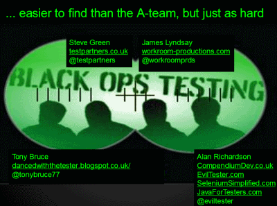

## Black Ops Testing - A Practical Testing Workshop

London Tester Gathering Workshops, October 2013. Presented by James Lyndsay, Steve Green, Alan Richardson, and Tony Bruce.

More details:

https://www.eviltester.com/conference/ltgw2013_blackops_conference/

This full-day workshop worked through a testing lifecycle using an open-source application: scouting, planning, attacking, tools, and automation. Practical exercises and debriefs encouraged participants to contribute their experience, while the four presenters discussed their different approaches and models.

The published conference account records this as the team's first workshop together and emphasises discussion of practical experience and the application of theory.

## Slides and Notes

- [Slides - Markdown, 47 slides](slides.md)
- [Slides - PDF](export/slides.pdf)
- [Participant-expectation speaker notes](speaker-notes.md)
- [Redmine automation demo code](https://github.com/eviltester/LTGBlackOps2013)

The deck covers Redmine, scouting, inventories, oracles, strategy and tactics, planning, tracking, reporting, tools, and automation. All 47 slides have been converted from the PowerPoint export to Markdown, preserving source text, nested lists, links, and artwork. Renders of slides 6 and 25 retain the direction arrow and strategy diagram alongside editable text.

The PDF was exported from Google Slides. The body text on page 20 was scaled slightly within its existing page size to make the final "Reasonable user expectation" bullet visible; it falls below the page edge in the original export. The other pages retain their original layout. The original download and Google Slides presentation were left unchanged.

Seven participant-expectation note paragraphs from slide 5 are retained separately. Six paragraphs of internal presenter coordination from other note pages are omitted. These are presentation notes, not a transcript.

## Published Closing Image

The closing image is copied unchanged from the published conference page's website source. Its tagline is "... easier to find than the A-team, but just as hard".

## Presenters

- [James Lyndsay](https://www.workroom-productions.com)
- [Steve Green](https://www.testpartners.co.uk/)
- [Alan Richardson](https://www.eviltester.com/)
- [Tony Bruce](https://twitter.com/tonybruce77)

## Archive Selection

The local archive contains a collaborative planning document, artwork variants, individual portrait sources, and Paint.NET files. The planning document includes proposed exercises, possible targets, scheduling, and presenter coordination; it has been omitted from this public release.

The complete deck was subsequently located on Google Slides and exported on 24 November 2026 for this archive. The original Google Slides presentation was left unchanged. The downloaded PowerPoint is a conversion source and is omitted from the GitHub release; the original local planning document, artwork variants, portrait components, and PDN files remain omitted. Only images referenced by the Markdown are included.
