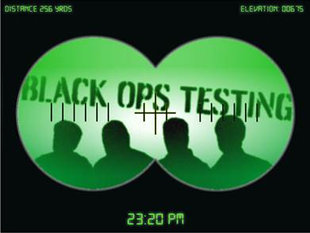
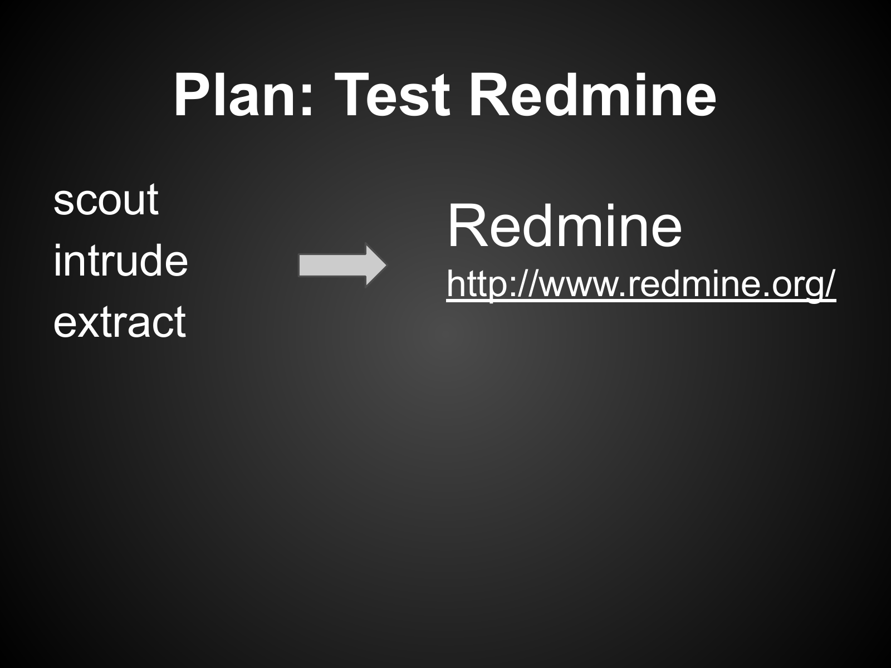
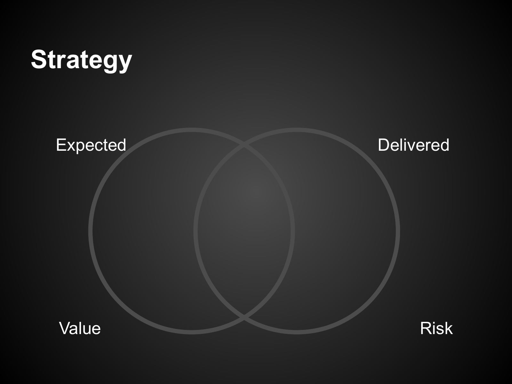

<!-- Slide 1 -->

# Black Ops Testing

@tonybruce77

[Source link: @tonybruce77](https://twitter.com/tonybruce77)

@eviltester

[Source link: @eviltester](https://twitter.com/eviltester)

@testpartners

[Source link: @testpartners](https://twitter.com/testpartners)

@workroomprds

[Source link: @workroomprds](https://twitter.com/workroomprds)

---

<!-- Slide 2 -->

# Black Ops Testing - Tagline

They're easier to find than the A-team, but just as hard

---

<!-- Slide 3 -->

# Introductions

---

<!-- Slide 4 -->

# Brief &amp; Overview of the Day

need for deeper and effective testing

get inside

investigate

see what is happening

report

give people a grounding they can build on

through practical learning

do and discuss

---

<!-- Slide 5 -->

# Expectations

---

<!-- Slide 6 -->

# Plan: Test Redmine

scout

intrude

extract

Redmine

<http://www.redmine.org/>

---

<!-- Slide 7 -->

# So if we asked you to test it? ...

You might choose an exploratory testing approach, but what does ‘exploratory testing’ mean to you?

---

<!-- Slide 8 -->

# One View Might Be...

Exploratory testing is an investigation to reveal information about the system.

We investigate what users and the system can do, not just what they should do. And what they cannot do.

Some verification and validation will occur but they are not the primary objective.

---

<!-- Slide 9 -->

# An Introduction to Redmine

- What is it?
- Why?
- Where is it hosted?
- Limitations
    - (i.e. what we don’t want you doing)

---

<!-- Slide 10 -->

# Scouting

---

<!-- Slide 11 -->

# Scouting/Inventory etc.

The context is:

- You have never seen it before.
- There is no design documentation.
- You cannot talk to the developers.
What else do you need to know in order to plan your approach to the testing?

---

<!-- Slide 12 -->

# You Might Want To Know...

- What is the objective of the testing?
- Is any domain knowledge needed?
- How long have I got?
- Who else is testing it?
- What testing has already been done? And can I trust it?
- What test artifacts are required?
- Is there anything I must not do?

---

<!-- Slide 13 -->

# Inventories and Oracles

Inventories - what is there to test?

Oracles - how do we know if it’s right?

What types of inventory can you think of?

---

<!-- Slide 14 -->

# Inventories Might Include

- Pages
- Subdomains and external websites
- Functions and features
- Technologies
- Input methods
- Output methods
- User levels
- User states
- System states
- Relevant test techniques or objectives

---

<!-- Slide 15 -->

# Some Input Methods

- Mouse
- Physical keyboard
- On-screen keyboard
- Touchscreen
- File import
- API
- Assistive technologies e.g. voice recognition software

---

<!-- Slide 16 -->

# Some Output Methods

- Screen
- Printer
- File export
- RSS feed
- Emails
- API
- Assistive technologies e.g. screen reader
- Mobile devices

---

<!-- Slide 17 -->

# Some Examples of States

- User
    - Anonymous
    - Registered (never visited)
    - Registered (first visit)
    - Registered (subsequent visits)
    - Registered user who has performed certain actions
- System
    - Clean install – no data in the system
    - Populated with data following normal use
    - Clean install followed by restoration of data from backup
    - Cookies edited or deleted

---

<!-- Slide 18 -->

# Some Examples of Test Techniques

- Race conditions
- URL editing
- Flash version detection
- CPU, memory and bandwidth utilisation
- Multiple concurrent browser sessions
- Stress tests
- Character set support
- Automation
    - What can we automate and get immediate ROI?
    - Should we automate anything to avoid input error?
    - What tests cannot be done manually?

---

<!-- Slide 19 -->

# Oracles

In the absence of design documentation, how can we tell if the system is doing what it is supposed to?

---

<!-- Slide 20 -->

# Possible Oracles Include...

- Help files and FAQ pages
- On-screen instructions
- Error messages
- Comments in source code
- Self-consistency
- The client’s related websites and competitors’ websites
- Previous versions of the website
- Relevant legislation or regulatory bodies
- Offline collateral (packaging, TV adverts, direct mail etc)
- Reasonable user expectation

---

<!-- Slide 21 -->

# Scouting in Practice

Spend 30 minutes scouting around the Redmine application, creating inventories and finding oracles.

During the scouting you may encounter bugs and behaviours you will never see again. What can you do about that?

---

<!-- Slide 22 -->

# Pause to aim

Where should we scout next?

What could we look at, that we’ve not looked at?

How else could we scout? Slightly differently? Very?

What do we have to ignore? What do we choose to?

---

<!-- Slide 23 -->

# Also Need to Consider...

- Modeling – how can we model the system to assist our test design?
- Test focus – what will and won’t get tested?
- Reporting – what, when and how?
- Management – how are we going to plan and track our test coverage? Ad-hoc? Loose structure? Session-based?

---

<!-- Slide 24 -->

# Testing

---

<!-- Slide 25 -->

# Strategy

Expected

Delivered

Value

Risk

---

<!-- Slide 26 -->

# Tactics

Triggering … … Observing

Constraints?

Attractors?

Enhancements?

---

<!-- Slide 27 -->

# ...Expand...

Doing

Planning

Tracking/Recording

Reporting

---

<!-- Slide 28 -->

# Analysing

---

<!-- Slide 29 -->

# Taking Stock, Reflecting, Re-Planning

how to analyse what you have done

---

<!-- Slide 30 -->

# Lunch

---

<!-- Slide 31 -->

# Debrief &amp; Tooling

---

<!-- Slide 32 -->

# What’s in your Bergen?

- Debrief
    - What tools have we used so far?
    - How else might we use them?
- Territory informs Approach
    - Based on what we know of the app, what other tools might we use?
- Map informs Strategy
    - Based on what else we know, what other tools might we use?
- Function informs Tactics
    - Given the tool functions, what else might we do.

---

<!-- Slide 33 -->

# Planning

Planning

---

<!-- Slide 34 -->

# I love it when a plan come together

- What was your plan?
    - At what point did you change?
- Was it important to have a plan?
    - Why?
    - Who is interested?
- How is it communicated?
    - Who looks at it?
- Plan or planning?

---

<!-- Slide 35 -->

# Tracking

Tracking

---

<!-- Slide 36 -->

# So hey! How’s your tracking?

- How?
    - Format
        - How else?
- Why are you tracking what you are tracking?
    - With hindsight, what else would you track?
    - How does either help?
    - Who is interested?
        - Why?
            - No what is the real reason?

---

<!-- Slide 37 -->

# Reporting

Reporting

---

<!-- Slide 38 -->

# What is in your reporting?

- Information
    - What kind of information would you report?
- How?
    - Format
        - How else?
- Who cares?
    - Would you report differently?
        - Do they care about the same thing?
- Why do they care?
    - Explicit
    - Implicit

---

<!-- Slide 39 -->

# Automation

---

<!-- Slide 40 -->

# So if we asked you to automate it?..

- Does it look Easy? Hard?
- Any Questions?
- Opinions?

---

<!-- Slide 41 -->

# Exercise: Spend some time evaluating Automation Options

- Any Gotchas?
- Any Quick Wins?
- Prerequisites?
- etc.
De-brief in 20 mins

---

<!-- Slide 42 -->

# Demo: Automation on RedMine

- Given:
    - “Automate to create test data”
    - Not much time (4 hrs max)
- Options: Considered...
    - API
    - Raw HTTP messages
    - GUI Automation via WebDriver
- Action:
    - Hack out some code using API
    - Blocked - Use GUI - Learn - Back to API
    - <https://github.com/eviltester/LTGBlackOps2013>
… Insert Code Demo Here ...

---

<!-- Slide 43 -->

# Automation Debrief

- Testing vs Checking
- Manual vs Automation
- RedMine Based Discussion

---

<!-- Slide 44 -->

# De-Brief

---

<!-- Slide 45 -->

# General Q&amp;A Free For All

- Questions?
- Opinions?
- etc.?

---

<!-- Slide 46 -->

# Terminated

---

<!-- Slide 47 -->

# ... easier to find than the A-team, but just as hard

Tony Bruce dancedwiththetester.blogspot.co.uk/

@tonybruce77

[Source link: dancedwiththetester.blogspot.co.uk/](http://dancedwiththetester.blogspot.co.uk/)

James Lyndsay

workroom-productions.com @workroomprds

[Source link: workroom-productions.com](http://workroom-productions.com)

Alan Richardson

CompendiumDev.co.uk

EvilTester.com

SeleniumSimplified.com

JavaForTesters.com

@eviltester

[Source link: CompendiumDev.co.uk](http://www.compendiumdev.co.uk/)

[Source link: EvilTester.com](http://eviltester.com/)

[Source link: SeleniumSimplified.com](http://seleniumsimplified.com/)

[Source link: JavaForTesters.com](http://javafortesters.com/)

Steve Green

testpartners.co.uk @testpartners

[Source link: testpartners.co.uk](http://www.testpartners.co.uk/)
