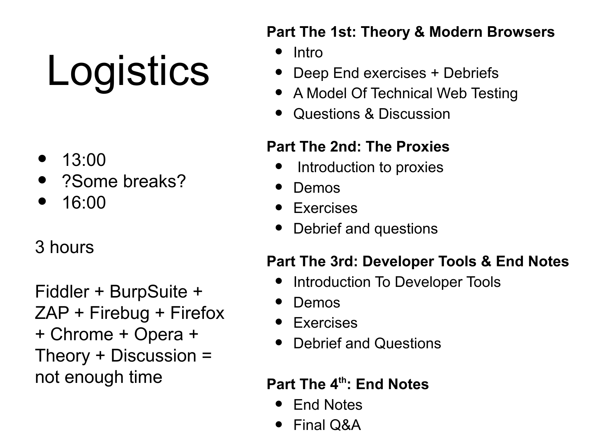
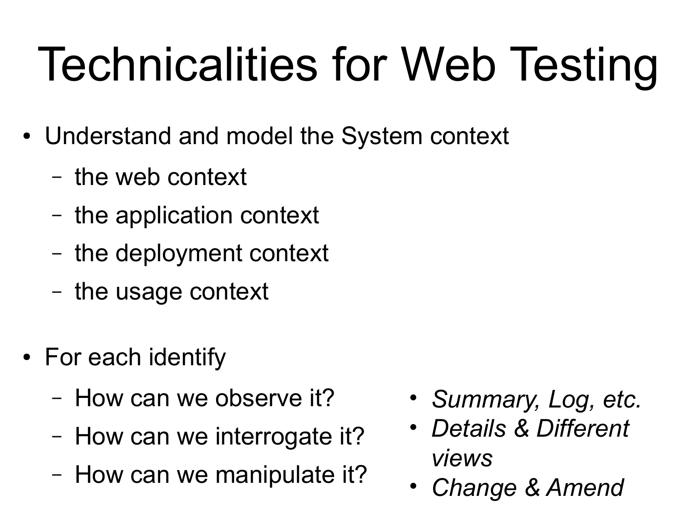
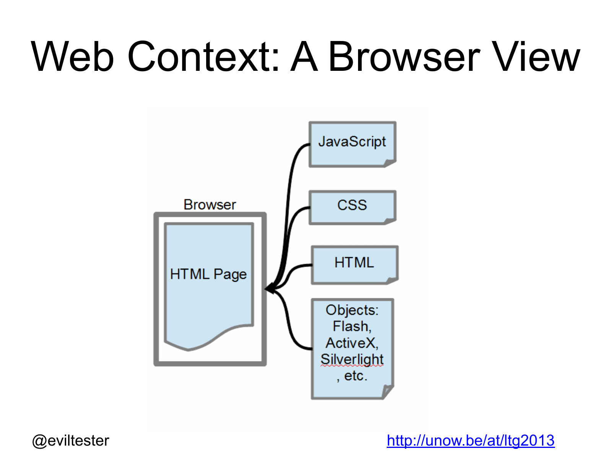
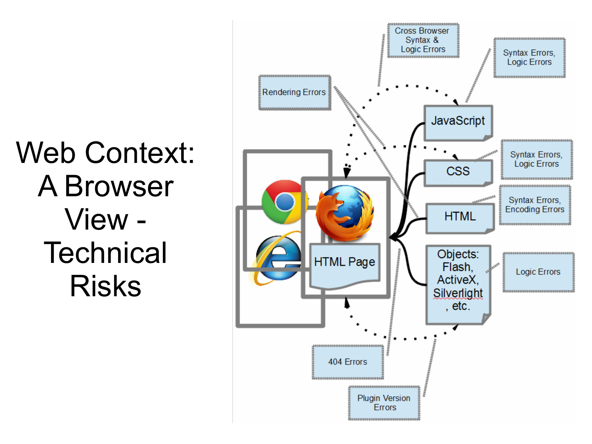
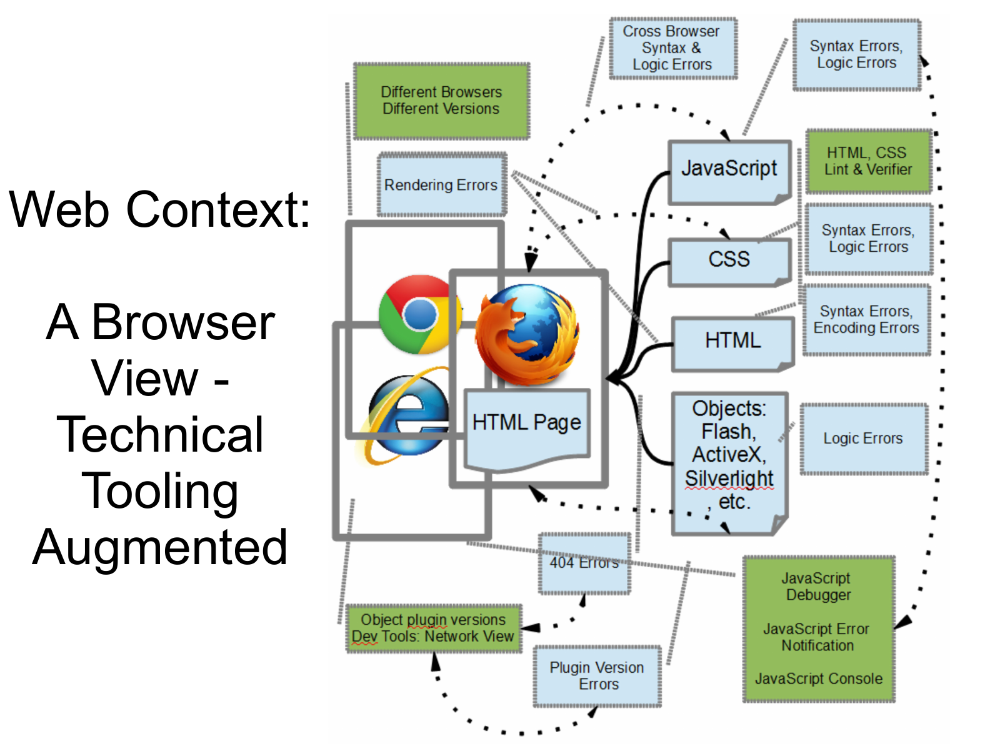
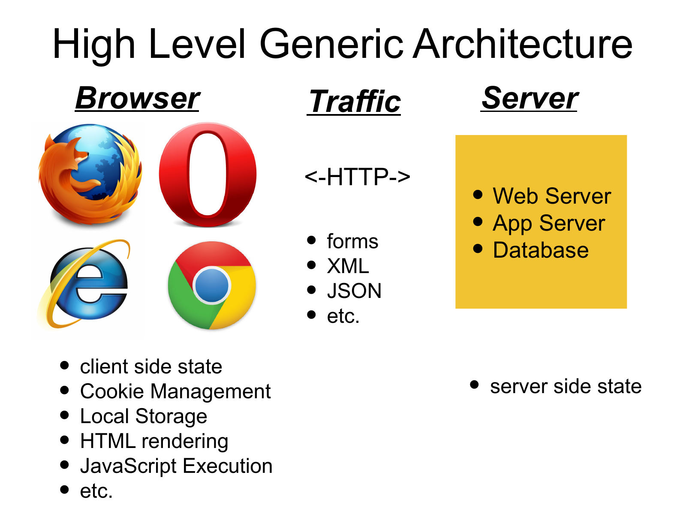
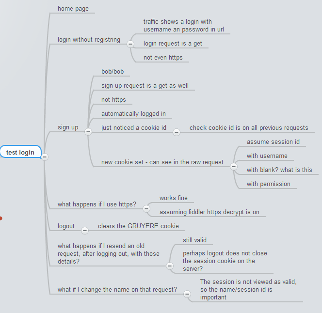
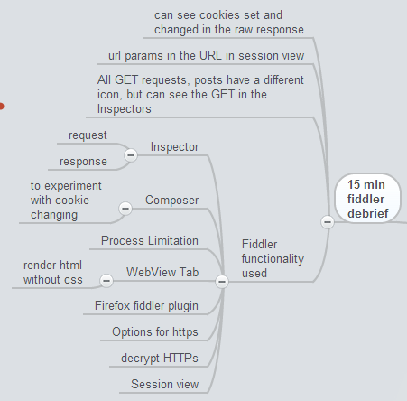
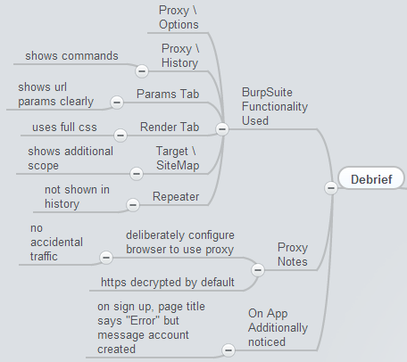
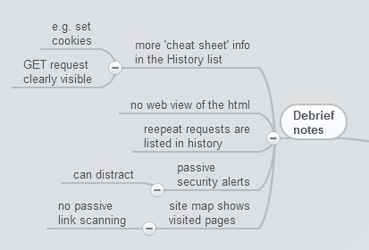

<!-- Original footer: @eviltester -->

<!-- Slide 1 -->

# The Evil Tester's Guide to HTTP Proxies and Developer Tools

The Evil Tester's Guide to HTTP Proxies And Developer Tools

London Tester Gathering 2013 Alan Richardson

@eviltester

---

<!-- Slide 2 -->

# Introductory Notes

@eviltester

---

<!-- Slide 3 -->

# Alan Richardson - Blogs, Books, and Courses

Blogs and Websites

- CompendiumDev.co.uk
- SeleniumSimplified.com
- EvilTester.com
- JavaForTesters.com
- Twitter: @eviltester

Online Training Courses

- Technical Web Testing 101
- Intro to Selenium
- Selenium 2 WebDriver API

Videos

youtube.com/user/EviltesterVideos

Books

Selenium Simplified

Java For Testers

leanpub.com/javaForTesters

Alan Richardson

uk.linkedin.com/in/eviltester

Independent Test Consultant

[Source link: CompendiumDev.co.uk](http://www.compendiumdev.co.uk/)

[Source link: SeleniumSimplified.com](http://www.seleniumsimplified.com/)

[Source link: EvilTester.com](http://www.eviltester.com/)

[Source link: JavaForTesters.com](http://JavaForTesters.com/)

[Source link: @eviltester](https://twitter.com/eviltester)

[Source link: youtube.com/user/EviltesterVideos](http://www.youtube.com/user/EviltesterVideos)

[Source link: leanpub.com/javaForTesters](http://leanpub.com/javaForTesters)

[Source link: uk.linkedin.com/in/eviltester](http://uk.linkedin.com/in/eviltester)

---

<!-- Slide 4 -->

# Logistics

- 13:00
- ?Some breaks?
- 16:00

3 hours

Fiddler + BurpSuite + ZAP + Firebug + Firefox + Chrome + Opera + Theory + Discussion = not enough time

Part The 1st: Theory &amp; Modern Browsers

- Intro
- Deep End exercises + Debriefs
- A Model Of Technical Web Testing
- Questions &amp; Discussion

Part The 2nd: The Proxies

- Introduction to proxies
- Demos
- Exercises
- Debrief and questions

Part The 3rd: Developer Tools &amp; End Notes

- Introduction To Developer Tools
- Demos
- Exercises
- Debrief and Questions

Part The 4th: End Notes

- End Notes
- Final Q&amp;A

---

<!-- Slide 5 -->

# Blurb: The Evil Tester's guide - HTTP proxies and Browser Developer Tools

I test a lot of web applications. I use proxy servers to interrogate and manipulate web traffic, and the built in browser developer tools.

We will cover and go beyond the obvious interrogation and manipulation of traffic and also look at how to use auto-responders, custom rules and traffic generators. The different capabilities of the tools and how to use them in combination.

We will also look at the new features in modern browsers that help you achieve some of the proxy benefits out of the box, for those moments when you have to test unarmed.

As well as the tools I want to cover the testing thought processes and models that help you apply the tools in your work.

Turn up with some modern browsers installed (Chrome, Firefox, Opera), a couple of proxy servers (BurpSuite, Fiddler, Zed Attack Proxy), possibly some plugins (Firebug), to maximize your time in the workshop.

@eviltester

---

<!-- Slide 6 -->

# Who's Done What?

- Used Proxies?
    - BurpSuite? Fiddler? ZAP?
    - BrowserMobProxy?
    - What else?
- Used Plugins?
    - Firebug? Cookie Management – various? What else?
- Used Browser Dev Tools?
    - Chrome? Firefox? Opera? What else?

@eviltester

---

<!-- Slide 7 -->

# MORIM - A reminder to keep going deeper

MORIM - Model through Observation, Reflection, Interrogation and Manipulation

- Model == what I think I currently understand
- Observations can corroborate or invalidate my model
- Reflect to find gaps and lack of depth and derive intent
- Interrogate - focused observation with intent
- Manipulation - hypothesis exploration

@eviltester

---

<!-- Slide 8 -->

# It means "Tool Augmentation"

Tools to...

- passively observe, maintain history of observations
- alert on specific conditions
- observe the unobserved, and interrogate the inaccessible
- help me model and reflect
- help me manipulate
- ... etc.

Never tools to control.

Always Tools to augment.

@eviltester

---

<!-- Slide 9 -->

# Exercise: Welcome to the Deep End

- <http://google-gruyere.appspot.com/start>
- Use Whatever combination of tools you want
- Test Login however you want
    - (interpret this however you want)
    - For 15 mins max

Then we will debrief

@eviltester

---

<!-- Slide 10 -->

# Debrief Notes

- Observe? Manipulate? Traffic?
- Only Out of the box?
- Dev Tools?
- Proxies? What do they add?
- Plugins? Why?
- XPath? CSS Selectors?

@eviltester

---

<!-- Slide 11 -->

# 5 Min Exercise

- Take on board what you learned in the debriefs for the tool you used
- Learn to observe the things you didn't observe before
- Find them in the tool you used

@eviltester

---

<!-- Slide 12 -->

# Alan Richardson - Blogs, Books, and Courses

Technical Web Testing: A Model

@eviltester

---

<!-- Slide 13 -->

# The MORIM Loop - Model

- Model
    - Build a layered model of the application functionality, flows, technology usage, etc.

- Observe
- Reflect
- Interrogate
- Manipulate

@eviltester

---

<!-- Slide 14 -->

# The MORIM Loop - Observe

- Model
- Observe
    - At every layer, what can you see?
    - Can you increase the depth of observation.
    - Do you understand what you see?
    - What else could you observe?
- Reflect
- Interrogate
- Manipulate

@eviltester

---

<!-- Slide 15 -->

# The MORIM Loop - Reflect

- Model
- Observe
- Reflect
    - Expand the model,
    - Intent - for deliberate action
    - Analyse the observations
    - What does that imply?
    - How? Risks? What else? When?
- Interrogate
- Manipulate

@eviltester

---

<!-- Slide 16 -->

# The MORIM Loop - Interrogate

- Model
- Observe
- Reflect
- Interrogate
    - Deep dive into observed data
    - Breakpoint
    - Correlate data changes with state
    - etc.
- Manipulate

@eviltester

---

<!-- Slide 17 -->

# The MORIM Loop - Manipulate

- Model
- Observe
- Reflect
- Interrogate
- Manipulate
    - Edit the data
    - Change the state
    - Edit the communication
    - Change the environment context e.g. speed, memory, etc.

---

<!-- Slide 18 -->

# During all the exercises; Consider:

Observation

- What are you observing. What are you not observing. What do you want to observe? Why?

Interrogation

- What do you want to see in more detail? How can you do that? Why?

Manipulation

- What do you want to amend? How could you? Why?

@eviltester

---

<!-- Slide 19 -->

# Alan Richardson - Blogs, Books, and Courses

Our Basic Web Technology Knowledge

@eviltester

---

<!-- Slide 20 -->

# Technicalities for Web Testing

- Understand and model the System context
    - the web context
    - the application context
    - the deployment context
    - the usage context

- For each identify
    - How can we observe it?
    - How can we interrogate it?
    - How can we manipulate it?

- Summary, Log, etc.
- Details &amp; Different views
- Change &amp; Amend

---

<!-- Slide 21 -->

# Web Context: A Browser View

@eviltester

---

<!-- Slide 22 -->

# Web Context: A Browser View - Technical Risks

---

<!-- Slide 23 -->

# Web Context: A Browser View - Technical Tooling Augmented

---

<!-- Slide 24 -->

# High Level Generic Architecture

&lt;-HTTP-&gt;

- Web Server
- App Server
- Database

- server side state

- client side state
- Cookie Management
- Local Storage
- HTML rendering
- JavaScript Execution
- etc.

- forms
- XML
- JSON
- etc.

Browser

Server

Traffic

---

<!-- Slide 25 -->

# Model suggests... Tool suggests...

We can work from model to tool...

We can also work from tool function to model.

@eviltester

---

<!-- Slide 26 -->

# Alan Richardson - Blogs, Books, and Courses

The Proxies

@eviltester

---

<!-- Slide 27 -->

# Generic Testing Requirements

Traffic {Request, Response} CRUD

- Create - Generate new requests
- Read - Observe Traffic
    - Requests
    - Responses
- Update
    - Manipulate Requests &amp; Responses
        - Manually
        - Automatically
    - Replay Requests
- Delete - block requests or responses

@eviltester

---

<!-- Slide 28 -->

# Proxies

- BurpSuite
    - <http://portswigger.net/burp/download.html>
- Fiddler
    - <http://fiddler2.com/>
- OWASP ZAP Proxy
    - <https://www.owasp.org/index.php/OWASP_Zed_Attack_Proxy_Project>
- For Embedding – BrowserMobProxy
    - <http://bmp.lightbody.net/>

@eviltester

---

<!-- Slide 29 -->

# Configure Browser To Use Proxy

- Chrome, IE all use the System Internet Settings
    - Chrome Incognito and normal mode share proxy settings
- Firefox and Opera can maintain proxy settings independently of system settings

@eviltester

---

<!-- Slide 30 -->

# BurpSuite Basics

- Java – Embedded Tab GUI
- Proxy\\Options - Configure Browser
- Intercept – can have complicated rules
- Observe with History
    - Request and Response Tabs
- Repeater to replay and manipulate
- Site Map – visited and not yet covered
- Spider
- Intruder - variety of params for fuzzing

@eviltester

---

<!-- Slide 31 -->

# Fiddler Basics

- Windows Only
- Automatically hooks into Windows System Proxy
    - IE &amp; Chrome use by default without configuration
- www.fiddler2.com/fiddler2/extensions.asp e.g. passive security scanning
- HTTPS decryption off by default
    - Tools \\ Fiddler Options - HTTPS tab - Decrypt HTTPS traffic
- Auto Responders
- Scripting Rules – multiple breakpoints via scripts

@eviltester

[Source link: www.fiddler2.com/fiddler2/extensions.asp](http://www.fiddler2.com/fiddler2/extensions.asp)

---

<!-- Slide 32 -->

# ZAP Basics

- Java
- Lots of Options
- Easy Single param fuzzer
- Embedded Scripting
- Multiple Breakpoint rules via GUI
- Site Map for visit
- Passive Security Scanning
- Spiders
- Message Diff

---

<!-- Slide 33 -->

# Test Login With a Proxy

- Using a Debug Proxy
- 'Test' the Gruyere Login process
- 15 – 20 mins
- Make notes about what you find and how you use the proxy so we can debrief

---

<!-- Slide 34 -->

# Debrief

---

<!-- Slide 35 -->

# Proxy Demos based on Login Exercise Debriefs

@eviltester

---

<!-- Slide 36 -->

# My Login Test Debrief Notes

- I used Firefox because the proxy settings don't impact the rest of the machine
- Firefox also has Fiddler Addon
- Started with Fiddler
- Basic Scope
    - Install, Start, Config Browser with Proxy
    - Start App, Home, Login Without Registering, SignUp, Try HTTPs, Logout, check session closed on logout

@eviltester

---

<!-- Slide 37 -->

# Scope

---

<!-- Slide 38 -->

# Fiddler Debrief

---

<!-- Slide 39 -->

# BurpSuite Debrief

---

<!-- Slide 40 -->

# ZAP Debrief

---

<!-- Slide 41 -->

# Exercise: Repeat Login in a different tool

- Take on board what you learned in the debriefs
- Try again with a different tool
- Max 10 mins

@eviltester

---

<!-- Slide 42 -->

# Basic Exercises

- Observe Traffic and explore the app
- Manipulate Traffic
    - Zap:BreakPoints. Burp:Intercept. Fiddler: Rules\\Breakpoint
    - after it leaves the browser and before it reaches the server
    - after it reaches the server but before it reaches the browser
        - In fiddler try auto responders, e.g. replace the css
- Repeat Requests out of context

@eviltester

---

<!-- Slide 43 -->

# Advanced Exercise Ideas

- Explore ZAP's
    - Spiders
    - Fuzzer
- Explore Fiddler's
    - AutoResponder
    - Statistics &amp; TimeLine
- BurpSuite
    - Spider
    - Intruder (fuzzer)

- Chain Proxies
- Use The Decode/Encode Tools
- Experiment with additional funtionality of the tool

---

<!-- Slide 44 -->

# Debrief &amp; Q&amp;A

@eviltester

---

<!-- Slide 45 -->

# Alan Richardson - Blogs, Books, and Courses

The Developer Tools

@eviltester

---

<!-- Slide 46 -->

# Developer != Developer

- Tools are now available to every user
- No longer “A User would never do that”, now you don't know who will do what
- Even IE has good 'developer' tools

@eviltester

---

<!-- Slide 47 -->

# What to expect?

- View/Edit Dom - {CRUD}
- View Network Traffic - {R}
- Applied CSS
- Debug JavaScript
- JavaScript Console
- Profilers

@eviltester

---

<!-- Slide 48 -->

# How to Access

- IE 10, Chrome, Firefox, – Press F12
- Opera – Cntrl + Shift + I
- Or right click and “Inspect Element”

@eviltester

---

<!-- Slide 49 -->

# Points of Note

- Opera allows full CRUD of cookies
- Firefox – I still prefer Firebug addon
- Chrome Overrides
    - user-agent, geo and emulate device form factors

@eviltester

---

<!-- Slide 50 -->

# Exercises

- Repeat Login exercise with just the browser tools
- Amend the Dom prior to submitting a form to bypass any gui validation or edit read only fields
- Use Chrome tools to emulate a mobile device and navigate to sites with mobile versions e.g. bbc.co.uk
- Amend attributes on elements e.g. “style=display:none”

---

<!-- Slide 51 -->

# Debrief &amp; Q&amp;A

@eviltester

---

<!-- Slide 52 -->

# Alan Richardson - Blogs, Books, and Courses

End Notes

@eviltester

---

<!-- Slide 53 -->

# Is this just Security Testing?

@eviltester

---

<!-- Slide 54 -->

# Observation &amp; Manipulation

- Comments on what you observed?
    - What didn't you observe?
    - What did you want to observe?
    - What could you not observe?
- Comments on Manipulation?
    - What did you manipulate?
    - What did you want to manipulate?
    - What could you not manipulate?

@eviltester

---

<!-- Slide 55 -->

# What makes a difference?

You can manipulate a whole bunch of things, why would you want to manipulate the:

- Header?
- Body?
- Request URI?
- Params?
- Payload?

@eviltester

---

<!-- Slide 56 -->

# Inspiration from Form

What can this tool do? == New test ideas!

e.g.

- what does the autoresponder feature let me do?
- What could I use the save as HAR file for?
- etc.

@eviltester

---

<!-- Slide 57 -->

# Theory Summary

- Technical Testing works with multiple models of the System
- Model for:
    - Understanding
    - Risk
    - Test Ideas
    - Tooling ideas
- Tool Augmentation
    - Observe
    - Interrogate
    - Manipulate

---

<!-- Slide 58 -->

# Recommended Reading

- The Web Application Hacker's Handbook
    - by Stuttard &amp; Pinto
- Debugging with Fiddler
    - by Eric Lawrence

@eviltester

---

<!-- Slide 59 -->

# Alan Richardson - Blogs, Books, and Courses

Blogs and Websites

- CompendiumDev.co.uk
- SeleniumSimplified.com
- EvilTester.com
- JavaForTesters.com
- Twitter: @eviltester

Online Training Courses

- Technical Web Testing 101
- Intro to Selenium
- Selenium 2 WebDriver API

Videos

youtube.com/user/EviltesterVideos

Books

Selenium Simplified

Java For Testers

leanpub.com/javaForTesters

Alan Richardson

uk.linkedin.com/in/eviltester

Independent Test Consultant

Contact Alan for training and consultancy tailored to your needs: http://compendiumdev.co.uk/contact

[Source link: CompendiumDev.co.uk](http://www.compendiumdev.co.uk/)

[Source link: SeleniumSimplified.com](http://www.seleniumsimplified.com/)

[Source link: EvilTester.com](http://www.eviltester.com/)

[Source link: JavaForTesters.com](http://JavaForTesters.com/)

[Source link: @eviltester](https://twitter.com/eviltester)

[Source link: youtube.com/user/EviltesterVideos](http://www.youtube.com/user/EviltesterVideos)

[Source link: leanpub.com/javaForTesters](http://leanpub.com/javaForTesters)

[Source link: uk.linkedin.com/in/eviltester](http://uk.linkedin.com/in/eviltester)
