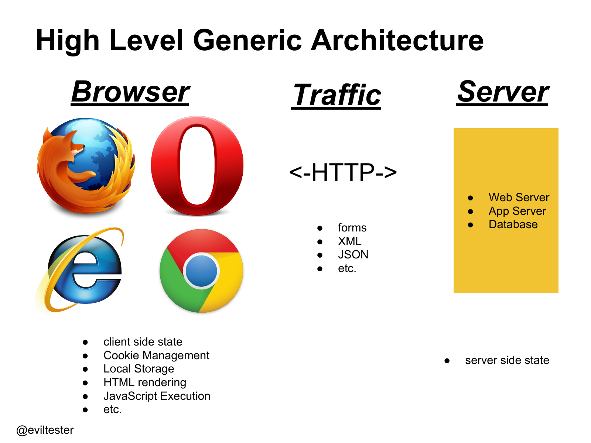
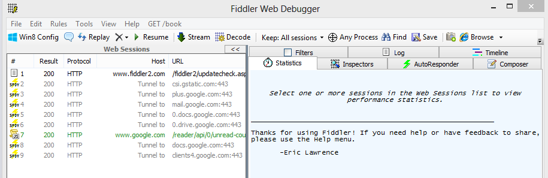
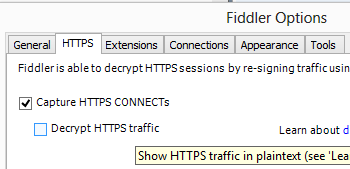

<!-- Original footer: @eviltester -->

<!-- Slide 1 -->

# The Evil Tester's Tool Overview of HTTP Proxies

A Tutorial Support Reference Guide

Alan Richardson

@eviltester

www.eviltester.com

www.compendiumdev.co.uk

www.seleniumsimplified.com

@eviltester

---

<!-- Slide 2 -->

# The MORIM Loop

- Model
- Observe
- Reflect
- Interrogate
- Manipulate

@eviltester

---

<!-- Slide 3 -->

# High Level Generic Architecture

&lt;-HTTP-&gt;

- Web Server
- App Server
- Database

- server side state

- client side state
- Cookie Management
- Local Storage
- HTML rendering
- JavaScript Execution
- etc.

- forms
- XML
- JSON
- etc.

Browser

Server

Traffic

@eviltester

---

<!-- Slide 4 -->

# Introduction to Modern Browsers

@eviltester

---

<!-- Slide 5 -->

# Modern Browsers

- Dev Tools
- Observe Network Traffic
- Interrogate &amp; Manipulate
    - DOM
    - Data - cookies, local storage
- Differing capabilities between browsers
"Don't get hung up on 'I need to test on BrowserX' - use them all, even while you focus on BrowserX"

@eviltester

---

<!-- Slide 6 -->

# Augment Browsers With Plugins and Addons

- Out of the box experience continually improves
- Use browser plugins to increase the functionality of the browser even further

@eviltester

---

<!-- Slide 7 -->

# Gruyere - Cloud app to test against

A Google App Engine hosted application to learn security testing for common vulnerabilities.

Read the Instructions

- <http://google-gruyere.appspot.com/>
Create a new instance

- <http://google-gruyere.appspot.com/start>

@eviltester

---

<!-- Slide 8 -->

# Introduction to Proxies

@eviltester slides: http://unow.be/at/gtn\_tute

[Source link: http://unow.be/at/gtn_tute](http://unow.be/at/gtn_tute)

---

<!-- Slide 9 -->

# What is an HTTP Proxy?

- Sits between browser and server
- route all requests through the proxy
Browser -&gt; Request -&gt; Proxy -&gt; Server

Browser &lt;- Proxy &lt;- Response &lt;- Server

Https handled by 'man in the middle' certificate use.

@eviltester

---

<!-- Slide 10 -->

# Proxies and their capabilities

@eviltester

---

<!-- Slide 11 -->

# Generic Testing Requirements

Traffic {Request, Response} CRUD

- Create - Generate new requests
- Read - Observe Traffic
    - Requests
    - Responses
- Update -
    - Manipulate Requests &amp; Responses
        - Manually
        - Automatically
    - Replay Requests
- Delete - block requests or responses

@eviltester

---

<!-- Slide 12 -->

# Configure Browser to use a Proxy

---

<!-- Slide 13 -->

# Configure Browser to use a Proxy

- Chrome, IE all use the System Internet Settings
- Firefox and Opera can maintain proxy settings independently of system settings

---

<!-- Slide 14 -->

# Configure Chrome to use a Proxy

- Chrome\\Settings search for proxy
- Use the normal system proxy settings
- Chrome Incognito and normal mode share proxy settings

---

<!-- Slide 15 -->

# Configure Firefox to use a Proxy

- Firefox\\Options
    - Advanced\\Network
        - Connection [Settings...]
        - Manual proxy configuration:
        - use value listed in Proxy\\Options Listeners
        - ignore the "No Proxy For"
- If you already configured IE or Chrome then you could use System Proxy Settings

---

<!-- Slide 16 -->

# Configure Opera to use a Proxy

- Settings\\Preferences
    - Advanced\\Network
    - [Proxy Servers...]
    - use config from Proxy\\Options
- F12 can quickly toggle proxy on off once configured

---

<!-- Slide 17 -->

# Configure IE to use a Proxy

- Config \\ options
    - Connections
        - Lan settings
            - Use Proxy Server
                - use details from Proxy\\Options

---

<!-- Slide 18 -->

# You may be asked about proxy certificate (BurpSuite portswigger)

- Adhoc - Add it as an exception
- To remove exception
    - Firefox
        - Options\\Advanced\\Encryption
        - view certificates
            - servers (PortSwigger)
    - Chrome
        - Settings \\ search for manage certificates
    - Opera
        - Preferences
            - Advanced\\Security
            - Manage Certificates...
    - IE
        - Config \\ Internet Options \\ Content [Certificates]

---

<!-- Slide 19 -->

# BurpSuite

@eviltester

---

<!-- Slide 20 -->

# What is BurpSuite?

- Java based Proxy
- Professional and Free License
    - Pro designed for security professionals
    - Free version usually good enough for testing
- Book: "The Web Application Hacker's Handbook"
- <http://portswigger.net/burp/download.html>

@eviltester

---

<!-- Slide 21 -->

# Basic Features For Testing

- Proxy
- Spider
- Repeater
- Sequencer
- Decoder
- Comparer

@eviltester

---

<!-- Slide 22 -->

# How to Install &amp; Run

- Download the .jar file
    - <http://portswigger.net/burp/download.html>
- Double click or "java -jar burpsuite\_free\_vx.x.jar"
    - where x.x is the version you downloaded

@eviltester

---

<!-- Slide 23 -->

# BurpSuite Basics

- Tabbed GUI
- Proxy\\Options
- Configure Browser
- Intercept
- Obeserve with History Tab
- Repeater to replay and manipulate
- Site Map
- Spider
- Decoder
- Intruder - variety of params

@eviltester

---

<!-- Slide 24 -->

# Fiddler

@eviltester

---

<!-- Slide 25 -->

# What is Fiddler?

- .net based (v2 &amp; v4)
- <http://www.fiddler2.com/>
- now owned by Teleric

@eviltester

---

<!-- Slide 26 -->

# Obvious Differences

- Automatically hooks into Windows System Proxy
    - IE &amp; Chrome use by default without configuration
    - This makes it good for beginners
- HTTPS decryption off by default
    - Tools \\ Fiddler Options
        - HTTPS tab
            - Decrypt HTTPS traffic

@eviltester

---

<!-- Slide 27 -->

# Fiddler Extensions

- www.fiddler2.com/fiddler2/extensions.asp
    - Formatters
    - Windows 8 "Metro"
    - Android &amp; iOS Certificate maker
    - Request Differ
    - SAZ Clipboard Util
    - Geo spoofing
    - Rules Editor
    - Privacy Scanner
    - Performance Tester Helper
    - Stress Testing
    - Security Testing - Watcher &amp; Ammonite &amp; X5s
    - Fuzzing - intruder21
    - etc.

@eviltester

---

<!-- Slide 28 -->

# Fiddler Basics

- Firefox Hook "Tools \\ Monitor with Fiddler"
- WebSessions Pane - History
- Statistics Tab
- Inspectors Tab
- AutoResponder Tab
- Composer Tab
- Filters Tab
- Timeline Tab
- Config Options
- Decode with TextWizard
- Replay
- Export Sessions

---

<!-- Slide 29 -->

# Recommended For Self Study

@eviltester

---

<!-- Slide 30 -->

# Videos &amp; Courses

- Evil Tester Videos on Burp on Youtube
    - www.youtube.com/watch?v=ft5MSmf42Kw
    - www.youtube.com/watch?v=JmAk1OVwp-4
- ZAP
    - www.youtube.com/watch?v=QG2RCZHMEkM
    - www.youtube.com/user/psiinon?feature=watch
- Technical Web Testing 101
    - www.udemy.com/technical-web-testing-101
    - Free Udemy Course

[Source link: www.youtube.com/watch?v=ft5MSmf42Kw](http://www.youtube.com/watch?v=ft5MSmf42Kw)

[Source link: www.youtube.com/watch?v=JmAk1OVwp-4](http://www.youtube.com/watch?v=JmAk1OVwp-4)

[Source link: www.youtube.com/watch?v=QG2RCZHMEkM](http://www.youtube.com/watch?v=QG2RCZHMEkM)

[Source link: www.youtube.com/user/psiinon?feature=watch](http://www.youtube.com/user/psiinon?feature=watch)

---

<!-- Slide 31 -->

# Books

- The Web Application Hacker's Handbook
    - www.amazon.com/exec/obidos/ASIN/1118026470
    - www.amazon.co.uk/exec/obidos/ASIN/1118026470
- Debugging with Fiddler by Eric Lawrence
    - www.amazon.com/exec/obidos/ASIN/1475024487
    - www.amazon.co.uk/exec/obidos/ASIN/1475024487

[Source link: www.amazon.com/exec/obidos/ASIN/1118026470](http://www.amazon.com/exec/obidos/ASIN/1118026470/compendiumdev-20)

[Source link: www.amazon.co.uk/exec/obidos/ASIN/1118026470](http://www.amazon.co.uk/exec/obidos/ASIN/1118026470/compendiumdev-21)

[Source link: www.amazon.com/exec/obidos/ASIN/1475024487](http://www.amazon.com/exec/obidos/ASIN/1475024487/compendiumdev-20)

[Source link: www.amazon.co.uk/exec/obidos/ASIN/1475024487](http://www.amazon.co.uk/exec/obidos/ASIN/1475024487/compendiumdev-21)

---

<!-- Slide 32 -->

# Proxies

- BurpSuite
    - <http://www.portswigger.net/burp/>
- Fiddler
    - <http://www.fiddler2.com/fiddler2/>
- zaproxy (Zed Attack Proxy)
    - <http://code.google.com/p/zaproxy/>
- <https://twitter.com/zaproxy>

---

<!-- Slide 33 -->

# Apps to test against

- <http://google-gruyere.appspot.com/part1>
    - <http://google-gruyere.appspot.com/start>
- <https://hack.me/>
- <http://demo.testfire.net/>
- WebGoat
    - <http://code.google.com/p/webgoat/>
- Lists of Apps to Test Against
    - <http://blog.taddong.com/2011/10/hacking-vulnerable-web-applications.html>

---

<!-- Slide 34 -->

# Alan Richardson - Blogs, Books, and Courses

Alan Richardson

uk.linkedin.com/in/eviltester

Independent Test Consultant based in the UK. He offers training and consultancy in Selenium WebDriver, Exploratory and Technical web testing.

[Source link: uk.linkedin.com/in/eviltester](http://uk.linkedin.com/in/eviltester)

Contact Alan for training and

consultancy tailored to your needs: http://compendiumdev.co.uk/contact

Blogs and Websites

- CompendiumDev.co.uk
- SeleniumSimplified.com
- EvilTester.com
- JavaForTesters.com
- Twitter: @eviltester

[Source link: SeleniumSimplified.com](http://SeleniumSimplified.com)

[Source link: EvilTester.com](http://eviltester.com)

[Source link: JavaForTesters.com](http://javafortesters.com/)

[Source link: @eviltester](https://twitter.com/eviltester)

Online Training Courses

- Technical Web Testing 101
    - Unow.be/at/udemy101
- Intro to Selenium
    - Unow.be/at/udemystart
- Selenium 2 WebDriver API
    - Unow.be/at/udemyapi
Videos

youtube.com/user/EviltesterVideos

Books

Selenium Simplified

Unow.be/rc/selsimp

Java For Testers

leanpub.com/javaForTesters

[Source link: Unow.be/at/udemy101](http://unow.be/at/udemy101)

[Source link: Unow.be/at/udemystart](http://unow.be/at/udemystart)

[Source link: Unow.be/at/udemyapi](http://unow.be/at/udemyapi)

[Source link: youtube.com/user/EviltesterVideos](http://youtube.com/user/EviltesterVideos)

[Source link: Unow.be/rc/selsimp](http://unow.be/rc/selsimp)

[Source link: leanpub.com/javaForTesters](https://leanpub.com/javaForTesters)

