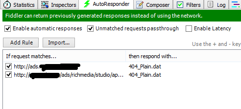
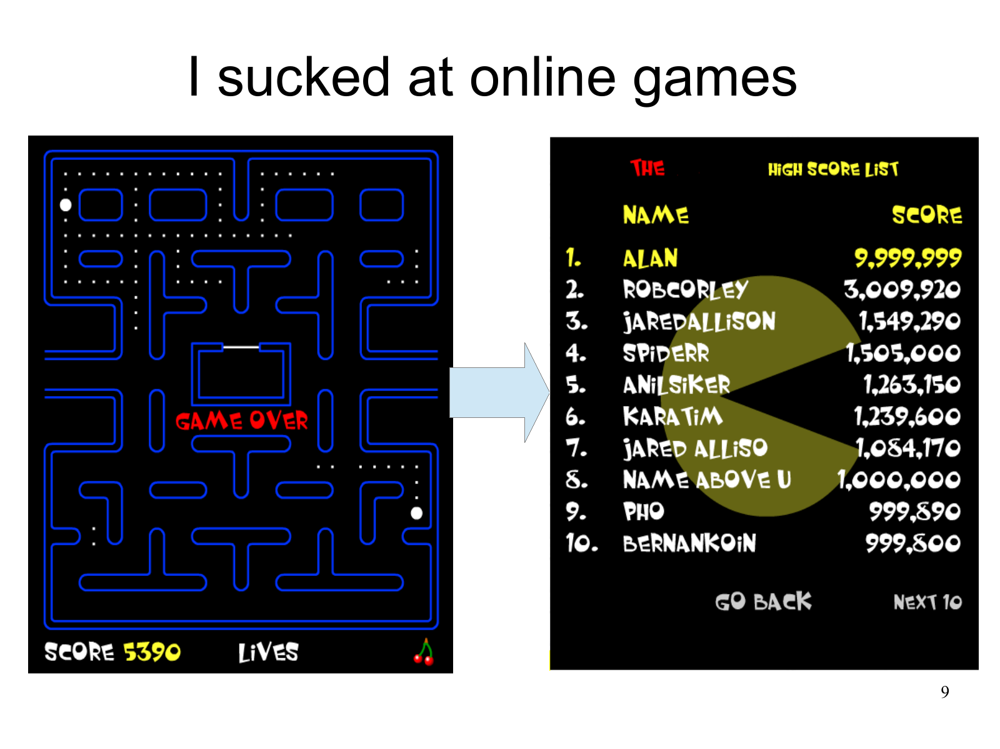
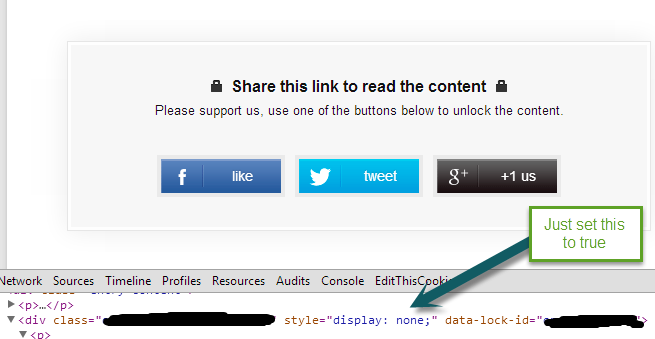
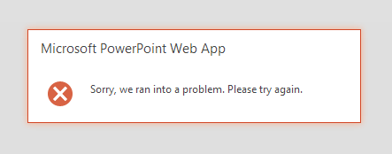
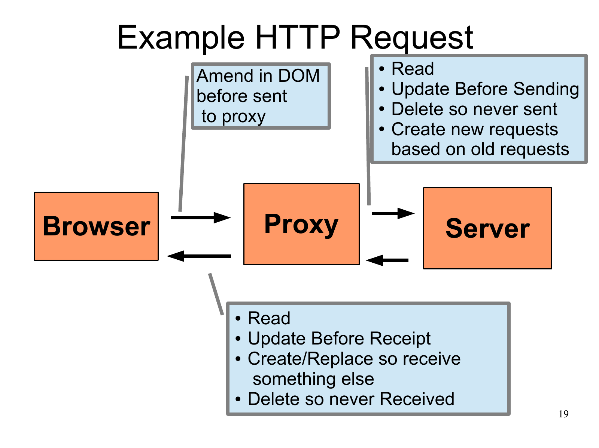
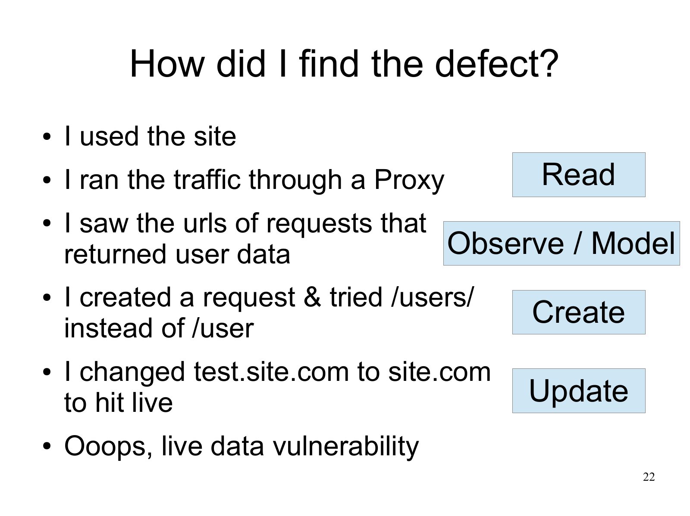
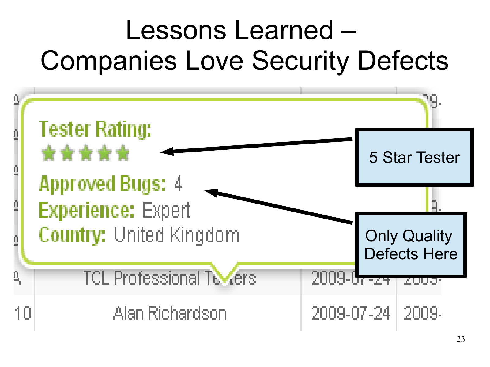
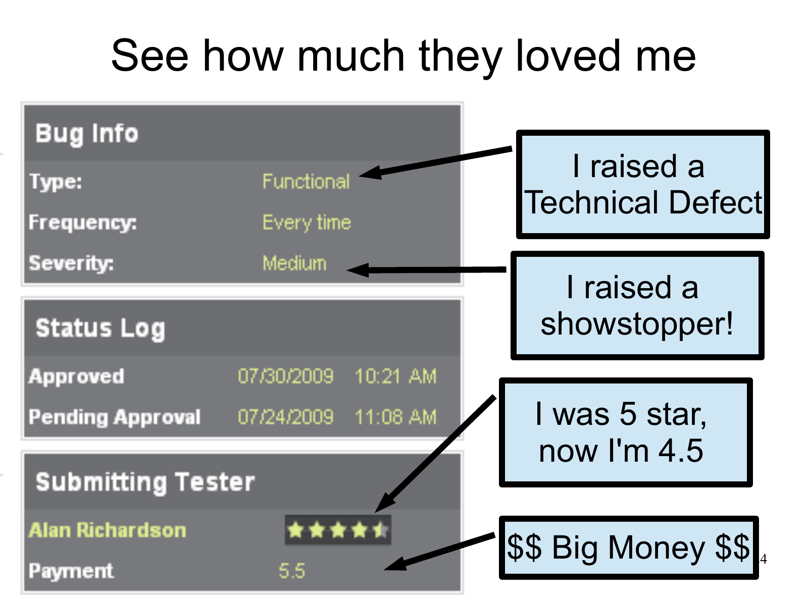

<!-- footer: @EvilTester -->

<!-- Slide 1 -->

# Confessions of an Accidental Security Tester

Alan Richardson

@eviltester

www.SeleniumSimplified.com

www.EvilTester.com

www.CompendiumDev.co.uk

www.JavaForTesters.com

"I didn't break in, you left the door open"

---

<!-- Slide 2 -->

# WARNING

I AM NOT A SECURITY TESTER

---

<!-- Slide 3 -->

# “I am not a security tester”

- I am a user that observes the system at a lower level of detail than many users
- I think about what I observe
- Based on my observations I then ask the system 'what if?' questions

---

<!-- Slide 4 -->

# “Accidentally Stumble”

I prefer to get paid for finding defects

But...

- I use the web for business
- My personal details are submitted to web sites
- I like to make sure I'm safe
- I 'accidentally stumble' across security defects

---

<!-- Slide 5 -->

# “By adopting my 'Bad' habits, you can Accidentally Stumble across Security Defects too”

---

<!-- Slide 6 -->

# How I 'Accidentally Stumble'

- I use browser dev tools in my normal day to day web surfing:
    - Firebug, Chrome Developer Tools
- I often have all my web traffic running through a debug proxy:
    - Fiddler, BurpSuite, ZAP
- I inspect Web Forms before I submit them

This is normal behaviour for me.

---

<!-- Slide 7 -->

# “I developed these 'bad' habits out of necessity”

---

<!-- Slide 8 -->

# I wanted to skip the online TV ads

---

<!-- Slide 9 -->

# I sucked at online games

---

<!-- Slide 10 -->

# Reading 'unreadable content'

---

<!-- Slide 11 -->

# Bypassing Bugs and annoyances on WebSites

- Div based overlays that stop me doing what I need to
- Buttons not enabled when they should be
- Incorrect JavaScript validation that marks invalid my valid details
- Etc.

---

<!-- Slide 12 -->

# “It wasn't me Guv, THEY made me do it”

---

<!-- Slide 13 -->

# “Other normal people will develop these habits as well”

---

<!-- Slide 14 -->

# It won't just be me doing this

- Browser Dev Tools are now installed by default
- Everyone has access to lower level observation and manipulation features
- “No user would ever do that” is no longer valid
- Some users are kids.
    - Kids love doing this

---

<!-- Slide 15 -->

# “I'm not a security tester. I'm just a Cruddy guy”

---

<!-- Slide 16 -->

# C.R.U.D.dy

- Create
    - Create new POST requests with the information you want
- Read
    - Read the HTTP requests and see the information to build a model of the system
- Update
    - Update the information sent to the server to match what I want
- Delete
    - Delete requests and responses I dont' want

---

<!-- Slide 17 -->

# What do you apply CRUD to?

- URL
- Cookies
- Payloads
- Form Fields
- DOM
- HTTP Methods
- HTTP Headers
- etc.
    - make a list of 'entities' involved in HTTP process

---

<!-- Slide 18 -->

# Example URL CRUD

- URL
    - (C)Guess new urls, new params, mixup params
    - (R)track used urls,
    - (U)amend params in url,
    - (D)change HTTP method; delete params
- Why?
    - See new products, change items in page, undocumented API commands, etc.
- How?
    - Proxy tools, Amend DOM, Amend URL in browser

---

<!-- Slide 19 -->

# Example HTTP Request

Browser

Proxy

Server

- Read
- Update Before Sending
- Delete so never sent
- Create new requests based on old requests

Amend in DOM before sent to proxy

- Read
- Update Before Receipt
- Create/Replace so receive something else
- Delete so never Received

---

<!-- Slide 20 -->

# Example Cookie CRUD

- Create new Cookies
- Update values
- Read – track cookies over time
- Delete Cookies
- Why?
    - Session hijacking, new permissions, change baskets, depends what they are used for, etc.
- How?
    - Browser dev tools, Debug Proxy

---

<!-- Slide 21 -->

# My First Proper Security Bug

- My first crowd sourced testing experiment
    - Testing a 'social media' video sharing &amp; watching site
- Everyone else:
    - Low hanging fruit, spelling errors, broken links, missing images, etc.
- Me:
    - I can access the live system and see all customer details including emails and addresses

---

<!-- Slide 22 -->

# How did I find the defect?

- I used the site
- I ran the traffic through a Proxy
- I saw the urls of requests that returned user data
- I created a request &amp; tried /users/ instead of /user
- I changed test.site.com to site.com to hit live
- Ooops, live data vulnerability

Read

Observe / Model

Create

Update

---

<!-- Slide 23 -->

# Lessons Learned – Companies Love Security Defects

5 Star Tester

Only Quality Defects Here

---

<!-- Slide 24 -->

# See how much they loved me

I raised a showstopper!

I raised a Technical Defect

I was 5 star, now I'm 4.5

$$ Big Money $$

---

<!-- Slide 25 -->

# I didn't deliberately look for a security issue

- I explored the system
    - Perform normal functions, observing traffic
- I built a model
    - How do the requests map to the functions
- I thought about the model from a 'risk' perspective
    - Does the API let you see all Users?
    - Does this work on live?
- I found a way to ask the system the questions

---

<!-- Slide 26 -->

# Generic Lessons Learned

- The techniques and tools that we normally use for web testing extend to security testing
- Increase your ability to Observe the system
- Model the system
- Think about what that model implies
- Manipulate the system and ask 'what if' questions
    - Sometimes known as 'testing'

---

<!-- Slide 27 -->

# Defects I 'mostly' got fixed

- Viewing the revenue reports for other sellers
    - Urls not protected by user permissions
- Unpaid video downloading via ipad and android
    - Permissions from web across devices
- The 'Get' that became a 'Post'
    - Comments in site, Open source documentation
- Should I be able to buy this for $0?
    - Shopping cart amendment

---

<!-- Slide 28 -->

# Some notes on Reporting and Advocacy

---

<!-- Slide 29 -->

# My old process

- Email to support
- Another Email
- And another
- Etc.

---

<!-- Slide 30 -->

# When it was really serious

- Email to support
- Public post in their user forums or Facebook
- Email to support
- Find the emails of CEO, CTO, etc.
- Email as many people in the company as I can
- Replies to other people's posts in the forums

Nag Nag Naggity Nag

---

<!-- Slide 31 -->

# What I've found works

- Create a video of you doing the exploit, as though it were a tutorial video
- Email the video
- Mention that you release video tutorials to YouTube

youtube.com/EvilTesterVideos

---

<!-- Slide 32 -->

# Lessons learned

- Make it impossible to misunderstand
    - Write it up clearly
    - Show it in Action
    - Create a 'script' that performs the exploit
- Let everyone in the company that you can find see the exploit

---

<!-- Slide 33 -->

# And if they don't fix it...

...at least you have an automated script that allows you to continue to take advantage of it

---

<!-- Slide 34 -->

# “Some Defects don't get fixed quickly, they are still live”

---

<!-- Slide 35 -->

# “I stumbled across security issues on a well known developer conference web site”

---

<!-- Slide 36 -->

# “There are product sales sites where I can still download their stuff for free”

---

<!-- Slide 37 -->

# “I found a 'download' form that supplied me with emails and server commands I could have tried”

---

<!-- Slide 38 -->

# If you are a tester...

- You should already have the thought processes required to stumble across these issues
    - Model, Observe, Risk, Manipulate, CRUD
- You may need to learn
    - to read HTTP requests
    - JavaScript, and use the Dev Tool Debugger
- You may need to start using
    - Debug Proxies – Fiddler, ZAP, BurpSuite
    - Browser Dev Tools &amp; Firebug

---

<!-- Slide 39 -->

# WARNING

THIS IS A SLIPPERY SLOPE

OUCH!

---

<!-- Slide 40 -->

# Warning: Slippery Slope

- You start seeing more of these problems
- You become more concerned...
    - And start using VPNs
    - Monitoring your apps and network using Wireshark
- You gain more technical knowledge
- You test at deeper levels of the system

---

<!-- Slide 41 -->

# And I learn generic issues

- Too much data in JSON
    - Performance issue
    - Possible Security Issue
- Knock on security impact of small change
- Data in JSON used in 'other' places
    - Enrich domain model from multiple sources

---

<!-- Slide 42 -->

# Suggested Reading/ Viewing

---

<!-- Slide 43 -->

# Suggested Gateway Hobbies

- Monitor HTTP Wifi Network traffic using WireShark
    - Suggested locations: Hotels, Public WiFi, Conferences, and Airport Lounges
- Monitor your network traffic using an HTTP debug proxy
- Investigate the DOM using Browser Dev Tools, by default
- Break out of the sandbox of Kiosk systems

---

<!-- Slide 44 -->

# Alan Richardson - Blogs, Books, and Courses

Blogs and Websites

- CompendiumDev.co.uk
- SeleniumSimplified.com
- EvilTester.com
- JavaForTesters.com
- Twitter: @eviltester

Online Training Courses

- Technical Web Testing 101
- Intro to Selenium
- Selenium 2 WebDriver API

Videos

youtube.com/user/EviltesterVideos

Books

Selenium Simplified

Java For Testers

leanpub.com/javaForTesters

Alan Richardson

uk.linkedin.com/in/eviltester

Independent Test Consultant &amp; Custom Training

Contact Alan

http://compendiumdev.co.uk/contact

