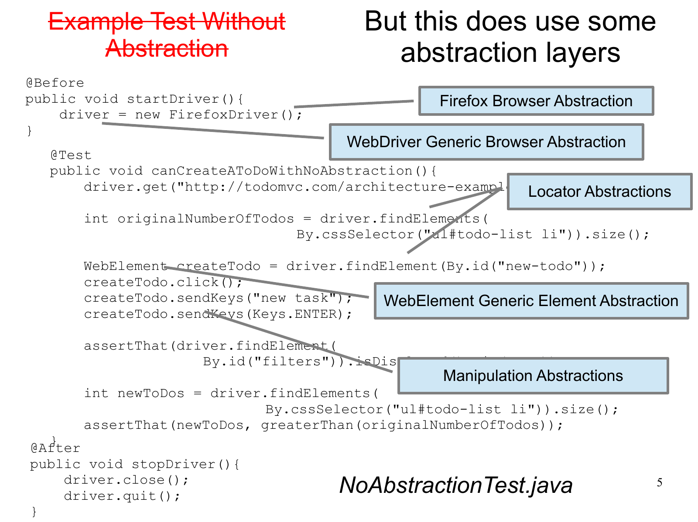
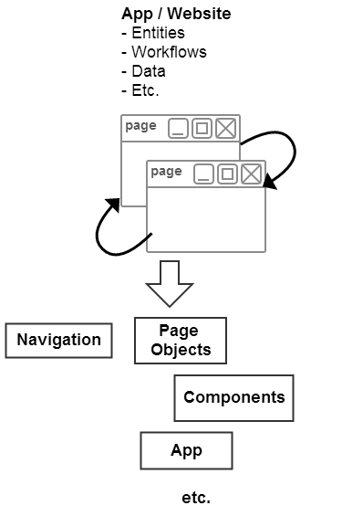
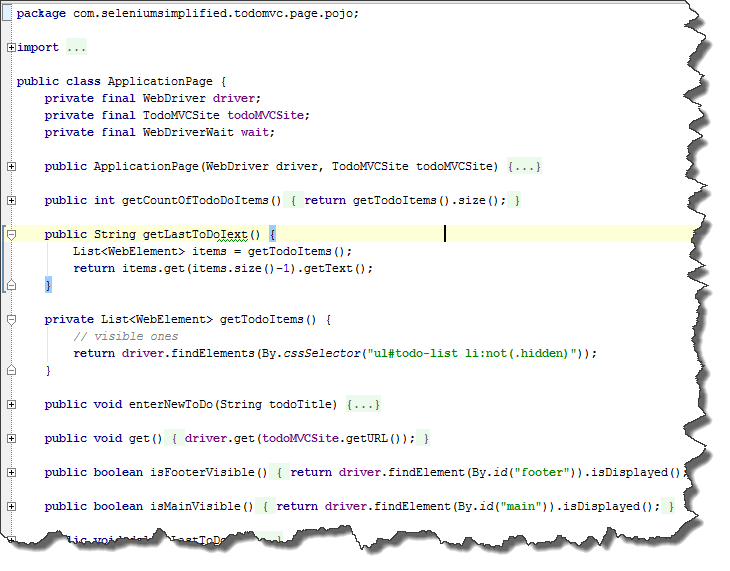
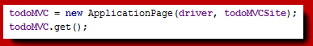
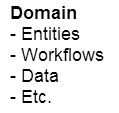
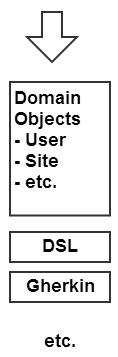
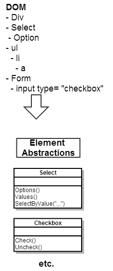
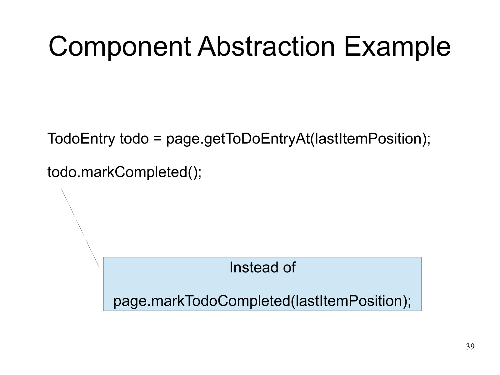

<!-- footer: @EvilTester -->

<!-- Slide 1 -->

# Automation Abstractions: Page Objects and Beyond

Alan Richardson

@eviltester

https://xp-dev.com/svn/AutomationAbstractions

www.SeleniumSimplified.com

www.EvilTester.com

www.CompendiumDev.co.uk

www.JavaForTesters.com

---

<!-- Slide 2 -->

# What is Abstraction?

- Modelling
- Separation of concerns
- Logical vs Physical
- Functional vs Structural
- Interfaces vs Implementations
- Data / Entities / Persistence
- Functionality / Task Flow
- Goals / Strategies
- Layers – GUI, DB, HTTP
- Etc.

---

<!-- Slide 3 -->

# Creating Systems - William Blake

“I must create a system. or be enslav'd by another Mans; I will not reason &amp; compare: my business is to create”

William Blake, 1820

Jerusalem: The Emanation of the Giant Albion


http://www.blakearchive.org/exist/blake/archive/object.xq?objectid=jerusalem.e.illbk.10&amp;java=no

---

<!-- Slide 4 -->

# Example Test Without Abstraction

```java
    @Before
    public void startDriver(){
        driver = new FirefoxDriver();
    }
```

```java
    @Test
    public void canCreateAToDoWithNoAbstraction(){
        driver.get("http://todomvc.com/architecture-examples/backbone/");

        int originalNumberOfTodos = driver.findElements(
									By.cssSelector("ul#todo-list li")).size();

        WebElement createTodo = driver.findElement(By.id("new-todo"));
        createTodo.click();
        createTodo.sendKeys("new task");
        createTodo.sendKeys(Keys.ENTER);

        assertThat(driver.findElement(
						By.id("filters")).isDisplayed(), is(true));

        int newToDos = driver.findElements(
								By.cssSelector("ul#todo-list li")).size();
        assertThat(newToDos, greaterThan(originalNumberOfTodos));
    }
```

```java
    @After
    public void stopDriver(){
        driver.close();
        driver.quit();
    }
```

NoAbstractionTest.java

https://xp-dev.com/svn/AutomationAbstractions

---

<!-- Slide 5 -->

# ~~Example Test Without Abstraction~~



```java
    @Before
    public void startDriver(){
        driver = new FirefoxDriver();
    }
```

```java
    @Test
    public void canCreateAToDoWithNoAbstraction(){
        driver.get("http://todomvc.com/architecture-examples/backbone/");

        int originalNumberOfTodos = driver.findElements(
									By.cssSelector("ul#todo-list li")).size();

        WebElement createTodo = driver.findElement(By.id("new-todo"));
        createTodo.click();
        createTodo.sendKeys("new task");
        createTodo.sendKeys(Keys.ENTER);

        assertThat(driver.findElement(
						By.id("filters")).isDisplayed(), is(true));

        int newToDos = driver.findElements(
								By.cssSelector("ul#todo-list li")).size();
        assertThat(newToDos, greaterThan(originalNumberOfTodos));
    }
```

```java
    @After
    public void stopDriver(){
        driver.close();
        driver.quit();
    }
```

NoAbstractionTest.java

But this does use some abstraction layers

Firefox Browser Abstraction

WebDriver Generic Browser Abstraction

WebElement Generic Element Abstraction

Locator Abstraction

Locator Abstractions

Manipulation Abstractions

---

<!-- Slide 6 -->

# WebDriver provides abstractions

- Browser
- DOM
- Web Element

Tool vendors gain value from generic abstractions.

You gain value from 'domain' abstractions.

---

<!-- Slide 7 -->

# Example Test With Abstraction

```java
    @Before
    public void startDriver(){
        driver = new FirefoxDriver();
    }
```

```java
    @Test
    public void canCreateAToDoWithAbstraction(){
        TodoMVCUser user =
						new TodoMVCUser(driver, new TodoMVCSite());

        user.opensApplication().and().createNewToDo("new task");

        ApplicationPageFunctional page =
              new ApplicationPageFunctional(driver,
															new TodoMVCSite());
        assertThat(page.getCountOfTodoDoItems(), is(1));
        assertThat(page.isFooterVisible(), is(true));
    }
```

```java
    @After
    public void stopDriver(){
        driver.close();
        driver.quit();
    }
```

NoAbstractionTest.java

---

<!-- Slide 8 -->

# Why Abstraction?

- Change implementations
- Single Responsibility – only changes when necessary
- Makes automation readable and maintainable
- We can unit test some of our test code
- etc.

https://xp-dev.com/svn/AutomationAbstractions

---

<!-- Slide 9 -->

# Some Abstraction Layer Categories

- Data

- Generic Data Abstractions e.g. email, postcode

- Physical

- Physical layout of your application e.g. pages, components
- Navigation across pages

- Domain

- Your application Entities domain e.g. user, account

- Logical

- User actions, workflows

---

<!-- Slide 10 -->

# Common Automation Abstractions

- Page Objects: pages, components, widgets
- Dom Element Abstractions: select, textbox, etc.
- Domain Objects: user, account, order
- Gherkin (Given/When/And/Then)
- Domain Specific Languages: code, keywords
- ...

https://xp-dev.com/svn/AutomationAbstractions

---

<!-- Slide 11 -->

# Abstraction != Implementation

- Abstraction != Tool / Framework / Implementation
- Gherkin != Cucumber
- Page Object != Page Factory / Slow Loadable
- DSL != Keyword Driven

If we want to get good at abstraction then we need to model, split apart, make the relationships clear, and be aware of our options.

---

<!-- Slide 12 -->

# Page Objects



- The most obvious automation abstraction
- What is it?
    - A page? A Component?
- Do web applications still have pages?

---

<!-- Slide 13 -->

# A Page Object that abstracts a Page

- Often has methods for
    - Opening the page
    - Accessing elements
    - Doing stuff, and navigating as a side-effect
    - Logical high level functionality e.g. login
    - Low level physical functionality e.g. typeUsername, clickLoginButton

Should a Page Object be responsible for all of this?

---

<!-- Slide 14 -->

# Page Object Design Decisions

- What methods does it have?
    - Functional
        - login(username, password),
        - loginAs(user)
    - Structural
        - enterName(username), enterPassword(password), clickLogin(), submitLoginForm(username, password)
- Does it expose elements or not?
    - public WebElement loginButton;
    - public WebElement getLoginButton();
    - public clickLoginButton();

---

<!-- Slide 15 -->

# Page Object Functionality Approaches

- Expose WebElements Directly
    - Leads to WebElement Abstractions
    - public TextField userNameField;
- Hide WebElements behind physical functional methods e.g. typeUserName("bob");
- Logical helper methods e.g. loginAs(name,pass)
- Layers of Page Objects
    - Physical
    - Logical

---

<!-- Slide 16 -->

# Navigation Design Decisions

Does a Page Object return other pages?

```java
  public IssueListPage submit(){
    driver.findElement(By.id(“submit”)).click();
    return new IssueListPage(driver);
  }
```

- Or Navigate implicitly after interactions
- Or have navigation objects

---

<!-- Slide 17 -->

# Implicit or Explicit Wait?

## Implicit Wait

```java
driver.manage().timeouts().
implicitlyWait(15L, TimeUnit.SECONDS);

assertThat(driver.findElement(                					By.id("filters")).isDisplayed()
				 , is(true));
```

## Explicit Wait

```java
driver.manage().timeouts().
implicitlyWait(0L, TimeUnit.SECONDS);
WebDriverWait wait = new WebDriverWait(driver,15);

wait.until(ExpectedConditions.elementToBeClickable(By.id("filters")));
```

Example: 'NoAbstractionTest.java'

---

<!-- Slide 18 -->

# Implementing Page Objects

- POJO
    - Plain object, driver in constructor, methods use driver.&lt;method&gt;
- Page Factory
    - Annotated elements, lazy instantiation via reflection
- LoadableComponent
    - Common interface (load, isLoaded), isLoaded throws Error
- SlowLoadableComponent
    - Common interface, waits for on isLoaded
- Other approaches?

---

<!-- Slide 19 -->

# Example Implementations

https://xp-dev.com/svn/AutomationAbstractions

---

<!-- Slide 20 -->

# POJO

- 'ApplicationPage.java'
    - Used in 'SequentialCreationOfTest.java'
    - Not much refactoring in the example
- Simple Class
- WebDriver passed to constructor
- Composition of any components
- e.g.
    - com.seleniumsimplified.todomvc.page.pojo
    - 'ApplicationPage.java'
        - Not much refactoring in the example

---

<!-- Slide 21 -->

# Pojo Example





---

<!-- Slide 22 -->

# Functional vs Structural

- Functional
    - loginAs(username, password)
- Structural
    - enterUsername
    - enterPassword
    - clickLoginButton
    - submitLoginForm(username, password)

---

<!-- Slide 23 -->

# Functional Vs Structural Example

- One way of answering “what methods to put on a page object”
    - Is it functional / behavioural?
    - Is it structural / Physical?
- Functional 'uses' Structural implementation
- Why?
    - Sometimes it is just a naming difference
    - Handling exceptions in functional but not structural
    - Higher level methods in Functional
    - Different concepts e.g. deleteLastItem

---

<!-- Slide 24 -->

# Page Factory

- Annotate fields with @FindBy
- Instantiate in constructor using PageFactory.initElements
    - Can create your own page factory initialiser
- Avoids boilerplate accessor methods
- Fast to create Page Objects
- Might become harder to expand and maintain

---

<!-- Slide 25 -->

# Page Factory Example

```java
    @FindBy(how = How.CSS, using="#todo-count strong")
    private WebElement countElementStrong;

    @FindBy(how = How.CSS, using="#todo-count")
    private WebElement countElement;

    @FindBy(how = How.CSS, using="#filters li a")
    List<WebElement> filters;

    @FindBy(how = How.ID, using="clear-completed")
    List<WebElement> clearCompletedAsList;

    @FindBy(how = How.ID, using="clear-completed")
    WebElement clearCompletedButton;

    public ApplicationPageStructuralFactory(WebDriver driver, TodoMVCSite todoMVCSite) {

        PageFactory.initElements(driver, this);

	this.driver = driver;

	...
```

---

<!-- Slide 26 -->

# SlowLoadableComponent

- Some pages and components need synchronisation to wait till they are ready
    - One approach – SlowLoadableComponent adds responsibility for waiting, to the page
- extend SlowLoadableComponent
- Standard interface for synchronisation on load
    - get()
        - If isLoaded then return this Else load
        - While not loaded{ wait for 200 millseconds}
    - Implement load and isLoaded

---

<!-- Slide 27 -->

# Fluent Page Objects

```java
todoMVC = new ApplicationPageFunctionalFluent(
									driver, todoMVCSite);
todoMVC.get();

todoMVC.enterNewToDo("First Completed Item").
        and().
        toggleCompletionOfLastItem().
        then().
        enterNewToDo("Still to do this").
        and().
        enterNewToDo("Still to do this too").
        then().
        filterOnCompleted();
```

---

<!-- Slide 28 -->

# Fluent Page Objects

- Methods return the page object or other objects instead of void
    - void clickDeleteButton();
    - PageObject clickDeleteButton();
- Syntactic sugar methods:
    - and(), then(), also()
- Can work well at high levels of abstraction and when no navigation involved
- Train Wreck?

---

<!-- Slide 29 -->

# Navigation Options

- Direct in Test: page.get(); page.waitFor();
- Instantiate new pages based on test flow
    - Navigation as side-effect, may have to bypass 'get'
    - Loadable pages, non-loadable, support classes
- Page Object methods might return other Pages
    - e.g. a method on the login page might be
        - MyAccountPage clickLogin();
- We might use navigation objects
    - direct, Jump.to(MyAccountPage.class)
    - path based (current page → desired page)
        - Navigate.to(MyAccountPage.class)

---

<!-- Slide 30 -->

# Possible Domain Abstractions

- Logical Objects
    - ToDo
    - ToDoList
- Physical Objects
    - LocallyStoredToDo
- Actors
    - User
- Environment
    - Site
    - Implementation





---

<!-- Slide 31 -->

# Page Objects &amp; Domain Objects

- Instead of
    - todoMVC.enterNewToDo(“New Item”)
- We could have have
    - ToDoItem newItem = new ToDoItem(“New Item”);
    - todoMVC.enterNewToDo(newItem);
- See code in DomainBasedTest

---

<!-- Slide 32 -->

# Domain Objects That Span Logical &amp; Physical

e.g. User

- user.createNewToDo(“new item”)
- user.createNewToDo(newItem)
- See use in NoAbstractionTest

---

<!-- Slide 33 -->

# Sometimes it is possible to over think this stuff

- Don't let thinking about this slow you down
- Conduct experiments
- Refactor
- Rethink if
    - you are maintaining too much
    - your abstraction layer stops you doing stuff
    - you are 'working around' your abstraction layers

---

<!-- Slide 34 -->

# Element Abstractions



---

<!-- Slide 35 -->

# Element Abstraction Example

- Would you include 'toggle'?

```java
public interface Checkbox {

    public boolean isChecked();
    public Checkbox check();
    public Checkbox uncheck();
    public Checkbox toggle();
}
```

https://xp-dev.com/svn/AutomationAbstractions

---

<!-- Slide 36 -->

# Element Abstractions

- Existing support classes: Select,
- Possible: TextBox, Checkbox, TextBox, File etc.
- Can enforce Semantics
    - Checkbox: isChecked, check(), uncheck(), toggle()
    - TextBox: clear(), enterText()
    - etc.
- Pass back from Page Objects into test?

---

<!-- Slide 37 -->

# Element Abstraction Pros and Cons

- May have to create a custom page factory
- Can help 'restrict' code i.e. check or uncheck, rather than click, enforces 'semantics'
- If you create them...
    - allow return WebElement
        - so that I can go beyond the abstraction layer if I need to. Not required if it is just a WebElement wrapper.

https://xp-dev.com/svn/AutomationAbstractions

---

<!-- Slide 38 -->

# Component Abstractions

- Shared Components/Widgets on the page
- e.g.
    - VisibleToDoEntry, VisibleToDoList
    - Filters, Footer, Header, etc.
- Could have 'functional' representation for repeated items e.g. login forms
- Could have 'structural' representation
- Likely use : page object composition

---

<!-- Slide 39 -->

# Component Abstraction Example



```java
TodoEntry todo = page.getToDoEntryAt(lastItemPosition);

todo.markCompleted();
```

Instead of

```java
page.markTodoCompleted(lastItemPosition);
```

---

<!-- Slide 40 -->

# Gherkin as an abstraction layer

- Implement steps using highest appropriate abstraction layer
- CucumberJVM as 'DSL implementor'
- 'Expressibility' vs 'Step Re-use'
- See todomvc.feature and ToDoMvcSteps

```gherkin
Feature: We can create and edit To Do lists in ToDoMvc

  We want to amend todos in ToDoMVC because that is
  the set of exercises on the abstraction tutorial

  Scenario: Create a ToDo Item
    Given a user opens a blank ToDoMVC page
    When the user creates a todo "new task"
    Then they see 1 todo item on the page
```

---

<!-- Slide 41 -->

# My modeling biases

- Driver
    - Inject so instantiate any page or component as required/desired at any time
- Explicit Synchronisation
    - To make sure that the desired object is available and ready for use (as defined by synchronisation)
- Navigation
    - Implicit (via taking action e.g. click)
    - Explicit Navigation Object, not in page object
        - Open/jump (via driver.get)
        - To (state model from current, to desired)

---

<!-- Slide 42 -->

# My modeling biases

- Page Objects
    - Physical
        - abstract the 'real world'
    - Components
        - For common features on the page
    - Logical
        - abstract the functionality
        - Sometimes these are entity methods not page objects
            - e.g. user.registers().and().logsin()
- I tend not to....
    - abstract WebElements

---

<!-- Slide 43 -->

# My modeling biases

- I tend not to....
    - abstract WebElements
    - Use inheritence to create a model of the app
        - e.g. MyAppPage extends GenericAppPage
    - Use 3rd party abstractions on top of WebDriver

---

<!-- Slide 44 -->

# Are there rights and wrongs?

- Right / Wrong?
- Decisions?
- Project/Team/Organisation Standards?

Identify your own biases -

Experiment

Recognise your decisions

---

<!-- Slide 45 -->

# Decisions

- The 'limits' and overlap of Abstraction Layers
- Build it now, or 'refactor to' later
- How much change is anticipated?
    - To which layer? GUI, Business domain, Workflow?
- Who is working with the automation code?
    - Skill levels? Support needed?
- How/When with the automation execute?

---

<!-- Slide 46 -->

# Other Useful Links

- Jeff “Cheezy” Morgan – page-object ruby gem, data_magic gem and stareast code
    - https://github.com/cheezy?tab=repositories
- Marcus Merrell
    - Self-Generating Test Artifacts for Selenium/WebDriver
    - https://www.youtube.com/watch?v=mSCFsUOgPpw
- Anand Ramdeo
    - One Step at a Time
    - https://www.youtube.com/watch?v=dFPgzH_XP1I

https://xp-dev.com/svn/AutomationAbstractions

---

<!-- Slide 47 -->

# Homework

- Using the code at https://xp-dev.com/svn/AutomationAbstractions/
    - Compare the different implementations under 'main'
        - com.seleniumsimplified.todomvc.page
    - Investigate how the Page Objects delegate to each other, and the Domain Objects use Page Objects
    - Examine the 'test' usage of the Page Objects and Domain Objects
    - Examine the different navigation approaches

---

<!-- Slide 48 -->

# Alan Richardson - Blogs, Books, and Courses

Blogs and Websites

- CompendiumDev.co.uk
- SeleniumSimplified.com
- EvilTester.com
- JavaForTesters.com
- Twitter: @eviltester

Online Training Courses

- Technical Web Testing 101 Unow.be/at/techwebtest101
- Intro to Selenium Unow.be/at/startwebdriver
- Selenium 2 WebDriver API Unow.be/at/webdriverapi

Videos

youtube.com/user/EviltesterVideos

Books

Selenium Simplified

Unow.be/rc/selsimp

Java For Testers

leanpub.com/javaForTesters

Alan Richardson

uk.linkedin.com/in/eviltester

Independent Test Consultant &amp; Custom Training

Contact Alan

http://compendiumdev.co.uk/contact


