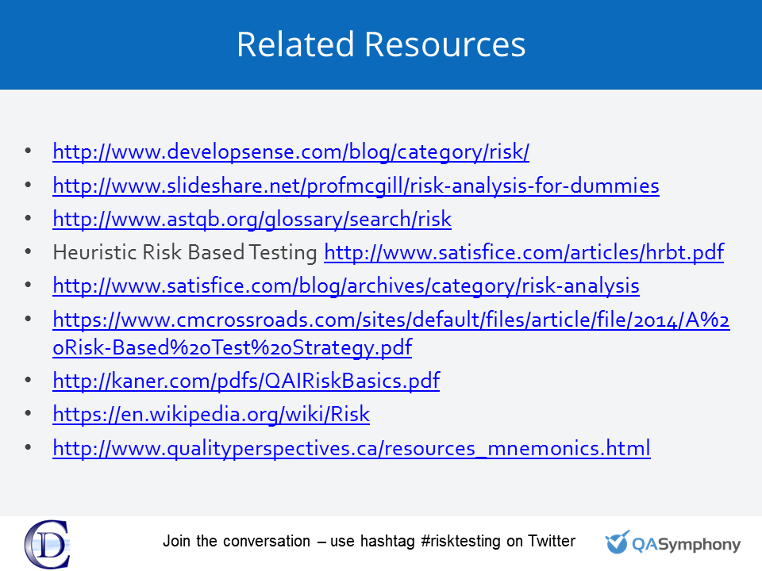

# Resources for "Risk Mitigation Using Exploratory and Technical Testing"

During the talk I mentioned a bunch of resources. I describe them all in here.

I don't endorse them all, and you'll probably be able to tell from the descriptions below which ones I do like, and which I like less. But, I do think we should read things we don't like.

And... this is not a complete list. Hopefully you'll just use this as a stepping stone for your own education and find more resources related to the topic of risk.

## Quality Perspectives Mnemonics Resources

* [qualityperspectives.ca/resources_mnemonics.html](http://www.qualityperspectives.ca/resources_mnemonics.html)

[Lynn Mckee](http://www.qualityperspectives.ca/about.html) maintains a list of Mnemonics that appear in testing literature, presentations and blog posts from around the world.

If there is a flaw in the list it is simply that - each mnemonic listed has a link to the person who is associated with creating it, but not to a canonical reference describing the mnemonic.

This means that *you* have to do work to follow the link to the person and read through their published work if you want to find out how *they* interpret the words in the mnemonic.

It also means that you have an opportunity to think through what the words in the mnemonic mean to you, before you go and read what other people have thought of them.

As I mention in the talk, the mnemonics can be useful for triggering ideas that you might not have triggered through systematic thought.

In some ways, you can use this page for some test strategy [stichomancy](https://en.wikipedia.org/wiki/Bibliomancy).

People also seem to get a similar value from the [mindmaps](http://apps.testinsane.com/mindmaps/) uploaded to [testinsane.com](http://testinsane.com)

## Michael Bolton Blog Archives

* [developsense.com/blog/category/risk/](http://www.developsense.com/blog/category/risk/)

Michael Bolton has a risk section on his blog. And I can see from his posts that he has described regression testing in a similar way that I did in this talk.

## Risk Management

* [slideshare.net/profmcgill/risk-analysis-for-dummies](http://www.slideshare.net/profmcgill/risk-analysis-for-dummies)

This was one of the first slideshare presentations I found when doing a web search for risk formulas, as I wanted to illustrate the slide deck with something 'complex'.

I think this deck provides a pretty good summary of a risk process and the example it is wrapped around it pretty interesting.

The reality is that the formulas are not particularly complex. They tend to use a fairly small set of variables.

While I denigrate the approach in the talk, there clearly are situations where this type of approach is valid, I just don't think that managing software projects is one of them. If you have a software project where you introduce this type of risk process to mitigate the risk then I think you could probably adopt a better process in general.

I think I'd be tempted to use this approach if I had a lot of data streaming in from a lot of sources and trying to identify risk from many data sources.

But it is still worth reading how people use these approaches, because then you will be ready when you encounter it, and you might find that when you do, it is entirely appropriate to the project you work on.

## ASTQB glossary

* [astqb.org/glossary/search/risk](http://www.astqb.org/glossary/search/risk)

I picked on the ASTQB in the talk because it is an easy target.

The database, upon release, really did have an SQL injection vulnerability, although I don't know how serious it was. When I find an SQL injection vulnerability in a real system, I don't exploit it to see how far I can take it. I report it to the vendor with the query strings that bypass their validation rules and which the system sends directly to the database.

The glossary provides a valuable service, in that you have access to a set of 'words'. You can then choose to use their definition or think of your own nuances. And like the mnemonics we mentioned previously, reading the words and definitions might trigger new thoughts that help you with your testing.

## James Bach & Heuristic Risk Based Testing

* [satisfice.com/articles/hrbt.pdf](http://www.satisfice.com/articles/hrbt.pdf)

James Bach's Heuristic Risk Based Testing document is very useful for describing a range of model views and perspectives that you can take. These are illustrated with high level 'single named' concepts that make it easy to explore and target a dimension at a time.

I thoroughly recommend reading this. For many people this underpins their test process and is highly influential.

* [satisfice.com/blog/archives/category/risk-analysis](http://www.satisfice.com/blog/archives/category/risk-analysis)

James Bach's blog is also worth reading. I linked to the 'risk' category above, but he has written so much more than this.

## Ingrid Ottevanger "Risk-Based Test Strategy"

* [A%20Risk-Based%20Test%20Strategy.pdf](https://www.cmcrossroads.com/sites/default/files/article/file/2014/A%20Risk-Based%20Test%20Strategy.pdf)

I primarily included this because it will appear in many searches for risk based testing and provides a fairly traditional 'risk based testing' approach, which offers a counterbalance to the heuristic approaches listed and the 'commonsense' approach I describe in the presentation.

## Cem Kaner Risk Based Testing Basics

* [kaner.com/pdfs/QAIRiskBasics.pdf](http://kaner.com/pdfs/QAIRiskBasics.pdf)

This slide deck is very easy to read and provides a bigger overview of using risk for prioritisation than I describe in the talk.

It spans the 'traditional' and 'pragmatic' fairly well.

## Risk - Wikipedia

* [en.wikipedia.org/wiki/Risk](https://en.wikipedia.org/wiki/Risk)

It is mandatory (because of an old bylaw, or charter, or religious precept, or something) that I include a link to wikipedia.

I have now done so.

And now the only 'real' research you have to do is read that page, and perhaps follow some of the links at the bottom.
