# Risk Mitigation Using Exploratory and Technical Testing

This is the archived office/practice-recording transcript. Its original introduction refers to the live webinar; it does not establish a transcript of the live Q&A.

This webinar was presented live on 28th June 2016 in partnership with [QASymphony](http://qasymphony.com).

## Introduction

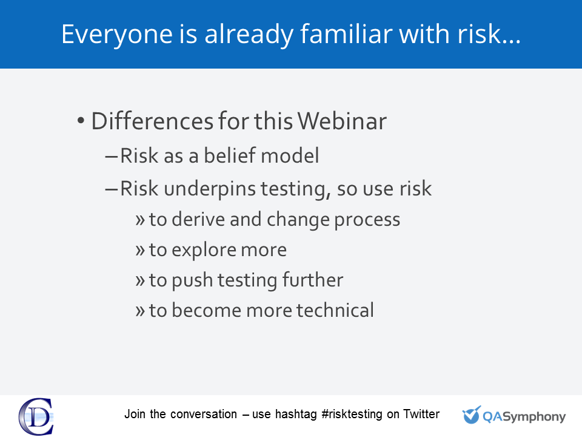

This is a talk about risk, though I'm fairly certain that everyone is already familiar with risk. The difference is I want to do in this particular talk is look at risk as a belief model. I firmly believe in systems and models. All my work is determined by looking at building models of systems and looking at how they interact and that's models of everything. Models of what I believe is going to happen, systems of how things interact, how my beliefs mesh together, because I can believe different things in different context and how the overlap will impact what I'm doing.

Fundamentally with risks we believe that some things are going to go wrong more than others. We believe that some things will not go wrong therefore we will not think of those and put them in our belief or risk model. Because our range of beliefs are limited but the range of risks is not, we need to go beyond our beliefs and look at tools and processes for helping us do that so we can improve our testing.

We know that risk is important for testing, we're always told about risk based testing. What I don't think we necessarily do is use it as our massively underpinning process. We don't necessarily build our processes to mitigate risk and only mitigate risk. We don't necessarily use risk to drive all our testing to be the main technique that we have for using our testing.

If we do start using risk when we test, we can communicate in terms of the risk that we've identified. If people share that risk, then they're more likely to understand what we're doing. If we say we have to do performance testing people might not understand why or might not get on board with that, might not give you the money for that. If you say, "We need to do performance testing because we believe that when we go live and we increase our advertising and we have 10,000 people trying to hit our sight at the same time. There's a massive risk that it will go so slowly that all the advertising spent will be wasted and no one can log on or use the system."

If people get on board with that risk, then they will support your notion that you have to test for it in order to detect whether a process is good enough. They might even get on board with a mitigation process to prevent that risk from happening in the first place. We can communicate in terms of risk as well as using it to derive what we do. Fundamentally because risk is essentially common sense, risk is essentially something that might go wrong.

## Commonsense Risk

* What is Risk?
    * *Something that might go wrong*
        * Probability
        * Impact

Normally when we talk about risk we have the notions of probability and impact associated with it because we believe that something will happen or the likelihood of something happening. We believe that something would be really bad happens or we might believe it's just negligible it might happen but even if it does it won't be an issue. When I was initially creating this talk, this talk was a webinar so there's risk with doing this as a webinar.

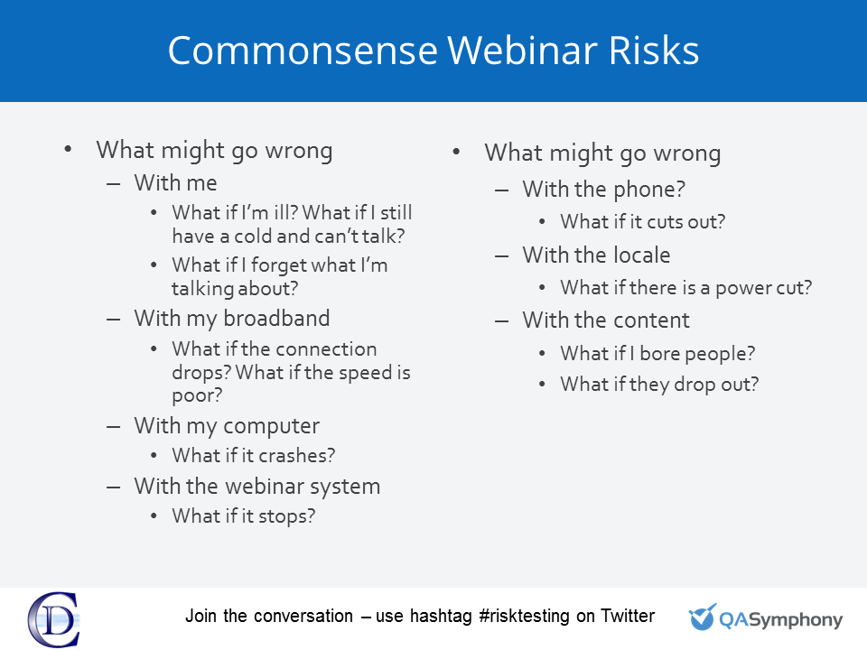

What might go wrong in a webinar? That I might be ill, I might have a cold. I did have a cold last week and maybe you might be hearing it in my voice.  What if I forget what I'm talking about? That might be a risk. What if I just rumble on and talk about other things that are unrelated to what I'm talking about? What if the broadband connection drops, what if there's no speed, what if my voice cuts out, what if a computer crashes, what if the webinar stops, what if this content is so boring that people don't pay any attention in the first place?

I have to have scared myself silly by identifying as many risks as possible. Figure out is it a still a risk that I care about, will I do something to mitigate it, do I want to know whether that risk actually manifests so that I can do something about it? Do I just want to accept that risk and not do anything about it and just go, "It might happen, people might get bored, that's trough?" With the webinar I can mitigate illness by sleeping more. I can mitigate the forgetfulness by presenting notes and practicing like I'm doing here.  This is a practice session I've recorded.

*Risk Process:*

* Identify
* Mitigate
* Detect
* Accept

I might mitigate the broadband risks by having the other people use the slides, the QA I sent for the guys that the webinar was for. Maybe they can manage the slides for me. If there's a power cut then I've got a UPS, a power system backed up by a battery. I could use my tablet, I can use the land line for the phone instead of the microphone. There's a whole bunch of things we can do so long as we identify them then we have the option to mitigate them.  Mitigation has risk or the process that we use to detect could have risk.

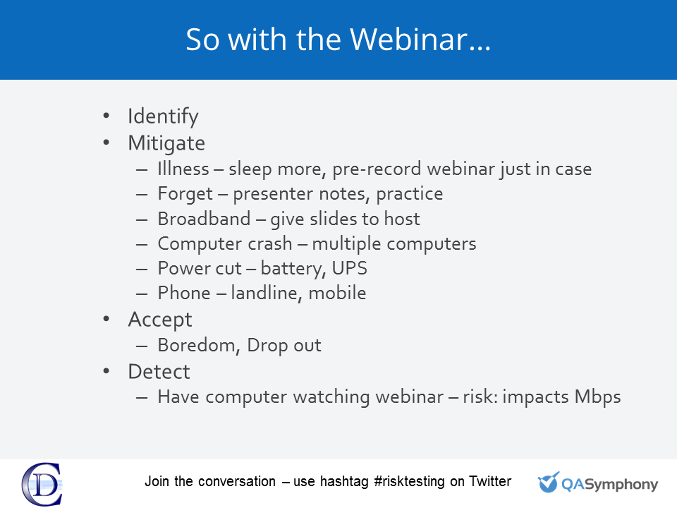

If I care whether the webinar system goes down then I might have another computer that is monitoring the webinar, watching the webinar and I can see it in real-time but there's a risk that that impact my megabits per second and might cause a knock-on effect on the webinar itself. We have to understand that we can chain risks when we have a risk and we choose to mitigate it that might introduce other risks because we've changed the process and process changes have risk. The same with our test approach. When we choose to do something, that might introduce a risk and we have to then manage that have a knock-on effect because we are building a belief chain.

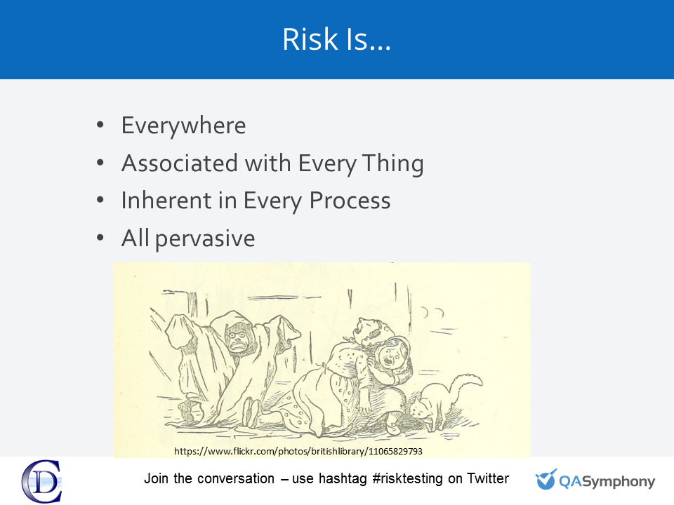

Fundamentally risk is everywhere, it's associated with everything, it's all pervasive, it's inherent and we should fear everything. One of our massive, the easy ways of improving risk identification is to look at what is going on in our process or a system and go, "What I'm I not scared of, what have I not identified any problems with? Log in seems to be fine, what risk have I not identified? Why I'm I not scared that login might go wrong, what is going on with my thinking that I believe this is correct?" We are trying to identify risk so we can mitigate it.

On my website I have a contact form. On the bottom of every page there's a contact form and I receive spam emails. There's a risk that I receive so many spam emails my inbox blows up, I receive so many spam emails I can't tell between a spam email and a real email, a whole bunch of things might get lost. There's a risks that my website comes down just the load of data being fed into it. I might choose to mitigate that risk, I might choose to mitigate that risk by adding a captcha to the contact form.

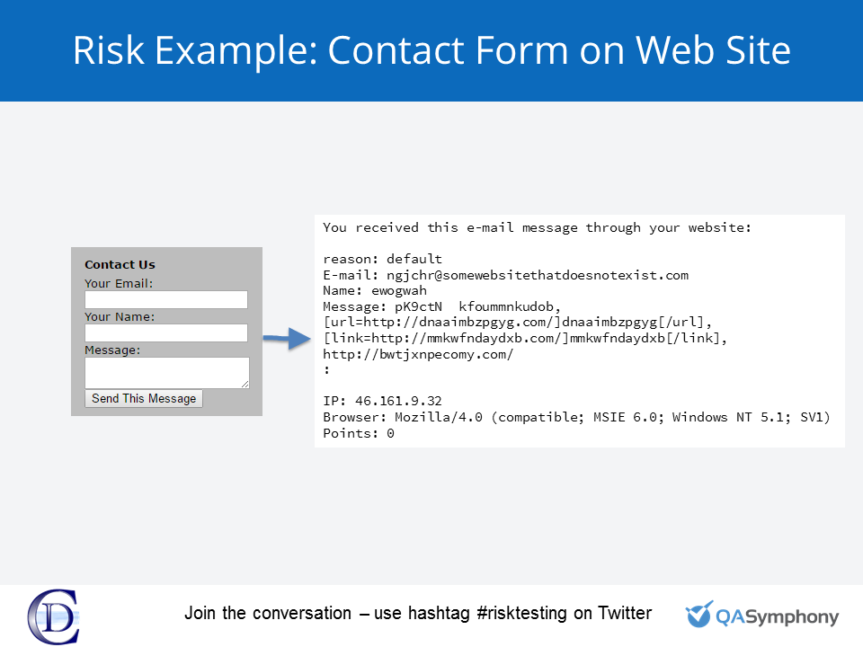

Then there's a knock-on risk that no one contacts me because they can't get past the capture. This is the kind of risk process we have to do and the knock-on risk analysis around the mitigation. We also have to understand that risks open up opportunities for us. I have an opportunity based on this risk of spam that the contact form now doubles up as a website is an available checker. There are plenty of systems that I can subscribe to that will then request my website and check that it is still up.

I don't want to have to do that if I leave this, essentially, vulnerability in place because every time I receive a spam email I know that my website is still up and running. Someone has automated this for me. Someone has put the time and effort in to automate my website and tell me that my website is still running and the contact form is still sending me emails. I might accept the risk around the amount of spam and acknowledge this opportunity that I don't have to do any work to make an uptime. Because essentially with testing risk is an opportunity for testing.

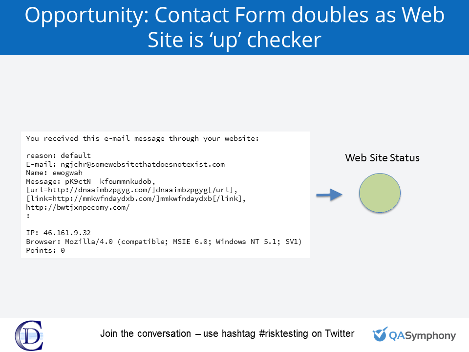

## General Risks & Testing

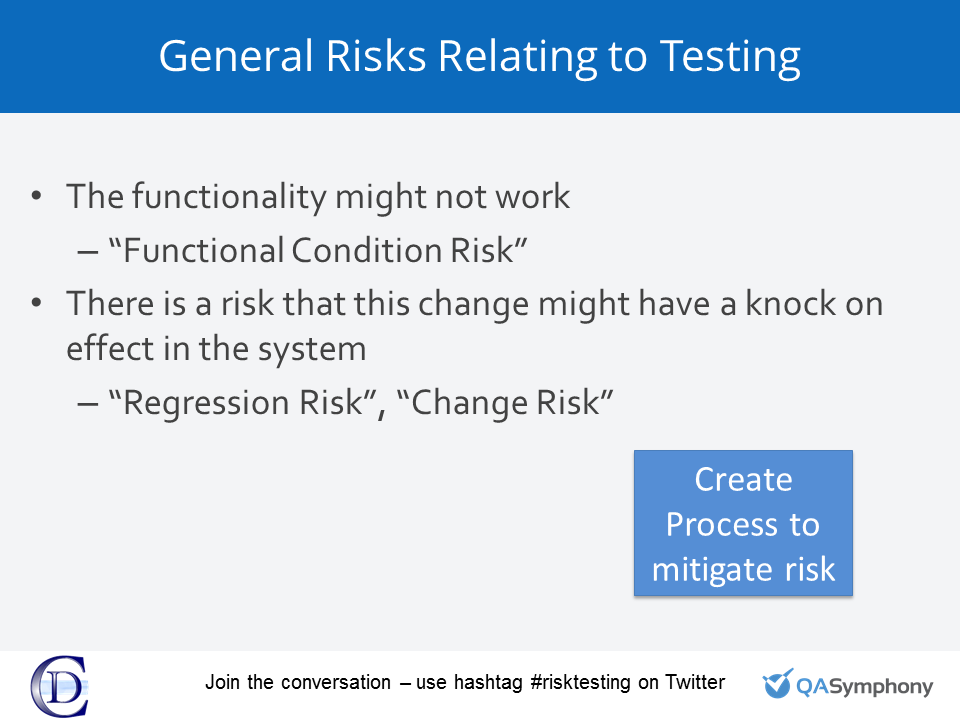

The risk that something might go wrong is an opportunity for us to detect that, to improve our process, to try and cover that, to improve our development process, to mitigate that. Risk is an opportunity for doing something differently. We have general risks related to testing. General risks irrelevant of the context that everyone is familiar with like the functionality might not work is one of the reasons why we test in the first place. Just a functional conditional risk.

There's also a risk the change when we do development might have a knock on effect in the system. There's a risk of regression or a risk associated with the change. We have in testing the notion of regression testing, which people view as a mitigation for this regression risk. What we have to understand is that testing itself is not really a mitigation process, it's a detection process. We do regression testing to detect that the change risk has manifested. That there was a risk of regression and it has actually happened. That when we changed something there was a knock-on effect.

That is why regression testing goes out of hand because we're trying to use it as a mitigation process when in fact it's a detection process. A mitigation process for regression risk would be much more focused on the risk, much more focused on the change that's going on. We'd look at the change we're about to make, we'd look at what is the impact, we'd look at how much effort is involved, how much do we understand the systems that we're changing.

Then we isolate it and we have a much smaller risk and we have a much smaller scope that we have to detect the risk within. We have to understand that testing is a vague word but testing itself doesn't really mitigate this risk. We put that process in place not because we're risk driven but because we've understood that there are certain processes testing should have regardless of the risk that we normally use to mitigate them.

## Business, Project and Functional Risk

You probably already use risk in your testing, you have notions like business risk or project risk or functional risk. Business risk is things like we might run out of funding, the requirements might be wrong, there might be regulatory requirements yadayadaya. This is the stuff that is less likely to be used for testing. What we normally mean when we're talking about testing is project risk or functional risk, project risk is the kind of things you discuss in those really boring risk management meetings. Where you go, "Well we might not have enough staff," or "Everyone might go on holiday," or "Bob might get sick," and the users don't know what they're talking about, they don't know the requirements.

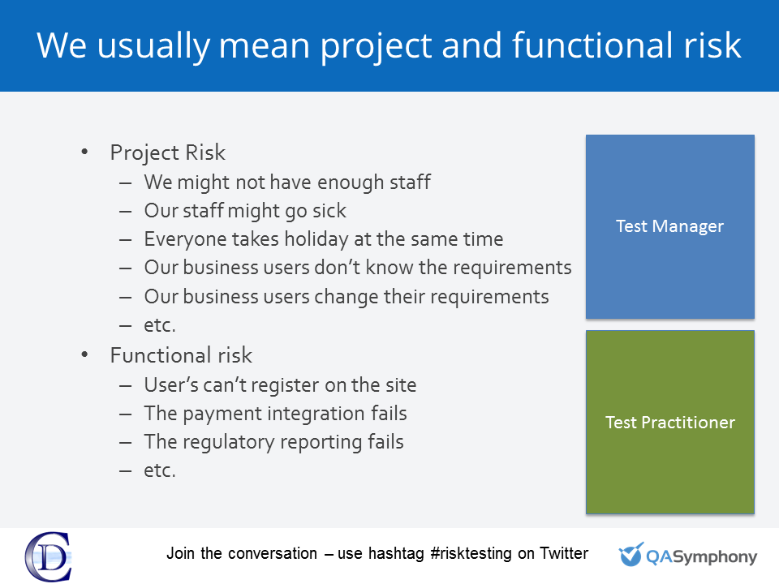

The users have no idea what they want, they're going to change the requirements. This is the stuff we manage in the test manager or project management process. The stuff we normally focus on as test practitioners is functional risk. There's a risk that the user can't register on the site. Then what we do is we very often tie that back into the business and to assess the impact and then that helps us adjust the priority.

Then that very often we get confused between functional risk and business risk because we're then focused on the impact to allow us to determine the scope of what we do, rather than using the functional risk as a way of driving the testing. A user can't register on the site. Why might the user not be able to register on the site? Because the fields are missing, because we can't type in the password, because the JavaScript doesn't work. That is the process that's going to lead us to derive testing scope.

Risk is something that might go wrong and we know that there's a potential for impact, sometimes we ask other people to determine the impact because they're the ones who are going to prioritize our testing. *People very often get hang-up on probability* because they want it to be quantified. Essentially probably is a guess how likely do we think this is going to happen, how likely do we believe this belief is going to happen. We want to quantify it because we don't trust our beliefs.

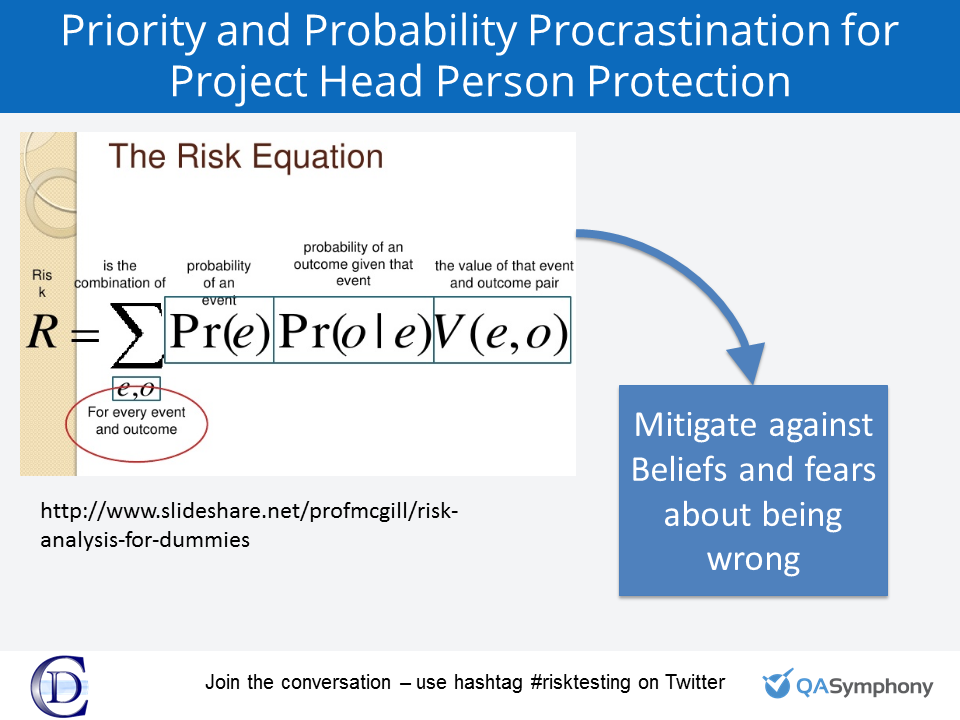

Very often what we end up doing is going through a process of priority and probability, procrastination for a project protection. Essentially we make it quantified so we cannot get blamed. We quantify the probability, we quantify the impact, we use a formula for deciding the priority of the risk and that avoids the risk that we choose the wrong thing or we pick the wrong risk to target or we denigrate one risk. Then a risk manifest is when none of the others do. This is very often used to mitigate being blamed and we don't want to do that.

What we want to do is target our testing effectively and technical knowledge might allow you to prioritize differently and analyze your risks differently and come up with different approaches to testing because we don't want to paralyze our process. Very often a formal risk process paralyzes the process.

* Very easy to spend a lot of time trying to
    * Quantify probability
    * Quantify Impact
    * Use a ‘formula’ for deciding’ priority
* To avoid (and because of fear of…)
    * Deciding what to focus on in case we
        * Choosing the wrong thing
        * Picking the wrong risk
    * Blame
* Technical knowledge might allow you to prioritise differently
* Risk in using a formal risk process that you paralyse your process

## ISTQB Risk Definition

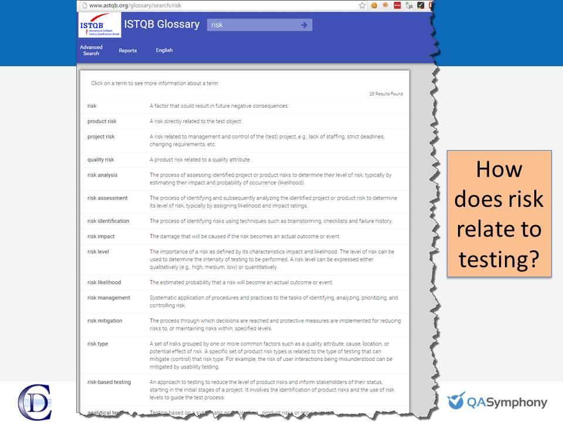

I had a quick look to find formal test definitions, other people that come up with definitions look at risk, and the ISTQB glossary that was available in the ASTQB's site has a whole bunch of stuff associated with risk.

This is a software system so it has risks itself and the idea to go after this system was introduced at the risk of SQL injection and that risk manifested then I raised that issue with them and they fixed it. Just hopefully now we can do a search on it without the risk that someone has put something insane into the database. The database is full of definitions and we may or may not agree with them. Here is the ISTQB definition of risk based testing from the glossary.

It says "an approach to testing to reduce the level of product risk and blah, blah, blah..."

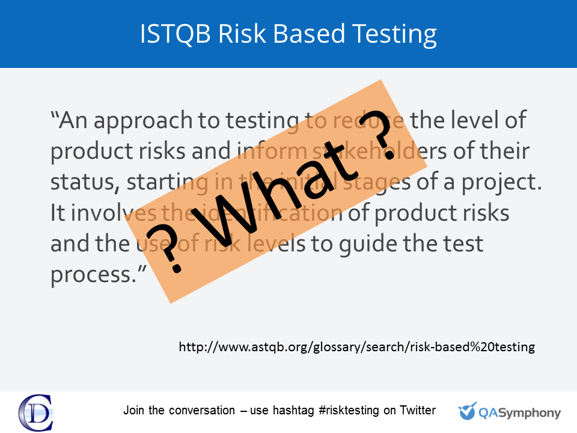

Right now there is a massive risk that if I actually read this I would have fallen asleep or gone insane or whatever else. I had to decompose the writing in a form that I could understand and this is what I came up with. As an approach to testing to reduce the level of product risks there's some sort of mitigation in there. I don't know if they mean reduce the number of product risks or reduce the severity of the product risks. I don't really know, but I know there's some form of mitigation.

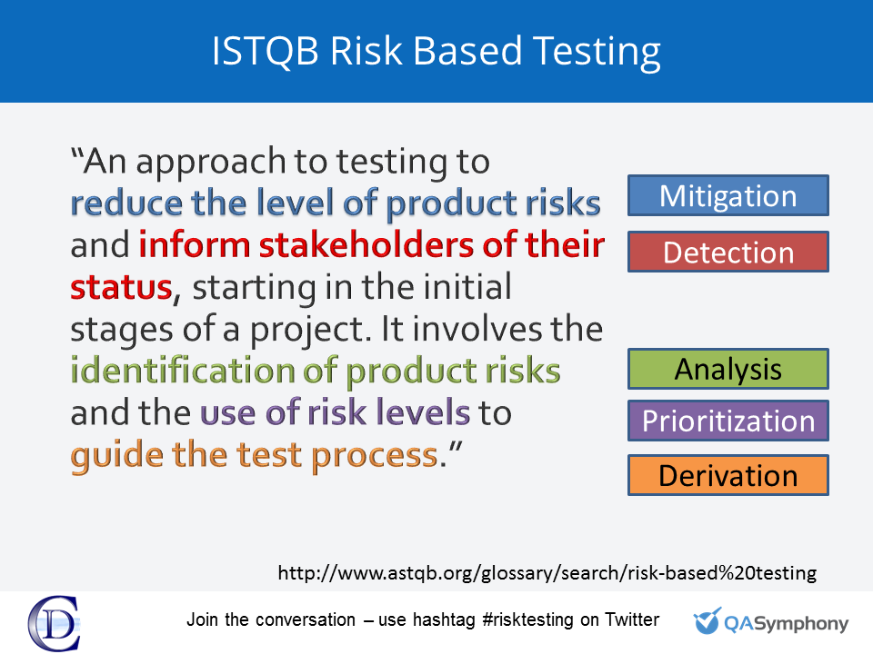

They view risk based testing as having a mitigation aspect which is more than I do. They recognize detection in order to inform stakeholders. The status we have to detect whether the risk has manifested or not then some form of checking whether this risk has manifested as an issue. There's analysis involved, we have to identity the product risks. We analyze it to see what risks are available. What they're talking about product risks are a risk directly related to the test object, towards a test object well as the component or system to be tested.

Product risk is a risk directly related to the component or system to be tested. Now I think the risks go beyond that but that's the risk they're focused on. Then there's the notion of using the risk levels to prioritize, which is fine and using risks to guide the test process. Some sort of a notion of derivation. I deconstructed this in a term that I can understand and then look at. I've built a very simple model of a risk management process here.

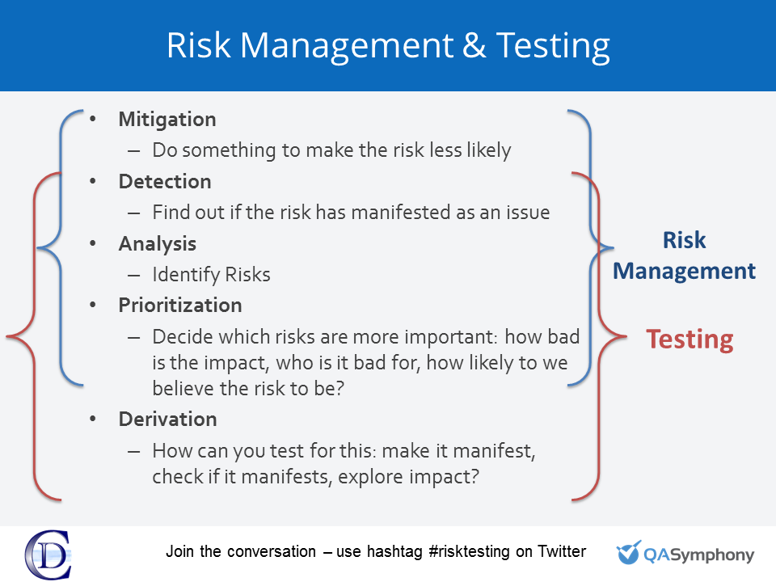

This doesn't mean this is formal risk management process or you'll find this in books, but I believe a risk management process has us analyzing and identifying the risks. Choosing to mitigate the risk, do something to make the risk less likely to manifest, detecting if the risk has manifested. Prioritizations, deciding what is more important and what we focus on, what we do first and derivation. How do we test for this, how do we check that has happened?

How do we make this manifest, what steps do we have to go through to actually try and trigger this risk? Then I think there's overlap between risk management and testing but the risk management is focused on the analysis, the detection, the mitigation and prioritization? The testing is focused on the detection, the analysis, the prioritization and the derivation. That is where I focus my attention on.

Within the context of system risks process risks are well mitigated. In order to classify the risks, I've got notions of functional risk, system risk, technical risk. Then the stuff that isn't system related like the process risk, the business risk and the project risk. The process risk is based on the system of development and the way that we actually develop the software.

I think that functional risk is pretty well covered in the literature and I've put some references in this presentation so you can see them. The notions of system risk are fairly well covered with those references as well. Business risk, project risk that's handled in normal risk management books. What I think is not well covered is technical risk and non-system related risk or the process risk. I don't see a lot of that covered in the literature. That's what I'm going to cover now.

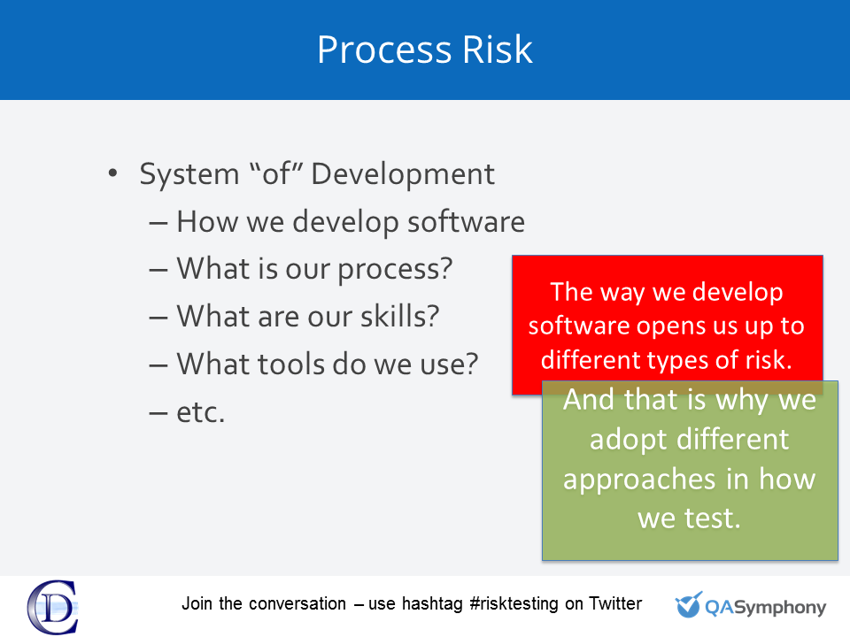

I believe we have systems of development. How we develop the software, the processes that we use, what skills do we have in there, what tools do we have in use? That's why it's a system, it's a relationship between the people and the processes and how they interact. The way that we develop software opens us up to different types of risk and that's why we adopt different approaches and how we test because we're trying to mitigate different risks in the process.

With process risk we do it the same way we do any other process, we analyze the process, we understand it, we look for risks, we look at how the system interacts, we look at where the relationships might break down, we look at where there might be bottlenecks. Are there any issues that actually happen as a process? It's something that we can look at and see what would things go wrong, what works, what doesn't? Then we can choose to change processes to mitigate the risk or change processes to detect the risk if it happens or we can accept the risk.

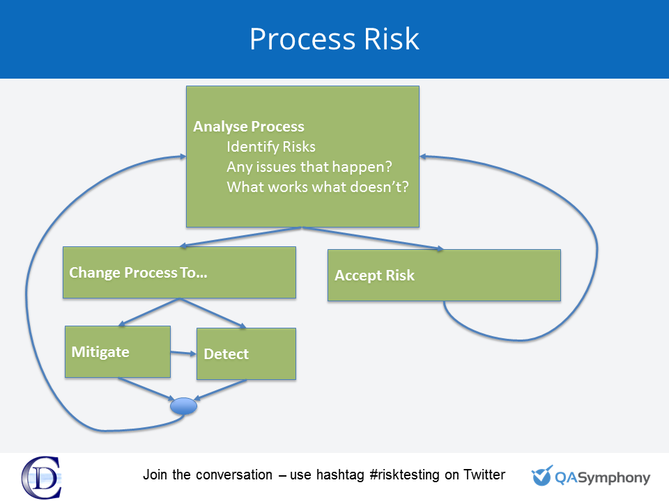

We know that it's a risk that we don't have enough testers to do the process we've said we're going to do so we accept that risk and we just cut it back in certain ways. We don't really assess the impact. We're just, "Yeah and there's something wrong," we accept them. This is a loop process, every time we choose to mitigate it we have to analyze again because we've changed the process and that introduces more risk or we accept the risk and that might introduce more risk. Every process has risk, it has risk in there.

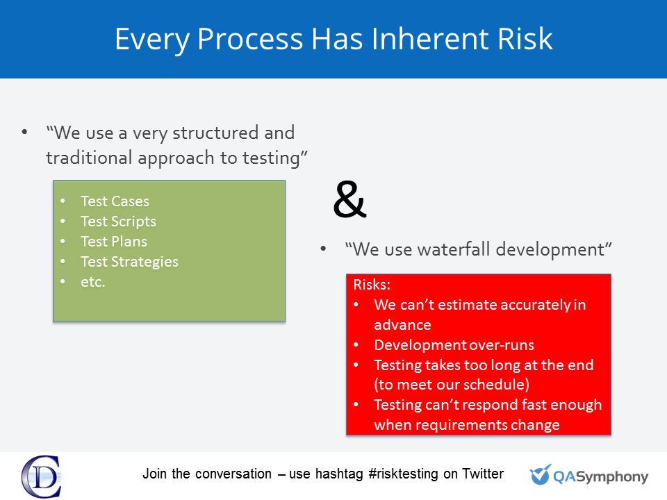

If you're working on a waterfall process you're more than likely to use a very structured traditional approach to testing. You write text cases, test scripts, test plans, test strategies, whatever. They tend to fit together fairly well but they still have risks, there's risks that you can't accurately estimate everything in advance, you don't know how much you're going to do or how long it's going to take. There's a risk of development and testing overruns, there's a big risk that testing can't respond fast enough when requirements change. Because we've created scripts that are cross-referenced to cases which have to be updated and all the data and the plans have to change and everything is so tightly connected. Every process has risk.

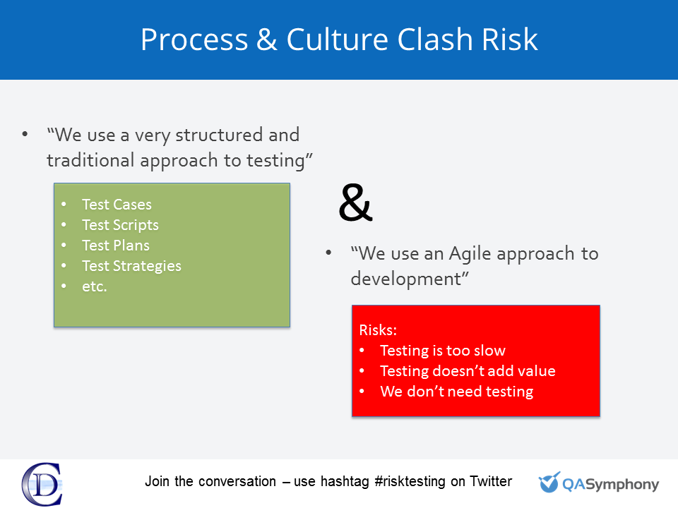

There's also a risk that processes clash, that systems clash, that the testing, process and system clashes with the development process because they're not built around the same risks. If you use an agile approach to development but continue to use a very structured and traditional approach to testing there is a massive risk that testing will be too slow. You're doing all this test case documentation, test script documentation, massive risk that it doesn't fit in with what you're doing. There's massive risk that testing doesn't add value in the time it needs to because it's busy of creating these artifacts rather than doing the testing.

We have to model the system of development. Build a test process that fits the development process. If we just bring in a standard model of testing, then there's a massive risk that it won't fit the development process and there will be knock-on risks and issues.  To do this we have to view the process as a system.

## Process Risk and Processes as a System

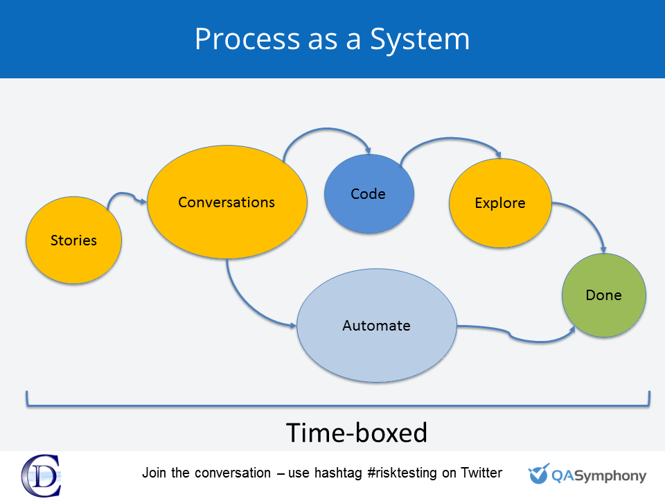

Here is a basic model of a modern Agile development approach. We have stories, we talk about them, then we go and write some code or we automate them in parallel. Then we do some exploration after the code system has been put together and we check whether we're done or not and there are risks in there.

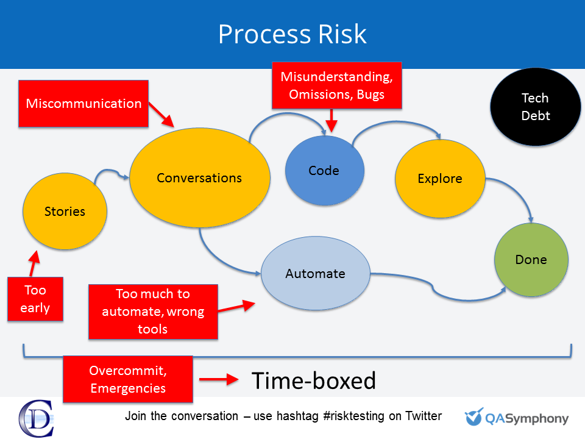

* We write stories
    * We don’t like to write things down & rely on conversation
        * Risk of misunderstanding
            * Discuss ‘test ideas’ during story elaboration
            * Write test ideas in story description (add to as understanding grows)
            * Track exploratory testing performed so it can be reviewed as part of story ‘done’
        * Risk of waste because we discuss very early and add to a backlog
            * Exploratory testing rather than a lot of upfront test design
    * Risk Acceptance criteria might be incomplete
        * Use exploratory testing to go beyond acceptance criteria
    * Risk Exploratory Testing might take too long
        * Explore in small chunks, review when finished, decide what else to do
    * Risk exploratory testing might test wrong things
        * Agree high level test areas prior to exploring

We risk miscommunication because we don't like to write things down so we rely on conversations that people might not be there at the same time, we might not ask questions, there might be miscommunication. We might not clarify our understandings, there might be miss-understandings. When we actually come to code it we might forget things because we haven't written it down so there's omissions in what we do. We create bugs and we're going to create bugs anyway because we're people and there's a risk of that.

There's a risk that we discuss the stories too early so we discuss too much. We have too much decided in advance with no flexibility, then we have to do too much re-work when we actually complete the story. There's a risk that we try and automate too much with the wrong tools or with the wrong skills or we over-commit or there's emergencies and we can't do what we need to do then the sprint. Sometimes we mitigate by creating a tech debt entry. We can't finish, so stick it on the tech debt pile.

That process itself introduces risk, we never get around to do in the tech debt pile. There's a risk that we haven't actually managed or mitigated the risk in our process, we've just accepted it and put it in the tech debt pile when we should be mitigating it.

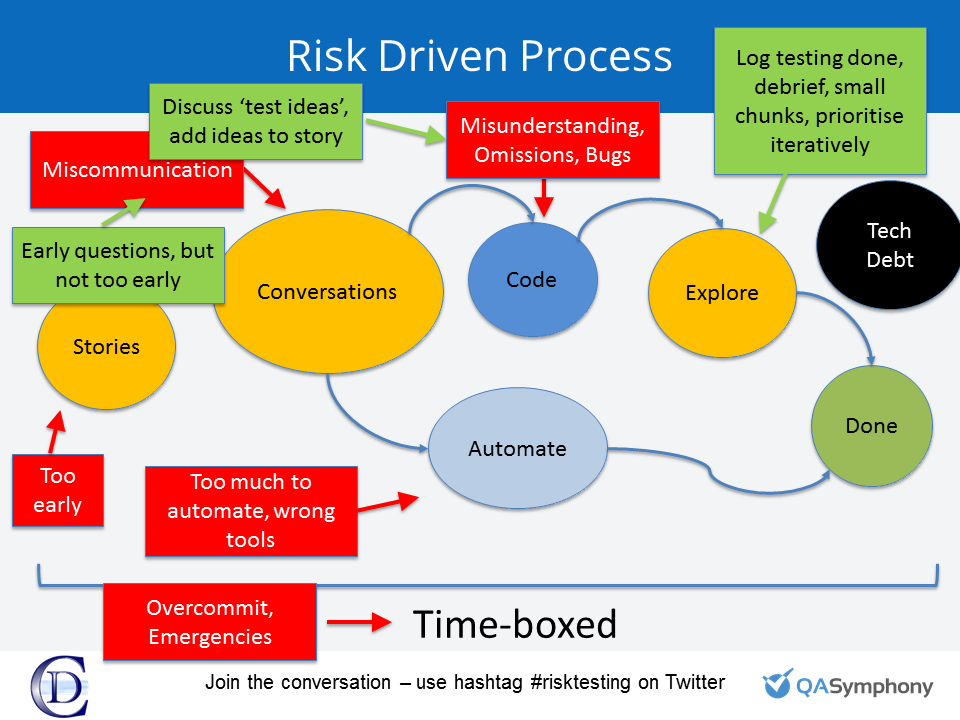

*When a 'test approach' is not working:*

* Complaints
* Issues
* Lack of time
* etc.

* Perhaps some ‘risks’ with the process have manifested
* Perhaps the process isn’t fit for purpose and is now a project risk

If we have a test process that's built from risk, then we can look at what the issues are. There's a risk of misunderstanding therefore we will discuss the test ideas and write them down in the stories so we can go back and check them.

There's a risk that explorative testing can be communicated. What we do is we tie it back to the test ideas and we create logs of what we do. We put that in the stories so that we debrief and we can review it later.

We work in small chunks because there's a risk that we don't know how to do everything upfront. There's a risk that the acceptance criteria might be incomplete.

We use exploratory testing as a process to mitigate that, to go beyond the acceptance criteria.

We mitigate the acceptance criteria by trying to automate the coverage of that. We mitigate the risk that we're trying to go so fast and we might forget things by having an automated set of code that continues to check whether the acceptance criteria is still valid as we go forward to mitigate that risk of change earlier. We put the process in place to mitigate the risk because fundamentally process risks are essentially systems risk.

* Process based focus makes it easy to justify not changing – because it is the process
* Risk based focus makes it harder to say we won’t mitigate

* We have to learn something new
    * Learning involves making mistakes
        *We can’t afford mistakes because that will take time
* What if we choose the wrong process?
    * A different process might make things worse

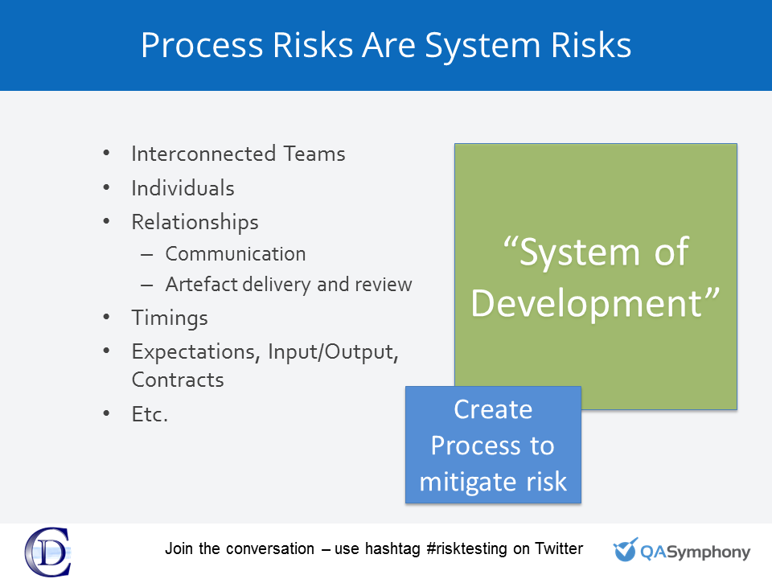

The ISTQB definition was talking about system risks. Process is a system therefore we can look at the teams, the individuals, the relationships, the communication, the artifacts, the timings. Everything associated with that system of development to create a process to mitigate the risk. That means we're talking about the testing process to mitigate risk in the development process. We're not talking about testing to mitigate risk.

## Risks as Beliefs

* Ultimately we are talking about beliefs - A slightly different model of risk
    * What do I believe might go wrong?
        * Likelihood based on our model of the world
    * What do I believe would happen if it did?
        * Impact
    * Why do I believe that is important?
    * How will I know if it happens?

We have a problem. Why if we can do risk analysis to change process, don't we change processes? It's partly because what we're really talking about are beliefs. If I give you a different model of risk, if risk is a model of belief. What do I believe might go wrong, what do I believe is the likelihood of that this will happen, what do I believe is the impact of this? What do I believe is important?

Do I believe there's a problem if we're going to battle on the back of lobsters and tortoises? What do I believe is going to happen in the event we do this faced with tanks? What do I believe is the impact?

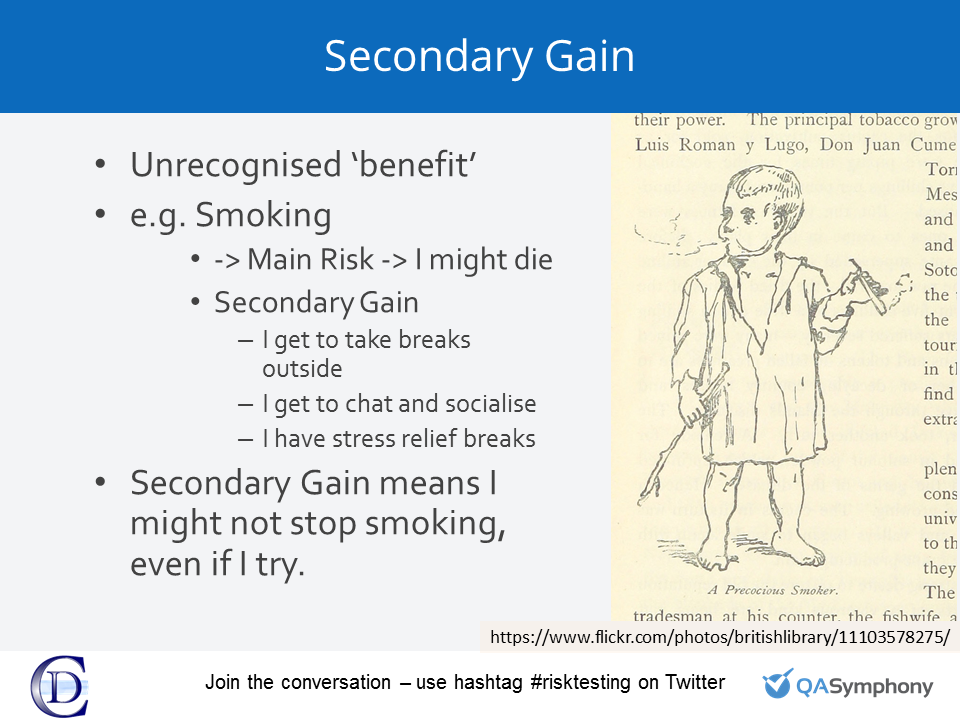

When we're dealing with beliefs we have to take in account the notion of secondary gain. Secondary gain is unrecognized benefits. If I'm smoking, there's a risk I might die. That's a fairly big risk but there are secondary gains. If I'm smoking I get to go outside and take breaks, I get to go outside and chat and socialize with the other smokers. I get to have regular stress relief breaks and the more I smoke the more regular stress relief breaks I get, the happier I become. If I stop smoking I lose the secondary gain that might impact me stopping even if I try.

We recognize that risks as a belief model, as a belief change model or a belief mitigation. We have to take in account secondary gain. Risk itself keeps us as testers in business. Process risk justifies a standard process. Not having enough time in the sprint means we never have to finish anything, we never have to make the automate code better, we never have to use coding standards, we never have to unit test the automated code.

Not having enough time mean we don't have to learn the technology in detail because we focus on the acceptance criterias, we never have enough time to go really deeply into the system. Secondary gain is a massive risk to change. We have conversations, we don't write things down, we don't have to maintain what we've written down and no one likes writing things down anyway because we really just want to focus on the code. Secondary gain, we don't have to write anything down and it's a risk.

If we identify secondary gain and we change our attitude to it then we're much more likely to address risks and processes. What we fundamentally do not want is for our testing to be limited by our beliefs.

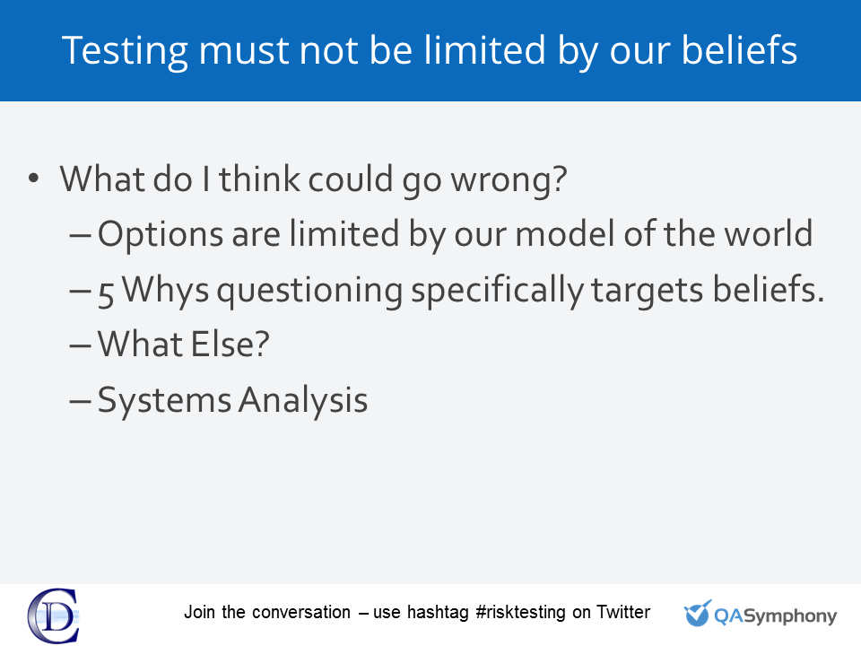

We need to keep thinking, "What do I think could go wrong." Our options of what we target are limited by our model of the world. We have ways of expanding that '5 Whys questioning' which I don't normally like in a process, but I think is fine for risk management because risks are beliefs '5 Whys' target beliefs.

There's a risk that the database might go wrong. Why? Because the database might run out of space. Why else? Because the database might be a different version than the version of PHP on the website. Why else? We might not have deployed the JDBC diver to the server. Why might we not have deployed the driver? Because we use Maven and we can't bring in JDBC Maven. Why else? Because we manually deploy things we might have forgotten? Why else? Alright that '5 Whys' forces us to continually expand and challenge our model of the world and our beliefs and keep going.

We can do that through system analysis as well. By building a model we can subject it to a more structured analysis or a more objective analysis. Have we got all the entities in the model, have we got all the communication links, what might go wrong with the communication links? Do they have enough data, where are the dependencies?

I fundamentally believe that the more complicated a system the more risk that something go wrong, therefore I want to simplify my processes as much as I can. The way that I do that sometimes is just by starting with a blank slate.

## Risk leads to exploratory testing

If I had no test process whatsoever and designed one based on risk it would probably look like an exploratory testing process. I've created a thing but I don't how to test it, I don't know if it works or not. Well we might ask questions like, "Who is going to use it, what is it supposed to do, what do you feed in one end, what do you get out of the back, what does it process?"

These questions come from risk. There's a risk that it might not work.

Well let's mitigate, what is it supposed to do? Let us use it and see if it does it and collect enough evidence to see if it does or it doesn't not. That would be a mitigation process.

* Risk: We have coded something, but don’t know how to test it
    * Mitigate: What is the code supposed to do? Use it. See if it does. And collate enough evidence to say if it does or doesn’t.
    * Mitigate: Who is going to use it? How? Do what they would do, see if the system does it, and tell people if it does or doesn’t.
    * Mitigate: What data does this process? What is it supposed to generate as output? Feed the data in, see if it processes it and gets the output,

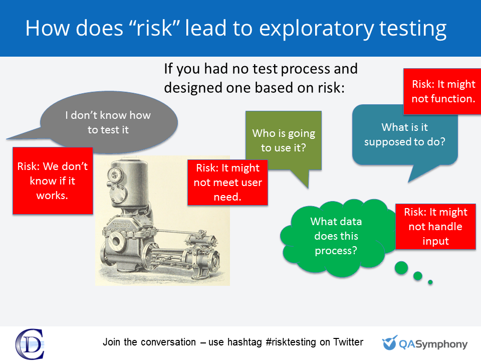

There is a risk that it doesn't meet the user's need. Well, who's going to use it, how are they going to use it? Let's do what they do and see if the system does it and then communicate whether it does or it doesn't. There's a risk that it doesn't process data. Okay, well what data does is process etcetera etcetera?

* If you had no test process and designed one based on risk, it might look like exploratory testing
* The questions can be based on our understanding of the thing in its context and identifying risks of how it first in that context.

* Risk: We have coded something, but don’t know how to test it
	* Risk: It might not work
	    * Mitigate: What is the code supposed to do? Use it. See if it does. And collate enough evidence to say if it does or doesn’t.
	* Risk: It doesn’t meet the user’s needs
	    * Mitigate: Who is going to use it? How? Do what they would do, see if the system does it, and tell people if it does or doesn’t.
	* Risk: It doesn’t process the resources it is supposed to?
	    * Mitigate: What data does this process? What is it supposed to generate as output? Feed the data in, see if it processes it and gets the output, …

Then we start to build up a testing process based on the risk and it does look like an exploratory testing process or at least it does when I do it given my beliefs of my process. Because the initial risks and mitigation we create will be based on our models which are based on our beliefs.

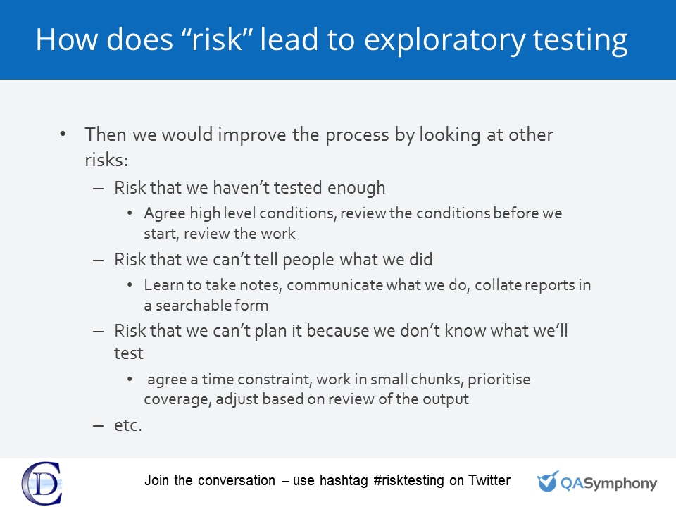

As we look at the process in more detail we can identify more risks and then expand the process. There's a risk that we might not have tested enough therefore we would mitigate that by having our process agree high level conditions, reviewing the conditions before we start to work on it. There's a risk that we can't tell with what we did etcetera, etcetera. When we identify risks we target those with process change.

What's interesting is that, that previous example starts to look a bit like James Bach's SFDPO or San Francisco Depot Mnemonic. Where we're looking at the function, the data and the operations part of his structure, function, data, platform, operations.

We do have heuristics or mnemonics that are in the real world that we can use to help us do this or we can do it from a systems perspective.

## System Modelling for Risk

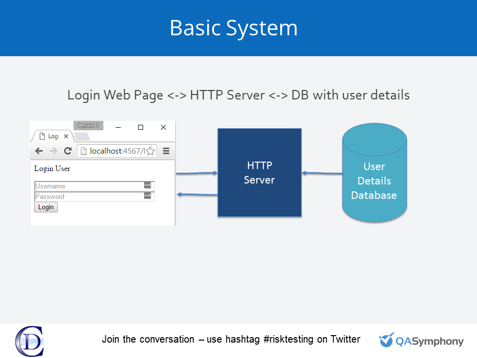

Here's a basic system I've got a login page that has a basic username and password to communicate to an HTTP server and we login to the database. As we go through this particular model what I want you to be thinking in parallel is do you have the technical knowledge? What technical knowledge do you have that is associated with the level they're working on? What risks can you see based on your technical knowledge? Can you spot gaps in the model coverage based on your technical understanding of how this application works? What tools would you need to help you cover the gaps and exploit the technical information that is shown on the screen?

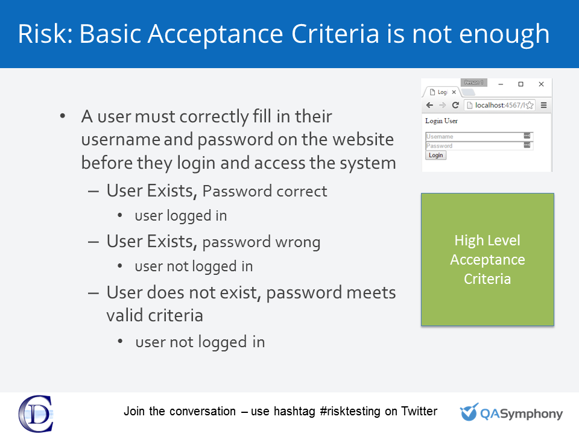

Here's the basic form username, password. We need the username and password to be correct together to match those in the database then they'll be logged in. If we get one of those wrong, then they won't be logged in or if it's invalid we're report some criteria, but obviously this isn't enough to test it. We could run with this, we can do a whole bunch of exploratory testing around this, but how far do we have to go? We ask additional questions.

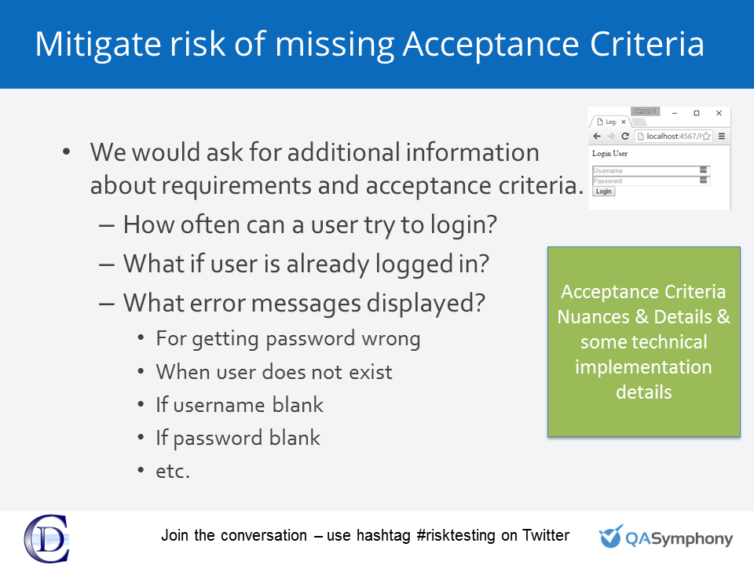

Let's start by asking questions on the domain, the login domain. We know how login forms work, we can ask questions around that. How often can a user try and login, how many login attempts does a user get? What if they're already logged in, what happens? What error messages do we see? As we ask these questions we will get answers that tell us information that the user can login 10 times. We're going to track it in JavaScript cookie, we're going to validate the username and passwords using JavaScript, we're going to check the length using JavaScript.

We've learned some technical information as we go through and we probably want to test that a well, but that's not all.

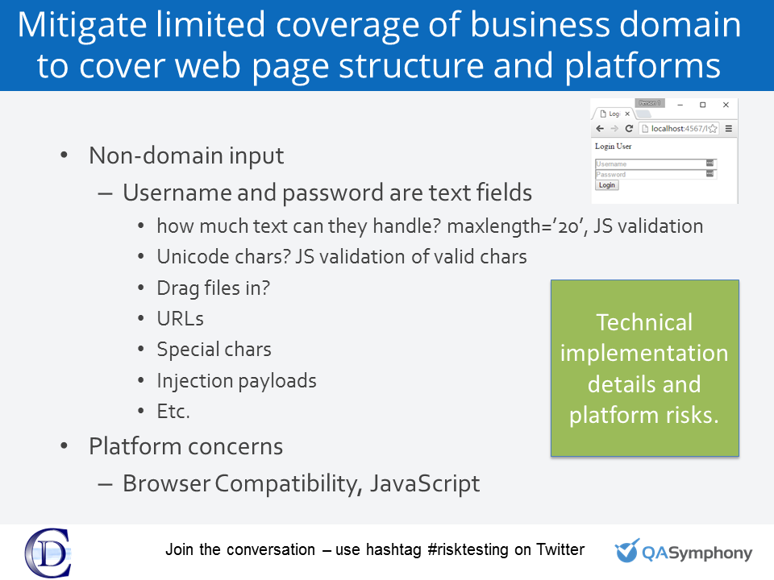

We know that we're working on a browser so we have to have information about the browser that will guide our testing because essentially a username is not a surname in a browser. A username is just a text field. How many characters can it have, how do we control the length, what characters are valid, how is it validated?

We learn that we're using the max length HTML attribute, we're using JavaScript validation. We might be concerned about browser compatibility or JavaScript compatibility. Do we have enough technical information to limit the browsers, do we know what our concerns are, do we know what HTML we're worried about in browser compatibility, do we know why we're worried about browser compatibility or are we just worried about browser compatibility because we're testing a browser application?

If it's because we're testing browser application that's not good enough. We need to know what the risks for that browser are because our testing needs to be informed by a technical understanding of the system.

That to me is the core of what technical testing is all about. Not programming, not automating.

*Technical knowledge applied to testing* : using it to expand the requirements, using it to expand the range of risks that we identify, using it to expand our approach to testing.

## A Technical model

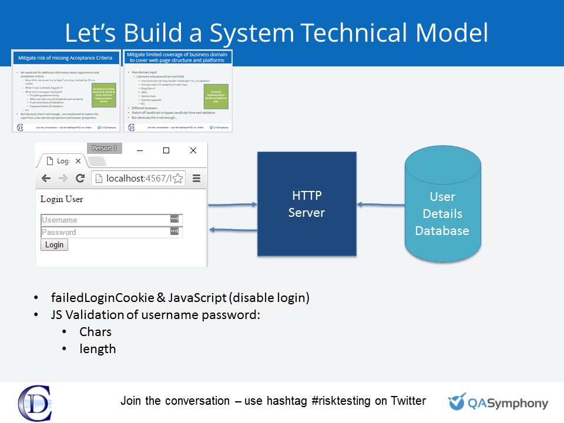

If we then focus on this system from a technical perspective, we have learned that there's a field login cookie that will have a 10. That we are using JavaScript to disable the login if that cookie gets too high. We're using JavaScript to validate the characters in the username and password and the length prior to allowing it to be sent to the HTTP server. Therefore, there are risks here.  What if the user disables the cookie? There's a risk that the cookie isn't tracked, there's a risk that the cookie is not accepted, there's a risk that the user amends the cookie, there's a risk that JavaScript is disabled, there's a risk that the user amends the HTML max length attribute in the browser.

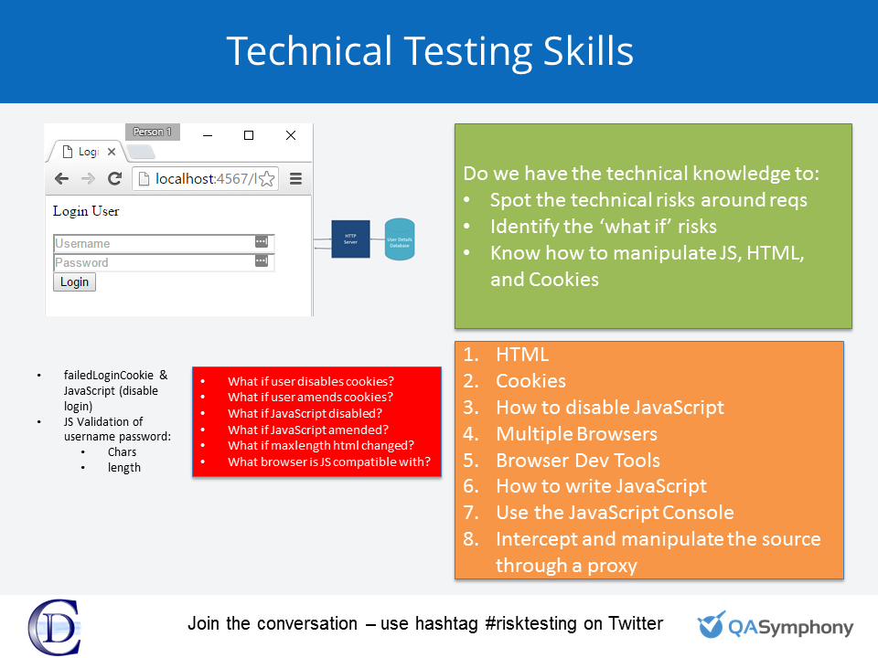

In order to even identify those risks, we have to have technical knowledge. We need to understand how HTML works to know that max length is risk, to know what browsers compatibility issues there might be. We need to know what cookies are, we need to know how cookies are tracked and stored, we need to know that the user can amend cookies, we need to know that there are browser dev tools that will allow us to edit and set to. There are whole bunch of technical knowledge we need to identify the risk.

We need to know how to actually amend the cookie in order to check whether that amendment causes us an issue or not. We need the ability to manipulate the system to target those risks. That was only looking at the browser end, we still have other parts in the system.

If our technical knowledge only extends to the browser that's as far as our testing is going to go. What risks are there from the technical knowledge of the HTTP server.

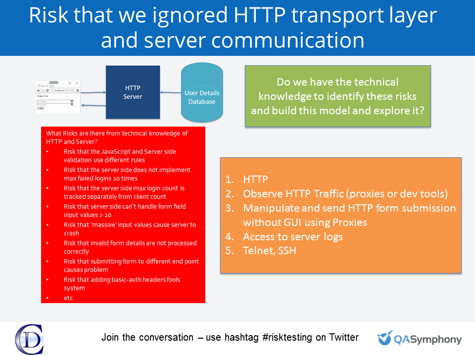

There's risk that the validation rules might not match up, that the login count is not done on both sides. There's a risk that if in massive amounts of data which we cannot necessarily do in the front-end we just feed it in through the HTTP message, then that causes our server a problem. Again we need to understand the technical knowledge of the HTTP server and HTTP to know how to observe the traffic, to see if the right traffic is being sent, to see if there's any extra traffic, to manipulate the traffic, to send the HTTP messages without using the GUI to actually be able to trigger some of this.

We need to check to see whether when we send in big fields whether it causes errors in the server logs. We need to be able to observe the server logs. We need to be able to login, we need to be able to interrogate what was in the database to check, to see whether the right information is being checked. We need the ability to extend our testing across the technical parts of this system.

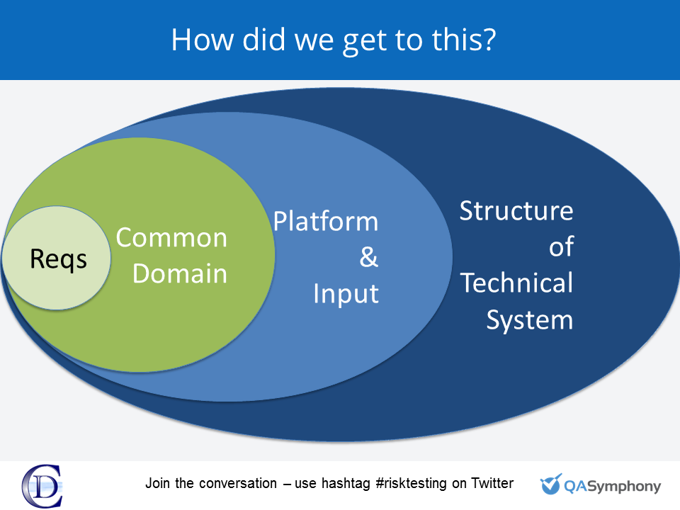

* Basic Requirements
* Expanded via questioning to cover our understanding of the 'login' domain (discovered some 'technical' information – JS, Cookies)
* Expanded to cover a basic understanding of the platform and input form (incorporated some 'technical' information about HTML, maxlength, JS validation)
* Expanded to cover risks from a basic understanding of the structure of the application which were not mentioned in requirements or from questioning the requirements.

We got to this point by looking at the requirements, by looking at the general common domain, the login domain. By looking at the platform that we're using, the web platform.

Looking at what input it takes, by looking at how the system is structured or browser communicating to an HTTP server. We can go further and what we do is we add multiple layers to our model of the system.

We need to go beyond requirements and start looking at the technicalities of the system in order to increase the scope of risks that we cover.

## Risky

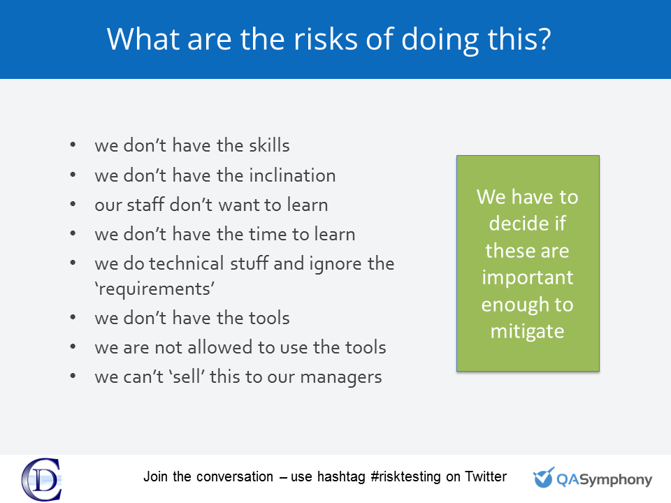

Obviously with any process there are risks. If you try and do this and you don't have the skills, then you'll do it badly or you may not have the inclination or your staff may not want to learn or you don't have the tools and you don't like the tools. etc.

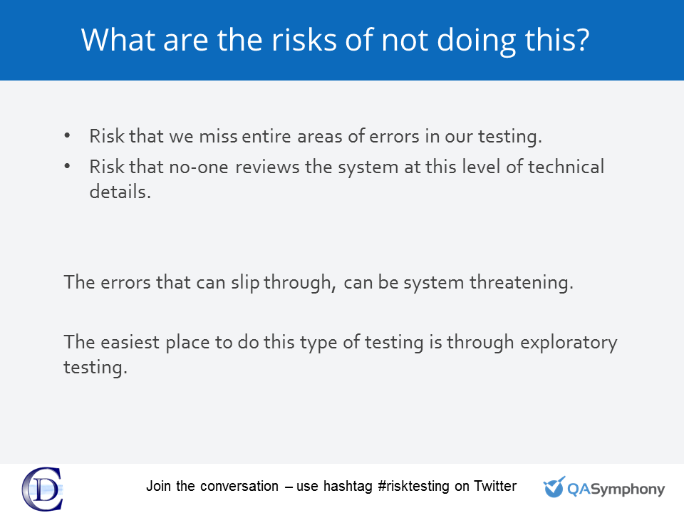

There's a whole bunch of risks associated with becoming more technical but we have to decide if these risks are important enough to mitigate or not. If we don't do it there are risk that we miss out entire areas of the system in our testing. If all we know is the GUI we will never test for a large HTTP, we will never identify whether there are knock-on errors appearing in the logs, we will never test at this level. These system errors if they slip though can be massive.

The easiest place to do this type of testing is by using an exploratory testing process on your testing process. The thing is you can probably fit in an exploratory testing aspect in most systems of development.

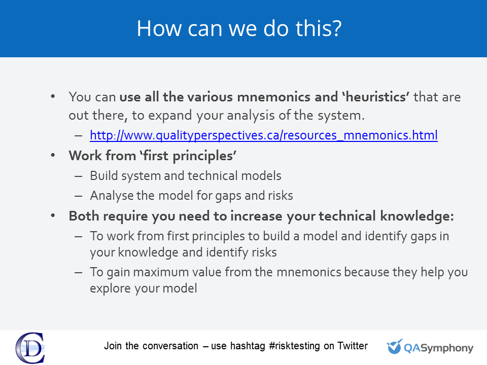

We can do this either by starting with the various mnemonics and heuristics that are out there. This is a link to a list of them already mentioned James Bach's San Francisco Depot Heuristics.

You can use that or you can work from fresh principles and build a model of the system as we did here and look at the gaps and the risks in the communication. To use both of them effectively you need to increase your technical knowledge if you're just given the notion of function. If you don't have technical knowledge to understand how that function is technically implemented, you won't go far enough with that mnemonic.

If you build a system model which just has input fields and input validation you won't go far enough because you don't recognize that the technicality is beyond the browsers, it's beyond the JavaScript validation is and at the server. We may be doing the extra validation on the database, we need to extend it in order to gain maximum value from any of our models.

But we have to make a couple of decisions:

* Are we prepared to increase our technical knowledge?
* Are we prepared to put the time and effort into learning more?

If you're a manager are going to give your staff more time?  If you're a company will you value this to actually put the time and effort in to do it? If you as an individual value this are you going to put the time in to do it regardless of whether your company does or not?

We have to decide how we're going to do this.

* Start small
* Learn a little every (day/week/month)
* Apply the knowledge in your testing
* You will never learn everything.
    * You can't.
* You will have to keep learning.
    * The more you learn the more you realise you don't know.
* You will have to keep your knowledge up to date
    * Because things change.

I know that it looks massive because there's so much to learn. What we have to do is do it in small chunks. Learn a little bit every day, keep applying what we learn during our testing, learn what we need when we're testing the applications that we're testing, learn the stuff that you're testing at work, learn the technologies that you're testing at work.

Then you will keep learning it, you will keep your knowledge up to date because you will be faced with thing you didn't understand, thinks that you don't know how to use in your actual work and life.

If you go away and just read a book for a month and then come back expecting to apply that knowledge you won't. If you're reading a book then apply the knowledge as you learn it. Make sure you're learning something that you can apply immediately.

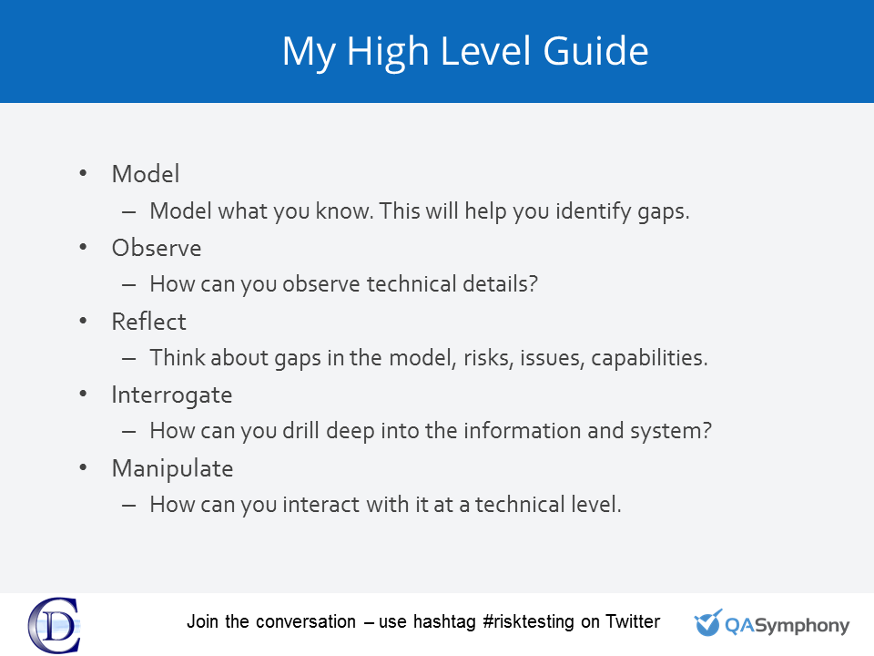

This is my high level guide. I model the system that I'm working with, I model the technology that I'm working with, then I will identify gaps. If I model the system I'm working with and I can see that there's an HTTP communication and I don't know what HTTP is I have to go and learn that. I want to be able to observe the things in my model so how can I observe the HTTP Traffic?

I need to continually reflect on what I'm doing, what my model is, where are the gaps, where are the issues? I need to be able to interrogate and drill dip down into that model. I need to be able to manipulate that model at different levels. If the only manipulation I can do is at the GUI I won't be testing far enough. That obviously there are risks when you're learning a new process because you will be slower. You won't know what you're seeing, you will be unsure whether this is an issue. You will follow up things that might lead nowhere.

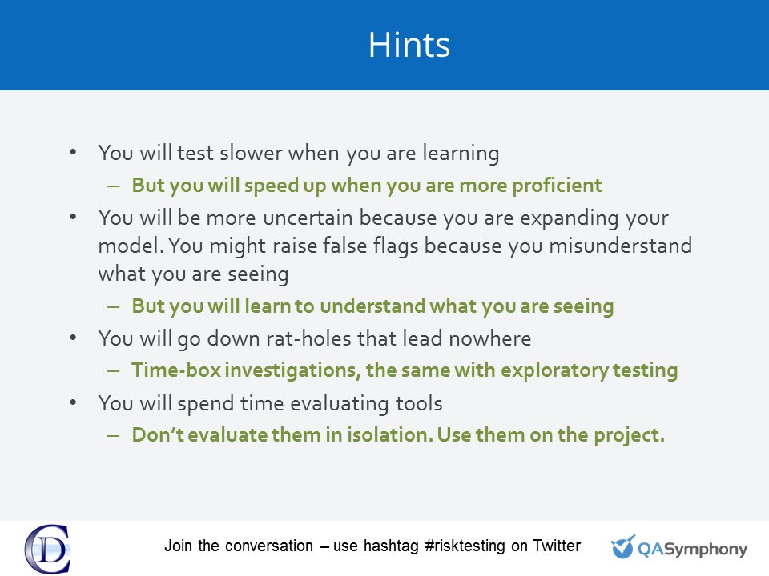

We mitigate these risks, we know that we will speed up, we know that we will apply the things as we're going through. We time box the investigations to mitigate going too far for too long. We don't just spend time evaluating tools, we use the tools and see if they work and learn how to use them at the same time as learning what they do as learning the technology. The more we combine, maximize and apply; the better off we will be.

## A Manager's Guide

Yeah, but seriously, I'm a manager...

* I'm in meetings all day
* I nod when my staff tell me stuff
* If it isn't an email or a word processor or a spreadsheet, I don't open it

If you're a manager looking at this and you don't even have the technical knowledge of how your system works this might be a problem, but managers mitigate risk.

> It is always an individual's choice to
> improve their technical skills.
>
> But a manager's job is to manage risk.
> They can decide to take action to mitigate the risk
> that there are gaps in testing caused by a lack of
> technical focus regardless of their technical knowledge.

It's a manager's job to manage risk, to make decisions that would take action if there's a risk they want to address.

It's an individual's choice, whether they improve their technical skills or not and you can't really force people if they don't want to learn this.

What you can do is create a culture where that learning is valued, where that learning is encouraged, where that learning is helped, but if someone doesn't want to do this you can't make them do it. If you're changing culture, then there's a risk that people don't want to be part of that culture you're trying to change to. These are just management issues and management risks. The fundamental things is, is this notion of pushing your testing to be more technical important? And the risk of not doing that? If that is important will you manage that risk?

* Do any issues or problems slip through the net?
* Ask team to explain their models of the system
* What risks do people target – are there any technical risks?
* Do they understand the technology they are testing?
* Ask people what is missing in their model?
    * What is the next level down in their model?
    * Do they understand that level?
* Identify next steps for expanding the model
    * Who to speak to, identify books that can help, web searches on the technology
* Make learning and sharing learning part of the team process
    * Team members can demonstrate existing tools and skills

## Conclusions

> We test systems to the level that we understand
> them enough to observe their behaviour and compare
> it to our model of how we think it should behave.

We can only test systems to the level that we understand them enough to observe their behavior and compare it to our model of how we think it should behave. That means there's a higher level description of a test process. We have a model, we observe a system, we compare what we've observed back to our model. If there's a difference, then it might be an issue. We have to go in and investigate or communicate the issue.

If what we observe matches our model, chances are the system is working according to what our model of the system is.

> We test systems at the places where
> we can manipulate them.

We can only test systems at the places we can manipulate them and if you can only use a GUI, your manipulation and testing is done at the GUI. If you know how to send the STP messages, you can take your testing to the next technical level.

> We test systems to the level that we can
> interrogate them to understand the data
> that they process and produce.

We test systems to the level that we can interrogate them to understand the data that they process and produce. If all your observation is done and all your interrogation is done at the GUI then that is the only level that you're going to see. You're only going to know if this system has a problem when it reports and error. You're not going to interrogate the logs and see if there were any problems in passing at the time that you did the testing.

The more that we can make our observations and interrogations in the system the more we can look directly into the database to see what the problem is. The more we can interrogate the responses coming back from the system, the more that we can push our testing.

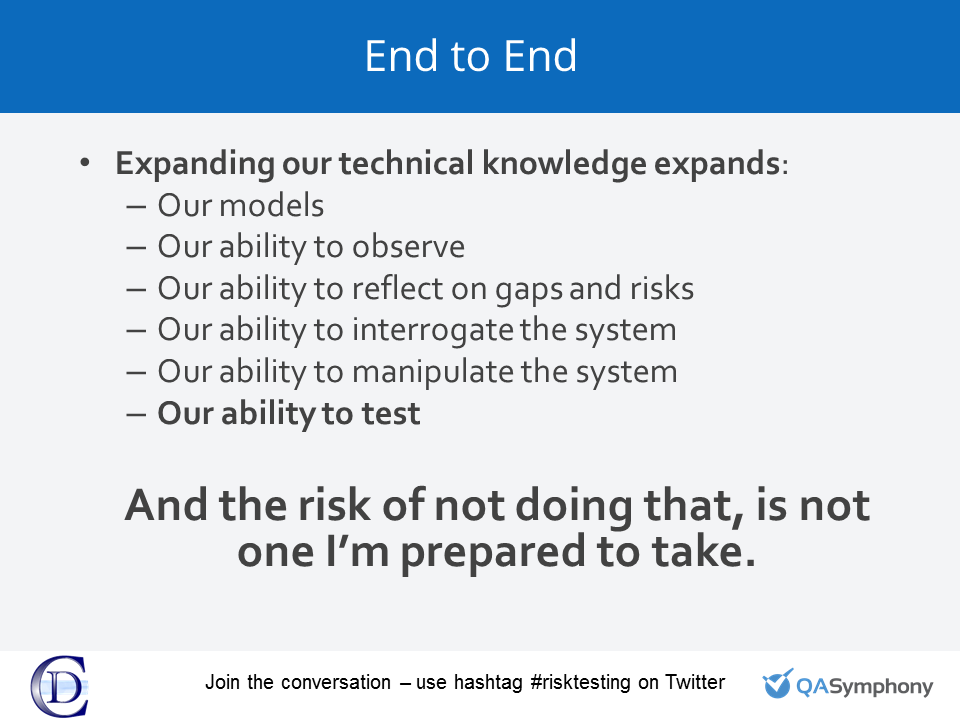

Expanding our technical knowledge expands our models, our ability to observe, our ability to reflect on the gaps, our ability to interrogate the systems, our ability to manipulate the system fundamentally expanding our technical knowledge expands our ability to test. The risk of not doing that is not one that I am prepared to take. You have a choice, you have an individual choice as to whether you address this risk or not.
