# Risk Mitigation Using Exploratory and Technical Testing

28th June 2016

Alan Richardson – Compendium Developments Ltd

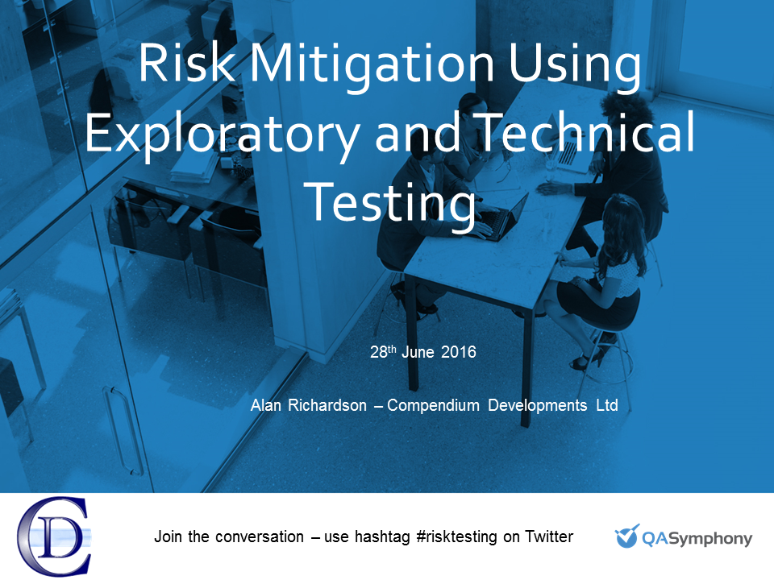

---

# ABOUT QASYMPHONY

Robust test management platform purpose-built to help agile teams centralize, organize and accelerate software testing

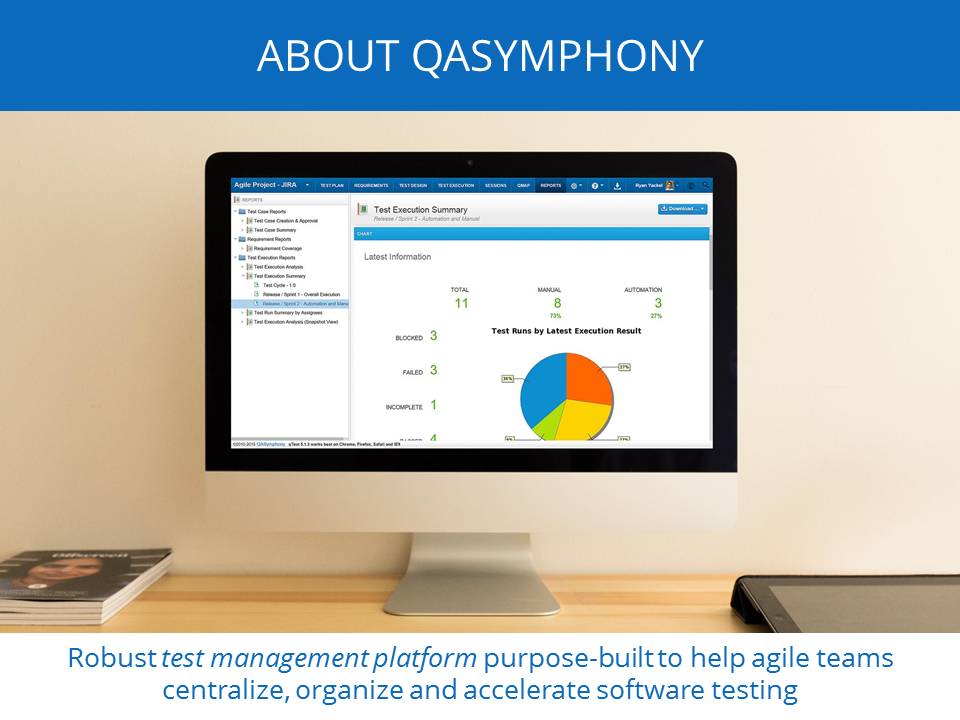

---

# OUR PRESENTER

- Guest Speaker: Alan Richardson
- Alan has worked in Software Development for over 20 years; as a programmer, tester, test manager. As an independent test consultant he helps organisations improve their agility, technical skills and testing processes. Alan wrote the books "Dear Evil Tester", "Java For Testers" and "Selenium Simplified"; he also created online training courses on technical web testing, Java and Selenium WebDriver.
- Alan blogs at EvilTester.com, SeleniumSimplified.com, and JavaForTesters.com; you can find information on his consultancy, training and conference talks at CompendiumDev.co.uk. Follow him on twitter as @EvilTester.

CompendiumDev.co.uk

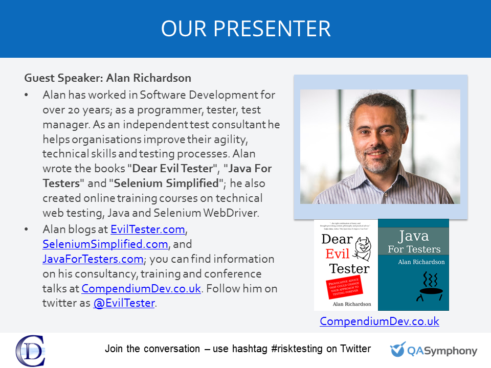

---

# Everyone is already familiar with risk…

- Differences for this Webinar
    - Risk as a belief model
    - Risk underpins testing, so use risk
        - to derive and change process
        - to explore more
        - to push testing further
        - to become more technical

---

# Commonsense Risk

- What is risk?
    - Something that might go wrong
        - Probability
        - Impact

---

# Commonsense Webinar Risks

- What might go wrong
    - With me
        - What if I’m ill? What if I still have a cold and can’t talk?
        - What if I forget what I’m talking about?
    - With my broadband
        - What if the connection drops? What if the speed is poor?
    - With my computer
        - What if it crashes?
    - With the webinar system
        - What if it stops?

- What might go wrong
    - With the phone?
        - What if it cuts out?
    - With the locale
        - What if there is a power cut?
    - With the content
        - What if I bore people?
        - What if they drop out?

---

# Commonsense Risk Process

- Identify
- Mitigate
- Detect
- Accept

---

# So with the Webinar…

- Identify
- Mitigate
    - Illness – sleep more, pre-record webinar just in case
    - Forget – presenter notes, practice
    - Broadband – give slides to host
    - Computer crash – multiple computers
    - Power cut – battery, UPS
    - Phone – landline, mobile
- Accept
    - Boredom, Drop out
- Detect
    - Have computer watching webinar – risk: impacts Mbps

---

# Risk Is…

- Everywhere
- Associated with Every Thing
- Inherent in Every Process
- All pervasive

https://www.flickr.com/photos/britishlibrary/11065829793

https://www.flickr.com/photos/britishlibrary/11065829793

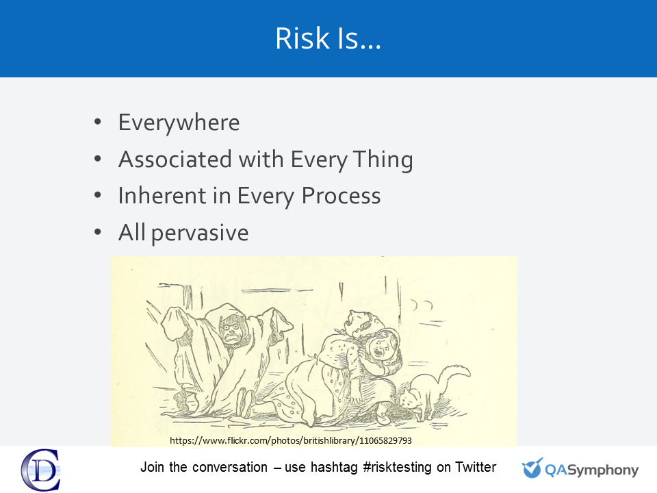

---

# Risk Example: Contact Form on Web Site

```text
You received this e-mail message through your website:
reason: default
E-mail: ngjchr@somewebsitethatdoesnotexist.com
Name: ewogwah
Message: pK9ctN  kfoummnkudob,
[url=http://dnaaimbzpgyg.com/]dnaaimbzpgyg[/url],
[link=http://mmkwfndaydxb.com/]mmkwfndaydxb[/link],
http://bwtjxnpecomy.com/
:
IP: 46.161.9.32
Browser: Mozilla/4.0 (compatible; MSIE 6.0; Windows NT 5.1; SV1)
Points: 0
```

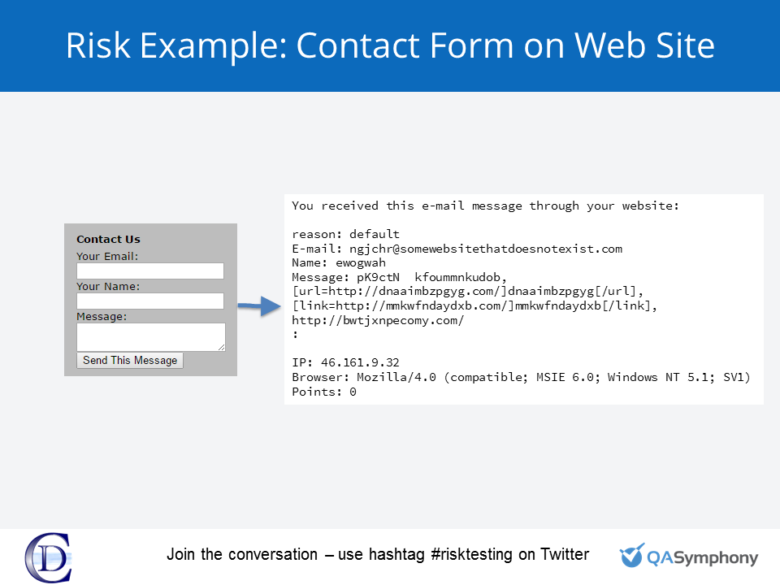

---

# Opportunity: Contact Form doubles as Web Site is ‘up’ checker

```text
You received this e-mail message through your website:
reason: default
E-mail: ngjchr@somewebsitethatdoesnotexist.com
Name: ewogwah
Message: pK9ctN  kfoummnkudob,
[url=http://dnaaimbzpgyg.com/]dnaaimbzpgyg[/url],
[link=http://mmkwfndaydxb.com/]mmkwfndaydxb[/link],
http://bwtjxnpecomy.com/
:
IP: 46.161.9.32
Browser: Mozilla/4.0 (compatible; MSIE 6.0; Windows NT 5.1; SV1)
Points: 0
```

Web Site Status

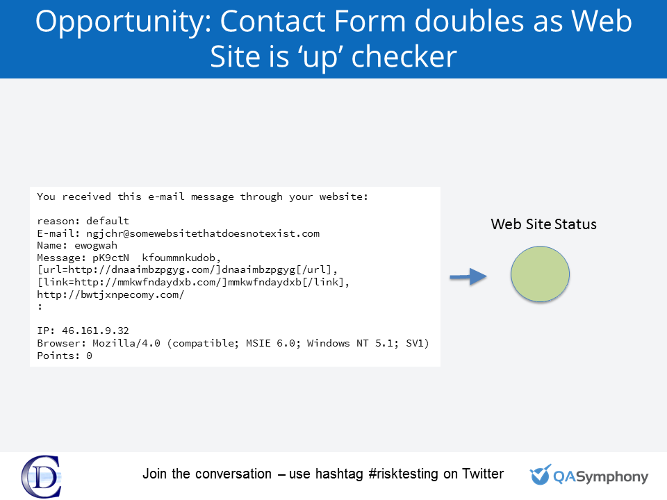

---

# Risk &amp; Opportunity

- What is risk?
    - Something that might go wrong
        - Probability
        - Impact

Opportunity for testing

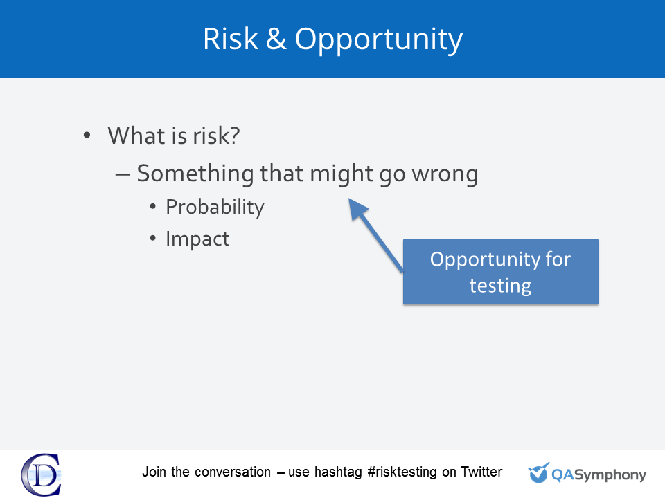

---

# General Risks Relating to Testing

- The functionality might not work
    - “Functional Condition Risk”
- There is a risk that this change might have a knock on effect in the system
    - “Regression Risk”, “Change Risk”

Create Process to mitigate risk

---

# You probably already use risk in your testing

- Business Risk
- Project Risk
- Functional Risk

---

# Typical Risk Modeling: Business Risks

- We might run out of funding
- Our requirements might be wrong
- We might be hit by a regulatory requirement

Less likely to be used for testing

---

# We usually mean project and functional risk

- Project Risk
    - We might not have enough staff
    - Our staff might go sick
    - Everyone takes holiday at the same time
    - Our business users don’t know the requirements
    - Our business users change their requirements
    - etc.
- Functional risk
    - User’s can’t register on the site
    - The payment integration fails
    - The regulatory reporting fails
    - etc.

Test Manager

Test Practitioner

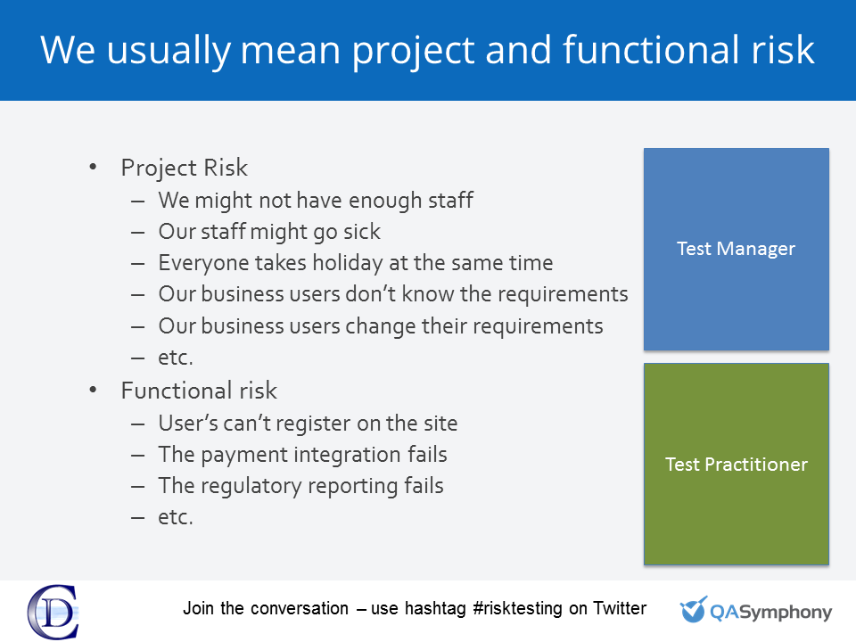

---

# Risk

- What is risk?
    - Something that might go wrong
        - Probability
        - Impact

People get hung up here

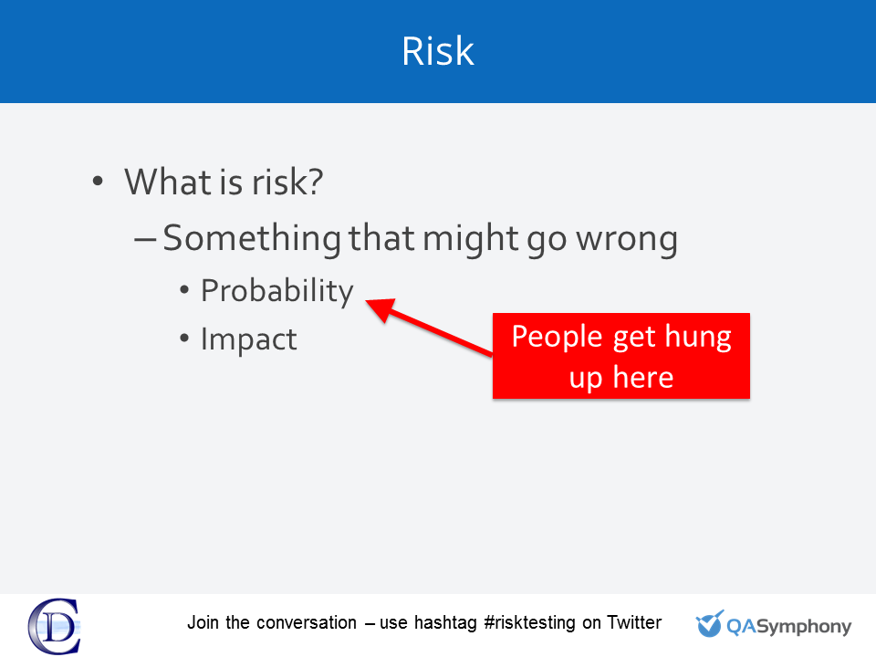

---

# Priority and Probability Procrastination for Project Head Person Protection

http://www.slideshare.net/profmcgill/risk-analysis-for-dummies

Mitigate against Beliefs and fears about being wrong

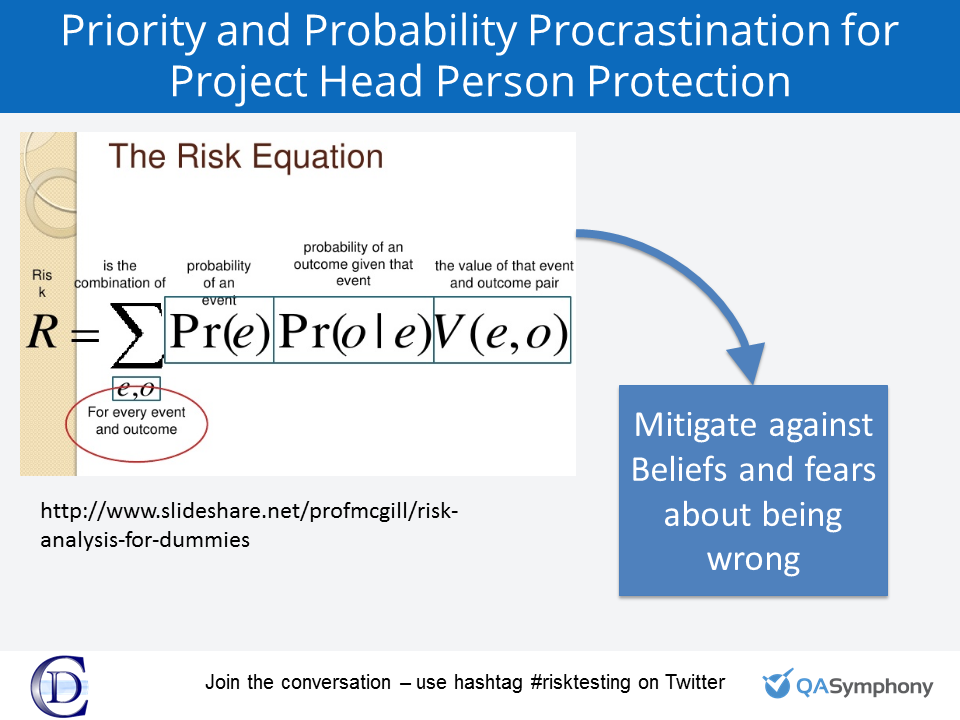

---

# Risk &amp; Testing

How does risk relate to testing?

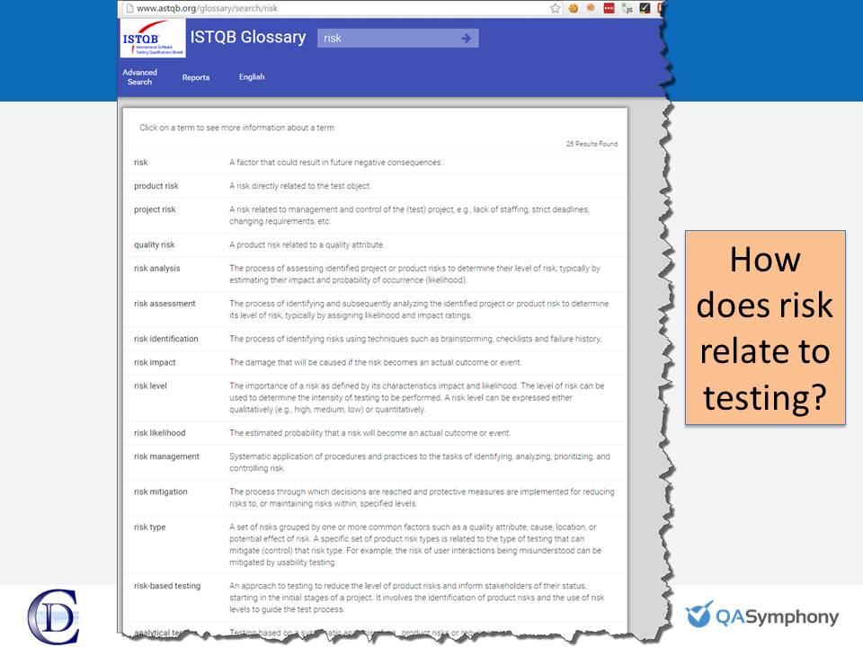

---

# ISTQB “Risk-Based Testing”

“An approach to testing to reduce the level of product risks and inform stakeholders of their status, starting in the initial stages of a project. It involves the identification of product risks and the use of risk levels to guide the test process.”

http://www.astqb.org/glossary/search/risk-based%20testing

---

# ISTQB Risk Based Testing

“An approach to testing to reduce the level of product risks and inform stakeholders of their status, starting in the initial stages of a project. It involves the identification of product risks and the use of risk levels to guide the test process.”

http://www.astqb.org/glossary/search/risk-based%20testing

? What ?

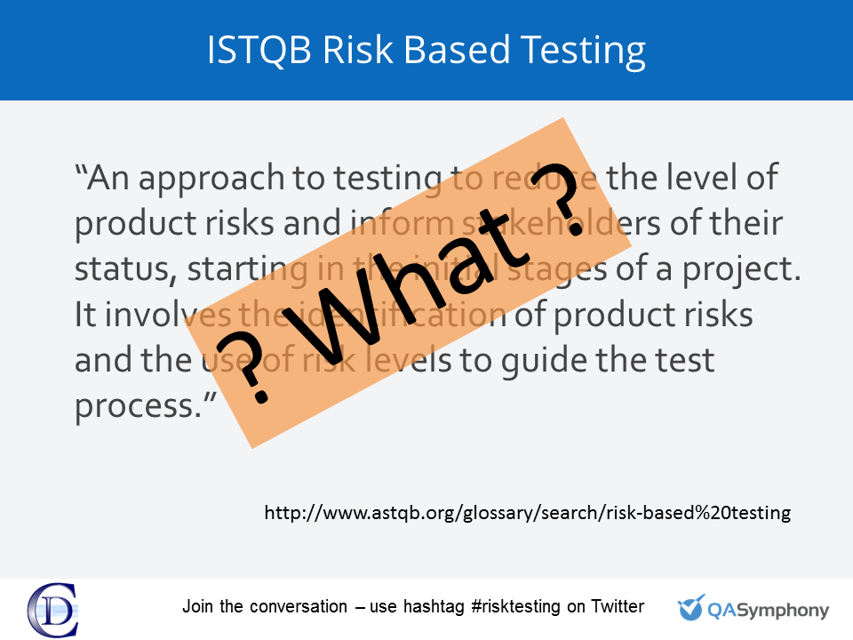

---

# ISTQB Risk Based Testing

“An approach to testing to reduce the level of product risks and inform stakeholders of their status, starting in the initial stages of a project. It involves the identification of product risks and the use of risk levels to guide the test process.”

http://www.astqb.org/glossary/search/risk-based%20testing

Mitigation

Detection

Analysis

Prioritization

Derivation

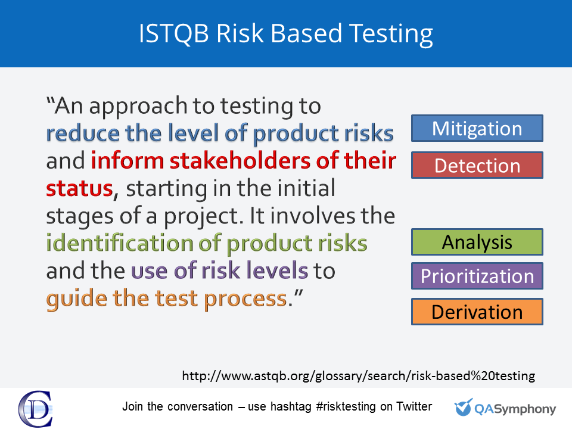

---

# Risk Management &amp; Testing

- Mitigation
    - Do something to make the risk less likely
- Detection
    - Find out if the risk has manifested as an issue
- Analysis
    - Identify Risks
- Prioritization
    - Decide which risks are more important: how bad is the impact, who is it bad for, how likely to we believe the risk to be?
- Derivation
    - How can you test for this: make it manifest, check if it manifests, explore impact?

Risk Management

Testing

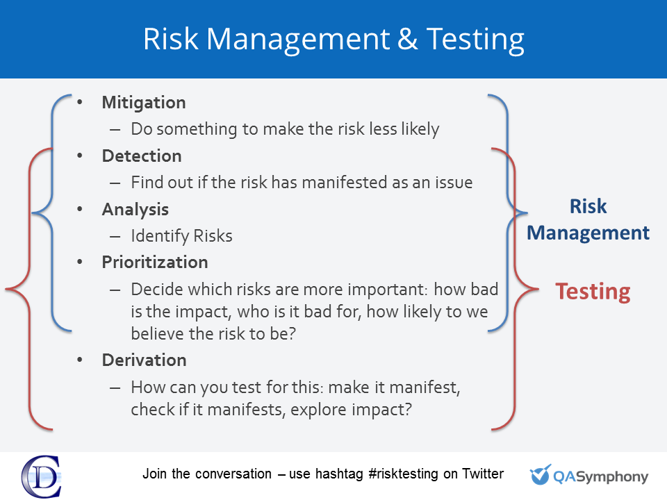

---

# Some Risk Classifications

- Functional Risk
    - Relating to the functionality
        - function, security, performance, accessibility
- System Risk
    - performance, security, backups, install, restore
- Technical Risk
    - Technology involved: load balancing, libraries, protocols, platform compatibility
- Non-system Related
    - Process Risk
    - Business Risk
    - Project Risk

Based on the System Of Development

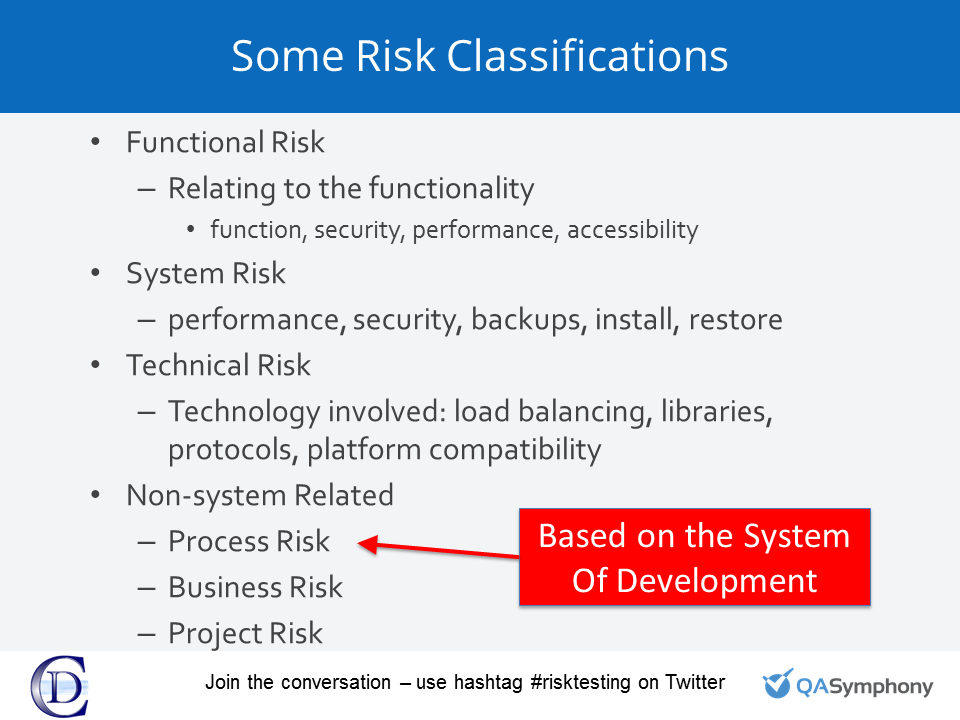

---

# Some Risk Classifications

- Functional Risk
    - Relating to the functionality
        - function, security, performance, accessibility
- System
    - performance, security, backups, install, restore
- Technical Risk
    - Technology involved: load balancing, libraries, protocols, platform compatibility
- Non-system Related
    - Process Risk
    - Business Risk
    - Project Risk

See Related References

See Related References

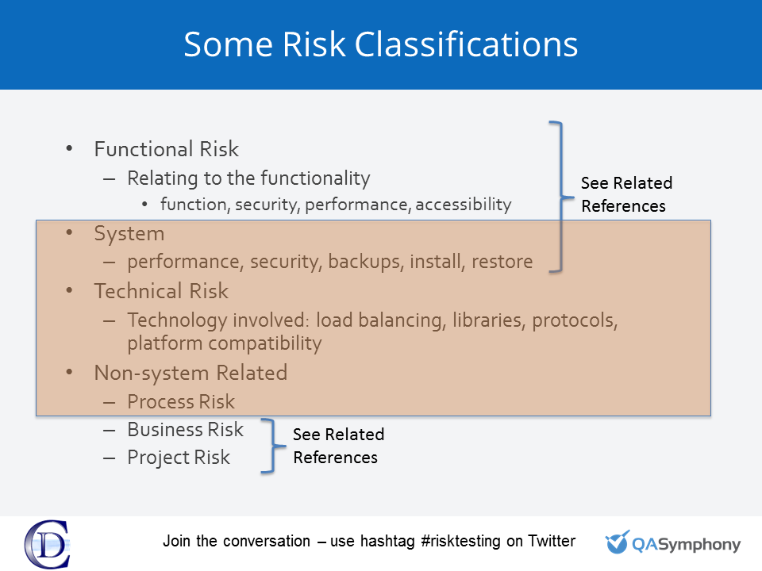

---

# Process Risk

- System “of” Development
    - How we develop software
    - What is our process?
    - What are our skills?
    - What tools do we use?
    - etc.

The way we develop software opens us up to different types of risk.

---

# Process Risk

- System “of” Development
    - How we develop software
    - What is our process?
    - What are our skills?
    - What tools do we use?
    - etc.

The way we develop software opens us up to different types of risk.

And that is why we adopt different approaches in how we test.

---

# Process Risk

- Analyse Process
    - Identify Risks
    - Any issues that happen?
    - What works what doesn’t?

Change Process To…

Mitigate

Detect

Accept Risk

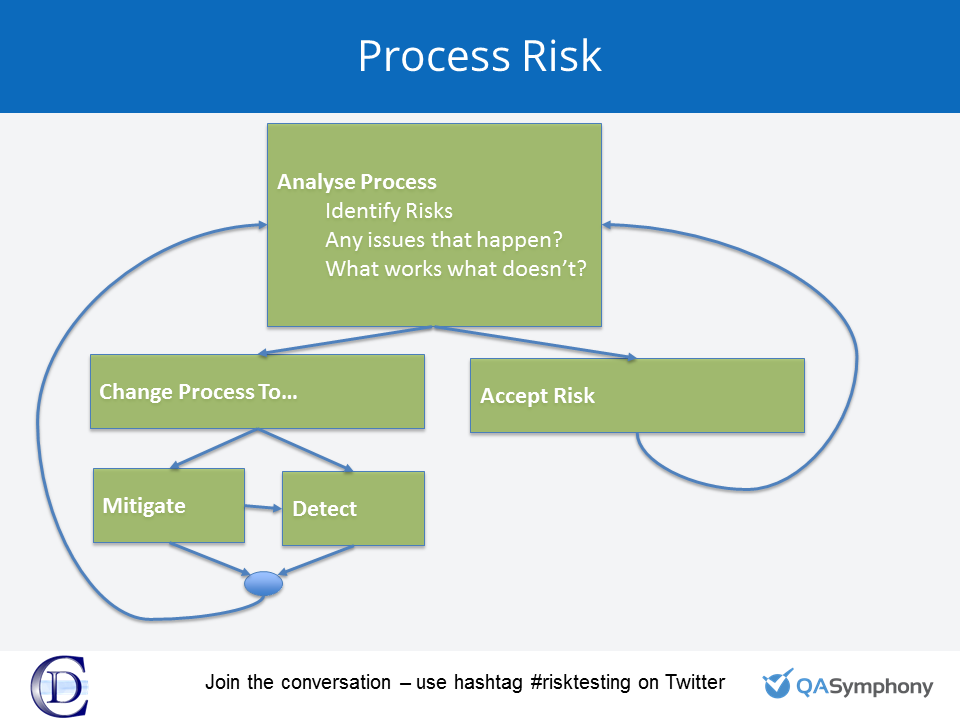

---

# Every Process Has Inherent Risk

“We use a very structured and traditional approach to testing”

- Risks:
- We can’t estimate accurately in advance
- Development over-runs
- Testing takes too long at the end (to meet our schedule)
- Testing can’t respond fast enough when requirements change

- Test Cases
- Test Scripts
- Test Plans
- Test Strategies
- etc.

“We use waterfall development”

&amp;

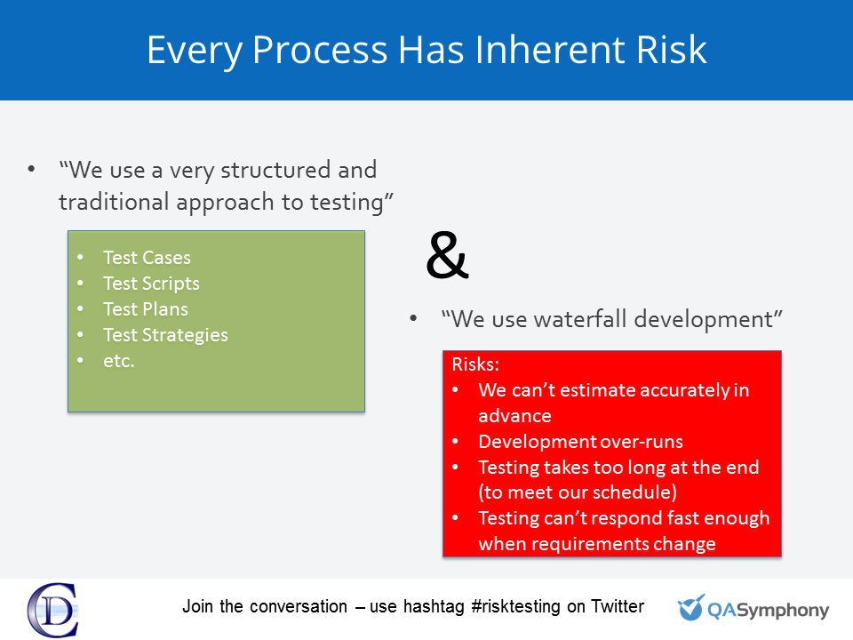

---

# Process &amp; Culture Clash Risk

“We use a very structured and traditional approach to testing”

- Risks:
- Testing is too slow
- Testing doesn’t add value
- We don’t need testing

- Test Cases
- Test Scripts
- Test Plans
- Test Strategies
- etc.

“We use an Agile approach to development”

&amp;

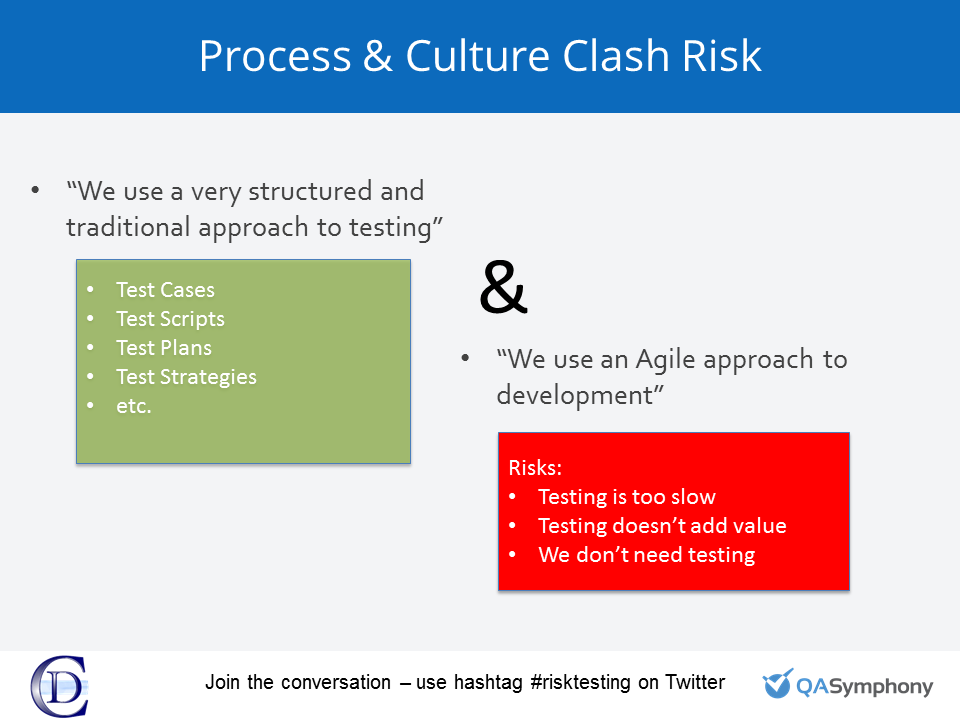

---

# Process as a System

Stories

Conversations

Code

Explore

Done

Automate

Time-boxed

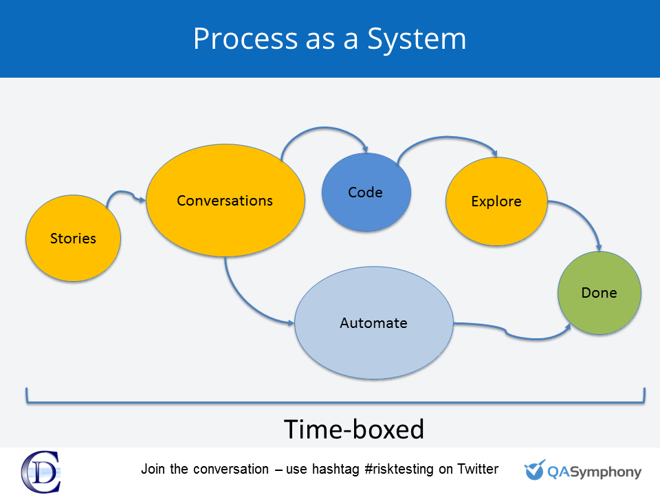

---

# Process Risk

Stories

Conversations

Code

Explore

Done

Automate

Time-boxed

Miscommunication

Misunderstanding, Omissions, Bugs

Overcommit, Emergencies

Too much to automate, wrong tools

Tech Debt

Too early

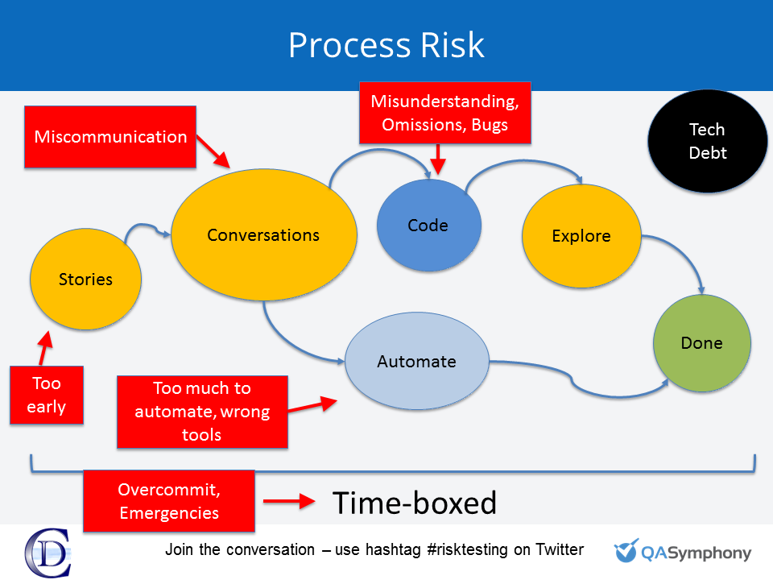

---

# Risk Driven Process

Stories

Conversations

Code

Explore

Done

Automate

Time-boxed

Miscommunication

Misunderstanding, Omissions, Bugs

Overcommit, Emergencies

Too much to automate, wrong tools

Tech Debt

Too early

Discuss ‘test ideas’, add ideas to story

Log testing done, debrief, small chunks, prioritise iteratively

Early questions, but not too early

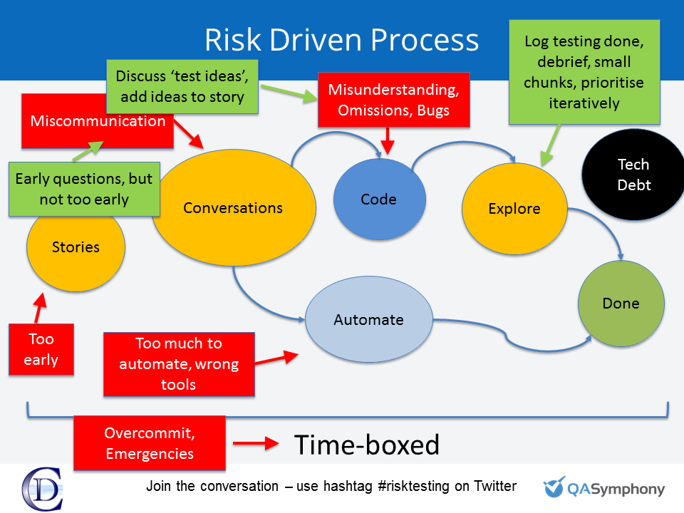

---

# Process Risks Are System Risks

- Interconnected Teams
- Individuals
- Relationships
    - Communication
    - Artefact delivery and review
- Timings
- Expectations, Input/Output, Contracts
- Etc.

“System of Development”

Create Process to mitigate risk

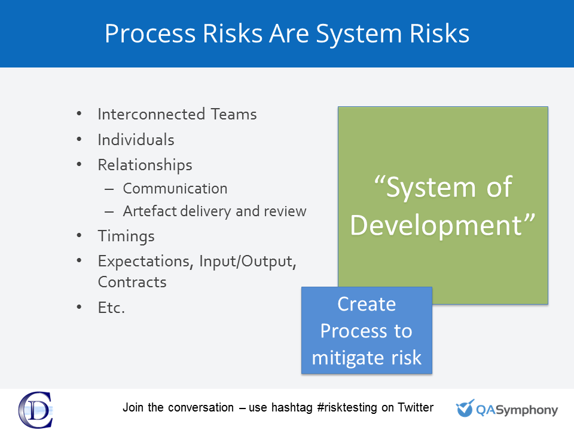

---

# Changing Process is a Risk

But if we already know it doesn’t work how can we justify not changing?

---

# Beliefs

https://www.flickr.com/photos/britishlibrary/11291184996

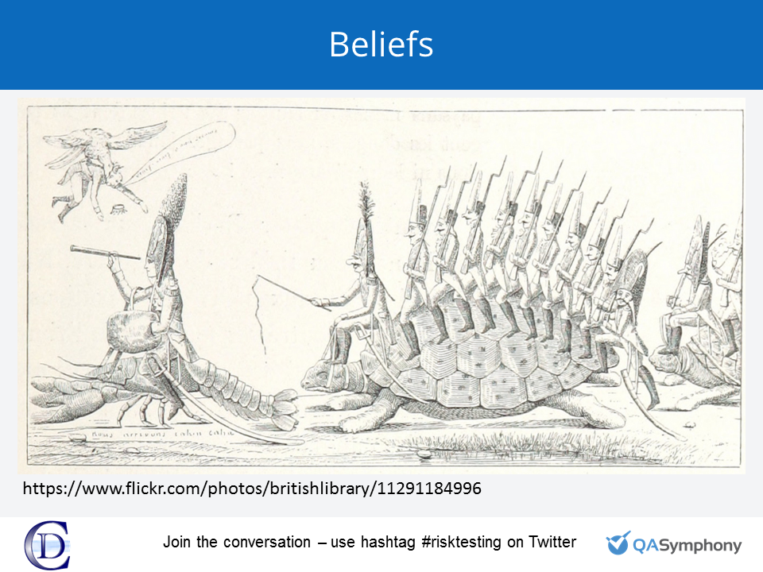

---

# Secondary Gain

- Unrecognised ‘benefit’
- e.g. Smoking
    - -&gt; Main Risk -&gt; I might die
    - Secondary Gain
        - I get to take breaks outside
        - I get to chat and socialise
        - I have stress relief breaks
- Secondary Gain means I might not stop smoking, even if I try.

https://www.flickr.com/photos/britishlibrary/11103578275/

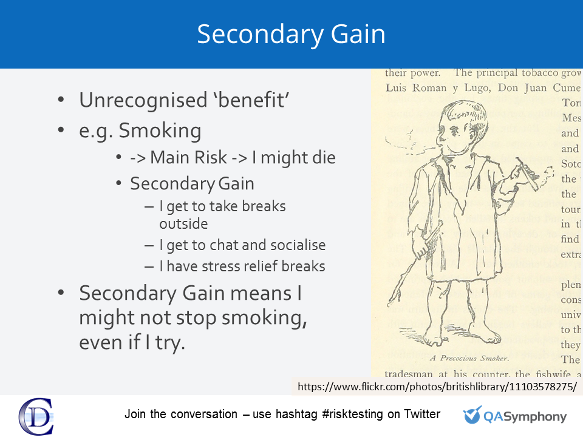

---

# Hypothetical Examples of Secondary Gain

- Risk keeps us in business
- Process risk justifies our ‘standard’
- Not enough time means we never have to finish
- Not enough time means we don’t have to learn
- Secondary Gain is a massive risk to change
    - Identify secondary gain
    - and change your attitude to it

---

# Testing must not be limited by our beliefs

- What do I think could go wrong?
    - Options are limited by our model of the world
    - 5 Whys questioning specifically targets beliefs.
    - What Else?
    - Systems Analysis

---

# How does “risk” lead to exploratory testing

- I believe
    - The more complicated a system the more risk that something can go wrong
    - We want to simplify the ‘process’ as much as we can

---

# How does “risk” lead to exploratory testing

If you had no test process and designed one based on risk:

I don’t know how to test it

What is it supposed to do?

Who is going to use it?

What data does this process?

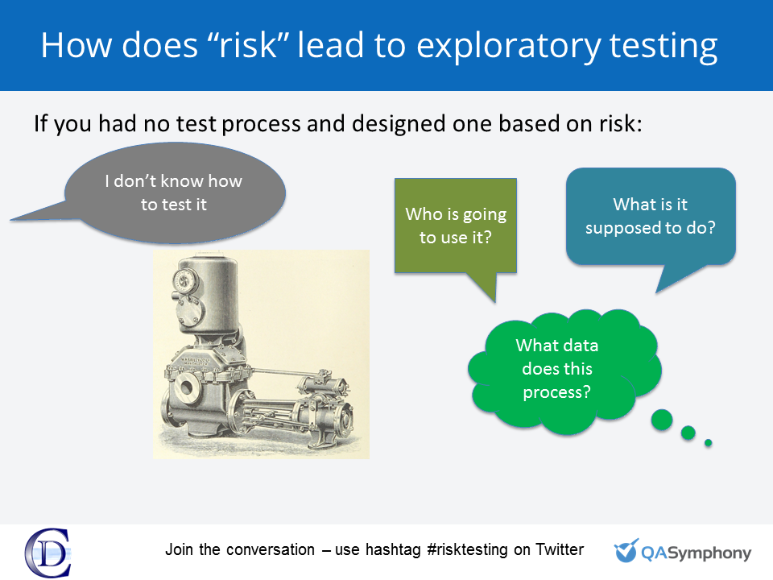

---

# How does “risk” lead to exploratory testing

If you had no test process and designed one based on risk:

I don’t know how to test it

What is it supposed to do?

Who is going to use it?

What data does this process?

Risk: We don’t know if it works.

Risk: It might not function.

Risk: It might not meet user need.

Risk: It might not handle input

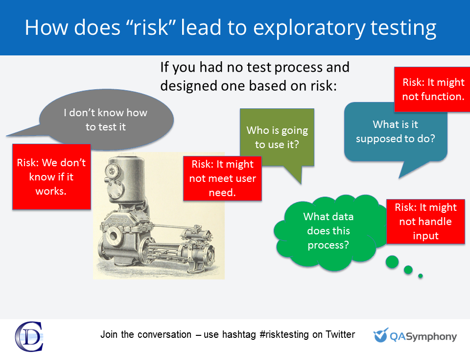

---

# How does “risk” lead to exploratory testing

- Then we would improve the process by looking at other risks:
    - Risk that we haven’t tested enough
        - Agree high level conditions, review the conditions before we start, review the work
    - Risk that we can’t tell people what we did
        - Learn to take notes, communicate what we do, collate reports in a searchable form
    - Risk that we can’t plan it because we don’t know what we’ll test
        - agree a time constraint, work in small chunks, prioritise coverage, adjust based on review of the output
    - etc.

---

# Basic System

Login Web Page &lt;-&gt; HTTP Server &lt;-&gt; DB with user details

- HTTP
- Server

User Details Database

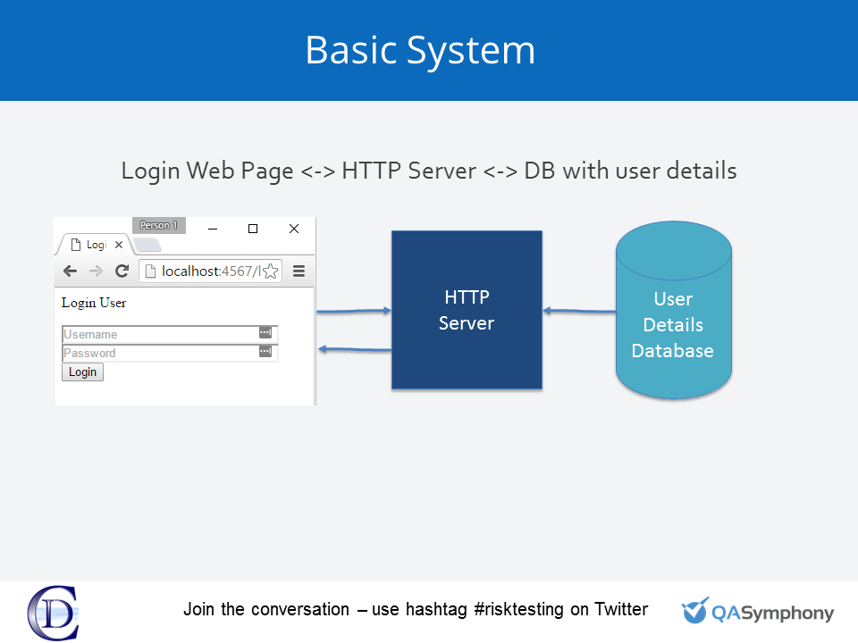

---

# Risk: Basic Acceptance Criteria is not enough

- A user must correctly fill in their username and password on the website before they login and access the system
    - User Exists, Password correct
        - user logged in
    - User Exists, password wrong
        - user not logged in
    - User does not exist, password meets valid criteria
        - user not logged in

High Level Acceptance Criteria

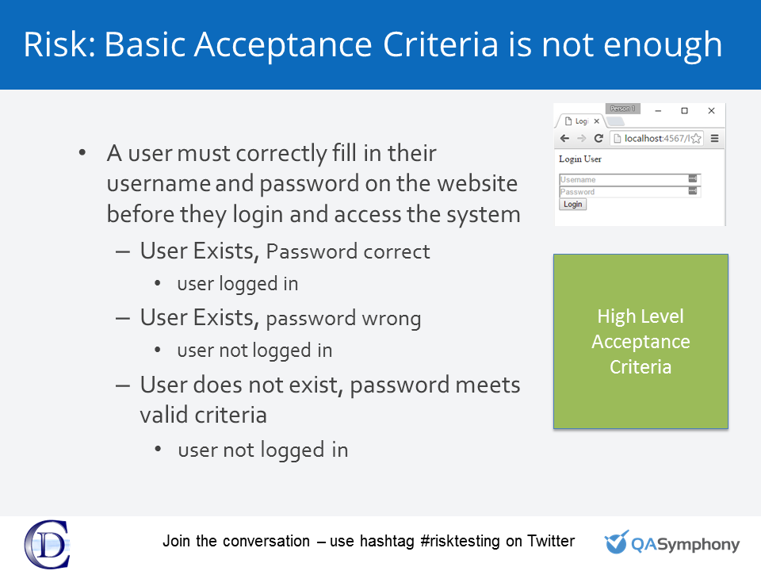

---

# Mitigate risk of missing Acceptance Criteria

- We would ask for additional information about requirements and acceptance criteria.
    - How often can a user try to login?
    - What if user is already logged in?
    - What error messages displayed?
        - For getting password wrong
        - When user does not exist
        - If username blank
        - If password blank
        - etc.

- Acceptance Criteria
- Nuances &amp; Details &amp; some technical implementation details

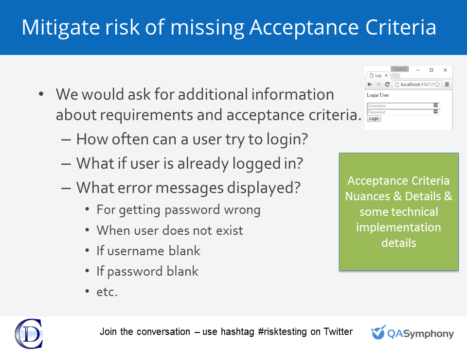

---

# Mitigate limited coverage of business domain to cover web page structure and platforms

- Non-domain input
    - Username and password are text fields
        - how much text can they handle? maxlength=’20’, JS validation
        - Unicode chars? JS validation of valid chars
        - Drag files in?
        - URLs
        - Special chars
        - Injection payloads
        - Etc.
- Platform concerns
    - Browser Compatibility, JavaScript

Technical implementation details and platform risks.

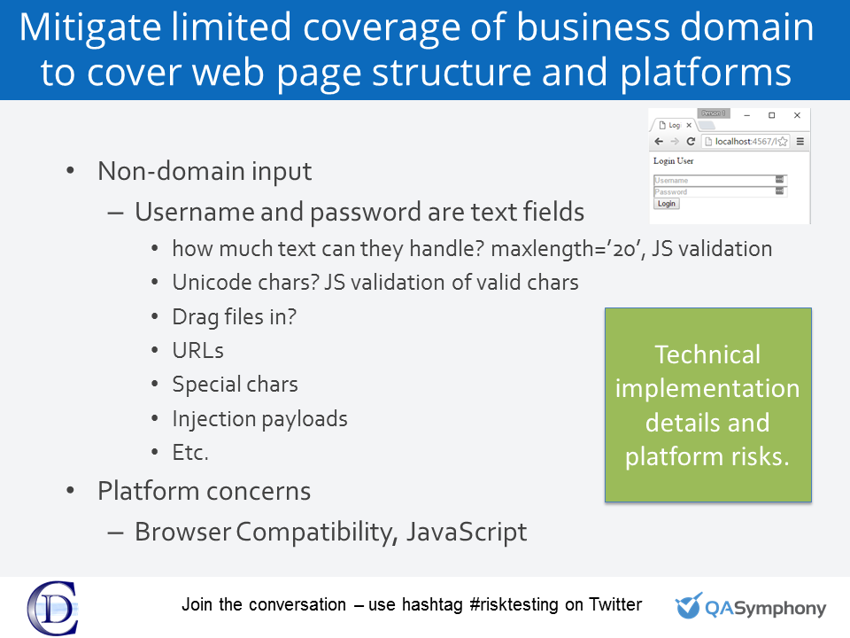

---

# What is Technical Testing?

- Testing informed by a technical understanding of the system.
- Not programming. Not automating.
- Technical knowledge Applied to Testing

---

# Let’s Build a System Technical Model

- HTTP
- Server

User Details Database

- failedLoginCookie &amp; JavaScript (disable login)
- JS Validation of username password:
    - Chars
    - length

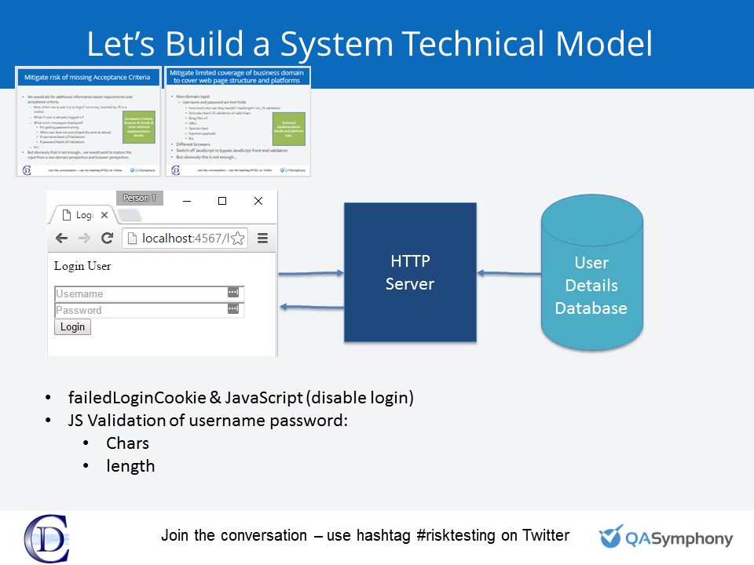

---

# Technical Testing Model

- failedLoginCookie &amp; JavaScript (disable login)
- JS Validation of username password:
    - Chars
    - length

- What if user disables cookies?
- What if user amends cookies?
- What if JavaScript disabled?
- What if JavaScript amended?
- What if maxlength html changed?

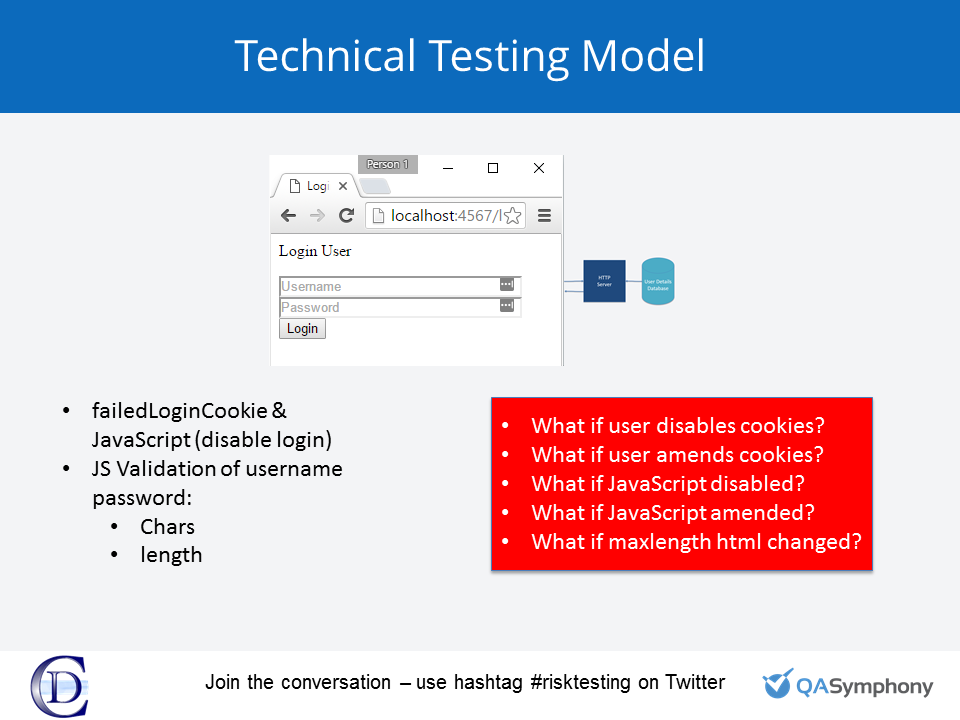

---

# Technical Testing Skills

- failedLoginCookie &amp; JavaScript (disable login)
- JS Validation of username password:
    - Chars
    - length

- What if user disables cookies?
- What if user amends cookies?
- What if JavaScript disabled?
- What if JavaScript amended?
- What if maxlength html changed?
- What browser is JS compatible with?

- Do we have the technical knowledge to:
- Spot the technical risks around reqs
- Identify the ‘what if’ risks
- Know how to manipulate JS, HTML, and Cookies

1. HTML
1. Cookies
1. How to disable JavaScript
1. Multiple Browsers
1. Browser Dev Tools
1. How to write JavaScript
1. Use the JavaScript Console
1. Intercept and manipulate the source through a proxy

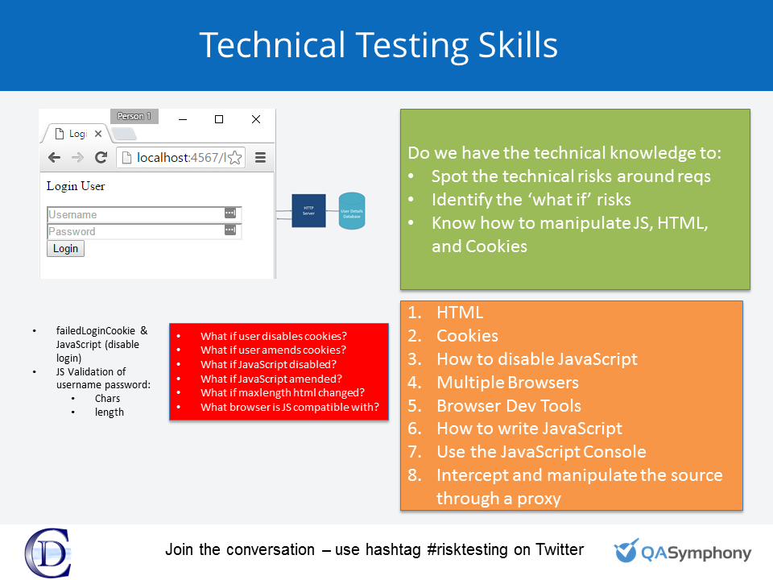

---

# Risk that we ignored HTTP transport layer and server communication

System Model Technical risks.

- What Risks are there from technical knowledge of HTTP and Server?
- JavaScript and Server side validation use different rules
- Server side does not implement max failed logins 10 times
- Server side max login count is tracked separately from client count
- Server side can’t handle form field input values &gt; 20
- ‘massive’ input values cause server to crash
- Invalid form details are not processed correctly
- Submitting form to different end point causes problem
- Adding basic-auth headers fools system
- etc.

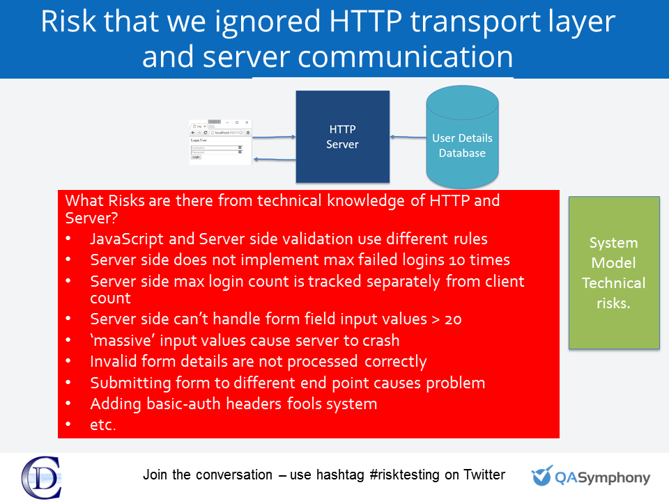

---

# Risk that we ignored HTTP transport layer and server communication

Do we have the technical knowledge to identify these risks and build this model and explore it?

- What Risks are there from technical knowledge of HTTP and Server?
- Risk that the JavaScript and Server side validation use different rules
- Risk that the server side does not implement max failed logins 10 times
- Risk that the server side max login count is tracked separately from client count
- Risk that server side can’t handle form field input values &gt; 20
- Risk that ‘massive’ input values cause server to crash
- Risk that invalid form details are not processed correctly
- Risk that submitting form to different end point causes problem
- Risk that adding basic-auth headers fools system
- etc.

1. HTTP
1. Observe HTTP Traffic (proxies or dev tools)
1. Manipulate and send HTTP form submission without GUI using Proxies
1. Access to server logs
1. Telnet, SSH

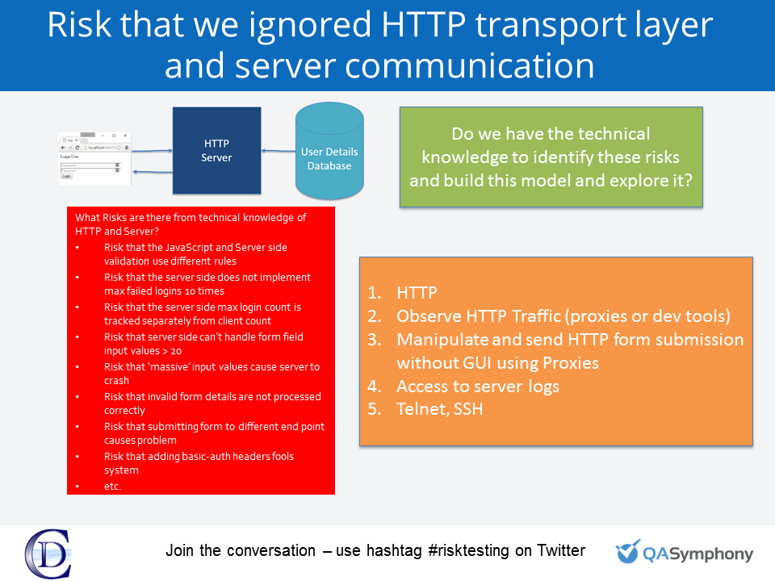

---

# How did we get to this?

Structure of Technical System

Platform &amp; Input

Common Domain

Reqs

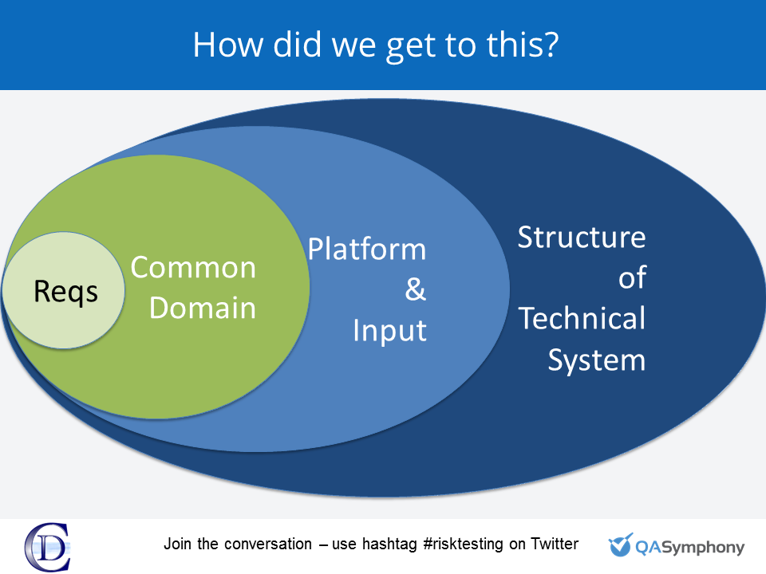

---

# What are the risks of doing this?

- we don’t have the skills
- we don’t have the inclination
- our staff don’t want to learn
- we don’t have the time to learn
- we do technical stuff and ignore the ‘requirements’
- we don’t have the tools
- we are not allowed to use the tools
- we can’t ‘sell’ this to our managers

We have to decide if these are important enough to mitigate

---

# What are the risks of not doing this?

- Risk that we miss entire areas of errors in our testing.
- Risk that no-one reviews the system at this level of technical details.
- The errors that can slip through, can be system threatening.
- The easiest place to do this type of testing is through exploratory testing.

---

# How can we do this?

- You can use all the various mnemonics and ‘heuristics’ that are out there, to expand your analysis of the system.
    - http://www.qualityperspectives.ca/resources\_mnemonics.html
- Work from ‘first principles’
    - Build system and technical models
    - Analyse the model for gaps and risks
- Both require you need to increase your technical knowledge:
    - To work from first principles to build a model and identify gaps in your knowledge and identify risks
    - To gain maximum value from the mnemonics because they help you explore your model

---

# Simple decisions

- Are you prepared to increase your technical knowledge?
- Are you prepared to put in the time and effort to learn more?
    - You / Your Company / Your Manager / Your Project

---

# You don’t have to know everything

If learn in small chunks, you apply what you learn, during your testing, then you will keep learning and keep your knowledge up to date.

---

# My High Level Guide

- Model
    - Model what you know. This will help you identify gaps.
- Observe
    - How can you observe technical details?
- Reflect
    - Think about gaps in the model, risks, issues, capabilities.
- Interrogate
    - How can you drill deep into the information and system?
- Manipulate
    - How can you interact with it at a technical level.

---

# Warning: Risks

- You will test slower when you are learning
- You will be more uncertain because you are expanding your model
- You might raise false flags because you misunderstand what you are seeing
- You will go down rat-holes that lead nowhere
- You will spend time evaluating tools

---

# Hints

- You will test slower when you are learning
    - But you will speed up when you are more proficient
- You will be more uncertain because you are expanding your model. You might raise false flags because you misunderstand what you are seeing
    - But you will learn to understand what you are seeing
- You will go down rat-holes that lead nowhere
    - Time-box investigations, the same with exploratory testing
- You will spend time evaluating tools
    - Don’t evaluate them in isolation. Use them on the project.

---

# Yeah, but seriously, I’m a manager…

- I’m in meetings all day
- I nod when my staff tell me stuff
- If it isn’t an email or a word processor or a spreadsheet, I don’t open it

---

# I manage seriously…

- It is always an individual’s choice to improve their technical skills.
- But a manager’s job is to manage risk. They can decide to take action to mitigate the risk that there are gaps in testing caused by a lack of technical focus regardless of their technical knowledge.

---

# Start to End

- We test systems to the level that we understand them enough to observe their behaviour and compare it to our model of how we think it should behave.
- We test systems at the places where we can manipulate them.
- We test systems to the level that we can interrogate them to understand the data that they process and produce.

---

# End to End

- Expanding our technical knowledge expands:
    - Our models
    - Our ability to observe
    - Our ability to reflect on gaps and risks
    - Our ability to interrogate the system
    - Our ability to manipulate the system
    - Our ability to test

---

# End to End

- Expanding our technical knowledge expands:
    - Our models
    - Our ability to observe
    - Our ability to reflect on gaps and risks
    - Our ability to interrogate the system
    - Our ability to manipulate the system
    - Our ability to test
- And the risk of not doing that, is not one I’m prepared to take.

---

# Q&amp;A

Questions?

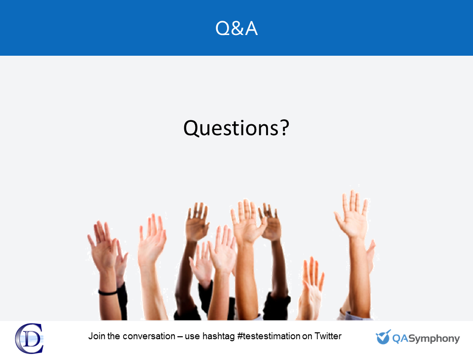

---

# Thank you

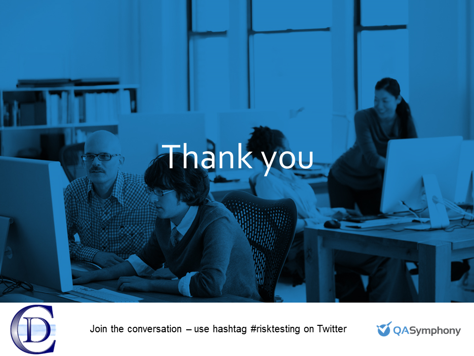

---

# Related Resources

- http://www.developsense.com/blog/category/risk/
- http://www.slideshare.net/profmcgill/risk-analysis-for-dummies
- http://www.astqb.org/glossary/search/risk
- Heuristic Risk Based Testing http://www.satisfice.com/articles/hrbt.pdf
- http://www.satisfice.com/blog/archives/category/risk-analysis
- https://www.cmcrossroads.com/sites/default/files/article/file/2014/A%20Risk-Based%20Test%20Strategy.pdf
- http://kaner.com/pdfs/QAIRiskBasics.pdf
- https://en.wikipedia.org/wiki/Risk
- http://www.qualityperspectives.ca/resources\_mnemonics.html

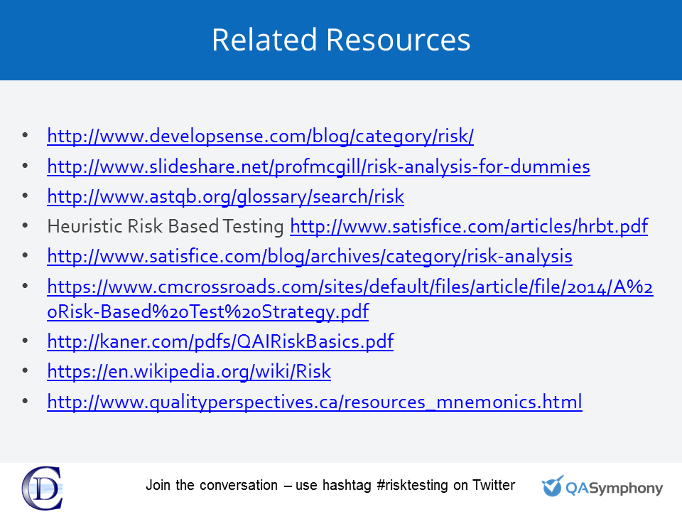
