<!-- Slide 1 -->

# NLP for Testers – a short introduction

Alan Richardson

Compendium Developments

[http://compendiumdev.co.uk/nlp](http://compendiumdev.co.uk/nlp)

(Supporting Paper and Web Links)

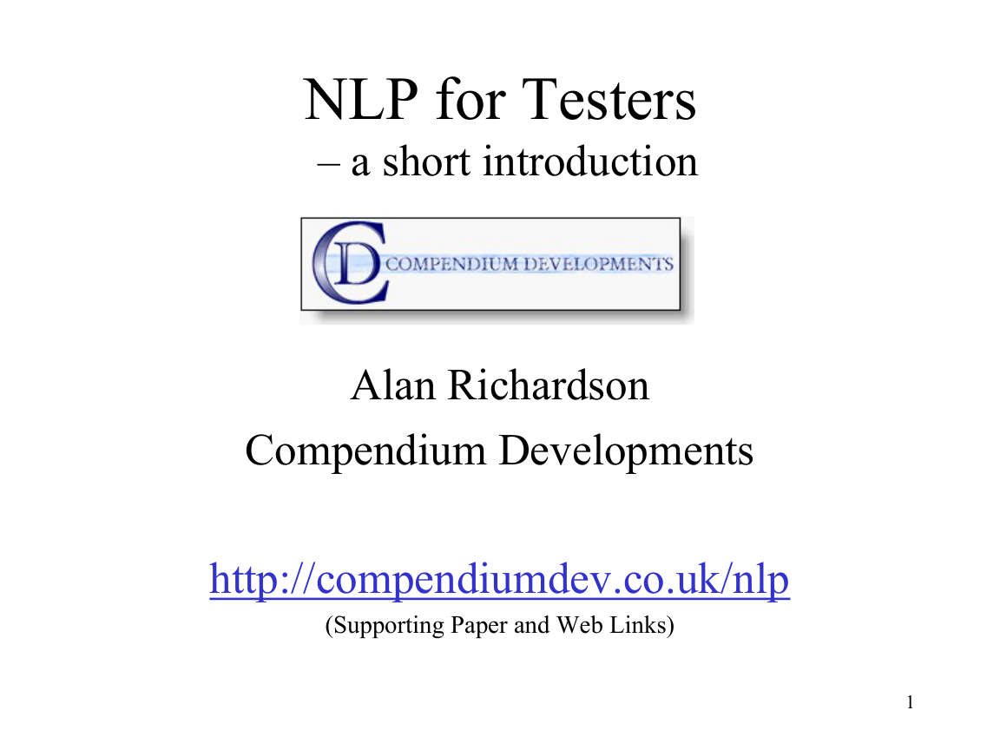

---

<!-- Slide 2 -->

# What NLP Have you Experienced?

- Trainings
- Books
- Anything at all?

---

<!-- Slide 3 -->

# What is NLP?

---

<!-- Slide 4 -->

# How is NLP advertised?

- Improve your relationships,
- master rapport with anyone in moments,
- sell anything to anyone, and do it ethically,
- gain more flexibility,
- cure any phobia in seconds,
- get more of what you really want,
- Create instant motivation and confidence

---

<!-- Slide 5 -->

# What is it really?

---

<!-- Slide 6 -->

# Neuro Linguistic Programming

Linguistic

Language and nonverbal communication systems through which neural representations are coded, ordered, and given meaning.

Programming

The ability to organize our communication and neurological systems to achieve specific desired goals and results.

Neuro

Nervous system through which experience is received and processed through the five senses.

[http://www.purenlp.com/nlpis1.htm](http://www.purenlp.com/nlpis1.htm)

“…the study of the structure of subjective experience.”

[www.richardbandler.tv](http://www.richardbandler.tv)

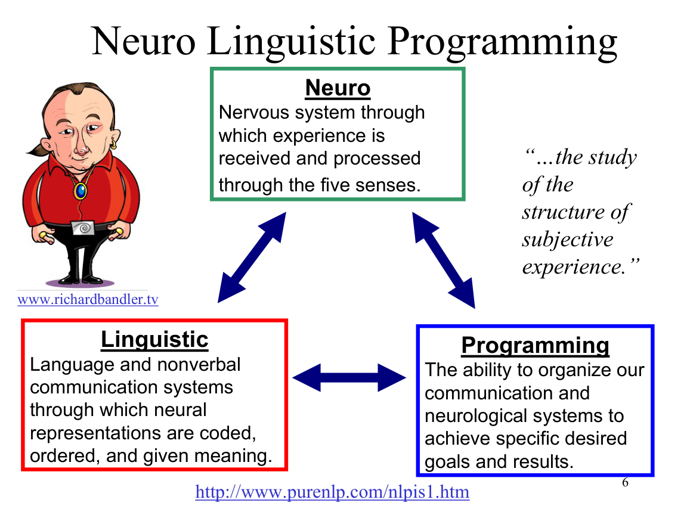

---

<!-- Slide 7 -->

# No, What is it really?

---

<!-- Slide 8 -->

# Roots of NLP

“The Structure of Magic” volume 1, Richard Bandler &amp; John Grinder

\[NLP is a Synthesis\]

## Embedded Diagram Text

Virginia Satir

Fritz Perls

Frank Farrelly

Milton Erickson

Others

Transformational Grammar

Family Therapy

Congruence

Groups

Change

Gestalt Therapy

Context

Provocative Therapy

Attitude

Humour

Challenge

Explore limits

Honesty

Hypnosis

Ambiguity

Conversational Change

George Miller

Gregory Bateson

Alfred Korzybski

Edward Sapir

Mathematical Logic

Deep structure

Surface Structure

Deletion

Distortion

Generalization

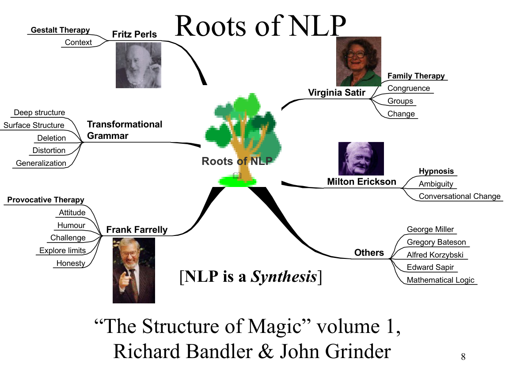

---

<!-- Slide 9 -->

# Modelling

“The NLP modeling process involves finding out about how the brain (“Neuro”) is operating by analyzing language patterns (“Linguistic”) and non-verbal communication. The results of this analysis are then put into step-by-step strategies or programs (“Programming”) that may be used to transfer the skill to other people and areas of application.”

Modeling with NLP,

Robert Dilts

Meta Publishing, 1998

Most techniques and tools of NLP have been derived by…

---

<!-- Slide 10 -->

# Presuppositions of NLP

- The Map is not the Territory
- Life and Mind are systemic processes

---

<!-- Slide 11 -->

# NLP and Testing are related

- Questioning
- Modelling
- Communication
- Effectiveness
- Attitude
- Synthesis Knowledge Systems
- Literalism
- Identify Ambiguity
- Honesty

---

<!-- Slide 12 -->

# Exercise: Attributes of a tester

- Identify…
- Attributes or Qualities of a tester
- Descriptions of a tester

---

<!-- Slide 13 -->

# Results

- Adjectives? Phrases?
- Were the attributes positive?
    - Any useful negative attributes?
- How many apply to you?

---

<!-- Slide 14 -->

# Attributes vs States

Attributes

- Person ‘has’
- Context?
- “IS” of identity

States

- Person ‘feels’
- Context State
- Behaviour

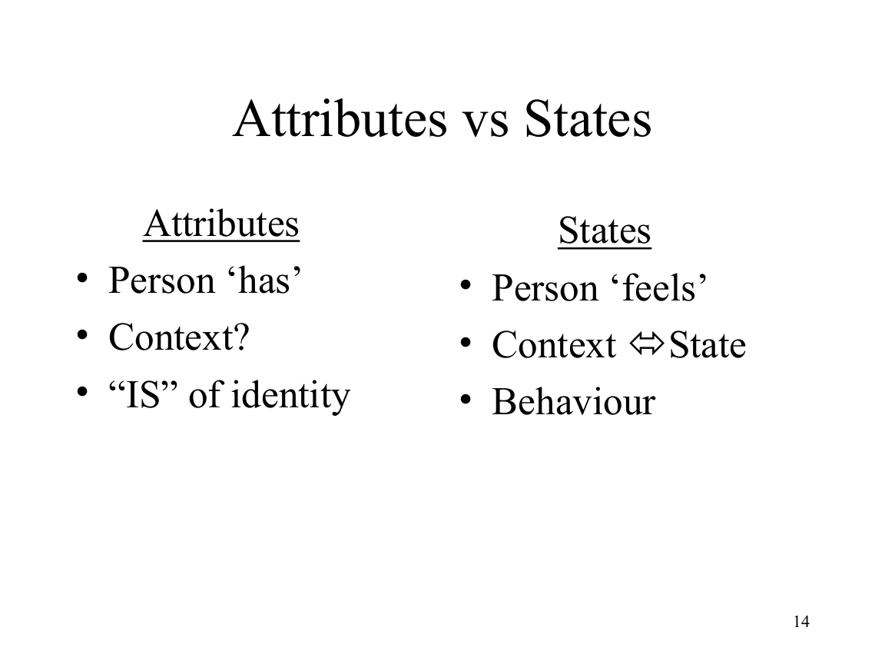

---

<!-- Slide 15 -->

# Exercise: Convert attributes into states

- Can you generate and feel those states in yourself?
- Can you say things to other people to generate those states? (Elicitation)
- When would those states be appropriate?
- Can you identify a time when you used those states positively? Negatively?

---

<!-- Slide 16 -->

# Meta-Model

- Identify Ambiguity Early
- Apply to the communication we give
- Apply to the system
- A Model of Analysis (Req, Spec, etc.)
- Apply to our beliefs and values about testing

---

<!-- Slide 17 -->

# Deep Surface

- Meta-Model based on transformational grammar model
- Words affect experience

Deep Structure

Surface Structure

Primary Experience

Sensory &amp; Emotional

Secondary Experience

Linguistic Derivation

Transformation

Surface Structure

Surface Structure

Surface Structure

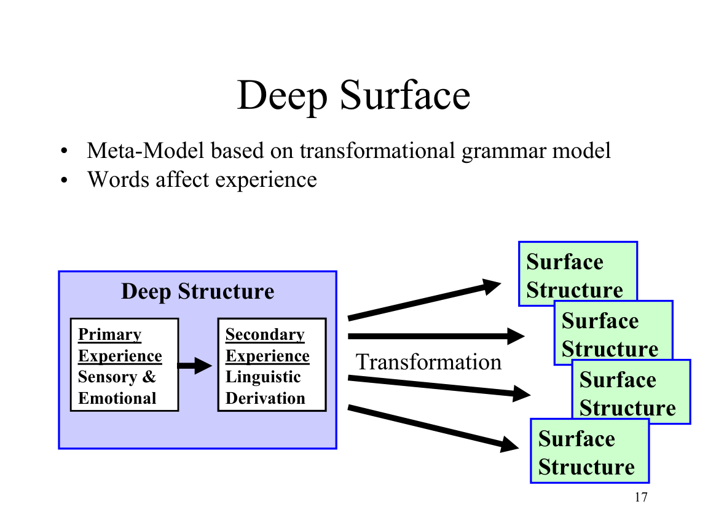

---

<!-- Slide 18 -->

# Meta Model and ambiguity

- Transformations (Distortion, Deletion, Generalization) can create ambiguity
- Ambiguous statement:
    - “The daily trade file must be processed in under 5 seconds when the system starts up.”

## Embedded Diagram Text

Deletion Distortion

Meta Model

Simple Deletion

Comparative Deletion

Lack of Referential Index

Unspecified Verb

Nominalization

Cause and Effect

Mind Reading

Complex Equivalence

Lost Performative

Universal Quantifier

Modal Operators

Presuppositions

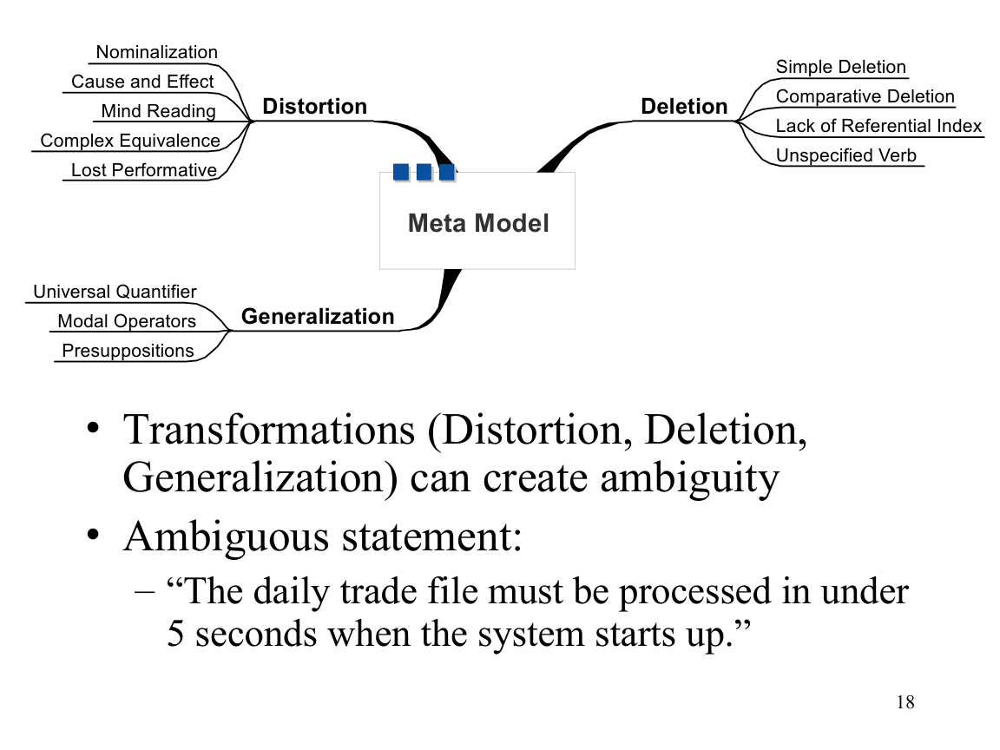

---

<!-- Slide 19 -->

# Example Meta Model questions

- Processed by what? How?
- Daily trade file – contains what? From where?
- 5 seconds – based on what?
- Starts up? How, When, How often?

## Embedded Diagram Text

"The daily trade file must be processed in under 5 seconds when the system starts up"

LP

SD (1) MO UV (1) SD (3) SD (4) UV (2) SD (2)

Effect Cause CE

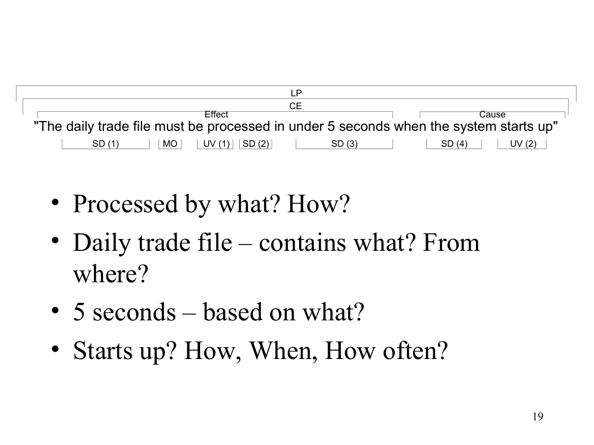

---

<!-- Slide 20 -->

# Generalization

- Universal Quantifier: The system will always process the daily trade file at start up. Even if the system is restarted in the middle of the day?
- Modal Operator: The system might ask the user to save the file.
- Presuppositions: Daily trade file exists. What if it doesn’t? The daily trade file can be processed. What if it is corrupt?

## Embedded Diagram Text

Universal Quantifier Modal Operators

Generalization

A Limiting Generalisation Counter, challenge

Identify exception

"All developers hate testers"

"I develop and I don't hate you"

"\*ALL\* developers?"

"Microsoft have 2 testers for every developer, that must be hate city"

Rules for limits Challenge and get more information on the limits

"I can't run these tests" "What stops you?"

"I shouldn't test this." "What would happen if you did?"

What is unstated and has to be true for the statement to be true Challenge, test

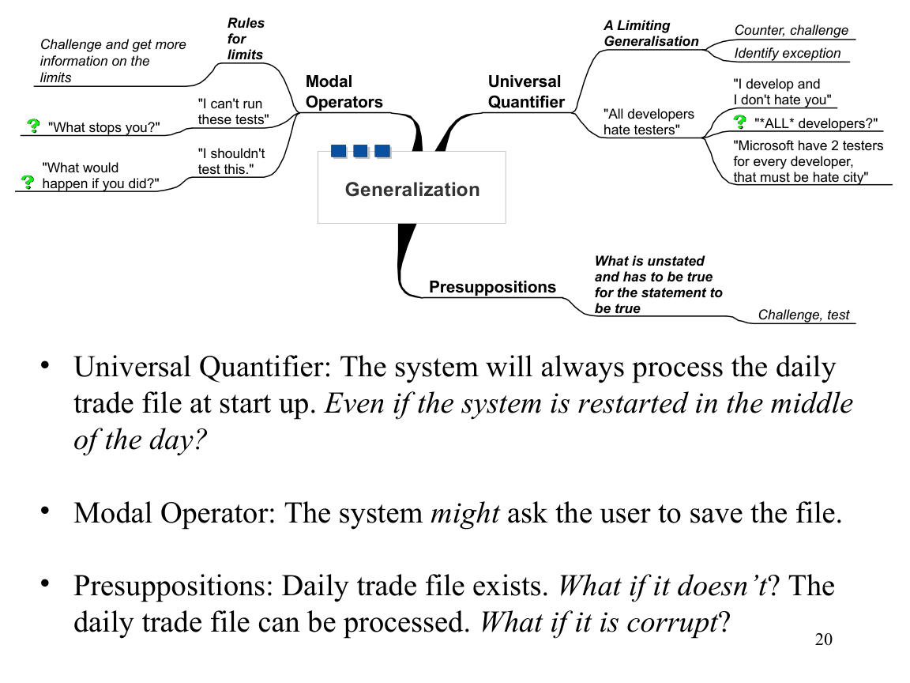

---

<!-- Slide 21 -->

# Identify Generalizations

- “Only admin users can delete records”
- “All records must be validated by the front end when they are amended”
- “All test cases must be scripted”

Modal Operators,

Universal Quantifiers

Presuppositions

---

<!-- Slide 22 -->

# Deletion

- Deletion can cause special cases not to be identified
- Deep Structure deletions identified through presupposition analysis &amp; model building

## Embedded Diagram Text

Simple Deletion

Comparative Deletion

Lack of Referential Index

Unspecified Verb

Element missing from surface structure Recover Deleted Information

"The system is going to fail"

"fail how?"

"Which system?"

Missing Reference Point Identify Comparison

"This system is rubbish"

"Compared to What?"

Unspecified Noun Recover Noun

"They have a poor process"

"Who are they?"

Missing Process Details Recover Missing Process

"I'm testing"

"How are you testing?"

"What kind of testing are you doing?"

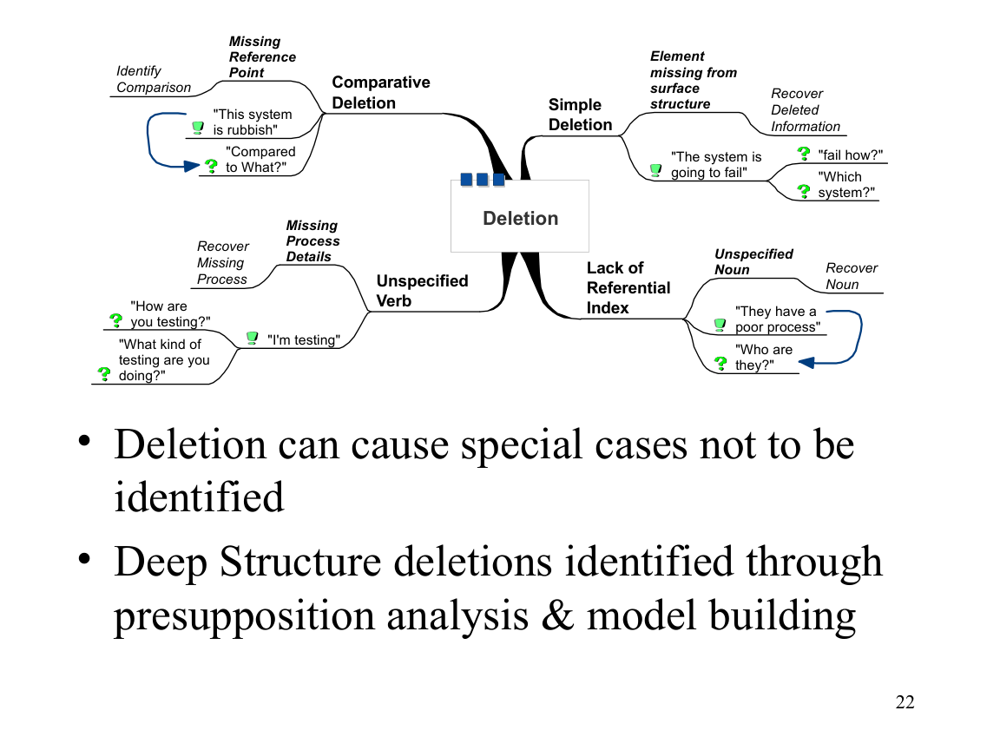

---

<!-- Slide 23 -->

# Identify Deletions

- “This system must be the fastest on the market”
- “The admin user will amend user details”

Simple,

Comparative,

Verb,

Noun (referential index)

---

<!-- Slide 24 -->

# Distortion

- Distortions can taint beliefs and attitudes
- Good source of resistance in communication

## Embedded Diagram Text

Nominalization Cause and Effect

Mind Reading

Complex Equivalence

Lost Performative Distortion

Process as noun Convert noun to process

"I'm going to test" "What kind of testing are you going to do?"

X Causes Y

Stimulus &amp; Response

More information about the causality

"Bad specifications make me angry"

"How specifically does a bad specification make you angry?"

Claim to knowledge Identify source of claim

"They hate testers" "How do you Know?"

2 unrelated statements represented as equivalent Check validity of equivalence

"They don't know how to develop software, the requirements are never signed off."

"If the requirements were signed off does that mean they would know how to develop software?"

A Value Judgement Identify Source

Identify Criteria

"It is wrong to test without writing test scripts" "According to Whom?"

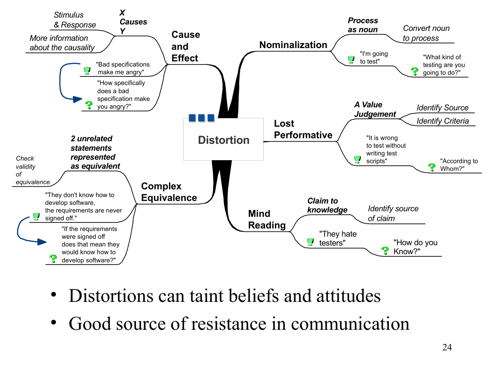

---

<!-- Slide 25 -->

# Identify Distortions

- “Obviously, developers deliver code late because they don’t give the testers any respect.”
- “When developers don’t do any unit testing it makes testers really annoyed”

Cause Effect

Complex Equivalence

Lost Performative

Mind Reading

Nominalization

---

<!-- Slide 26 -->

# Meta-Model Questioning Exercise

- Work in 3s
- Person 1 ask Person 2 to describe something e.g.:
    - their testing project,
    - their application under test,
    - what testing is
- Person 2 responds, Person 1 listens, Person 1 analyses response based on the Meta-Model and asks a follow on question based on the Meta-Model analysis, repeat
- Person 3 takes a meta position for later review

---

<!-- Slide 27 -->

# Meta-Model for Influence

- Embedded Commands
- Presuppositions
- Conversational Postulates
- Deliberate use of ambiguity
    - use their deep structure

---

<!-- Slide 28 -->

# Meta-Model usage Guidelines

- Rapport
- What do you want to know?
- Stop at some point

---

<!-- Slide 29 -->

# Meta Model — repeated

Meta-Model

- Identify Ambiguity Early
- Apply to the communication we give
- Apply to the system
- A Model of Analysis (Req, Spec, etc.)
- Apply to our beliefs and values about testing

Repeated

---

<!-- Slide 30 -->

# Learning NLP

---

<!-- Slide 31 -->

# What is left to learn?

- Strategies,
    - Meta Programs,
    - Accessing Cues,
    - Anchoring,
    - Belief Systems,
    - Submodalities,
    - Hypnosis,
    - Ambiguity,
    - Metaphor,
        - Isomorphic
        - Homomorphic
    - Sleight of Mouth,
    - Logical Levels,
    - And more …

---

<!-- Slide 32 -->

# How to learn

- On the web (later slide)
    - Books (Bandler, Dilts) (pto)
    - CDs
    - Videos
    - Practise groups
    - Study roots of NLP
    - Training

Purchases Visit:

[www.ebay.co.uk](http://www.ebay.co.uk)

[www.abebooks.co.uk](http://www.abebooks.co.uk)

[www.nlp-london.com](http://www.nlp-london.com)

Transcribe

---

<!-- Slide 33 -->

# Recommended Books

- Structure of magic vols 1 &amp; 2
    - (Bandler and Grinder)
- Persuasion Engineering
    - (Bandler &amp; LaValle)
- Modeling with NLP
    - (Robert Dilts)

---

<!-- Slide 34 -->

# On The Web

- [www.purenlp.com](http://www.purenlp.com)
- [www.richardbandler.tv](http://www.richardbandler.tv)
- [www.paulmckenna.com](http://www.paulmckenna.com)
- [www.saladltd.co.uk](http://www.saladltd.co.uk)
- [www.nlp.biz/NLP](http://www.nlp.biz/NLP)
- [www.compendiumdev.co.uk/nlp](http://www.compendiumdev.co.uk/nlp)
- [www.23nlpeople.com/NLP\_links.htm](http://www.23nlpeople.com/NLP_links.htm)

---

<!-- Slide 35 -->

# IT Related

- Gerald Weinberg:
    - Are your lights on?
        - (More) Secrets of consulting.

---

<!-- Slide 36 -->

# NLP is…

ATTITUDE

…sense of curiosity and adventure … desire to learn the skills to be able to find out what kinds of communication influences somebody and the kinds of things worth knowing ... to look at life as a rare and unprecedented opportunity to learn

METHODOLOGY … all behavior has a structure . . . and that structure can be modeled, learned, taught, and changed (re-Programmed). The way to know what will be useful and effective are the perceptual skills

TECHNOLOGY enabling the practitioner to organize information and perceptions in ways that allow them to achieve results that were once inconceivable

[http://www.purenlp.com/nlpis2.htm](http://www.purenlp.com/nlpis2.htm)

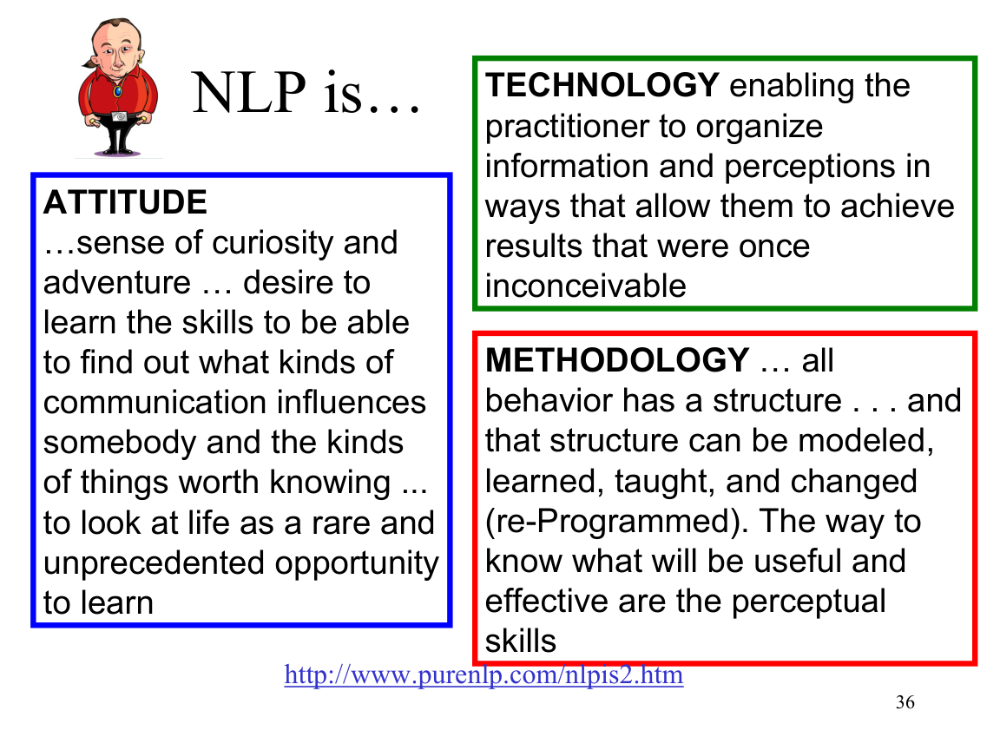

---

<!-- Slide 37 -->

# Playtime
