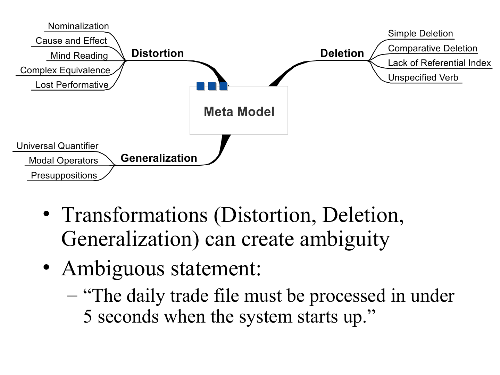
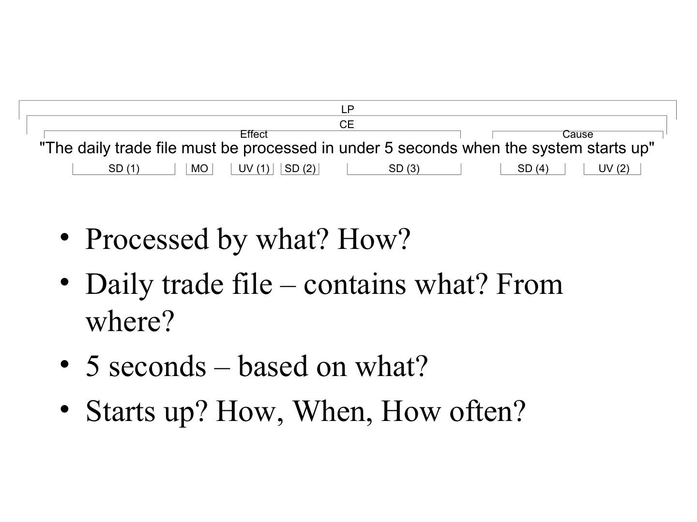
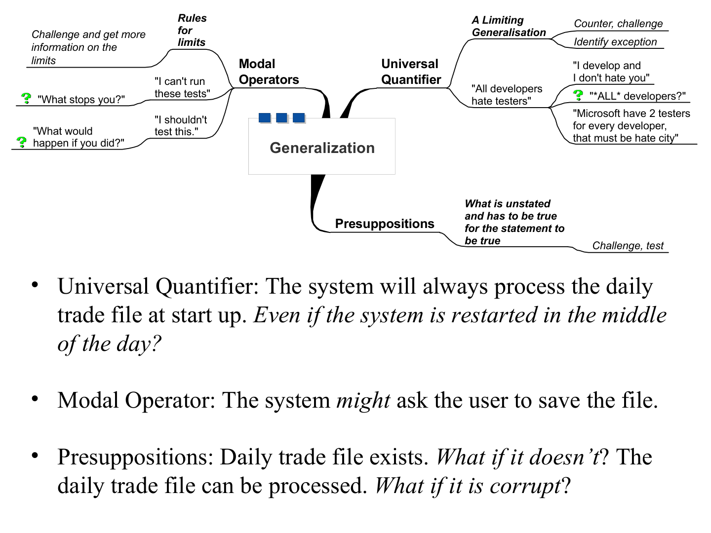
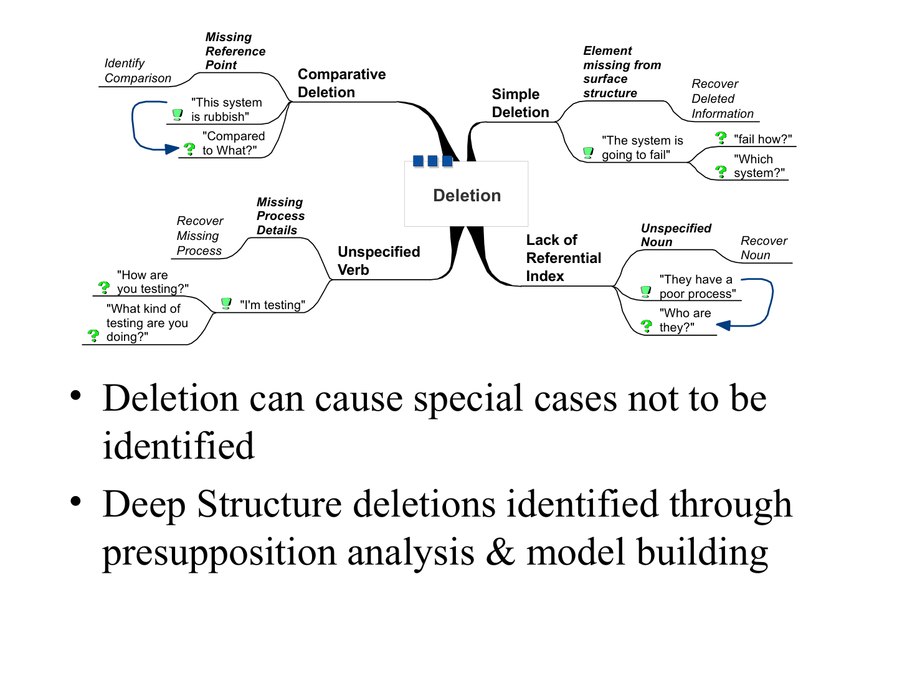
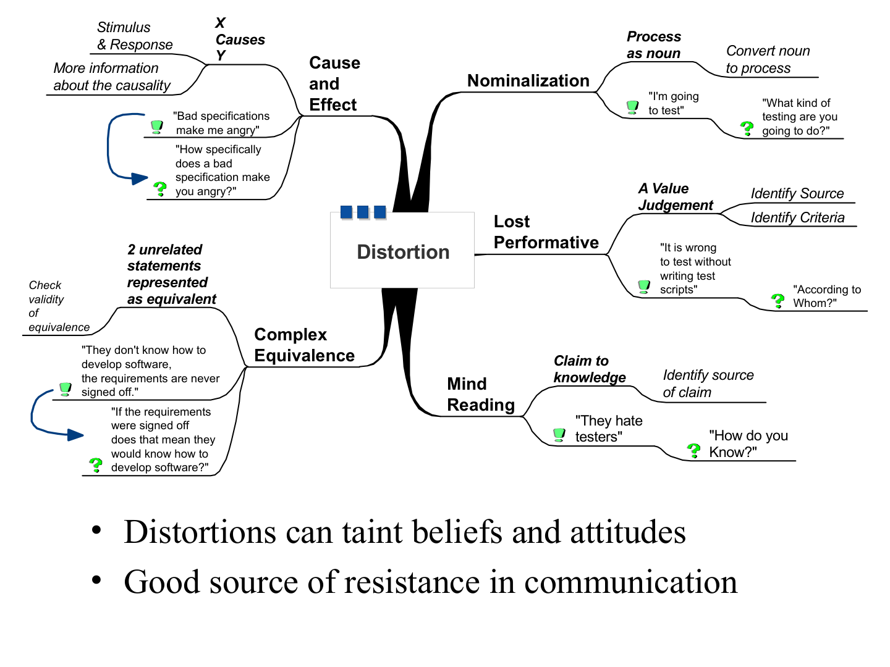
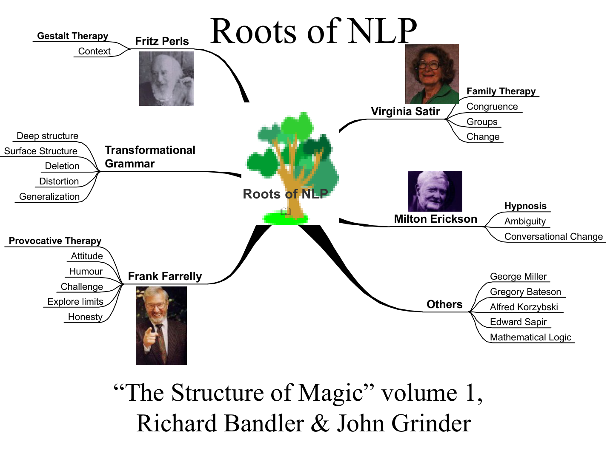

<!-- Slide 1 -->

# NLP for Testers – a brief introduction

Alan Richardson

Compendium Developments

<http://compendiumdev.co.uk/nlp>

(Supporting Paper and Web Links)

---

<!-- Slide 2 -->

# Equivoque

---

<!-- Slide 3 -->

# Meta-Model and an ambiguous requirement

- Transformations (Distortion, Deletion, Generalization) can create ambiguity
- Ambiguous statement:
    - “The daily trade file must be processed in under 5 seconds when the system starts up.”

## Embedded Diagram Text

- Meta Model
    - Deletion
        - Simple Deletion
        - Comparative Deletion
        - Lack of Referential Index
        - Unspecified Verb
    - Distortion
        - Nominalization
        - Cause and Effect
        - Mind Reading
        - Complex Equivalence
        - Lost Performative
    - Generalization
        - Universal Quantifier
        - Modal Operators
        - Presuppositions

---

<!-- Slide 4 -->

# Questions about the requirement

- Processed by what? How?
- Daily trade file – contains what? From where?
- 5 seconds – based on what?
- Starts up? How, When, How often?

## Embedded Requirement Text

"The daily trade file must be processed in under 5 seconds when the system starts up"

Annotation labels in the original diagram: LP, CE, Effect, Cause, SD (1), MO, UV (1), SD (2), SD (3), SD (4), UV (2).

---

<!-- Slide 5 -->

# Generalization

- Universal Quantifier: The system will always process the daily trade file at start up. Even if the system is restarted in the middle of the day?
- Modal Operator: The system might ask the user to save the file.
- Presuppositions: Daily trade file exists. What if it doesn’t? The daily trade file can be processed. What if it is corrupt?

## Embedded Diagram Text

| Pattern | Description | Challenge | Original examples |
| --- | --- | --- | --- |
| Universal Quantifier | A Limiting Generalisation | Counter, challenge Identify exception | "All developers hate testers" "I develop and I don't hate you" "\*ALL\* developers?" "Microsoft have 2 testers for every developer, that must be hate city" |
| Modal Operators | Rules for limits | Challenge and get more information on the limits | "I can't run these tests" "What stops you?" "I shouldn't test this." "What would happen if you did?" |
| Presuppositions | What is unstated and has to be true for the statement to be true | Challenge, test |  |

---

<!-- Slide 6 -->

# Deletion

- Deletion can cause special cases not to be identified
- Deep Structure deletions identified through presupposition analysis &amp; model building

## Embedded Diagram Text

| Pattern | Description | Challenge | Original examples |
| --- | --- | --- | --- |
| Simple Deletion | Element missing from surface structure | Recover Deleted Information | "The system is going to fail" "fail how?" "Which system?" |
| Comparative Deletion | Missing Reference Point | Identify Comparison | "This system is rubbish" "Compared to What?" |
| Lack of Referential Index | Unspecified Noun | Recover Noun | "They have a poor process" "Who are they?" |
| Unspecified Verb | Missing Process Details | Recover Missing Process | "I'm testing" "How are you testing?" "What kind of testing are you doing?" |

---

<!-- Slide 7 -->

# Distortion

- Distortions can taint beliefs and attitudes
- Good source of resistance in communication

## Embedded Diagram Text

| Pattern | Description | Challenge | Original examples |
| --- | --- | --- | --- |
| Nominalization | Process as noun | Convert noun to process | "I'm going to test" "What kind of testing are you going to do?" |
| Cause and Effect | X Causes Y Stimulus &amp; Response | More information about the causality | "Bad specifications make me angry" "How specifically does a bad specification make you angry?" |
| Mind Reading | Claim to knowledge | Identify source of claim | "They hate testers" "How do you Know?" |
| Complex Equivalence | 2 unrelated statements represented as equivalent | Check validity of equivalence | "They don't know how to develop software, the requirements are never signed off." "If the requirements were signed off does that mean they would know how to develop software?" |
| Lost Performative | A Value Judgement | Identify Source Identify Criteria | "It is wrong to test without writing test scripts" "According to Whom?" |

---

<!-- Slide 8 -->

# Roots of NLP

“The Structure of Magic” volume 1, Richard Bandler &amp; John Grinder

## Embedded Diagram Text

| Person or area | Original diagram labels |
| --- | --- |
| Fritz Perls | Gestalt Therapy Context |
| Virginia Satir | Family Therapy Congruence Groups Change |
| Transformational Grammar | Deep structure Surface Structure Deletion Distortion Generalization |
| Milton Erickson | Hypnosis Ambiguity Conversational Change |
| Frank Farrelly | Provocative Therapy Attitude Humour Challenge Explore limits Honesty |
| Others | George Miller Gregory Bateson Alfred Korzybski Edward Sapir Mathematical Logic |

---

<!-- Slide 9 -->

# Learning NLP

- What is left to learn?
    - Strategies, Meta Programs, Accessing Cues, Anchoring, Belief Systems …
- How to learn
    - Books (Bandler, Dilts), training, videos, practise groups, study roots of NLP
- IT Related
    - Gerald Weinberg: Are your lights on? (More) Secrets of consulting.
- Apply it, Apply it to testing
