<!-- Slide 1 -->

# Learning, Developing, Evolving: The Path of the Technical Tester

Alan Richardson

Head of Testing @ LMAX

Sigist March 2011

www.eviltester.com

www.compendiumdev.co.uk

---

<!-- Slide 2 -->

# Times are Changing and Testers Need to Change With Them

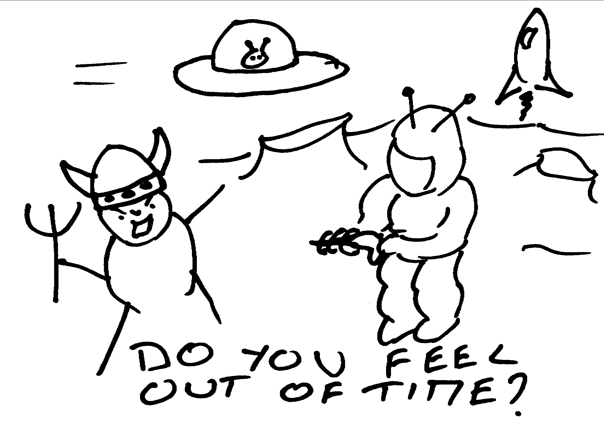

---

<!-- Slide 3 -->

# Testing Used to be Easy...

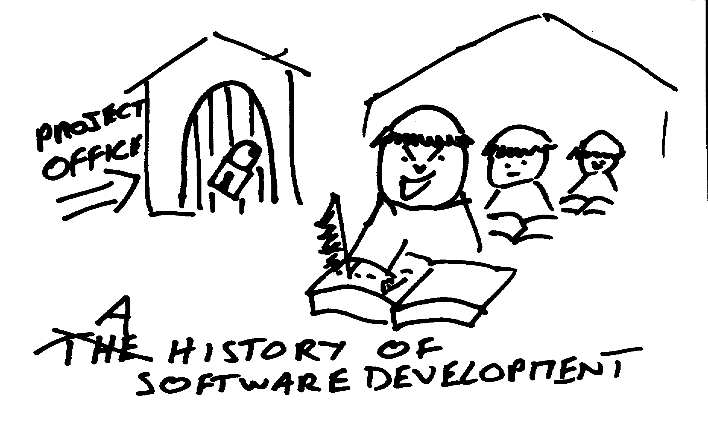

---

<!-- Slide 4 -->

# Testing might still be easy (in some jobs)... but for how much longer?

“It's astounding, time is fleeting Madness takes its toll. But listen closely,

not for very much longer I've got to keep control.”

Richard O'Brien

---

<!-- Slide 5 -->

# Testers Need To Change Their Ways

---

<!-- Slide 6 -->

# Have No Fear, Salvation Is Here

ETERNAL SALVATION -- or triple your money back. The path of the Technical Tester is before you. Are you man/woman/yeti/unsure enough to step forward? Time to get... Technical

---

<!-- Slide 7 -->

# How will getting technical help ME?

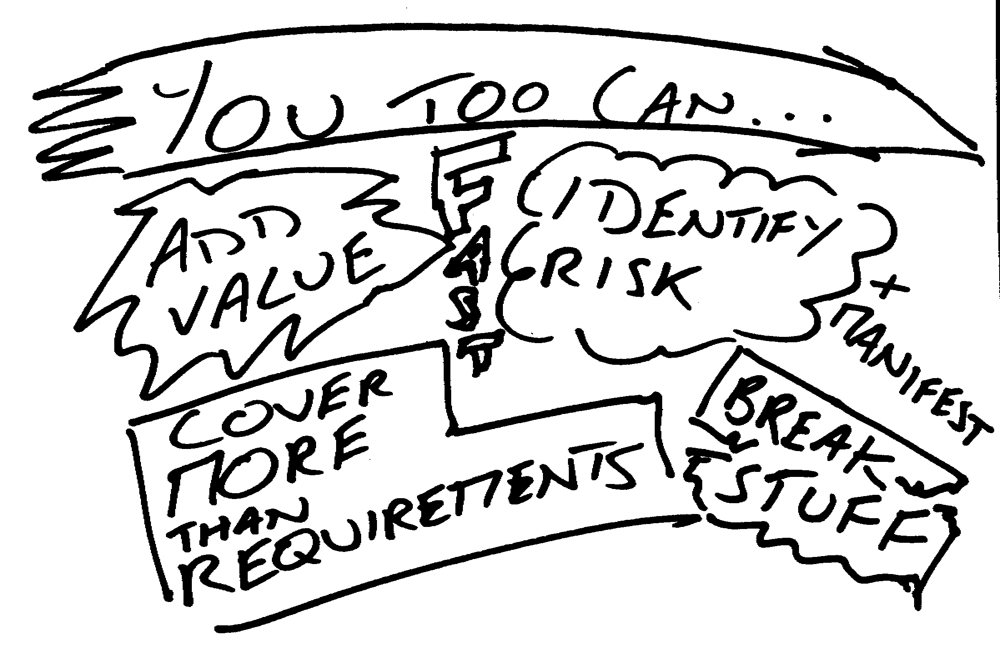

---

<!-- Slide 8 -->

# Traditional Testing Concepts that Stop YOU Testing Technically

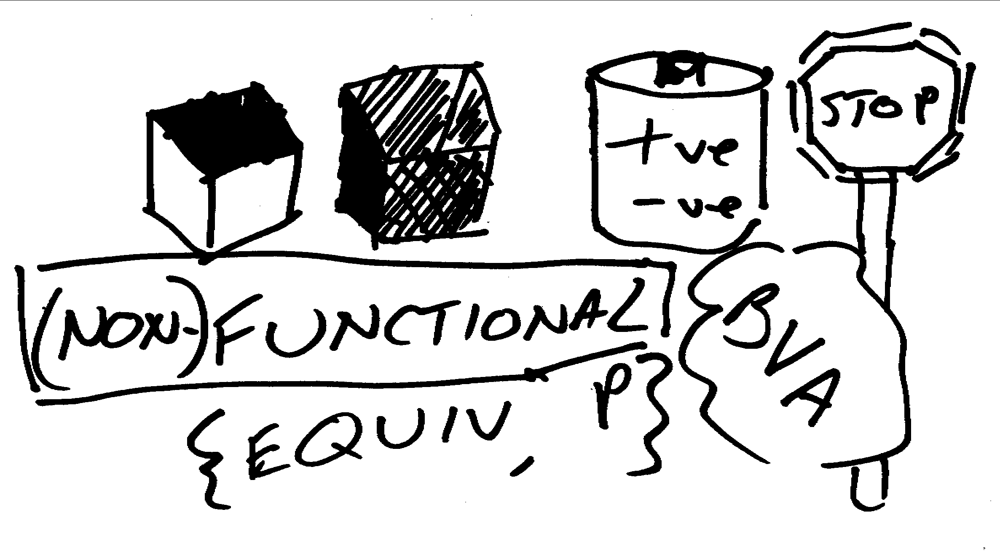

---

<!-- Slide 9 -->

# How to get more from your testing books than THEY intended to tell you

They don't want you to know the secrets

You have to learn to read between the lines

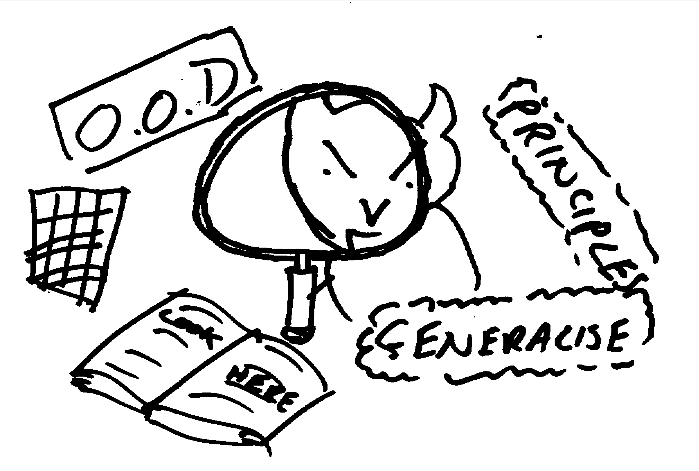

---

<!-- Slide 10 -->

# How to Build Test Techniques From First Principles

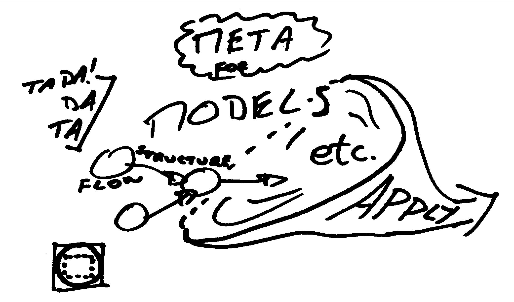

---

<!-- Slide 11 -->

# The Ying and Yang of Technical Testing

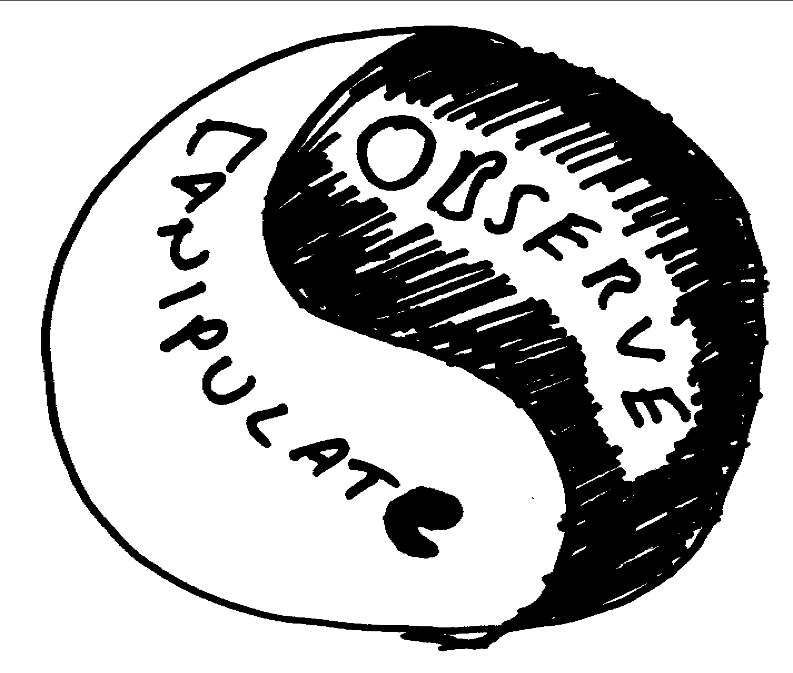

---

<!-- Slide 12 -->

# Technical Testing is a LIE

---

<!-- Slide 13 -->

# The right way to quickly build a map

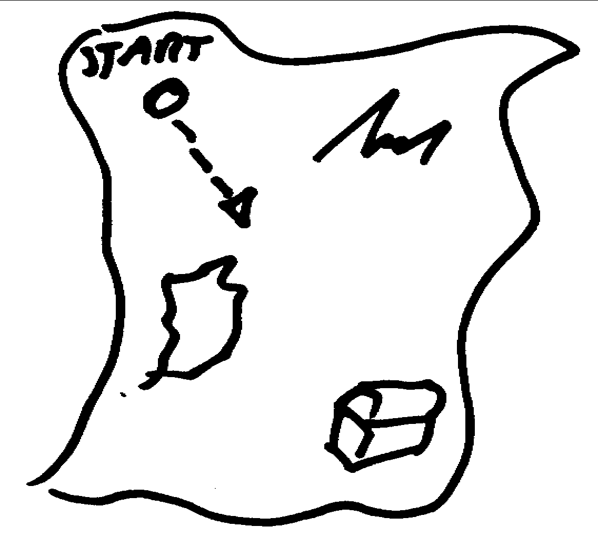

---

<!-- Slide 14 -->

# How to use the difference between map and territory to improve your testing

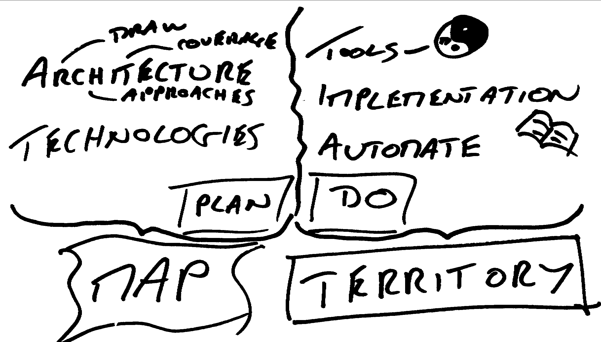

---

<!-- Slide 15 -->

# A Worked Example - Web App Terrain

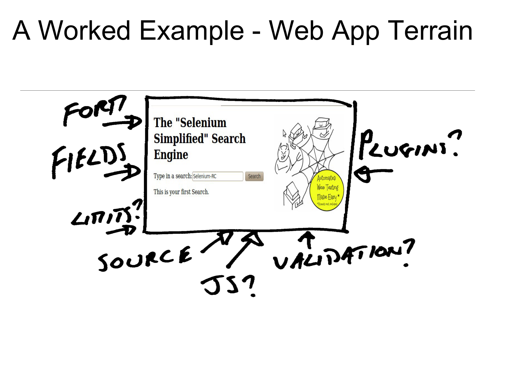

---

<!-- Slide 16 -->

# A Worked Example - Server Terrain

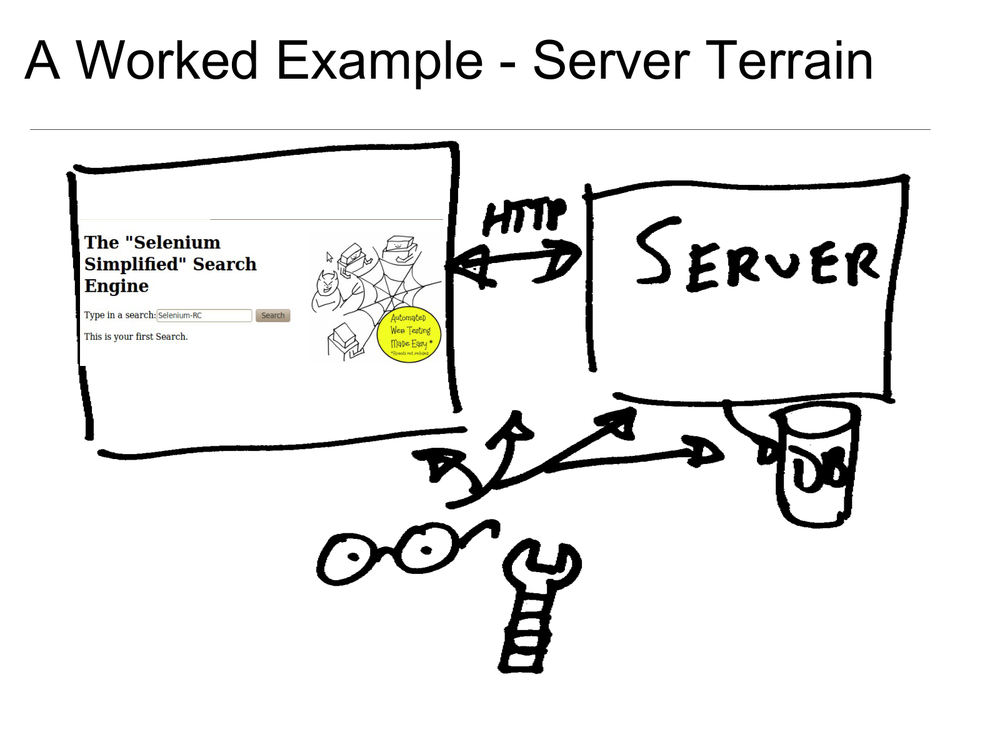

---

<!-- Slide 17 -->

# A Worked Example - Browser Terrain

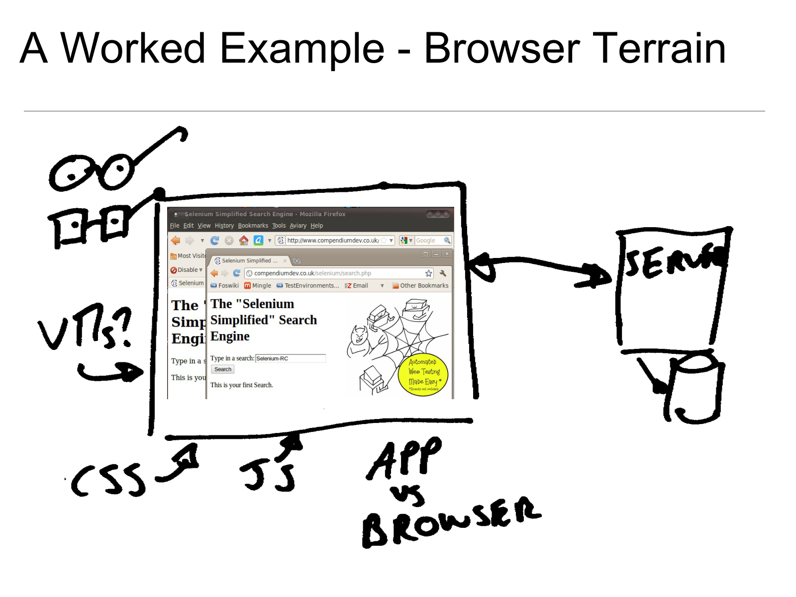

---

<!-- Slide 18 -->

# A Worked Example - Architecture Terrain

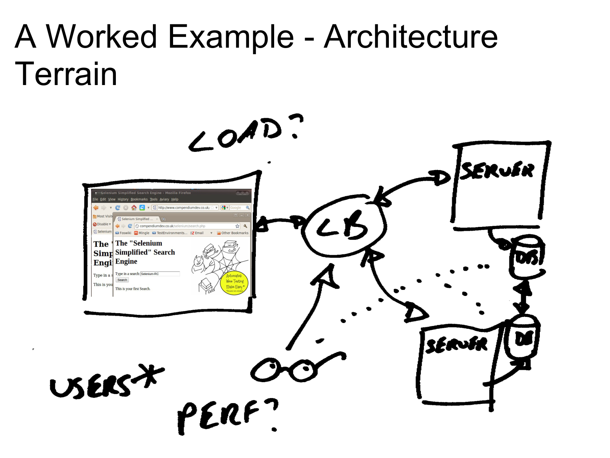

---

<!-- Slide 19 -->

# A Worked Example - User Terrain

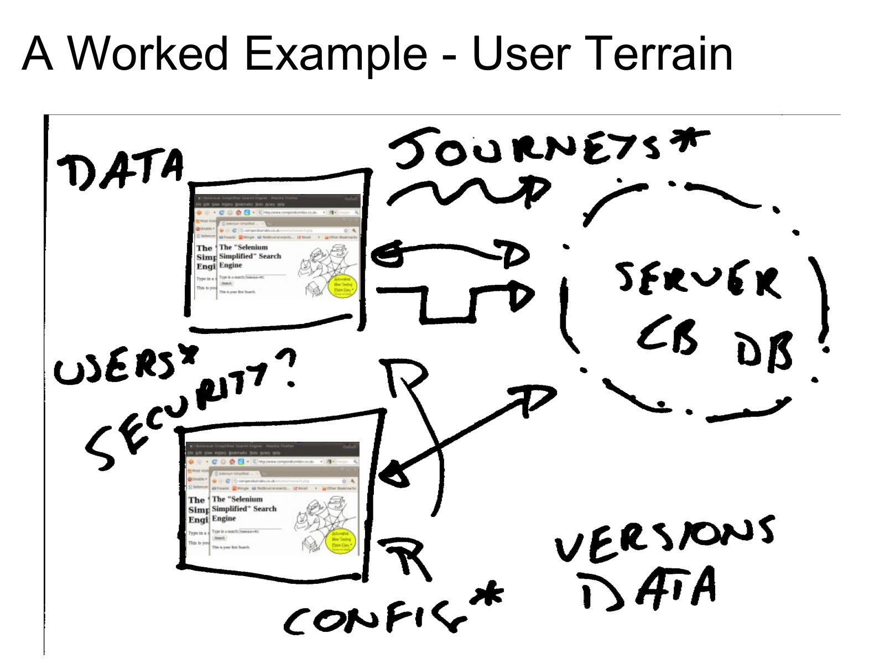

---

<!-- Slide 20 -->

# The Bluffers Guide To Technical Web Testing

- Automation
    - Selenium
    - JMeter
- Programming
- Test Data
    - PerlClip
    - Benerator
    - Excel
- Proxies
    - Burpsuite
    - Fiddler

- Browsers
    - Firefox
    - Chrome
- Browser Plugins
    - Firebug
    - Selenium IDE
- Virtual Machines
    - MS Compatability Images

- Research these
- Identify their terrain
- See how they fit your models
- Functionality can suggest technique

---

<!-- Slide 21 -->

# Final Notes

- Old testing models decay
- Models lead to exploration
- Observe and Manipulate the terrain
- Model more terrains
- Exploration leads to 'techniques'
- 'Techniques' apply to models
- Systems comes first, Technical is an end point
- 'Being Technical' allows you to model and explore more and deeper terrains

---

<!-- Slide 22 -->

# Further Reading

- Selenium Simplified
    - by Alan Richardson. An introduction to automated testing with selenium in Java
    - www.compendiumdev.co.uk/selenium
- Web Application Hacker's Handbook
    - by Dafydd Stuttard &amp; Marcus Pinto
- For generalisation (by James Whittaker):
    - How to Break Web Software
    - How to Break Software
- Diagnosing the System for Organisations
    - by Stafford Beer

---

<!-- Slide 23 -->

# Even More Further Reading (for free)

- The OWASP Testing Guide
    - <http://www.owasp.org/index.php/OWASP_Testing_Project>
- Putting Systems to Work by Derek Hitchins
    - <http://www.hitchins.net/SysBooks.html> (free download pdf)
- The Art of War by Sun Tzu
    - provides a generalisable model for technical testing - including map/territory, observation (use of spies) and manipulation
    - www.sonshi.com
- The Book of Five Rings by Miyamoto Musashi
    - How to practice and improve
    - <http://www.feedbooks.com/book/3953/the-book-of-five-rings>
