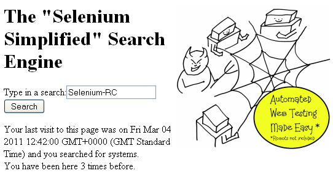

# Technical Testing Paper - Draft

Draft supporting paper retained from the source archive, including its unfinished sections and placeholders. Original wording is retained; the generated table of contents is omitted. This is not a transcript.

Technical Testing Paper

“Testers will not be able to survive for much longer with the traditional approach to testing. We need to smarten up, get more technical, and become IT professionals if we want to survive. And by survive I mean, ‘work on good projects’ and not be left on the side like little dinosaurs awaiting extinction.”

A grumpy old tester

## So What 'is' Technical Testing?

Thanks for asking. But I don't like definitions. If I tell you what it 'is' and you believe me, then you might allow yourself to constrain your actions to fit within that definition. So I won't give you a definition, I'll describe the model of Technical Testing that I think I have in my head.

I don't consider technical testing to be technique based. I think traditional 'testing techniques' can prove detrimental to the technical tester if they use 'techniques' to identify their tests.

I think a tester does technical testing when drive their testing using technical risk and basing it on system modeling. Testing techniques can provide a way of identifying the coverage scope within the technical risks identified. The technical tester needs to be able to work from first principles and define their own techniques because they may be working with new technology and new approaches.

Actually the phrase "Technical Tester" is a lie, and it is really "Systems Testing" but that phrase is taken, so "Systems Based Testing" is better, but "Technical Tester" is how I think of it.

For me a technical tester would look at a web form and rather than approaching it from a requirements and business perspective. Deals with the implementation and technology involved.

So to get all Zen. For a technical tester there is no +ve, or -ve test, there is only the flow and how we handle it. There are no boundaries, there are only arbitrary overlapping categories. There are no absolutes, only overlapping and potentially contradictory models.

If the System lets me do it, then the system needs to handle it. The System includes, what we write as software, browser, communication protocols, etc. etc.

So for a web form the System contains: the browser, the config, the form, the javascript, the validation, the payload, the transport mechanism, the receiver, etc.; there are flow models, data models, server models, etc. The technical tester looks at the interaction of all this to identify risk.

The limitation of the approach of the technical tester is their knowledge and their skill.

Part of this comes from a generalised models from the "How to break books", from practical tesitng books like Beizer;s Software Testing Techniques, and Jorgensens's “Software Testing” the difference and overlap between hacking and testing, etc.

I don't like definitions. I'm more interested in the approach than the definition, so I aim to provide you with examples, and explain mindsets and strategies. Obviously I also need a 'blaggers' guide - which contains the tools and mnemonics. But I believe the 'blaggers' guide will instantly have out of date information in it, and you will have to construct your own.

## Why this feels important to me

### Some History

The olden days were great weren’t they. We sat in the cool of the waterfall, long lazy days writing and maintaining test scripts. Reading requirements and ... etc. \[FINISH THIS DIATRIBE\]

Unfortunately, the description I describe above still exists on some projects. If you are stuck on one of those projects, or work in a company where this situation exists then I think you need to do something so that when the industry changes to make your situation a thing of the past, that you don't get left behind.

### A Present

Some companies do not work in the ways described above.

Some companies have lighter weight processes, some do 'Agile', some do 'lean'. Regardless of their names, these 'other' approaches have things in common:

- Team roles blur
- Team work in phase with each other
- Team work closely together
- Increased use of automation to continually validate requirements
- 'Team' means everyone
- Requirements change

When I say that the team roles blur, I describe the situation where the actions which were once the exclusive preserve of testers no longer remain so. Any role can write automated tests. Any role can check the system and determine if a requirement has a corollary implementation.

The blurring of the team role seems to me, one reason why you will find people asking 'what does a tester do on an Agile project?'. I think the people asking that question, were not doing the full role of a tester. You get to concentrate on the other stuff you were doing, and if you weren't doing other stuff, your role as a tester did not go far enough.

When the team work in phase it means that the time given to an exclusive 'test phase' reduces. These approaches aim to reduce the time to zero. Typically the time reduces to 'too small to do the normal testing process', because the 'normal testing process' has been spread over the entire phase and across multiple roles.

The team have to work closely together to allow them to blur and work in phase. This reduces the amount of documentation that the project produces and encourages them to work together. They may well conduct the activities together, so a business analyst and a tester might work together to write an automated test, they may bring in a developer to help with tricky aspects of the automation. A tester and a developer might work together to increase the number of tests implemented in the unit testing framework, thereby increasing test coverage at a lower implementation level than the tester working alone would have targeted the test at.

Teams working with the 'other' approach typically have lots of tests, running at different levels of the system. The team learn to rely on these to pick up 'regression' errors and therefore reduce the time spent on manual regression testing. Aiming to increase the amount of time spent on exploratory and questioning testing. Test Automation no longer rests with the testers. Test Automation tools no longer aim their marketing solely at testers.

Developers, business analysts, business, testers, designers form the team. Thinking of a project team as 'test team', 'development team', 'business analysis team' limits efficiency in these projects and almost guarantees that the project will slip into inefficient habits and not work the way they want to.

The team expect Requirements to change. The approaches in use, have to cope with change. Test Approaches which spend a long time analyzing requirements, constructing plans, writing test cases and subsequent manual test scripts will fail in these environments.

### A Future

Regardless of which type of organisation you work in. You can apply the mindsets and approaches that I describe here as 'Technical Testing' in any of them.

You will then find the transition between organisational types simpler.

By adopting more technical approaches, and more systems based approaches, testers can add value that no-one else on the development team does. They can harness the skills that underpin their traditional teachings and build on their essential practices.

The ‘tester’ needs to work quickly, to learn to approach the system technically as well as from the requirements domain. The ‘technical tester’ comes armed with tools, and the ability to construct their own tools and techniques. Able to strip the application down to its basics and hone in on technical risk to exploit it.

We throw away nothing by becoming more 'Technical'.

We become better testers.

## Technical Testing

### A High Level Model of Technical Testing

#### A Modeling Abstraction: Map and Terrain

I have a simple high level view of modeling for technical testing.

I have terrain. I have map.

The terrain represents the physical world, which in my case consists of a a mostly virtual world of 'software' and data. I put software in quotes because it is really data, but a special class of data.

The map represents all the models that I make of the terrain. These help me entertain possibilities at different layers of abstraction.

I derive risk from my analysis of the models, and my observation of the terrain.

I describe coverage in terms of my map using my models.

When I 'do' something I interact with the terrain. I can manipulate the terrain to effect change which may not, at that point, be represented in my map.

Tools exist as terrain and they help me increase my ability to observe, manipulate and explore the terrain.

I understand the terrain, in terms of my maps.

My technical knowledge exists in terms of maps. More technical maps help me engage with the terrain more deeply and more thoroughly.

We will explore different examples of these concepts as the paper progresses.

#### Fundamental Actions: Observe and Manipulate

I currently use a simple classification scheme for my interaction with the terrain.

I Observe, or I Manipulate.

This helps me identify new tools, and new technical knowledge that I should pursue and attain.

The realisation that I need these tools derives from my map, not the terrain.

#### An Example: A Web Form

Consider a simple web form.



Most of us have used the web before and have encountered forms before. Here it seems obvious from a functional model that the user types in a search term, and presses the \[Search\] button, then a search will take place and the results will display.

I don't know if you were aware of that generic functional model before now. But hopefully now you see that you have a model of this functionality in your head. A set of 'expectations' codified in a mental model.

If you have an understanding of the terrain then you know that the 'form' does not 'look' like the above picture. The form 'looks' like the following:

```html
<html>
	<head>
		<link href="styles.css" rel="stylesheet" type="text/css" />
		<title>Selenium Simplified Search Engine</title>
		<SCRIPT>
			... removed for space reasons ...
		</SCRIPT>
	</head>
	<body>
		
		<h1>The "Selenium Simplified" Search Engine</h1>
		<form method="post" action="">
			Type in a search:<input title="Search" type="text" name="q"
						value="Selenium-RC"/>
			<input type="submit" value="Search" name="btnG" />
		</form>
		<SCRIPT>document.write (GetLastVisit())</SCRIPT>
	</body>
</html>
```

If you have models of the the HTML terrain then you can read and understand the source code above. And you know that a browser interprets and renders the HTML code as the image shown above.

A quick analysis reveals at least the following models and the following terrain.

Models:

- a functional usage model of web form interaction
- HTML model, it may or may not include all the source code elements above, but I can see from the terrain (source) gaps in my model of the terrain that lead me to more technical research

Terrain:

- browser rendering
- HTML
- HTTP GET and POST
- JavaScript
- GIF images
- CSS

Can you identify any other terrain?

Can you identify any other models?

#### How does this help?

Traditional test analysis might take the following format:

- input field -&gt; leads to domain analysis, boundary value analysis, equivalence partitioning
- search button -&gt; leads to a flow graph of the form flow ending in search button submission.
- Previous search message -&gt; state between form calls.

Technical testing might take the following form:

- Which models do I have that this relates to?
    - Exploration of how my current models relate to this one?
        - HTML Form functionality
            - Submit with button
            - Submit without button
        - Generic Form functionality
            - Input value variation
            - Default Values
- What can I observe currently about the terrain?
    - Default Value
    - Image
    - Button
    - State message,
        - how does it work?
        - Flows?
- How can I observe the terrain more deeply?
    - View Source
    - In browser Dom
    - How do these observations shape my model of this form?
- How can I manipulate the terrain?
    - Buttons, input, state
- Where does the form go when submitted?
    - Self, post, variables
- ... many more paths ...

I consider Technical Testing involving:

- making the Models explicit rather than tacit
- knowing how the models are used
- asking questions from the model
- considering the terrain to form a 'new' contextual model of the current situation

I know that some web testers will not have learned HTML. They will not know how a Form works. They will not read and understand the source code to the above form. They will not have extended their maps of the terrain. They will have limited the testing of the form to the 'requirements', the browser rendering and the application of their known techniques. They have not adopted a 'Technical' mindset, and have not taken the terrain into account.

Technical testers try to learn the terrain.

A Technical tester, with no knowledge of the web or HTML will be driven to find out how this thing in front of them works. They will learn about the terrain and construct models of it that they can use in their testing.

They will be driven to find out how they can learn more about the terrain in front of them now. They will learn that they can view the source. They will learn that they can 'view source'. They will learn what the HTML elements in front of them mean. They will take that knowledge and apply it to the system in front of them.

#### How I might apply the technical knowledge

From the application of HTML knowledge in the above example we know that:

- the form has no limit to the size of the input field
- the form posts a response to the server
- the form is a standard HTML form
- the 'state' maintenance is done browsers side using Javascript and not server side

##### We adjust our test approach based on our models

Our test approaches are based on our models of the terrain.

- We could do all tests for input variation without using the browser at all, and could be done by sending messages directly to the server.
- All tests for state maintenance are browser level, so we probably need to test this functionality on multiple browsers to see if it works.

Can you identify any other ways to adjust your test approach?

What else could you take into account?

##### Models lead to tools

Having changed our approach, because our model has changed, we have to work out how to do these new approaches.

- A technical tester will then identify tools to help them send messages to the server and bypass the GUI.
- A technical tester then has to work out how to install multiple browsers on their machine.

Do you know of tools and ways to do this?

### Traditional Vs Technical

I have heard it said that 'Technical Testing' refers to the application of techniques whereas I think of 'Traditional' testing as the application of techniques.

This means that the phrase offers ambiguity. 'Technical Testing' has connotations.

I consider 'Technical' testing as involving:

- the construction and subsequent application of techniques.
- the gathering and learning of Technical knowledge to better model the system.
- The use of Technical knowledge to observe and manipulate the terrain more deeply

I think that “Systems Thinking and Modeling Based” Testing may well describe this better. But:

- it has no clear marketing hook
- no-one would know what I meant without a long and detailed explanation
- I need a simple phrase to put on job adverts that more likely attracts the type of testers I look for

So consider my use of the phrase 'Technical Testing' as an in-joke, a play on words that approximates what I require, and full in the knowledge that as a label, we have to immediately go beyond what those words say about it, in order to to do it. You can not allow yourself to constrain your testing to those words, otherwise you do not do what those words imply.

#### Traditional Testing Techniques and approaches

I face a dichotomy.

I got a lot of value from some 'Traditional Techniques', from 'Traditional Books' e.g. State Transition testing and other Graph Based Testing, Set Theory Based testing (Domain Analysis). I still get a lot of value from these techniques.

I think other 'concepts' such as Boundary Value Analysis, Equivalence Partitioning, White/Black box, +ve/-ve, functional/non-funtional do more harm that good.

So when I say, traditional testing techniques hold you back. That sounds a lot harder than I mean it. So I will attempt to explain.

Any technique, that uses an explicit model as part of its method probably has value. It starts to lose value, when you throw away the model and keep only the derived 'test cases'.

For me the value of testing using State Transition Graphs does not come from constructing lots of test cases by following some coverage focused analysis of the graph. If it did, I would automate that process. For me the value comes from building the graph.

##### Heuristics Elevated to the Status of Test Techniques

Boundary Value Analysis is an easy target. It doesn't really deserve the name technique, nor the ocean of coverage that it has received over the years. Consider “Boundary Value Analysis” as a 'hint' from a grizzled tester, which might quickly give you a set of data to try that might expose a problem because it has done in the past. In which case it falls firmly into the heuristic category.

The traditional teaching tale behind Boundary Value Analysis takes the form of a heuristic built from a bug taxonomy:

- “An off by one error when coding loops” (The taxonomy entry)
- Test the boundary of the loop max and min values (The heuristic)
- Boundary Value Analysis (The Technique in Heuristic Clothing)

This heuristic can sometimes identify defects, as will a better analysis of the input fields.

For me 'Boundary Value Analysis' does not come from a -1,+1 sum (or -1,-2,+1,+2 depending on who teaches you the technique). It comes from the outlying values in an ordered set.

It comes from the identification that part of the terrain can map on to an ordered set, or knowing that the terrain has boundaries in it and exploring those boundaries (e.g. binary representational limits on ints and longs).

It also applies at multiple model levels. So at one model level I might identify a boundary. But at a deeper model of the same terrain, the boundary might not appear, or might take different values.

When I used to employ Boundary Value Analysis as a technique without the subtlety that I have grown to see develop from use of models. I used to find the Boundary Values, and stop. The application of a 'technique', stopped me thinking through the models.

In our web form example. There are no limits on the form input field.

But had the field said &lt;input title="Search" type="text" name="q" value="Selenium-RC" maxlength="20"/&gt;. Does 20 represent a Boundary?

There are no loops involved here, so I have lost the taxonomy driven element of the heuristic, and start applying a technique because it looks like a boundary.

Would I test that boundary with 20, or with 19?

I know that the browser will accept 19 chars, unless there is a browser bug. I know that the limit only applies to the browser. The limit “20” presents a valid condition to try, but not because of BVA, but because the system lets me. The actual processing is done on the server, so the limit of 20 should not constrain my testing as I test the server without the GUI and need to use the value “20” as a requirement that only values of 20 are accepted. Or do I? Perhaps there is no problem if 21 is accepted by the server. I need to follow the data through to see where the other limits are. Perhaps there is a limit on the database field and the field is defined as 25 chars. BVA would not have found a problem with sending in 26 chars, technical analysis did. Perhaps the database stores the field in a Blob, so I need to see where the field is used on screen somewhere else, perhaps there are limits there. BVA would limit your testing and constrain your imagination.

Technical Testing, for an input field, I might decide to automate all length combinations, sending them directly to the server, and increasing them to see the max that it could handle. Or did I just do stress testing?

The field of testing seems to put too much value on these techniques, and far less value on the thought processes and models that underpin them.

##### Warnings Against Testing Concepts

Testing has a few Testing 'concepts' which, unless you are aware of the dangers, can stifle your thinking.

Here are the concepts that I have trained myself to avoid, and the dangers they presented to me. If you are susceptible to the dangers listed then you might want to avoid them too.

###### Black Box/White Box Testing

Ah, the most pernicious of them all.

To make the testing without knowledge (Black Box) a viable approach, and to primarily teach that knowledge of the system (White Box) in terms of code.

To fully engage in technical testing, I view all my areas of less knowledge, as more susceptible to defects remaining not found.

I personally only use these terms ironically. When I say 'Black Box' testing, I mean that I am testing lazily, or quickly (without having had time to learn the system technically or model it structurally). For me, the phrase is a warning sign. Not a valid test concept that I would plan to do.

Concentrate on the models that you build and identify which techniques you can apply to the models. Do not think in terms of Black or White, and then choose techniques from the categories presented by the Canon.

##### Functional/Non-Functional Testing

I periodically write non-functional automated test scripts. Sometimes my scripts simply don't work and they remain non-functional until I debug them to get them functional.

Both of these terms seem to apply to requirements based testing.

##### +ve/-ve Testing

Testers describe to me that they have done some negative testing. I have to ask them 'how?' because I haven't understood what they have done. They tell me that they check that the system responds to negative inputs. I have to ask what they mean by a negative input. Etc. etc.

Eventually I learn that they have tried to trigger the error message processing in the system, by typing in a series of values that are viewed as 'erroneous', a list which they can then explain to me. I can understand this.

I also don't view it as negative testing. I view the error handling path as a functional path.

These terms clearly came from a context where the words mean something. Possibly medical terminology where the result of a test is 'positive' in that it shows the presence of a certain 'thing'. And 'negative' shows the absence of a certain 'thing'.

For me to map this 'simple' term to software is harder than trying to describe with clarity the testing I have done, therefore I consider it harmful to my approach to testing.

##### Dangers

All of these concepts allow us to think in vagueries and communicate in ambiguities. If you say White Box testing, I still have no idea what you mean. If you describe the models that you use to guide your testing then I have a better idea of the type of tests you may be identifying and the type of gaps you may encounter.

They all preset the danger of boolean thinking. Yes/No thinking. When testing lives in the grey areas and find treasures in the shadows, such concepts do not help us explore the continuity. They do not help us re-use and re-apply. Technical Testers do not need guidance by absolutes, we need guidance towards flexibility.

They encourage the tester to ignore the model and think in vague conceptually terms and categorise the techniques out of context from the model that the techniques apply to.

They discourage clear communication.

They encourage woolly thinking.

#### Cross-disciplinary Techniques

When I study traditional test techniques, I go beyond the testing books.

For graph/flow modeling techniques I can turn to graph theory.

For data analysis techniques (Decision Tables, Classification Trees, etc.) I turn to set theory, data mining, statistical analysis.

Sometimes the field of testing describes this as process as cross-discipline learning.

But in reality, testing has taken these 'techniques' from other disciplines in a simpler form.

This suggests to me that that the canon of test techniques, which seems to have stabilised around the late 80's. Only stopped because the testing profession got lazy.

Cross-disciplinary research is not the preserve of the outlying kook. The fundamental nature of 'Testing' involves, increasing our ability to model and map the terrain, using whatever technique we can apply from any discipline.

A fixed syllabus of traditional techniques may hold the tester back from spotting this.

But this is an important Technical Testing Technique.

## The Blagger's Guide to Technical Web Testing

\[Tools in context with the terrain&lt;-&gt;map relationship\]

## Final Notes

What preceded was a current (at the time) generic model of what I believe my test approach involves. You should treat it as a model. Find my biases and areas where I fear to tread then act, identifying them makes exploration permissable. Act as if nothing in it is true and that discovering the truth is up to you.
