<!-- footer: @EvilTester -->

<!-- Slide 1 -->

# Push Your Functional Testing Further

## into Technology and Security

Alan Richardson

EvilTester.com

@EvilTester

---

<!-- Slide 2 -->

# Part the first, wherein we describe Functional Testing in terms of Systems and Models, and expand A model of testing to include Technical Testing.

---

<!-- Slide 3 -->

# Functional Testing

- Testers learn how to test systems
    - Requirements
    - 'What' a system 'should' do

---

<!-- Slide 4 -->

# Systems

- System under Development
- System of Development

---

<!-- Slide 5 -->

# System Under Development

- System under Development
    - Requirements
    - Architecture
    - Environments
    - etc.

---

<!-- Slide 6 -->

# System Of Development

- Methodological Context
- Social Constructs
- Model Different Systems of Testing
    - Systems of Feedback
    - Systems of Learning
    - Systems of Questioning
    - ...

---

<!-- Slide 7 -->

# Requirement Example – RestMud

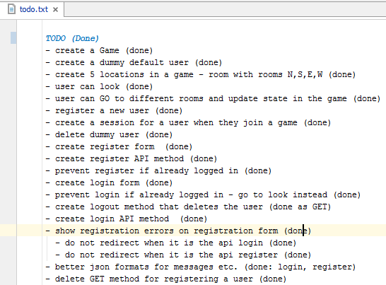

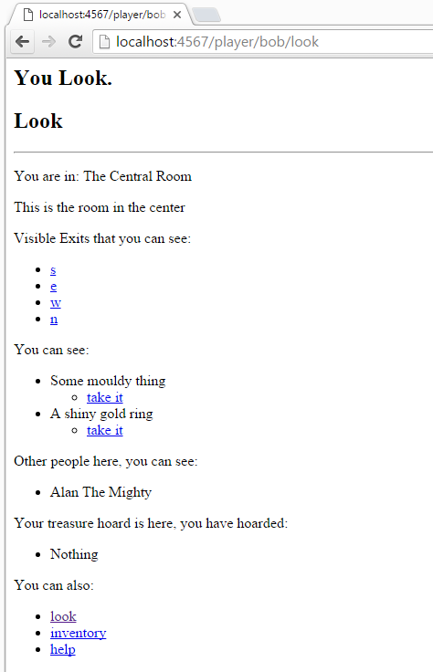

---

<!-- Slide 8 -->

# A Model of Testing

- Modelling,
- Observation,
- Intent,
- Reflection,
- Manipulation

---

<!-- Slide 9 -->

# We can push our functional testing further

- “What is it supposed to do?”
    - vs “What does it do?”
- Comparison to other models
- Is it viable?
- Precondition analysis
- Presupposition analysis

---

<!-- Slide 10 -->

# We can push our functional testing further

- Explore 'How' the system does what it does
- Understand the technology used to build the system
    - Identify technology risks
    - Identify risks at different levels of the stack
    - Work at different levels of the stack

---

<!-- Slide 11 -->

# A Model of Technical Testing

- Modelling,
- Observation,
- Interrogation,
- Reflection (includes intent),
- Manipulation

---

<!-- Slide 12 -->

# Part the second, wherein two technical models are provided with a discussion of possible technical testing approaches.

---

<!-- Slide 13 -->

# Example – a Java App

- HouseOfTest.se
    - /2016/02/testers-contest-crappy-little-datagenerator/

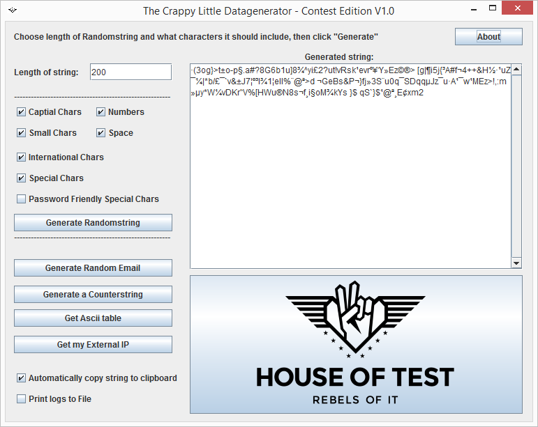

---

<!-- Slide 14 -->

# Observation Example – a Java App

- Double click run – see GUI
- tail -f DataGeneration.txt
- Text Editor
    - Line endings
    - Refresh
- No exceptions shown

---

<!-- Slide 15 -->

# Observation Example – a Java App

- java -jar crappy_little_datagenerator_v_1.0.jar
    - Now can see stdout written to command line, exceptions, errors etc.

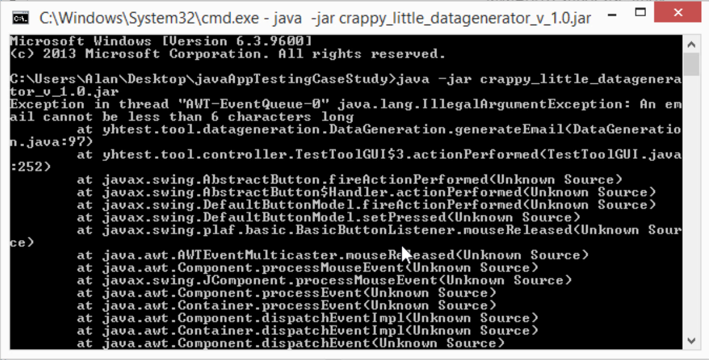

---

<!-- Slide 16 -->

# Interrogation Example – a Java App

- Decompile e.g. http://jd.benow.ca/
- Load .jar as a library into a Project

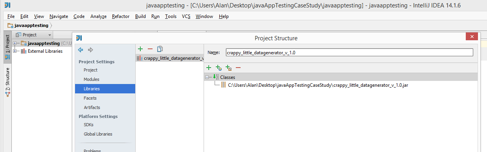

---

<!-- Slide 17 -->

# Interrogation Example – a Java App

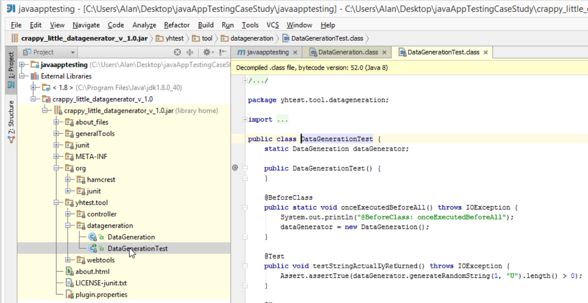

---

<!-- Slide 18 -->

# Observe - Multiple Entry Points

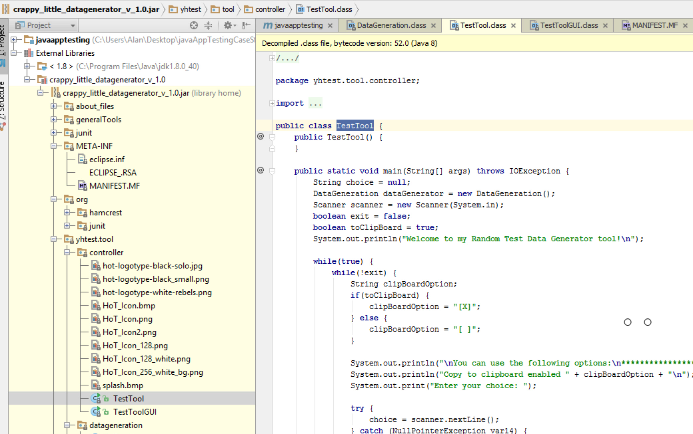

---

<!-- Slide 19 -->

# Modelling Example – a Java App

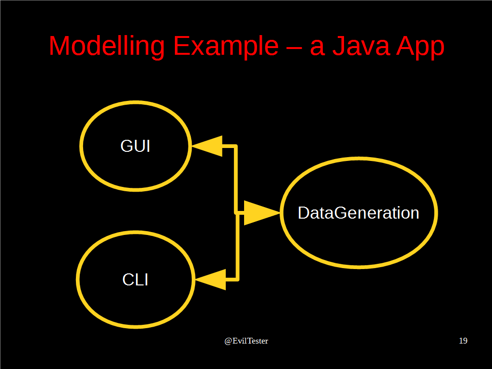

---

<!-- Slide 20 -->

# Manipulation Example – a Java App

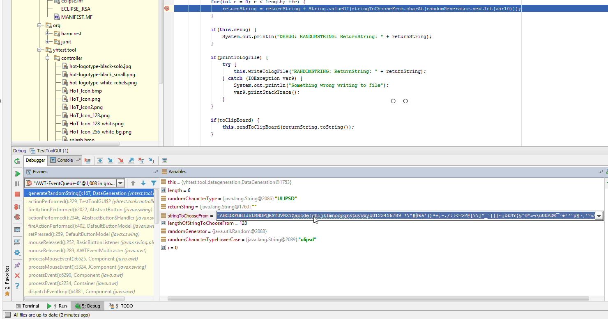

---

<!-- Slide 21 -->

# Manipulate Example – a Java App

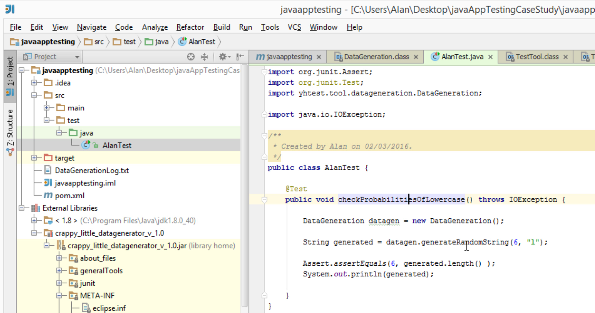

---

<!-- Slide 22 -->

# Risks

- Does this test approach add risk?
    - Because testing at a lower level in the stack?
    - Because working against a non-deployed version?
    - Because it is not how the user would run it?

---

<!-- Slide 23 -->

# Risk

- Mitigating risk provides one reason for testing
- No test approach mitigates all risk
- Multiple test approaches required

---

<!-- Slide 24 -->

# Modelling – a Web App

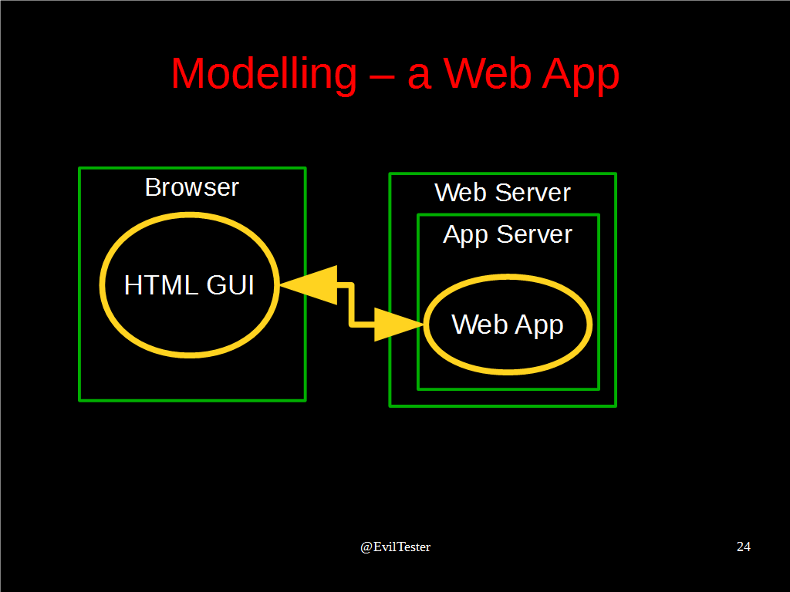

---

<!-- Slide 25 -->

# Observe & Interrogate – a Web App

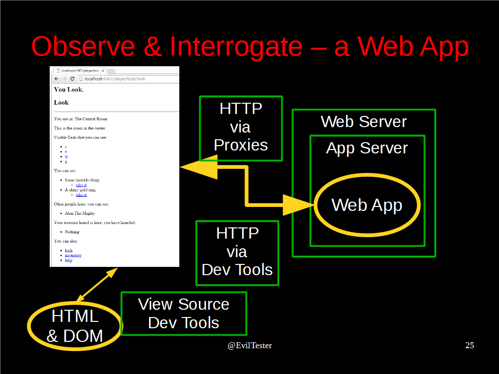

---

<!-- Slide 26 -->

# Manipulate – a Web App

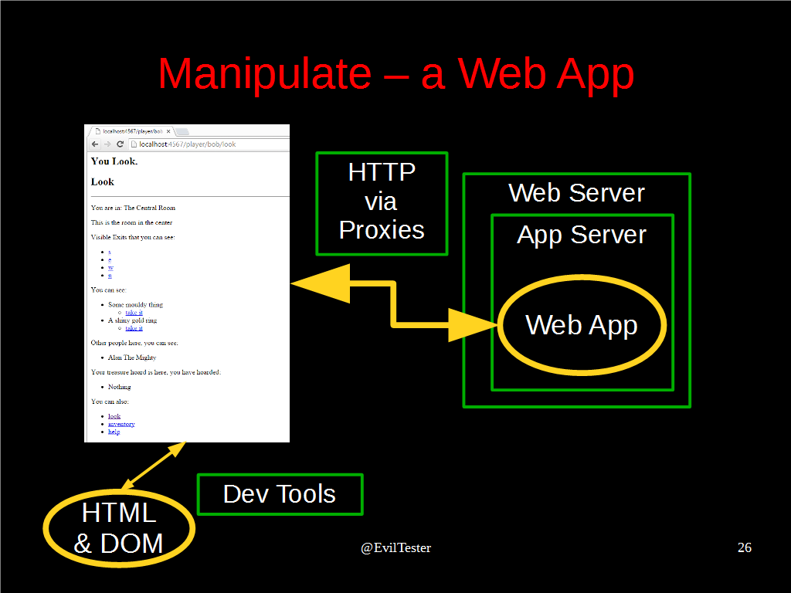

---

<!-- Slide 27 -->

# Modelling – this Web App

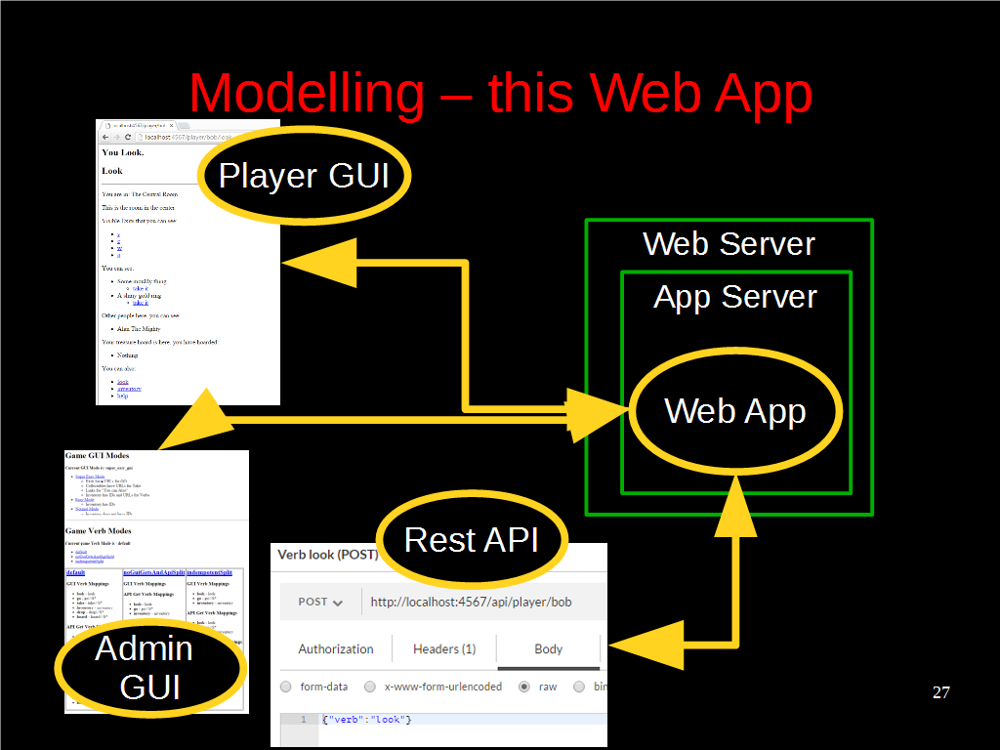

---

<!-- Slide 28 -->

# Part the third, wherein the overlap between technical testing and security testing are explored.

---

<!-- Slide 29 -->

# Deeper Testing

---

<!-- Slide 30 -->

# Technical Testing

- We will find defects and issues we would otherwise miss
    - Observing, Interrogating, Manipulating lower
- Some defects normally associated with security testing
    - I am not a security tester
    - Technically Informed Modelling

---

<!-- Slide 31 -->

# Security Overlap Examples

- Code reviews find hard-coded security issues
- Form field inspection exposed emails, executable shell code, file names for survey answers
- HTML Commented URLs to 'secret' parts of the application
- User HTTP json contains more info than displayed as HTML

---

<!-- Slide 32 -->

# Security Overlap Examples Because...

| Example | Because... |
| --- | --- |
| Code reviews find hard-coded security issues | Observed More Deeply |
| Form field inspection exposed emails, executable shell code, file names for survey answers | Interrogated More Deeply |
| HTML Commented URLs to 'secret' parts of the application | Interrogated More Deeply |
| User HTTP json contains more info than displayed as HTML | Observed, Interrogated, Manipulated More Deeply |

**Because Modelled More Deeply**

---

<!-- Slide 33 -->

# Any Methodology : Any Tester

- Methodology context does not dictate
    - 'Process' context might dictate
    - 'Social' context might dictate
- Any Tester can do this
    - Limited by technology knowledge
    - Limited by technical skill
    - Limited by choice

---

<!-- Slide 34 -->

# Part the fourth, wherein the steps to increase technical ability are made lay afore the public.

---

<!-- Slide 35 -->

# I am fairly Technical

- Books
- SeleniumSimplified.com
- EvilTester.com
- JavaForTesters.com
- Online Training Courses
- Consultancy, work hands on with teams

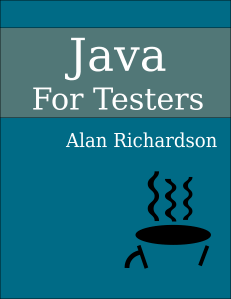

---

<!-- Slide 36 -->

# I grew up with computers...

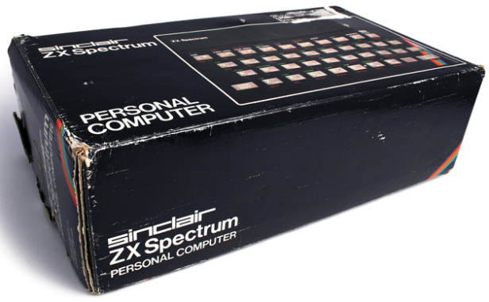

http://www.retrogamer.net/profiles/hardware/zx-spectrum-hardware-profile/

---

<!-- Slide 37 -->

# I grew up reading computer books...

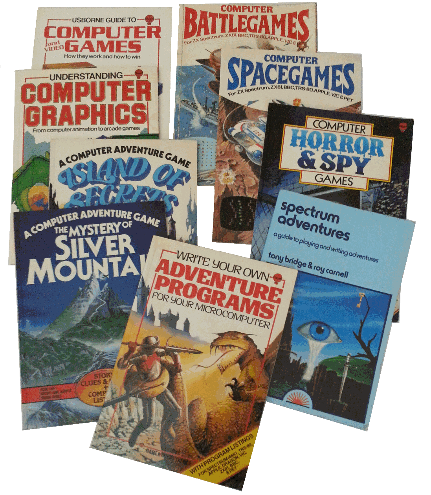

http://www.usborne.com/catalogue/feature-page/computer-and-coding-books.aspx

---

<!-- Slide 38 -->

# ...but not with the internet

http://www.worldofspectrum.org/hardware/feat24.html

---

<!-- Slide 39 -->

# I had to learn how to test the web

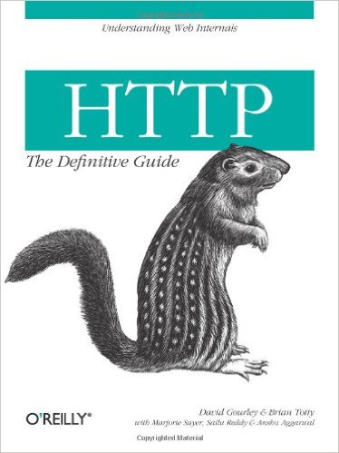

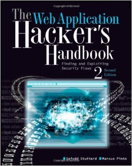

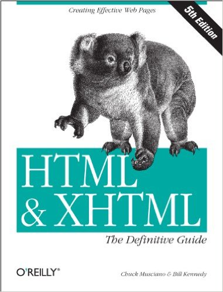

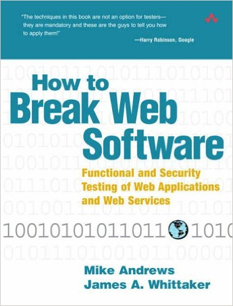

---

<!-- Slide 40 -->

# How to learn to test the web

- Model What You Know
    - HTML? HTTP? Browsers?
- Increase your ability to Observe at the GUI
    - View Source
    - Inspect Element - Dev Tools
    - You will see things you don't understand (add to your model & research)

---

<!-- Slide 41 -->

# How to learn to test the web

- Increase your ability to Manipulate at the GUI
    - Inspect Element - Dev Tools
    - Amend DOM prior to submitting a form
    - Inspect and manipulate URLs
- Cookies, Local Storage
    - Inspect
    - Figure out how to manipulate (plugins required?)

---

<!-- Slide 42 -->

# Basic Web Challenges

- View Source and inspect Element of:
    - Your favourite web sites
        - How do they do 'that'?
- Any free 'pdf' report that requires 'email'
    - find the download without adding your email
- Newspapers - 'you have read too many articles today' – how can they tell? Manipulate to bypass?

---

<!-- Slide 43 -->

# How to learn to test the web

- Observe HTTP Traffic in Browser
    - Network tab in Dev Tools
- Observe HTTP Traffic outside Browser
    - HTTP Proxy
    - Fiddler, Charles, BurpSuite, Owasp ZAP
    - Interrogate and Manipulate Traffic with a Proxy

---

<!-- Slide 44 -->

# How to learn to test the web

- Learn features in the browser
    - View Source, Users, Dev Tools
    - How can the feature help you test?
- Learn features in the proxies
    - Replay Message, Fuzzers, Auto Responders
    - How can the feature help you test?

---

<!-- Slide 45 -->

# Technology Basics

- Model the Technology
    - Where are the gaps in your understanding?
    - These gaps are risks to your testing.
- How can I observe X?
- How can I interrogate X?
- How can I manipulate X?
- Repeat

---

<!-- Slide 46 -->

# Application Basics

- Model the application
- What is it actually doing?
    - Not just what is it supposed to do
- How does it do X?
    - Observe, Interrogate, Manipulate

---

<!-- Slide 47 -->

# Going Further

---

<!-- Slide 48 -->

# Pushing Functional Testing Even Further

Go Even Further:

- Explore and automate systems below the GUI
    - GUI as API
- Quickly enter more combinations of input than would otherwise be feasible
    - Fuzzers, Setup Test Data
- Test at an API level without specialist tools
    - Proxy message creation

---

<!-- Slide 49 -->

# Do the work!

- Research
- Experiment
- Learn
- Take Small Steps

---

<!-- Slide 50 -->

# Do The Work!

- Alan Richardson
    - @EvilTester
    - www.EvilTester.com
    - www.JavaForTester.com
    - www.SeleniumSimplified.com
    - www.CompendiumDev.co.uk
