# Sigist March 2016 - Push Functional Testing Further

## Prelude

## Introduction

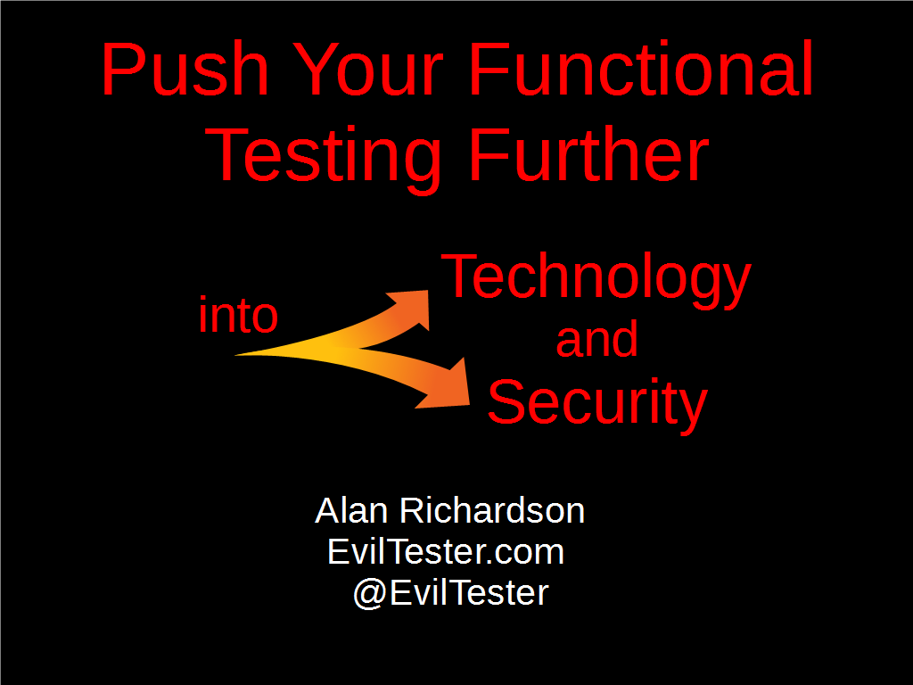\

My name is Alan Richardson. I'm a test consultant. That means I test things and I help people test better. What I think testers do well is functional testing. That's pretty much what we learn how to do, so the purpose of this talk is to help understand what functional testing is, build some models of it, then figure out how we can push that further. When we push that further, we start working in terms of systems and lower levels looking at the technology we're working with. That starts to move us into areas that would normally be classed as Security Testing, possibly Performance Testing, possibly moving ever more closer into automating things. Not because that's our aim, not because that's what we're studying, simply because we're pushing our functional testing further. What we do, we still remain as functional testing.

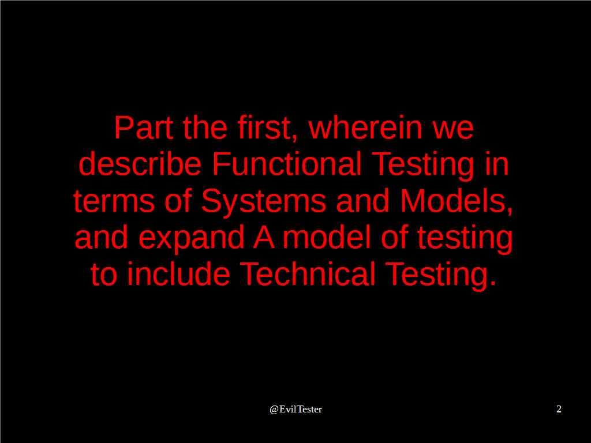\

I'm going to describe functional testing. I'm going to describe it in terms of systems. I'm going to describe it in terms of models. What I really want us to do is get back to the basics of testing and for me the basics of testing are systems, modeling those systems, and exploring the models in relation to reality. If we can do that, it's a lot easier to change what we do and understand what we do and communicate what we do to other people.

## Systems of Testing

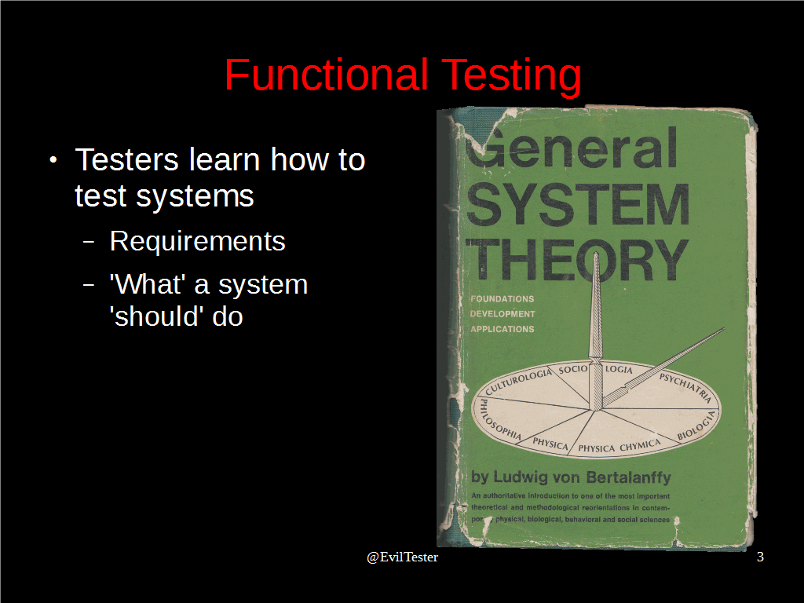\

I think, fundamentally, functional testing is about working with systems. Testers learn how to test systems. One of the easiest ways we have of doing that is by understanding the requirements of the system. The requirements tell us what a system should do. They might even tell us why a system should do that. We've used those requirements to build a model of the system about how it's going to work, about what we think it's going to do, about how it's going to function. Then we compare that model to reality.

We have some techniques that we use for doing that. All the techniques you see in the software testing books. They're techniques for translating from the model into test conditions or test cases or whatever else we call them. Then we can then apply to the system as functional testing. A lot of this for me is related back to systems theory, systems thinking, cybernetics, that kind of stuff. 

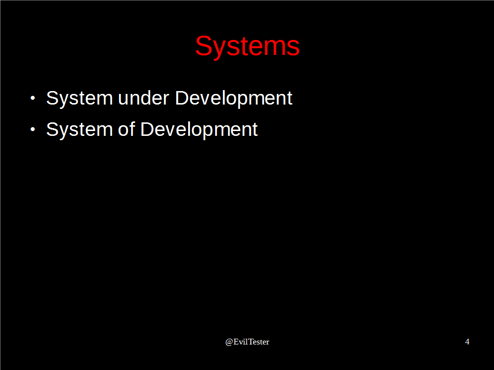\

In terms of systems, what I look at is a system under development and the system of development. They're two high-level models of the testing context that we have.

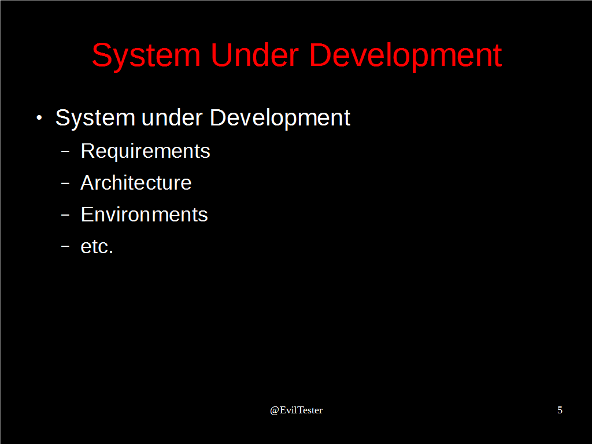\

The system under development is the obvious one. It's the thing we are testing. It's the model built from the set of requirements. It's the model built from the architecture diagrams and how we think this thing's going to be put together. It's the environments that they have and the limits they impose upon us and what we can test where. It's the risk models we build up. That's our system under development and we use that for testing.

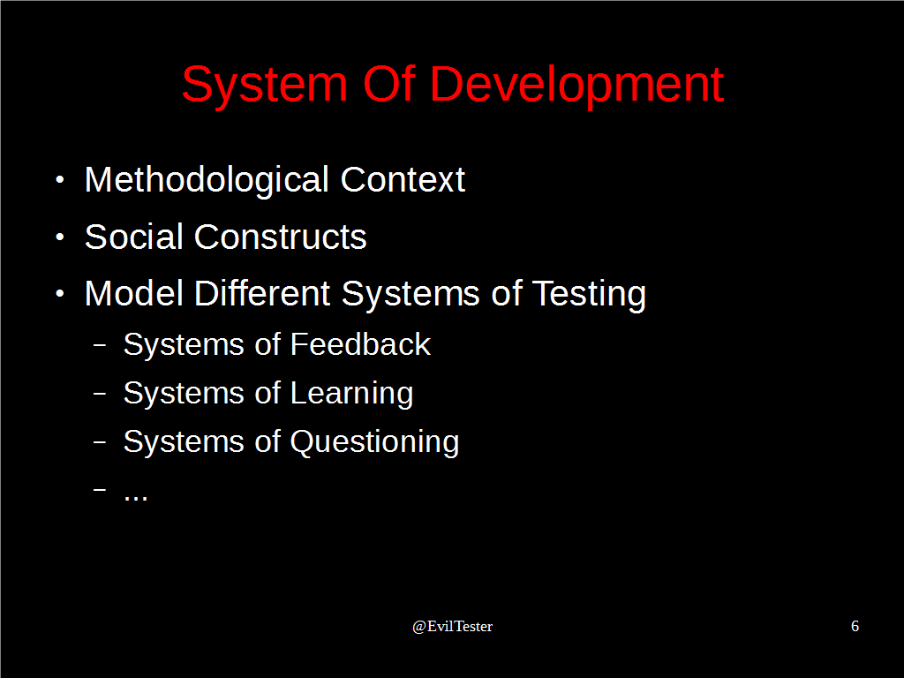\

We also have the system of development, the way that we build the system, the methodological context, the way we choose to run the project. The social constructs within that. The role hierarchies, who's doing what and the politics that are all involved in there. All the places where our social skills have to come in.

If we start looking at social skills as a systems model, we use exactly the same approaches that we do in the system as we do on the people. The same approach on the people and the system and that might sound bad, but fundamentally that's taking a cybernetic view of social interactions. Part of the thinking underpins family therapy. That's part of the thinking that underpins management cybernetics, management processes. We use concepts in our testing.

We can also look at different models of testing systems. We can look at testing as a system of feedback. Very often we're told, "testing is the lights in the project that guide the way, that highlight where we're going, that illuminate our progress." That's testing as a system of feedback. We're getting feedback at the project, which is different from illumination because feedback is positive or negative.

Positive feedback is feedback that corroborates our model, makes us think everything is already the way we thought it was. Negative feedback is telling us our model is wrong. We have to do something, we have to change. The feedback takes the form of information. If feedback takes the form of data, then we have to process it. If feedback takes the form of noise, then we ignore it. We have to be getting information in there. That is a whole model around systems theories, systems thinking, cybernetics and how they interact.

We look at testing as a system of learning. All the social theories around learning, about building up models, about how we expand models, about how we choose to operate in small chunks, about how we check and do experiments. All of that feeds into the learning of systems.

We can look at testing as a way of questioning: asking questions of the system, getting answers back and modeling them. Each of these models gives us a slightly different focus in how we use testing.

Testing isn't a single thing. It's one of these models or another model you come up with.

## Functional Testing

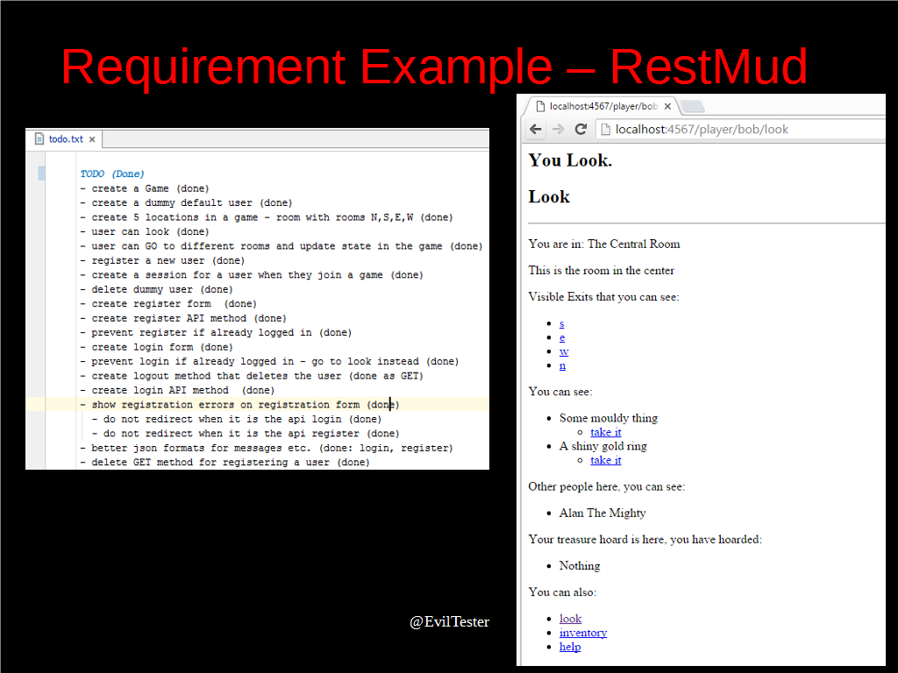\

Here's a requirements example from RestMud. This is a multi-user game that I've written and here are the requirements on the left. This is as simple as it gets. The requirements are a to-do list. The system must do these things. I go in the system, I check whether it does those things. That's requirement-based testing at its simplest. That's what I'm doing. A very simple functional testing model.

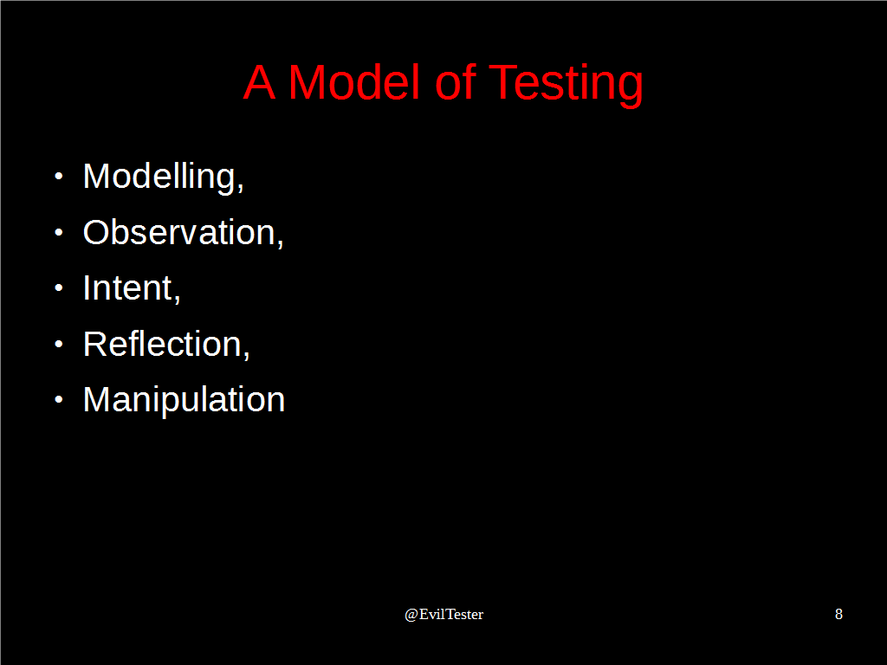\

I have a model of testing, just testing in general that is split into five different parts. The modeling process. Modeling is massively important. It's clearly important. It's fundamental to what we do and I think testers do it well. 

Within that we have to observe because as we use the system we have to observe the results. If I'm checking that we can log into the system, I have to observe that we have logged into the system. 

I'm approaching my testing with intent. This is fundamental. We decide what we're going to do, then we do it. Otherwise we're just randomly going through the system and that's not what we class as testing.

Everything that we count as testing has to have that intent process. We have to think about what we're going in order to expand the models. In order to figure out new ways to observe, in order to create new intent to figure out what to do next.

We have to manipulate the system. I'm deliberately choosing words people don't like because we have to treat the system as a malleable thing and make it work as we need. We need to manipulate it in different ways. When we use the system, we click on links, we go through, we check whether it's working, we are manipulating the system. We have to understand we can manipulate it in more ways than just the ones that the system are exposing to us.

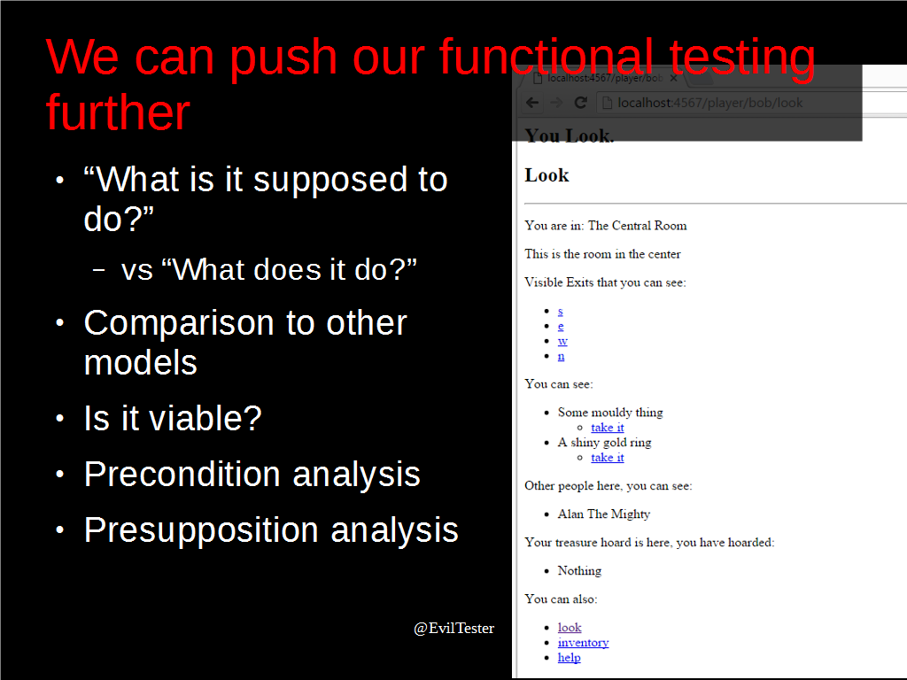\

We can push our functional testing further. We know that we've got the model for what is it supposed to do, but we can also bring in the model of what does it actually do? What does it do? What does it do that wasn't specified in advance in the requirements? What does it do extra? What conditions has it implemented when we expected the other ones? If we start testing what is does do, we're starting to work more closely with the reality. We can take what does it do further down into the technology stacks just by continually understanding the implementation in more detail.

Now we can push our functional testing further by comparing it to other models, by asking whether the system is viable, does it do what the users want?

There are also two other things here: precondition analysis and presupposition analysis. They're very similar, but they're different and used a lot in exploratory testing. 

Precondition analysis is looking at what the system is saying to you and breaking those preconditions. We can see here that there's the rest mud screen. It says there's some mouldy thing in the room and I can take it. Precondition is it's there to be taken.

We can break pre-conditions. That's what testers do. We break preconditions. Its a multi-user system, someone comes and takes the mouldy thing before we do, we've broken that precondition. What happens when we try to take it when it's not there?

That's what pre-condition analysis is. That's one of the things we do during exploratory testing.

It's one of the things that will take you into security testing: breaking the fundamental preconditions that the system believes are in there. That's where you start looking at error handling constructs.

Presupposition analysis is different. Presupposition analysis is building up a model of the system. We can see here that it says, "Your treasure hoard is here. You have hoarded nothing." 

Which suggests to me, it presupposes the notion that we can hoard things, that we have the ability to hoard. That for some reason, I don't have that ability yet. Why is that? What do I have to do to get in the state where I can hoard things?

This is how we build up models.

There's presupposition when we look at the screen when it gives us an input field. There's a presupposition we can type in that. There's a presupposition that whatever we type in there is valid because it has let us do that.

We explore these presuppositions when we do our functional testing. When we look at presuppositions throughout the technology stack, we push our technical testing ever more deeply.

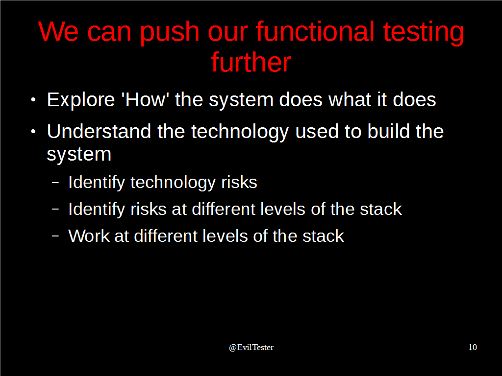\

We can push our testing by looking at how our system does what it does, by understanding the technology that we use to build the system because then we can start identifying risks with the technology. Risks with how the technology is put together.

Risks at different levels of the technology stack, so we're no longer just looking at the HTML GUI. We start looking at the HTTP messages, we start looking at the server and we can start to work at different levels. We an observe at different levels, interrogate at different levels, manipulate at different levels, because my model of technical testing has an extra piece.

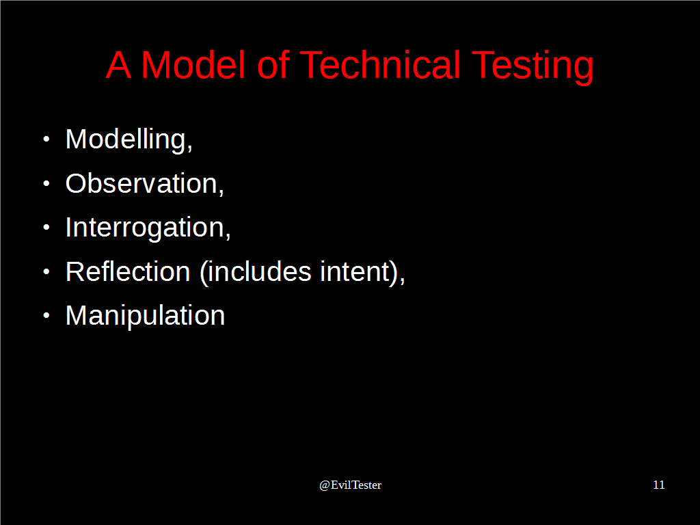\

I've moved intent into reflection because the process of thinking about what we're doing gives us ideas of what we want to do next.

What's important in a technical testing process is that we can interrogate the system. We manipulate the system, we observe to see what's happening, we build up our models. When we see something that is interesting, we need to interrogate that system in detail.

We see a new record being written into the database because we're observing at the database level because we're doing technical testing and we interrogate that to see whether it has the right data in it in all the fields under all circumstances.

We see, we observe that a message was sent to the server. We interrogate it to look at the header, to look at the fields to make sure it's completely valid. This is going in depth. Asking specific questions of it to we can really hone in.

It's different from observation. Observation is something we can have tools running in the background and checking things out. Observation is looking at traffic as it's passing and in the network tab. Interrogation is drilling in deep into it to make sure it works and using that, really low level technical detail, to inform our models, which we then use to inform our testing when we think about it.

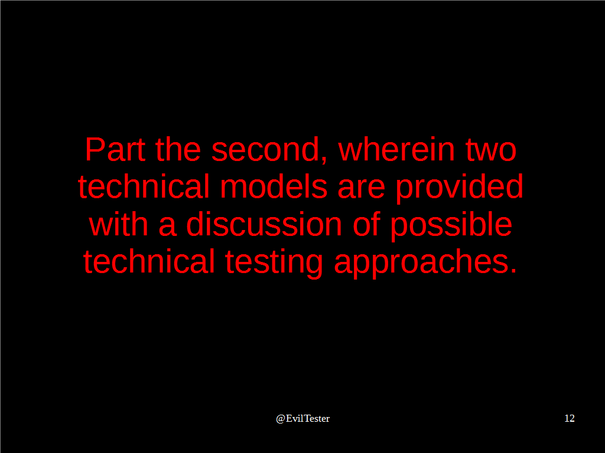\

I'm now going to look at some case studies, some examples of getting more technical in applications. 

## Testing a Java App

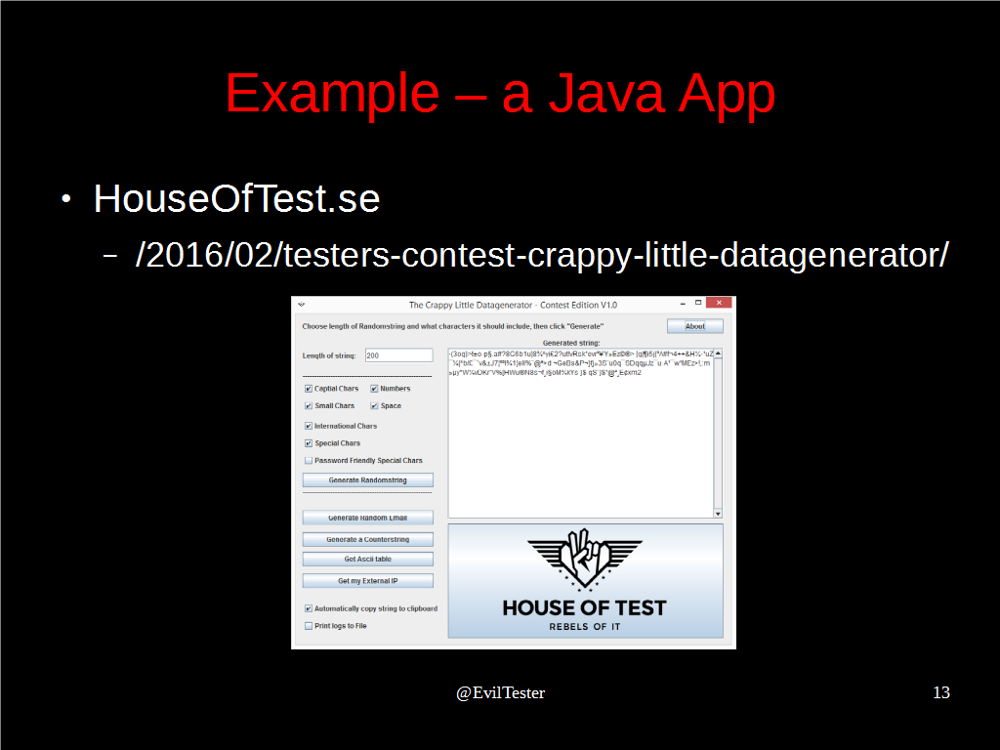\

Here's an example of a java application. This was released by the House of Test Consultancy in Sweden. They released it as a contest. They called it, "The Crappy Little DataGenerator." Basically it's a java desktop application which generates random data, so you an choose the length of string, you can choose the type of characters you want generated in there, you press the buttons and it generates the strings for you. There's a lot of information on the screen there we can use to build up a model and we could test that functionally. But this is a talk about technical testing. We want to figure out how we can technically test that in more detail.

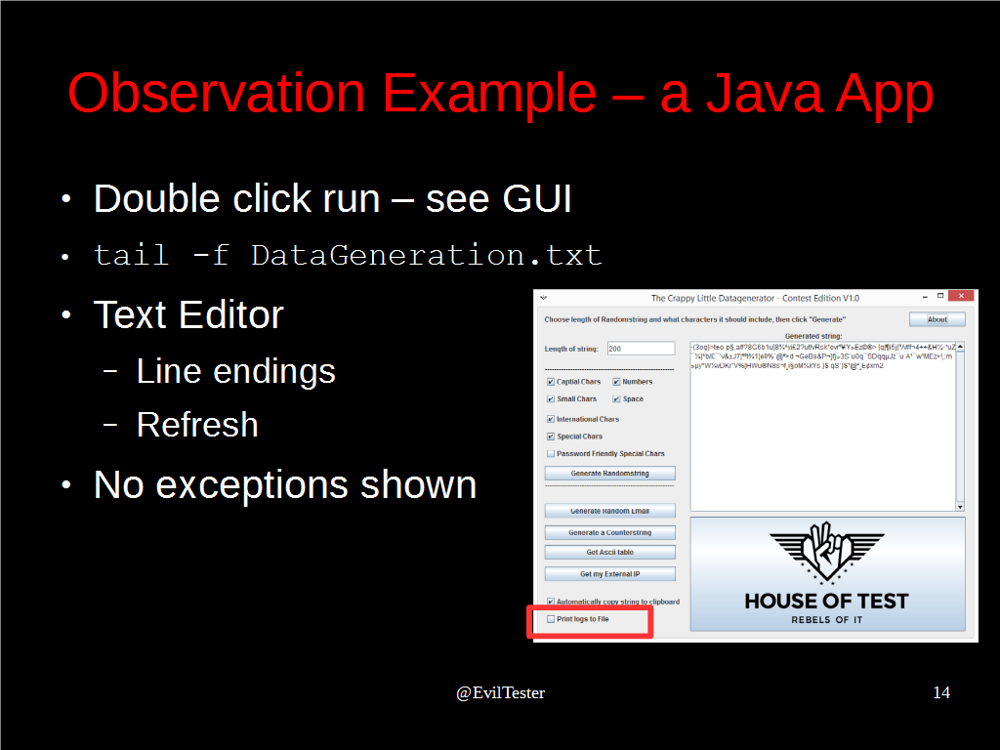\

We can see there that there's an option called, "print logs to file." Whenever possible, we want to expand our observation so if the system can help us do that, if we can switch on logging in the system and we can observe those logs, that will help us test. That will give us more information that we can add into our model about how the system actually works, not what it's just supposed to do. Here I double clicked the GUI, I've run it, I've switched on the logging, I can tail that log file, or I can load that log file in a text editor.

The tools that you use for observation change how you observe. If I tail it, I've got a constant scroll of the log file. If I put it in text editor, I have to make sure the text editor can handle the log endings that are in the logging file otherwise I'm just going to get a mess on screen. I have to make sure the text editor will refresh when the file changes, otherwise I have to constantly reload it in. I have to make sure the text editor doesn't lock the file, otherwise it's going to impact the application.

The tools we use to observe might add risk into our process, but that's the same with anything. Whatever we do in our test process we have to assess the risks of it.

When I'm testing this, I had a quick look at the international characters and nothing was randomly generated. There was no string generated. That looks like a bug, but I'm looking at the log and nothing is appearing in the log. There's nothing telling me generation didn't work. There's no exceptions, there's just nothing. I see nothing. I'm not getting a level of observation that I need in order to know what is going on. That's one clue that I'm not observing in the system detailed enough.

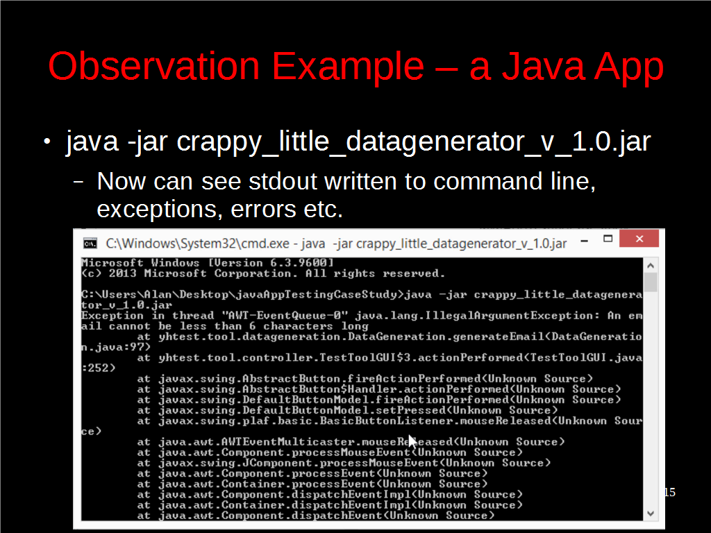\

I have technical knowledge about Java, so I know we can start our Java applications in different ways. One of the ways that we can start off is from the command line doing `java -jar` and then the name of the jar file. In some systems, this is done automatically so you'd have seen this information. If you're running windows, you probably wouldn't see this information. Now when I do this, standard error is now being caught in the console. When I click the generate international characters, or in this case, generate email characters, an exception is written to the log and I get more information. I see that it's a swing GUI using AWT, which means it's doesn't necessarily need to use Java 1.8. It could be using 1.7 or 1.6, but it has to run under Java 1.8, so there's something in the code that is making that happen, but it's not the GUI. I'm building up my model of how the system works.

I'm expanding my technical knowledge. If I don't know how to read this, my technical testing is limited by my knowledge. The more that we observe, the more we identify where we need to expand our models in order to observe better.

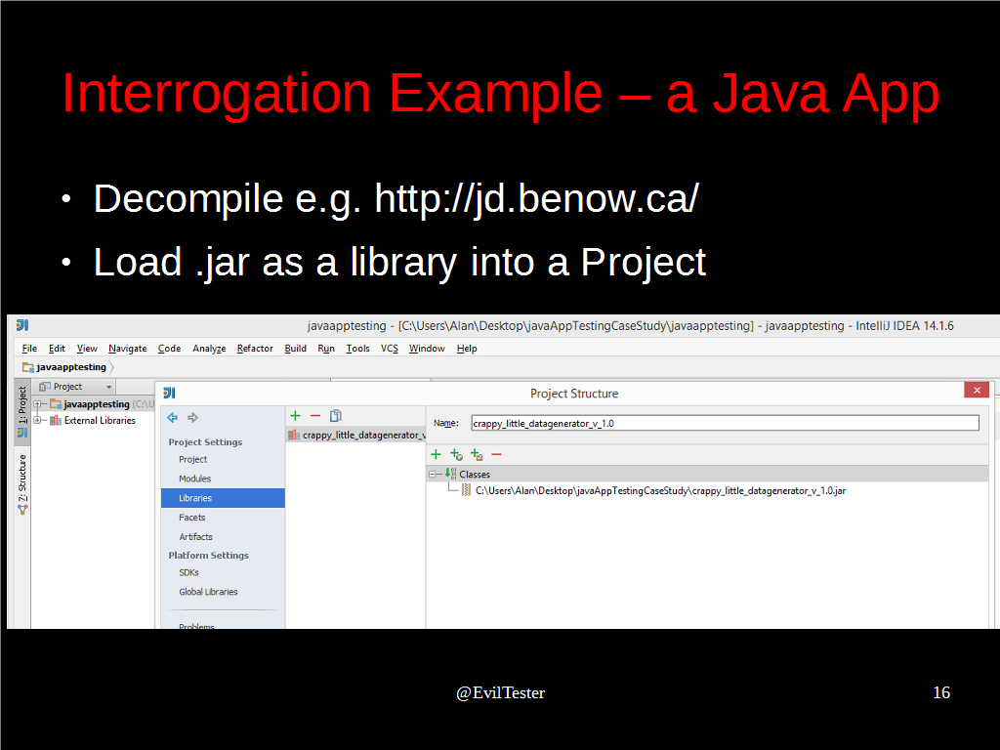\

One thing I want to do is ... I know that I need to interrogate this in more detail to try and get more insight into this application. The easiest way I can do that is I could decompile it. A lot of people during this contest were saying, "Let's decompile the application." And were downloading a decompiler to look at the source.

That's not how I would do it.

What I would do is I would use the IDE to decompile it. I add ... I create a new project, I add the `.jar` as a library to that project, then I have a decompiled version of the code, but because it's in the IDE, I can start manipulating it now at code level. I can break point, I can run it within the IDE. That gives me a lot more flexibility.

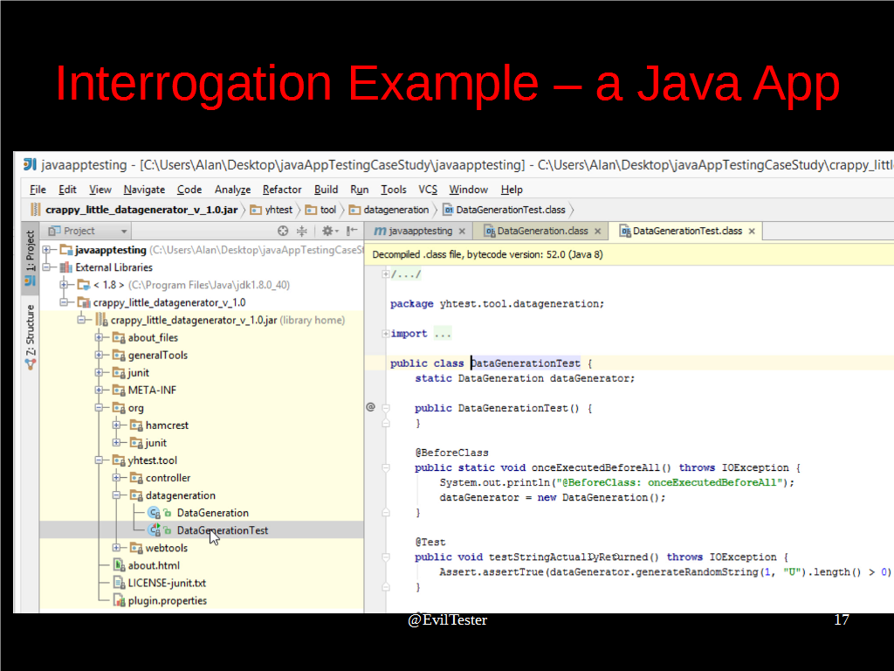\

Whether I decompiled it or had it in the IDE, I can review the code and I can see that there are tests in there. Those tests give me more indication of where the risks might be. I can see limits to the testing, I can observe the previous testing at a more lower level. 

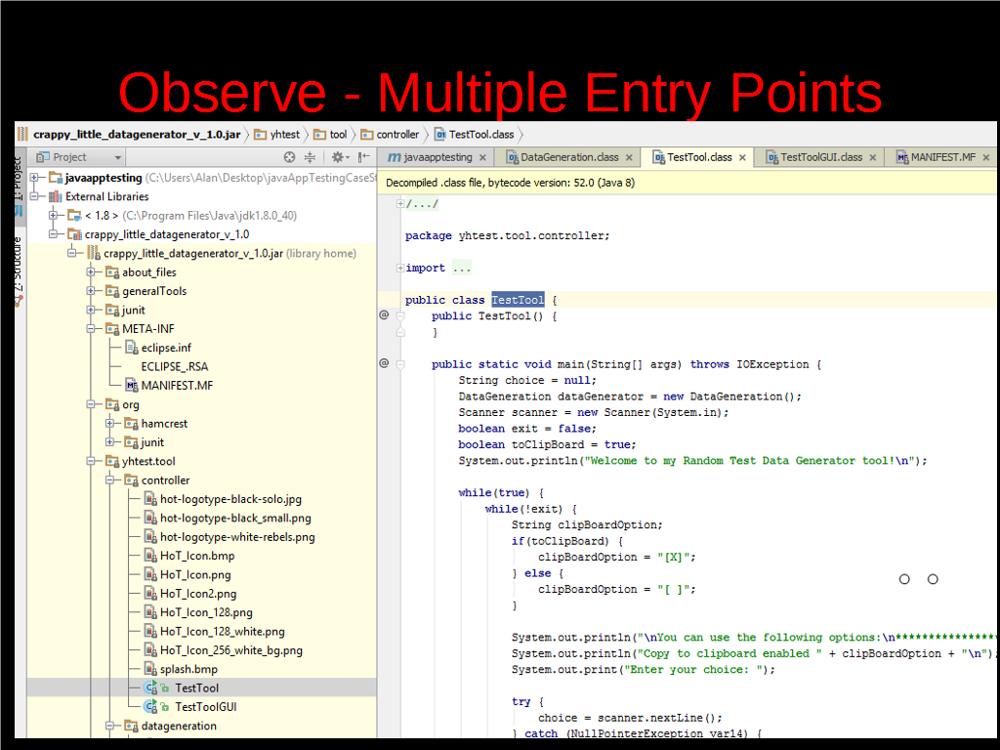\

I can see that the tool itself has two GUIs: there's the desktop GUI that started up. The test two GUI class. There's also a command line interface. There's two ways into the system and that wasn't obvious just from running the application.

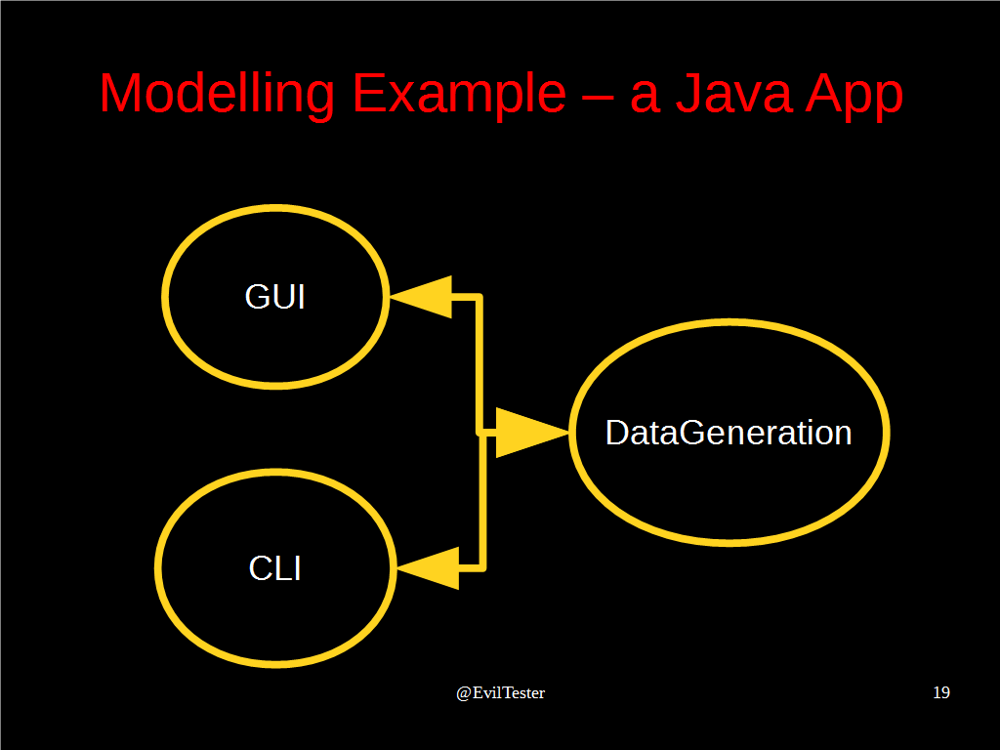\

Now I have more insight into how this application works and I can test it. This has changed my model of the application, so I can see that there's a GUI, I can see that there's a command line interface.

And I can see that both of those use the same underlying data generation class. This means that if I concentrate my testing and derisk the data generation at a lower level, I can cut down the amount of testing I have to do at the GUI or the CLI.

I'm using the technical knowledge that I'm gaining from looking at this application and modeling it to change the way that I approach the testing.

You can see here that this model actually looks like a client server type application even though it's not. Even though it's a single desktop app, we can model it in terms of the multiple tiers it's working with. If we have the ability to interrogate at lower levels, observe at lower levels, manipulate at lower levels, we can change the way that we do testing.

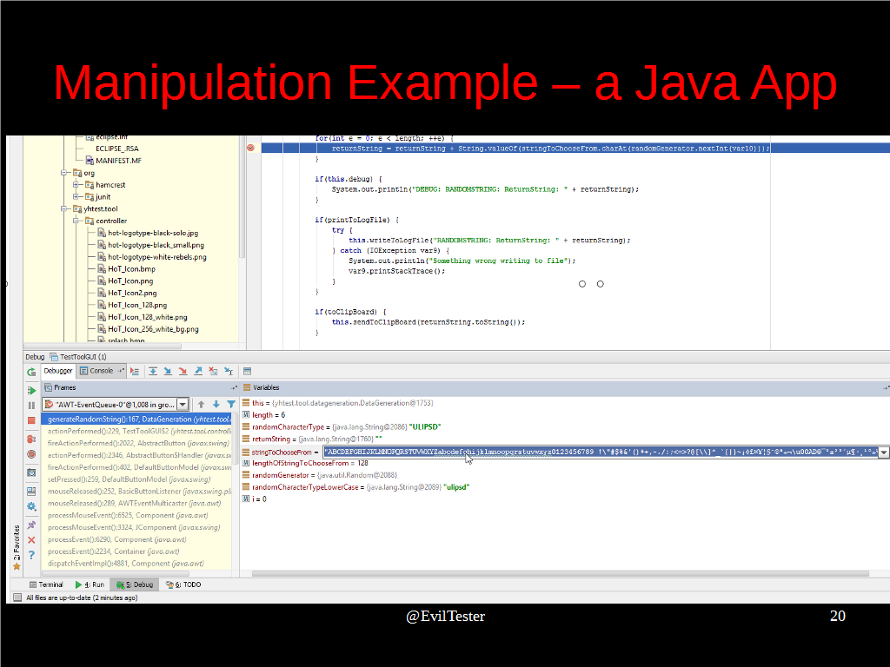\

The way that I can manipulate this system is that I can have break points and I can see the variables as it's running through. I can step through the application and change them on the fly to get different conditions that might be hard to implement in an actual test environment.

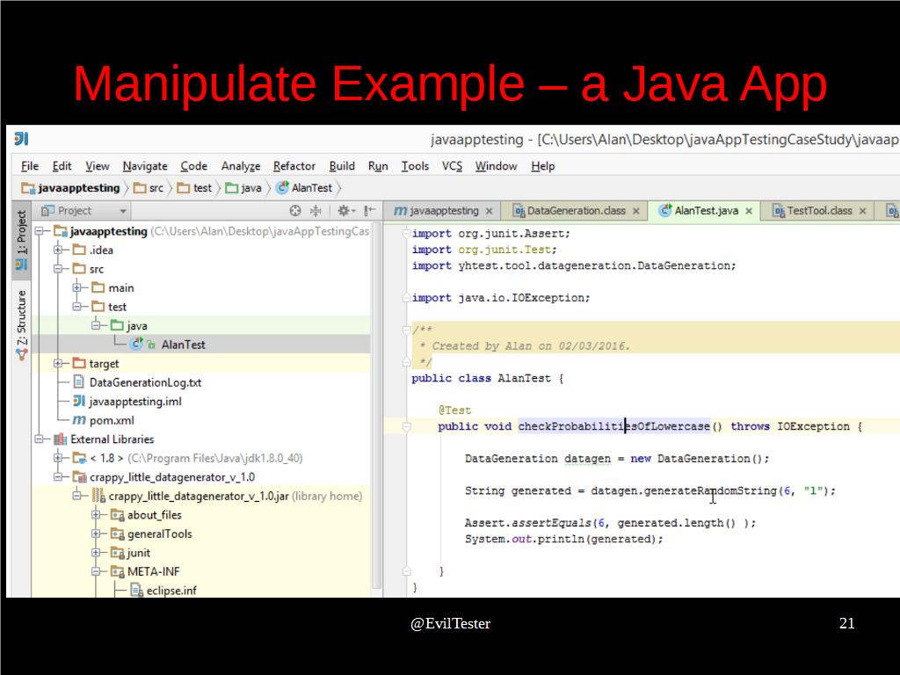\

You can see here, in order for me to manipulate at a lower level, I'm actually writing code to execute the data generation class.

I'm not writing unit tests, I'm writing code that will explore and manipulate the application at a lower level of the technology stack.

Now I need Java coding ability to do this. I need more technical skills in order to do this. What I'm starting to work on at this point is some way of executing the data generation class lots of times in order to assess whether the strings are randomly generated enough. Whether it's random enough, right?

One of the things that's important is we know we can generate random strings, but are they actually random? Do we trust these to be random? How would I know that? The only way I would know that is by randomizing a string a bunch of times and then analyzing to see whether the character distribution is random ... is equally random. Whether each character is generated about the same amount as any other. I need a big sample space in order to do that.

What I'm going to do is create a loop. I'll call the data generation method a thousand times, gather up all the characters, and check when they're in the probability. I found a bug when I was doing that.

This is also a bug that would be very hard to find working at the GUI. It would be very hard to capture all the strings that were generated and put them in a distribution. I could probably do it. I could manually do it. It's copying the strings in a clipboard, pasting them in a text file. I could analyze the characters that went through, but it would take a long time to generate a thousand strings. It would take me 10 minutes to write some code to do that and then I would know. Again, we're changing the manipulation level.

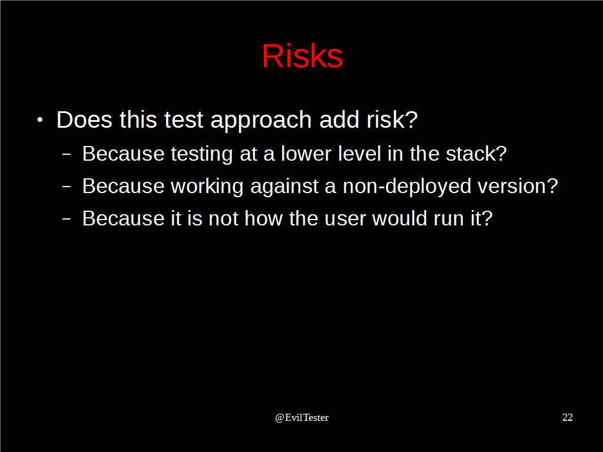\

One thing we have to do, we have to always do this with any approach to testing that we do is think about the risks. Think about the risks of adding new tools in. Does the text edit unlock the file? Is that a risk?

Now some people get concerned about technical testing because they see risks of testing at a lower level in the stack. We might miss something at the GUI because we're testing at a lower level. I'm not testing the actual running `.jar` because I'm running within the IDE so the environment is slightly different so the defects might not be valid. That's a risk. But if we understand technically what we're doing, we can technically assess the impact of that risk and make a team decision.

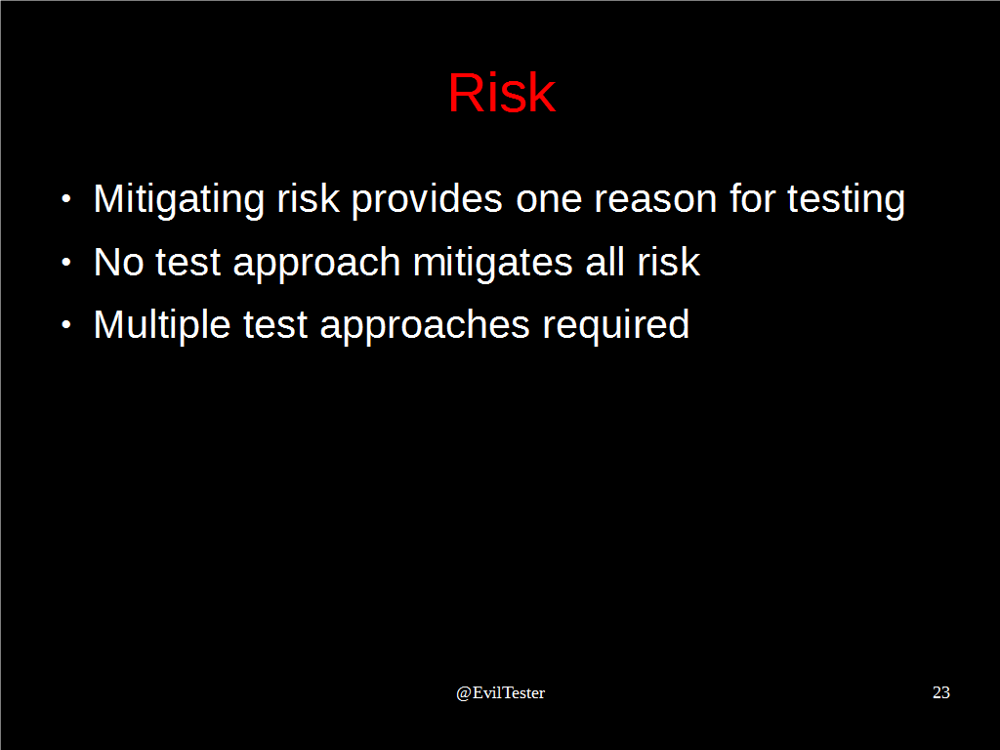\

The point is, one of the reason for testing is to try and mitigate risk. No test approach mitigates all the risk, so if our only test approach is functional testing at a high level looking at requirements, or even just exploring preconditions and presuppositions, but only still working through the GUI not understanding the technologies. There's a whole swathe of the application we have not observed, or interrogated, or manipulated and that is a risk.

Technical testing would only be a risk to the project if that was your sole way of testing. We always need multiple test approaches and the more that we learn to dive deeply into the system, the more we identify different classes of risks.

## Testing a Web App

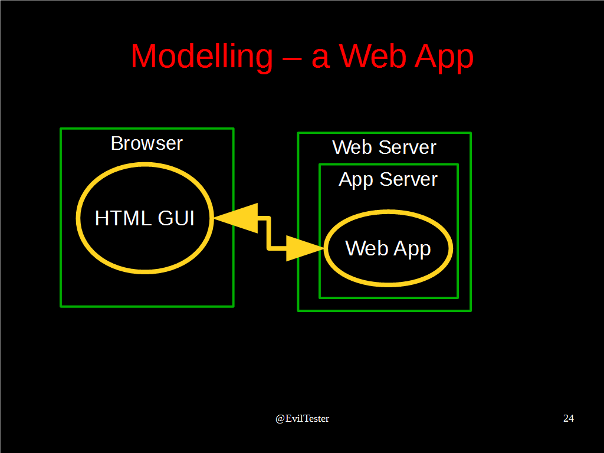\

Here's a web app. This is going to be the RestMud multi user game. You can see that we're working in a browser. We're used to that. It's got the HTML GUI. It sends messages across to the server. The server's actually in two parts: you've got the web server that deals with static content, the HTML files, images, got the app server that handles all the commands to pick things up, change the user state, things like that.

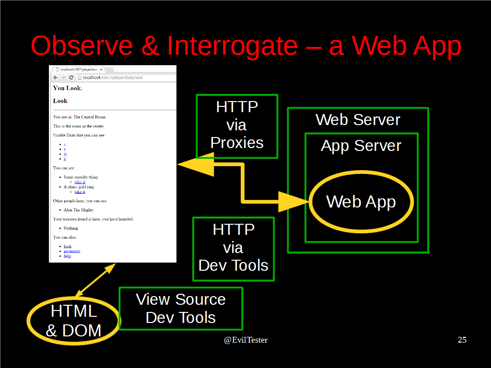\

We can see here that I can observe and interrogate the GUI in the browser itself. I can look at the HTML that's sent through. I can look at the DOM, which is the browser representation of that HTML, it's interpretation. I can see the visual representation under different circumstances. I can observe the application in different ways.

I can interrogate in the browser now because we have developer tools in the browser now that let us interrogate at a really low level.

I can observe the HTTP messages now in the browsers. We never used to be able to do this. The dev tools now have the network tab and we can observe the traffic.

We can actually interrogate the traffic at this point.

I can also still do it through a proxy. A proxy is very useful. It maintains the history quite easily. We can interrogate at a really low level.

Different tools give us different abilities when we observe, interrogate and manipulate, so having a multitude of tools for different reasons is a useful thing to do.

You can see here that I still have not done anything to observe and interrogate the web server or the app server, so really we know now that there is some risk in our testing. Something may go wrong in the web server, the app server, that we may not notice because it might not get passed through to the GUI. There might be exceptions thrown all the time that could give us a problem live that we, with our test approach, are not going to pick up. That's a risk and we know that now because we're modeling it.

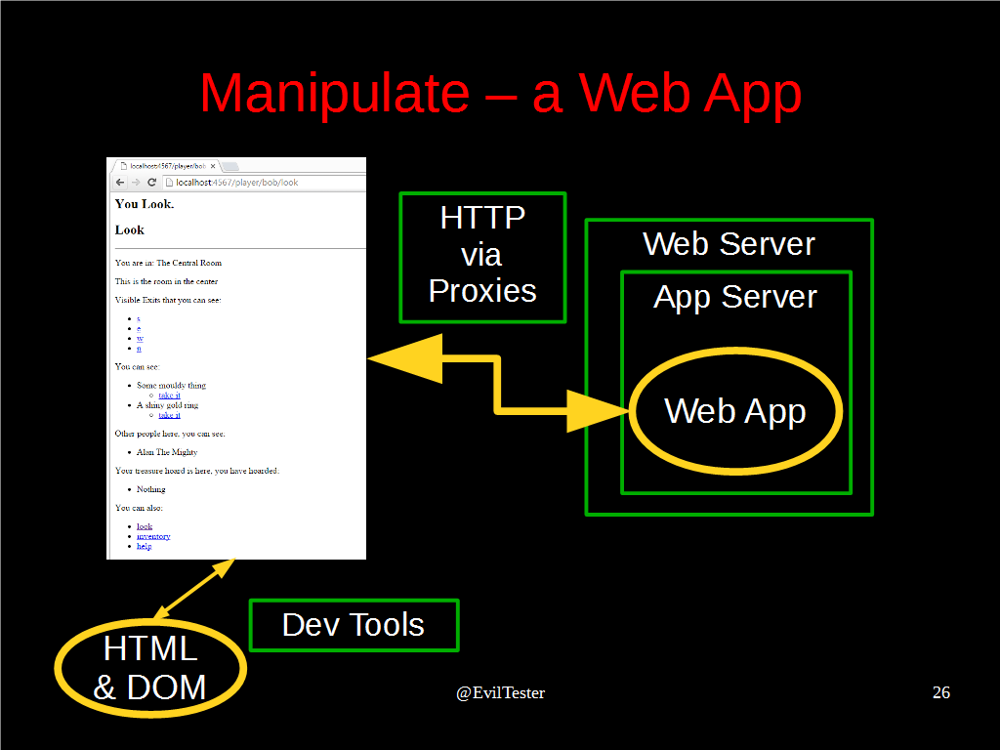\

We can manipulate the web app in the DOM. The dev tools let us change the DOM, they let us delete fields from forms before we submit them, they let us add new values in a drop down so we can test conditions that the server may not be doing.

We can also manipulate the HTTP traffic at the proxy level. We can repeat requests very easily and manipulate them to a proxy faster than we might be able to do it in the browser. Some of the proxy tools have fuzzers that let us do that. Let us send the same request but with random data that can be useful for our testing.

At this point, we're starting to use the kind of tools that people use in security testing, but we're not doing security testing. We're doing functional testing. We're just trying to use tools that make that more effective and let us work at lower levels.

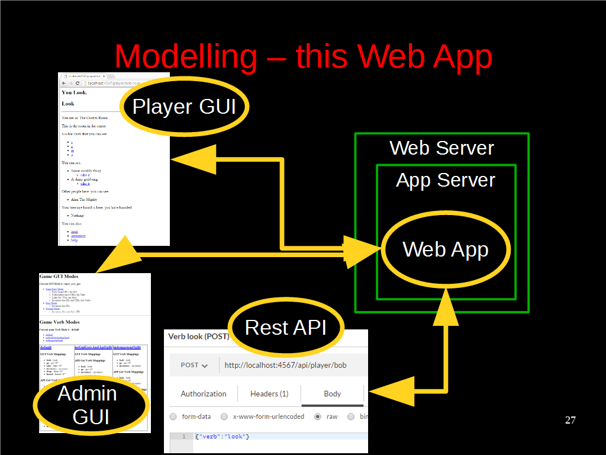\

I'm still not working at the web server or the app server.

Now when I build a model of this app, I can see that I've got a player GUI, I've got an admin GUI, I've got a Rest API.

Now unfortunately here, the player GUI doesn't really use the rest API. If it did, I could focus my testing on the rest API and mitigate a lot of risk.

In order to really test this, I have to call the methods in the web app. I would ideally like to see a lot more testing done on the app server end in order to mitigate risk at the GUI and rest API level.

The Rest API, if I learn how to automate that, if I learn how to test through that, chances are the tools let me automate that more easily, more replicability, than in the GUI, that might mitigate a lot of the web app.

Again, I'm using a technical model to help me understand where to put my test approach to mitigate the risks in the system more easily.

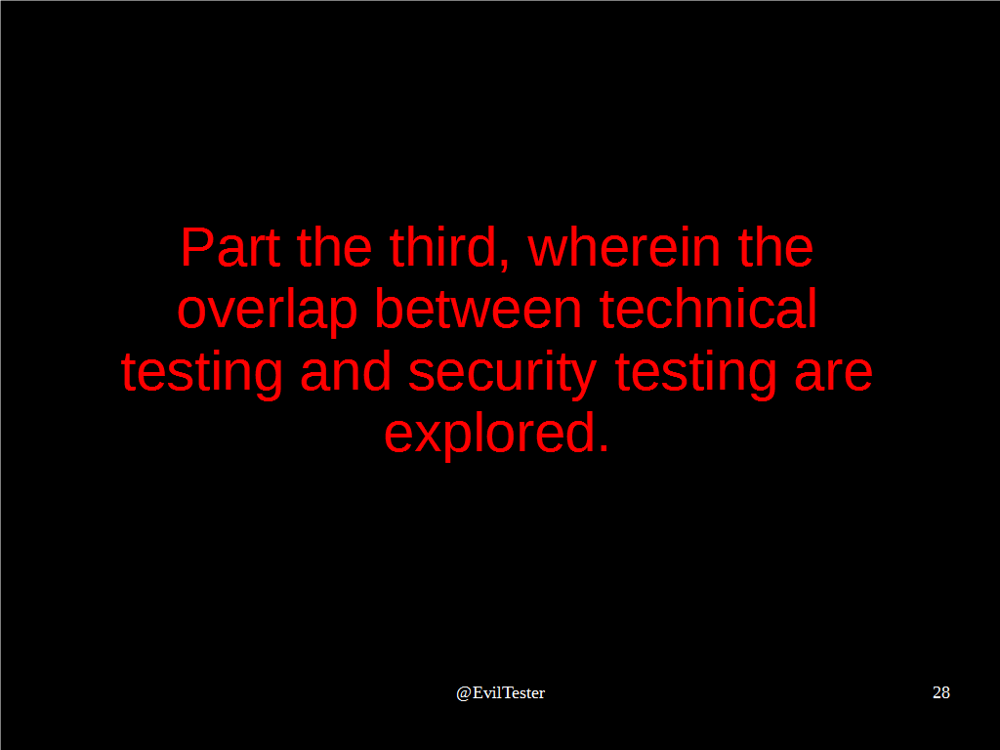\

We're just going to look at how technical testing overlaps security testing in a bit more detail. Really, it's because we're testing deeply.

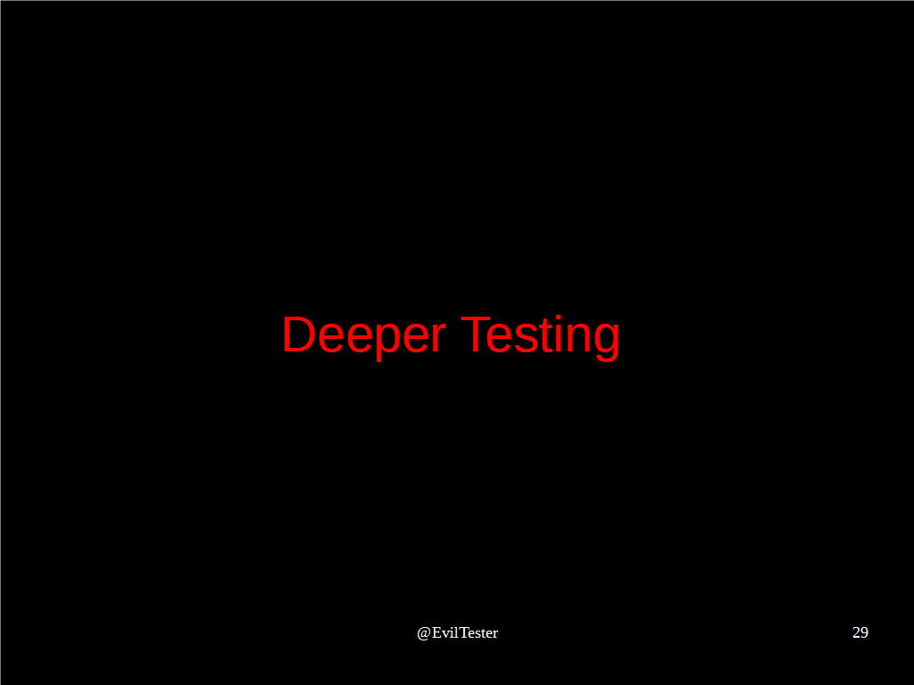\

We're testing more deeply.

Because we're testing more deeply, and we are observing the system at different levels, we will find defects we would otherwise miss.

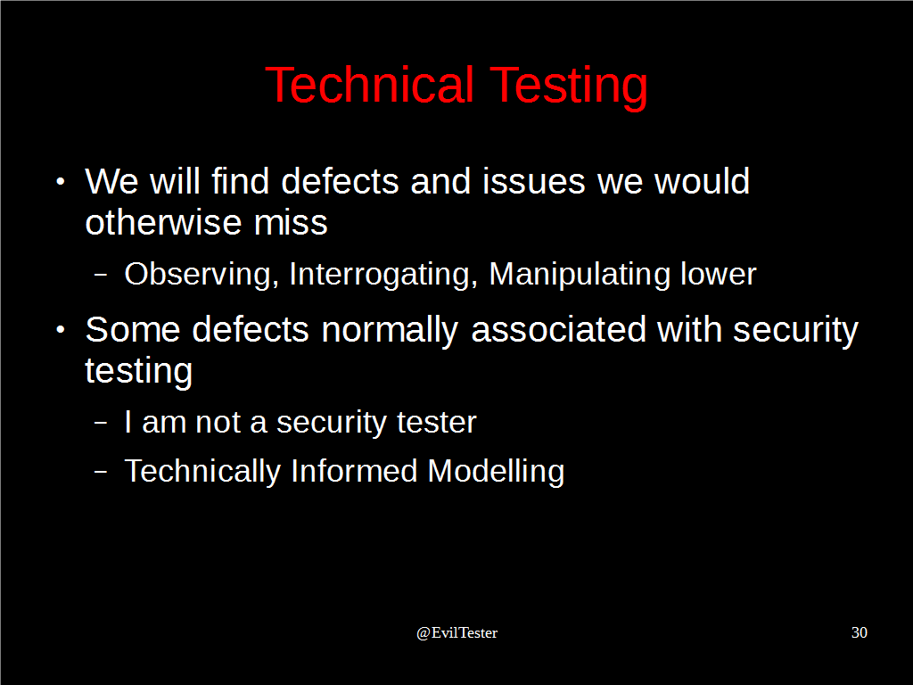\

If we did something to the application, and it throws an exception on the server, we're not going to see that unless we're observing at the server level.

The simple fact that we push our observation, interrogation, manipulation into lower levels, expands what we will see. It also opens up new horizons as to what we can trigger. So by, bypassing the GUI, we can send in values that the GUI might trap. The GUI might not let us enter things which might happen in the server. We have to be able to do them.

I'm not a security tester, but I have read some security testing books. I've read enough security testing books to know that I'm not a security tester. I don't use the tools that they do. I don't have the same intent when I'm testing the application that they do.

I'm technically informed. I model the system at a technical level. I take the knowledge that I read in the security testing books about the underlying technology and figure out how can I apply that as a tester. What does it mean for me in testing the functionality?

What we often find is that when we hire security testers, we're not really hiring them to do security testing at a functional level, we're hiring them to do penetration testing.

We're hiring them to check whether our environments are solid. Whether people can break into them. Whether the deployed environment has the right server versions to make sure they're not vulnerable to accessing.

Very often we don't give them logins. We're challenging them to login. When they get to the point that they can login, they stop their testing because they've exposed the vulnerability. They rarely get to the point where they're using your application functionally at a detailed level to look for security testing defects from a functional perspective. That's rare to see. That's what we do. That's what we have to do when we do our testing. The more technical we get with our testing, the more we're able to do that.

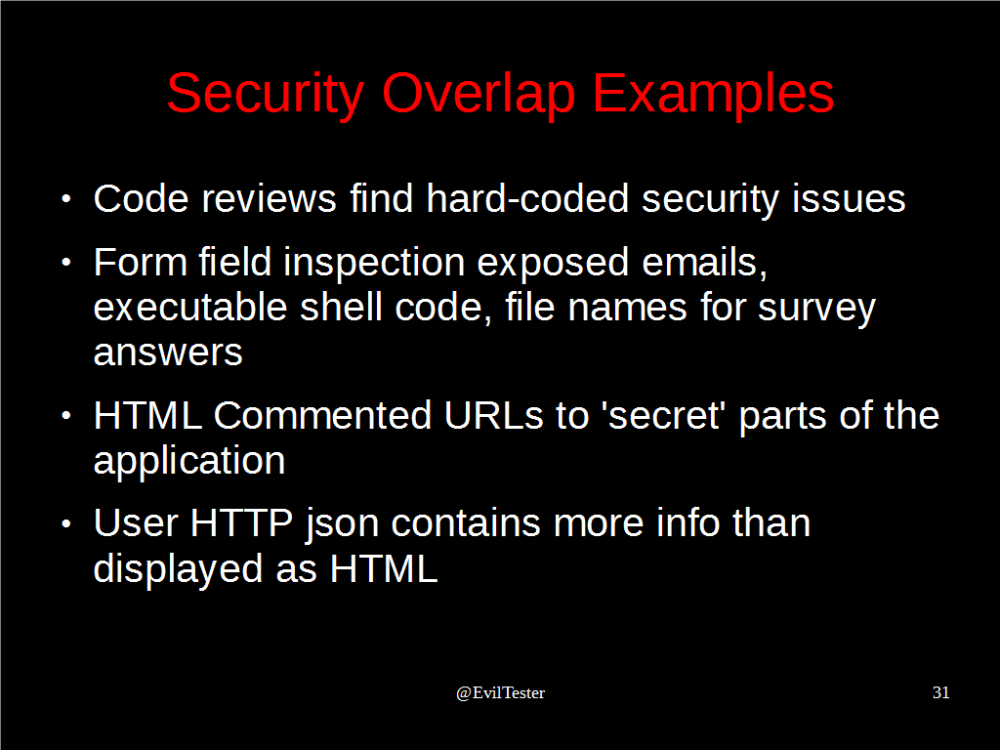\

Some examples from life and live.

When you do code reviews, when you're just observing the code that's in there, you will sometimes see hard-coded security issues. Hard-coded emails, hard-coded work arounds through server headings all that kind of stuff.

You'll see this in the HTML. At a simple level HTML is code. Code has comments. You look at the code, the comments in the HTML code and you might see secret paths of the application. To-dos that suggest there are defects that are not fixed, there might be issues revealed in there.

We'll only see that if we start observing it at a lower level.

When I look at forms just on the web, this has happened in applications I've tested, but you'll see this in the web. When you are asked to sign up for ... "Download our PDF that explains every test tool forever that is great. Particularly the one that we sell." When you look at those forms, you see possibly emails in them. Hard coded emails in the form, that suggest that the form is going to send something to that email address. If you submit the form with a different email address, you might be able to start spamming people. You might be able to use their mail system to send out mails to people that they don't want to send them to.

I've seen exposed shell code in there, so I could change the shell code and it would execute things on the server. That's a fairly major security risk, but it's embedded in the form.

File names for survey answers, filling in a survey. It says, "write it to this CSV file." If you change the path, then you can start overwriting other files. If you change the name of the file, you can overwrite other files on the server depending on the permissions that they set. Job is running at in the actual server. It's a security risk, but they're in there. In the functionality we see them during functional testing because we're observing at a lower level.

I was on an online conference, and as I do, I have a proxy running to see the traffic that's going through because I'm interested in what goes through and I'm always trying to observe in more detail and expand my technical skills.

I saw in the little chat forum there was a request that said, "Give me the user details." That's important because he needs to know which users are in the chat room. I had to look at the details that came back and there were details in the request coming back that were not on screen. On screen, it had the user ID, it didn't have the email, it didn't have the phone number, it didn't have their home address, but all of that was in the request coming back. All of that was exposed from the system. That's a security risk.

In functional testing, we know how HTTP requests are made. We see the URL, simple matter for us to change the URL. Functional testing: we vary inputs to see what the response is. So I was able to change the URL to say, "Don't just give me the 20 people in the chat room, give me the thousand people that are in the conference. I don't care who's logged in or not, everybody." Then I had all the user details coming back. That's a security risk. For instance, a security risk that was found during functional testing. Functional usage. Functional.

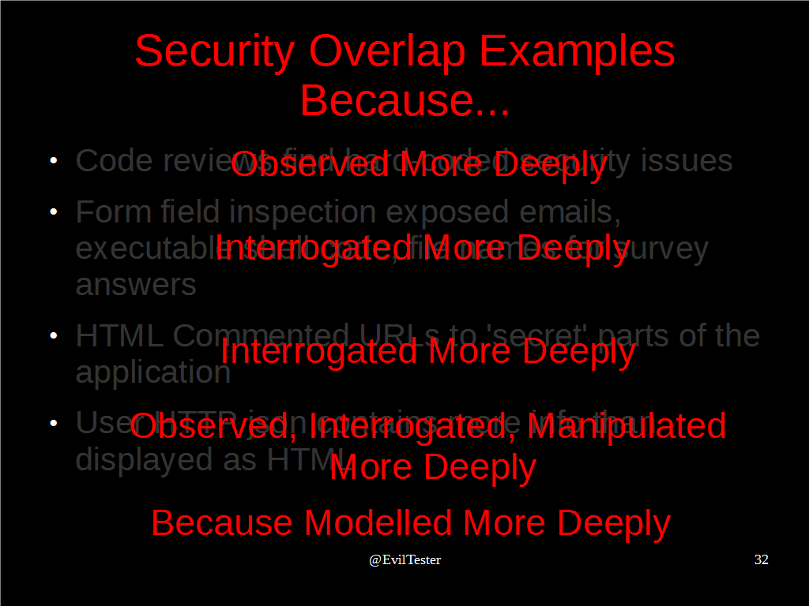\

Because I was observing a more deep level. I was interrogating more deeply. I was manipulating the system at a more deep level than the GUI was doing. I modeled the application at a deeper level than had been done in their functional testing.

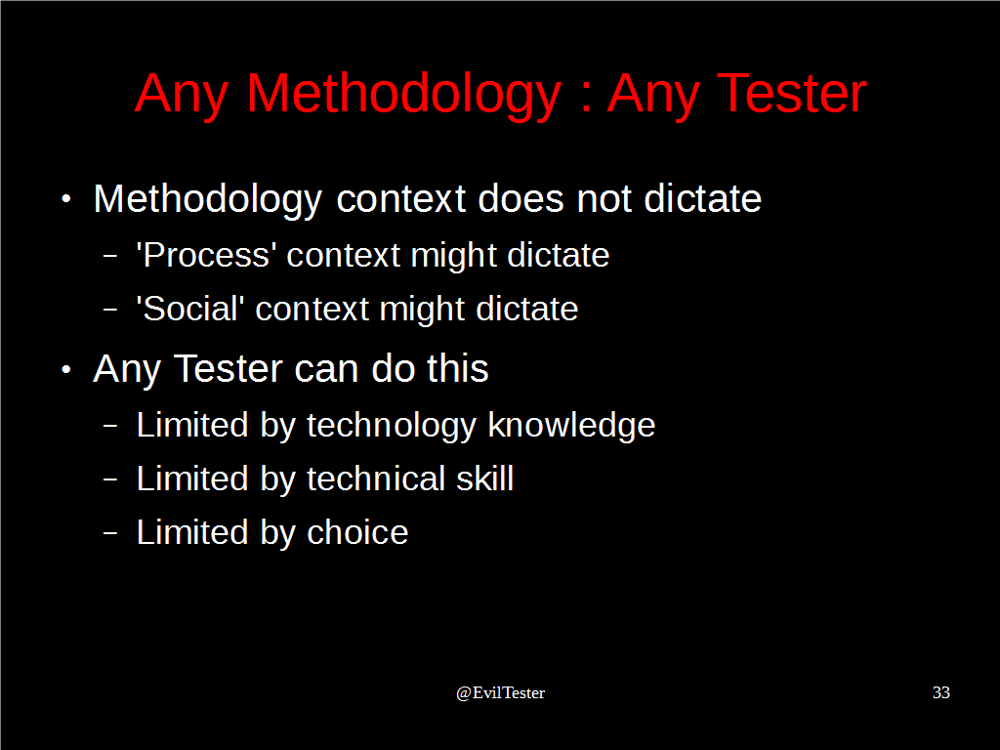\

Now you see that none of this is methodologically specific. You could do this on waterfall, you could do this on agile. It has nothing to do with the methodology.

Now there might be parts of the context that you work in and the environment that you work in and the system of development that you're using that might change this. The process that you put in place. The social rules being put on top. The social interactions of people telling you not do things because they don't like it or they can't do it or they don't see value in it. 

But because these are social constructs, we are part of that social system and we have the ability to influence it if we have the ability to communicate it effectively. If we can demonstrate the value in it or if we just make a stance and do it anyway and show the value.

None of this is really invasive. Observation is something that you do as a side effect. As you're doing the testing you observe in parallel. That gives you more information. If that adds value, you can interrogate. None of this is invasive and it's a choice that we make.

Any tester can do this. What they're limited by is their technical knowledge. They're limited by the technical skill that they have. Those are the limits.

If you don't have the technical knowledge of HTTP requests, you can't observe at the HTTP request level. If you don't have the technical skill to figure out how to create Java `@Test` methods to test at the lower level, you won't do that.

We are limited by our skills and knowledge. Fundamentally, skills and knowledge limitations are a choice. We choose not to learn this.

It might not seem like that. It might seem like, "I don't have the time. I don't have this. I don't know this. I don't want to." Whatever.

Recognize that that is a choice. It is a choice you're making. One of the reasons I stand and talk about this thing is to let people know that this is a choice that they have made. Those of you that are technical have chosen to expand your knowledge. Those of you that are not technical have chosen no to have learned this. It's not that one is bad, one is good. It's that it's a choice and recognize that if you want to you can change the choice and learn this. 

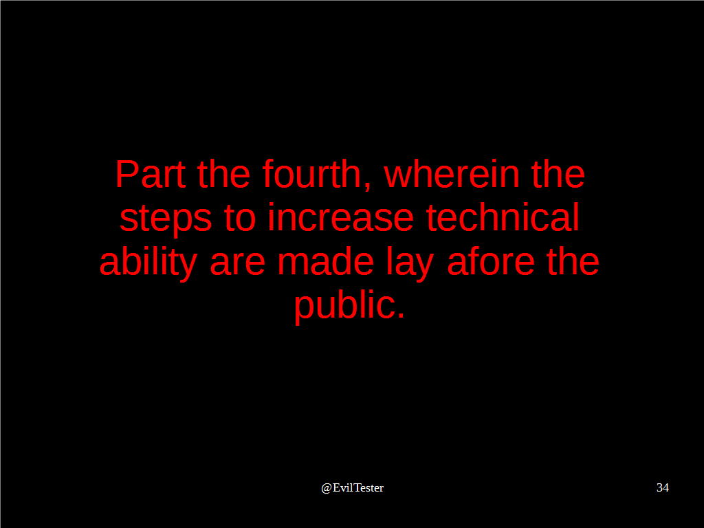\

That's what we'll do now. We'll look at the steps it takes to actually learn this.

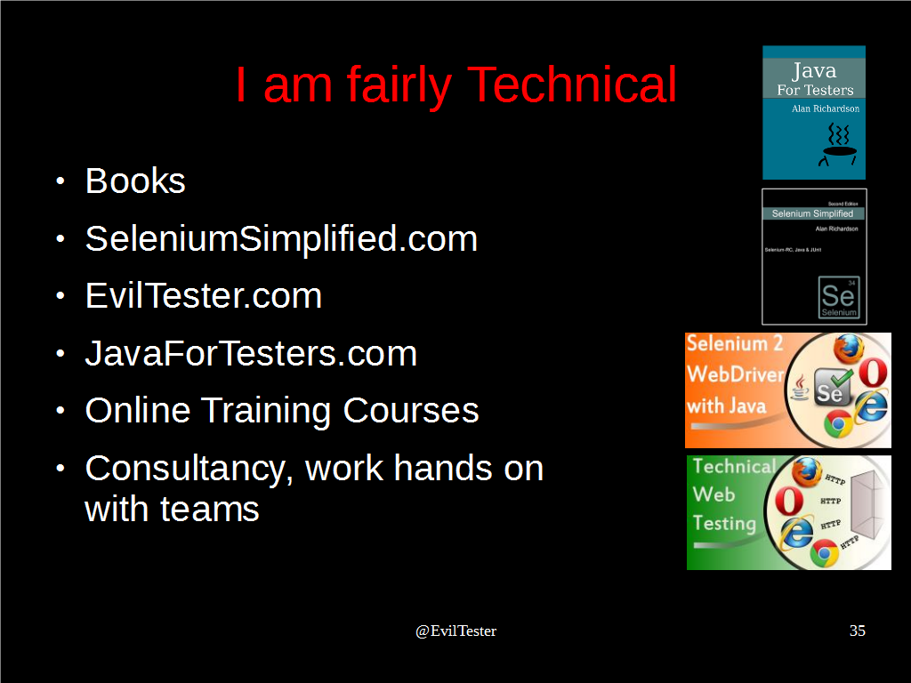\

Now you might have noticed that I'm fairly technical, right. I've written some books on this stuff, I've got technical websites, you can see them there. They cover web driver, technical testing, Java, et cetera. You can visit this. A lot of these next slides we're going to go through fairly quickly because they're for your use later on. There is information out there. Online courses on how to do this stuff.

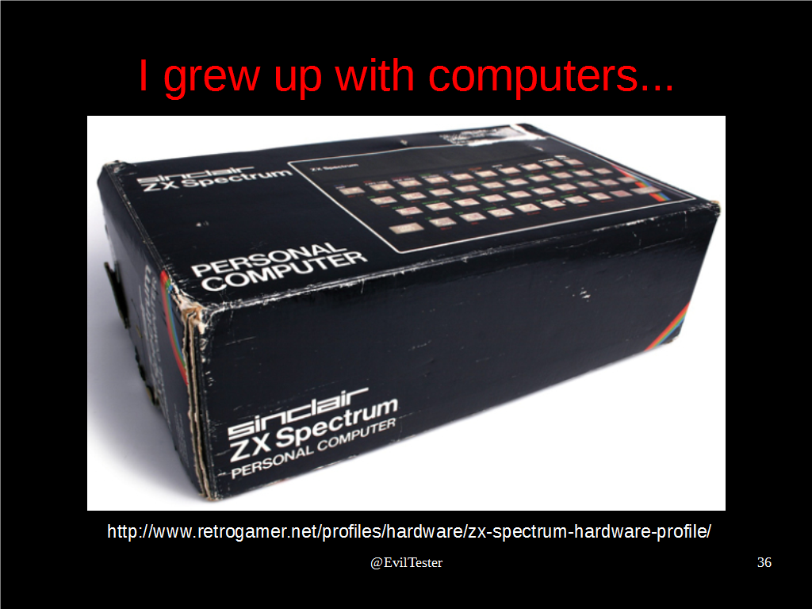\

I'm fairly technical and that might be because I grew up with computers. I got my first computer, a ZX Spectrum when I was 12-13, whatever it was. I grew up with computers all the way through.

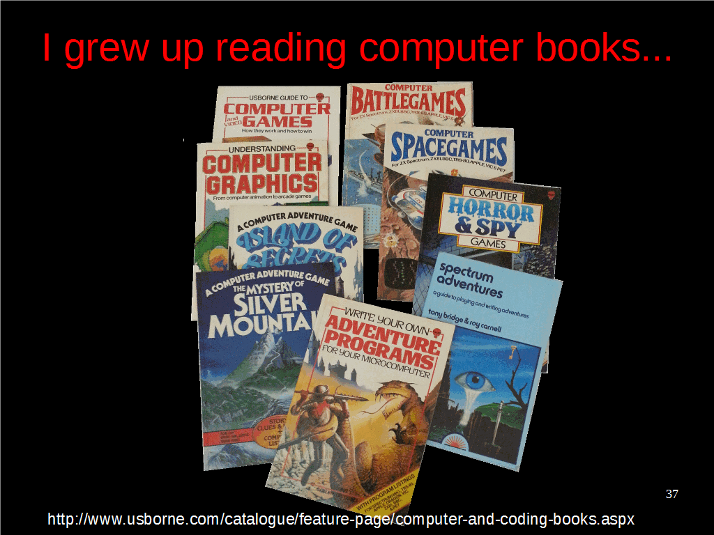\

I grew up reading lots of computer books. If you want to, you can read most of these books, not all of them, most of these books for free on the [Usborne site](http://www.usborne.com/catalogue/feature-page/computer-and-coding-books.aspx).

You can't read all of them because these are my books. These are from my bookcase. This one here for How to Write Your Own Adventure Programs. That was key to what I do now.

When I automate, a lot of what I do, stems from writing adventure programs when I was younger. Writing adventure programs when I was younger taught me parsing, which moved me to compilers and interpreters. Which is really what I'm doing when I build test abstractions for automating systems. It's really what we do when we build keyword driven automated frameworks. Essentially keyword driven automated frameworks is no different from building a simple parser for an adventure game.

Adventure games also taught me how to explore systems and models. A lot of what I do is related to that, when I was 12, 13, 14.

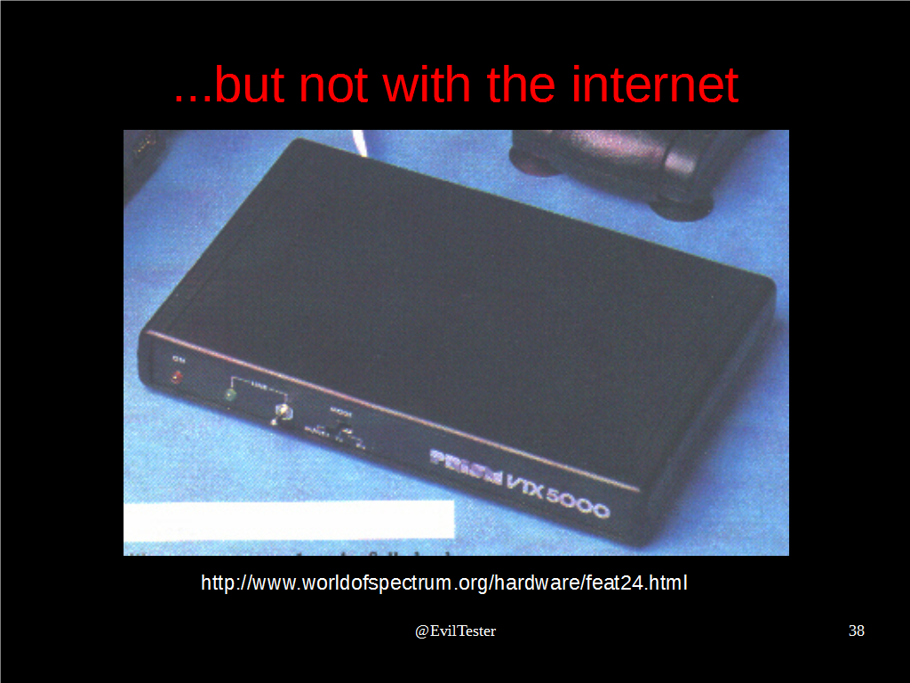\

I grew up with computers and things, I'm technical, but I didn't grow up with the Internet. This was my first modem. It was 1200 baud, bits per second, which is not fast. It didn't need to be fast because we didn't have the Internet in those days. I did not grow up with the Internet. I used this to dial up and connect to other modems, go, "Oh, no I'm hacking," and drop the line. 

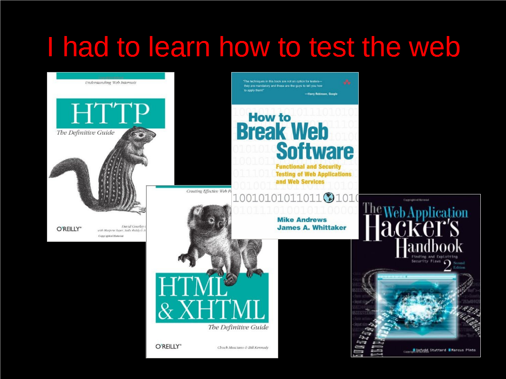\

I had to learn how to test the web. I looked for books that would help me: sources of information on the technologies. I had to identify the technologies. I had to learn about HTTP, HTML, I learned HTML by writing my own websites.

There are books on how to test web software. They're out of date. The tools mentioned in these books are not what you will use now. The kind of techniques and intent behind them is still important, but you have to interpret that for yourself. Up-to-date books tend to be the security books. The Web Application Hackers Handbook, excellent book, goes into detail, explains the technology, but you have to interpret it for testing because it's aimed at security testing people, not functional testers. We know functional testing so we have to use the information to expand our functional testing into the technical realm.

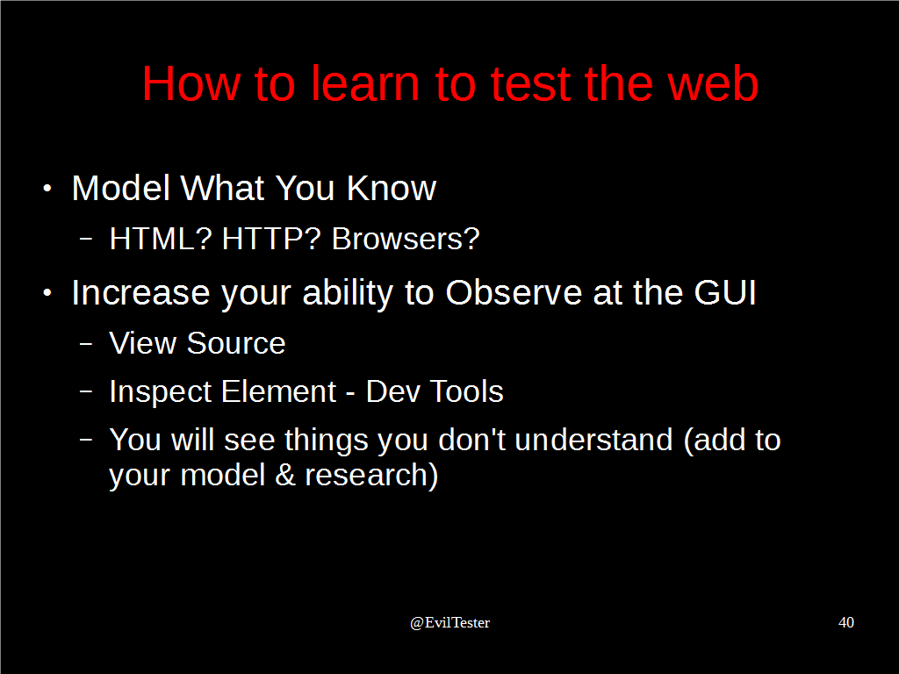\

We learn this by modeling what we know. That way we can see gaps. We don't know HTML, we go and learn it.

We need to focus on observation, interrogation, manipulation. How can I observe at the GUI? What can I observe at the GUI? What functionality does the browser have that will let me observe at the GUI. Then we learn the dev tools. As we observe, we see things we don't understand and they let us expand our model.

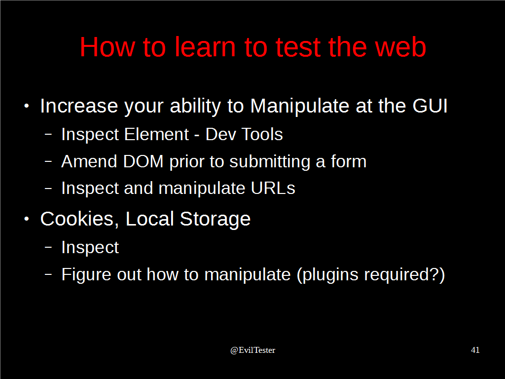\

We need the ability to manipulate at different levels. How can I manipulate the GUI? How an can you use the DOM tools to do that? How can I change the cookies and local storage if we don't know what those are? We have to find out. They are key to understanding the web. If you want to immediately do this, I suggest when you go back you look at the applications you're testing.

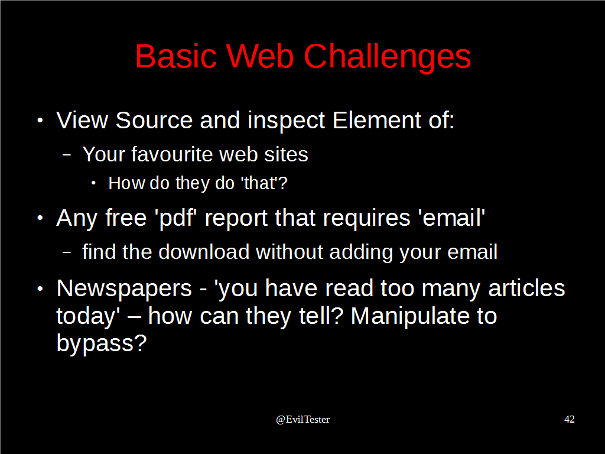\

Figure out how to do this, or just at home. When you surf the web look at the source of the website you're visiting. Inspect the elements and go, "How are these things doing this? Is this carousel CSS? Is this carousel javascript? Is this carousel embedded flash? What is going on here?"

Every time you're asked to type in your email address to download something, stop. Look at the form. See whether you have to or not. See whether they really need that information to get the goods they're trying to give. You'll see other things as you do that.

Ever been at a newspaper site and they said, "You've read too many articles this week you need to sign up to our pro-plan pay wall?" How are they doing that? You haven't signed up. They don't know your details. They don't know your information. How is this happening?

It's probably happening on your client side. If it's happening on your client side, it's something you can control. It's something you can manipulate. Learn how to do that and then this pop up won't appear.

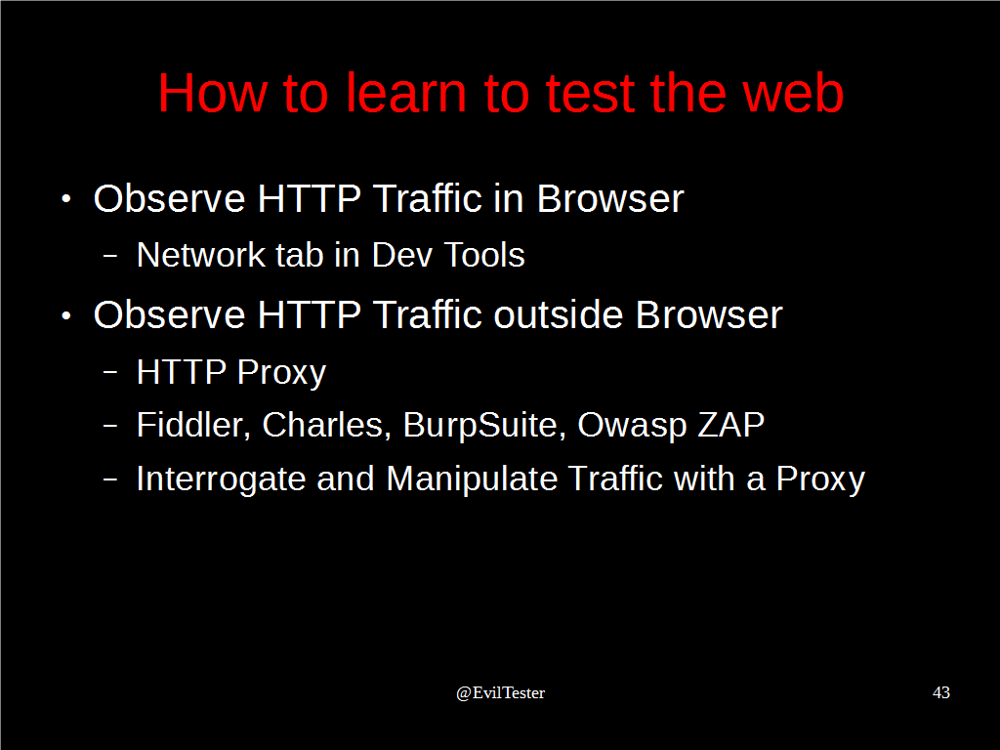\

We need to go deeper. We know that GUI sends HTTP messages, we need to learn how to observe them. We've got the network tab. We need to put proxies in. If you want to immediately start, start with Fiddler on Windows or Charles on the Mac. Very easy to use and you'll see more stuff, you'll see the traffic, you'll start to interrogate it and manipulate it.

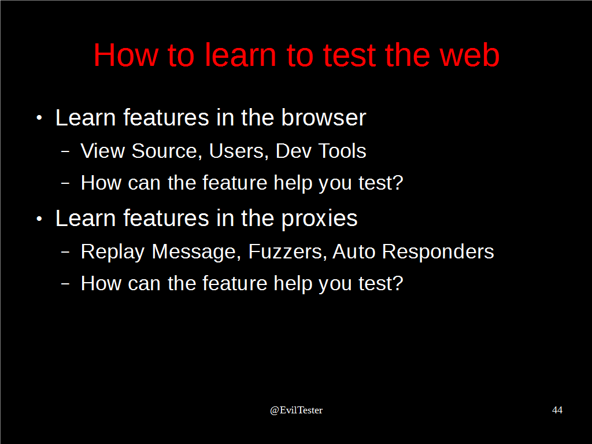\

We need to learn the features of our tools and that will trigger more information in our head of what we can do because it's expanding the models of the capabilities. 

Proxies I already mentioned they have fuzzers. I use fuzzers to set up test data in systems. I request to create a user. I can randomly fuzz the data over that and set up a bunch of new users. Different features will help us test.

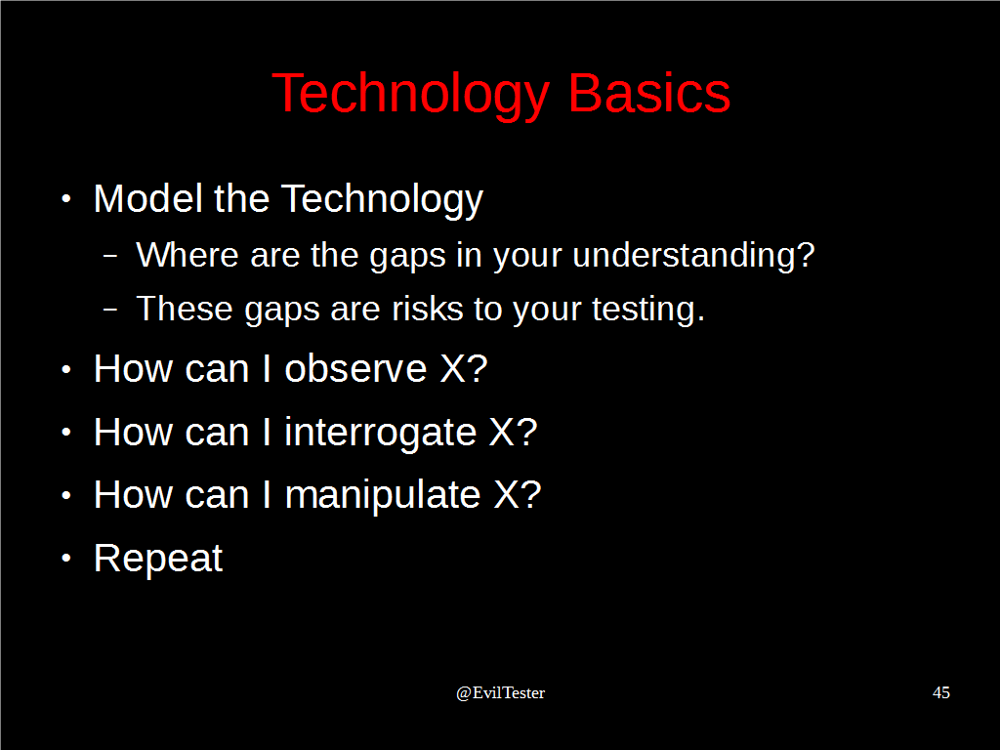\

The fundamental things are we need to understand the technology. We do that by modeling it to see where the gaps are, then these gaps fundamentally are risks to your testing. We want to learn so we can mitigate those risks. We learn by saying, "How can I observe this? How can I interrogate this? How can I manipulate this?" Then we repeat that learning process. That's in general for technology. 

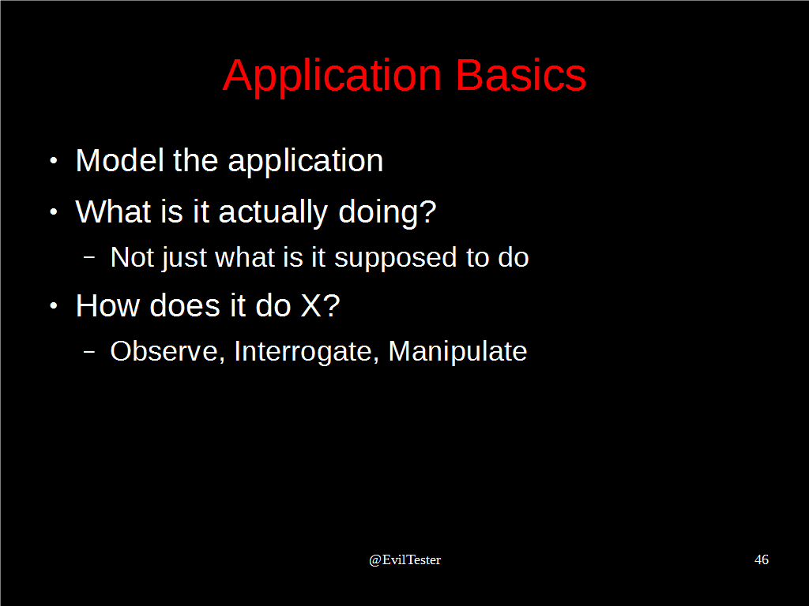\

For your application specifically, you model the application. The structure of it, not just the architecture, but the implementation, the deployment. Look at what it's actually doing. Figure out how it does that. Where is it storing the data and then how can you observe that and interrogate it and manipulate it?

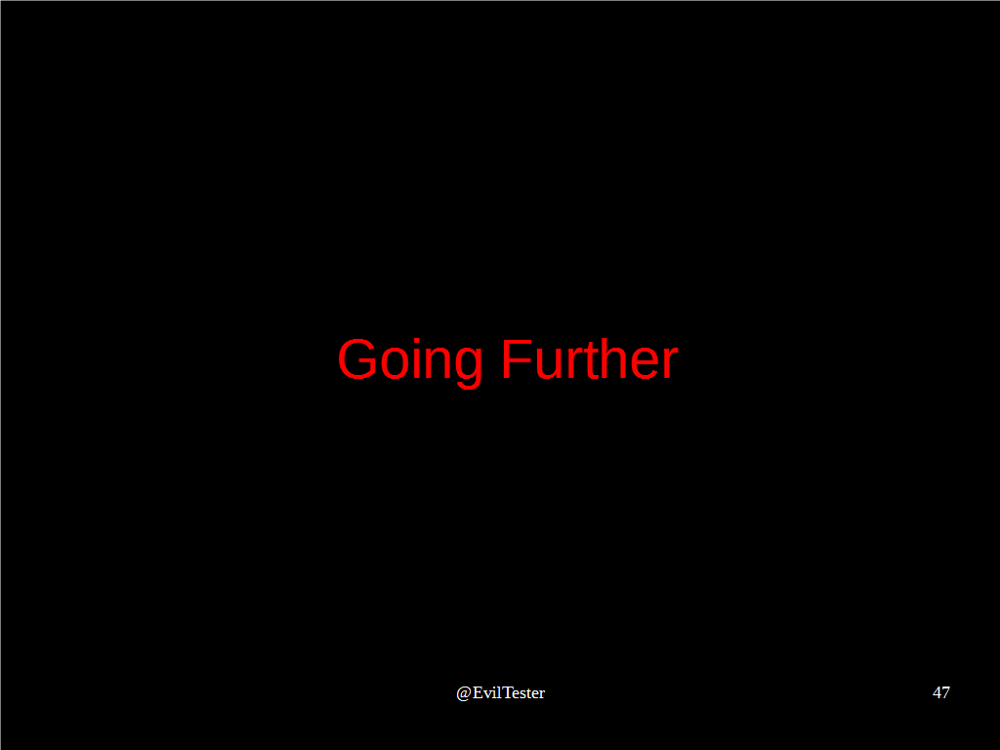\

Now when you do this, there is no limit to where you go. 

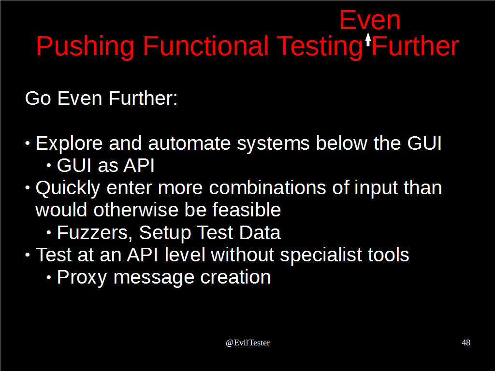\

This will probably start to move you into the ability to automate. To learn how to code so you can write ... automated execution at a lower level of the stack. You learn how to use these tools to set up data, to send lots of inputs ... invalid inputs to fuzz across different JSON messages that you're sending to create invalid conditions as it's going through.

You're not doing security testing, but you're using their tools and their approaches. As you're doing it, you may as well put in some of the security testing payloads that will move you into that area even though you don't call yourself a security tester.

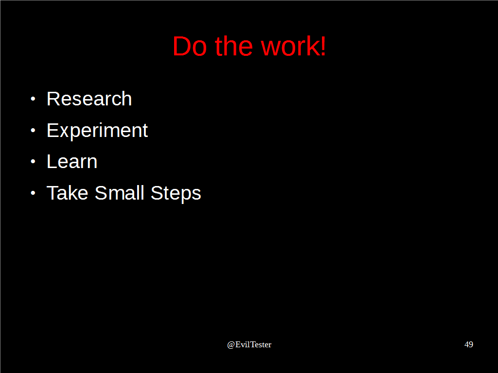\

Fundamentally, this is a choice. Choices are about doing the work, doing the research, doing the experiments, doing the learning. Now unfortunately, this is massive. I'm still learning this. I have been learning this forever and it might seem intimidating and that's why we take small steps. We do this in very small chunks. Star with the sites that you already do use and work on. Look at the code. Start in tiny ways. Create a little website in HTML to learn HTML or amend the HTML.

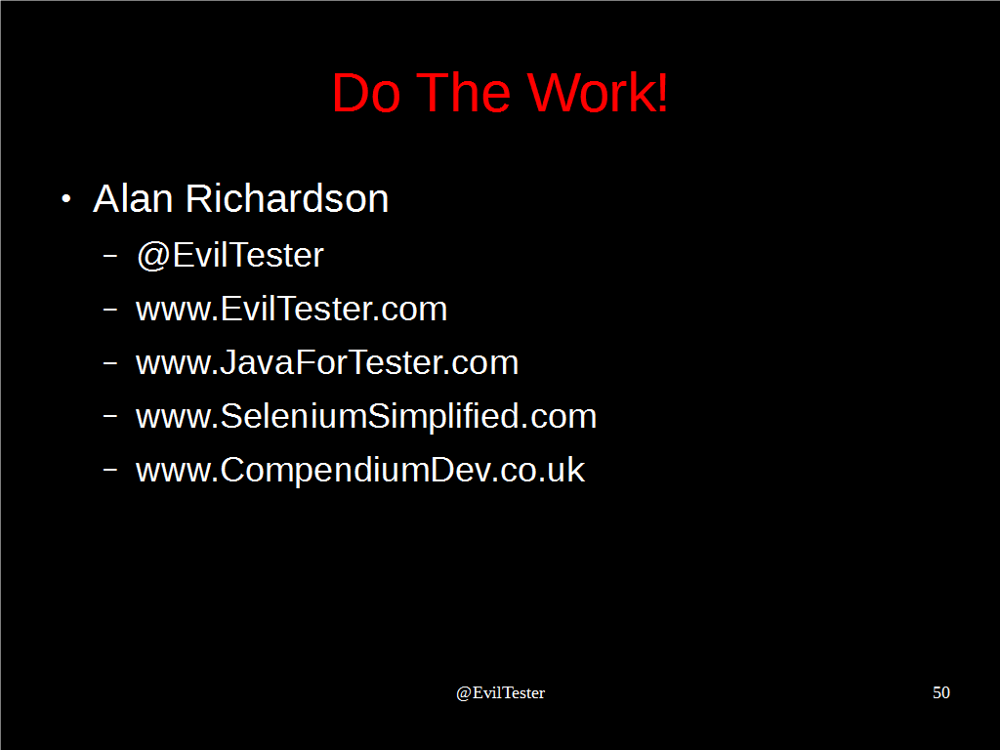\

Fundamentally it's a choice and it's your choice. If you need help, there are resources, but it's your choice as to whether you understand the risks that your test approach is leading to and whether you learn the technical skills that help you mitigate those risks.

Thank you very much.

