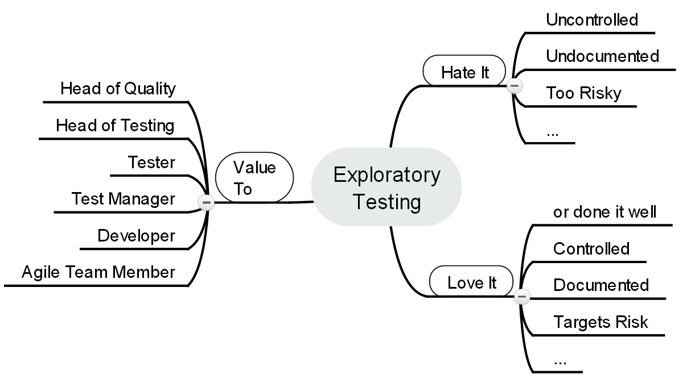
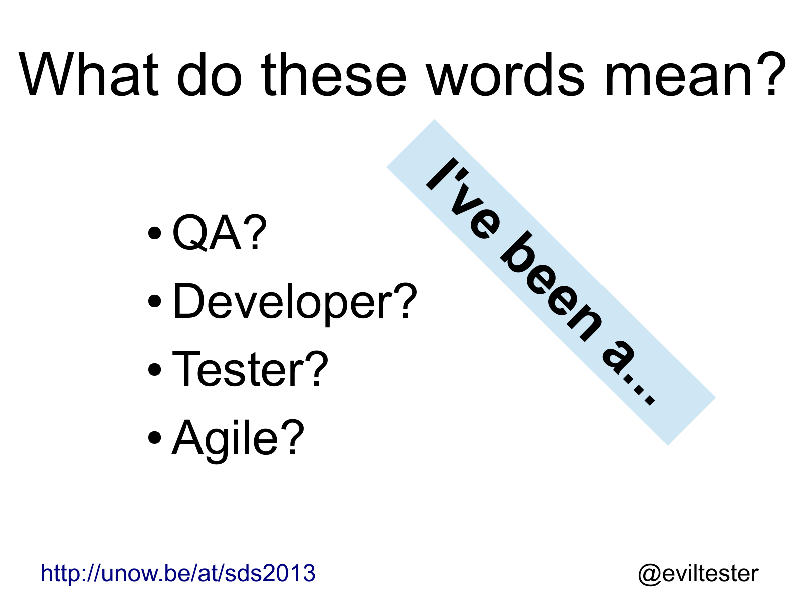
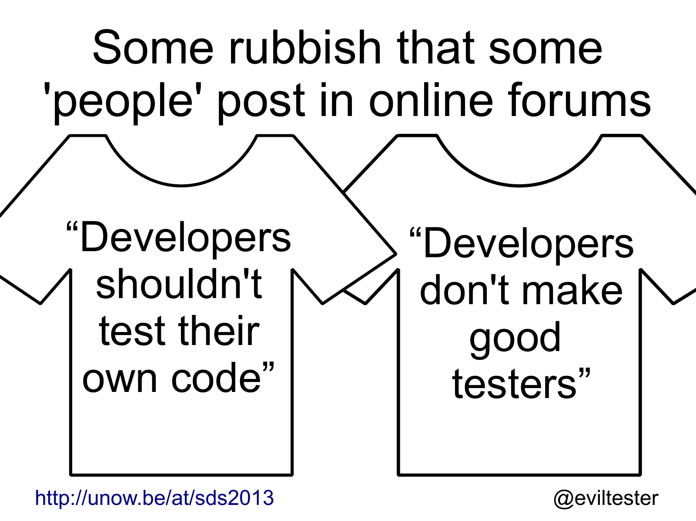
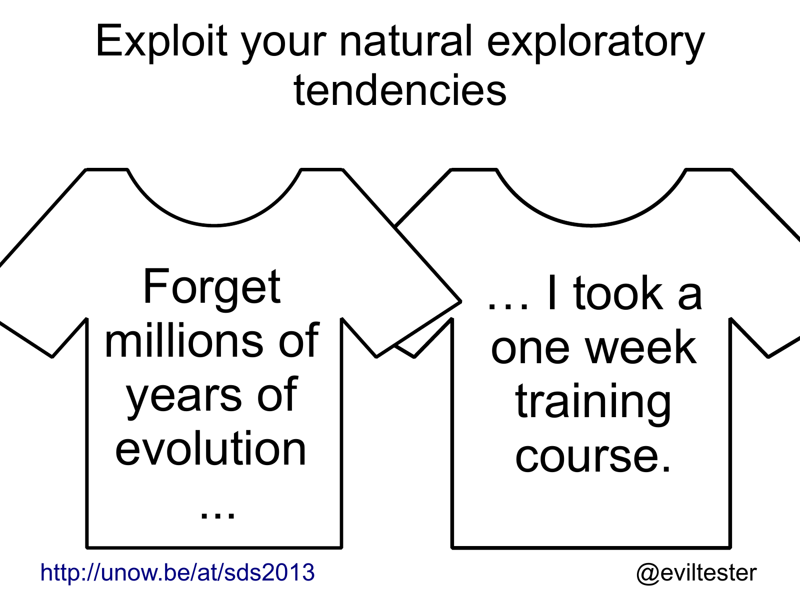
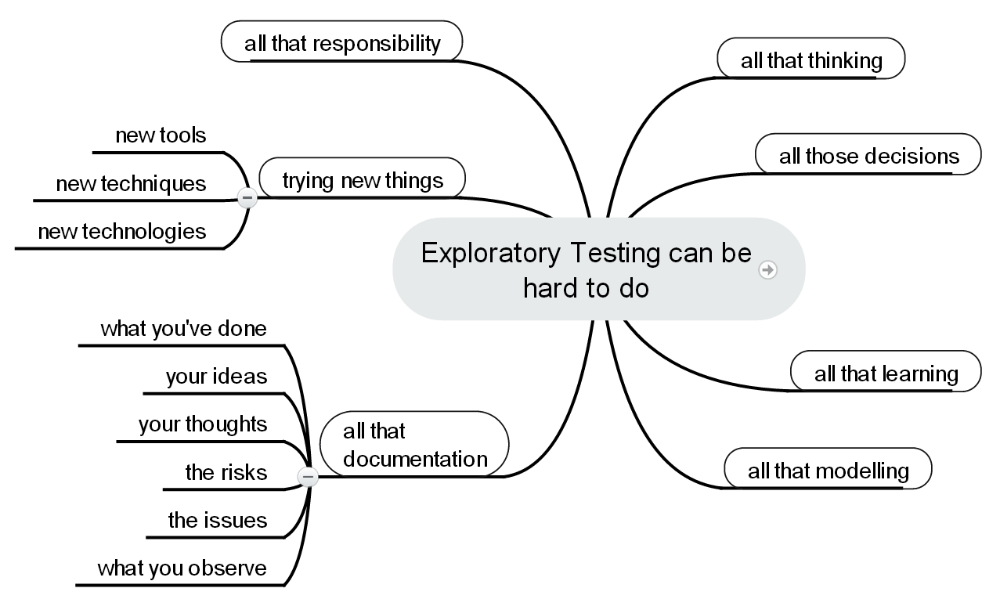
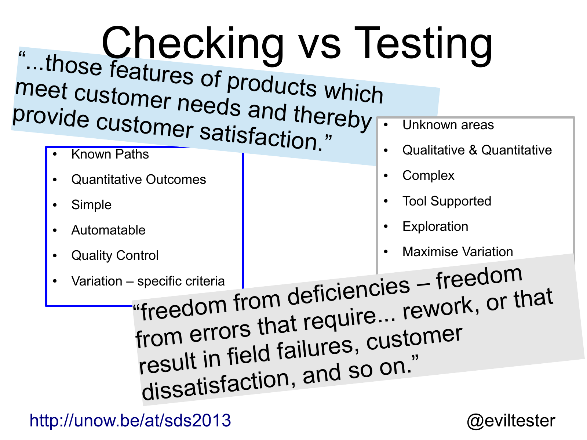
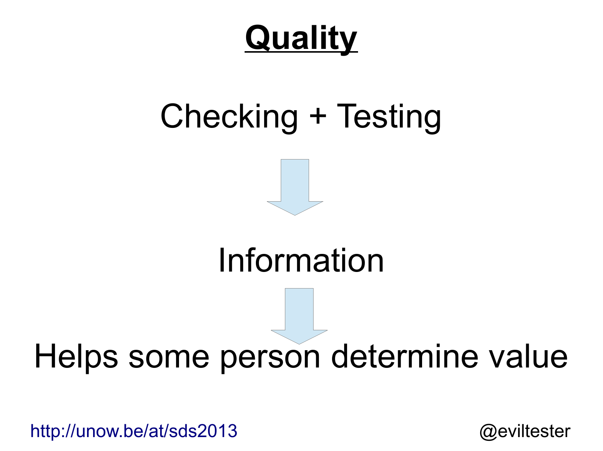
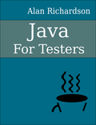

<!-- Slide 1 -->

# Experiences of Exploratory Testing in Agile, Testing, Dev and QA

Alan Richardson

www.CompendiumDev.co.uk

www.EvilTester.com

www.JavaForTesters.com

www.SeleniumSimplified.com

 @eviltester

[Source link: www.CompendiumDev.co.uk](http://www.CompendiumDev.co.uk/)

[Source link: www.EvilTester.com](http://www.EvilTester.com/)

[Source link: www.JavaForTesters.com](http://www.JavaForTesters.com/)

[Source link: www.SeleniumSimplified.com](http://www.SeleniumSimplified.com/)

---

<!-- Slide 2 -->

# Experiences Of...

 @eviltester

## Diagram text

Exploratory Testing

- Hate It
    - Uncontrolled
    - Undocumented
    - Too Risky
    - ...
- Value To
    - Head of Quality
    - Head of Testing
    - Tester
    - Test Manager
    - Developer
    - Agile Team Member
- Love It
    - or done it well
    - Controlled
    - Documented
    - Targets Risk
    - ...

---

<!-- Slide 3 -->

# A Brief Overview of Exploratory Testing...

 @eviltester

---

<!-- Slide 4 -->

# What does "Exploratory Testing" mean?

"An Interactive Process of Simultaneous learning, test design, and test execution"

James Bach

http://www.satisfice.com/glossary.shtml

 @eviltester

---

<!-- Slide 5 -->

# What does that mean to you?

- Undocumented?
- Uncontrolled?
- Risky?
- Unplanned?
- Well Documented?
- Highly Skilled?
- Manual?

 @eviltester

---

<!-- Slide 6 -->

# What do I mean by exploratory testing?

- Continual Evaluation &amp; Re-evaluation
- Observation &amp; Evidence
- Tool Augmented

- Low Overhead &amp; Fast
- Skill Based
- Team Based
- Intent

Characterized by:

 @eviltester

---

<!-- Slide 7 -->

# What do these words mean?

- QA?
- Developer?
- Tester?
- Agile?

I've been a...

 @eviltester

---

<!-- Slide 8 -->

# As a Developer ...

 @eviltester

---

<!-- Slide 9 -->

# Some rubbish that some 'people' post in online forums

“Developers don't make good testers”

“Developers shouldn't test their own code”

 @eviltester

---

<!-- Slide 10 -->

# A Lesson from learning to code ...

“ Exploratory Testing ... a natural way to test ”

 @eviltester

---

<!-- Slide 11 -->

# Exploit your natural exploratory tendencies

Forget millions of years of evolution ...

… I took a one week training course.

 @eviltester

---

<!-- Slide 12 -->

# We can learn to improve our natural approach to exploration

- Model Building
- Questioning Approaches
- Note taking
- Communication
- Tools &amp; Equipment to help

Not limited to 'Testers'

 @eviltester

---

<!-- Slide 13 -->

# We learn to use code to test our code

- 'test code'
- Unit Testing
- TDD

Test Code built through exploration, learning and modelling

 @eviltester

---

<!-- Slide 14 -->

# Lessons Learned

- When I Code, I perform an exploratory process
    - Writing test code. Building models. Writing application code. Testing. Refinement.
    - Artifacts:
        - Application Code, Automated checks, Test Code

- Everyone can learn to explore &amp; test better
- Emergent behaviours lie beyond the Unit

 @eviltester

---

<!-- Slide 15 -->

# As a Tester ...

 @eviltester

---

<!-- Slide 16 -->

# “We used to have to sneak 'exploratory testing' in”

 @eviltester

---

<!-- Slide 17 -->

# “Then we learned to explore”

 @eviltester

---

<!-- Slide 18 -->

# Exploratory Testing can be hard to do

 @eviltester

## Diagram text

Exploratory Testing can be hard to do

- all that responsibility
- all that thinking
- all those decisions
- trying new things
    - new tools
    - new techniques
    - new technologies
- all that learning
- all that documentation
    - what you've done
    - your ideas
    - your thoughts
    - the risks
    - the issues
    - what you observe
- all that modelling

---

<!-- Slide 19 -->

# Exploratory Testing can be hard to manage...

- When done badly
- When your culture doesn't support it

 @eviltester

---

<!-- Slide 20 -->

# “Exploratory testing can be hard to accept responsibility for”

 @eviltester

---

<!-- Slide 21 -->

# As a QA ...

 @eviltester

---

<!-- Slide 22 -->

# I didn't want to be Head of Quality

- We can feel
    - constrained by our titles
    - That we have to live up to our titles

- Quality meant
    - Process, Checking, Rules
    - Everybody... but no-body

 @eviltester

---

<!-- Slide 23 -->

# Juran on Quality?

- “...those features of products which meet customer needs and thereby provide customer satisfaction.”
- “...freedom from deficiencies – freedom from errors that require... rework, or that result in field failures, customer dissatisfaction, and so on.”

Juran's Quality Handbook

 @eviltester

---

<!-- Slide 24 -->

# Checking vs Testing

One of the most important distinctions in Software Development in recent years.

Credited to Michael Bolton, James Bach

| Checking | Testing |
| --- | --- |
| Is this this? | What else is this? |

Uncle Al's crude summary boxes

 @eviltester

---

<!-- Slide 25 -->

# Checking vs Testing

| Checking | Testing |
| --- | --- |
| Known Paths | Unknown areas |
| Quantitative Expected Outcomes | Qualitative &amp; Quantitative Outcomes |
| Simple | Complex |
| Automatable | Tool Supported |
| Quality Control | Exploration |
| Variation over specific criteria | Maximise Variation |

Uncle Al's crude distinction list

 @eviltester

---

<!-- Slide 26 -->

# Checking vs Testing

| Checking | Testing |
| --- | --- |
| Known Paths | Unknown areas |
| Quantitative Outcomes | Qualitative &amp; Quantitative |
| Simple | Complex |
| Automatable | Tool Supported |
| Quality Control | Exploration |
| Variation – specific criteria | Maximise Variation |
| “...those features of products which meet customer needs and thereby provide customer satisfaction.” | “freedom from deficiencies – freedom from errors that require... rework, or that result in field failures, customer dissatisfaction, and so on.” |

 @eviltester

---

<!-- Slide 27 -->

# Quality

Checking + Testing

Information

Helps some person determine value

 @eviltester

---

<!-- Slide 28 -->

# Exploratory Testing Lessons in QA

- Move focus from compliance to information
- Give responsibility back to team
- Describe minimal compliance
- Everyone does QA
- Everyone can learn to do QA better
- QA helps people do QA better
- Culture kills

 @eviltester

---

<!-- Slide 29 -->

# As an Agile Team Member ...

 @eviltester

---

<!-- Slide 30 -->

# Agile involves everything we have already talked about... faster, and more often

 @eviltester

---

<!-- Slide 31 -->

# Don't get hung up on formal role definitions...

 @eviltester

---

<!-- Slide 32 -->

# Agree Meaning

- Through...
    - Discussion
    - Experimenting
    - Questioning
    - Understanding
    - Learning
    - Observation
    - Evidence

 @eviltester

… Exploration

---

<!-- Slide 33 -->

# Alan Richardson - Blogs, Books, and Courses

Blogs and Websites

- CompendiumDev.co.uk
- SeleniumSimplified.com
- EvilTester.com
- JavaForTesters.com
- Twitter: @eviltester

Online Training Courses

- Technical Web Testing 101
- Intro to Selenium
- Selenium 2 WebDriver API

Videos

youtube.com/user/EviltesterVideos

Books

Selenium Simplified

Java For Testers

leanpub.com/javaForTesters

Alan Richardson

uk.linkedin.com/in/eviltester

Independent Test Consultant

Contact Alan for training and consultancy tailored to your needs: http://compendiumdev.co.uk/contact

[Source link: CompendiumDev.co.uk](http://www.compendiumdev.co.uk/)

[Source link: SeleniumSimplified.com](http://www.seleniumsimplified.com/)

[Source link: EvilTester.com](http://www.eviltester.com/)

[Source link: JavaForTesters.com](http://JavaForTesters.com/)

[Source link: @eviltester](https://twitter.com/eviltester)

[Source link: youtube.com/user/EviltesterVideos](http://www.youtube.com/user/EviltesterVideos)

[Source link: leanpub.com/javaForTesters](http://leanpub.com/javaForTesters)

[Source link: uk.linkedin.com/in/eviltester](http://uk.linkedin.com/in/eviltester)
