<!-- Slide 1 -->

# How Testers Can Benefit from using NLP

Alan Richardson

Compendium Developments

www.compendiumdev.co.uk/nlp

Software &amp; Systems Quality Conferences - UK 2006

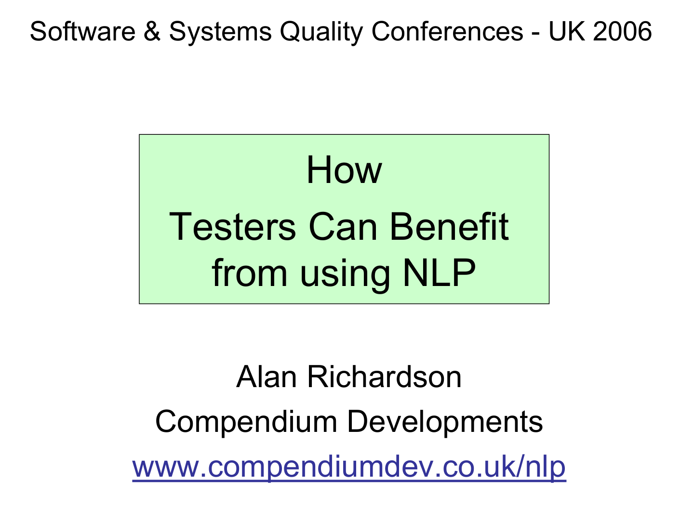

---

<!-- Slide 2 -->

# Session Aim

- An overview of NLP
- What from NLP can provide benefit quickly?
- Enough information to enable you to
    - Start to change your own test approach,
    - Apply some NLP techniques
- Sources for further learning

“How quickly can you learn to change, for the better, how you approach software testing?”

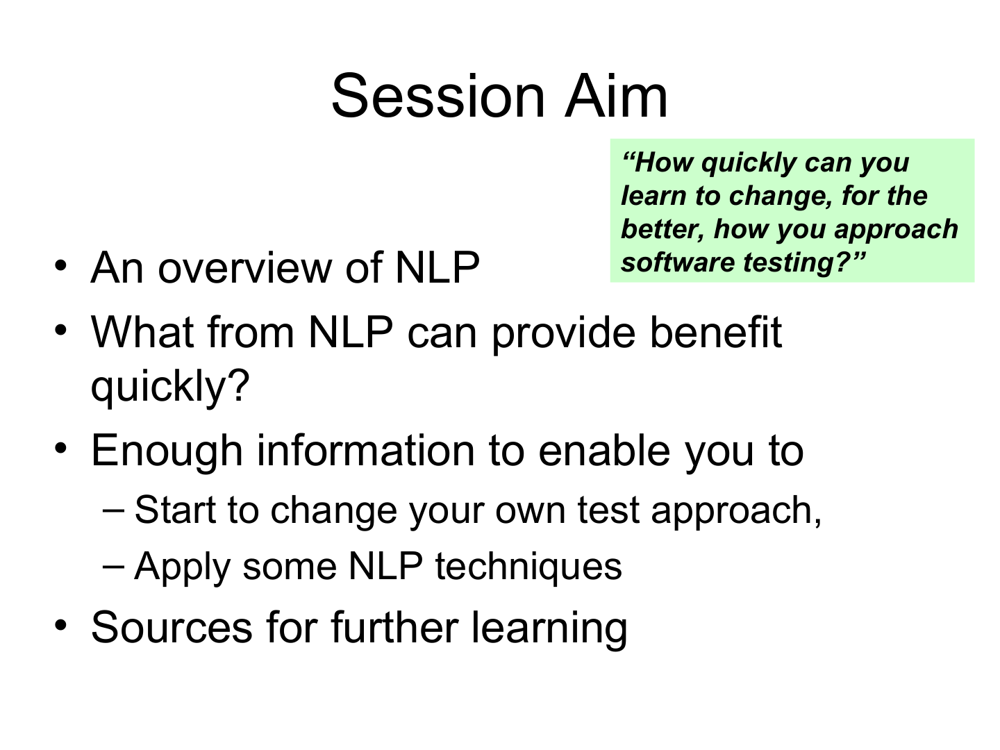

---

<!-- Slide 3 -->

# What is NLP?

- Neuro-Linguistic Programming™ (NLP™)
- Techniques and models drawn from a wide range of disciplines:
    - mathematics, linguistics, psychotherapy, systems theory, cybernetics, general semantics, philosophy, psychotherapy.
- Used to identify, change, and allow people flexibility in their behavior to achieve desired goals effectively and quickly.

---

<!-- Slide 4 -->

# An NLP Session

- “What” is the person doing?
- “How” is the person doing what they are doing?
- A context of…
Questioning, Modelling, Communication, Attitude, Effectiveness, Literalism, Identify Ambiguity, Honesty

- Approach testing like an NLP Session

---

<!-- Slide 5 -->

# Session’s Subset…

Can be used to:

- improve your software testing process
- increase your awareness for your testing context

Law of

Requisite

Variety

States &amp;

Beliefs

Variety?

Meta Model

Attitude

Identify

Model &amp; Change

Presupposition

Key

…of NLP techniques and models

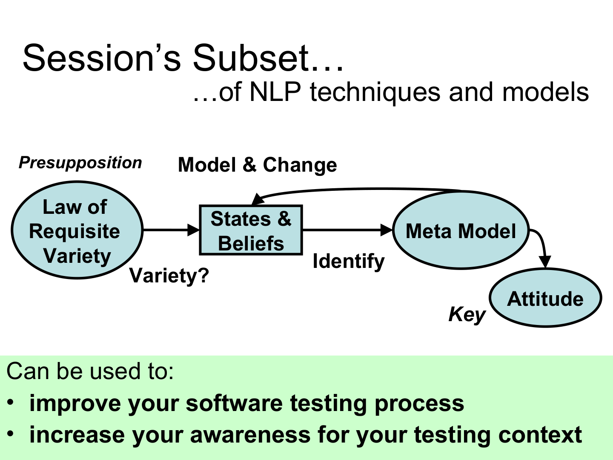

---

<!-- Slide 6 -->

# Presuppositions of NLP

- The Map is not the Territory
- Life and Mind are systemic processes

www.nlpu.com [Source link](http://www.nlpu.com/)

---

<!-- Slide 7 -->

# Example Software Testing Maps

| Maps | Territory |
| --- | --- |
| Stated Requirements | Needs |
| Specification | Code |
| Test Script | Application Path |
| Test Case | Task |

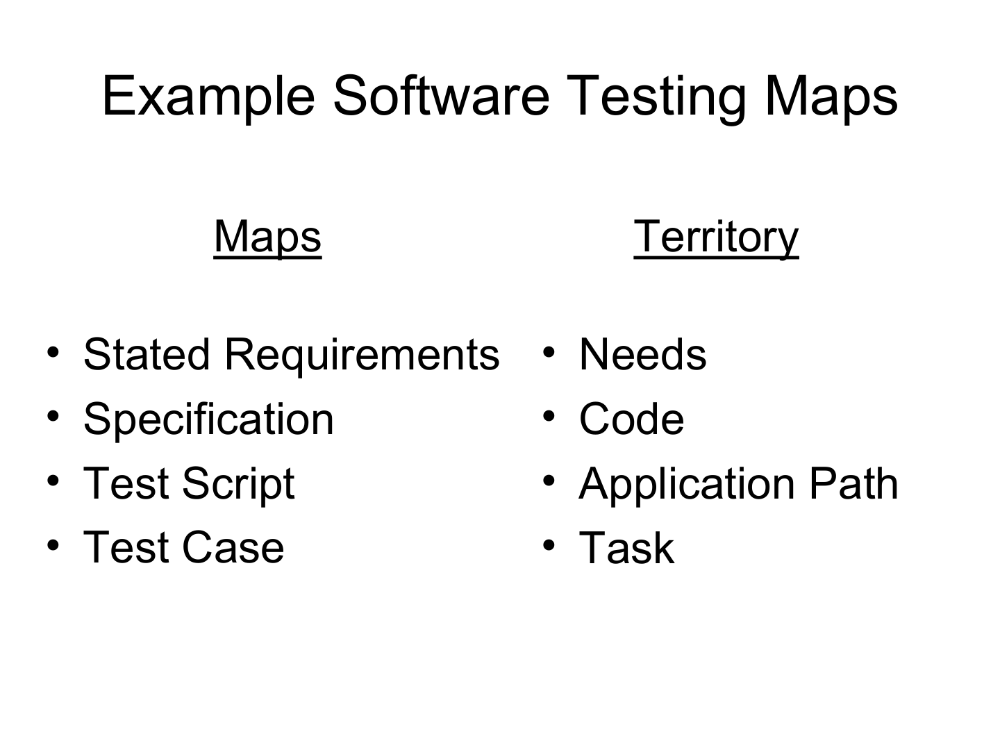

---

<!-- Slide 8 -->

# The Map is not the territory

- Expect maps to be different from the Territory
- Work as close to the territory as you can
- Context Driven uses the territory not the map

The Map

is not the

territory

Everyone is unique

People make the best choice

available to them at the time

The meaning of the communication

is the response that you get

There is no failure,

only feedback

Everyone already has the

resources they need to succeed

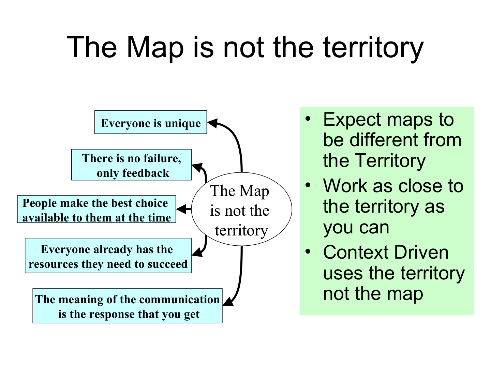

---

<!-- Slide 9 -->

# Life and Mind are systemic processes

- We are systems
- Our mental state affects our physiology
- Our relationships with other people are systems

Life and

mind are

systemic

processes

Every behaviour has

a positive intent

The law of

requisite variety

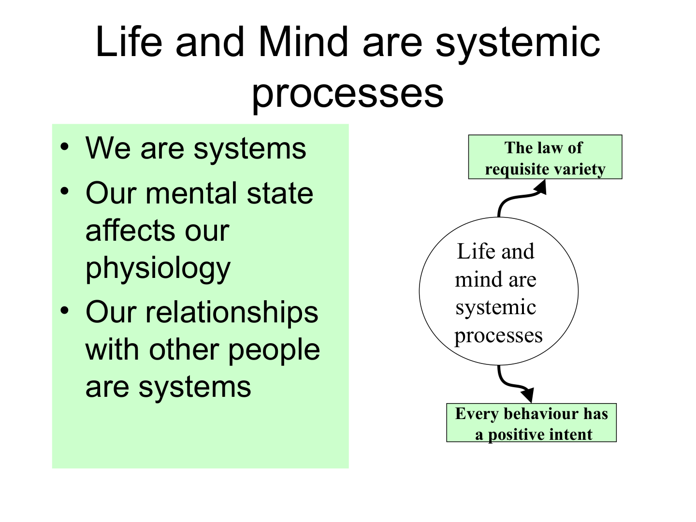

---

<!-- Slide 10 -->

# Law of Requisite Variety

“…in any cybernetic system the element or person in the system with the widest range of behaviours or variability of choice will control the system”

---

<!-- Slide 11 -->

# Law of Requisite Variety

- In your situation what has the greater variety?
    - Development or Testing?
    - Project or Programme?
    - Amongst your testers?
- What skills are important for testing variety?
    - Familiarity with test techniques
    - Questioning
    - Context Analysis
- Do your maps lend themselves to variety?

---

<!-- Slide 12 -->

# States

---

<!-- Slide 13 -->

# Which makes the more effective defect reporting state?

- Angry
- Uptight
- Rapid Breathing
- Internal Dialog

- Controlled
- Objective
- Calm
- Thoughtful

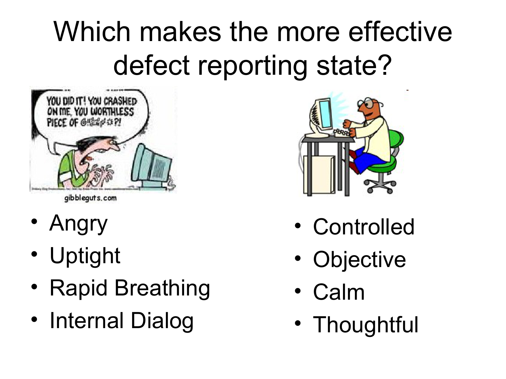

---

<!-- Slide 14 -->

# What makes an effective defect reporting state?

- Its obvious which state was more effective but…
    - Do you pick your state?
    - Have you tried different states?
    - If you have a good state can you make it better?

---

<!-- Slide 15 -->

# States

- What State is your defect process in?

Find

a

Defect

State?

Investigate

To Repeat

To Exploit

Report

- Ecstatic?
- Angry?
- Frustrated?

Maintain \*

State Process

State?

State?

Physiology

Mental

- Clean?
- Effective?
- Deliberate?

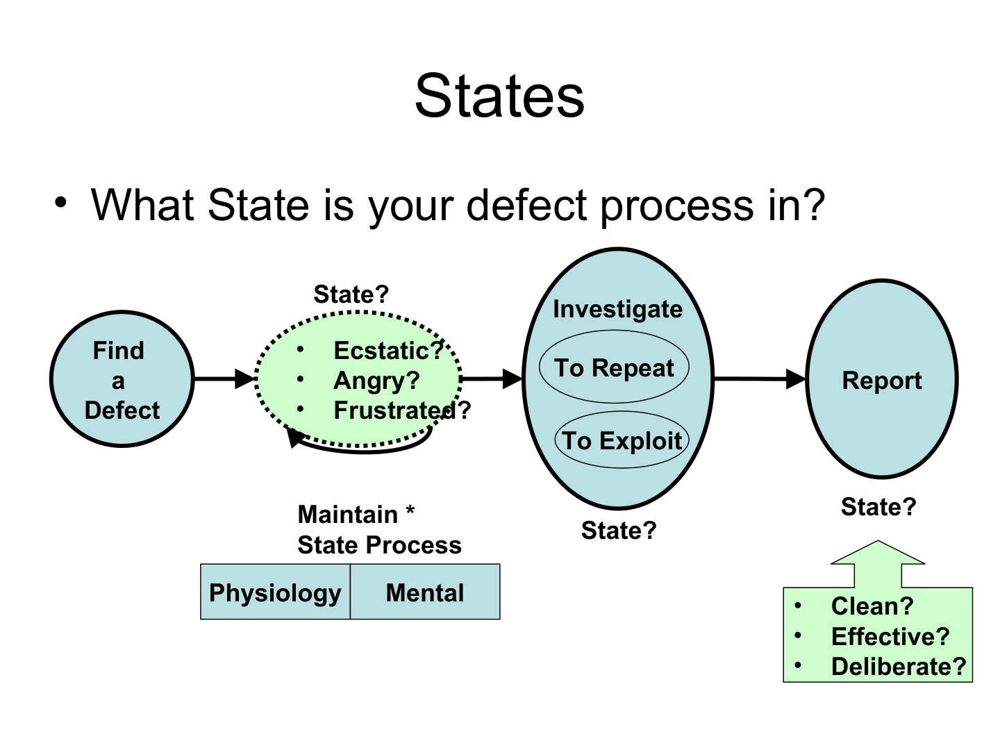

---

<!-- Slide 16 -->

# States

- Be aware of your states
    - How are you maintaining the state?
- Be aware of the activities you do
    - Partition the activities you do
        - What states have you been in?
        - Whick ones worked well?
- Clean your states
    - What would an effective state for this activity be?
    - What resources do you need?
    - When have you ever had that resource before?
    - What would it feel like to be in that ultimate clean state? What would your physiology be like?

---

<!-- Slide 17 -->

# Beliefs

---

<!-- Slide 18 -->

# I was a teenage methodology monster!

\*Gasp in amazement\*

As you see him know exactly what do do, before he is even on site.

\*You will Be shocked\*

As the rework mounts to truly heroic proportions

\*Can you bear to see\*

Him justify his actions by quoting text book after text book and expert after expert.

Coming soon to a project near you…

Methodology

“He can do no wrong.”

Beliefs

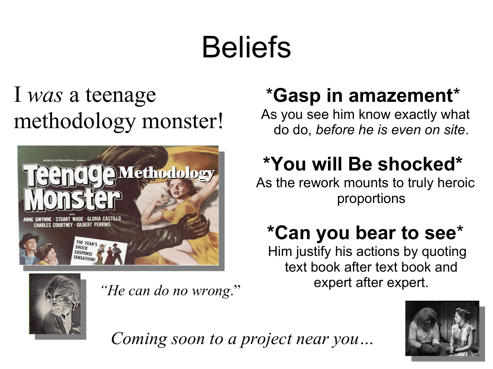

---

<!-- Slide 19 -->

# Example Beliefs About Testing

- We cannot test without specifications
- We must write test scripts before testing
- Test Scripts must be runnable, unambiguously, by anybody
- Testing has to be fully documented
- Test Scripts have to be fully detailed down to the test step level
- Requirements must be signed off
- Test Artefacts must be in the test repository database

…that I have held

…and let go

---

<!-- Slide 20 -->

# What are your Software Testing beliefs?

What are

you doing?

What would

happen if you

didn’t do that?

Why are you

doing that?

what do you

think you should

be doing?

Statement

of Belief

Identify

and

Question

Your

Beliefs…

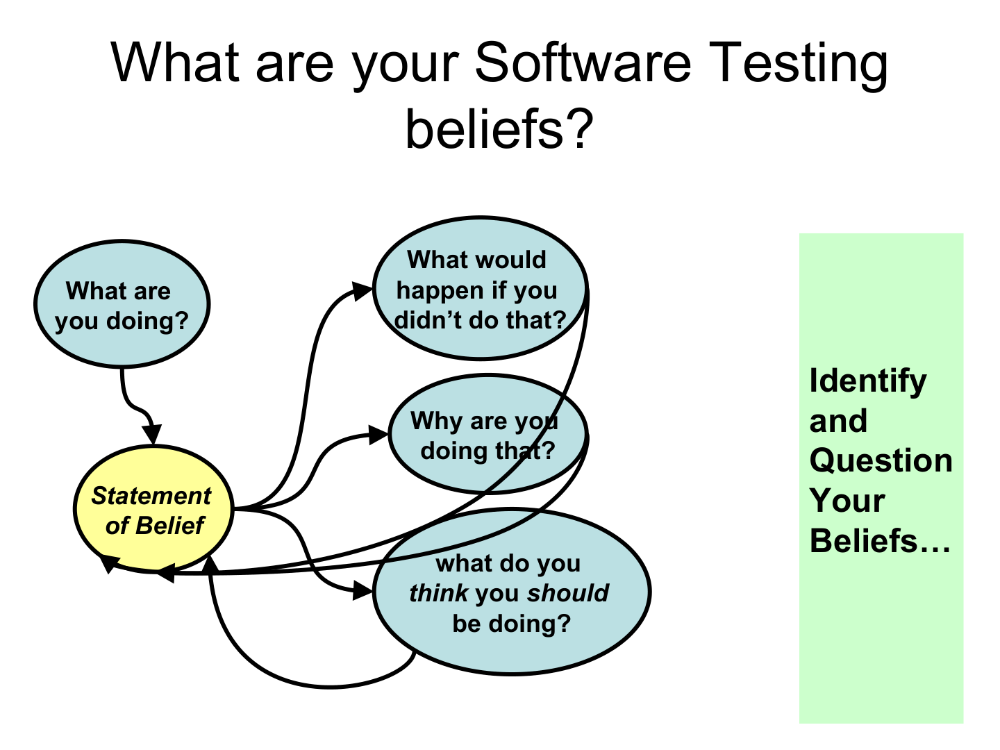

---

<!-- Slide 21 -->

# Meta-Model

---

<!-- Slide 22 -->

# Deep Surface

- Meta-Model based on transformational grammar model
- Words affect experience

Deep Structure

Surface Structure

Primary Experience

Sensory &amp; Emotional

Secondary Experience

Linguistic Derivation

Transformation

Surface Structure

Surface Structure

Surface Structure

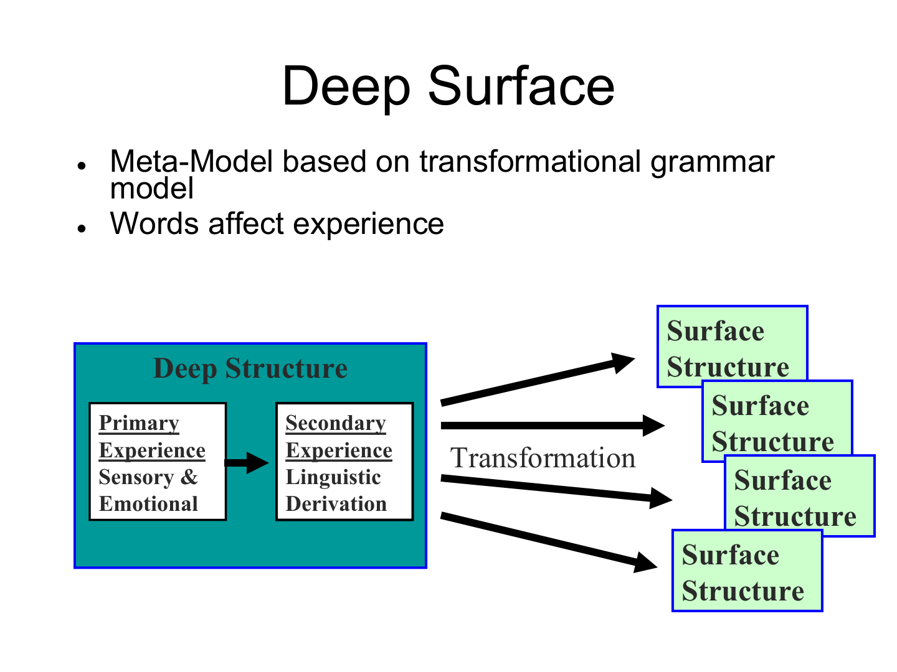

---

<!-- Slide 23 -->

# Meta-Model

- Transformations (Distortion, Deletion, Generalization) can create ambiguity
- Identify Ambiguity (in the system, in the docs, in the communication) and target it with questions (Tests, Challenges)

## Embedded Diagram Text

- Meta Model
    - Deletion
        - Simple Deletion
        - Comparative Deletion
        - Lack of Referential Index
        - Unspecified Verb
    - Distortion
        - Nominalization
        - Cause and Effect
        - Mind Reading
        - Complex Equivalence
        - Lost Performative
    - Generalization
        - Universal Quantifier
        - Modal Operators
        - Presuppositions

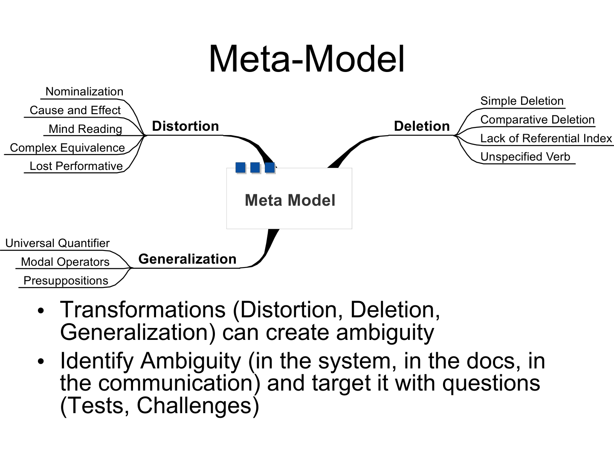

---

<!-- Slide 24 -->

# Example Meta-Model

- Processed by what? How?
- Daily trade file – contains what? From where?
- 5 seconds – based on what?
- Starts up? How, When, How often?

## Embedded Example Text

"The daily trade file must be processed in under 5 seconds when the system starts up"

Annotation labels in the source diagram: LP, SD (1), MO, UV (1), SD (3), SD (4), UV (2), SD (2), Effect, Cause, CE.

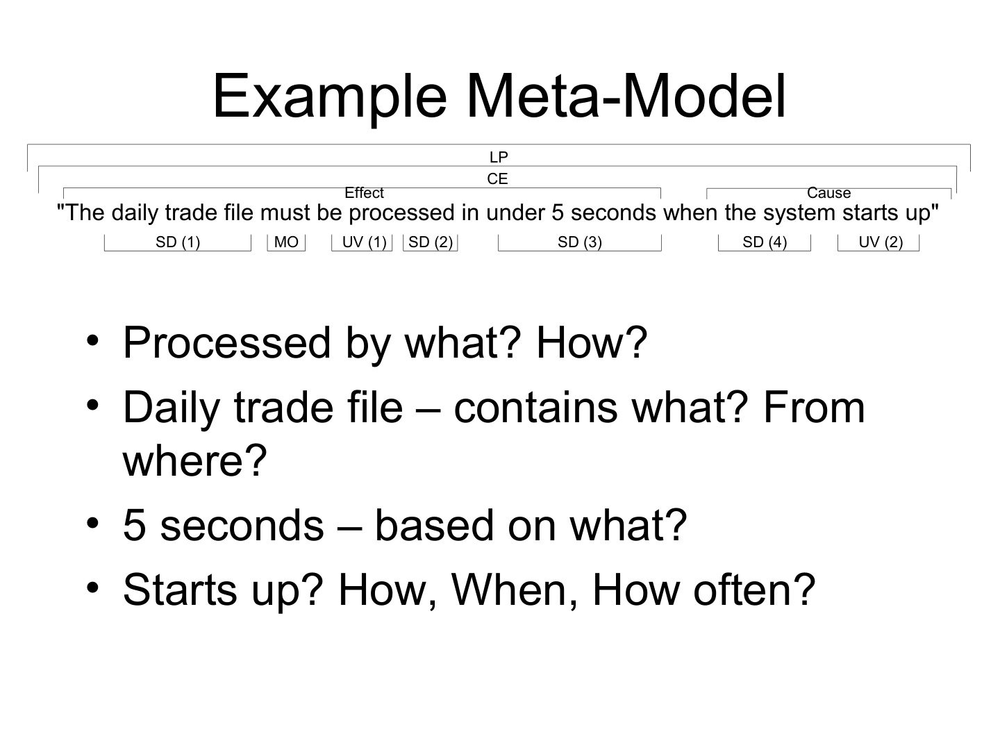

---

<!-- Slide 25 -->

# Meta-Model Uses

- Identify Ambiguity Early
- Apply to the communication we give
- Presupposition analysis of the system
- A Model of Analysis (Req, Spec, etc.)
- Question our beliefs and values about testing
- A System of Heuristics

---

<!-- Slide 26 -->

# Attitude

---

<!-- Slide 27 -->

# NLP as attitude and methodology

"NLP is an attitude and a methodology that leaves behind a trail of techniques."

Richard Bandler

---

<!-- Slide 28 -->

# NLP is…

ATTITUDE

…sense of curiosity and adventure … desire to learn the skills to be able to find out what kinds of communication influences somebody and the kinds of things worth knowing ... to look at life as a rare and unprecedented opportunity to learn

METHODOLOGY

…all behavior has a structure … and that structure can be modeled, learned, taught, and changed (re-Programmed). The way to know what will be useful and effective are the perceptual skills

TECHNOLOGY

… enabling the practitioner to organize information and perceptions in ways that allow them to achieve results that were once inconceivable

<http://www.purenlp.com/nlpis2.htm>

…and so is Testing

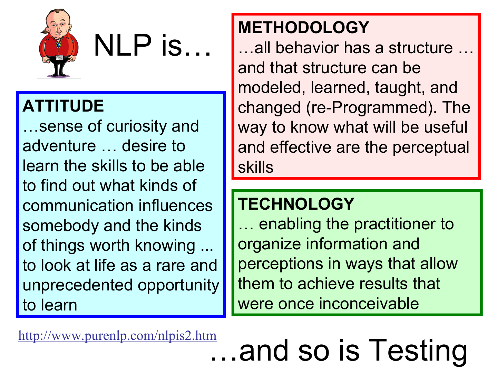

---

<!-- Slide 29 -->

# The techniques and models are…

…Simple

- you can be put them in practice now
- using the information given in this session

…Subtle

- continued usage,
- and further study
- will increase effectiveness
- and practical application.

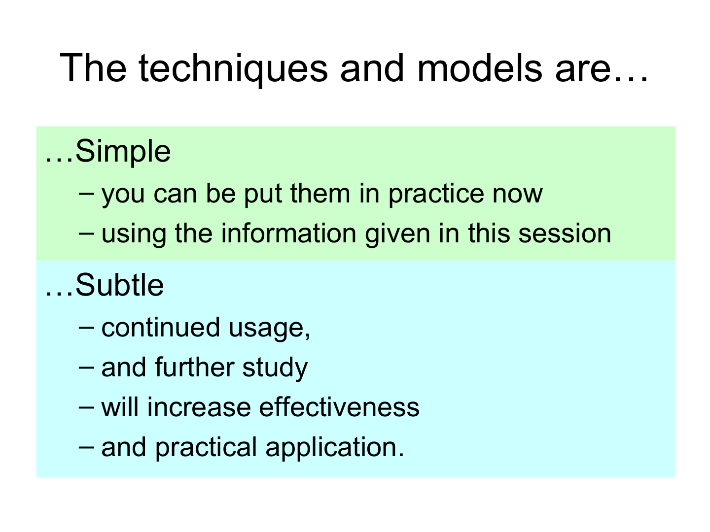

---

<!-- Slide 30 -->

# Further Reading

NLP Books

- Richard Bandler
    - The structure of Magic (vols I &amp; II)
    - Persuasion Engineering
- Robert Dilts
    - Modelling with NLP

IT Books

- Gerald Weinberg
    - Are your lights on?
    - (More) Secrets of Consulting

NLP is best experienced… Try it, Apply it

Online

- www.compendiumdev.co.uk/nlp [Source link](http://www.compendiumdev.co.uk/nlp)
- www.nlpu.com [Source link](http://www.nlpu.com/)

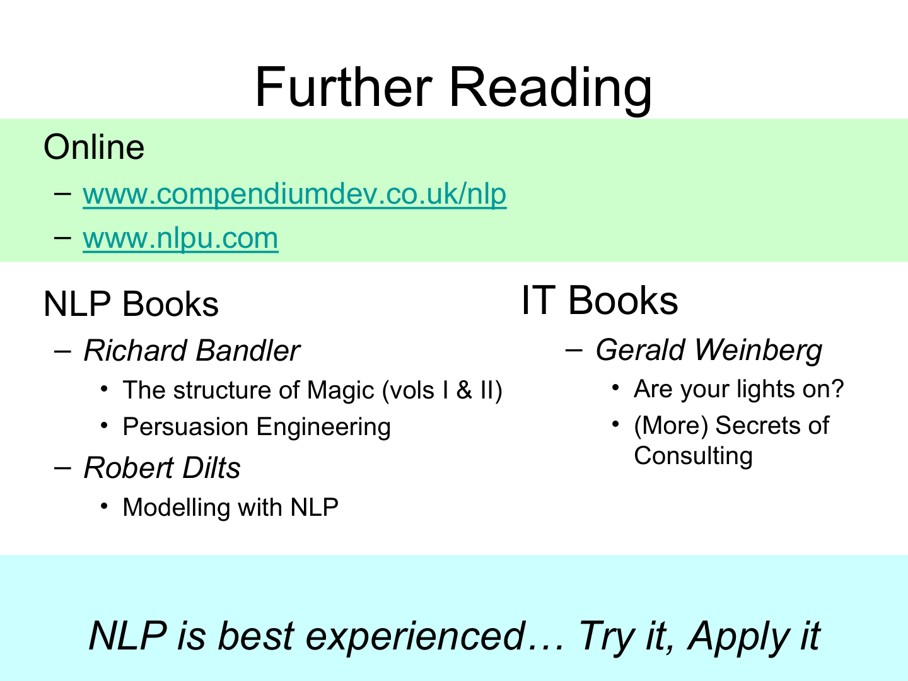

---

<!-- Slide 31 -->

# Session End Summary

- Simple, Subtle
- Choose variety over limits
- Is your Attitude working?

“I have personally changed how I view and approach software testing by applying the techniques and models of NLP”.

Law of

Requisite

Variety

States &amp;

Beliefs

Meta Model

Attitude

Change &amp;

Use

Identify &amp;

Model

Presuppositions

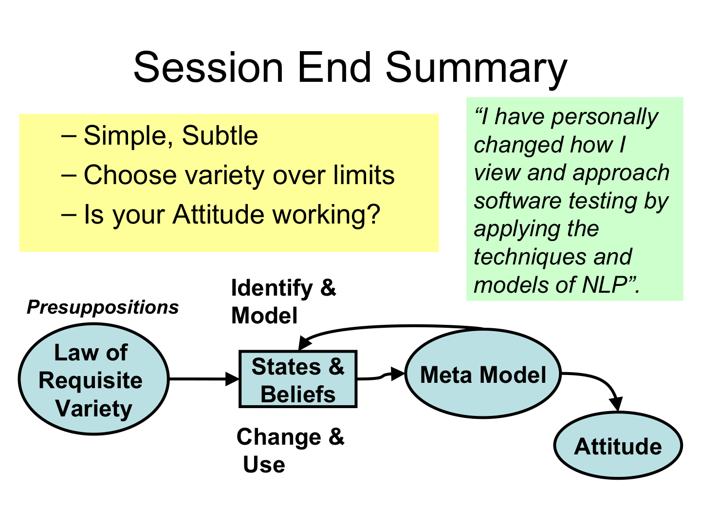
