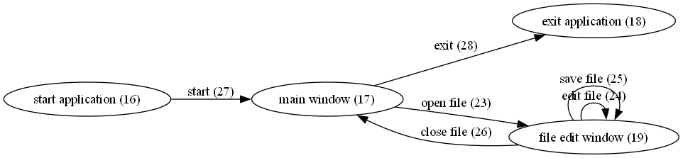

## Directed System Graph - DOT Example

- [Original DOT source](simple-system.dot)
- [Presentation example](../../talk/slides.md)
- [Spreadsheet tool](../spreadsheet/)



The original `simpleSystemDiGraphv2.dot` is copied unchanged as `simple-system.dot`. It contains four nodes and six directed edges, including the edit/save self-loops. The preview was generated from this source with Graphviz.

To regenerate the preview with Graphviz installed:

```shell
dot -Tpng simple-system.dot -o simple-system.png
```
