# Dot Generation Spreadsheet - Instructions

Original version 0.2 instructions for dotSheet_02.xls. Wording and screenshots are retained; the automatic page-number contents list is omitted. The original workbook and extracted VBA source are available alongside this guide.

Dot Generation Spreadsheet

Version 0.2, supporting spreadsheet dotSheet\_02.xls

## Introduction

This sheet is a simple example of how to generate dot graphs from a spreadsheet representation.

The spreadsheet was written in MS Excel 2000.

The purpose is to provide a basis for building new functionality on, but mainlly to show that the diagramatic representation of a graph is a sideeffect, and that what testers are really intersted in is the underlying reprsentation.

This sheet is an example of the representation discussed in the StarEast 2003 paper “Practical Experiences of Graph Based Testing” (version 1.2) on page 17.

The underlying representation is what testers will parse to do such things as:

- Analyse path coverage

- Create adjacency matrices

- Generate test scripts from paths and node/link descriptions.

Before you use this sheet you will need to have installed Graphviz from www.graphviz.org [Source link](http://www.graphviz.org/)

You will then need to set up the cells in the macro worksheet to point to the paths that you want to use.

Warranty: there is none, full source is provided. Use it as you see fit.

Feel free to amend and use this spreadsheet. If you do make changes then I’d be interested to know what you have done with it. And if you have any comments on the documentation here then feel free to comment.

You can always email me on alan@compendiumdev.co.uk [Source link](mailto:alan@compendiumdev.co.uk)

## The Sheet format

There are 4 worksheets:

- 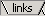, lists all the link details

- 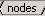, which lists all the node details

- 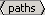, which lists all the path details

- 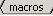, which contains the macro gui

Feel free to add more sheets.

Or move them around if you want.

All the macros use the sheet names so don’t rename them, unless you want to edit the code.

### Links

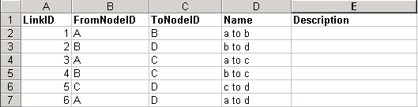

This sheet represents the links in the graph.

Feel free to add more columns if you want. At the moment the macros only use columns A through D.

#### LinkID

Each link should be given a unique ID, which doesn’t have to be a number, but it should be small enough that you don’t mind retyping it when you construct the paths.

#### FromNodeID

This is the unique id of a node from the nodes tab.

#### ToNodeID

This is the unique id of a node from the nodes tab. If you use the same id as the FromNodeID then you will create a reflexive link (one that links the node to itself) this is perfectly acceptable.

#### Name

This is a name for the link that would be displayed on the graph.

#### Description

This is description of the link. I would use this to describe what to do when I traverse the link in a script.

### Nodes

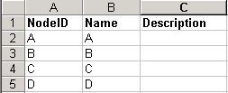

This sheet represents the nodes in the graph.

This is much simpler as nodes are fairly atomic.

Feel free to extend this by adding more columns if you want. At the moment the macros only use columns A and B.

#### NodeID

This is a unique ID for the node.

#### Name

The name of the node, will be displayed on the graph.

#### Description

A description of the node which would be used when generating scripts.

### Paths

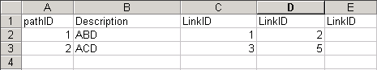

This is not actually used by the macros at the moment but would form the basis for any script generation or coverage metric analysis.

#### PathID

The unique id of the path.

#### Description

A description of the path.

#### LinkID

Every other column would be treated as a linkId to specify the path. By using the linkIDs we can very easily work out what the path is. In the above example:

- LinkID 1 is A-&gt;B

- LinkID 2 is B-&gt;D

- So this path represents A-&gt;B-&gt;D

We use links because they are unambiguous. If we used node pairs e.g. (A,B), (B,D) then this would uniquely define the flow of the path provided we did not have multiple links between nodes, which we may well want to do, and is a perfectly valid thing to do.

### Macros

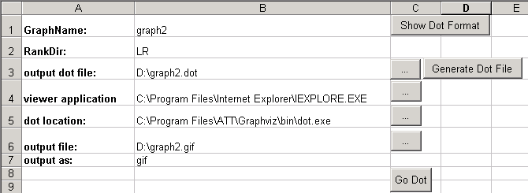

This is the main control mechanism in the spreadsheet.

The cells that control the generation of the graph visualisation are:

- B1 is the name of the graph, used when generating the dot representation

- B2 is the rankDir, see the dot documentation for alternatives

- B3 is the full path of the file to output when pressing the \[Generate Dot File\] button.

- B4 is the application that is called to display the output graphic file (B6 is passed to B4 as a parameter)

- B5 is the full path of the dot executable file

- B6 is the full path of the graphic file that will be output when pressing the \[Go Dot\] button.

- B7 is the type of file to output from dot. This is passed as to dot as the –T option. Gif is just one of the many output formats supported by dot. Check the dot documentation for more.

#### Show Dot Format

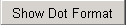

Pressing this button will display a pop up containing the code that will be generated for the graph defined by the nodes and links sheet.

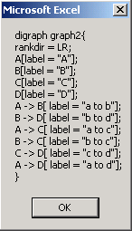

#### Browse

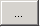

Pressing the browse button above will allow you to choose a path for the cell that it is adjacent to. (B3, B4, B5 or B6)

#### Generate Dot File

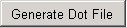

Will output the generated dot code to the file specified in cell B3. If the file already exists then it will be overwritten without warning or confirmation.

#### Go Dot

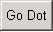

Will pass the file in B3 to the dot executable defined by B5.

The command line sent is of the form:

Dot –Tgif dotfile.dot –o output.gif

1. Dot would be replaced by the contents of B5

2. gif would be replaced by the contents of B7

3. dotfile.dot would be replaced by B3 (this must have already been generated by previously pressing the button. 

4. output.gif would be replaced by the contents of B6

## The code

The VBA code that powers this spreadsheet is very simple and can be viewed and amended by either :

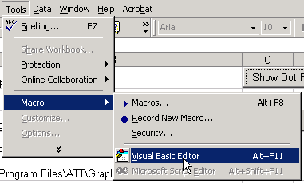

or showing the visual basic toolbar,

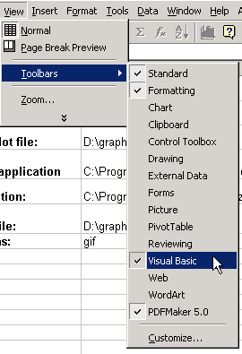

Pressing the design button

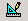

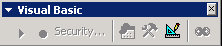

and then double clicking on one of the buttons on the sheet

In either case the Visual Basic code will be displayed:

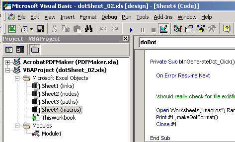

There is one module (module1) which has a single function defined in it:

MakeDotFormat

This takes the information in the spreadsheets and constructs a string which is the dot representation of the graph. This is shown when you click the button.

All the other functions are stored under the buttons etc. All the code is commented and very simple.
