# Practical Experiences in Graph-Based Testing

Original version 1.2 paper, dated 8 April 2003 in the document. Wording, source credits, comparisons, appendices and illustrations are retained. The automatic page-number contents list is omitted; the original PDF retains its pagination.

Practical Experiences in Graph-Based Testing

Abstract

Herein you are introduced to different structural diagramming techniques, but primarily the generic directed graph. Graph usage is explained as part of a structured testing process and during exploratory testing. The thought processes and models of testing which have led to my usage of graphs are examined. I will also list, review and comment on free and inexpensive tools which you can use to incorporate graph based tests into your testing process.

Author’s Biography

While working as a developer, coding software testing tools, Alan Richardson’s interest switched from programming to software testing. Since 1993, software testing has been Alan’s professional specialism and he has worked at all levels of the testing hierarchy; test execution and design, test management, strategy and methodology. He is currently an independent test consultant and helps his clients with every aspect of software testing.

Alan holds a BSc in Computing (Hons), and the ISEB foundation certificate in software testing. Alan can be found on the ISEB examination markers panel for Software Testing, and is a member of the BCS London branch of the Special Interest Group in Software Testing. He manages and maintains a web site dedicated to software testing (<http://www.compendiumdev.co.uk>) and has written a number of freely downloadable tools to help in the testing process. [Source link](http://www.compendiumdev.co.uk/)

When not being paid to test, Alan is generally reading about testing, beta testing useful tools, writing about testing, coding, and studying Neuro Linguistic Programming.

v1.2 08/04/2003

## Introduction

As a child I hated making models. I would inevitably glue some strange bit of plastic to the table, discover an extra bit of plastic that didn’t go anywhere and paint the shapeless, glue encrusted thing, really badly. My models were always wrong, they never looked like the picture on the box, and worse, they didn’t look anything like the real thing.

But now that I’m a tester, I love models and can’t get enough of them. I use them all the time and show them to everybody. My models are still not correct, fundamentally all models are incorrect, but provided my models are good enough to aid me in my testing and look enough like the real thing, I have no complaints, well, maybe just one or two. Those complaints come down to lack of tool support, but I’ll be explaining how to get round that later on.

The main model I use is the di-graph, the directed graph, which from this point onwards, I will generically refer to as the graph. Graphs are well covered in the testing literature, Beizer has 2 books that cover the subject \[Beizer95\]\[Beizer90\] and there is additional information in \[Binder00\]. But the tool support for graphing in testing is minimal.

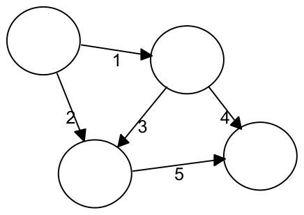

A Directed Graph

What Are Graphs?

Graphs are simple models composed of nodes joined by edges . The graphs that this paper will be considering are directed graphs, graphs where the edges have a direction.

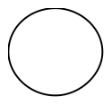

.

A Path is a sequence of edges through a directed graph.

There has been a great deal of work done on graph theory in the research community, but this paper will not be covering it, this is a practical paper and no graph theory is required in order to understand it, but a bluffers guide to Graph theory is provided in Appendix 1: Graph Theory Cheat Sheet for further study.

One of the main reasons for writing this paper is that, and I generalise wildly here, I don’t think that structural graph models are used enough in testing. I certainly don’t encounter many testers using graphs, which is a shame as graphs are well covered in the testing literature, and they are enormously helpful. I could suppose that this might be due to testing tool support, but I don’t really believe that. Perhaps other testers just haven’t been through the same testing experiences as I have? So one thing I’m going to do in this paper is present an account of my use of graphs in testing.

I will recount my early experiences with graphs, documenting lessons learned the hard way so that you don’t have to, documenting my changing thought processes as I learned how to use them effectively and documenting the tools that I have used to support my use of graphs in testing.

The use of graphs in testing is not a panacea, but it is useful, it is a technique that is easy to learn and has numerous benefits. Sometimes I don’t apply it, but you have to learn a technique so that you know when to apply it and when to discount it.

Graphs will be presented as useful models for:

- deriving test conditions

- understanding systems

- communicating the tester’s view of the system

- automating the production of test scripts

- assessing a variety of coverage measures

- visualising and reporting coverage measures

This is not a paper about state transition diagrams or other formal test design techniques. Graphs by their nature are abstract and are only formal in terms of their notation, this paper will show you how to harness that for the benefit of your testing process.

At the end of this paper; or before, if you want to skip to the appendices and start downloading tools, I hope that you will give graphs a try in your testing at the appropriate points. If you need to be convinced about the merits of graphs in testing then keep reading, but first, let me start at the beginning.

## Graphs in Practise

### In the beginning there were design techniques

I started in this business as a software developer and a software designer and I learned many visual modelling techniques: FlowCharts, Jackson Structured Programming (JSP), ERD, Petri nets, State Transition diagrams, Use Cases, and the list goes on...

The structural models; Flowcharts, JSP were interesting as they abstracted the underlying implementation source code, and, given a certain level of detail in the model, the code could be automatically generated from the model itself. In order to generate code, the models have to use the concepts of sequence, selection and iteration.

Flowcharts seemed to be a particularly poor way of representing source code because, as a developer, it was faster and less error prone for me to write the code, than to write the code out as a diagram. JSP was more appealing. JSP added a layer of abstraction about the code, and I had to build models of the data as well as structural models of processes.

Most people are familiar with flowcharts so I won’t explain those, but many people skipped JSP and went straight into OO. So I’ll give a quick overview of JSP here.

JSP has 3 notational concepts:

| Sequence | Selection (IF) | Iteration (loop) |
| --- | --- | --- |
| 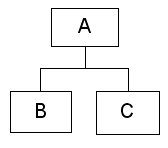 | 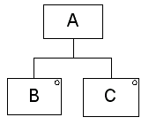 | 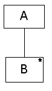 |
| A is a B followed by a C | A is B or C | A is a number of Bs |

JSP used the notion of analysing the input data and diagramming it into the above form, analysing the output in a separate diagram, also using the above notation, and then merging the diagrams into a final program. That last sentence actually generalises quite wildly, but JSP was really quite interesting for me and opened up the possibility of programming via diagrams rather than code. And for a while, in an academic environment, I generated all my program code, but in the real world on development projects I quickly stopped generating in favour of a design model, with a separate code model.

When I didn’t have to have a one to one mapping between the design model and the code model, I had a vast array of choices for design models, the UML is full of them, and I used state transition diagrams, Entity Relational diagrams, Entity Life History diagrams. The lot.

When I started testing other people’s developments, clearly I couldn’t use the code, but I was allowed to use the design models. All testers learn techniques for testing design models, none of which I will cover here, but most relate to test condition derivation, test data derivation or test case design. This was fine and I could generate dozens of test cases, but my problem was the number of test scripts I had to write, all of them similar to one another.

I envied the programmers who had the concepts of iteration and selection because it didn’t seem allowable to add these constructs into test scripts. If I gave testers a choice in the script then they might choose the wrong path when re-running the test. The scripts were all written in English and became confusing when I used too many procedural flow constructs. Instead, I embraced the workload of writing hundreds of scripts using just the sequence construct.

### Graphs as a test case design mechanism

I remember when I first started using graphs on test projects. I was still a young tester and I had just started to construct my models of the testing process and the relationships between the various entities in the testing life cycle.

I was aware of the concept of requirement coverage and had skimmed, but hadn’t fully understood, Beizer’s coverage of graphs in Software Testing Techniques \[Beizer90\]. Something from Beizer obviously stuck in my mind though, as I started to use graphs as a test design technique.

By diagramming a process, or system, or set of requirements as a hand drawn graph, I could use a path coverage technique to construct test cases. By path coverage I mean that I would trace paths through the graph to derive tests, and I would do this until I had covered all the edges and covered all the paths that I thought were important.

I did this in secret though as this wasn’t something that the other testers in the team were doing. I was dabbling in the black arts, the occult realms of software testing and the graphs became undisclosed glyphs and magic talismans in my notebook. I justified each of my graph designed tests by cross referencing them back to the test conditions which we had generated from the requirements and specifications.

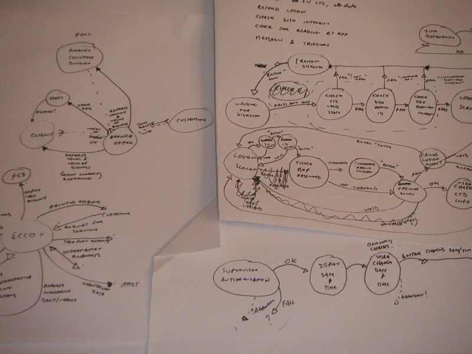

An Early Example of a Graph Based Testing Grimoire

But I was selective where I applied the graphs. I didn’t want to model everything in the system as a graph, some of the tests were obvious and many were one offs, but sometimes I needed a batch of tests for an area and in those instances, graphs were my tool of choice.

The technique was a secret, and it might have been magic. However the results were tangible and visible. By using graphs, I understood the requirements better, could create test cases faster and, where my path didn’t match a test condition, I was able to evidence a higher degree of insight into the requirements and spot a gap in our analysis.

Thinking back to my design days, I knew that these graphs evidenced selection and iteration constructs and if I could only figure out how, then I could start generating scripts from these models too.

### Test Script Development from a Graph

As a tester, the majority of the projects I have worked on have been manual structured testing projects where most of the test cases and test scripts are produced far in advance of test execution. The most frustrating aspect of constructing testware in structured testing projects, for me, is the construction of so many test scripts.

Test scripts are programs which testers execute. But unlike the programs that programmers write, we don’t write one program with loops and conditional statements, we write hundreds of programs using just the sequence construct. We write a thousand scripts to run a thousand paths.

The test script model, encourages this situation

The Test Script Model

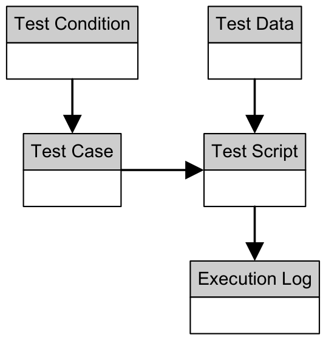

When I was constructing various models of the testing process, the one which fit most of the structured testing sites I worked at was the Test Script Model.

The test script model’s focus is the construction of test scripts which are executed and the execution is tracked.

Test Cases are derived from Test Conditions, and these Test Conditions are the result of various test derivation techniques e.g. BVA, Equivalence Partitioning, requirements analysis

Test Scripts are the executable form of a test case and document the steps to be executed and data to be consumed.

There are hierarchy extensions to this model for categorisation hierarchies and derivation hierarchies, but hierarchies are not structural models.

There is, it has to be said, a certain degree of redundant representation in the test script model. Too many of the scripts are too similar, as are too many of the test case descriptions. And yet this is the model which is supported by most of the test management tools in use today.

I distinctly remember the moment when the test script model and the tool support for it started to hamper my testing abilities. I had a rather small system to test, but it had a high degree of complexity and there were a variety of developer produced flowcharts which had been produced to help explain the system. The flowcharts were out of date and I had to remodel them. I have already mentioned my distaste for flowcharts so I turned instead to my new found ally, the graph.

The graphs I began producing for this system were very detailed. It was the perfect system to model using graph notation, but given the tools in use on the job and the culture I was working in, a different level of abstraction or a different representation in the test scripts was not acceptable. However, I was running out of time, and I had no choice, I had to reveal my secret method of test construction and this time I had to use it to construct scripts.

I created a fairly detailed set of graphs. For each of the nodes and links in the graph I created a textual description which was a process description (script) of what to do at each node or edge when encountered during path traversal.

Test data was analysed and described and partitioned into test data sets. This was an easy way of partitioning the test data and combining it with a path so the text description on a node could read “Enter the customer ID”, and I could look at the test data set and see what the customer ID was for that test. The test scripts were then documented in terms of the Path and the Data.

In order not to make the graph too complicated, I still handcrafted some of the scripts that were too tricky to model or would add undue complexity to the graphs.

And so I went from this...

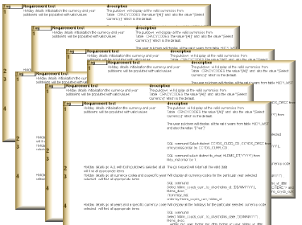

Many full test scripts, each allocated to a single test case.

To This...

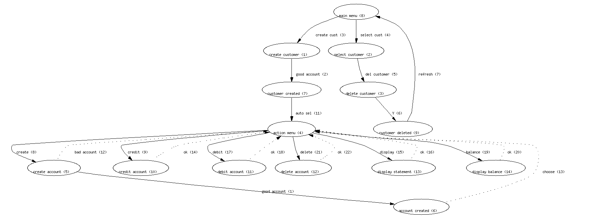

- TC1: Path {3, 2, 11, 9, 14} : DataSet {1}

- TC2: Path {4, 5, 6, 7} : DataSet {2}

- ....

Test Cases were described as a path through a graph with an associated data set, with some supporting scripts for those hard to model areas.

The graphs were drawn in Visio and took quite a long time to layout and get right.

I never seemed to find the time to extend this approach further and model it all in an access database, as this would have allowed me to automatically generate the script that I was running. Instead, when executing a script, I had to read the various descriptions and data set information from MS Word documents. This took a little longer when executing the script as I had to pull together various bits of information, but took far less time than actually writing the scripts.

I did experiment with automatically generating the paths from a graph and wrote a small Perl script to help do this. The Perl script can be found on the web \[wwwPP\] and there are various pages describing its limitations. Automatic path generation is a topic of research on its own and will not be covered in this paper, suffice it to say that:

- the Perl script is rather naive,

- generates too many paths,

- and because I was new to graphs I made the mistake of representing paths as sequences of nodes instead of sequences of links – in my defence, my graphs were only drawn with a single edge between each node (it seemed right at the time), but a lesson learned. Paths are sequences of edges, not sequences of nodes.

### The Script Meta Model (An Aside)

Throughout my various roles on client sites, I have been making notes towards a model of the testing process. A sub part of a larger testing entity model is the Test Script Model which has already been covered.

A model which I use to provide a different view of the testing process is the Script Meta Model.

The Script Meta Model was constructed out of a desire to avoid writing the many deliverables that testers write when using the Test Script Model; reams of test conditions, numerous test cases, hundreds of test scripts. One of the reasons for using a graph model is that a graph can be converted into a number of scripts, therefore instead of maintaining a set of scripts why not just maintain the graph that they can be derived from?

I started to view the testware that was being produced as the result of 3 different models:

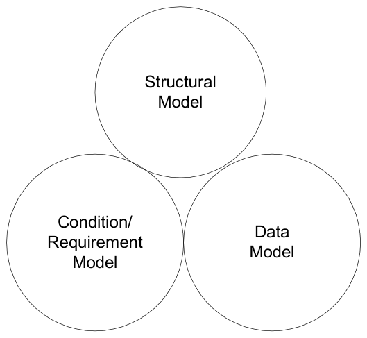

The structural model was a model of the system or the process, I would use graphs to model this.

The data model was an analysis of the data used by the system. This would be represented in many different forms; entity analysis diagrams, BNF, formal notation.

The condition/requirement model was a catch all model for anything else.

Test Cases seemed to be the result of the intersections between these models and Test Scripts were intersections between these models where the structural model was involved. I started to term this the Script Meta Model:

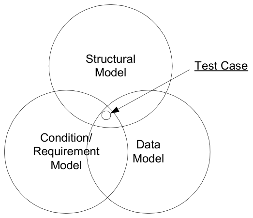

The Script Meta Model Test Case Definition

Different intersection points map to different levels of Test abstraction. High level test cases map on to a requirement model and data model intersection. Completely instantiated test scripts map on to an intersection between the structural model and the data model.

The utopian ideal behind this model is that if the tester’s structural models were complete and accurate enough then all test scripts could be generated automatically. Personally I don’t have time to build models like that, nor do I have the tools, so I use the Script Meta Model to remind me that I should use my models to reduce the amount of testware that I have to construct.

### Communication Graphs leading to test development

The project was being conducted in a structured testing and development environment, but it was not going well. The development specifications were ambiguous, being produced late, delivered late to the test team, and they were wrong.

Writing test scripts was taking too long and the constant change resulted in too much rework.

As a mitigating strategy I produced a number of graphs which I could use to communicate my understanding to the development team. Normally I didn’t use my graphs in this way, but it seemed fairly sensible that if I was using them to understand the system then I could use the graphs to communicate my understanding of the system.

The graphs went through quite a few iterations until they were understood by the development team and everyone was satisfied that they represented what the testers could do to the system. The development team also made a few changes to the system as a result of reviewing the graphs as they identified issues with the system or specification. And where the graphs were not complete, we supplemented them with some high level test case descriptions.

An unexpected benefit from all this communication was that the development team reported it was the first time they actually had proper visibility into the test process. They had always been too busy to read the test documentation before or plow through dozens of test scripts to see what the testers would be doing.

As the project was running to tight timescales, and we still had to plan the testing, the scripts were documented at a high level of abstraction; with an overall aim, the path through the graph to be taken, the test data to be used, and the various test conditions that would be covered.

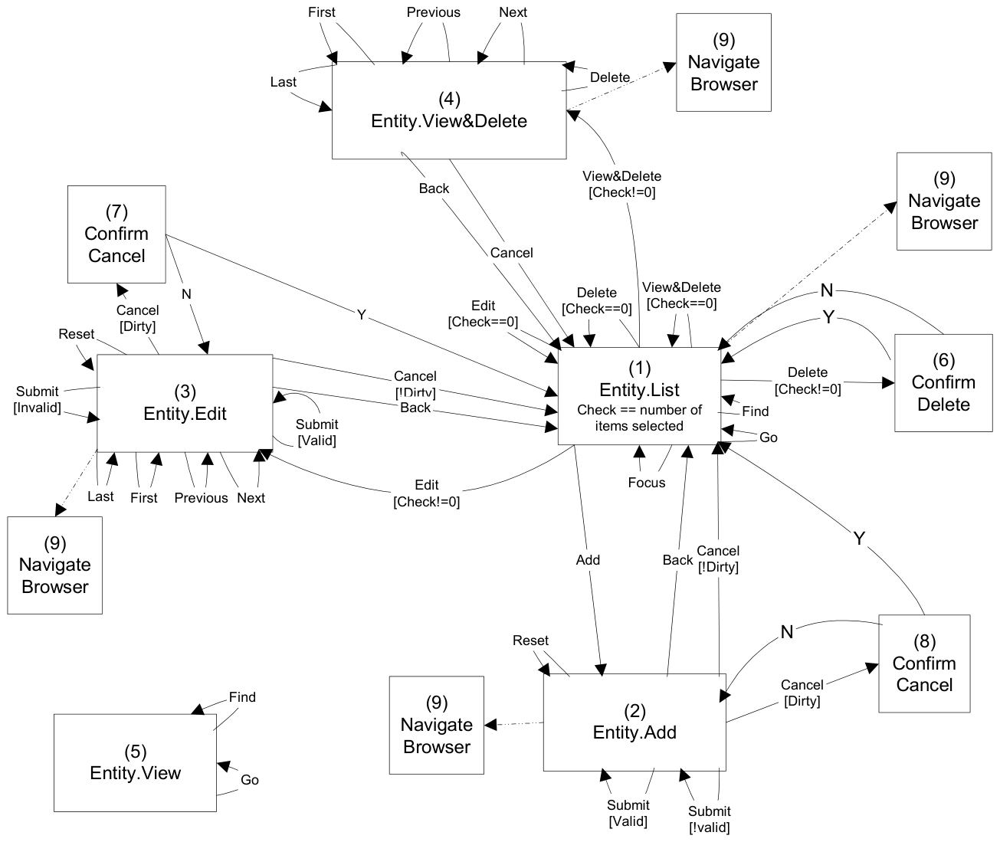

A high level communication graph suitable for test case derivation and scripting

Because I used graphs early in the process, the development team were used to seeing them and I could use some of the higher level graphs showing system interaction to communicate the progress of testing and what areas were still to be tested. This is something that I will provide more information on in the later section Experiments in visualisation

The approach used was fast, documented, structured, reviewed, had buy in, meant less rework to the testware, and the testing was still repeatable.

### Client based exploratory testing

My previous examples have all been related to structured testing, and I’ll be summarising the lessons learned later on, but graphs are not just applicable to structured testing.

My first experiences with exploratory testing were before I knew what the term was. I was asked to test a system on a client site with no notice, as I was filling in for a tester on the team who was on holiday, I didn’t even know what the system did. Fortunately the client did give me a single page release note before seating me in front of the web browser. I told them I was only going to be able to do adhoc testing, they said that was fine as they had already tested the software.

Fortunately I had been mulling over in my mind the possibility of constructing graphs at the same time as I would be learning the software, to try and minimise the rework that is involved when a graph built at design time doesn’t quite match the delivered system.

Rework is always an issue when you construct your test designs before the system is available, but I found the impact of rework when using graphs was far less than the amount of rework that had to be done when I was using the test script model to document my tests.

To aid me, I had found a graph drawing tool on the internet which I was going to explore. The tool was interesting in that it was free; great, our test budget didn’t extend to cover my experiments and it was a tool designed to draw graphs, not diagrams.

A generic diagramming tool, like Visio, can be used to draw graphs but its very generic nature makes it slower to use for a specific purpose. A tool which only draws graphs is faster to use, and has use features like automatic graph layout, and a text based representation of the graph which can be parsed later if required.

The tool I had identified was VGJ which is covered in more detail in Appendix 4: Tools List (VGJ). VGJ is a simple little browser based java applet. But because I was testing a web based app, when the app brought down my browser, it also brought down my graph. Fortunately as I was merrily testing away, I was saving my diagram frequently as I generally do with any tool.

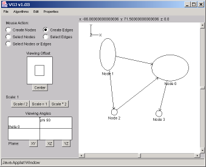

VGJ in action

This was an interesting exercise to do, but I found that the user interface of the tool didn’t support the speed of diagram creation that I required for exploratory testing. It was still faster than Visio, but VGJ didn’t quite have the speed I required, and I was still making written notes as I went along. I found it easier to draw the graph by hand and to represent the graph using the GML structured notation in a text editor and paste it into VGJ for visualisation.

Inevitably the development team were only interested in the defects I found and fortunately the holidaying tester came back so I didn’t have to repeat the process or document my notes any more thoroughly.

### An Exploratory Testing aid, and Beta Testing deliverable

My initial experiences with graph based exploratory testing did not put me off, and I did eventually learn a little more about exploratory testing and I have been practising, by Beta Testing other people’s software. Beta Testing is a great way to improve your testing skills as you get to experiment with whatever test technique or approach takes your fancy at the time.

One of the important aspects of exploratory testing, I have since learned, is knowing what you have done and being able to report on it. I have tried a number of ways of doing this; an open text editor file, mind maps, diagrammers, outliners and graphs.

I have settled on text editor notes and hand drawn graphs on an A3 sheet of paper. This is not far different from my initial attempts at graph based testing but my final documentation process is now different.

My Beta Test Mapping Process is simple:

1. open the app

2. scan the available options, they become links on the graph with no terminating node

3. follow the links, drawing the graph, testing and making notes as I go

4. repeat steps 2 &amp; 3 until the urge to test is sated

When I need to start again on the next session, I already have a map so I start filling in the areas that I haven’t yet visited.

At the end of a particular test session I document the graph really quickly, either using a front end to an automatic graph visualiser, or representing the graph directly in the graph visualisation tools graph markup language. By using a graph visualiser I don’t have to worry about the layout of the graph, as I would do if I was using Visio or any other diagramming package.

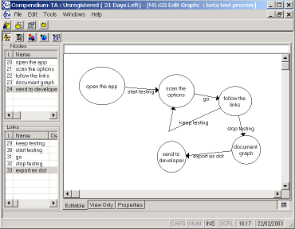

Quickly document the graph in a front end

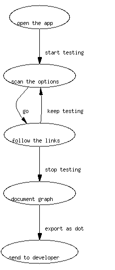

export to dot

The graph visualiser that I use is called Dot and is part of the AT&amp;T GraphViz package. I use a variety of front-ends to Dot: sometimes I use the supplied Dotty editor, sometimes Tintfu, occasionally JGraph but now I normally I use Compendium-TA which is a program that I wrote to help me do graph based testing. Details of all these tools can be found in Appendix 4: Tools List.

The Dot markup language is a structured text language file which is very simple to construct and amend, details can be found in Appendix 5: Graph Languages.

I then send the visualised graph, with the supporting text file notes and issue logs to the product supplier. I have found that this level of detail is more useful to the product supplier than just the issue logs as they get a feel for what tests have been run; can ask me to test certain areas in more depth and can replicate the issues better as they see the context in which the issues arose. The developer can also point out paths on the graph that I missed or that they would like tested in more detail.

## Practical Lessons Learned and Case Study Conclusions

Scott Ambler, in Agile Modelling \[Ambler02\] defines the purposes of modelling as communication and understanding. As testers we use graphs to help us understand systems, to communicate our understanding to the rest of the development team, and to define our test cases and test scripts.

Agile models are sufficiently consistent \[Ambler02\]. This is an important point to note in our usage of graphs as they are not as formal as State Transition diagrams or Petri Nets. Our graphs have a high degree of abstraction and don’t have a formal modelling methodology behind them; the edges are not always events, the nodes are not always states and are sometimes processes. This gives a lot of freedom to model quickly and as required.

For Communication

- Rather than have people review hundreds of scripts, which they never seem to manage to get around to doing or doing effectively, they can instead review a handful of diagrams.

- Graphs communicate my understanding and help other people understand the systems better.

- The cliché is that a picture is worth a thousand words. My experience tells me that a graph can summarise several pages of requirements and development specifications.

- Sometimes all that has to be done to prevent defects is draw a graph, show it to the developer and ask a few questions.

- Sometimes the graphs will make it into the development documentation for future readers.

- Show your graphs to other people, don’t keep them to yourself, they are too valuable for that.

- Remember, there is more to a graph than just a picture of a graph. The picture is a visualisation of an underlying representation, and this is what you are communicating, you use the picture as a way of communicating it.

For Understanding

- Generally when logic or interaction is hard to comprehend in textual form, I draw a graph. And when I am drawing graphs for understanding I use my favourite tool; Paper and Pen.

For Definition

- To support script definition, extra step description information is added to the nodes and edges, to tell the tester what to do when traversing a path through the graph.

- Don’t try to model everything in a single graph, use multiple graphs.

- You don’t have to model everything in a graph, you do have other test techniques too.

- You don’t need to get too detailed, keep your graphs manageable.

- If you have a set of test scripts which are similar, consider reverse engineering a model of the scripts as a graph.

- Graphs can evolve, and become more detailed, as the project matures.

Tool Usage

- Graphs on paper, are easier and quicker to construct than in a tool, particularly during exploratory testing

- I particularly recommend flipcharts, or A3 pads, but I have in extremis used A4, A5 and post it notes (which I don’t recommend).

- Paper has the advantages:

    - that it doesn’t crash when the system I am exploring crashes my computer

    - that I have to swap from window to window,

    - it is easier to record future paths, when I know there is an edge but I don’t know what the terminating node is

    - that I don’t feel quite as precious about my model when using paper

    - that I find it easier to make annotations that a computer tool would find clumsy

- The tool adds permanence and the ability to process the graphs further.

- Graph tools are generally designed for visualisation not for testing, be prepared to write supplementary tools and documents.

- Use tools to automatically lay out the graph

- Experiment with a number of tools to find the right one for you, and with all tools, get used to it before you start using it in a time critical testing phase.

Test Design

- Test Design is different from Test Script design. A test is something that you want to check. A script tells you how to check it in order to determine if a particular test can be passed. When viewing the test process through the eyes of the Script Meta Model, tests are justifications for traversing a path.

- In a structured test process graphs can be used to provide a justification for some of the scope for testing, in session-based testing, a graph can provide a justification for some of the test charters.

- The standard way of deriving tests from graphs is by covering the paths through the graph (\[Beizer95\]\[Binder00\]\[Beizer90\]). Despite the utopian ideals of the Script Meta Model, we will not get all our tests from coverage. The graphs we produce are usually not detailed enough.

- We get extra tests from the graph by examining it and identifying the behaviour that is not modelled.

- Graphs which are modelled too deeply too quickly can become unwieldy and hard to maintain. There has to be a trade off between understanding, communication, and derivation and this will depend on why you drew the graph, the position in the lifecycle, and probably the toolset that you are using to model the graphs.

Test Script Design

- A test script and a test design are different. All test scripts could be automatically generated from a very detailed model, all test designs can not.

- In essence we derive paths from the graph. Paths can be described as sequences of edges. Because every edge has a start node and an end node, we only need to use edges.

- Paths are generated from graphs by the application of strategies to the graph: e.g. node coverage, branch coverage, predicate coverage, cover all loops twice

- When we are covering the paths we are not covering the tests. The script meta model shows us that paths are independent from tests. It is possible to build scripts from paths directly but these scripts do not have the contextual aims that the condition model provides, nor does it exercise the data adequately.

- A Path is a script, but it is an uninstantiated script. To become a test script, we need to know the data used and the conditions covered.

- When I extend the detail in graphs to make them more suitable for script generation, I try to avoid confusing the graph. So I add any important linking edges by adding them as dotted lines, and making start and end nodes different colours. These extra visualisation attributes are important for retaining the communication benefits.

- Give each graph, node and each edge a unique ID that you can use in your path edge sequences and in your cross referencing

## Using Graphs in Your Testing

In previous sections I have covered how I used graphs in my testing process. Now I want to explain how you can start to use graphs in your own testing processes.

I have already mentioned that the tool support for using graphs in testing is not particularly extensive. I have written a number of programs to help, but you need to be able to understand how to do this for yourself. You also need to understand how the various tools available to you can be integrated into your test process.

We know that graphs, when represented as diagrams can still help us with our testing. We can use them to communicate and understand. And we can manually identify paths through the graphs and interpret the paths during testing. There are two basic levels for doing this:

1. Work with Diagrams

- communicate and understand

- identify paths for test case derivation

1. Work with Diagrams with supporting node and edge annotation

- as above

- represent scripts as sequences of edges for repeatable testing

At level 1, we are constructing graphs as diagrams, and using the diagrams as a basis for communication. We use them as a basis for test case derivation by writing tests to cover all the paths that are appropriate to traverse through the graph, this typically involves red penning the graph as we write our tests.

At level 2, we are going in to more detail and our graphs have to be more detailed. The graphs have to be detailed enough so that by following a path through the graph we can actually follow a script. But because human testers are involved, the descriptions on the nodes and edges don’t have to be to the same level of detail that would be required for automated execution. Giving us a certain degree of ambiguity in the abstraction we can use, and this works to our advantage, provided that there are not too many ways of interpreting the path.

It is essential to make a note of the path that the test is covering so each node and edge are given a unique identifier. The path is described as a list of the unique identifiers of the edges e.g. {1, 5, 3, 6}. When executing the script, the tester follows the path and reads the annotation against the node and edge to determine what to do during the script.

Experiment with the various tools in Appendix 4: Tools List, to see which one suits you best. You might well discover that at levels 1 and 2, normal vector graphic tools like Visio and Smartdraw will suit your needs, although you will miss out on the time saving automatic layout functionality.

We can actually do a lot of good testing work at levels 1 and 2, and you will note that in all the case studies I have presented I have been working at level 2. One of the reasons I wrote the Compendium-TA tool, was to move into experimenting with level 3 where we work with the actual graph rather than the diagram.

1. Work with Graph Representation

- diagrams become an output

- automatic parsing

- automatic script generation

Graph tools focus on the visualisation of graphs. Testers are interested in that only as a side effect, our goal is not to draw graphs, but to use graphs to help conduct testing. We can conduct testing with graphs in a more automated fashion when graphs are represented in a format that we can easily handle. But be warned, in order to do any automated processing, such as generating test scripts from paths, or assessing coverage metrics, or any kind of advanced visualisation, we need to start doing some programming.

The graph tools (Appendix 4: Tools List) typically use a Graph Markup Language to represent the graphs (Appendix 5: Graph Languages). One of the difficulties with interfacing with the existing tools using programming languages is the number of graph representation languages which are in use, and the difficulty in getting some of the tools to work. Many of the tools are supplied in source format or are written in Java, some require extra libraries. During the body of the paper I have mentioned some of the easier tools to get working, and I have highlighed in Appendix 4: Tools List the tools which I recommend you start with.

There is no “Standard” graph markup language so when choosing one, we really need to focus on the tools that support the markup language we want to use, and the ease of integration into our testing process.

All the markup languages that we will be considering are simple text files. Examples are provided in Appendix 5: Graph Languages.

| XML Based | Structured Text |
| --- | --- |
| XGMML GXL GraphXML GraphML Graphotron | GraphViz (Dot) GML |

The language formats

Ideally the markup language chosen will be simple to construct without tools, simple to parse and extensible. By extensible I mean the ability to add extra fields or notation i.e. adding descriptions to nodes, adding cross references fields.

GraphViz and GML are the oldest languages and are a structured text rather than XML. I find that this actually makes them simpler to manage and maintain without formal tool support.

The GraphViz format is used by the AT&amp;T GraphViz toolset. It is a very simple representation and is my favourite when it comes to hand crafting the graph representations. GML was created as the markup language for the Graphlet tool and is also the text representation used by the VGJ tool. GML is a very simple structured text language, and while it is easy to write by hand, I prefer the GraphViz representation.

All the XML variants are very similar but I find them more difficult to work with. If you are a better programmer than I, then perhaps XML is the ideal format for you, but be warned, the XML languages actually have poorer tool support.

The use of graph languages has two main considerations:

- use the graph mark up languages as our graph representation, in which case it has to handle extra fields (in which case we are also interested in tool support of the extra fields).

- use it as the output from our extended representation in which case it is the tool visualisation support that we are interested in.

One approach to graph construction that I have seen mentioned on the net is to write a small program with very little processing in it and pass it through doxygen (www.doxygen.org). Doxygen is a code parser which visualises the structure of the source code using GraphViz. I would recommend learning the very simple GraphViz representation rather than this more error prone and complicated process. [Source link](http://www.doxygen.org/)

I believe that the tester is best served by using the graph representation languages as outputs of their own representations of graphs. This is the approach used in the Compendium-TA tool, but it is easy to take the same approach in Excel, or any spreadsheet or database that supports macros. One reason for choosing this option is that although the mark up languages can handle our extensions, the tools which support the markup languages generally do not, and often will not, persist your extensions when saving the graph.

I am now going to suggest that if you want to use graphs more effectively in your own testing processes then you, or a friendly programmer of your acquaintance, will have to do some programming. I have added a set of links in Appendix 4: Tools List (code libraries) should you wish to use standard graph libraries.

I will assume that you are using a spreadsheet would suggest the tabs in the sheet be:

- Links

    - columns: linkID, fromNodeID, toNodeID, Name, Description

- Nodes

    - columns: nodeID, Name, Description

- Paths

    - columns: pathID, Description, linkID, linkID\*

As an abstract example I will use the following graph:

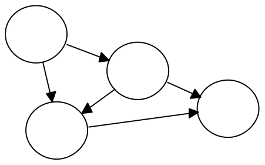

Nodes

| nodeID | Name | Description |
| --- | --- | --- |
| A | A | \[insert script details here\] |
| B | B | \[insert script details here\] |
| C | C | \[insert script details here\] |
| D | D | \[insert script details here\] |

Links

| linkID | FromNodeID | ToNodeID | Name | Description |
| --- | --- | --- | --- | --- |
| 1 | A | B | a to b | \[insert script details here\] |
| 2 | B | D | b to d | \[insert script details here\] |
| 3 | A | C | a to c | \[insert script details here\] |
| 4 | B | C | b to c | \[insert script details here\] |
| 5 | C | D | c to d | \[insert script details here\] |

Paths

| pathID | Description | LinkID | LinkID | LinkID | ... |
| --- | --- | --- | --- | --- | --- |
| 1 | ABD | 1 | 2 |  | ... |
| 2 | ACD | 3 | 5 |  |  |
| ... |  |  |  |  |  |

It is a simple matter to write macros which will output a graph markup format from the above information for feeding into the tools for automatic layout.

From this information it is also a simple matter to construct the various matrix representations of graphs presented in \[Beizer90\] should you wish to experiment with the various algorithms presented there.

Another extension possible with the above representation is to expand the path representation into a textual script that the tester can follow. This is done by writing a text file for each link in the path and outputting the description of the fromNode, then the link description, then the toNode description. The fromNode description is only written for the first node link in the path.

It is undeniably useful to have a graph drawing tool for constructing graphs quickly, and if it is one of the tools which supports Dot or GML then the textual output from the tool is easy to manually convert into the above spreadsheet form.

For the more adventurous among you, it is surely possible to parse the output files automatically.

## Experiments in visualisation

This is really the future vision, and possibility section of this paper, and is your chance to experiment, as I have only dabbled with this on client sites.

Given that graphs can be used as a communication tool so that everyone can be made aware of the testing that will be carried out on a system. It seems reasonable to assume that the same graphs can be used to document various project status information.

Information such as:

Defect Density

Progress

Coverage (measures of coverage 1, 2, 3 etc.)

Outstanding Defects

Good Bits (system elements with few faults)

Using a tool like GraphViz, it is easy to add extra information into the GraphViz file to change the colour of a node, or the style of an edge.

So for Progress, we might show the graph with areas which have been tested, as coloured blue, and areas which are currently under test as green.

For Defect Density we might have different representations for our defect density scale: 1 – 10 Outstanding defects (green circle), 11- 20 outstanding defects (blue circle), 21 – 30 outstanding defects (red circle), above 30 outstanding defects (red square).

In order to implement the above, we have to either use cross referencing information or extra attributes on the nodes and links and then a customisation to our export routine.

The defect density could be calculated by counting the number of cross referenced defects to a node on a graph or by using a defect density attribute on the node.

This extends the use of graphs as a communication mechanism throughout the testing lifecycle and may help communicate testing status to those managers who never seem to read the numbers in the progress reports.

## Appendix 1: Graph Theory Cheat Sheet

A Graph has Vertices and Edges .

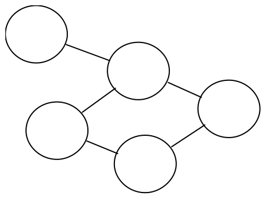

Edges Join vertices. (synonyms; Vertex:Node).

The count of the number of edges which have the vertex as an end point is the Degree of that vertex.

Concepts:

- Multiple Edges between the same two vertices

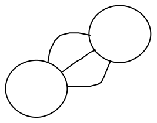

- Loop , an edge from a vertex to the same vertex

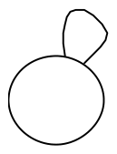

- Two vertices are Adjacent when joined by an edge; two edges are Adjacent when they have a shared vertex

- A Weight is a value assigned to an edge, a graph with weighted edges is a Weighted Graph

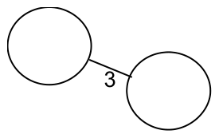

- Vertices are Incident to the edge joining them

- Simple Graph has no loops or multiple edges

- Digraph is a graph where the edges have a direction (Directed Graph)

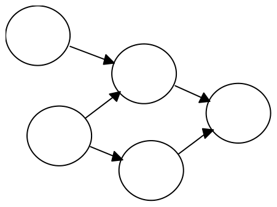

- An edge in a Digraph is called an Arc

- In a digraph, the degree of a vertex is the out-degree for arcs out of the vertex and the in-degree for arcs into the vertex

- A Vertex with In-degree of 0 is a Source and a Vertex with Out-degree of 0 is a Sink

- Subgraph is defined in terms of a Graph minus edges; G – {e,f,g} (where e,f,g are edges)

- an End Vertex has degree of 1; an Isolated Vertex has degree of 0

- A Walk is a sequence of edges, from the Initial Vertex to the Final Vertex. The length of a walk is the number of edges.

- A Path is a walk in which no vertex appears more than once.

- A Trail is a walk where no edge appears more than once

- A walk is Closed when the Initial Vertex is the same as the Final Vertex

- A Cycle is a walk where the start vertex is the end vertice.

- A Connected Graph is in one piece

- A Disconnected Graph is one with more than one piece

- A Tree is a graph with 1 path between each pair of vertices.

- A Forest is a disconnected graph where each graph is a tree

- Planar Graph is a graph that can be redrawn without edges crossing

Graphs can be represented non visually as lists &amp; matrices.

| Graph: | List: |
| --- | --- |
|  | A: B, C B: C, D C: D |

Adjacency Matrix:

Incidence Matrix:

V x V where each entry is the number of edges joining the vertices

V x E where each entry is 1 if vertex is incident to edge and 0 if it is not

| - | A | B | C | D |
| --- | --- | --- | --- | --- |
| A | 0 | 1 | 1 | 0 |
| B | 0 | 0 | 1 | 1 |
| C | 0 | 0 | 0 | 1 |
| D | 0 | 0 | 0 | 0 |

| - | 1 | 2 | 3 | 4 | 5 |
| --- | --- | --- | --- | --- | --- |
| A | 1 | 1 | 0 | 0 | 0 |
| B | 1 | 0 | 1 | 1 | 0 |
| C | 0 | 1 | 1 | 0 | 1 |
| D | 0 | 0 | 0 | 1 | 1 |

Graph Types: Null, Complete, Cycle, Path, Wheel, Regular, Biparite, Cubes, Simple, Eulerian, Hamiltonian, Isomorphic

Recommended References

- Introduction to Graph Theory, Robin J. Wilson, 1996, Longman

- Graph Theory Techniques in Model Based Testing, Harry Robinson, <http://www.geocities.com/harry_robinson_testing/graph_theory.htm>

## Appendix 2: References

\[Ambler02\]

Agile Modelling – Effective Practices for extreme programming and the unified process, Scott Ambler, 2002, John Wiley &amp; Sons

\[Beizer95\]

Black Box Testing, Boris Beizer, 1995, John Wiley &amp; Sons,

\[Beizer90\]

Software testing techniques, Boris Beizer, 1990, Van Nostrand Reinhold, 2nd Edition

\[Binder00\]

Testing Object Oriented Systems, Robert V. Binder, 2000, Addison Wesley

\[wwwAlt\]

The Compendium Developments Alternative Tools List (<http://www.compendiumdev.co.uk/alttools/index.php>)

\[wwwPP\]

The Compendium Developments Perl Path Analysis tool (<http://www.compendiumdev.co.uk/perltools/>)

## Appendix 3: Relevant web sites

www.graphdrawing.org [Source link](http://www.graphdrawing.org/)

Links to the majority of graph languages, lists of graph books and links to the Graph Drawing Symposiums

<http://rw4.cs.uni-sb.de/users/sander/html/gstools.html>

Graph Drawing Tools and Related Work page has a list of tools, most of which are listed in Appendix 4

<http://www.utm.edu/departments/math/graph/>

Graph Theory Tutorials, by Chris Caldwell

<http://www.math.uni-hamburg.de/home/diestel/books/graph.theory/>

Reinhard Diestel’s ‘Graph Theory’, 2nd Edition, published by Springer, has an on-line electronic version here

<http://www.model-based-testing.org/>

Harry Robinson’s model based testing site always has plenty of interesting papers

<http://www.compendiumdev.co.uk> [Source link](http://www.compendiumdev.co.uk/)

My web site has other writings related to graph based testing

## Appendix 4: Tools List

Diagrammers

Should you wish to experiment with graph based testing then the tools in this section are those that I recommend you experiment with.

#### GraphViz

The AT&amp;T Open Source Graph Visualisation toolkit

FREE

<http://www.research.att.com/sw/tools/graphviz/>

<http://www.graphviz.org> [Source link](http://www.graphviz.org/)

related links: doxygen (<http://www.doxygen.org>) [Source link](http://www.doxygen.org/)

FREE

The main component for testing purposes is Dot which is the command line driven visualisation engine for directed graphs.

ScreenShot

Features

Review

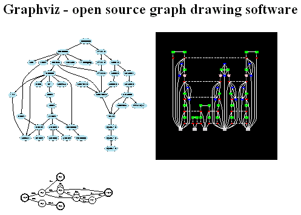

- Dot Markup Language

- Many scripting language APIs

- Mature

- Free &amp; Open source

- outputs to GIF, PNG, FIG, JPG, PostScript, SVG, and more...

- web server version

- command line

This is a great free toolset for auto layout of graphs. It is command line driven and comes in two flavours dot (for directed graphs) and neato (for undirected graphs).

The supplied editing tool is crude, but output to dot format is available from other tools (grappa, dge, tintifu). Used as part of doxygen to document source code.

#### VGJ

A very simple GML diagrammer

<http://www.eng.auburn.edu/department/cse/research/graph_drawing/graph_drawing.html>

There is an instantiation of it here: <http://pop.dia.uniroma3.it/vgj/>

FREE

ScreenShot

Features

Review

- GML Language

- Browser Based Java Applet

- simple function state GUI

- No Longer being maintained

- simple layout algorithms

Sadly this tool is no longer being maintained.

This is a very simple tool to use, and the graph can be edited using the diagrammer or via the text representation in GML.

Be careful using this when testing web apps because it is browser based.

#### JGraph

<http://sourceforge.net/projects/jgraph/>

FREE

ScreenShot

Features

Review

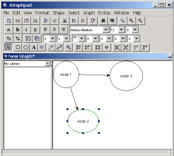

- Export to GraphViz, GXL and JPG

- Different Layout algorithms

- Simple Diagrammer

- Uses its own .pad file format

- export to GraphViz has bugs

- No annotation supported

- Front end bugs

Export to GraphViz format has some issues (circles become squares), but it can act as a simple enough front end to dot for drawing basic graphs.

It uses its own file format as input but will export to other formats.

The spring embedded layout algorithm, occasionally walks the graph off the screen and the scrollbars sometimes don't allow you to scroll across the window properly.

#### Tintfu

<http://sourceforge.net/projects/tintfu/>

FREE

ScreenShot

Features

Review

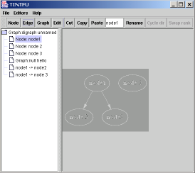

- uses GraphViz

- simple GUI

- only exports to .dot format

- visualisation pane didn’t work well on my machine

A front end to GraphViz, the node and edges are entered through dialogs rather than dragging and dropping on the gui pane like most editors. This makes it a little harder to get started with than the other editors but is pretty fast.

The full range of GraphViz attributes are easy to get at and the graph is redrawn each time new items are added.

#### TouchGraph

<http://www.touchgraph.com> [Source link](http://www.touchgraph.com/)

There is an example graph here: <http://www.compendiumdev.co.uk/touchgraph/tsitemap.html>

FREE

ScreenShot

Features

Review

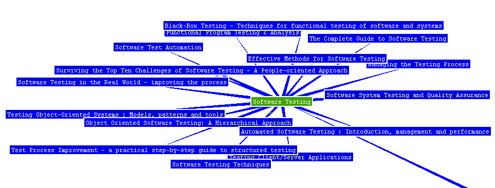

- XML data format

- easy visualisation

- Great for url based graphs

As an editor it is crude, but it can visualise large graphs, great for URL based graphs.

#### Process Revolution 2002

<http://www.siliconmindset.com> [Source link](http://www.siliconmindset.com/)

Commercial

ScreenShot

Features

Review

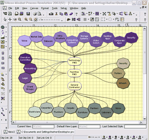

- Graph Based Diagrammer

- XML output

- Automated Layout Algorithms

- Shape Templates

- complicated XML output

A Generic diagrammer which uses a graph metaphor as the main diagram console, rather than a diagrammer like Visio which uses a drawing metaphor. The tool uses XML as its representation, but it is a rather rich representation.

Future versions will have a VBA interface which will make it much more attractive to testers.

#### Compendium-TA

A modelling tool using graphs, entities and hierarchies.

<http://www.compendium-ta.com> [Source link](http://www.compendium-ta.com/)

<http://www.compendiumdev.co.uk/compendium-ta>

Commercial

ScreenShot

Features

Review

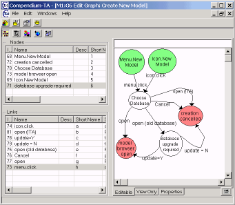

- Dot integration

- Hierarchy modelling support

- user defined entities

- cross referencing

- Macro language integration

- Path coverage metrics

- Simple Diagrammer

I wrote Compendium-TA to help me do graph based testing, so it is a relatively crude diagrammer, but allows me to do the ‘other’ things that I have to do with graphs, such as create new properties on the nodes and links and cross reference the nodes and links with other entities. Compendium-TA has its own diagrammer which is manual, and uses dot to create quick and automatically laid out representations of the graph.

#### Others

Some of these have reviews at <http://www.compendiumdev.co.uk/alttools/index.php> \[\*\], Others are harder to get working and require Java and a variety of plug-ins, or only run under Linux.

VCG

<http://rw4.cs.uni-sb.de/users/sander/html/gsvcg1.html>

reviewed @ \[\*\]

Graphlet

<http://www.brainsys.de/>

reviewed @ \[\*\]

DaVinci

<http://www.b-novative.com/>

reviewed @ \[\*\]

Aisee

<http://www.aisee.com/>

reviewed @ \[\*\]

Goblin

<http://www.math.uni-augsburg.de/opt/goblin.html>

GraphMapper

<http://www.sumdog.com/?page=Projects&sub=GraphMapper> [Source link](http://www.sumdog.com/?page=Projects&sub=GraphMapper)

A simple graph diagrammer with its own file format

GraphOpt

<http://schmuhl.org/graphopt/>

A layout algorithm that uses a subset of the GraphViz dot language

Figaro

<http://sourceforge.net/projects/thefigaro/>

Linux, Xwindows, unevaluated, no information available

GraphThing

<http://graph.seul.org/>

Linux, unevaluated, create, manipulate and study graphs

#### Code Libraries

If you want to write your own tools or interfaces in other languages, then first of all look for code libraries, here is a small subset of those that are out there.

OpenJGraph

<http://openjgraph.sourceforge.net/>

Java Graph Library

GTL

<http://infosun.fmi.uni-passau.de/GTL/>

C++ Graph Library

GEF

<http://gef.tigris.org/>

Java Graph Library

GVF

<http://gvf.sourceforge.net/>

GraphXML Java Library

Boost

<http://www.boost.org/libs/graph/doc/>

C++ Graph Library

Perl CPan Modules

GraphReadWrite

<http://search.cpan.org/author/NEILB/Graph-ReadWrite-1.07/>

GraphViz

<http://search.cpan.org/author/LBROCARD/GraphViz-1.7/>

Graph

<http://search.cpan.org/author/JHI/Graph-0.20101/>

yGRAPH

<http://www.ygraph.com> [Source link](http://www.ygraph.com/)

A commercial Java graph library that can process yGraph, GML, and graphML formats

P.I.G.A.L.E

<http://pigale.sourceforge.net/>

A C++ graph library with editing package

General Testing Graphing Utilities

#### Perl Path Generation Script

A simple Perl script for generating paths for a graph

<http://www.compendiumdev.co.uk/perltools/>

ScreenShot

Features

Review

\[text based, no screenshot available\]

- uses a simple node pair text file

- generates a path as a lists of nodes

- only allows 1 edge between each pair of nodes

This is a very simple Perl script, which when given the opportunity will generate far too many paths through a graph.

Also the paths are presented as node pairs rather than edges so extra processing would be required in order to achieve full branch coverage.

Could be a useful basis if you want to write your own scripts.

## Appendix 5: Graph Languages

More information on all the Graph Languages presented in this paper can be found below, with links to their respective web sites.

| XML Based | Structured Text |
| --- | --- |
| XGMML GXL GraphXML GraphML Graphotron | Dot GML |

All the markup languages listed here are simple text files. Dot and GML are the oldest so are a structured text rather than XML. This actually makes them simpler to manage and maintain without formal tool support.

Structured Text

#### GraphViz (Dot)

<http://www.research.att.com/sw/tools/graphviz/>

<http://www.graphviz.org> [Source link](http://www.graphviz.org/)

Description

Sample

The GraphViz graph markup language. This is probably the most well supported graph visualisation format available. It is also one of the easiest languages to write by hand.

It is a very simple representation and is my favourite when it comes to hand crafting the graph representations.

Nodes are all given a unique ID and a textual label. Edges are defined as being from node -&gt; node and it is the label that identifies them as unique.

The language is more flexible than presented here and there are a lot of extra attributes to define line style, colour, shape, position. But for constructing a graph quickly, all that is required is shown in the example.

digraph G2 {

rankdir = LR;

node16\[label = "start application (16)"\];

node17\[label = "main window (17)"\];

node18\[label = "exit application (18)"\];

node19\[label = "file edit window (19)"\];

node17 -&gt; node19\[ label = "open file (23)"\];

node19 -&gt; node19\[ label = "edit file (24)"\];

node19 -&gt; node19\[ label = "save file (25)"\];

node19 -&gt; node17\[ label = "close file (26)"\];

node16 -&gt; node17\[ label = "start (27)"\];

node17 -&gt; node18\[ label = "exit (28)"\];

}

#### GML

Graph Markup Language

<http://infosun.fmi.uni-passau.de/Graphlet/GML/>

Description

Sample

GML was created as the markup language for Graphlet. But is also the text representation used by the VGJ tool.

It is a very simple structured text language format that uses white space and \[ \] as delimiters, and while it is easy to write by hand, I prefer the dot representation.

The GML format is probably easier to parse if you want to read it as an input format as it marks off when a node starts and when an edge starts.

Both GML and GraphViz are easily automatically or manually constructed.

As per the GraphViz language, there are a lot of extra markup attributes for colour and shape etc.

graph \[

comment "G2"

directed 1

id 42

label "Graph G2"

node \[ id 16 label "start application (16)" \]

node \[ id 17 label "main window (17)" \]

node \[ id 18 label "exit application (18)" \]

node \[ id 19 label "file edit window (19)" \]

edge \[ source 17 target 19 label "open file (23)" \]

edge \[ source 19 target 19 label "edit file (24)” \]

edge \[ source 19 target 19 label "save file (25)” \]

edge \[ source 19 target 17 label "close file (26)” \]

edge \[ source 16 target 17 label "start (27)” \]

edge \[ source 17 target 18 label "exit (28)” \]

\]

XML Based

All the XML variants are very similar, and I’m only going to list the output of a couple of them. XML is obviously easier to add extra fields and notation too, and can be edited in XML editors as well as the tools which support the notation, but the following notations are not actually as well supported as the two structured text representations GraphViz and GML and are far harder to write by hand.

#### Graphotron

<http://www.zvon.org/ZvonSW/ZvonGraphotron/>

Description

Sample

Graphotron is designed as an intermediary XML language which can be converted into other graph languages.

At the moment the Saxon style sheet parser is used and the supported outputs are Dot (GraphViz), daVinci and VCG.

&lt;graphotron version="1.0"

xmlns="<http://zvon.org/graphotron">

xmlns:dot="<http://zvon.org/graphotron/dot">&gt;

&lt;global-settings&gt;

&lt;dot:label select="/\*/title/@Zvon"/&gt;

&lt;/global-settings&gt;

&lt;vertex match="/\*/\*"&gt;

&lt;name select="substring(/\*/title,

count(preceding::\*)\*3 - 1,

3)"/&gt;

&lt;dot:color select="."/&gt;

&lt;dot:fontcolor select="."/&gt;

&lt;/vertex&gt;

...

#### GXL

Graph Exchange Language

<http://www.gupro.de/GXL/>

GXL Converter Framework:

<http://ist.unibw-muenchen.de/GXL/triebsees/>

Description

Sample

XML based graph language. There is a GXL converter framework which will turn GXL into various formats, but from a quick look at the web site only syntax trees are supported as output.

&lt;?xml version="1.0"?&gt;

&lt;!DOCTYPE gxl SYSTEM "../../../gxl-1.0.dtd"&gt;

&lt;gxl xmlns:xlink="<http://www.w3.org/1999/xlink">&gt;

&lt;graph id="simpleExample"&gt;&lt;type xlink:href="../../schema/gxl/ simpleExampleSchema.gxl#simpleExampleSchema"/&gt;

&lt;node id="p"&gt;

&lt;type xlink:href="../../schema/gxl/ simpleExampleSchema.gxl#Proc"/&gt;

&lt;attr name="file"&gt;

&lt;string&gt;main.c&lt;/string&gt;

&lt;/attr&gt;

&lt;/node&gt;

&lt;edge id="r1" from="p" to="v"&gt;

&lt;type xlink:href="../../schema/gxl/ simpleExampleSchema.gxl#ref"/&gt;

&lt;attr name="line"&gt;

&lt;int&gt;127&lt;/int&gt;

&lt;/attr&gt;

&lt;/edge&gt;

&lt;/graph&gt;

&lt;/gxl&gt;

#### GraphXML

<http://www.cwi.nl/InfoVisu/GraphXML/index.html>

Description

Sample

XML based graph language that doesn’t seem to have much tool support.

\[see web site\]

#### GraphML

<http://graphml.graphdrawing.org/>

Description

Sample

Another XML based graph language with little tool support. GraphML is based on GML.

\[see web site\]

#### XGMML

<http://www.cs.rpi.edu/~puninj/XGMML/>

Description

Sample

XML Based graph language based on the GML language. Created for the WWWPAL web visualisation software.

There are converters to turn XGMML into and from GML.

\[see web site\]
