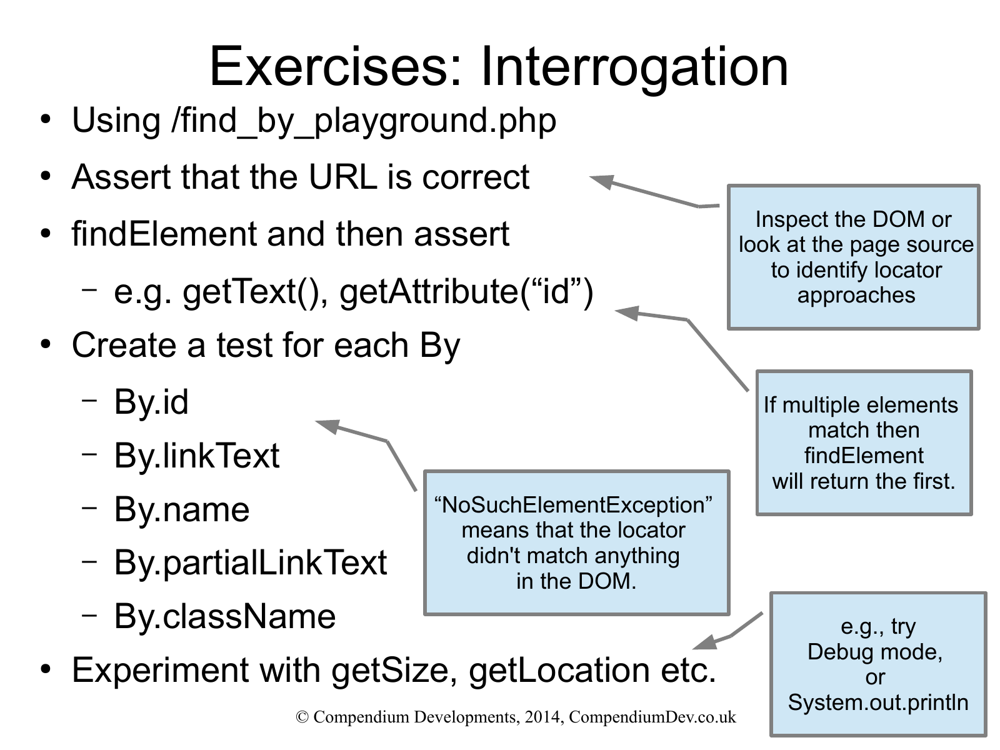

<!-- footer: © Compendium Developments, 2014, CompendiumDev.co.uk -->

<!-- Slide 1 -->

# Hands On WebDriver: Training Exercises For One Day

Alan Richardson

@eviltester

<http://compendiumdev.co.uk/contact>

www.SeleniumSimplified.com

www.EvilTester.com

www.CompendiumDev.co.uk

www.JavaForTesters.com

---

<!-- Slide 2 -->

# Alan Richardson - Blogs, Books, and Courses

Blogs and Websites

- CompendiumDev.co.uk
- SeleniumSimplified.com
- EvilTester.com
- JavaForTesters.com
- Twitter: @eviltester

Online Training Courses

- Technical Web Testing 101
- Intro to Selenium
- Selenium 2 WebDriver API

Videos

youtube.com/user/EviltesterVideos

Books

Selenium Simplified

Java For Testers

leanpub.com/javaForTesters

Alan Richardson

uk.linkedin.com/in/eviltester

Independent Test Consultant &amp; Custom Training

Contact Alan

<http://compendiumdev.co.uk/contact>


---

<!-- Slide 3 -->

# Exercises

---

<!-- Slide 4 -->

# Exercises: My First Test

1. Create the Class and Test for “My First Extended Test”

- <http://seleniumsimplified.com/testpages/basic_web_page.html>
    - Get Page, Check Title, Find para1, Check Text

2. Find paragraph 1 using the Class Name "main"
3. Find paragraph 1 and check that getAttribute can return the class name correctly
4. Find all the paragraphs and check that there are 2 of them

---

<!-- Slide 5 -->

# Exercises: My First Test .cont

5. Check that find element when the By would match multiple elements e.g. By.tagName("p") returns the first one

6. Check that findElement, when it can't find anything, throws an exception e.g. By.id("missing")

- What type of exception is thrown?
- What happens to the test?

7. Check that findElements, when it can't find anything, returns an empty collection and does not throw an exception

---

<!-- Slide 6 -->

# Exercises: Hamcrest

- Instead of Assert.assertTrue use
    - assertThat(&lt;condition&gt;, is(true));
- Instead of Assert.assertEquals use
    - assertThat(&lt;value&gt;, equalTo(&lt;value&gt;));
    - assertThat(&lt;value&gt;, is(&lt;value&gt;));

---

<!-- Slide 7 -->

# Exercises: JUnit

- Move the driver creation and quit into @BeforeClass and @AfterClass
- Move the driver.get into @Before, and driver.close into @After
- What happens to the tests now?
- What happens when a test throws an exception now?

---

<!-- Slide 8 -->

# Exercises: Navigation

- Use the URLs in the table
    - navigate() .to(), .forward(), back(), .refresh()
    - Assert on titles to check navigation worked
- <http://seleniumsimplified.com/testpages>

| File Path | Title |
| --- | --- |
| / | "Selenium Test Pages" |
| /search.php | "Selenium Simplified Search Engine" |
| /basic\_html\_form.html | "HTML Form Elements" |
| /basic\_web\_page.html | "Basic Web Page Title" |
| /refresh.php | "Refreshed Page on ([0-9]{10})" |

---

<!-- Slide 9 -->

# Exercises: Interrogation



- Using /find\_by\_playground.php
- Assert that the URL is correct
- findElement and then assert
    - e.g. getText(), getAttribute(“id”)
- Create a test for each By
    - By.id
    - By.linkText
    - By.name
    - By.partialLinkText
    - By.className
- Experiment with getSize, getLocation etc.

“NoSuchElementException” means that the locator didn't match anything in the DOM.

Inspect the DOM or look at the page source to identify locator approaches

If multiple elements match then findElement will return the first.

e.g., try Debug mode, or System.out.println

---

<!-- Slide 10 -->

# Exercises: Manipulation

1. Submit form and assert page title changes
2. Clear, then type comments, submit form and check output
3. Submit form with radio 2 selected
4. Submit form with only checkbox 1 selected

Using http://seleniumsimplified.com/testpages/basic\_html\_form.html

You might need to run these tests in 'debug' mode, because we have not covered synchronisation yet.

Or after creating the driver, add:

driver.manage().timeouts().implicitlyWait(10, TimeUnit.SECONDS);

---

<!-- Slide 11 -->

# Exercises: Manipulation Bonus

- testpages/basic\_ajax.html
- Manually, select “server”, select “java”, submit, check submitted details
- automate with .click and previous interrogation learning
- Run in Debug Mode

---

<!-- Slide 12 -->

# Exercises: Locators - CSS &amp; XPath

---

<!-- Slide 13 -->

# Manual Locator Exercises

Use FirePath to experiment with CSS &amp; Xpath Selectors on /testpages/find\_by\_playground.php

- Select All links
- Select all the anchors
- Select the 13th Link
- Experiment

---

<!-- Slide 14 -->

# CSS Basic Exercises

- Use By.cssSelector as replacement for
    - By.id, By.name, By.className, By.tagName

- Create test first using By.id (etc.)
- Check test works
- Replace By.id (etc.) with By.cssSelector
- Optionally – repeat above for xpath

| Replace | Assert |
| --- | --- |
| By.id(“p31”) | getAttribute(“name”) == “pName31” |
| By.name(“ulName1”) | getAttribute(“id”) == “ul1” |
| By.className(“specialDiv”) | getAttribute(“id”) == “div1” |
| By.tagName(“li”) | getAttribute(“name”) == “liName1” |

---

<!-- Slide 15 -->

# Exercises: Synchronisation

- Run the test FixFailingTest.java in debug mode and check it works when you step through slowly
- Run it as a test and it fails
- Fix by increasing implicit wait time
- Set implicit wait time to 0 and fix by Adding Synchronisation code using the ExpectedConditions class so that the test runs
- There is more than one way to do this. When you have one approach try and find at least one more (the answers show 4 ways to do this)

---

<!-- Slide 16 -->

# Exercises: Synchronisation (Bonus)

- Create a custom expected condition to fix the test
    - Inline with anonymous function
    - Using a private method that returns an ExpectedCondition
    - Using a custom ExpectedCondition class

---

<!-- Slide 17 -->

# Exercises: Page Objects

- Using a Fixed Ajax Test as a basis, create a Page Object for the basic\_ajax page and use that in the tests.
- Create a version of the page object that uses the Page Factory
- Make the results page a SlowLoadableComponent based Page Object

---

<!-- Slide 18 -->

# Optional Exercises

- Refactor existing tests to use Page Objects
- Refactor tests so urls are in a single object e.g. Site.BASE\_URL
- Use the “Select” support class for the Ajax tests
- Add Synchronisation to the Manipulation Test
- Run tests using a different browser
- Use the other pages in /testpages and create Page Objects and tests to handle the functionality on the test pages
    - e.g. cookies, alerts, submit forms
- Create a Driver class which lets you configure browsers in a single location

Answers are not provided for these – work through these at your own pace

---

<!-- Slide 19 -->

# Answers

When no answer section exists then see the sample code

---

<!-- Slide 20 -->

# Answers: My First Test

1. ` See code on original slide `
2. ` WebElement para1 = driver.findElement(By.className("main")); `
3. ` Assert.assertTrue( para1.getAttribute("class").equals("main")); `
4. ` Assert.assertEquals( driver.findElements(By.tagName("p")).size(), 2); `
5. ` Assert.assertTrue(driver.findElement(By.tagName("p")). getAttribute("id").equals("para1")); `
6. ` WebElement missing = driver.findElement(By.id("missing")); `

- ` NoSuchElementException `
- ` leaves browser open `

7. ` Assert.assertEquals(driver.findElements( By.id("missing")).size(),0); `

---

<!-- Slide 21 -->

# Answers: Hamcrest

- Import from hamcrest matchers

```java
import static org.hamcrest.MatcherAssert.assertThat;
import static org.hamcrest.Matchers.equalTo;
import static org.hamcrest.Matchers.is;
```

```java
AssertThat(
	driver.getTitle().equals("Basic Web Page Title"), is(true));
assertThat(driver.getTitle(), equalTo("Basic Web Page Title"));
assertThat(driver.getTitle(), is("Basic Web Page Title"));
```

---

<!-- Slide 22 -->

# Answers: JUnit

- Static required for class level methods
- Tests now focus on assertions and actions, not setup
- Failing tests don't leave browsers open
- Easier now to create new tests instead of expanding existing

```java
static WebDriver driver;
final String PAGE_URL = "http://seleniumsimplified.com/testpages/basic_web_page.html";

@BeforeClass
public static void createDriver(){
    driver = new FirefoxDriver();
}

@Before
public void gotoPage(){
    driver.get(PAGE_URL);
}
```

```java
@After
public void closePage(){
    driver.close();
}

@AfterClass
public static void closeBrowser(){
    driver.quit();
}
```

---

<!-- Slide 23 -->

# Answers: Manual CSS Selectors

- a[href]
- a[name^="p"]
- #div18 ul li:nth-child(13) a

---

<!-- Slide 24 -->

# Answers: Manual XPath Selectors

- //a[@href]
- //a[not(@href)]
    - Or
    - //a[starts-with(@name,"p")]
- (//a[@href])[13]

---

<!-- Slide 25 -->

# Answers: CSS Basic Exercises

- I have two sets of sample answers because there are so many ways of fulfilling the result
    - FindByCSSSelectorBasicExercisesTest
    - FindByCSSSelectorBasicExercisesFullAnswersTest

---

<!-- Slide 26 -->

# Answers: Synchronisation

- Full answers in the code. Hint: prior to 2nd select

- And you might need to wait for the results to be ready

```java
new WebDriverWait(driver,10).until(
                ExpectedConditions.invisibilityOfElementLocated(
                        By.id("ajaxBusy")));
```

```java
       new WebDriverWait(driver,10).until(
                ExpectedConditions.presenceOfElementLocated(
                        By.cssSelector("option[value='23']")));
```

```java
        new WebDriverWait(driver,10).until(
                ExpectedConditions.visibilityOfElementLocated(
                        By.cssSelector("option[value='23']")));
```

```java
        new WebDriverWait(driver,10).until(
                ExpectedConditions.elementToBeClickable(
                        By.cssSelector("option[value='23']")));
```

---

<!-- Slide 27 -->

# Alan Richardson - Blogs, Books, and Courses

Blogs and Websites

- CompendiumDev.co.uk
- SeleniumSimplified.com
- EvilTester.com
- JavaForTesters.com
- Twitter: @eviltester

Online Training Courses

- Technical Web Testing 101
- Intro to Selenium
- Selenium 2 WebDriver API

Videos

youtube.com/user/EviltesterVideos

Books

Selenium Simplified

Java For Testers

leanpub.com/javaForTesters

Alan Richardson

uk.linkedin.com/in/eviltester

Independent Test Consultant &amp; Custom Training

Contact Alan

<http://compendiumdev.co.uk/contact>


