<!-- footer: © Compendium Developments, 2014, CompendiumDev.co.uk -->

<!-- Slide 1 -->

# Hands On WebDriver: Training One Day

Alan Richardson

@eviltester

<http://www.compendiumdev.co.uk/contact>

www.SeleniumSimplified.com

www.EvilTester.com

www.CompendiumDev.co.uk

www.JavaForTesters.com

---

<!-- Slide 2 -->

# Materials &amp; Code etc.

- Main Slides
- Exercise Slides
- Link to Source Code Repo
- Link to test pages

\+ Discount on Online Selenium 2 WebDriver with Java Training course – discount ends 30th June

---

<!-- Slide 3 -->

# Alan Richardson - Blogs, Books, and Courses

Blogs and Websites

- CompendiumDev.co.uk
- SeleniumSimplified.com
- EvilTester.com
- JavaForTesters.com
- Twitter: @eviltester

Online Training Courses

- Technical Web Testing 101
- Intro to Selenium
- Selenium 2 WebDriver API

Videos

youtube.com/user/EviltesterVideos

Books

Selenium Simplified

Java For Testers

leanpub.com/javaForTesters

Alan Richardson

uk.linkedin.com/in/eviltester

Independent Test Consultant &amp; Custom Training

Contact Alan

<http://compendiumdev.co.uk/contact>


---

<!-- Slide 4 -->

# Overview

- Hints and Tips
- Installation
- Basic WebDriver API capabilities
- Simple interrogation and navigation
- Synchronization strategies
- AJAX applications.
- Tools
- Location strategies using CSS and XPath.
- Introduction to abstraction approaches

---

<!-- Slide 5 -->

# Approach

- Presentation
- Demos
- Exercises
    - Multiple Tracks depending on your level

---

<!-- Slide 6 -->

# Status Check

- Java Experience?
- Automation Experience?
- Selenium Experience?
- WebDriver Experience?

---

<!-- Slide 7 -->

# Introduction &amp; Overview

---

<!-- Slide 8 -->

# Ancient History

- Selenium 1.0
    - Javascript through a proxy
    - Flat API “selenium.”
    - Server based
- WebDriver
    - Object Oriented API, Interface which each driver implements
    - Driver calls browser directly
    - Has a server component Remote WebDriver

---

<!-- Slide 9 -->

# Installation

- Java SDK
- Maven
- IntelliJ IDE
- Firefox
- FirePath plugin

seleniumsimplified.com/get-started/

---

<!-- Slide 10 -->

# What is Maven?

- A build tool
- Dependency Management
- Standard Folder Structure
- Java project tasks simpler
    - mvn clean compile
    - mvn package
    - mvn test
- <http://maven.apache.org>

---

<!-- Slide 11 -->

# pom.xml

```xml
    <dependencies>
        <dependency>
            <groupId>org.hamcrest</groupId>
            <artifactId>hamcrest-all</artifactId>
            <version>1.3</version>
        </dependency>
        <dependency>
            <groupId>junit</groupId>
            <artifactId>junit</artifactId>
            <version>4.11</version>
        </dependency>
        <dependency>
            <groupId>org.seleniumhq.selenium</groupId>
            <artifactId>selenium-server</artifactId>
            <version>2.40.0</version>
        </dependency>
    </dependencies>
```

---

<!-- Slide 12 -->

# Java Language Levels

- Set in IntelliJ Project Settings
- And in the pom.xml

```xml
    <!-- I have added the build section to support importing into
     IntelliJ automatically without throwing errors about wrong Java
     Version. This basically says the source requires at least Java 1.7
     and use a compiler that outputs Java 1.7 -->
    <build>
        <plugins>
            <plugin>
                <groupId>org.apache.maven.plugins</groupId>
                <artifactId>maven-compiler-plugin</artifactId>
                <version>3.1</version>
                <configuration>
                    <source>1.7</source>
                    <target>1.7</target>
                    <encoding>UTF-8</encoding>
                </configuration>
            </plugin>
        </plugins>
    </build>
```

---

<!-- Slide 13 -->

# Benefits of Maven

- Standard directory structure
- Supported by Selenium and some of the drivers
- Easy to update and install
- Simple to add to Continuous Integration
    - “mvn test”

---

<!-- Slide 14 -->

# MyFirstTest.java

```java
package com.eviltester.webdriver;

import org.junit.Assert;
import org.junit.Test;
import org.openqa.selenium.WebDriver;
import org.openqa.selenium.firefox.FirefoxDriver;

public class MyFirstTest {

 @Test
 public void startWebDriver(){

   WebDriver driver = new FirefoxDriver();
   driver.navigate().to("http://seleniumsimplified.com");

   Assert.assertTrue("Expected Selenium Simplified",
                     driver.getTitle().
                            startsWith("Selenium Simplified"));

   driver.close();
   driver.quit();
 }
}
```

---

<!-- Slide 15 -->

# Recommended Applications For Exercises Overview

- Beginner: Selenium Test Pages
    - <https://github.com/eviltester/seleniumTestPages>
    - <http://seleniumsimplified.com/testpages/>
- Intermediate:
    - <http://todomvc.com/>
- Advanced
    - <http://google-gruyere.appspot.com/>
    - <http://demo.redmine.org/>

---

<!-- Slide 16 -->

# Source Code For Examples etc.

- <https://xp-dev.com/>
    - svn/HandsOnWebDriverOneDayCourseJava/trunk
- <http://compendiumdev.co.uk/>
    - files/conferences/se2014/handson20140504.zip

<https://xp-dev.com/svn/HandsOnWebDriverOneDayCourseJava/trunk/>

<http://compendiumdev.co.uk/files/conferences/se2014/handson20140504.zip>

---

<!-- Slide 17 -->

# Alan Richardson - Blogs, Books, and Courses

Section: WebDriver is an API

---

<!-- Slide 18 -->

# API Overview

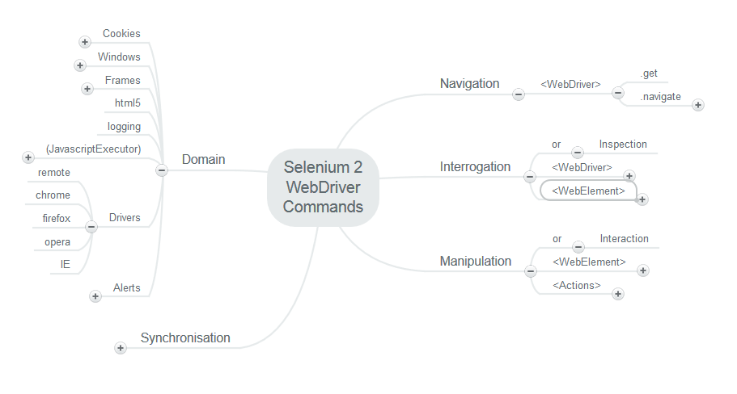

<http://www.mindmeister.com/280141421/selenium-2-webdriver-commands>

---

<!-- Slide 19 -->

# Basic Knowledge

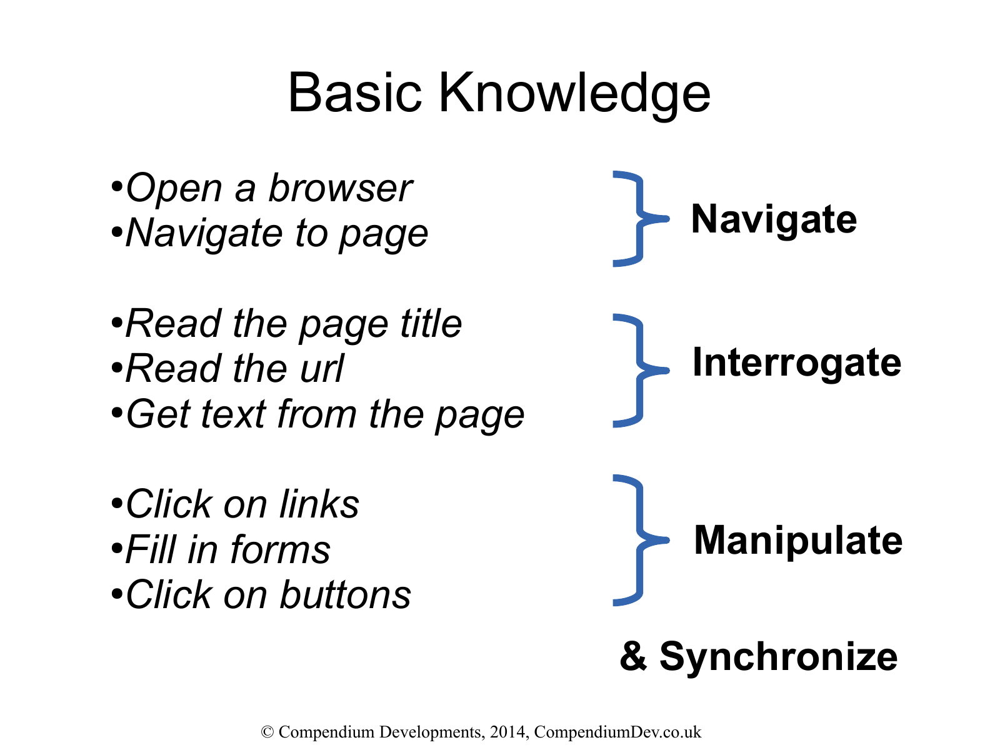

- Open a browser
- Navigate to page

- Read the page title
- Read the url
- Get text from the page

- Click on links
- Fill in forms
- Click on buttons

Navigate

Interrogate

Manipulate

&amp; Synchronize

---

<!-- Slide 20 -->

# WebDriver Basics

- WebDriver
    - Think of the driver as the browser
    - Interface with implementations – FirefoxDriver, ChromeDriver etc.
    - High Level commands
        - get, getTitle, getCurrentUrl, close, quit
    - Functional Groupings
        - Navigate, Manage
    - Locate
        - FindElement, FindElements

---

<!-- Slide 21 -->

# WebElement Basics

- The DOM elements
    - &lt;a&gt;, &lt;p&gt;, &lt;ul&gt;, etc.
- Found By.Id, By.Name, etc.
- Interrogate
    - .getAttribute, .getValue, isEnabled etc.
- Manipulate
    - SendKeys, click, etc.

---

<!-- Slide 22 -->

# JUnit Basics

- Test Execution Framework
- @Test
    - Annotate a method with @Test
- Can Run @Test methods from the IDE
- Use Assertions to check results
    - Assert.assertTrue(true);
    - Assert.assertEquals(1+1, 2);

---

<!-- Slide 23 -->

# WebDriver API Learning Tips

- Use Code Completion (ctrl+space)
- ctrl+Q for Documentation of Commands (ctrl+j on mac)
- ctrl+click to view the actual WebDriver code (cmd+click on mac)
- AutoScroll

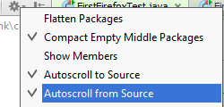

---

<!-- Slide 24 -->

# IntelliJ Navigation Shortcut Keys

- Find Symbol
    - Shift + Cntrl + Alt + N
- Find Class
    - Cntrl + N
- Find File
    - Shift + Cntrl + N
    - on mac use Cmd instead of Cntrl

---

<!-- Slide 25 -->

# Browser Tools Overview

- Firefox
    - Inspect
    - Inspect with Firebug
        - FirePath
- Chrome Inspect

---

<!-- Slide 26 -->

# Alan Richardson - Blogs, Books, and Courses

Section: My First Test

---

<!-- Slide 27 -->

# Demo

- <http://seleniumsimplified.com/testpages/basic_web_page.html>
    - Get Page, Check Title, Find para1, Check Text
- How to run a test Class
- How to run a test method
- How to set a breakpoint
- How to debug a test Method
- How to use evaluate

---

<!-- Slide 28 -->

# MyFirstExtendedTest.java

```java
@Test
public void getBasicPageAndCheckDetails(){

  WebDriver driver = new FirefoxDriver();

  driver.get(
    "http://seleniumsimplified.com/testpages/basic_web_page.html"
        );

  Assert.assertTrue("Expected Different Title",
                    driver.getTitle().
                            equals("Basic Web Page Title"));

  WebElement para1 = driver.findElement(By.id("para1"));
  Assert.assertTrue(
                "A paragraph of text".equals(para1.getText()));

  driver.close();
  driver.quit();
}
```

---

<!-- Slide 29 -->

# Used WebDriver API Summary

- WebDriver driver = new FirefoxDriver();
    - Create a new instance of a driver and browser
- driver.get(aURL);
    - Open a web page in the browser
- findElement, By.id, By.name
    - WebElement element = driver.findElement(By.id(“anid));
    - Find a WebElement using id or name attribute,
    - findElement can be chained

- driver.getTitle()
    - Get the title of the current page
- driver.close(), driver.quit()
    - Close the current browser window,
    - quit the browser and driver

- Junit Used
    - @Test
    - Assert.assertTrue
    - Assert.assertEquals

---

<!-- Slide 30 -->

# My First Test Exercises

---

<!-- Slide 31 -->

# IntelliJ &amp; JUnit

---

<!-- Slide 32 -->

# Java &amp; Maven Summary

- Packages organise the Java classes
- Java Classes Start with Uppercase letters
- Methods start with lowercase letters
- Add tests in the src/test/java folder hierarchy
- Add Test into the class name to automatically run from maven as a test
- Import classes from other packages to use them
- Code completion helps, be careful what you import

---

<!-- Slide 33 -->

# Basics

- Use code completion as much as possible
- Learn short cut keys
- Remove any code syntax errors as fast as possible because they interfere with code completion

---

<!-- Slide 34 -->

# IntelliJ Evaluate Expression

- In Debug mode use Evaluate to experiment with code constructs in situ.
    - e.g. when writing xpath findElements code
- Can sometimes recompile and hot swap the code into the running debug session.

---

<!-- Slide 35 -->

# JUnit @Before, @After

- @BeforeClass,
    - Run once before any @Test in the class is run
    - static
- @AfterClass
    - Run once after all @Test in the class have run
    - static
- @Before,
    - Run before each @Test
- @After
    - Run after each @Test

---

<!-- Slide 36 -->

# Hamcrest Summary

- Create readable assertions
- assertThat( actual, is(expected value));
    - Check that an actual value is as expected
- Look at the code to see what methods are available:
    - is, not, greaterThan, lessThan, endsWith, startsWith, containsString, etc.
- Read the docs
- <http://code.google.com/p/hamcrest/wiki/Tutorial#A_tour_of_common_matchers>

---

<!-- Slide 37 -->

# Hamcrest Matchers CheatSheet

- is
- not
- Number
    - greaterThan,
    - greaterThanOrEqualTo,
    - lessThan,
    - lessThanOrEqualTo - test ordering
- Text
    - equalToIgnoringCase
    - equalToIgnoringWhiteSpace
    - containsString,
    - endsWith,
    - startsWith

- Collections
    - hasEntry,
    - hasKey,
    - hasValue - test a map contains an entry, key or value
    - hasItem,
    - hasItems - test a collection contains elements
    - hasItemInArray - test an array contains an element
- notNullValue,
- nullValue - test for null

<http://code.google.com/p/hamcrest/wiki/Tutorial#A_tour_of_common_matchers>

e.g. assertThat(driver.getTitle(), is(not(“bob”));

---

<!-- Slide 38 -->

# Hamcrest &amp; JUnit Exercises

---

<!-- Slide 39 -->

# Navigation &amp; Interrogation

---

<!-- Slide 40 -->

# WebDriver

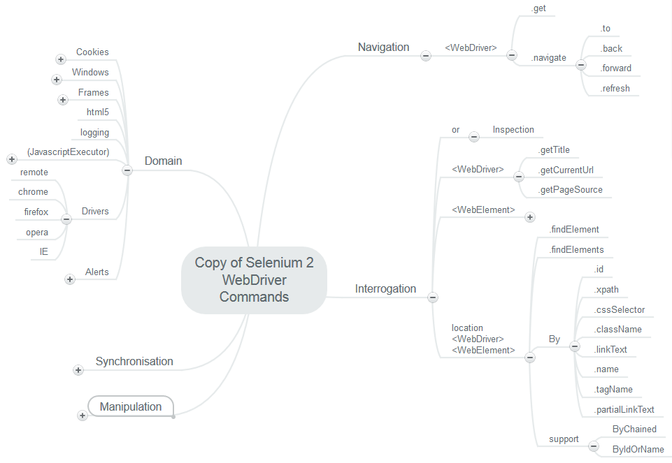

---

<!-- Slide 41 -->

# Navigation Annotated

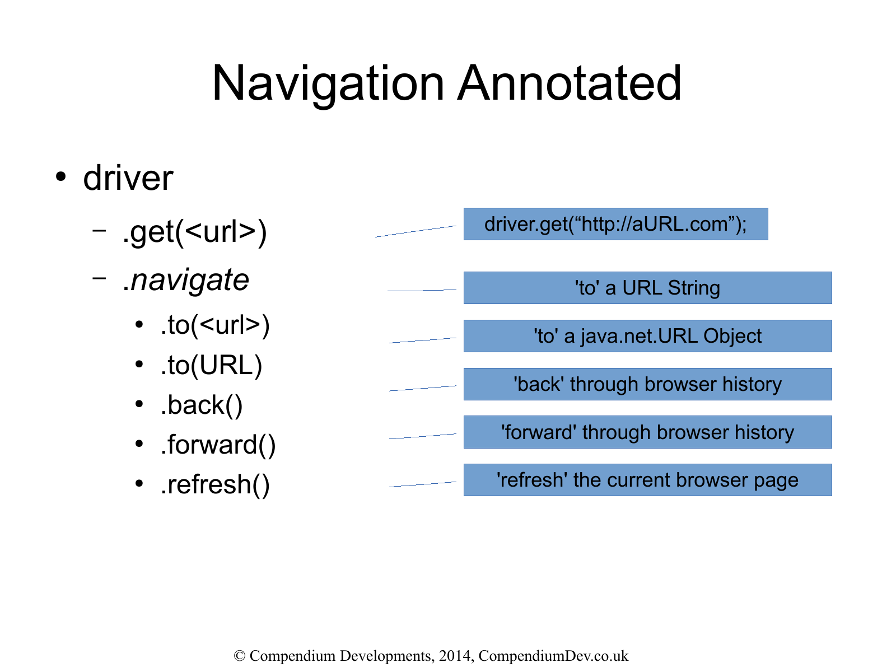

- driver
    - .get(&lt;url&gt;)
    - .navigate
        - .to(&lt;url&gt;)
        - .to(URL)
        - .back()
        - .forward()
        - .refresh()

driver.get(“http://aURL.com”);

'to' a URL String

'to' a java.net.URL Object

'back' through browser history

'forward' through browser history

'refresh' the current browser page

---

<!-- Slide 42 -->

# Driver level Interrogation Methods

- driver
    - .getTitle()

- .getCurrentUrl()

- .getPageSource()

All return String.

Pretty obvious what each method does.

Be wary of using getPageSource it may not return what you expect.

---

<!-- Slide 43 -->

# Be Careful with getPageSource

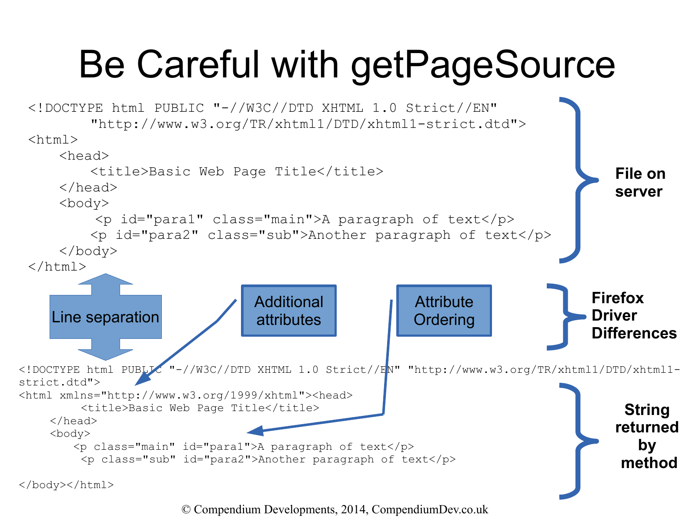

```html
<!DOCTYPE html PUBLIC "-//W3C//DTD XHTML 1.0 Strict//EN"
        "http://www.w3.org/TR/xhtml1/DTD/xhtml1-strict.dtd">
<html>
    <head>
        <title>Basic Web Page Title</title>
    </head>
    <body>
        <p id="para1" class="main">A paragraph of text</p>
        <p id="para2" class="sub">Another paragraph of text</p>
    </body>
</html>
```

```html
<!DOCTYPE html PUBLIC "-//W3C//DTD XHTML 1.0 Strict//EN" "http://www.w3.org/TR/xhtml1/DTD/xhtml1-strict.dtd">
<html xmlns="http://www.w3.org/1999/xhtml"><head>
        <title>Basic Web Page Title</title>
    </head>
    <body>
        <p class="main" id="para1">A paragraph of text</p>
        <p class="sub" id="para2">Another paragraph of text</p>

</body></html>
```

File on

server

String

returned

by

method

Line separation

Firefox

Driver

Differences

Additional

attributes

Attribute

Ordering

---

<!-- Slide 44 -->

# Driver .findElement(By)

- By.id
- By.xpath
- By.cssSelector
- By.className
- By.linkText
- By.name
- By.tagName
- By.partialLinkText

We find an element By using a locator strategy.

e.g. by using the id, by evaluating an xpath expression, by executing a css selector, etc.

```java
driver.findElement(By.id("para1"))
```

---

<!-- Slide 45 -->

# .findElements

- .findElement only returns 1 WebElement
- When a By can return more elements then .findElement returns the first in the list
- .findElements does not throw an exception if it can't match anything, it returns an empty list

- .findElements returns the full list of matching WebElements
    - e.g. driver.findElements(By.className(“normal”));

---

<!-- Slide 46 -->

# Chaining .findElement (s)

findElement(By.id(“.”)).findElement(By.name(“.”))

e.g.

```java
WebElement element = driver.findElement(By.id("div1")).
                            findElement(By.name("pName3")).
                            findElement(By.tagName("a"));
```

- Can use any By locator strategy

- Cannot Chain .findElements() as it returns a List of Web Elements

List&lt;WebElement&gt;

---

<!-- Slide 47 -->

# Chaining with ByChained

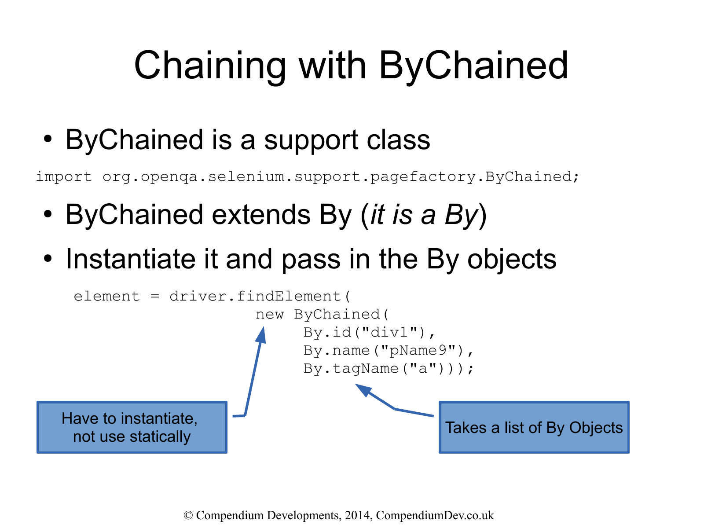

- ByChained is a support class

import org.openqa.selenium.support.pagefactory.ByChained;

- ByChained extends By (it is a By)
- Instantiate it and pass in the By objects

element = driver.findElement( new ByChained( By.id("div1"), By.name("pName9"), By.tagName("a")));

Takes a list of By Objects

Have to instantiate, not use statically

---

<!-- Slide 48 -->

# Other By Support Classes

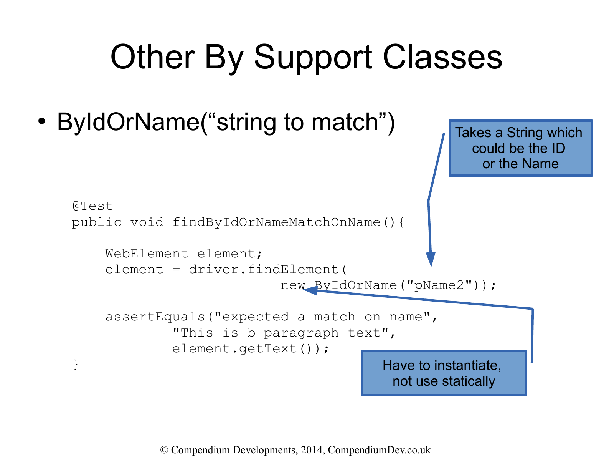

- ByIdOrName(“string to match”)

```java
    @Test
    public void findByIdOrNameMatchOnName(){

        WebElement element;
        element = driver.findElement(
                             new ByIdOrName("pName2"));

        assertEquals("expected a match on name",
                "This is b paragraph text",
                element.getText());
    }
```

Takes a String which

could be the ID

or the Name

Have to instantiate, not use statically

---

<!-- Slide 49 -->

# Basic WebElement API Summary

- WebElement, findElement,
    - WebElement element = driver.findElement(By.id(“anid));
    - Find a WebElement using id or name attribute,
    - findElement can be chained
- By.id, By.name
    - Locators to 'find' the elements

- element.sendKeys(“type this”);
    - Send keys to a web element to type something
- element.click()
- element.getText
    - Click on a web element
    - Get the text of the current element

---

<!-- Slide 50 -->

# WebElement

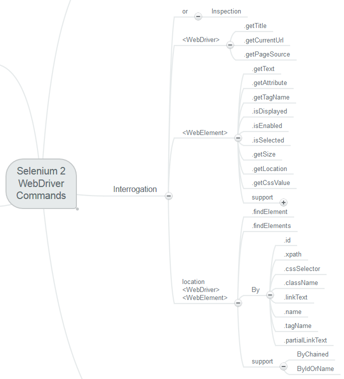

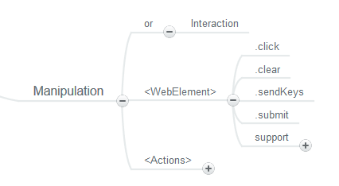

---

<!-- Slide 51 -->

# Dom Element Interrogation Approach

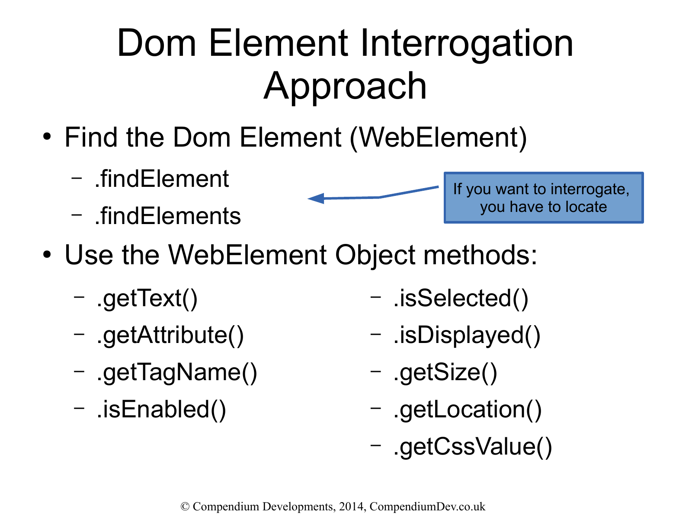

- Find the Dom Element (WebElement)
    - .findElement
    - .findElements
- Use the WebElement Object methods:

- .getText()
- .getAttribute()
- .getTagName()
- .isEnabled()

- .isSelected()
- .isDisplayed()
- .getSize()
- .getLocation()
- .getCssValue()

If you want to interrogate,

you have to locate

---

<!-- Slide 52 -->

# Does Navigation Require Synchronisation?

- Navigation blocks until the HTML of the page is loaded
- This does not mean the page is ready
    - for manipulation or
    - full interrogation
- Sometimes synchronisation is required on navigation

---

<!-- Slide 53 -->

# What about clicking?

- Normally we navigate by clicking:
    - on links
    - on buttons
    - by submitting forms
- This is navigation as a side-effect
    - It requires synchronisation
    - We will cover this later in Manipulation

---

<!-- Slide 54 -->

# Navigation &amp; Interrogation Exercises

---

<!-- Slide 55 -->

# Manipulation

---

<!-- Slide 56 -->

# WebElement Manipulation

- .click()
- .clear()
    - Clear a field
- .sendKeys(String) actually (CharSequence)
    - Sends the appropriate events to a WebElement keyup, keydown, etc.
    - Helper Keys class (org.openqa.selenium.Keys)
- .submit()
    - Submit a form

---

<!-- Slide 57 -->

# More on SendKeys

- Keys.chord to send Key Sequences
- Shift, CTRL etc start a modifier sequence
- Keys.NULL ends a modifier sequence

```java
aTextArea.sendKeys("this text", "and this text");

commentTextArea.sendKeys(
       Keys.chord(Keys.SHIFT, "bob", Keys.NULL, " Dobbs"));

assertEquals("BOB Dobbs", commentTextArea.getText())
```

---

<!-- Slide 58 -->

# SendKeys

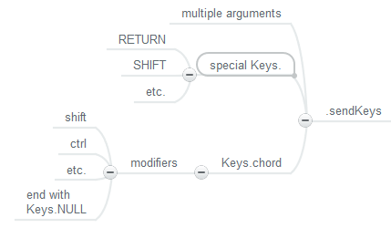

---

<!-- Slide 59 -->

# Manipulation Exercises

---

<!-- Slide 60 -->

# Location Strategies

---

<!-- Slide 61 -->

# Alan Richardson - Blogs, Books, and Courses

CSS Selectors


---

<!-- Slide 62 -->

# Useful Tools For CSS and XPath

- Firefox
    - Install FireBug and FirePath plugins
- Chrome
    - Developer tools are supposed to allow search using xpath or css (sometimes this breaks between releases)

---

<!-- Slide 63 -->

# CSS Selectors

- A CSS Selector matches a set of elements
- Used to style HTML from CSS Stylesheets
- Reused in Selenium to match DOM elements
- Useful References
    - <https://developer.mozilla.org/en-US/docs/CSS>
    - <http://reference.sitepoint.com/css/selectorref>
    - http://net.tutsplus.com/tutorials/html-css-techniques/ the-30-css-selectors-you-must-memorize/
    - <http://www.quirksmode.org/css/contents.html>
    - <http://www.w3schools.com/cssref/css_selectors.asp>
    - <http://css-tricks.com/attribute-selectors/>

---

<!-- Slide 64 -->

# Basics of CSS Selectors

- \*
    - match any element
- #id
    - match an id e.g. #p4
- .class
    - match a class e.g. “.normal”
- tag
    - match tags
- [attribute]
    - Match on the attribute name

---

<!-- Slide 65 -->

# CSS Attribute Matching

- tag[attribute^=”val”]
    - Partial match start of value
- tag[attribute$=”lue”]
    - Partial match end of value
- tag[attribute~=”value”]
    - Match on space separated values
- tag[a='val'], tag[b='val']
    - , is an 'or' grouping

- tag[attribute]
    - match tags with an attribute
- tag[attribute=”value”]
    - match tags with a specific attribute value
- tag[attr1='val1'][attr2='val2']
    - match tag using multiple attribute values
- tag[attribute\*=”alu”]
    - Partial match anywhere on value

---

<!-- Slide 66 -->

# CSS Selectors – Some Paths

- A &gt; B – B directly under A e.g. &lt;A&gt;&lt;B/&gt;&lt;/A&gt;
- A B – descendant
    - selectors separated by space i.e. “this then that”
    - Any degree of separation
    - e.g. “div li” would match but “div &gt; li” would not
- A + B – B siblings of an A
- B:first-child - every B which is first child of something
- B:nth-child(n) – the nth child of B e.g. n==3, 3rd
    - For more selectors see the references

---

<!-- Slide 67 -->

# By.cssSelector

- By.cssSelector(&lt;a css selector string&gt;)

```java
    @Test
    public void findElementsUsingCSSTag(){

        List<WebElement> elements;

        elements = driver.findElements(
                        By.cssSelector("p"));

        assertEquals("expected a different number",
                        41,
                        elements.size());
    }
```

---

<!-- Slide 68 -->

# CSS Selectors

- CSS Selectors are faster than Xpath
- CSS Selectors can't traverse back up the dom
- Try and use CSS Selectors by default for complicated selection queries

---

<!-- Slide 69 -->

# Exercise: Manual CSS Selectors

---

<!-- Slide 70 -->

# Alan Richardson - Blogs, Books, and Courses

XPath


---

<!-- Slide 71 -->

# XPath

- XML is an XML Query Language
- XPath is often slower than CSS
- XPath has more functions than CSS
- Xpath can navigate up and down the DOM
- References
    - <http://www.w3schools.com/xpath/>
    - <http://www.w3schools.com/xpath/xpath_functions.asp>

---

<!-- Slide 72 -->

# By.xpath

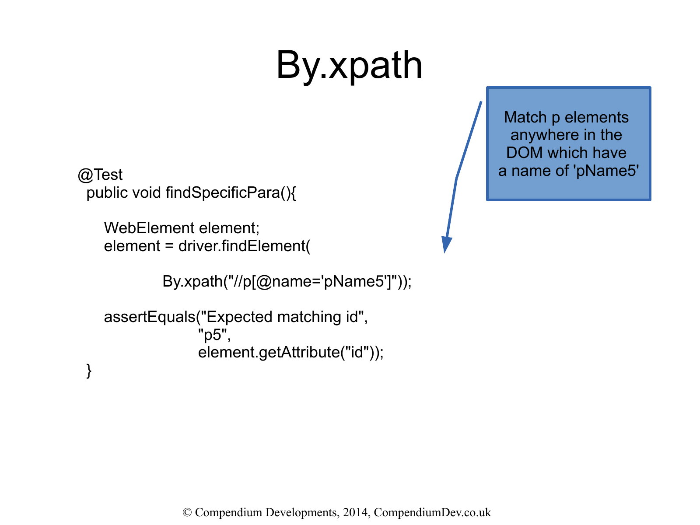

```java
  @Test
    public void findSpecificPara(){

        WebElement element;
        element = driver.findElement(

                    By.xpath("//p[@name='pName5']"));

        assertEquals("Expected matching id",
                         "p5",
                         element.getAttribute("id"));
    }
```

Match p elements anywhere in the DOM which have a name of 'pName5'

---

<!-- Slide 73 -->

# Xpath Selector Basics

- // - match anywhere
- / - match from root
- //\* - any element
- //tag – named element
- //\*[@attribute] – match if it has attribute
- //\*[@attribute='value'] – attribute with value
- . for content matching
- .. for traversing back up the path e.g. //div/p/a/..
- Operators: and, or etc
    - w3schools.com/xpath/xpath\_operators.asp
- Xpath functions e.g. contains, starts-with
    - w3schools.com/xpath/xpath\_functions.asp

---

<!-- Slide 74 -->

# Additional References

- Xpath, CSS Rosetta Stone
    - <http://www.simple-talk.com/dotnet/.net-framework/xpath,-css,-dom-and-selenium-the-rosetta-stone>
    - <http://bit.ly/RDJ3Wb>
- Note browsers tend to use Xpath 1.0

---

<!-- Slide 75 -->

# Chain XPath &amp; CSS in findElement

- Remember we can 'chain' findElement
    - elem.findElement(By.id('me')).findElement(By.id('this');
- You can use a combination of css selector and xpath selector
    - parentWebElement = webElementFoundByCSS.findElement(By.xpath(".."));
    - parentWebElement.findElements( By.cssSelector("div &gt; div"));

---

<!-- Slide 76 -->

# Exercise: Manual XPath Selectors

---

<!-- Slide 77 -->

# Exercise: CSS Basic Exercises

---

<!-- Slide 78 -->

# Synchronisation

---

<!-- Slide 79 -->

# Discussion

- Why wait?
- What conditions might you have waited for? e.g. visible... what else?
- Why wait for title instead of assert?
- Can we make the code cleaner?

---

<!-- Slide 80 -->

# Waiting Approaches

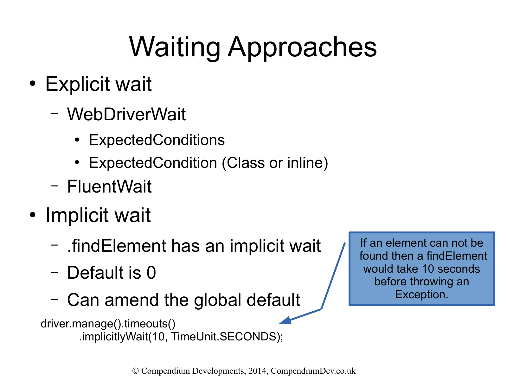

- Explicit wait
    - WebDriverWait
        - ExpectedConditions
        - ExpectedCondition (Class or inline)
    - FluentWait
- Implicit wait
    - .findElement has an implicit wait
    - Default is 0
    - Can amend the global default

```java
driver.manage().timeouts()
            .implicitlyWait(10, TimeUnit.SECONDS);
```

If an element can not be

found then a findElement

would take 10 seconds

before throwing an

Exception.

---

<!-- Slide 81 -->

# Implicit or Explicit?

- Implicit can make initial tests faster to write
    - you don't worry about synchronisation when writing tests
- It can be harder to add synchronisation later
    - You have to identify a source of intermittency
- If you start with implicit then you can expose synchronisation problems by gradually reducing the implicit wait time
- Can make tests increasingly slower
- Implicit can make test failures slower to report

---

<!-- Slide 82 -->

# Basic Synchronisation with ExpectedConditions

- Wait for the page to be in the correct state before working with it
    - Why? ElementNotFound exception
    - More robust across browsers
- WebDriverWait
    - A wait class which handles element not found exceptions
- ExpectedConditions
    - A class of static helper methods
    - e.g. new WebDriverWait(driver,10).until( ExpectedConditions.somecondition( By.id("user\_login")));

---

<!-- Slide 83 -->

# WebDriverWait Example

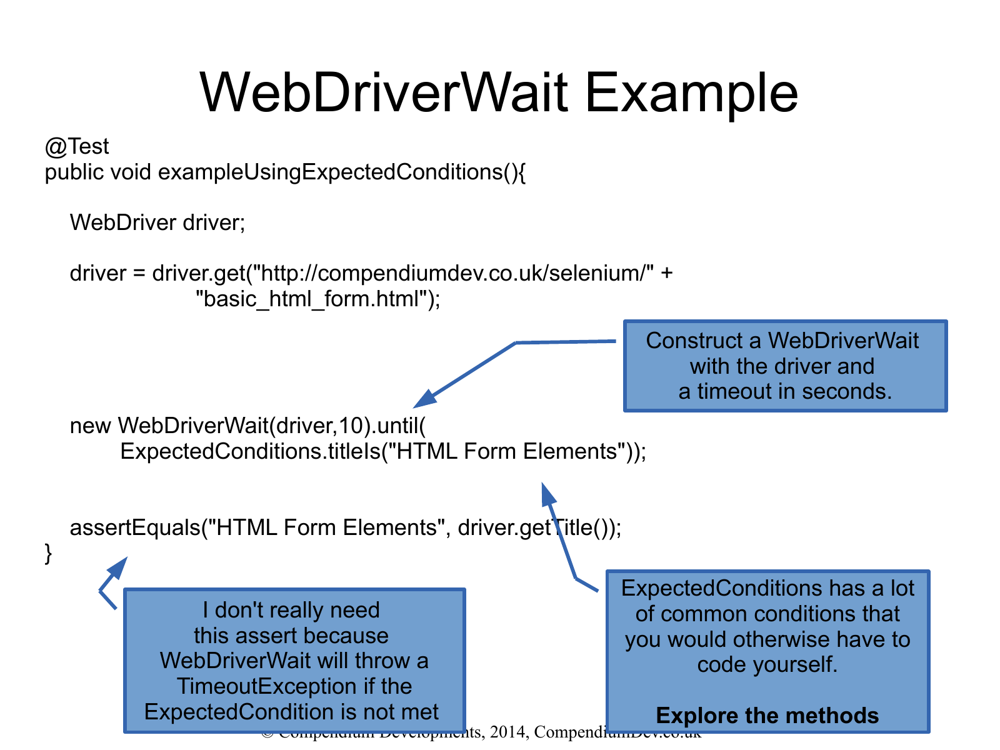

```java
@Test
public void exampleUsingExpectedConditions(){

    WebDriver driver;

    driver = driver.get("http://compendiumdev.co.uk/selenium/" +
                        "basic_html_form.html");


    new WebDriverWait(driver,10).until(
            ExpectedConditions.titleIs("HTML Form Elements"));


    assertEquals("HTML Form Elements", driver.getTitle());
}
```

I don't really need

this assert because

WebDriverWait will throw a

TimeoutException if the

ExpectedCondition is not met

Construct a WebDriverWait

with the driver and

a timeout in seconds.

ExpectedConditions has a lot

of common conditions that

you would otherwise have to

code yourself.

Explore the methods

---

<!-- Slide 84 -->

# Synchronisation API Summary

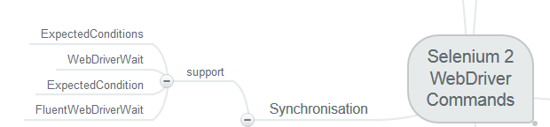

- new WebDriverWait(driver, seconds)
    - Create a wait class
- .until
    - Wait until a specific condition happens
    - until can return an element
- ExpectedConditions
    - A class of static helper wait methods for common scenarios


e.g.

- .titleIs(expectedValue)
    - True when title of page is expectedValue
- visibilityOfElementLocated
    - Returns an element when element located is visible

---

<!-- Slide 85 -->

# Alan Richardson - Blogs, Books, and Courses

Section:

Custom Expected Condition

---

<!-- Slide 86 -->

# Custom ExpectedCondition

```java
new WebDriverWait(driver,10).until(
        contextItemCountChanges(currentActionsForContext, "in tutorial"));
);
```

- Why?
    - ExpectedConditions doesn't have what you need
    - You want to make your tests read well for your usage scenario
    - You want to pass additional values to the apply method
- ... create a Custom ExpectedCondition

---

<!-- Slide 87 -->

# Custom ExpectedCondition Example

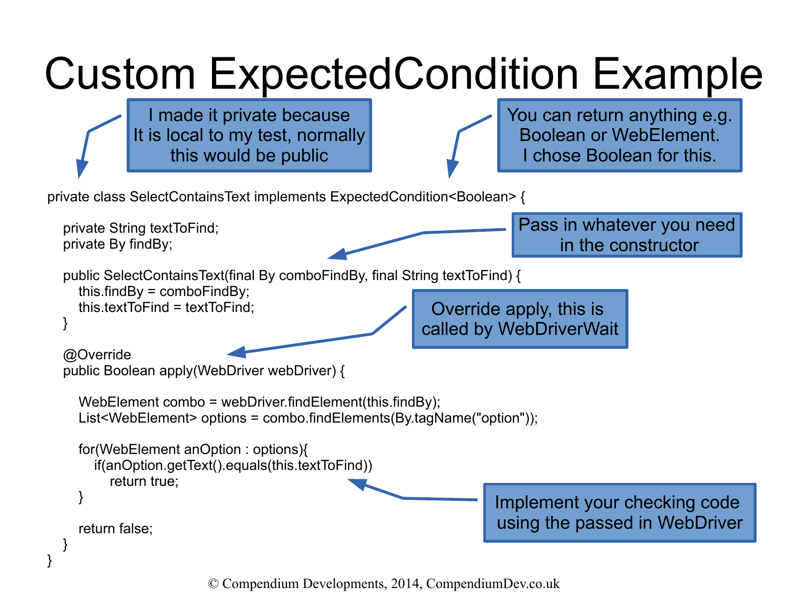

```java
    private class SelectContainsText implements ExpectedCondition<Boolean> {

        private String textToFind;
        private By findBy;

        public SelectContainsText(final By comboFindBy, final String textToFind) {
            this.findBy = comboFindBy;
            this.textToFind = textToFind;
        }

        @Override
        public Boolean apply(WebDriver webDriver) {

            WebElement combo = webDriver.findElement(this.findBy);
            List<WebElement> options = combo.findElements(By.tagName("option"));

            for(WebElement anOption : options){
                if(anOption.getText().equals(this.textToFind))
                    return true;
            }

            return false;
        }
    }
```

I made it private because

It is local to my test, normally

this would be public

You can return anything e.g.

Boolean or WebElement.

I chose Boolean for this.

Pass in whatever you need

in the constructor

Override apply, this is

called by WebDriverWait

Implement your checking code

using the passed in WebDriver

---

<!-- Slide 88 -->

# Adhoc Waits Created Inline Example

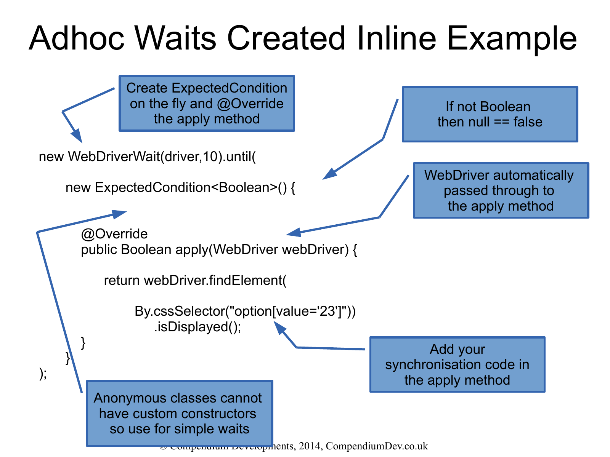

```java
new WebDriverWait(driver,10).until(
       new ExpectedCondition<Boolean>() {
           @Override
           public Boolean apply(WebDriver webDriver) {
                 return webDriver.findElement(
                         By.cssSelector("option[value='23']"))
                              .isDisplayed();
           }
       }
);
```

Create ExpectedCondition on the fly and @Override the apply method

WebDriver automatically passed through to the apply method

Add your

synchronisation code in the apply method

If not Boolean then null == false

Anonymous classes cannot have custom constructors so use for simple waits

---

<!-- Slide 89 -->

# Wrap Adhoc Wait in a method

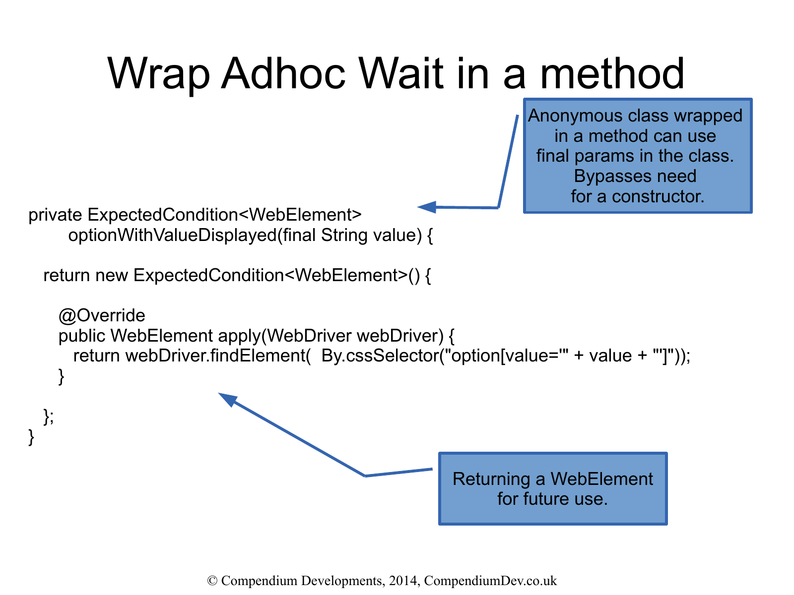

```java
private ExpectedCondition<WebElement>
        optionWithValueDisplayed(final String value) {

   return new ExpectedCondition<WebElement>() {

      @Override
      public WebElement apply(WebDriver webDriver) {
         return webDriver.findElement(  By.cssSelector("option[value='" + value + "']"));
      }

   };
}
```

Anonymous class wrapped

in a method can use

final params in the class.

Bypasses need

for a constructor.

Returning a WebElement

for future use.

---

<!-- Slide 90 -->

# Synchronisation Exercises

---

<!-- Slide 91 -->

# Abstraction

---

<!-- Slide 92 -->

# Abstraction Layers

- Abstraction Layers are
    - not a framework
    - contextual for an application, or an application framework
    - Essential for:
        - Maintenance
        - Speed of writing tests
        - Ease of understanding tests

---

<!-- Slide 93 -->

# Abstraction Layers Categorised

1. Data

- Generic Data Abstractions e.g. email, postcode

2. Physical

- Physical layout of your application e.g. pages, components
- Navigation across pages

3. Domain

- Your application Entities domain e.g. user, account

4. Logical

- User actions, workflows

---

<!-- Slide 94 -->

# Hints

- Create the test you want to see
    - Write the test as if the abstraction layers already existed
    - So you can:
        - See if it is readable, at the right level etc.
        - Use code completion to create classes (IntelliJ: Alt+Enter)

---

<!-- Slide 95 -->

# Page Objects?

- An abstraction around pages
    - Or page components
- Remove driver.xxxx from tests
- Model the physical domain
- Numerous ways of doing this
    - Page Factory
    - Extends LoadableComponent or SlowLoadableComponent
    - Basic objects
- Modelling Decisions Required

---

<!-- Slide 96 -->

# Example Test Using Page Object

```java
@Test
public void basicHtmlPageTest(){

    WebDriver driver = new FirefoxDriver();
    BasicHtmlPage page =
                                new BasicHtmlPage(driver);

    page.get();

    assertEquals(page.getParagraphOne(),
                        "A paragraph of text");
    assertEquals(page.getParagraphTwo(),
                        "Another paragraph of text");
}
```

---

<!-- Slide 97 -->

# Example Page Object

```java
public class BasicHtmlPage {
    private final WebDriver driver;
    private String paragraphTwo;

    public BasicHtmlPage(WebDriver driver) {
        this.driver = driver;
    }

    public void get() {
        driver.get(
"http://seleniumsimplified.com/testpages/basic_web_page.html");
    }

    public String getParagraphOne() {
        return driver.findElement(By.id("para1")).getText();
    }

    public String getParagraphTwo() {
        return driver.findElement(By.id("para2")).getText();
    }
}
```

---

<!-- Slide 98 -->

# Refactor to Page Object Heuristics

- Convert local abstractions to Page Abstractions
- Replace comments with abstractions
- Make Decisions about the model based on the test readability and method reuse
- Build only what you need as you need it

---

<!-- Slide 99 -->

# Page Object Heuristics

- Construct the page object with a WebDriver
- Limit the methods to physical actions
- Expose Constants as public static final
- Don't navigate to the page in the constructor, either use a navigation object or a get() method

---

<!-- Slide 100 -->

# Page Object Factory

- Annotate WebElements with @FindBy

@FindBy(how= How.ID, using="combo1") private WebElement aComboElement;

- Initialise the annotated WebElement(s) using a PageFactory

```java
    public BasicAjaxPageObject(WebDriver webDriver) {
        driver = webDriver;
        PageFactory.initElements(driver, this);
    }
```

---

<!-- Slide 101 -->

# Slow Loadable Component

- If our page objects extend SlowLoadableComponent then we have an interface for 'waiting' for free
- Instead of:

```java
       TracksDashboardHomePage dashboard =
          new TracksDashboardHomePage(driver);
```

new WebDriverWait(driver,10).until( ExpectedConditions.titleIs( dashboard.EXPECTED\_TITLE));

- We have to do:

```java
TracksDashboardHomePage dashboard =
          new TracksDashboardHomePage(driver);
```

dashboard.get();

---

<!-- Slide 102 -->

# SlowLoadableComponent

- Public interface
    - get()
        - loads and waits for component to be available

extends SlowLoadableComponent&lt;PageObjectClassName&gt;

- Call super constructor in constructor

```java
    public PageObjectClassName(WebDriver driver) {
        super(new SystemClock(), 10);
        this.driver = driver;
    }
```

- Implement load and isLoaded
    - isLoaded throws a new Error if not loaded
    - I often leave the 'load' part empty if I navigate to the page

---

<!-- Slide 103 -->

# Why do this?

- Synchronise on load
    - Page Load – don't do anything until page is loaded
    - Component Load – so we don't try to engage with the component until it is loaded
    - Get in the habit of synchronising
    - Interface makes it easy to extend
    - 'forced' to think about synchronisation
    - Encourages more comprehensive checks on 'ready'
- No impact
    - If we don't call .get() we don't trigger the wait

---

<!-- Slide 104 -->

# Summary

- Page Objects can be POJO
- Domain Objects are POJO
- Create abstraction layers
- Write failing code and use code completion
- Never add asserts into your abstraction layer
- Write methods so they read as native language
- Refactor in small increments
- Keep refactoring

---

<!-- Slide 105 -->

# Page Object Exercises

---

<!-- Slide 106 -->

# Bonus Sections

---

<!-- Slide 107 -->

# Support Classes as Abstractions

Examine the WebDriver source code for examples to build on.

- Select
- ExpectedConditions

---

<!-- Slide 108 -->

# Alerts

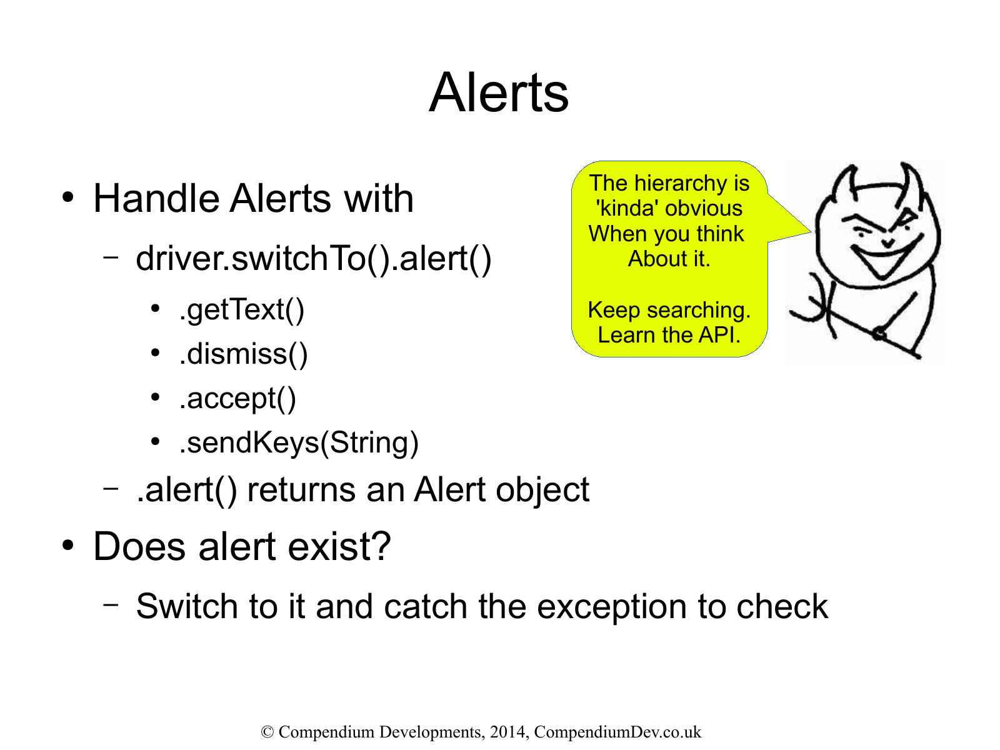

- Handle Alerts with
    - driver.switchTo().alert()
        - .getText()
        - .dismiss()
        - .accept()
        - .sendKeys(String)
    - .alert() returns an Alert object
- Does alert exist?
    - Switch to it and catch the exception to check

The hierarchy is

'kinda' obvious

When you think

About it.

Keep searching.

Learn the API.

---

<!-- Slide 109 -->

# User Interactions

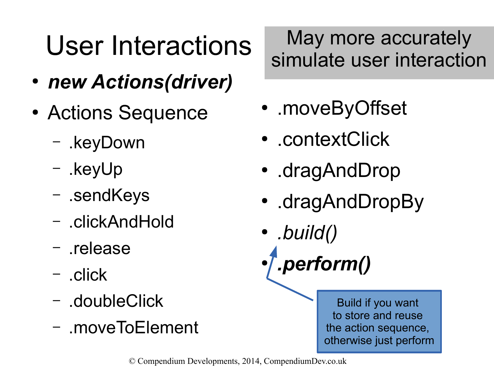

- new Actions(driver)
- Actions Sequence
    - .keyDown
    - .keyUp
    - .sendKeys
    - .clickAndHold
    - .release
    - .click
    - .doubleClick
    - .moveToElement

- .moveByOffset
- .contextClick
- .dragAndDrop
- .dragAndDropBy
- .build()
- .perform()

May more accurately simulate user interaction

Build if you want

to store and reuse

the action sequence,

otherwise just perform

---

<!-- Slide 110 -->

# More About Actions

- Actions uses GWT – operating system mouse move etc. so is more realistic
- You can interfere with the test if you move mouse and keyboard
- Actions can be brittle

---

<!-- Slide 111 -->

# Actions to simulate user Actions

- Hover, etc.
- new Actions(driver). ChainOfActions. build().perform();
- e.g. a chain of click actions

```java
        Actions actions = new Actions(driver);

        actions.click(multiSelectOptions.get(0)).
                click(multiSelectOptions.get(1)).
                click(multiSelectOptions.get(2)).perform();
```

---

<!-- Slide 112 -->

# Actions API Summary Slides

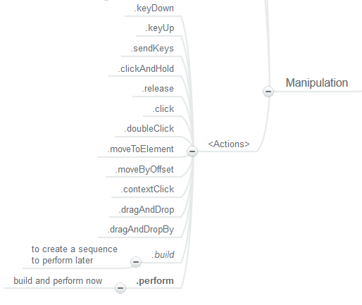

Note: I try and avoid actions

---

<!-- Slide 113 -->

# Alan Richardson - Blogs, Books, and Courses

Cookies


---

<!-- Slide 114 -->

# Cookies

- Inspect
    - driver.manage
        - .getCookies()
        - .getCookieNamed(“name”)
- Interact
    - driver.manage
        - .addCookie(Cookie)
        - .deleteAllCookies
        - .deleteCookie(Cookie)
        - .deleteCookieNamed(“name”)

---

<!-- Slide 115 -->

# Cookies Example

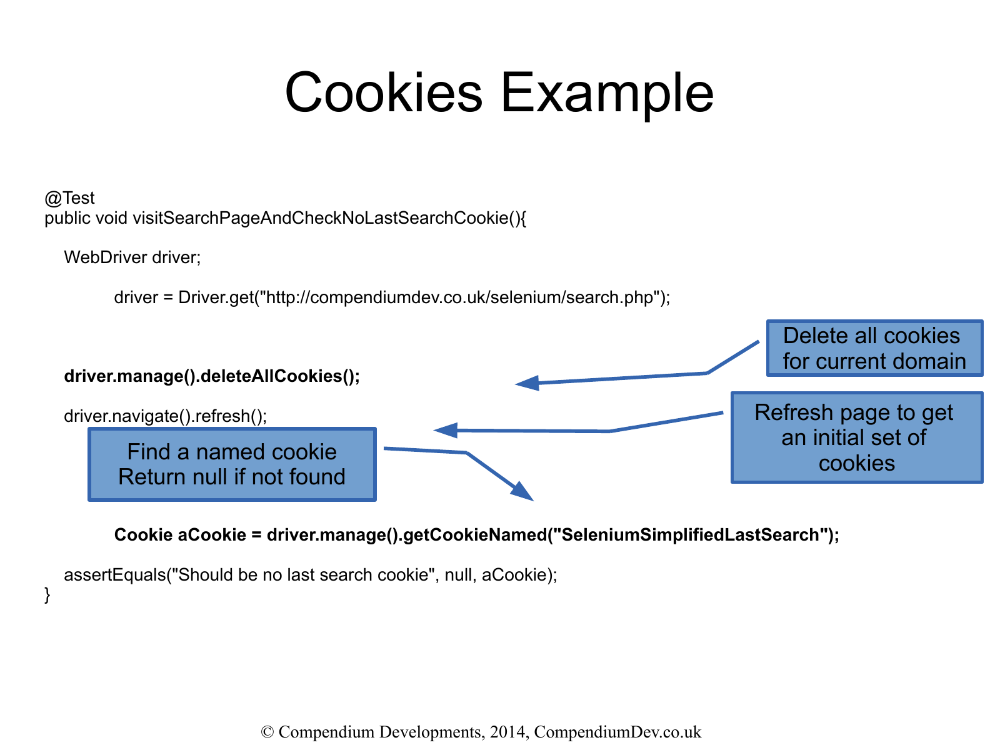

```java
    @Test
    public void visitSearchPageAndCheckNoLastSearchCookie(){

        WebDriver driver;

        driver = Driver.get("http://compendiumdev.co.uk/selenium/search.php");


        driver.manage().deleteAllCookies();

        driver.navigate().refresh();


        Cookie aCookie = driver.manage().getCookieNamed("SeleniumSimplifiedLastSearch");

        assertEquals("Should be no last search cookie", null, aCookie);
    }
```

Delete all cookies

for current domain

Refresh page to get

an initial set of

cookies

Find a named cookie

Return null if not found

---

<!-- Slide 116 -->

# Cookie.Builder

- Can use constructor
    - new Cookie
- Or can use Cookie.Builder

```java
Cookie aNewCookie = new Cookie.Builder(
                                    aCookie.getName(),
                                    String.valueOf(2)).
                          domain(aCookie.getDomain()).
                          path( aCookie.getPath()).
                          expiresOn(aCookie.getExpiry()).
                                isSecure(aCookie.isSecure()).
                                build();
```

---

<!-- Slide 117 -->

# Alan Richardson - Blogs, Books, and Courses

JavaScript


---

<!-- Slide 118 -->

# Why use Javascript?

- Workarounds
- Custom synchronisation
- Make the app more testable
    - Adjust hidden fields
    - Amend values
- Simulate hard to reach conditions
- Test Flash &amp; HTML 5

---

<!-- Slide 119 -->

# Javascript Execution

- Cast WebDriver to JavascriptExecutor
    - .executeScript(script, args...)
    - .executeAsyncScript(script, args...)
- Arguments are accessed using
    - arguments[index] e.g. "document.title=arguments[0]"
- Return values are converted to Java types
    - Html Element = WebElement, decimal = Double, non-decimal = Long, boolean = Boolean, array = List&lt;Object&gt;, else String or null
- Runs in an anonymous function

---

<!-- Slide 120 -->

# (JavascriptExecutor) Example

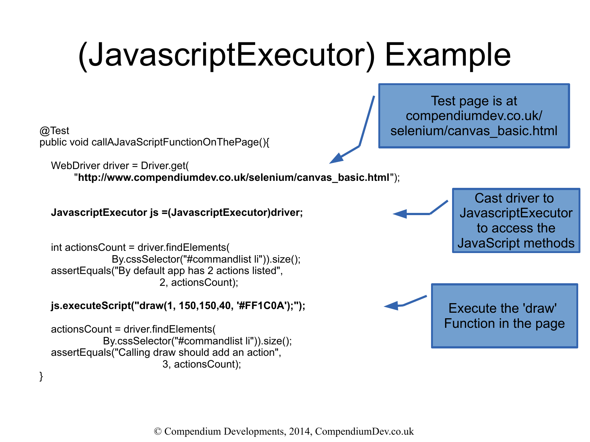

```java
    @Test
    public void callAJavaScriptFunctionOnThePage(){

        WebDriver driver = Driver.get(
                "http://www.compendiumdev.co.uk/selenium/canvas_basic.html");


        JavascriptExecutor js =(JavascriptExecutor)driver;


        int actionsCount = driver.findElements(
                             By.cssSelector("#commandlist li")).size();
        assertEquals("By default app has 2 actions listed",
                    2, actionsCount);

        js.executeScript("draw(1, 150,150,40, '#FF1C0A');");

        actionsCount = driver.findElements(
                          By.cssSelector("#commandlist li")).size();
        assertEquals("Calling draw should add an action",
                     3, actionsCount);
    }
```

Cast driver to JavascriptExecutor to access the JavaScript methods

Test page is at

compendiumdev.co.uk/ selenium/canvas\_basic.html

Execute the 'draw'

Function in the page

---

<!-- Slide 121 -->

# Execute Async JavaScript

- When executeAsyncScript is called, WebDriver adds an additional final argument, a callback function to signal that async execution has finished
    - "var callback = arguments[arguments.length – 1];"
- Any argument you pass to the callback function will be returned to WebDriver
    - HTML Element == WebElement, number == Long etc.
- Call it expecting an Object and cast appropriately
- SetScriptTimeout
    - driver.manage().timeouts().setScriptTimeout(10, TimeUnit.SECONDS);

---

<!-- Slide 122 -->

# Execute Async Example

```java
@Test
public void waitInBrowserForTimeSample(){
    driver.manage().timeouts().setScriptTimeout(10, TimeUnit.SECONDS);

    long start = System.currentTimeMillis();
        ((JavascriptExecutor) driver).executeAsyncScript(
            "window.setTimeout(arguments[arguments.length - 1], 500);");

    System.out.println(
            "Elapsed time: " + (System.currentTimeMillis() - start));

    assertTrue("Elapsed time should be greater than 500 milli",
            (System.currentTimeMillis() - start) > 500);

}
```

---

<!-- Slide 123 -->

# Alan Richardson - Blogs, Books, and Courses

Introducing Different Browsers


---

<!-- Slide 124 -->

# Browsers Overview

- Firefox Driver – currently built in
- HtmlUnit Driver – currently built in
- ChromeDriver – separate .exe
- OperaDriver – separate .exe available through maven
- IEDriver – seperate .exe
- RemoteDriver – currently built in, requires a server to connect to e.g. saucelabs or grid
- Various mobile drivers and safari driver

---

<!-- Slide 125 -->

# Firefox Driver

- Currently part of deployed Jars
    - Effectively 'built in'
    - Easy to get started with
    - Can be slow to startup

```java
aDriver = new FirefoxDriver();
```

---

<!-- Slide 126 -->

# Firefox Driver Profile

- Driver Profiles allow us to initialise a driver with additional capabilities and specific configuration

```java
  FirefoxProfile profile = new FirefoxProfile();
  WebDriver driver = new FirefoxDriver(profile);
```

- Profile level methods

profile.setEnableNativeEvents(true);

- Set browser preferences

profile.setPreference("extensions.firebug.currentVersion", "1.6.2");

- Load extensions profile.addExtension(new File(extensionPath));

---

<!-- Slide 127 -->

# FirefoxDriver Useful Links

- Firefox Preferences
    - about:config
    - <http://www.timeatlas.com/5_minute_tips/general/introduction_to_firefox_preferences#.UIvbL4az728>
- Firefox Driver Documentation
    - <http://code.google.com/p/selenium/wiki/FirefoxDriver>

---

<!-- Slide 128 -->

# Browser Capabilities

- Generic browser control mechanism
- e.g. Set Proxies

org.openqa.selenium.Proxy proxy = new org.openqa.selenium.Proxy(); proxy.setHttpProxy("localhost:8080") .setFtpProxy("localhost:8080") .setSslProxy("localhost:8080");

```java
        DesiredCapabilities capabilities = new DesiredCapabilities();
```

capabilities.setCapability(CapabilityType.PROXY, proxy);

---

<!-- Slide 129 -->

# HtmlUnitDriver

- <http://htmlunit.sourceforge.net/>
- DesiredCapabilities.setJavascriptEnabled seems to have been added for HTMLUnit

---

<!-- Slide 130 -->

# ChromeDriver

- <http://code.google.com/p/selenium/wiki/ChromeDriver>
- Download the driver server
    - set "webdriver.chrome.driver" to the location
- Command line switches
    - <http://peter.sh/experiments/chromium-command-line-switches/>
    - Pass in via options.addArguments
- ChromeDriver.log is useful debugging tool

---

<!-- Slide 131 -->

# ChromeDriver Example

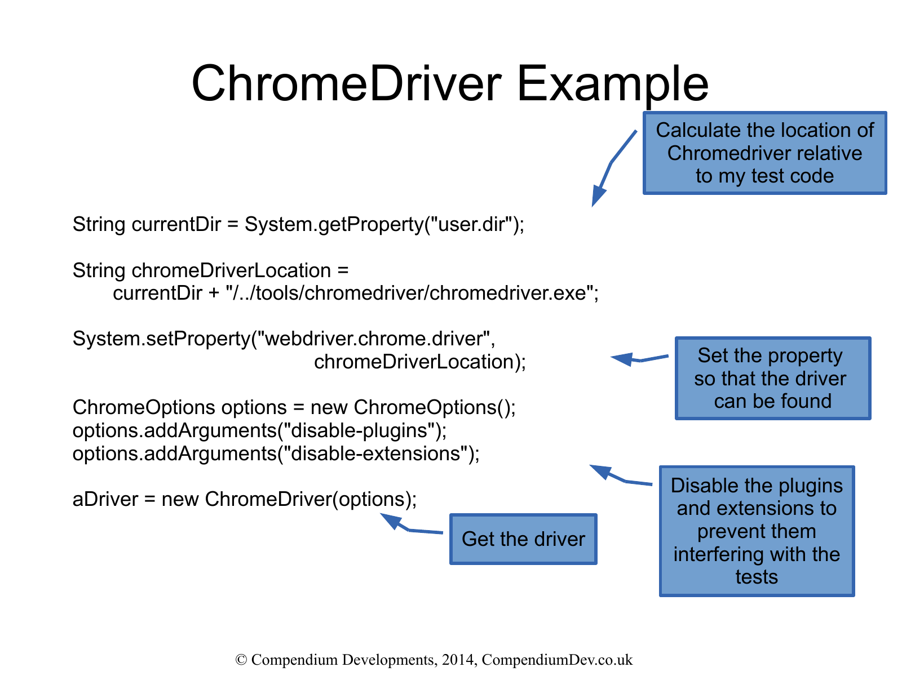

```java
String currentDir = System.getProperty("user.dir");

String chromeDriverLocation =
    currentDir + "/../tools/chromedriver/chromedriver.exe";

System.setProperty("webdriver.chrome.driver",
                        chromeDriverLocation);

ChromeOptions options = new ChromeOptions();
options.addArguments("disable-plugins");
options.addArguments("disable-extensions");

aDriver = new ChromeDriver(options);
```

Calculate the location of

Chromedriver relative

to my test code

Set the property

so that the driver

can be found

Disable the plugins

and extensions to prevent them interfering with the tests

Get the driver

---

<!-- Slide 132 -->

# Opera Driver

- Documentation and Downloads
    - <http://code.google.com/p/selenium/wiki/OperaDriver>
    - <https://github.com/operasoftware/operadriver>
    - <http://mvnrepository.com/artifact/com.opera/operadriver>
- Add to maven

```xml
    <dependency>
        <groupId>com.opera</groupId>
        <artifactId>operadriver</artifactId>
        <version>1.1</version>
    </dependency>
```

- Issues? then check for an up to date driver

---

<!-- Slide 133 -->

# Config Opera Driver

- Capabilities
- OperaProfile
    - opera:config
    - <http://www.opera.com/support/usingopera/operaini>

```java
OperaProfile profile = new OperaProfile();

// switching off Javascript will cause the opera driver to fail
profile.preferences().set("Extensions", "Scripting", 0);

WebDriver opera = new OperaDriver(profile);
```

---

<!-- Slide 134 -->

# IE Driver

- <http://code.google.com/p/selenium/wiki/InternetExplorerDriver>
- Download the server executable
    - <http://code.google.com/p/selenium/downloads/list>
    - Set “webdriver.ie.driver” to the location of the driver executable

```java
String currentUserDir = System.getProperty("user.dir");
String IEDriverLocation = currentUserDir +
                    "/../tools/iedriver_32/IEDriverServer.exe";
System.setProperty("webdriver.ie.driver", IEDriverLocation);
aDriver = new InternetExplorerDriver();
```

---

<!-- Slide 135 -->

# IE Driver on Path

- Drivers change
- IE Driver used to be add to path
- This method will be deprecated in favour of properties
- Pointing this out because we have to learn to read the code and the log messages output by Selenium

---

<!-- Slide 136 -->

# Alan Richardson - Blogs, Books, and Courses

RemoteWebDriver


---

<!-- Slide 137 -->

# Remote Driver

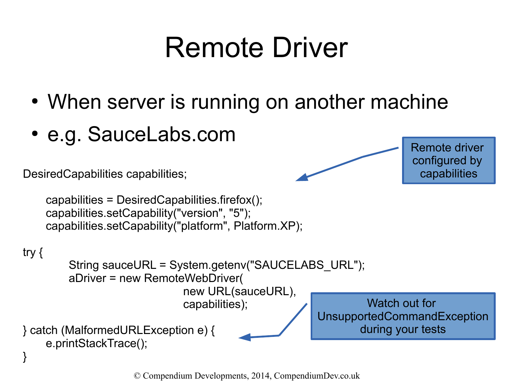

- When server is running on another machine
- e.g. SauceLabs.com

```java
DesiredCapabilities capabilities;
    capabilities = DesiredCapabilities.firefox();
    capabilities.setCapability("version", "5");
    capabilities.setCapability("platform", Platform.XP);

try {
        String sauceURL = System.getenv("SAUCELABS_URL");
        aDriver = new RemoteWebDriver(
                            new URL(sauceURL),
                            capabilities);

} catch (MalformedURLException e) {
    e.printStackTrace();
}
```

Remote driver configured by capabilities

Watch out for UnsupportedCommandException during your tests

---

<!-- Slide 138 -->

# RemoteWebDriver Profiles

- Can set firefox profiles on RemoteWebDriver

```java
FirefoxProfile fp = new FirefoxProfile();
// set something on the profile...
DesiredCapabilities dc = DesiredCapabilities.firefox();
dc.setCapability(FirefoxDriver.PROFILE, fp);
WebDriver driver = new RemoteWebDriver(dc);
```

- Can set firefox profiles on RemoteWebDriver

- Can set Chrome options on RemoteWebDriver

```java
ChromeOptions options = new ChromeOptions();
// set some options
DesiredCapabilities dc = DesiredCapabilities.chrome();
dc.setCapability(ChromeOptions.CAPABILITY, options);
WebDriver driver = new RemoteWebDriver(dc);
```

---

<!-- Slide 139 -->

# Grid Systems

- saucelabs.com
- browserstack.com
- Sign up for free
- Free plan good enough for this course, and a lot of things
- Records video
- Manual Testing

---

<!-- Slide 140 -->

# Alan Richardson - Blogs, Books, and Courses

Section: Any Time Left?

---

<!-- Slide 141 -->

# Any Questions?

---

<!-- Slide 142 -->

# Time for Free For All Automation?

- Pick a section and try and automated it
- Refactor some of the code into page objects or domain objects
- Try generating test data
- Try some of the advanced exercises

---

<!-- Slide 143 -->

# Alan Richardson - Blogs, Books, and Courses

Reference Section

---

<!-- Slide 144 -->

# Basic Practice Pages

- <http://SeleniumSimplified.com/testpages/>
    - alert.html
    - basic\_ajax.html
    - basic\_web\_page.html
    - basic\_html\_form.html
    - ajaxselect.php
- Source available at https://github.com/eviltester/seleniumTestPages

- calculate.php
- find\_by\_playground.php
- refresh.php
- search.php

---

<!-- Slide 145 -->

# Advanced Practice Pages

- compendiumdev.co.uk/selenium/Showcase/Showcase.html
- Source available at https://github.com/eviltester/simpleGWTShowCaseClone

---

<!-- Slide 146 -->

# Learn More Java

- Java For Testers by Alan Richardson
- Effective Java by Joshua Bloch
- Implementation Patterns by Kent Beck
- Growing Object-Oriented Software, Guided by Tests by Steve Freeman and Nat Pryce

---

<!-- Slide 147 -->

# Live pages to challenge yourself

gwt.google.com/samples/Showcase/Showcase.html

- Try the above it offers many challenges

www.primefaces.org/showcase/ui/home.jsf

- Practice on some simple apps:
    - <http://todomvc.com/>
    - <http://google-gruyere.appspot.com/>
    - <http://www.redmine.org/>
    - <http://getontracks.org/>

---

<!-- Slide 148 -->

# WebDriver Summary Sheet

| WebElement |
| --- |
| .getText() |
| .getAttribute(“name”) |
| .getTagName() |
| .isEnabled() |
| .isSelected() |
| .isDisplayed() |
| .getSize() |
| .getLocation() |
| .getCssValue() |

| Finding elements |
| --- |
| WebDriver |
| WebElement =<br>.findElement(BY) |
| List&lt;WebElement&gt; =<br>.findElements(BY) |
| By |
| .id(“an\_id”) |
| .xpath(“xpath”) |
| .cssSelector(“css”) |
| .className(“class”) |
| .linkText(“text”) |
| .name(“name” |
| .tagName(“a\_tag”) |
| .partialLinkText(“t”); |
| Support |
| ByChaining(By, By) |
| ByIdOrName(“idName”) |

Inspect

Navigate

| WebDriver |
| --- |
| .get(“URL”) |
| .navigate |
| .to(Url) |
| .to(“URL”) |
| .back() |
| .forward() |
| .refresh() |

| WebDriver |
| --- |
| .getTitle() |
| .getCurrentUrl() |
| .getPageSource() |

| WebDriver Interact |
| --- |
| = new &lt;driverClass&gt;() |
| .close() |
| .quit() |

Interact

| WebElement |
| --- |
| .click() |
| .submit() |
| .clear() |
| .sendKeys(String) |
| .sendKeys(Keys.x) |

| support.ui.Select |
| --- |
| .&lt;methods&gt;() |

| SwitchTo. |
| --- |
| .alert() |
| .getText() |
| .accept() |
| .dismiss() |
| .sendKeys(String) |
| .frame(...) |

| ExpectedConditions |
| --- |
| .titleIs(String) |
| … a lot of helper methods |

| WebDriverWait |
| --- |
| (driver, timeout in Seconds)<br>.until(ExpectedCondition) |

| Cookies |
| --- |
| WebDriver |
| .manage() |
| .deleteAllCookies() |
| .addCookie(Cookie) |
| .deleteCookie(Cookie) |
| .deleteCookieNamed(String) |

Synchronise

| Cookies |
| --- |
| WebDriver |
| .manage() |
| .getCookieNamed(String) |
| .getCookies() |

| Actions |
| --- |
| .keyUp() etc. |
| .perform() |

| (JavascriptExecutor) |
| --- |
| .executeScript |

---

<!-- Slide 149 -->

# Selectors

| CSS Selectors |
| --- |
| \* - any |
| #id |
| .class |
| tag |
| [attribute] |
| [attribute="value"] |
| tag[attribute="value"] |
| tag[attr1='val1'][attr2='val2'] |
| tag[att1='val1'], orThisTag |
| = (' or ") |
| \*="anywhere in value" |
| ^="start of value" |
| $="end of value" |
| ~="spaceSeperatedValue" |
| Paths |
| A &gt; B (child) |
| A B (any descendant) |
| A + B (A's B sibling) |
| tag:first-child |

| XPATH Selectors |
| --- |
| // - match anywhere |
| / - match from root |
| //\* - any element |
| //tag |
| //\*[@attribute] |
| //\*[@attribute="value"] |
| //tag[@attribute="value"] |
| //tag1/tag2 (child) |
| //tag1//tag2 (any descendant) |
| //tag1/../.. (.. to go up) |
| //\*[.='element textl] |
| [@at1="a" and @at2="b"] |
| and, or, =, !=, &lt;, &gt;, &gt;=, &lt;- |
| Functions |
| contains(@a,"alu") |
| starts-with(@a,"v") |
| ends-with(@a,"e") |
| Indexing |
| //tag[1] |

XPath References

- <http://www.w3schools.com/xpath/>
- <http://www.simple-talk.com/dotnet/.net-framework/xpath,-css,-dom-and-selenium-the-rosetta-stone/>

CSS References

- <http://reference.sitepoint.com/css/selectorref>
- http://net.tutsplus.com/tutorials/html-css-techniques/ the-30-css-selectors-you-must-memorize/
- <http://www.quirksmode.org/css/contents.html>
- <http://www.w3schools.com/cssref/css_selectors.asp>

---

<!-- Slide 150 -->

# Alan Richardson - Blogs, Books, and Courses

Blogs and Websites

- CompendiumDev.co.uk
- SeleniumSimplified.com
- EvilTester.com
- JavaForTesters.com
- Twitter: @eviltester

Online Training Courses

- Technical Web Testing 101
- Intro to Selenium
- Selenium 2 WebDriver API

Videos

youtube.com/user/EviltesterVideos

Books

Selenium Simplified

Java For Testers

leanpub.com/javaForTesters

Alan Richardson

uk.linkedin.com/in/eviltester

Independent Test Consultant &amp; Custom Training

Contact Alan

<http://compendiumdev.co.uk/contact>


