<!-- footer: © Compendium Developments, 2014, CompendiumDev.co.uk -->

<!-- Slide 1 -->

# Hands On WebDriver

Alan Richardson

SeleniumSimplified.com

JavaForTesters.com

EvilTester.com

CompendiumDev.co.uk

---

<!-- Slide 2 -->

# Course Overview

- Hints and Tips
- Installation
- Basic WebDriver API capabilities
- Simple interrogation and navigation
- Synchronization strategies
- AJAX applications.
- Tools
- Location strategies using CSS and XPath.
- Introduction to abstraction approaches

---

<!-- Slide 3 -->

# Approach

- Presentation
- Demos
- Exercises
    - Multiple Tracks depending on your level

---

<!-- Slide 4 -->

# Status Check

- Java Experience?
- Automation Experience?
- Selenium Experience?
- WebDriver Experience?

---

<!-- Slide 5 -->

# With Mixed Experience Levels...

- If you get stuck, ask for help
- You can keep doing the exercises, even when we move on
- Read the source code for the answers
- Try and run the answer source code
- Run the answer source code in debug mode
- Expect some of this to go over your head

---

<!-- Slide 6 -->

# Demo – WebDriver in Action

mvn -Dtest=TheDemoTest test

- A quick walkthrough of the demo code
    - JUnit, @Test
    - Java public static Config
    - WebDriver driver
    - New FirefoxDriver
    - Driver.
        - navigate() .to() .back()
        - findElement By.id(...) By.cssSelector
        - switchTo alert
        - close, quit

---

<!-- Slide 7 -->

# Introduction &amp; Overview

---

<!-- Slide 8 -->

# Ancient History

- Selenium 1.0
    - Javascript through a proxy
    - Flat API “selenium.”
    - Server based
- WebDriver
    - Object Oriented API, Interface which each driver implements
    - Driver calls browser directly
    - Has a server component Remote WebDriver

---

<!-- Slide 9 -->

# Installation

- Java SDK
- Maven
- IntelliJ IDE
- Firefox
- Firebug plugin
    - FirePath plugin

seleniumsimplified.com/get-started/

---

<!-- Slide 10 -->

# Exercises: Download, Run, Import

- Exercise: Download the source code
    - Download the source code
- Exercise: Run a test from Command Line
    - Run “mvn test -Dtest=MyFirstTest” from the command line
- Exercise: Import code into IDE
    - Import the code into IntelliJ (open the pom.xml)
- Exercise: Run MyFirstTest from IDE
    - Run the “MyFirstTest”

---

<!-- Slide 11 -->

# What is Maven?

- A build tool
- Dependency Management
- Standard Folder Structure
- Java project tasks simpler
    - mvn clean compile
    - mvn package
    - mvn test
- <http://maven.apache.org>

---

<!-- Slide 12 -->

# pom.xml

```xml
    <dependencies>
        <dependency>
            <groupId>junit</groupId>
            <artifactId>junit</artifactId>
            <version>4.11</version>
        </dependency>
        <dependency>
            <groupId>org.seleniumhq.selenium</groupId>
            <artifactId>selenium-server</artifactId>
            <version>2.42.2</version>
        </dependency>
    </dependencies>
```

---

<!-- Slide 13 -->

# Java Language Levels

- Set in IntelliJ Project Settings
- And in the pom.xml

```xml
    <!-- I have added the build section to support importing into
     IntelliJ automatically without throwing errors about wrong Java
     Version. This basically says the source requires at least Java 1.7
     and use a compiler that outputs Java 1.7 -->
    <build>
        <plugins>
            <plugin>
                <groupId>org.apache.maven.plugins</groupId>
                <artifactId>maven-compiler-plugin</artifactId>
                <version>3.1</version>
                <configuration>
                    <source>1.7</source>
                    <target>1.7</target>
                    <encoding>UTF-8</encoding>
                </configuration>
            </plugin>
        </plugins>
    </build>
```

---

<!-- Slide 14 -->

# Benefits of Maven

- Standard directory structure
- Supported by Selenium and some of the drivers
- Easy to update and install
- Simple to add to Continuous Integration
    - “mvn test”

---

<!-- Slide 15 -->

# Alan Richardson - Blogs, Books, and Courses

Section: WebDriver is an API

---

<!-- Slide 16 -->

# API Overview

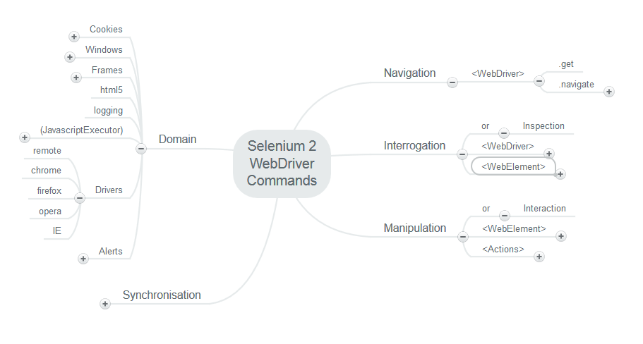

<http://www.mindmeister.com/280141421/selenium-2-webdriver-commands>

---

<!-- Slide 17 -->

# Demos During This Section

- Explain basic code sample of MyFirstTest
- Inspect WebElements using Firebug
- Various API constructs
- Use of Code Completion, JavaDoc, Autoscroll, params, view code
- How to run a test Class and Method
- How to debug a test Method, with breakpoints
- How to use evaluate

---

<!-- Slide 18 -->

# MyFirstTest.java

```java
package com.eviltester.webdriver;

import org.junit.Assert;
import org.junit.Test;
import org.openqa.selenium.WebDriver;
import org.openqa.selenium.firefox.FirefoxDriver;

public class MyFirstTest {

 @Test
 public void startWebDriver(){

   WebDriver driver = new FirefoxDriver();
   driver.navigate().to("http://seleniumsimplified.com");

   Assert.assertTrue("Expected Selenium Simplified",
                     driver.getTitle().
                            startsWith("Selenium Simplified"));

   driver.close();
   driver.quit();
 }
}
```

---

<!-- Slide 19 -->

# Basic Knowledge

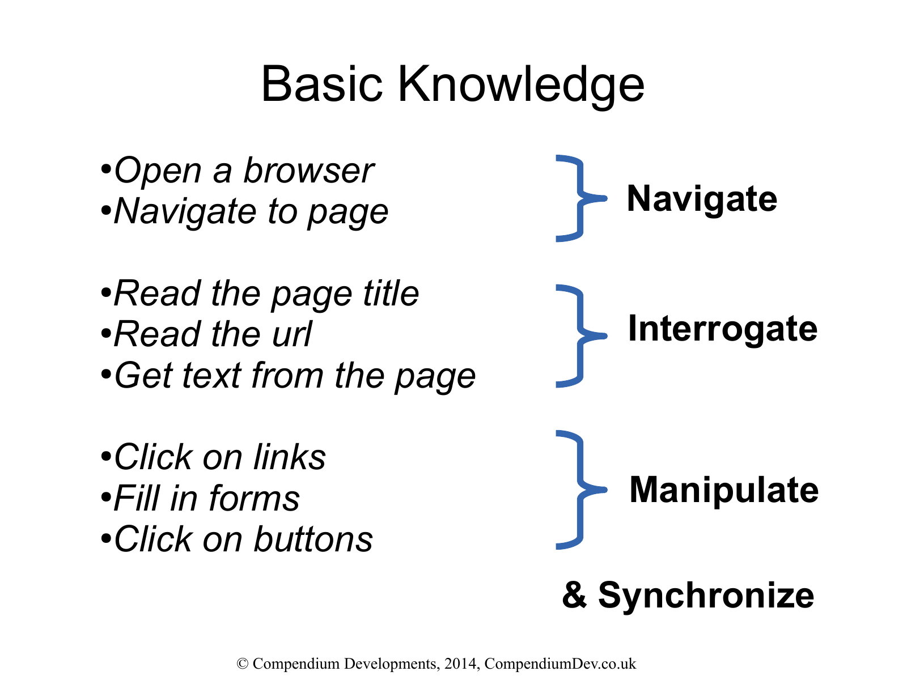

- Open a browser
- Navigate to page

- Read the page title
- Read the url
- Get text from the page

- Click on links
- Fill in forms
- Click on buttons

Navigate

Interrogate

Manipulate

&amp; Synchronize

---

<!-- Slide 20 -->

# WebDriver Basics

- WebDriver
    - Think of the driver as the browser
    - Interface with implementations – FirefoxDriver, ChromeDriver etc.
    - High Level commands
        - get, getTitle, getCurrentUrl, close, quit
    - Functional Groupings
        - Navigate, Manage
    - Locate
        - FindElement, FindElements

---

<!-- Slide 21 -->

# WebElement Basics

- The DOM elements
    - &lt;a&gt;, &lt;p&gt;, &lt;ul&gt;, etc.
- Found By.Id, By.Name, etc.
- Interrogate
    - .getAttribute, .getValue, isEnabled etc.
- Manipulate
    - SendKeys, click, etc.

---

<!-- Slide 22 -->

# JUnit Basics

- Test Execution Framework
- @Test
    - Annotate a method with @Test
- Can Run @Test methods from the IDE
- Use Assertions to check results
    - Import org.junit.Assert;
    - Assert.assertTrue(true);
    - Assert.assertEquals(1+1, 2);

---

<!-- Slide 23 -->

# Useful IntelliJ Shortcut Keys

- Find Symbol
    - Shift + Cntrl + Alt + N
- Find Class
    - Cntrl + N
- Find File
    - Shift + Cntrl + N
    - on mac use Cmd instead of Cntrl

- Code Completion
    - Cntrl + space
- 'Auto fix'
    - Alt + enter
- Method Parameters
    - Ctrl + P (Cmd + P)
- Java Doc
    - Ctrl + Q (Ctrl +J)

---

<!-- Slide 24 -->

# WebDriver API Learning Tips

- Use Code Completion (ctrl+space)
- ctrl+Q for Documentation of Commands (ctrl+j on mac)
- ctrl+click to view the actual WebDriver code (cmd+click on mac)
- AutoScroll

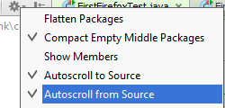

---

<!-- Slide 25 -->

# Browser Tools Overview

- Firefox
    - Inspect
    - Inspect with Firebug
        - FirePath
- Chrome Inspect

---

<!-- Slide 26 -->

# Checklist: Did you see...

- Explain basic code sample of MyFirstTest
- Inspect WebElements using Firebug
- Various API constructs
- Use of Code Completion, JavaDoc, Autoscroll, params, view code
- How to run a test Class and Method
- How to debug a test Method, with breakpoints
- How to use evaluate

---

<!-- Slide 27 -->

# Alan Richardson - Blogs, Books, and Courses

Section: My First Test

---

<!-- Slide 28 -->

# Exercise Demo: MyFirstExtendedTest.java

- Use .get instead of navigate
- Check title is "Basic Web Page Title"
- Check element id "para1" has text "A paragraph of text"

---

<!-- Slide 29 -->

# exercises.myfirsttest. MyFirstExtendedTest.java

```java
@Test
public void getBasicPageAndCheckDetails(){

  WebDriver driver = new FirefoxDriver();

  driver.get(
    "http://seleniumsimplified.com/testpages/basic_web_page.html"
        );

  Assert.assertTrue("Expected Different Title",
                    driver.getTitle().
                            equals("Basic Web Page Title"));

  WebElement para1 = driver.findElement(By.id("para1"));
  Assert.assertTrue(
                "A paragraph of text".equals(para1.getText()));

  driver.close();
  driver.quit();
}
```

Exercise:

---

<!-- Slide 30 -->

# Do Exercise Expand MyFirstExtendedTest

---

<!-- Slide 31 -->

# Exercise Debrief

- Questions?
- Anything I need to demo?
- Etc.

---

<!-- Slide 32 -->

# Used WebDriver API Summary

- WebDriver driver = new FirefoxDriver();
    - Create a new instance of a driver and browser
- driver.get(aURL);
    - Open a web page in the browser
- findElement(s), By.id, By.name, By.tagName
    - WebElement element = driver.findElement(By.id(“anid));
    - Find a WebElement using id or name attribute,
    - NoSuchElementException
    - findElement can be chained
- WebElement
    - getText, getAttribute

- driver.getTitle()
    - Get the title of the current page
- driver.close(), driver.quit()
    - Close the current browser window,
    - quit the browser and driver

- Junit Used
    - @Test
    - Assert.assertTrue
    - Assert.assertEquals
    - Comment as first arg
    - Expected, then Actual

---

<!-- Slide 33 -->

# IntelliJ &amp; JUnit

---

<!-- Slide 34 -->

# Java &amp; Maven Summary

- Packages organise the Java classes
- Java Classes Start with Uppercase letters
- Methods start with lowercase letters
- Add tests in the src/test/java folder hierarchy
- Add Test into the class name to automatically run from maven as a test
- Import classes from packages to use them
- Code completion helps, be careful with imports

---

<!-- Slide 35 -->

# Basics

- Use code completion as much as possible
- Learn short cut keys
- Remove any code syntax errors as fast as possible because they interfere with code completion

---

<!-- Slide 36 -->

# IntelliJ Evaluate Expression

- In Debug mode use Evaluate to experiment with code constructs in situ.
    - e.g. when writing xpath findElements code
- Can sometimes recompile and hot swap the code into the running debug session.

---

<!-- Slide 37 -->

# Issues With Current Test

- Many checks in same test method
- If one check fails we have no info on later checks
    - But these are same state checks
    - i.e. page is same state for all checks, so we should get that information

---

<!-- Slide 38 -->

# Solution – Use JUnit to setup state

- @Test
    - The set of checks we want to make
    - We can setup state in the test and move through state e.g. open page, click links, etc.
- @Before
    - Before every @Test, do some stuff to setup state
- @BeforeClass
    - Before any test in the Class, setup some state
- @After, @AfterClass
    - 'clean up' for each 'before'

---

<!-- Slide 39 -->

# Demo - JunitBeforeAfterDemoTest

- Outputs:
- @BeforeClass
    - -BeforeClass
- @Before
    - . Before
- @Test (4 tests)
    - \+ TestX

- @AfterClass
    - -AfterClass
- @After
    - . After
- What will Happen?

---

<!-- Slide 40 -->

# JUnit @Before, @After

- @BeforeClass,
    - Run once before any @Test in the class is run
    - static
- @AfterClass
    - Run once after all @Test in the class have run
    - static
- @Before,
    - Run before each @Test
- @After
    - Run after each @Test

---

<!-- Slide 41 -->

# Demo

- Refactor MyFirstExtendedTest to use
- @Before, @After and
- @BeforeClass and @AfterClass

---

<!-- Slide 42 -->

# Do the JUnit Exercises

---

<!-- Slide 43 -->

# Exercise Debrief

- Questions?
- Anything I need to demo?
- Etc.

---

<!-- Slide 44 -->

# Debrief

- WebDriver is not a test tool
- JUnit is a test tool
- JUnit, (or TestNG, or Cucumber etc.) give us the 'test' capabilities
- WebDriver provides the browser automation capabilities
- @Before,@After etc. allow us to make the test code more readable so the @Test focuses on the 'test' and the 'check' not the 'setup'
- Keep your 'tests' small

---

<!-- Slide 45 -->

# Navigation &amp; Interrogation

---

<!-- Slide 46 -->

# Navigation &amp; Interrogation

- We can navigate() around the site
- We can find an individual element or find multiple elements using different By locator methods e.g. by Id, name, tagName etc.
- When we have found an element we can interrogate it using the methods on WebElement
- WebDriver object exposes interrogation methods e.g. getUrl, getTitle, etc.

---

<!-- Slide 47 -->

# WebDriver

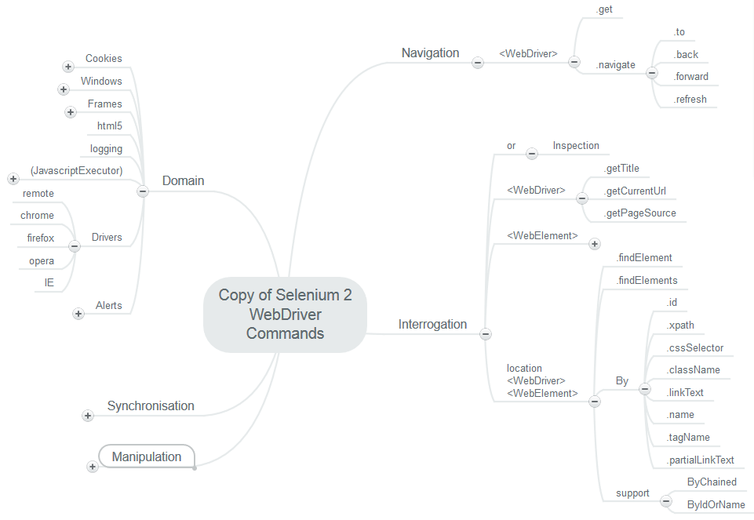

---

<!-- Slide 48 -->

# Navigation Annotated

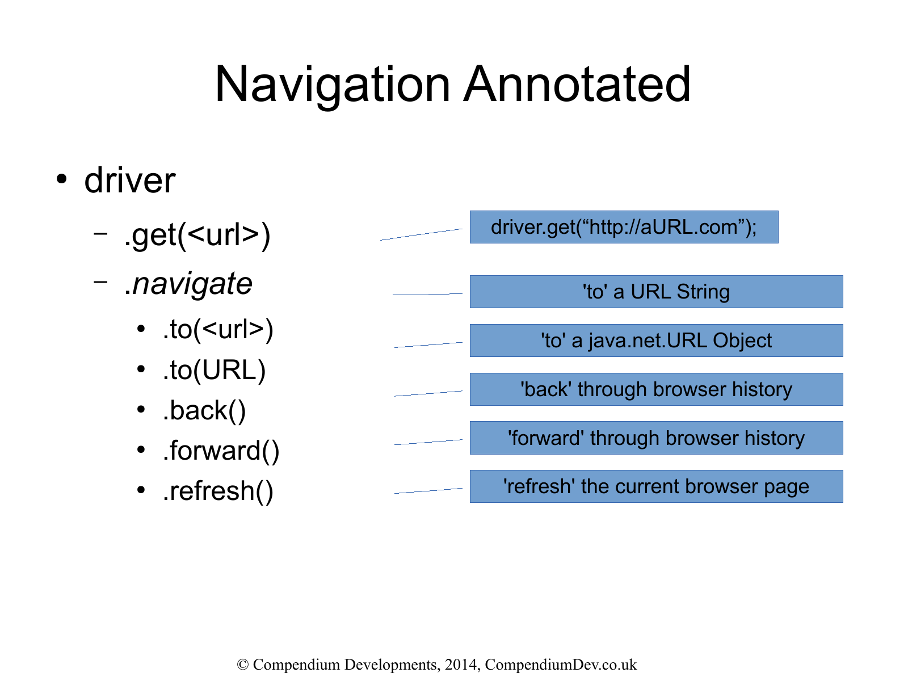

- driver
    - .get(&lt;url&gt;)
    - .navigate
        - .to(&lt;url&gt;)
        - .to(URL)
        - .back()
        - .forward()
        - .refresh()

driver.get(“http://aURL.com”);

'to' a URL String

'to' a java.net.URL Object

'back' through browser history

'forward' through browser history

'refresh' the current browser page

---

<!-- Slide 49 -->

# Driver level Interrogation Methods

- driver
    - .getTitle()

- .getCurrentUrl()

- .getPageSource()

All return String.

Pretty obvious what each method does.

Be wary of using getPageSource it may not return what you expect.

---

<!-- Slide 50 -->

# Be Careful with getPageSource

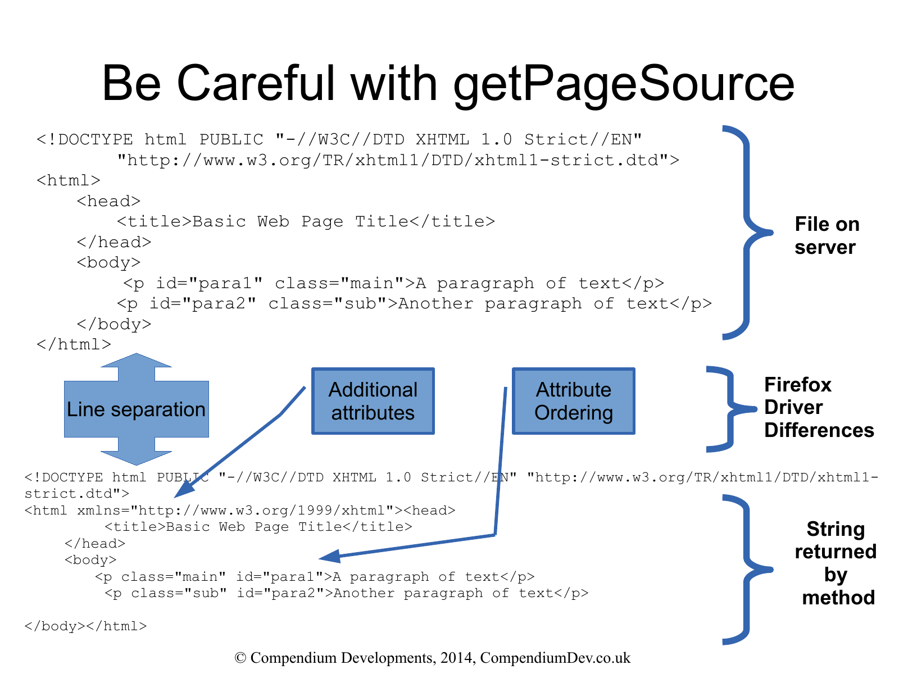

```html
<!DOCTYPE html PUBLIC "-//W3C//DTD XHTML 1.0 Strict//EN"
        "http://www.w3.org/TR/xhtml1/DTD/xhtml1-strict.dtd">
<html>
    <head>
        <title>Basic Web Page Title</title>
    </head>
    <body>
        <p id="para1" class="main">A paragraph of text</p>
        <p id="para2" class="sub">Another paragraph of text</p>
    </body>
</html>
```

```html
<!DOCTYPE html PUBLIC "-//W3C//DTD XHTML 1.0 Strict//EN" "http://www.w3.org/TR/xhtml1/DTD/xhtml1-strict.dtd">
<html xmlns="http://www.w3.org/1999/xhtml"><head>
        <title>Basic Web Page Title</title>
    </head>
    <body>
        <p class="main" id="para1">A paragraph of text</p>
        <p class="sub" id="para2">Another paragraph of text</p>

</body></html>
```

File on

server

String

returned

by

method

Line separation

Firefox

Driver

Differences

Additional

attributes

Attribute

Ordering

---

<!-- Slide 51 -->

# Driver .findElement(By)

- By.id
- By.xpath
- By.cssSelector
- By.className
- By.linkText
- By.name
- By.tagName
- By.partialLinkText

We find an element By using a locator strategy.

e.g. by using the id, by evaluating an xpath expression, by executing a css selector, etc.

```java
driver.findElement(By.id("para1"))
```

---

<!-- Slide 52 -->

# .findElements

- .findElement only returns 1 WebElement
- When a By can return more elements then .findElement returns the first in the list
- .findElements does not throw an exception if it can't match anything, it returns an empty list
- .findElements returns the full list of matching WebElements
    - e.g. driver.findElements(By.className(“normal”));

---

<!-- Slide 53 -->

# Chaining .findElement (s)

findElement(By.id(“.”)).findElement(By.name(“.”))

e.g.

```java
WebElement element = driver.findElement(By.id("div1")).
                            findElement(By.name("pName3")).
                            findElement(By.tagName("a"));
```

- Can use any By locator strategy

- Cannot Chain .findElements() as it returns a List of Web Elements

List&lt;WebElement&gt;

---

<!-- Slide 54 -->

# Chaining with ByChained

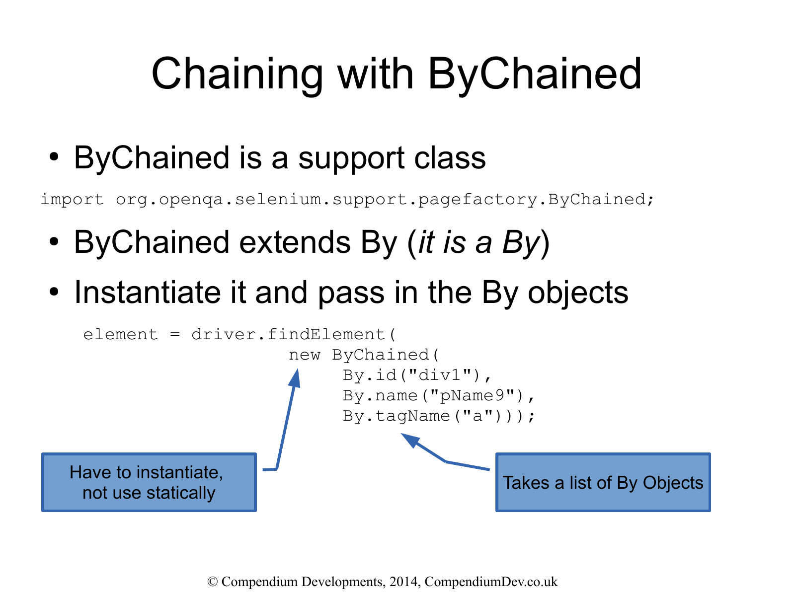

- ByChained is a support class

import org.openqa.selenium.support.pagefactory.ByChained;

- ByChained extends By (it is a By)
- Instantiate it and pass in the By objects

element = driver.findElement( new ByChained( By.id("div1"), By.name("pName9"), By.tagName("a")));

Takes a list of By Objects

Have to instantiate, not use statically

---

<!-- Slide 55 -->

# Other By Support Classes

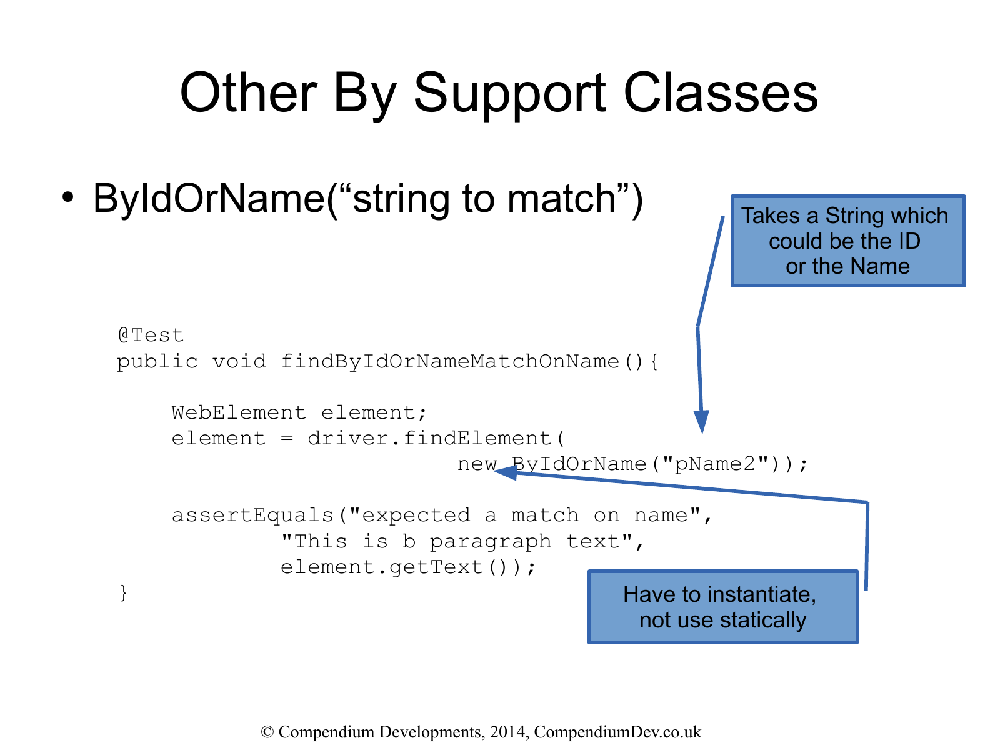

- ByIdOrName(“string to match”)

```java
    @Test
    public void findByIdOrNameMatchOnName(){

        WebElement element;
        element = driver.findElement(
                             new ByIdOrName("pName2"));

        assertEquals("expected a match on name",
                "This is b paragraph text",
                element.getText());
    }
```

Takes a String which

could be the ID

or the Name

Have to instantiate, not use statically

---

<!-- Slide 56 -->

# Basic WebElement API Summary

- WebElement, findElement,
    - WebElement element = driver.findElement(By.id(“anid));
    - Find a WebElement using id or name attribute,
    - findElement can be chained
- By.id, By.name
    - Locators to 'find' the elements

- element.sendKeys(“type this”);
    - Send keys to a web element to type something
- element.click()
- element.getText
    - Click on a web element
    - Get the text of the current element

---

<!-- Slide 57 -->

# WebElement

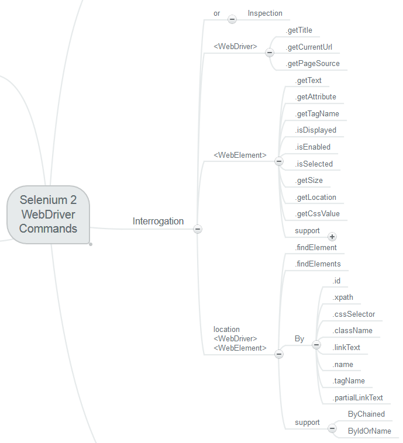

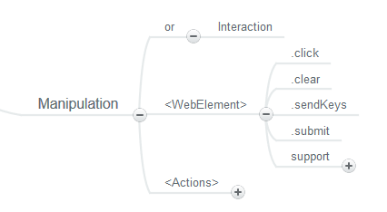

---

<!-- Slide 58 -->

# Dom Element Interrogation Approach

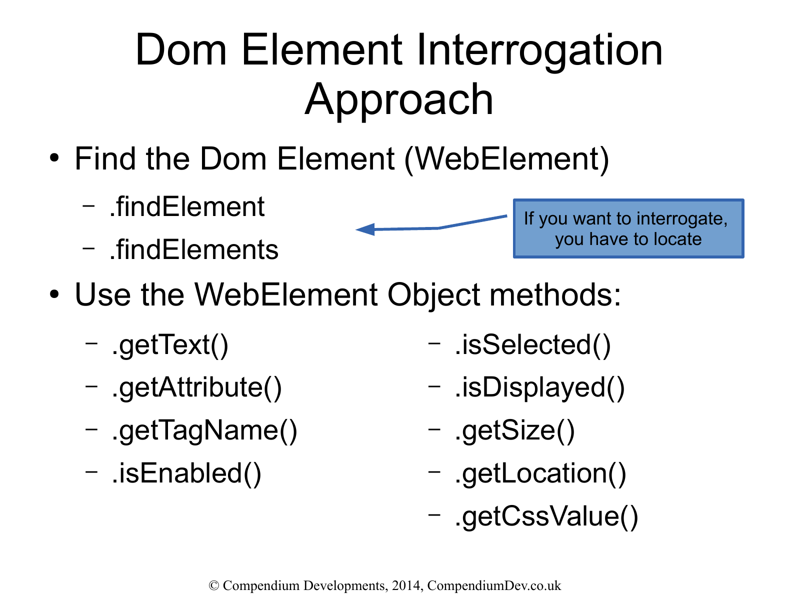

- Find the Dom Element (WebElement)
    - .findElement
    - .findElements
- Use the WebElement Object methods:

- .getText()
- .getAttribute()
- .getTagName()
- .isEnabled()

- .isSelected()
- .isDisplayed()
- .getSize()
- .getLocation()
- .getCssValue()

If you want to interrogate,

you have to locate

---

<!-- Slide 59 -->

# Does Navigation Require Synchronisation?

- Navigation blocks until the HTML of the page is loaded
- This does not mean the page is ready
    - for manipulation or
    - full interrogation
- Sometimes synchronisation is required on navigation

---

<!-- Slide 60 -->

# What about clicking?

- Normally we navigate by clicking:
    - on links
    - on buttons
    - by submitting forms
- This is navigation as a side-effect
    - It normally requires synchronisation
    - We will cover this later in Manipulation

---

<!-- Slide 61 -->

# Do the Navigation &amp; Interrogation Exercises

---

<!-- Slide 62 -->

# Exercise Debrief

- Questions?
- Anything I need to demo?
- Etc.

---

<!-- Slide 63 -->

# Manipulation

---

<!-- Slide 64 -->

# Manipulation

- When
    - we find an element we can
    - use the methods on the WebElement to
    - do stuff e.g. click, clear, sendKeys etc.

---

<!-- Slide 65 -->

# WebElement Manipulation

- .click()
- .clear()
    - Clear a field
- .sendKeys(String) actually (CharSequence)
    - Sends the appropriate events to a WebElement keyup, keydown, etc.
    - Helper Keys class (org.openqa.selenium.Keys)
- .submit()
    - Submit a form

---

<!-- Slide 66 -->

# More on SendKeys

- Keys.chord to send Key Sequences
- Shift, CTRL etc start a modifier sequence
- Keys.NULL ends a modifier sequence

```java
aTextArea.sendKeys("this text", "and this text");

commentTextArea.sendKeys(
       Keys.chord(Keys.SHIFT, "bob", Keys.NULL, " Dobbs"));

assertEquals("BOB Dobbs", commentTextArea.getText())
```

---

<!-- Slide 67 -->

# SendKeys

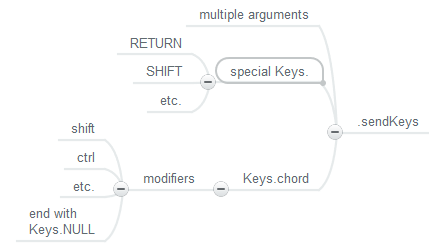

---

<!-- Slide 68 -->

# Do the Manipulation Exercises

---

<!-- Slide 69 -->

# Exercise Debrief

- Questions?
- Anything I need to demo?
- Etc.

---

<!-- Slide 70 -->

# Location Strategies

---

<!-- Slide 71 -->

# Alan Richardson - Blogs, Books, and Courses

CSS Selectors

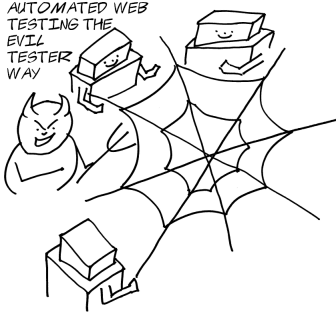

---

<!-- Slide 72 -->

# Useful Tools For CSS and XPath

- Firefox
    - Install FireBug and FirePath plugins
- Chrome
    - Developer tools are supposed to allow search using xpath or css (sometimes this breaks between releases)

---

<!-- Slide 73 -->

# CSS Selectors

- A CSS Selector matches a set of elements
- Used to style HTML from CSS Stylesheets
- Reused in Selenium to match DOM elements
- Useful References
    - <https://developer.mozilla.org/en-US/docs/CSS>
    - <http://reference.sitepoint.com/css/selectorref>
    - http://net.tutsplus.com/tutorials/html-css-techniques/ the-30-css-selectors-you-must-memorize/
    - <http://www.quirksmode.org/css/contents.html>
    - <http://www.w3schools.com/cssref/css_selectors.asp>
    - <http://css-tricks.com/attribute-selectors/>

---

<!-- Slide 74 -->

# Basics of CSS Selectors

- \*
    - match any element e.g. \*, \*[name="bob"]
- #id
    - match an id e.g. #p4
- .class
    - match a class e.g. “.normal”, “p.normal”
- tag
    - match tags e.g. p, a, div
- [attribute]
    - Match on the attribute name e.g. [id]

---

<!-- Slide 75 -->

# CSS Attribute Matching

- tag[attribute^=”val”]
    - Partial match start of value
- tag[attribute$=”lue”]
    - Partial match end of value
- tag[attribute~=”value”]
    - Match on space separated values
- tag[a='val'], tag[b='val']
    - , is an 'or' grouping

- tag[attribute]
    - match tags with an attribute
- tag[attribute=”value”]
    - match tags with a specific attribute value
- tag[attr1='val1'][attr2='val2']
    - match tag using multiple attribute values
- tag[attribute\*=”alu”]
    - Partial match anywhere on value

---

<!-- Slide 76 -->

# CSS Selectors – Some Paths

- A &gt; B – B directly under A e.g. &lt;A&gt;&lt;B/&gt;&lt;/A&gt;
- A B – descendant
    - selectors separated by space i.e. “this then that”
    - Any degree of separation
    - e.g. “div li” would match but “div &gt; li” would not
- A + B – B siblings of an A
- B:first-child - every B which is first child of something
- B:nth-child(n) – the nth child of B e.g. n==3, 3rd
    - For more selectors see the references

---

<!-- Slide 77 -->

# By.cssSelector

- By.cssSelector(&lt;a css selector string&gt;)

```java
    @Test
    public void findElementsUsingCSSTag(){

        List<WebElement> elements;

        elements = driver.findElements(
                        By.cssSelector("p"));

        assertEquals("expected a different number",
                        41,
                        elements.size());
    }
```

---

<!-- Slide 78 -->

# CSS Selectors

- CSS Selectors are faster than Xpath
- CSS Selectors can't traverse back up the dom
- Try and use CSS Selectors by default for complicated selection queries

---

<!-- Slide 79 -->

# Do Exercise: Manual CSS Selectors

---

<!-- Slide 80 -->

# Exercise Debrief

- Questions?
- Anything I need to demo?
- Etc.

---

<!-- Slide 81 -->

# Alan Richardson - Blogs, Books, and Courses

XPath


---

<!-- Slide 82 -->

# XPath

- XPath is an XML Query Language
- XPath is often slower than CSS
- XPath has more functions than CSS
- Xpath can navigate up and down the DOM
- References
    - <http://www.w3schools.com/xpath/>
    - <http://www.w3schools.com/xpath/xpath_functions.asp>

---

<!-- Slide 83 -->

# By.xpath

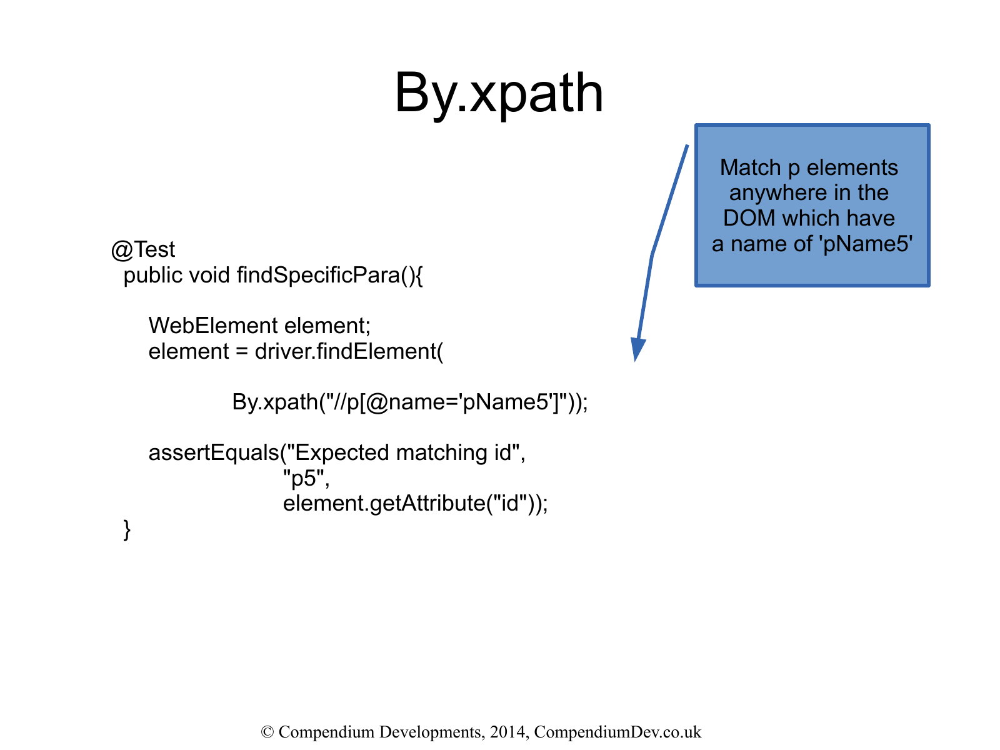

```java
  @Test
    public void findSpecificPara(){

        WebElement element;
        element = driver.findElement(

                    By.xpath("//p[@name='pName5']"));

        assertEquals("Expected matching id",
                         "p5",
                         element.getAttribute("id"));
    }
```

Match p elements anywhere in the DOM which have a name of 'pName5'

---

<!-- Slide 84 -->

# Xpath Selector Basics

- // - match anywhere
- / - match from root
- //\* - any element
- //tag – named element
- //\*[@attribute] – match if it has attribute
- //\*[@attribute='value'] – attribute with value
- . for content matching
- .. for traversing back up the path e.g. //div/p/a/..
- Operators: and, or etc
    - w3schools.com/xpath/xpath\_operators.asp
- Xpath functions e.g. contains, starts-with
    - w3schools.com/xpath/xpath\_functions.asp

---

<!-- Slide 85 -->

# Additional References

- Xpath, CSS Rosetta Stone
    - <http://www.simple-talk.com/dotnet/.net-framework/xpath,-css,-dom-and-selenium-the-rosetta-stone>
    - <http://bit.ly/RDJ3Wb>
- Note browsers tend to use Xpath 1.0

---

<!-- Slide 86 -->

# Chain XPath &amp; CSS in findElement

- Remember we can 'chain' findElement
    - elem.findElement(By.id('me')).findElement(By.id('this');
- You can use a combination of css selector and xpath selector
    - parentWebElement = webElementFoundByCSS.findElement(By.xpath(".."));
    - parentWebElement.findElements( By.cssSelector("div &gt; div"));

---

<!-- Slide 87 -->

# Do Exercise: Manual XPath Selectors

---

<!-- Slide 88 -->

# Exercise Debrief

- Questions?
- Anything I need to demo?
- Etc.

---

<!-- Slide 89 -->

# Do Exercise: CSS Basic Exercises

---

<!-- Slide 90 -->

# Exercise Debrief

- Questions?
- Anything I need to demo?
- Etc.

---

<!-- Slide 91 -->

# Synchronisation

---

<!-- Slide 92 -->

# Synchronisation

- We need to synchronise the test with the application execution otherwise the test will try and click on things that are not displayed (etc.) and the test will fail.
- Most of our synchronisation will involve telling WebDriver to Wait for certain conditions to be true e.g. element to be clickable, presence of element located, etc.

---

<!-- Slide 93 -->

# Demo

- Manually use basic\_ajax.html
- Run the synchronisation demo test in debug mode
- Run the synchronisation demo test to failure
- Discuss
    - Why Synchronise?
    - What can we synchronise on here?

---

<!-- Slide 94 -->

# Waiting Approaches

- Explicit wait
    - WebDriverWait for a specific condition to occur, if it does not occur then timeout after a certain time
    - Throw an exception if the wait times out
    - We wait only when we need to synchronise
- Implicit wait
    - Set a global timeout e.g. 10 seconds
    - Every time we try and find an element, we will wait for a maximum of 10 seconds
    - We are blind to synchronisation

---

<!-- Slide 95 -->

# ImplicitWait Approach

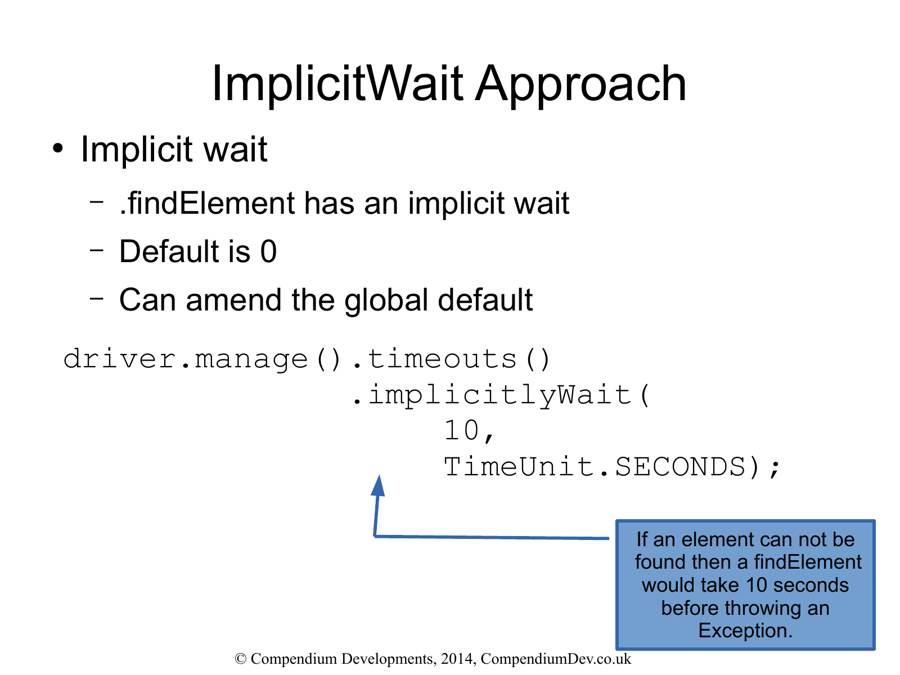

- Implicit wait
    - .findElement has an implicit wait
    - Default is 0
    - Can amend the global default

```java
driver.manage().timeouts()
               .implicitlyWait(
                    10,
                    TimeUnit.SECONDS);
```

If an element can not be

found then a findElement

would take 10 seconds

before throwing an

Exception.

---

<!-- Slide 96 -->

# WebDriverWait Approaches

- Explicit wait
    - WebDriverWait
        - ExpectedConditions helper class
        - custom ExpectedCondition (Class or inline)

new WebDriverWait(driver,10).until( ExpectedConditions.titleIs( "HTML Form Elements"));

---

<!-- Slide 97 -->

# WebDriverWait Example

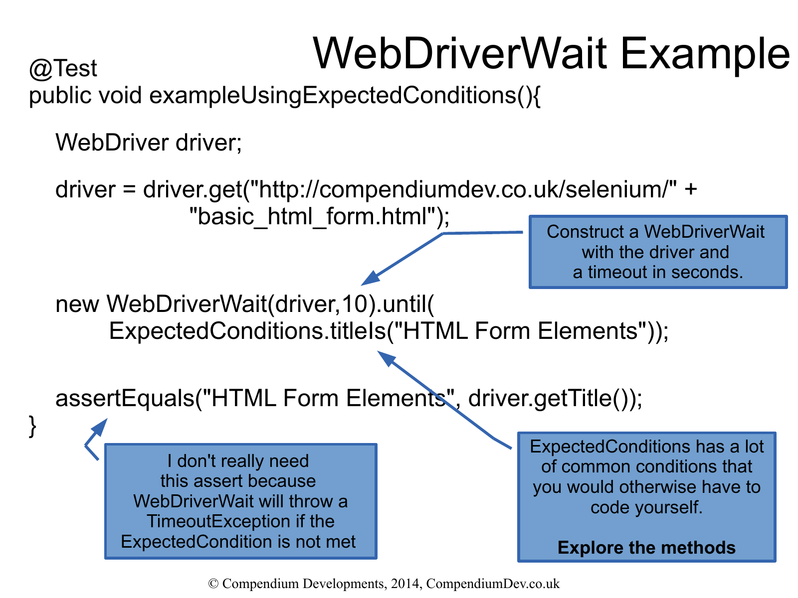

```java
@Test
public void exampleUsingExpectedConditions(){

    WebDriver driver;

    driver = driver.get("http://compendiumdev.co.uk/selenium/" +
                        "basic_html_form.html");


    new WebDriverWait(driver,10).until(
            ExpectedConditions.titleIs("HTML Form Elements"));


    assertEquals("HTML Form Elements", driver.getTitle());
}
```

I don't really need

this assert because

WebDriverWait will throw a

TimeoutException if the

ExpectedCondition is not met

Construct a WebDriverWait

with the driver and

a timeout in seconds.

ExpectedConditions has a lot

of common conditions that

you would otherwise have to

code yourself.

Explore the methods

---

<!-- Slide 98 -->

# Implicit or Explicit?

- Implicit can make initial tests faster to write
    - you don't worry about synchronisation when writing tests
- It can be harder to add synchronisation later
    - You have to identify a source of intermittency
- If you start with implicit then you can expose synchronisation problems by gradually reducing the implicit wait time
- Can make tests increasingly slower
- Implicit can make test failures slower to report

---

<!-- Slide 99 -->

# Basic Synchronisation with ExpectedConditions

- Wait for the page to be in the correct state before working with it
    - Why? ElementNotFound exception
    - More robust across browsers
- WebDriverWait
    - A wait class which handles element not found exceptions
- ExpectedConditions
    - A class of static helper methods
    - e.g. new WebDriverWait(driver,10).until( ExpectedConditions.somecondition( By.id("user\_login")));

---

<!-- Slide 100 -->

# Synchronisation API Summary

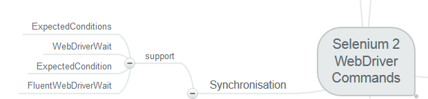

- new WebDriverWait(driver, seconds)
    - Create a wait class
- .until
    - Wait until a specific condition happens
    - until can return an element
- ExpectedConditions
    - A class of static helper wait methods for common scenarios


e.g.

- .titleIs(expectedValue)
    - True when title of page is expectedValue
- visibilityOfElementLocated
    - Returns an element when element located is visible

---

<!-- Slide 101 -->

# Checkpoint: Have you seen...

- Implicit wait added to code with test running?
- Explicit wait using WebDriverWait in the code with ExpectedConditions?
- Range of ExpectedConditions methods?

---

<!-- Slide 102 -->

# Do the Basic Synchronisation Exercises

---

<!-- Slide 103 -->

# Exercise Debrief

- Questions?
- Anything I need to demo?
- Etc.

---

<!-- Slide 104 -->

# Alan Richardson - Blogs, Books, and Courses

Section:

Custom Expected Condition

---

<!-- Slide 105 -->

# Custom Expected Condition

- Warning – this section requires Java Knowledge
- Most people do not create custom expected conditions, and instead use the ExpectedConditions class
- Learning the extra Java required to deal with Custom Expected Conditions will improve the readability and maintainability of your tests

---

<!-- Slide 106 -->

# Custom ExpectedCondition

```java
new WebDriverWait(driver,10).until(
     titleOfPageChangesFrom("in tutorial"));
);
```

- Why?
    - ExpectedConditions doesn't have what you need
    - You want to make your tests read well for your usage scenario
    - You want to pass additional values to the apply method
- ... create a Custom ExpectedCondition

---

<!-- Slide 107 -->

# Demo - ExpectedConditions

- org.openqa.selenium.support.ui.
    - ExpectedConditions
- Contains static methods which return an anonymous ExpectedCondition class
    - Define the type of the 'return' value
        - new ExpectedCondition&lt;Boolean&gt;()
    - Need to write an 'apply' method
        - Which returns true, or an object to signify wait is over
        - To keep waiting return null, or false

---

<!-- Slide 108 -->

# WebDriverWait Basics Explained

- Create a new WebDriverWait, with a timeout and call the 'until' method with an 'ExpectedCondition' as argument
- The 'until' method
    - calls the 'apply' method on the ExpectedCondition
    - Would stop waiting ...
        - If the 'apply' method returns true
        - If the apply method returns an object
    - If still waiting then pause for 500ms then try again
    - If timeout period expired then throw TimeoutException

```java
new WebDriverWait(driver,10).until(
     titleOfPageChangesFrom("in tutorial"));
);
```

---

<!-- Slide 109 -->

# Custom ExpectedCondition Example

```java
        new WebDriverWait(driver,10).until(
                new SelectContainsText(By.id("combo2"),"Java")
        );
```

---

<!-- Slide 110 -->

# Custom ExpectedCondition Example

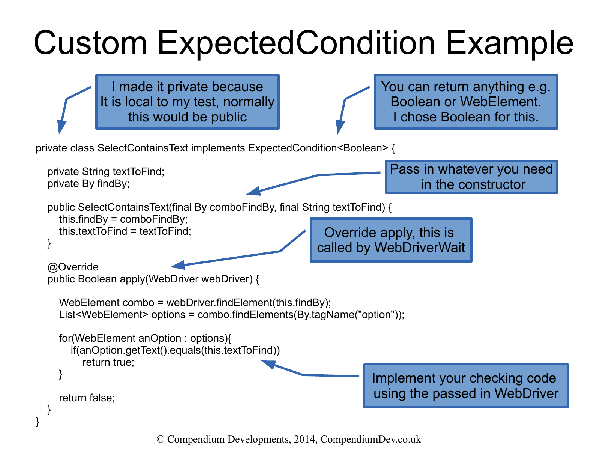

```java
    private class SelectContainsText implements ExpectedCondition<Boolean> {

        private String textToFind;
        private By findBy;

        public SelectContainsText(final By comboFindBy, final String textToFind) {
            this.findBy = comboFindBy;
            this.textToFind = textToFind;
        }

        @Override
        public Boolean apply(WebDriver webDriver) {

            WebElement combo = webDriver.findElement(this.findBy);
            List<WebElement> options = combo.findElements(By.tagName("option"));

            for(WebElement anOption : options){
                if(anOption.getText().equals(this.textToFind))
                    return true;
            }

            return false;
        }
    }
```

I made it private because

It is local to my test, normally

this would be public

You can return anything e.g.

Boolean or WebElement.

I chose Boolean for this.

Pass in whatever you need

in the constructor

Override apply, this is

called by WebDriverWait

Implement your checking code

using the passed in WebDriver

---

<!-- Slide 111 -->

# Adhoc Waits Created Inline Example

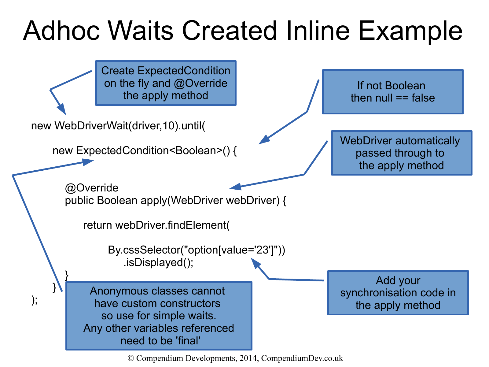

```java
new WebDriverWait(driver,10).until(
       new ExpectedCondition<Boolean>() {
           @Override
           public Boolean apply(WebDriver webDriver) {
                 return webDriver.findElement(
                         By.cssSelector("option[value='23']"))
                              .isDisplayed();
           }
       }
);
```

Create ExpectedCondition on the fly and @Override the apply method

WebDriver automatically passed through to the apply method

Add your

synchronisation code in the apply method

If not Boolean then null == false

Anonymous classes cannot have custom constructors so use for simple waits. Any other variables referenced need to be 'final'

---

<!-- Slide 112 -->

# Wrap Adhoc Wait in a method

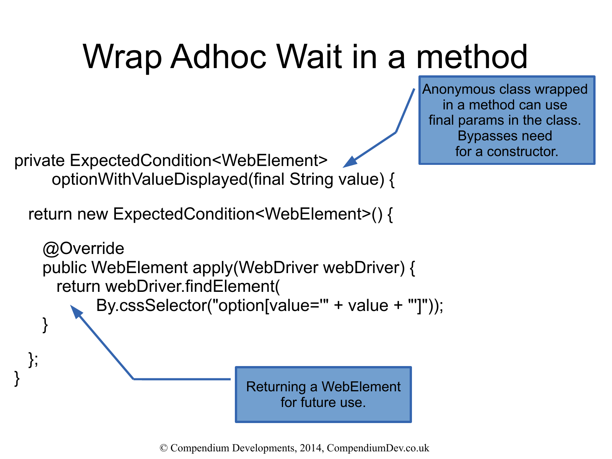

```java
private ExpectedCondition<WebElement>
        optionWithValueDisplayed(final String value) {

   return new ExpectedCondition<WebElement>() {

      @Override
      public WebElement apply(WebDriver webDriver) {
         return webDriver.findElement(
            By.cssSelector("option[value='" + value + "']"));
      }

   };
}
```

Anonymous class wrapped

in a method can use

final params in the class.

Bypasses need

for a constructor.

Returning a WebElement

for future use.

---

<!-- Slide 113 -->

# Custom Expected Condition Synchronisation Exercises

---

<!-- Slide 114 -->

# Exercise Debrief

- Questions?
- Anything I need to demo?
- Etc.

---

<!-- Slide 115 -->

# Abstraction

---

<!-- Slide 116 -->

# Abstraction Layers

- Abstraction Layers are
    - not a framework
    - contextual for an application, or an application framework
    - Essential for:
        - Maintenance
        - Speed of writing tests
        - Ease of understanding tests

---

<!-- Slide 117 -->

# Abstraction Layers Categorised

1. Data

- Generic Data Abstractions e.g. email, postcode

2. Physical

- Physical layout of your application e.g. pages, components
- Navigation across pages

3. Domain

- Your application Entities domain e.g. user, account

4. Logical

- User actions, workflows

---

<!-- Slide 118 -->

# Hints

- Create the test you want to see
    - Write the test as if the abstraction layers already existed
    - So you can:
        - See if it is readable, at the right level etc.
        - Use code completion to create classes (IntelliJ: Alt+Enter)

---

<!-- Slide 119 -->

# Page Objects?

- An abstraction around pages
    - Or page components
- Remove driver.xxxx from tests
- Model the physical domain
- Numerous ways of doing this
    - Page Factory
    - Extends LoadableComponent or SlowLoadableComponent
    - Basic objects
- Modelling Decisions Required

---

<!-- Slide 120 -->

# Example Test Using Page Object

```java
@Test
public void basicHtmlPageTest(){

    WebDriver driver = new FirefoxDriver();
    BasicHtmlPage page =
                                new BasicHtmlPage(driver);

    page.get();

    assertEquals(page.getParagraphOne(),
                        "A paragraph of text");
    assertEquals(page.getParagraphTwo(),
                        "Another paragraph of text");
}
```

---

<!-- Slide 121 -->

# Example Page Object

```java
public class BasicHtmlPage {
    private final WebDriver driver;
    private String paragraphTwo;

    public BasicHtmlPage(WebDriver driver) {
        this.driver = driver;
    }

    public void get() {
        driver.get(
"http://seleniumsimplified.com/testpages/basic_web_page.html");
    }

    public String getParagraphOne() {
        return driver.findElement(By.id("para1")).getText();
    }

    public String getParagraphTwo() {
        return driver.findElement(By.id("para2")).getText();
    }
}
```

---

<!-- Slide 122 -->

# Demo Page Objects POJO

- demos\\pageobjects\\ExamplePageObjectTest
- Plain Old Java Object
- Any Required Synchronisation in the methods
- Simple
- No Conventions

---

<!-- Slide 123 -->

# Refactor to Page Object Heuristics

- Convert local abstractions to Page Abstractions
- Replace comments with abstractions
- Make Decisions about the model based on the test readability and method reuse
- Build only what you need as you need it

---

<!-- Slide 124 -->

# Page Object Heuristics

- Construct the page object with a WebDriver
- Limit the methods to physical actions
- Expose Constants as public static final
- Don't navigate to the page in the constructor, either use a navigation object or a get() method

---

<!-- Slide 125 -->

# Demo Refactor To Page Object

- Convert test to use page object
- \\demos\\pageobjects\\refactorTo
    - RefactorExampleToPageObjectTest

---

<!-- Slide 126 -->

# Page Object Factory

- Annotate WebElements with @FindBy

@FindBy(how= How.ID, using="combo1") private WebElement aComboElement;

- Initialise the annotated WebElement(s) using a PageFactory

```java
    public BasicAjaxPageObject(WebDriver webDriver) {
        driver = webDriver;
        PageFactory.initElements(driver, this);
    }
```

---

<!-- Slide 127 -->

# Demo – Page Object Factory

- Walkthrough of
- demos\\pageobjects\\
- ExamplePageObjectTestUsingPageFactory

---

<!-- Slide 128 -->

# Slow Loadable Component

- If our page objects extend SlowLoadableComponent then we have an interface for 'waiting' for free
- Instead of explicitly coding waits for page load:

```java
       TracksDashboardHomePage dashboard =
          new TracksDashboardHomePage(driver);
```

new WebDriverWait(driver,10).until( ExpectedConditions.titleIs( dashboard.EXPECTED\_TITLE));

- We have a standard place to add conditions:

```java
TracksDashboardHomePage dashboard =
          new TracksDashboardHomePage(driver);
```

dashboard.get();

---

<!-- Slide 129 -->

# SlowLoadableComponent

- Public interface
    - get()
        - loads and waits for component to be available

extends SlowLoadableComponent&lt;PageObjectClassName&gt;

- Call super constructor in constructor

```java
    public PageObjectClassName(WebDriver driver) {
        super(new SystemClock(), 10);
        this.driver = driver;
    }
```

- Implement load and isLoaded
    - isLoaded throws a new Error if not loaded
    - I often leave the 'load' part empty if I navigate to the page

---

<!-- Slide 130 -->

# Demo – Slow Loadable

- Walkthrough of
- demos\\pageobjects\\
- ExamplePageObjectTestSlowLoadable

---

<!-- Slide 131 -->

# Why do this?

- Synchronise on load
    - Page Load – don't do anything until page is loaded
    - Component Load – so we don't try to engage with the component until it is loaded
    - Get in the habit of synchronising
    - Interface makes it easy to extend
    - 'forced' to think about synchronisation
    - Encourages more comprehensive checks on 'ready'
- No impact
    - If we don't call .get() we don't trigger the wait

---

<!-- Slide 132 -->

# Tips

- Sometimes I want to load a Slow Loadable Component page, without triggering the wait
- create a getPage method, to use from the test, and the load method

```java
public void getPage(){
  driver.get(Config.ROOT_URL +
             "/basic_web_page.html");
}

@Override
protected void load() {
    getPage();
}
```

---

<!-- Slide 133 -->

# Summary

- Page Objects can be POJO
- Domain Objects are POJO
- Create abstraction layers
- Write failing code and use code completion
- Never add asserts into your abstraction layer
- Write methods so they read as native language
- Refactor in small increments
- Keep refactoring

---

<!-- Slide 134 -->

# Do the Page Object Exercises

---

<!-- Slide 135 -->

# Exercise Debrief

- Questions?
- Anything I need to demo?
- Etc.

---

<!-- Slide 136 -->

# Bonus Sections

---

<!-- Slide 137 -->

# Bonus Sections

- This section contains an overview of 'additional' sections of the WebDriver API
- The tutorial may or may not have the time to reach this point

---

<!-- Slide 138 -->

# Support Classes as Abstractions

Examine the WebDriver source code for examples to build on.

e.g. org.openqa.selenium.support

- Select
- ExpectedConditions

---

<!-- Slide 139 -->

# Alerts

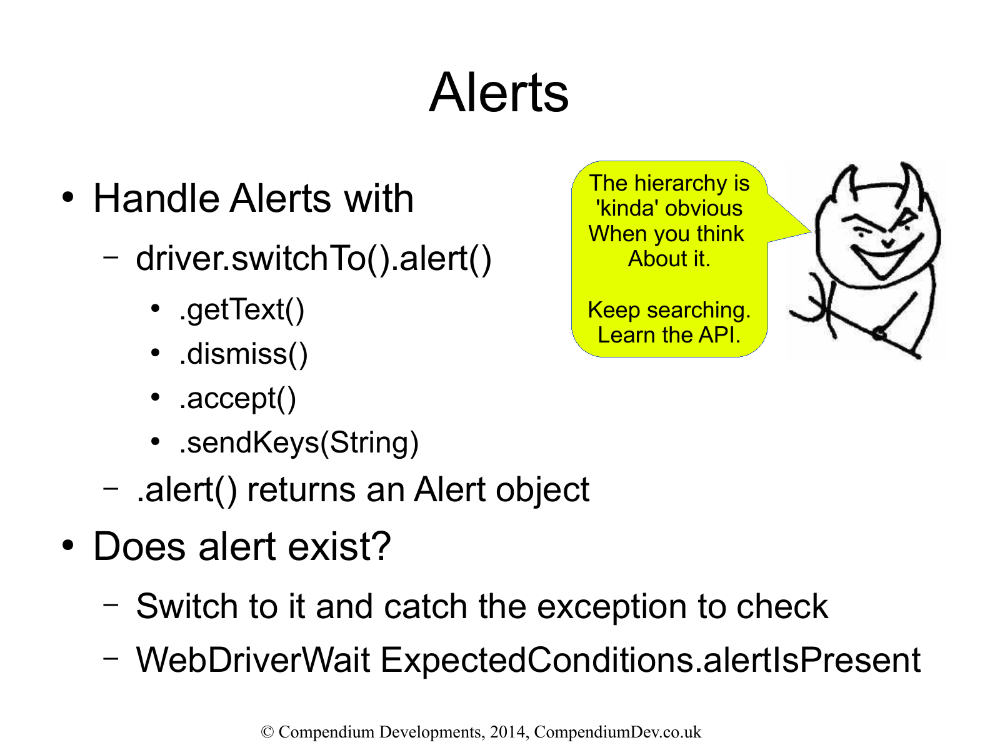

- Handle Alerts with
    - driver.switchTo().alert()
        - .getText()
        - .dismiss()
        - .accept()
        - .sendKeys(String)
    - .alert() returns an Alert object
- Does alert exist?
    - Switch to it and catch the exception to check
    - WebDriverWait ExpectedConditions.alertIsPresent

The hierarchy is

'kinda' obvious

When you think

About it.

Keep searching.

Learn the API.

---

<!-- Slide 140 -->

# User Interactions

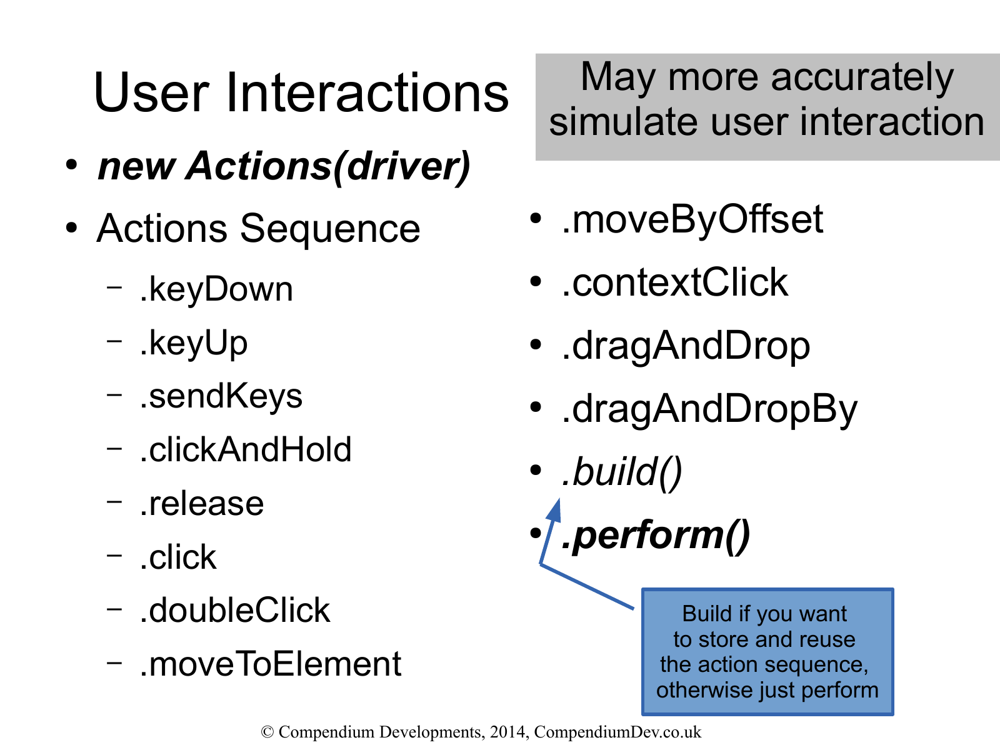

- new Actions(driver)
- Actions Sequence
    - .keyDown
    - .keyUp
    - .sendKeys
    - .clickAndHold
    - .release
    - .click
    - .doubleClick
    - .moveToElement

- .moveByOffset
- .contextClick
- .dragAndDrop
- .dragAndDropBy
- .build()
- .perform()

May more accurately simulate user interaction

Build if you want

to store and reuse

the action sequence,

otherwise just perform

---

<!-- Slide 141 -->

# More About Actions

- Actions uses GWT – operating system mouse move etc. so is more realistic
- You can interfere with the test if you move mouse and keyboard
- Actions can be brittle

---

<!-- Slide 142 -->

# Actions to simulate user Actions

- Hover, etc.
- new Actions(driver). ChainOfActions. build().perform();
- e.g. a chain of click actions

```java
        Actions actions = new Actions(driver);

        actions.click(multiSelectOptions.get(0)).
                click(multiSelectOptions.get(1)).
                click(multiSelectOptions.get(2)).perform();
```

---

<!-- Slide 143 -->

# Actions API Summary Slides

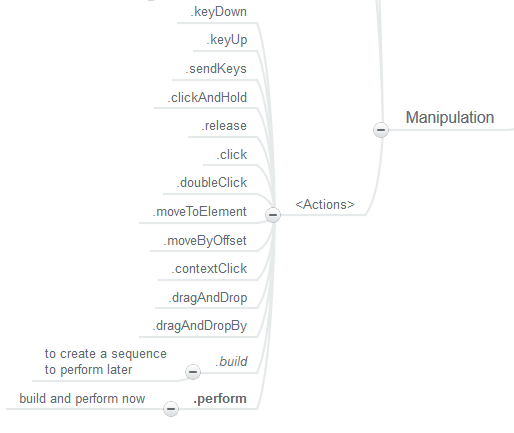

Note: I try and avoid actions

---

<!-- Slide 144 -->

# Alan Richardson - Blogs, Books, and Courses

Cookies


---

<!-- Slide 145 -->

# Cookies

- Inspect
    - driver.manage
        - .getCookies()
        - .getCookieNamed(“name”)
- Interact
    - driver.manage
        - .addCookie(Cookie)
        - .deleteAllCookies
        - .deleteCookie(Cookie)
        - .deleteCookieNamed(“name”)

---

<!-- Slide 146 -->

# Cookies Example

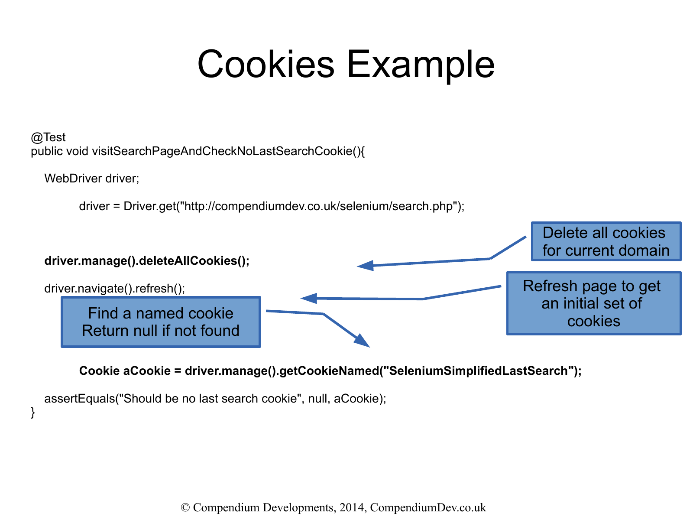

```java
    @Test
    public void visitSearchPageAndCheckNoLastSearchCookie(){

        WebDriver driver;

        driver = Driver.get("http://compendiumdev.co.uk/selenium/search.php");


        driver.manage().deleteAllCookies();

        driver.navigate().refresh();


        Cookie aCookie = driver.manage().getCookieNamed("SeleniumSimplifiedLastSearch");

        assertEquals("Should be no last search cookie", null, aCookie);
    }
```

Delete all cookies

for current domain

Refresh page to get

an initial set of

cookies

Find a named cookie

Return null if not found

---

<!-- Slide 147 -->

# Cookie.Builder

- Can use constructor
    - new Cookie
- Or can use Cookie.Builder

```java
Cookie aNewCookie = new Cookie.Builder(
                                    aCookie.getName(),
                                    String.valueOf(2)).
                          domain(aCookie.getDomain()).
                          path( aCookie.getPath()).
                          expiresOn(aCookie.getExpiry()).
                                isSecure(aCookie.isSecure()).
                                build();
```

---

<!-- Slide 148 -->

# Alan Richardson - Blogs, Books, and Courses

JavaScript


---

<!-- Slide 149 -->

# Why use Javascript?

- Workarounds
- Custom synchronisation
- Make the app more testable
    - Adjust hidden fields
    - Amend values
- Simulate hard to reach conditions
- Test Flash &amp; HTML 5

---

<!-- Slide 150 -->

# Javascript Execution

- Cast WebDriver to JavascriptExecutor
    - .executeScript(script, args...)
    - .executeAsyncScript(script, args...)
- Arguments are accessed using
    - arguments[index] e.g. "document.title=arguments[0]"
- Return values are converted to Java types
    - Html Element = WebElement, decimal = Double, non-decimal = Long, boolean = Boolean, array = List&lt;Object&gt;, else String or null
- Runs in an anonymous function

---

<!-- Slide 151 -->

# (JavascriptExecutor) Example

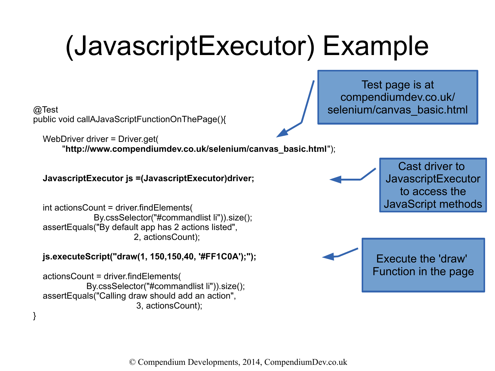

```java
    @Test
    public void callAJavaScriptFunctionOnThePage(){

        WebDriver driver = Driver.get(
                "http://www.compendiumdev.co.uk/selenium/canvas_basic.html");


        JavascriptExecutor js =(JavascriptExecutor)driver;


        int actionsCount = driver.findElements(
                             By.cssSelector("#commandlist li")).size();
        assertEquals("By default app has 2 actions listed",
                    2, actionsCount);

        js.executeScript("draw(1, 150,150,40, '#FF1C0A');");

        actionsCount = driver.findElements(
                          By.cssSelector("#commandlist li")).size();
        assertEquals("Calling draw should add an action",
                     3, actionsCount);
    }
```

Cast driver to JavascriptExecutor to access the JavaScript methods

Test page is at

compendiumdev.co.uk/ selenium/canvas\_basic.html

Execute the 'draw'

Function in the page

---

<!-- Slide 152 -->

# Alan Richardson - Blogs, Books, and Courses

Introducing Different Browsers


---

<!-- Slide 153 -->

# Browsers Overview

- Firefox Driver – currently built in
- HtmlUnit Driver – currently built in
- ChromeDriver – separate .exe
- OperaDriver – separate .exe available through maven, does not support current Opera version
- IEDriver – separate .exe IE10 and below
- RemoteDriver – currently built in, requires a server to connect to e.g. saucelabs or grid
- Various mobile drivers and safari driver

---

<!-- Slide 154 -->

# Firefox Driver

- Currently part of deployed Jars
    - Effectively 'built in'
    - Easy to get started with
    - Can be slow to startup

```java
aDriver = new FirefoxDriver();
```

---

<!-- Slide 155 -->

# Firefox Driver Profile

- Driver Profiles allow us to initialise a driver with additional capabilities and specific configuration

```java
  FirefoxProfile profile = new FirefoxProfile();
  WebDriver driver = new FirefoxDriver(profile);
```

- Profile level methods

profile.setEnableNativeEvents(true);

- Set browser preferences

profile.setPreference("extensions.firebug.currentVersion", "1.6.2");

- Load extensions profile.addExtension(new File(extensionPath));

---

<!-- Slide 156 -->

# FirefoxDriver Useful Links

- Firefox Preferences
    - about:config
    - <http://www.timeatlas.com/5_minute_tips/general/introduction_to_firefox_preferences#.UIvbL4az728>
- Firefox Driver Documentation
    - <http://code.google.com/p/selenium/wiki/FirefoxDriver>

---

<!-- Slide 157 -->

# Browser Capabilities

- Generic browser control mechanism
- e.g. Set Proxies

org.openqa.selenium.Proxy proxy = new org.openqa.selenium.Proxy(); proxy.setHttpProxy("localhost:8080") .setFtpProxy("localhost:8080") .setSslProxy("localhost:8080");

```java
        DesiredCapabilities capabilities = new DesiredCapabilities();
```

capabilities.setCapability(CapabilityType.PROXY, proxy);

---

<!-- Slide 158 -->

# HtmlUnitDriver

- <http://htmlunit.sourceforge.net/>
- DesiredCapabilities.setJavascriptEnabled seems to have been added for HTMLUnit

WebDriver htmlunit = new HtmlUnitDriver(true);

---

<!-- Slide 159 -->

# ChromeDriver

- <http://code.google.com/p/selenium/wiki/ChromeDriver>
- Download the driver server
    - set "webdriver.chrome.driver" to the location
- Command line switches
    - <http://peter.sh/experiments/chromium-command-line-switches/>
    - Pass in via options.addArguments
- ChromeDriver.log is useful debugging tool

---

<!-- Slide 160 -->

# ChromeDriver Example

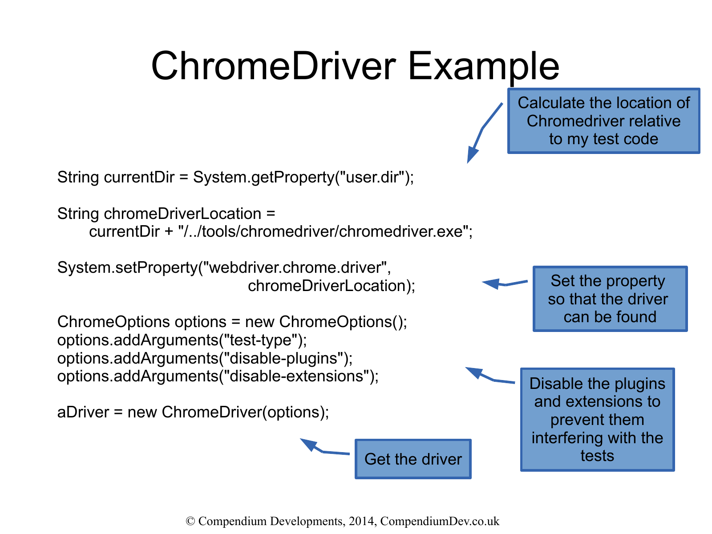

```java
String currentDir = System.getProperty("user.dir");

String chromeDriverLocation =
    currentDir + "/../tools/chromedriver/chromedriver.exe";

System.setProperty("webdriver.chrome.driver",
                        chromeDriverLocation);

ChromeOptions options = new ChromeOptions();
options.addArguments("test-type");
options.addArguments("disable-plugins");
options.addArguments("disable-extensions");

aDriver = new ChromeDriver(options);
```

Calculate the location of

Chromedriver relative

to my test code

Set the property

so that the driver

can be found

Disable the plugins

and extensions to prevent them interfering with the tests

Get the driver

---

<!-- Slide 161 -->

# Opera Driver

- Documentation and Downloads
    - <http://code.google.com/p/selenium/wiki/OperaDriver>
    - <https://github.com/operasoftware/operadriver>
    - <http://mvnrepository.com/artifact/com.opera/operadriver>
- Add to maven

```xml
    <dependency>
        <groupId>com.opera</groupId>
        <artifactId>operadriver</artifactId>
        <version>1.1</version>
    </dependency>
```

- Does not support modern Opera version

---

<!-- Slide 162 -->

# Config Opera Driver

- Capabilities
- OperaProfile
    - opera:config
    - <http://www.opera.com/support/usingopera/operaini>

```java
OperaProfile profile = new OperaProfile();

// switching off Javascript will cause the opera driver to fail
profile.preferences().set("Extensions", "Scripting", 0);

WebDriver opera = new OperaDriver(profile);
```

---

<!-- Slide 163 -->

# IE Driver

- <http://code.google.com/p/selenium/wiki/InternetExplorerDriver>
- Download the server executable
    - <http://code.google.com/p/selenium/downloads/list>
    - Set “webdriver.ie.driver” to the location of the driver executable

```java
String currentUserDir = System.getProperty("user.dir");
String IEDriverLocation = currentUserDir +
                    "/../tools/iedriver_32/IEDriverServer.exe";
System.setProperty("webdriver.ie.driver", IEDriverLocation);
aDriver = new InternetExplorerDriver();
```

---

<!-- Slide 164 -->

# IE Driver on Path

- Drivers change
- IE Driver used to be add to path
- This method will be deprecated in favour of properties
- Pointing this out because we have to learn to read the code and the log messages output by Selenium

---

<!-- Slide 165 -->

# Alan Richardson - Blogs, Books, and Courses

RemoteWebDriver


---

<!-- Slide 166 -->

# Remote Driver

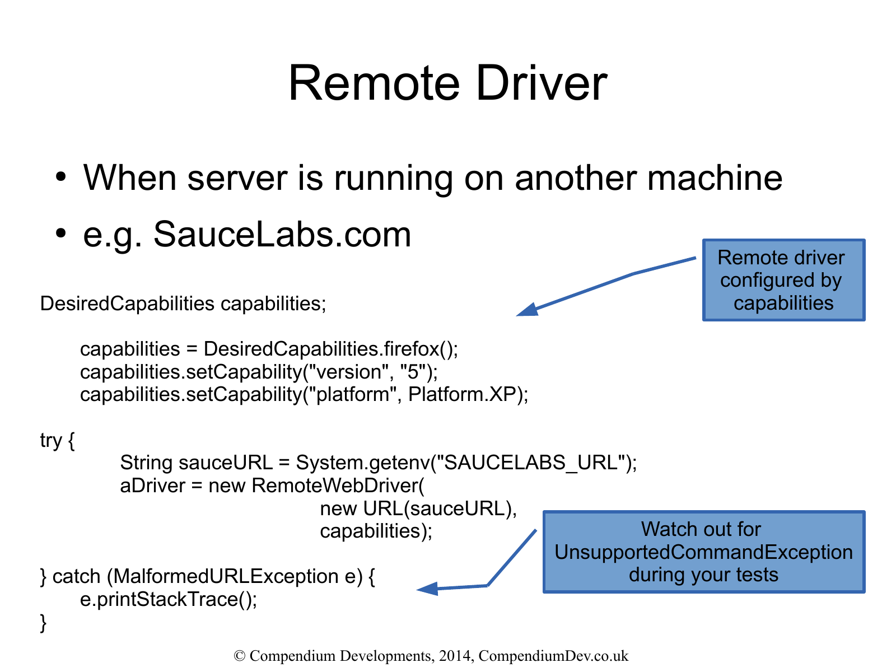

- When server is running on another machine
- e.g. SauceLabs.com

```java
DesiredCapabilities capabilities;
    capabilities = DesiredCapabilities.firefox();
    capabilities.setCapability("version", "5");
    capabilities.setCapability("platform", Platform.XP);

try {
        String sauceURL = System.getenv("SAUCELABS_URL");
        aDriver = new RemoteWebDriver(
                            new URL(sauceURL),
                            capabilities);

} catch (MalformedURLException e) {
    e.printStackTrace();
}
```

Remote driver configured by capabilities

Watch out for UnsupportedCommandException during your tests

---

<!-- Slide 167 -->

# RemoteWebDriver Profiles

- Can set firefox profiles on RemoteWebDriver

```java
FirefoxProfile fp = new FirefoxProfile();
// set something on the profile...
DesiredCapabilities dc = DesiredCapabilities.firefox();
dc.setCapability(FirefoxDriver.PROFILE, fp);
WebDriver driver = new RemoteWebDriver(dc);
```

- Can set firefox profiles on RemoteWebDriver

- Can set Chrome options on RemoteWebDriver

```java
ChromeOptions options = new ChromeOptions();
// set some options
DesiredCapabilities dc = DesiredCapabilities.chrome();
dc.setCapability(ChromeOptions.CAPABILITY, options);
WebDriver driver = new RemoteWebDriver(dc);
```

---

<!-- Slide 168 -->

# Grid Systems

- saucelabs.com
- browserstack.com
- Sign up for free
- Free plan good enough for this course, and a lot of things
- Records video
- Manual Testing

---

<!-- Slide 169 -->

# Alan Richardson - Blogs, Books, and Courses

Section: Any Time Left?

---

<!-- Slide 170 -->

# Any Questions?

---

<!-- Slide 171 -->

# Time for Free For All Automation?

- Pick a section and try and automated it
- Refactor some of the code into page objects or domain objects
- Try generating test data
- Try some of the advanced exercises

---

<!-- Slide 172 -->

# Alan Richardson - Blogs, Books, and Courses

Reference Section

---

<!-- Slide 173 -->

# Basic Practice Pages

- <http://SeleniumSimplified.com/testpages/>
    - alert.html
    - basic\_ajax.html
    - basic\_web\_page.html
    - basic\_html\_form.html
    - ajaxselect.php
- Source available at https://github.com/eviltester/seleniumTestPages

- calculate.php
- find\_by\_playground.php
- refresh.php
- search.php
- etc. (see index.html)

---

<!-- Slide 174 -->

# Advanced Practice Pages

- compendiumdev.co.uk/selenium/Showcase/Showcase.html
    - <http://compendiumdev.co.uk/selenium/Showcase/Showcase.html>
- Source available at https://github.com/eviltester/simpleGWTShowCaseClone

---

<!-- Slide 175 -->

# Recommended Applications For Practice Overview

- Intermediate:
    - <http://todomvc.com/>
- Advanced
    - <http://google-gruyere.appspot.com/>
    - <http://demo.redmine.org/>
    - <http://getontracks.org/>

---

<!-- Slide 176 -->

# Learn More Java

- Java For Testers
    - by Alan Richardson
- Effective Java
    - by Joshua Bloch
- Implementation Patterns
    - by Kent Beck
- Growing Object-Oriented Software, Guided by Tests
    - by Steve Freeman and Nat Pryce

---

<!-- Slide 177 -->

# Live pages to challenge yourself

gwt.google.com/samples/Showcase/Showcase.html

GWT demo application – good for synchronisation and location practice

<http://www.primefaces.org/showcase/>

Primfaces demo application – good for synchronisation and location practice. Also check out the source as they use WebDriver for their testing.

---

<!-- Slide 178 -->

# WebDriver Summary Sheet

| WebElement |
| --- |
| .getText() |
| .getAttribute(“name”) |
| .getTagName() |
| .isEnabled() |
| .isSelected() |
| .isDisplayed() |
| .getSize() |
| .getLocation() |
| .getCssValue() |

| Finding elements |
| --- |
| WebDriver |
| WebElement =<br>.findElement(BY) |
| List&lt;WebElement&gt; =<br>.findElements(BY) |
| By |
| .id(“an\_id”) |
| .xpath(“xpath”) |
| .cssSelector(“css”) |
| .className(“class”) |
| .linkText(“text”) |
| .name(“name” |
| .tagName(“a\_tag”) |
| .partialLinkText(“t”); |
| Support |
| ByChaining(By, By) |
| ByIdOrName(“idName”) |

Inspect

Navigate

| WebDriver |
| --- |
| .get(“URL”) |
| .navigate |
| .to(Url) |
| .to(“URL”) |
| .back() |
| .forward() |
| .refresh() |

| WebDriver |
| --- |
| .getTitle() |
| .getCurrentUrl() |
| .getPageSource() |

| WebDriver Interact |
| --- |
| = new &lt;driverClass&gt;() |
| .close() |
| .quit() |

Interact

| WebElement |
| --- |
| .click() |
| .submit() |
| .clear() |
| .sendKeys(String) |
| .sendKeys(Keys.x) |

| support.ui.Select |
| --- |
| .&lt;methods&gt;() |

| SwitchTo. |
| --- |
| .alert() |
| .getText() |
| .accept() |
| .dismiss() |
| .sendKeys(String) |
| .frame(...) |

| ExpectedConditions |
| --- |
| .titleIs(String) |
| … a lot of helper methods |

| WebDriverWait |
| --- |
| (driver, timeout in Seconds)<br>.until(ExpectedCondition) |

| Cookies |
| --- |
| WebDriver |
| .manage() |
| .deleteAllCookies() |
| .addCookie(Cookie) |
| .deleteCookie(Cookie) |
| .deleteCookieNamed(String) |

Synchronise

| Cookies |
| --- |
| WebDriver |
| .manage() |
| .getCookieNamed(String) |
| .getCookies() |

| Actions |
| --- |
| .keyUp() etc. |
| .perform() |

| (JavascriptExecutor) |
| --- |
| .executeScript |

---

<!-- Slide 179 -->

# Selectors

| CSS Selectors |
| --- |
| \* - any |
| #id |
| .class |
| tag |
| [attribute] |
| [attribute="value"] |
| tag[attribute="value"] |
| tag[attr1='val1'][attr2='val2'] |
| tag[att1='val1'], orThisTag |
| = (' or ") |
| \*="anywhere in value" |
| ^="start of value" |
| $="end of value" |
| ~="spaceSeperatedValue" |
| Paths |
| A &gt; B (child) |
| A B (any descendant) |
| A + B (A's B sibling) |
| tag:first-child |

| XPATH Selectors |
| --- |
| // - match anywhere |
| / - match from root |
| //\* - any element |
| //tag |
| //\*[@attribute] |
| //\*[@attribute="value"] |
| //tag[@attribute="value"] |
| //tag1/tag2 (child) |
| //tag1//tag2 (any descendant) |
| //tag1/../.. (.. to go up) |
| //\*[.='element textl] |
| [@at1="a" and @at2="b"] |
| and, or, =, !=, &lt;, &gt;, &gt;=, &lt;- |
| Functions |
| contains(@a,"alu") |
| starts-with(@a,"v") |
| ends-with(@a,"e") |
| Indexing |
| //tag[1] |

XPath References

- <http://www.w3schools.com/xpath/>
- <http://www.simple-talk.com/dotnet/.net-framework/xpath,-css,-dom-and-selenium-the-rosetta-stone/>

CSS References

- <http://reference.sitepoint.com/css/selectorref>
- http://net.tutsplus.com/tutorials/html-css-techniques/ the-30-css-selectors-you-must-memorize/
- <http://www.quirksmode.org/css/contents.html>
- <http://www.w3schools.com/cssref/css_selectors.asp>

---

<!-- Slide 180 -->

# Alan Richardson - Blogs, Books, and Courses

Blogs and Websites

- CompendiumDev.co.uk
- SeleniumSimplified.com
- EvilTester.com
- JavaForTesters.com
- Twitter: @eviltester

Online Training Courses

- Technical Web Testing 101
- Intro to Selenium
- Selenium 2 WebDriver API

Videos

youtube.com/user/EviltesterVideos

Books

Selenium Simplified

Java For Testers

leanpub.com/javaForTesters

Alan Richardson

uk.linkedin.com/in/eviltester

Independent Test Consultant &amp; Custom Training

Contact Alan

<http://compendiumdev.co.uk/contact>


