# Resources

---

# Testing 'Techniques'

- Testing Techniques,
- Testing Object Oriented Systems

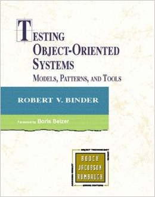

Boundaries, Equiv, Domain Testing, Graphs, Entities

---

# Testing Lessons &amp; Experience

- Testing Computer Software,
- Lessons Learned in software testing

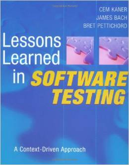

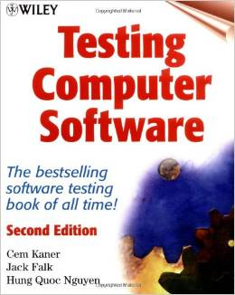

---

# Models, Heuristics, Mnemonics

- Heuristics,
- Mnemonics
- Rapid Software Testing,

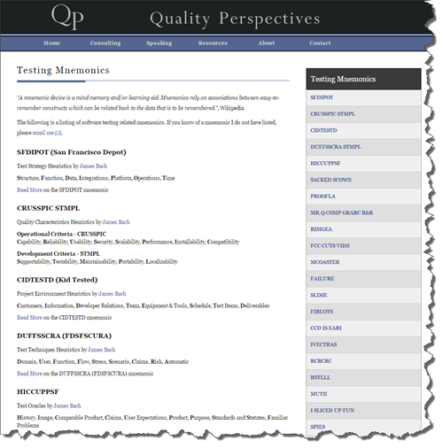

http://www.qualityperspectives.ca/resources\_mnemonics.html

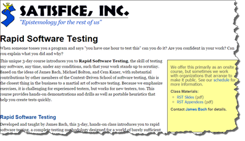

http://www.satisfice.com/info\_rst.shtml

---

# Models, Heuristics, Mnemonics

- Mnemonics lists
    - qualityperspectives.ca/resources\_mnemonics.html
- Rapid Software Testing
    - by James Bach &amp; Michael Bolton
    - satisfice.com/info\_rst.shtml

---

# Resources - Modelling

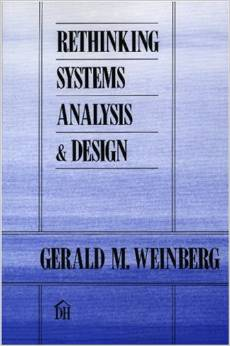

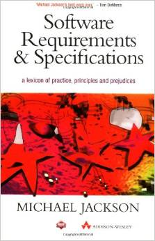

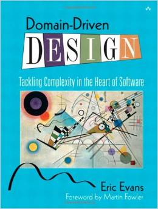

- Rethinking Systems Analysis &amp; Design
    - by Gerald M. Weinberg
- Domain Driven Design
    - by Eric Evans
- Software Requirements &amp; Specifications
    - by Michael Jackson

---

# Resources - Modelling

- Diagnosing the System For Organisations
    - by Stafford Beer
- Principles of Experimentation And Measurement
    - by Gordon M. Bragg

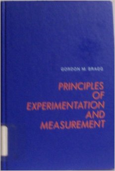

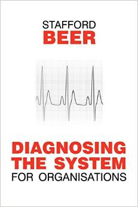

---

# Resources - Observation

- Observation
    - The Structure of Magic Volumes 1 &amp; 2
        - by Richard Bandler and John Grinder

---

# Resources - Interrogation

- The Web Application Hackers Handbook
- Provocative Therapy by Frank Farrelly
- NLP For Testers, by Alan Richardson
    - compendiumdev.co.uk/page/nlp

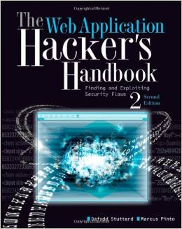

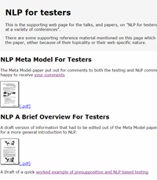

---

# Resources – Reflection

- Quantum Psychology
    - by Robert Anton Wilson

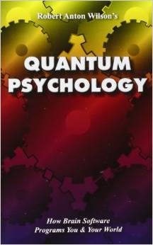

---

# Resources – Manipulation

- How to Break Software,
- How to Break Web Software,
- How to Break Security
    - by Whittaker (and others)

---

# Resources – Manipulation

- Patterns of the Hypnotic Techniques of Milton Erickson
    - by Richard Bandler &amp; John Grinder
- Changing with Families
    - by Bandler, Grinder &amp; Virginia Satir

---

# Tools

- Systems Thinking &amp; Modelling
    - Modelling,
    - Cybernetics,
    - Psychotherapy,
    - ...
- Testing Knowledge
    - Techniques,
    - Exploration,
    - Note Taking,
    - etc.

