# Technical Testing Webinar 1st April 2015 for Tabara de Testare

4 Romanian Cities, 1 Webinar

http://www.eviltester.com

http://www.meetup.com/Tabara-de-Testare-Cluj/

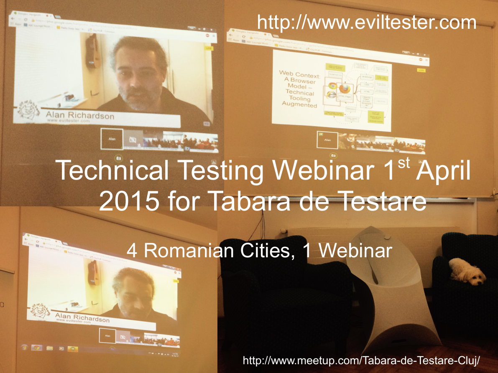

---

# On 1st April 2015, this webinar was presented live via Google Hangouts to the Tabara de Testare Romanian Testing Group

- An audience spread across rooms in 4 Romanian Cities, with 70+ people tuning in from the comfort of their own home and workplace
- The Webinar consisted of the slides and talky bits, a hands on demo, followed by a Q&amp;A section

---

# Blogs and Websites

CompendiumDev.co.uk

SeleniumSimplified.com

EvilTester.com

JavaForTesters.com

Twitter: @eviltester

Online Training Courses

Technical Web Testing 101

Intro to Selenium

Selenium 2 WebDriver API

Videos

youtube.com/user/EviltesterVideos

Books

Selenium Simplified

Java For Testers

leanpub.com/javaForTesters

Alan Richardson

uk.linkedin.com/in/eviltester

Independent Test Consultant &amp; Custom Training

Contact Alan

http://compendiumdev.co.uk/contact

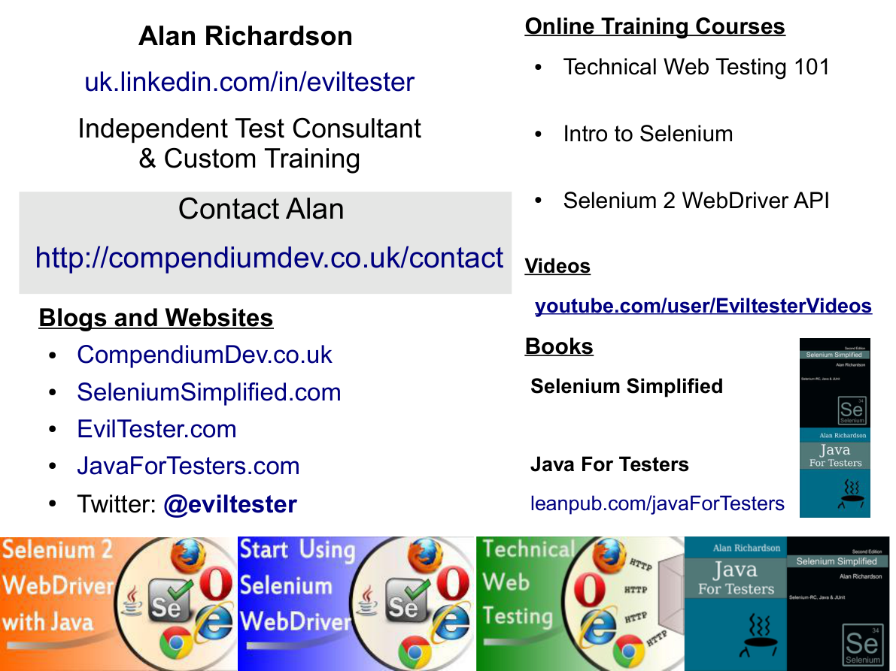

---

# But first some surface structure examples:

- Non-Technical Testing of a Web App
    - Tester → Browser
- Technical Testing of a Web App
    - Tester → Browser → Proxy → Server → DB

---

# Non-Technical Testing of a Web App

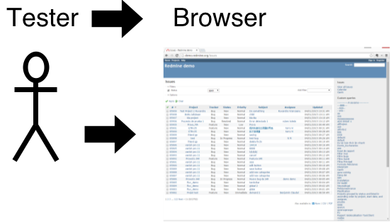

Tester → Browser. The diagram shows the tester working through the browser interface.

---

# Technical Testing of a Web App

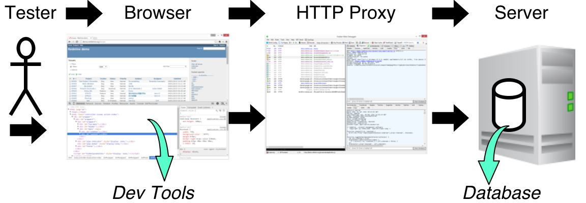

Tester → Browser → HTTP Proxy → Server → Database. The browser exposes Dev Tools as another interface for investigation.

---

# Technical Testing of a Web App

- Log monitoring
- DB access
- DB monitoring
- Profiling on the server
- Etc.

Tester → Browser → HTTP Proxy → Server → Database, with Dev Tools available at the browser.

---

# Surface Structure

- What it looks like from the outside
- Not a deep model
- It's not just addition of tools
- Attitude
- Philosophy

---

# What do I mean by Testing?

---

# All the normal stuff we learn

- Testing Techniques, Testing Object Oriented Systems
- Boundaries, Equiv, Domain Testing, Graphs, Entities

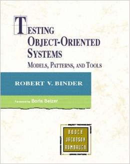

---

# All the Lessons we've learned over the years

- Testing Computer Software, Lessons Learned in software testing

---

# Over the years we build up models of what we do

- Heuristics,
- Mnemonics
- Rapid Software Testing,

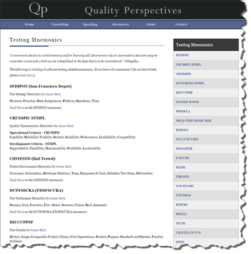

http://www.qualityperspectives.ca/resources\_mnemonics.html

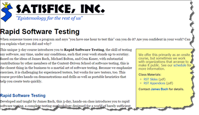

http://www.satisfice.com/info\_rst.shtml

---

# Build your own model

- Observe what you do
- Reflect on why you do it
- Ask yourself how else you could do it

---

# MORIM

- Model
    - What I think I understand. Different viewpoints.
- Observe
    - at different points to corroborate/invalidate model
- Reflect
    - find gaps, lack of depth, derive intent
- Interrogate
    - Focussed, deep dive observation with intent
- Manipulate
    - Hypothesis exploration and “how we do stuff”

---

# MORIM from Psychotherapy

- Model
    - “Work with the client you have, not the client you want”
- Observe
    - What language patterns do people use?
- Reflect
    - Remodel. Figure out what questions to ask next
- Interrogate
    - Specific questions to ask
- Manipulate
    - To effect change, manipulate - Hypnosis

---

# Tools

- Systems Thinking &amp; Modelling
    - Modelling,
    - Cybernetics,
    - Psychotherapy,
    - ...
- Testing Knowledge
    - Techniques,
    - Exploration,
    - Note Taking,
    - etc.

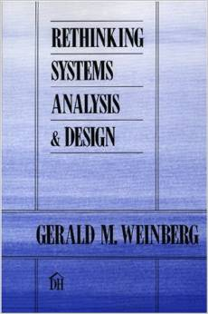

---

# Fundamentally, everything I do is modelling and model exploration.

- 'Technical' means going deeper into the models

---

# MORIM &amp; Technical Web Testing

---

# Web Context: A Browser Model

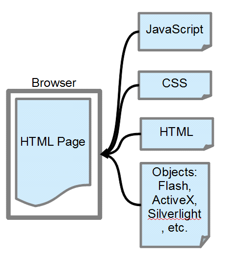

| Component | Modelled content |
| --- | --- |
| Browser | HTML Page |
| Inputs to the rendered page | JavaScript, CSS, HTML |
| Objects | Flash, ActiveX, Silverlight, etc. |

---

# Web Context: A Browser Model – Technical Risks

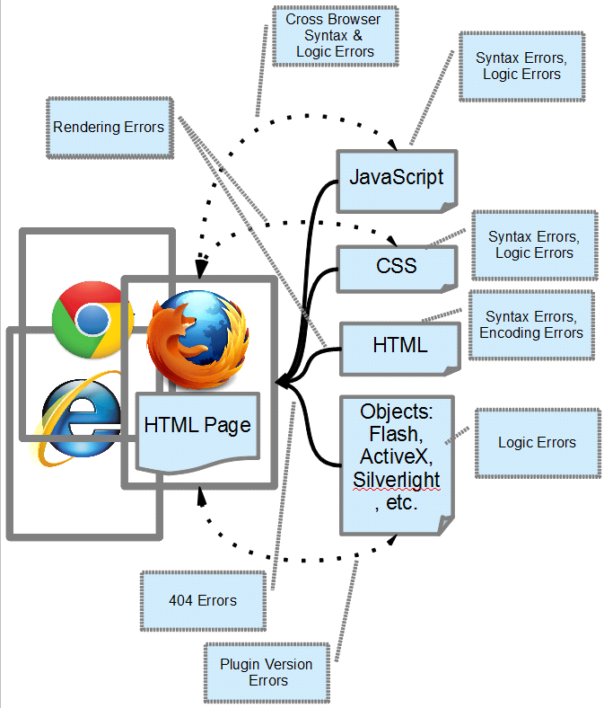

| Model area | Risks shown |
| --- | --- |
| Browser | Rendering Errors |
| Cross-browser behaviour | Cross Browser Syntax & Logic Errors |
| JavaScript | Syntax Errors, Logic Errors |
| CSS | Syntax Errors, Logic Errors |
| HTML | Syntax Errors, Encoding Errors |
| Objects: Flash, ActiveX, Silverlight, etc. | Logic Errors, Plugin Version Errors |
| Resources | 404 Errors |

The browser still renders the HTML Page from JavaScript, CSS, HTML and Objects; the dotted paths identify additional risks.

---

# Generic Web Application Model

Browser ↔ Server ↔ Database

What happens where?

What could we observe where?

Where could we manipulate?

---

# Generic Web Application

Browser ↔ Server ↔ Database

| Area | Modelled content |
| --- | --- |
| Browser | Rendering; CSS; Cookies; JavaScript |
| Traffic | HTTP Traffic; Cookie Creation; JSON, XML; Files: img, pdf, etc. |
| Server | HTTP Logs; Application Logs |
| Database | Schema; Data |

---

# Modelling &amp; Reflection lead to tooling to augment our testing

- What can we observe?
    - How would that help me?
        - How can I observe it? → tools
- What can I manipulate?
    - Why would I manipulate it?
        - How can I manipulate it? → tools

---

# Web Context: A Browser Model – Technical Tooling Augmented

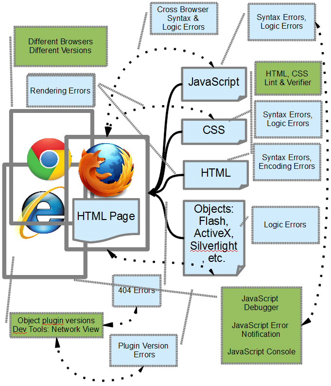

| Model area | Risks shown | Tooling added |
| --- | --- | --- |
| Browser and rendering | Rendering Errors; Cross Browser Syntax & Logic Errors | Different Browsers, Different Versions |
| JavaScript | Syntax Errors, Logic Errors | JavaScript Debugger; JavaScript Error Notification; JavaScript Console |
| CSS and HTML | Syntax Errors, Logic Errors, Encoding Errors | HTML, CSS Lint & Verifier |
| Objects: Flash, ActiveX, Silverlight, etc. | Logic Errors; Plugin Version Errors | Object plugin versions; Dev Tools: Network View |
| Resources | 404 Errors | Dev Tools: Network View |

JavaScript, CSS, HTML and Objects contribute to the HTML Page shown by the browser.

---

# What tools could we use?

- What can we observe?
    - Http traffic, cookies, javascript execution, log files, data in the database, DB schema used
- What tools do we need to observe?
    - HTTP Proxy (Burpsuite, ZAP Proxy, Fiddler), Browser Developer Tools (in browser), DB Tool (mysql, mysql workbench), Text Editors, Log File Viewers (tail -f)
- What can we manipulate?
    - HTTP Traffic, DOM, Cookies, DB, Config
- What tools do we need to manipulate?
    - All of the above

---

# Tools lead to new ideas

- Don't start with tools
- But once you have tools
    - Tools are technology
    - Look at their features – expand your models
    - How could you use that?
    - What does that teach you?

---

# e.g. Fuzzing

- Fuzzing – repeating requests while varying data
- Some proxy tools have Fuzzers
- Traditional use as templated security testing...
- We could 'repeat requests while varying data'
    - Quick tool supported exploration of a controlled data set
    - Fuzz data sets as data we would never use

---

# Reflections on Technical Testing

---

# A description of Technical Testing

- A reminder to keep “going deeper”
- Tool Augmentation
- Technical details will:
    - inspire more testing
    - identify more risks
    - Identify different problems
- Not limit our testing to Acceptance Criteria

---

# It means "Tool Augmentation"

- Is not automation, it uses automation
- Tools to passively observe, maintain history of observations
- Tools to alert on specific conditions
- Tools to observe the unobserved, and interrogate the inaccessible
- Tools to help me model and reflect
- Tools to help me manipulate
- ... etc.

Never tools to control. Tools to augment.

---

# How I describe what I do

- Not a definition
- A description of my current approaches
- I try get as deep and technical as I can
- I need to keep learning so that I can understand the technology

---

# Go Beyond the surface structure

- Transformational Grammar
    - Surface &amp; Deep Structure
    - Chomsky
    - Multiple surface structures
    - Single Deep structure
        - Filtered, biased, distorted → Surface Structure
- Questions operate as tools to investigate Surface to Deep mapping people

---

# Go Beyond the surface structure

- A Blueish Ball
- A Silvery round object
- A Bean Bag
- A Shiny Juggling prop

---

# Go Beyond the surface structure

- **It's An Alien**
- *A Silvery round object*
- *A Bean Bag*
- *A Shiny Juggling prop*

---

# It's not an alien

“'Say whatever you choose about the object, and whatever you might say is not it.' Or, in other words: Whatever you might say the object “is”, well it is not.'”

Alfred Korzybski, Science and Sanity, 5th ed, pg 35

---

# How to do Technical Testing?

- Identify tools to work with System Surface Structures
- Questioning Systems at different Surface Levels
- Learning System Structure Technology
- Model System Surface Structures
- Observe System Surface Structures

---

# Technical Testing Risks &amp; Issues

- Take responsibility for your testing
- Is anyone really going to stop you from doing the best testing you can?
- You can learn, as you add value. Take small steps.
- You can learn, as you pair. Ask questions, take notes. Apply your 'testing super powers' to the information you get.
- Use technical testing to 'push' for more access to environments and system internals

---

# Resources

---

# Resources - Testing

- Books
    - Testing Techniques (Beizer)
    - Testing Object Oriented Systems (Binder)
    - Testing Computer Software,
    - Lessons Learned in Software Testing
- Mnemonics lists
    - qualityperspectives.ca/resources\_mnemonics.html
- Rapid Software Testing
    - by James Bach &amp; Michael Bolton
    - satisfice.com/info\_rst.shtml

---

# Resources - Modelling

- Rethinking Systems Analysis &amp; Design
    - by Gerald M. Weinberg
- Domain Driven Design
    - by Eric Evans
- Diagnosing the System For Organisations
    - by Stafford Beer
- Software Requirements &amp; Specifications
    - by Michael Jackson
- Principles of Experimentation And Measurement – by Gordon M. Bragg

---

# Resources - Observation &amp; Interrogation

- Observation
    - The Structure of Magic Volumes 1 &amp; 2
        - by Richard Bandler and John Grinder
- Interrogation
    - The Web Application Hackers Handbook
    - Provocative Therapy by Frank Farrelly
    - NLP For Testers, by Alan Richardson
        - compendiumdev.co.uk/page/nlp

---

# Resources – Reflection &amp; Manipulation

- Reflection
    - Quantum Psychology by Robert Anton Wilson
- Manipulation
    - How to Break Software, How to Break Web Software, How to Break Security
        - by Whittaker (and others)
    - Patterns of the Hypnotic Techniques of Milton Erickson
        - by Richard Bandler &amp; John Grinder
    - Changing with Families
        - by Bandler, Grinder &amp; Virginia Satir

---

# Thank you to Tabara De Testare for organising the webinar

- And thanks to everyone who attended at the various venues and from their own homes and workplaces
- http://www.meetup.com/Tabara-de-Testare-Cluj/
