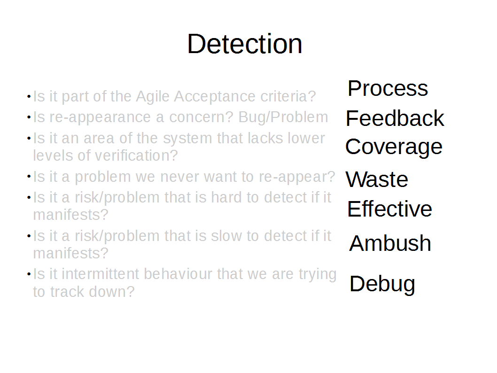
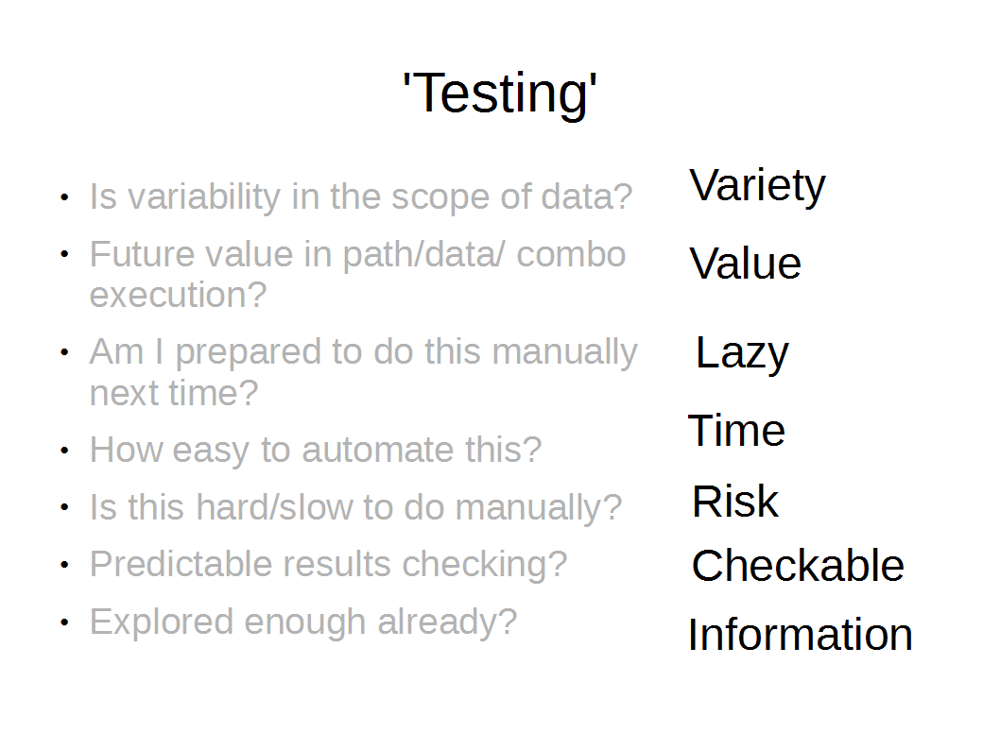
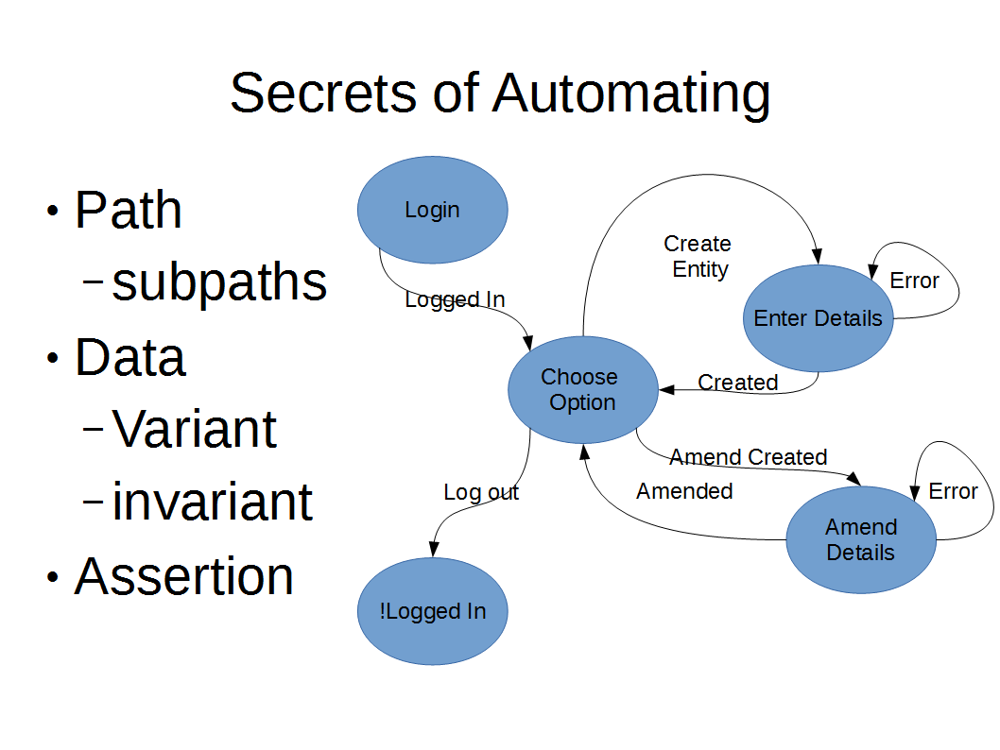

# Lessons Learned When Automating

On the 3rd of February I presented a webinar to Tabara de Testare, the Romanian testing group entitled "Lessons Learned When Automating"

## Introduction

This was the blurb.

_"I've been asked some very challenging questions about lessons learned, and how decisions are made during the process of automating and performing technical testing. In this webinar I'm going to answer them based on my experience. We'll discus how we know 'what to automate' which means we have to split our analysis into 'detection' and 'testing'. We'll cover lessons learned from solving problems, and making mistakes, and steps we can take during the problem solving process e.g for intermittent failures, and possible tool bugs. We'll discuss abstraction levels and the different levels of the technology stack to automate: how to do it, and how we make the decisions. We'll discuss coding primarily the differences, and the overlap, between the needs for coding for testing and coding for production deployment. We'll also cover some WebDriver specific answers to some of these questions. I'm also going to describe books and techniques that have helped me over the years when trying to deal with these questions on production projects. Also we'll take additional and follow up questions."_

You guys sent me a whole bunch of questions on different topics. Most of them, for some reason, related to automating things, and there were some very specific questions about WebDriver. I will probably skip the WebDriver answers in this webinar, unless, during the Q&A at the end, you guys actually want to hear them, simply for time reasons. It's not because they're bad questions, it's because they're good questions.

* Automating
    * Words & Definitions
    * What to automate?
    * Problems encountered automating?
    * Levels to automate at?
    * Improve testability for automating?

## Words & Definitions

* 'test' 'automate' used loosely?
* Can you automate testing?
* What words to use?

Now when people were asking questions, there was things like, "I'm using the word automation loosely," or, "I'm using the word test loosely when we talk about automating."

That's pretty much because it seems at the moment there's a lot of discussion in the world about the words that we use. Whether we use testing vs checking, what words we actually use to describe how we automate things.

It's important that we think through those terms, and it's important that we use them correctly. It's also important that we don't get hung up on the fact, because a lot of people now don't even want to talk about test automation, or they don't think that what they're doing is testing.

Simple fact is we have test processes, we have test strategies, we automate during those test strategies. The easiest way of communicating how you automate at the moment, and avoiding any controversy, is simply to not use the word automation.

If you avoid using the word automation, and you say everything else like, "We are going to automate this part of the application." "We are going to use this particular path with this particular data, and we're going to automate it with this tool." "We are automating this area."

If you avoid the word automation, then you'll be fine.

I've talked about this is other talks this year, and this is something I am actively working on. I'm trying to remove the word automation from my vocabulary, and you may hear me say it during this talk, simply because it's so ingrained in how we communicate, the way that we actually execute paths through systems automatically.

## What to Automate?

* How to decide if we should automate something ?
    * Any Heuristics?

I was asked, "How do we know what to automate, and do we have any heuristics for doing that?"

I do not have any heuristics for doing that, simple because I don't really use heuristics. In my head I have a lot of systems, and I have a lot of models.

In order to answer this question, what I tried to do is think through the questions that I ask myself and I'm going to automate them, and I've turned those into high level heuristics in order to try and communicate this.

*'Detection' or 'Testing'*

* Detect for 'known' problems when they occur
* Test for unknowns and improve process

Now when I am thinking about whether I'm going to automate something or not, I'm thinking about, "Am I automating for the purpose of detecting something?" or "to support me when I'm testing?"

When we talk about detecting something, we're talking about checking something, we're also talking about monitoring. This could just as easily be a monitoring task.

If we remove the word automation from our vocabulary, we start thinking in terms of, "What do I want to achieve, and how do I want to achieve that automatically?"

It doesn't have to be test automation at that point, it could be any type of automated process that does that.

A lot of the things that we do are monitoring.

We don't want to waste a lot of time when we install the application that hasn't worked, so how do we do that? We could monitor the application. We could have a heartbeat. We could have a set of monitors that check whether the systems are running properly or not.

### Detection

* Is it part of the Agile Acceptance criteria?
* Is re-appearance a concern? Bug/Problem
* Is it an area of the system that lacks lower levels of verification?
* Is it a problem we never want to re-appear?
* Is it a risk/problem that is hard to detect if it manifests?
* Is it a risk/problem that is slow to detect if it manifests?
* Is it intermittent behaviour that we are trying to track down?

When I'm thinking about detection, I'm thinking, if it's part of the acceptance criteria, and it's an agile project, then chances are we're going to automate it, because that's part of our process.

Is it something that I'm concerned that it's going to reappear? Do I want to get feedback on that at an early stage? That's going to be one of the questions, one of the answers.

If it's part of the system, and this depends on how we model the system that lacks lower levels of verification, then I will probably automate it. If it doesn't have a lot of unit tests around it, and it's part of the system, that we don't have much monitoring on it, or checking whether the answers are correct.

If it's something we've seen, and we want to make sure it never happens again because that would be waste, then we'll probably automate it.

If it's something that's hard to detect, or something that's slow to detect, if it's something that's going to ambush us, or something that we want to check effectively. If it's something that we're trying to track down.

Here's some high level heuristics:

* Is it for detection?
* Is it part of our process?
* Do we want to get the feedback on it?
* Is it something we're trying to achieve with coverage?
* Are we trying to avoid waste and do things effectively?
* Are we concerned that something's going to ambush us?

These would all be reasons why I would automate something.

### Testing

* Is variability in the scope of data?
* Future value in path/data/ combo execution?
* Am I prepared to do this manually next time?
* How easy to automate this?
* Is this hard/slow to do manually?
* Predictable results checking?
* Explored enough already?

Now when I'm testing, I have a couple of other questions. I'm trying to work out, is there variability in the scope of data? On this couple of slides coming, I'm going to basically explain a high level model of automating, and how we do that.

Variability of data is part of that, because if we're executing a path through the system, we could increase the coverage that we achieve over that path by varying the data massively. Sometimes all we do is execute the same path, but with lots of varied data. If there is a future value in specific path and data combinations, then I'll probably automate it.

How lazy am I? How bored am I when I do this actual work? That would be a reason for automating it.

How much time is it going to take? When we start projects, we don't have a lot of abstractions in place, therefore, when we come to automate something, it takes us quite a long time to automate it, because we haven't made it easy, we don't know the tools.

At a certain point in time, it's not even a hard decision. We've got all the abstraction layers there, it's very quick for me to knock up some code to do this, I'll probably automate it.

If it something that's slow to do manually, and there's a risk that I mess up when I do that manually, then I'm likely to try and automate it.

If the results are predictable and easy to check ... Also remember, we used to stick the word test in front of our "automations". We talk about test automation. We have to make sure we're continuing to test, so have we explored the application enough to warrant us spending time automating it so we don't have to repeat those paths again?

The next set of high level mnemonics or heuristics for this, for testing, are we trying to increase the amount of variety that we can do?

Will we add value when we do this? Again, is this lazy work or boring work? Can I do this quickly?

Is there a risk for me to do it manually, because I might mess up?

Make sure that it's checkable. We don't want to try and automate things that are really, really hard to automate, where we're non-sure whether the assertion that we make is correct or not. There has to be something that we can check quite easily.

## Secret of Automating

All of this is a result of a high level model that I have in mind.

This is my 'secrets of automating'.

All we do when we automate, is that we have a model of the system, we have paths through a system. We pass data over those paths.

Some of the data is variant, it doesn't matter what data goes through that path.

Some of the data is invariant, it controls the path.

If we have a particular process in an application, where we only do a certain check on a customer if they're over 65, that's invariant data. That path will only exercise if the person is over 65. The data that controls that path is invariant across that path.

The name of the customer is entirely unimportant at that point, therefore it's variant. Therefore, we can randomly generate it. Therefore, we can have a massive amount of scope if we automate it.

A lot of the time when people automate, they don't vary the data very much, they don't randomize the data. Consequently, what we tend to automate are paths; we don't tend to explore the variety of data across those paths.

The other thing we have to bear in mind is that, as well as executing paths with data, we have to assert on different conditions as we go through.

If we can do all those things, we understand all 3 of those areas, then we can automate.

Even if we are automating at high level through a tool like Cucumber, any kind of BDD spec by example, tool, we are constructing paths through the system.

This also leads us on to if we want to do model-based testing. Again, we're constructing paths through the system, we make it very explicit in the models.

This underpins pretty much all the automating that I do. There's some sort of path that I'm executing with data.

## Problems Encountered Automating

* What problems encountered writing automated tests?
* How to resolve?
* Problems change over time

I was asked, "What problems we encountered when we were writing automated tests, and how we resolved them?"

The thing is, the problems we face change over time.

*Problems Encountered At Start*

* Lack of tool familiarity
* Tool Immaturity
* Choice of tools, risk of commitment
* Hard to know what are your problems and what are tool problems
* No Abstractions

Because when we start automating, we are not familiar with the tools. The tools we're using may well be immature. When we started working with WebDriver, or Selenium RC at that point, it was a relatively immature tool, and it had bugs, and that caused us issues. That doesn't happen as much now because the tools are more mature.

There's a temptation to blame the tool because we don't know how it works. We make simple mistakes, things are slower, these are all problems. We don't know the limits that the tool imposes on us.

The tools can do some things easily and some things hard, but when we start with them, we don't know that.

Very often one of the problems is we try to automate parts of the application that the tool simply can't handle. We don't know that until we get to that point.

One of the issues we always had was the choice of tools, and the risk of commitment with that tool.

In the early days when you were starting with Selenium, WebDriver, or RC, you had a choice. Do I use Selenium RC, or do I use WebDriver? The 2 tools hadn't been merged at that point, fully. They were still changing.

What we did to mitigate that is we put a tool abstraction in place. We had our domain abstractions, our page objects, our data abstractions, and we would have a tool abstraction. If we wanted to open a browser, we would have a command that we had for "open browser" and it would delegate that off to the tool, so that if we decided to change tools, all we had to do is change that tool abstraction, we change our "open browser" method, rather than have the @Test code immediately use the tool.

Nowadays, the WebDriver interface itself is a tool abstraction. Essentially, it's an abstraction on top of a browser, so we're automating FireFox, we're automating IE, and we do that in the same way. We're operating a remote browser in the same way, that is an abstraction there.

If I was to be concerned that I was going to commit to WebDriver now, and I wanted to move off to a different tool, I probably wouldn't build a tool abstraction, but I would code to the WebDriver interface, and then if I want to move to a new tool, build an implementation of that WebDriver interface for the new tool.

Essentially, one of the problems you start with is, are you certain enough that you're going to commit? If you're not, then you need to build an abstraction layer to de-risk it.

It's hard to know whether the problems you face are problems of your own making, or problems of the tool. Whether a bug in the tool, or whether it's simply a problem in the application, you don't know.

Another issue that you face at the start is that there's no abstractions. You haven't built any page objects, you haven't built any code to reuse, so there's nothing that you've built on.

The temptation at that point is to use a framework, right, because you want to get to speed fast, you want to start implementing, so you bring a framework off the shelf that claims it will help you.

Say you're using Angular ... You're working in Javascript, you're testing with Angular, so you bring Protractor down, which essentially is a framework for JavaScript that sits on top of WebDriver.

That might seem like it gets you there faster, but you've brought on new risk into the project, because you now have a new thing to learn. You've got to learn the framework, you're still trying to learn WebDriver, you're still trying to learn how to automate your application, and you're even more tied in because you haven't built any abstractions.

I try and avoid bringing frameworks in.

Now, refactoring.

I think, very often seems that refactoring your code in the early days is slowing you down, but refactoring is something we have to do, and we have to do continually.

A lot of the questions I get asked are, "How do we structure things?", "what rules do we put in place?", "what are the standards we have to use?".

These are the things I do not worry about, because I know that we can refactor our code. Code is fungible, we can change code, we can refactor it as we learn. We can change the structure of it as we learn to make our work more effective when we build more abstraction layers. Very often people get stuck on that too early.

## Problem Diagnostic

* Isolate issue with a small @Test
* Make issue repeatable
* Debug mode
* Step slowly
* If no problem then synchronisation problem
* View tool source code
* Different version combinations (down, up)
* Identify workarounds

Tips on how to fix things.

When we're starting, we don't know if it's the tool, or whether it's the application, or what.

We have to get in the habit of doing diagnostics on problems.

The way we do that is we try and isolate the issue with a small @Test method. This should be a small test method that uses as little as possible about our existing abstractions.

Then we can rule out our abstraction layers as being part of the problem. This test needs to make the issue repeatable.

If we can make it repeatable, and we can make it repeatable on someone else's application, not just ours, then we know it's a tool issue, or we know it's an issue with the Javascript technology that it's using, something like that.

If we make the test repeatable and it doesn't use any of our abstractions, we can pass it off to the development team of the tool, when we raise an issue against that tool, and they can run it and see if it's a proper tool problem.

We have to learn how to use debug mode in our languages effectively, because very often we get synchronization issues.

In order to rule out a synchronization issue, or make sure it is a synchronization issue, we have to debug our code, step slowly through it.

If the code works when we step slowly through it, but fails when we just run it, chances are it's a synchronization problem.

Very often what happens is we put more synchronization in, we think the problem's fixed, then it comes back, because we need to add more synchronization. Very often it's just, we need to wait for a particular element to be present, we need to wait for the element to be displayed, then we need to wait for another element to be displayed after that. We just keep adding proper application state synchronization until the automation gets robust.

The same thing happens on rest APIs.

You issue a rest call, you get your response, and poll the database until it's in a particular state, because there might be some other process in the background working before you issue another rest call.

Synchronization is something we have to get into the habit of using.

If you're using a tool, hopefully you're programming, because that's the way you're going to get the most out of it.

We have to learn how to view the tool's source code, particularly if we're using an open source tool.

That way, if we spot a problem in the tool source code, we can either patch it; if we're using Ruby, we can do monkey patching on it, and add our own methods in place.

We've worked with Java, with WebDriver, and we found issues in the Java WebDriver that were fixed very quickly, but all we did is we added a workaround using the Javascript executor.

You have to get in the habit of identifying and implementing workarounds that will get you forward.

Also, you have to get in the habit of adjusting the different version combinations of the tool.

Maybe you go down a version of the tool to see if it happened beforehand, or whether it's only happened with the new version, then you're more likely to know whether it's a problem with the tool.

Check with the different browser combinations, is it the new browser versions, is it the old browser version?

There's a whole problem diagnostic process you have to get in the habit of, particularly when you're not familiar with the tool, because the temptation is it's going to be to blame the tool.

## Problems Encountered Now

* Decide on level of abstraction
* Decide on tech stack level to target
* Decide on tooling to use
* Unit test or not Unit test my code
* Synchronisation issues
* Ease of System Automating
* Mobile & New platforms

The problems that we face now, knowing how to use the tool well, are deciding on the levels of abstraction, because we still argue about:

* what is a page object?
* Does the page object return other page objects?
* Does the page object do navigation?
* Do we have another object for that?

These are discussions that we have on the team.

Deciding what level in the technology stack to target, because you very often get distracted by the automated test pyramid.

I tend not to worry about that too much. What I try and do is build abstractions at any level that we need, and automate at different levels.

We argue about what tool to use.

If we're using Ruby, there's new Ruby libraries come out all the time.

If you're in Javascript, there's masses of new automated execution libraries come through all the time.

These things distract us.

These are the problems we have, getting distracted by new things.

How much to unit test or not unit test our existing test code?

I try and unit test the domain abstractions, and the random data generation.

What I don't unit test are the parts of my abstraction layers that use WebDriver, other people do. Other people mock out WebDriver, and write unit tests for their test code that's going to use their test library.

I tend not to do that simply because we'll be executing those paths, and we'll find out whether they work that way.

Synchronization issues are always a problem.

Every time we, add new Javascript libraries, new ways of doing things on the front end, we introduce synchronization issues. We move between Javascript and CSS; we start using the CSS animation, that introduces new synchronization issues.

This remains a problem, but we just have to address it, and know that there's no easy ways out of that. People look for easy ways of synchronizing, and the easiest way of synchronizing is just to add more state-based synchronization in your code, and get it working.

We do have to address how easy it is to automate the application.

Convincing people that it's not just GUI hooks, we don't just need IDs put on things.

Sometimes we have to architect the application to make it easier to automate. We do have the concept of the test pyramid, we do have the concept that we can automate at the unit level, the interface level, the integration level, the component level.

We should architect the system to make that possible.

We have the issue now that we do things like mobile automation.

Mobile is new, so the tools are not as mature, they are harder to use. We haven't architected the applications to make them easy to test.

We've architected the applications so that they're testable via the GUI.

The GUI automation is hard.

What we should be doing is architecting the applications to make them easier to test, because the tools are not as robust yet.

These are the kind of problems we face that we have to argue about. I'm sure when we start doing more wearable testing, we'll get very similar issues through there as well.

## Levels to automate at

* How do you decide which level to automate at?
* Would you combine levels?
* Do you use abstractions?
    * Page Objects? Data Models? Other Models?

There were also questions about what levels to automate at.

How do we decide what level to automate at, and do we combine the levels of automation? Do we do stuff through the GUI, and the rest API, and do we use abstractions? etc.

In terms of which level to automate at, I like to automate at every level, but, what controls this is really our model of the system.

*How do you decide which level to automate at? GUI? API? Unit? etc*

* What is your model of the system?
* Where do you trust/value feedback from?
* Where can you automate fast to add value quickly?
* What are you prepared to maintain?
* What environments do/will you have?

At what levels do we understand the system? If our model of the system if only a GUI model, that is the only level we're going to automate at. If we understand the persistence mechanisms that it uses, if we understand the database that it uses. If we know how to access the database, and we know how to programmatically access the database, if that is part of our model, then we can automate at the persistence level as well. Then we can identify the tools to use.

Really, it's not so much about deciding which level to automate at, because I'm going to automate at them all, but I need to expand my model, and understand the technologies of its use, in order to do this.

It also depends where we value the feedback from. The customers and your team are familiar with the GUI, so when you start automating the application, they are going to see value in, and they're going to trust, the GUI automation.

They may not understand the API, so they may not value automating at the API. They know you've got API tests, but then they want you to repeat them at the GUI, because they don't trust or value it. This is also part of our model.

When we automate at that level, do we know what risks we are not covering by doing that?

That's essentially what your test pyramid is. It says, automate less at the GUI because you have mitigated the risks at the API level, therefore you have a little bit extra coverage at the GUI level, but not as much, because you trust it, and because your model of the system allows you to do that.

It also comes in, where can you automate fast?

Sometimes we choose to automate at the API level because we believe that is faster, that is more robust.

If that's a private API, and it's not public, and it's not versioned, then that may be changing faster than the GUI, which is public, which is not changing, which is documented.

Therefore, different projects are going to have different needs in this place. It's not just as simple as saying, "We will automate the API." It's, "We will automate the API because we know it is stable, and because we know it's not changing that much."

It also comes down to what are you prepared to maintain? Who on your team is maintaining all this code that you're doing for the automation work?

That will also change what automation you're going to do, and what environments you have, and how they're configured, and have you stuck https on those environments, etc.?

Essentially, I try and automate as much as humanly possible at different levels, and build abstractions around those, particularly abstractions that we can reuse.

## Would you combine levels?

* e.g. using GUI to create account, editing info and then verifying from the DB if data was stored properly?

When it comes down to combining them, yes I will do that.

Would we use the GUI to create an account, edit the information, then verify the information in the database? Yes we would, that's absolutely how we like to work.

* Path Segment (subpath) preconditions
    * Create at a level that you trust
* Automate at the level of the risk you want to detect
* Assert at multiple levels based on the conditions you want to check
    * Created – check in DB
    * Reported Created – check in API/HTML
    * Rendered Created Message – check on GUI

Also, this comes down to the model of automation, model of automating that I mentioned earlier on, with the paths, and path segments.

Each small path segment essentially has preconditions.

In order to execute a certain subpath in the application, the user must have logged in.

If I can log in through the API, I don't need to use the GUI to do that, and it might be faster. Therefore, I could log in via the API, take the cookie, hijack the cookie and stick it in the browser, and then do the browser automation from that point on, just for that small path segment.

That's how I combine the levels, knowing the subpaths, because then I know what risks I'm trying to target, what risks I face in the model of the application that I'm executing.

Essentially, we want to automate at the level of the risk we're trying to detect.

If we create an application through the GUI, then we're automatically logged in. Then we go and view the customer details on the screen, then we go and edit them, and we see that they're changed. All of this might be happening in memory. It might be happening in memory on the client side; there may be nothing changing in the back end. Therefore, we have to also check the persistence mechanism, because the risk is that it may not have persisted it. That's why we assert at multiple levels.

If we're concerned about the creation risk, we check in the database.

If we're concerned that it gets reported back, we can mitigate that risk in the html messages that are checked back, without checking to see if they're rendered.

If we actually could care that it's displayed to the user, then we check the rendering in the GUI.

We test at different risks because we view them as important or not. That also helps us decide what level of coverage we need.

* Helps to build abstraction layers that are clean
* Avoids frameworks
* Build libraries
* Can re-use in different ways

To do this, I like to build abstraction layers that are clean, and don't depend on each other. This means I try and avoid frameworks. I try and build libraries, so I would build a library of abstractions at the physical layer that map onto my physical GUI. I will try and build a library of abstractions that map onto the REST interface. I'll try and build a library of abstractions that represent the HTTP messages that the REST interface will use. The REST interface itself will probably use that underlying library, because I need the ability to test invalid conditions.

Very often we build abstraction levels that cause us to not make mistakes.

We build an abstraction layer around our REST interface, which will not allow us to make invalid JSON calls.

I need a way of making invalid JSON calls because I want to do some automated testing, that the application can handle invalid JSON. And I want to reuse all these abstractions in different ways, because I want to use the automated code that I build to support my manual exploratory testing.

Again, we've got a model of the system that has subpaths. I don't always want to have to start up the application, log into the application, navigate through the application, get the use user in a certain state, and do all that manually, when I've got abstraction layers that can do that automatically, and then leave me in a stage where I can continue the execution manually.

Reuse. All the automating, we reuse for our manual testing as well.

That means we need to keep it clean.

## Do you use abstractions?

* Page Objects?
    * Yes, an abstraction of the physical GUI
    * Not just Pages: Components, Navigation
* Data Models?
    * Yes, abstraction of persistence, messaging and logical
    * Random data generation
    * 'Default' data
* Other Models?
    * Yes, path and system models
    * Layered execution models
        * API, GUI as API, Files & Persistence

The type of abstractions that I use, I use page objects, but I don't just have page objects that represent a page.

I use page objects as a term of an abstraction of the physical GUI.

It's not just the pages, it's also the components, it's also the navigation.

That navigation is how we more through the application, which essentially is a model of how the application fits together.

I have data models because that's an abstraction of the persistence layer, and possibly the messaging and the rest API, and it allows me to do random data generation, which allows me to increase the variety of data that I put through the paths, which are represented by the page objects, and the navigation.

I have other models, path models, system models.

I have layered execution models. We know that we've got the API, we know that we've got the GUI. I have abstractions for the GUI as an API.

What that means is when we work with a web GUI, and we submit forms, that form is sent to the back end as an HTTP form request. I can model that as through it were an API, and issue form requests, without having to actually use the GUI. That allows me to simulate GUI events as though they were an API, as an abstraction.

Now there's a risk there that I have codified a form that might change, because the GUI might change, but I can mitigate that risk by checking periodically that the form that I'm sending is the same form that the GUI is sending; either by scraping the GUI, or by putting it through a proxy and double checking that the messages are the same.

Any time we do something under the covers, or bypass the normal way of doing it, we want to stick a check in place that makes sure that we've mitigated that risk ourselves.

## Improve testability for automating

* Advice to improve testability?
* Tools?
    * Re-use abstraction layers (different level of systems modelled – API, DB, GUI, etc.)
    * execute via @Test
    * Simple batch scripts
* Use abstractions for exploratory testing
* Executability
    * Tool hooks – GUI ids, APIs, no https, etc.

I was asked about how do we improve testability for automating?

In terms of, do we write tools? How do we set up users in the system? Things like that.

I tend not to write tools.

What I tend to do is write test methods that reuse the abstraction layers, that do things that tools might do. I would typically stick an @ignore on the top of that method, and just run that method from an IDE. That's my tool GUI, the IDE, a test in the IDE that is @Ignore's, that I can run.

That way I'm reusing the abstraction layers, and I'm reusing all the data-driven approaches that we've got for reading and files. I'm creating new code that is going to help us, and I can use the same abstractions to then help me with my exploratory testing.

It's rare that I write tools.

I might write batch files that do simple things like setting up the environment, checking that the environment is running, tearing down the environment. Those might be classed as tools.

Very often, I attempt to reuse my abstraction layers as much as possible. We do have to argue about the executability of the application to make it as easy to automate as possible.

## Coding

* How is coding different for testers than for programmers?
    * Any different coding Skills?
    * Language usage?

I was asked questions about coding, in terms of, is coding for testers different than it is for programmers? Do we need different coding skills, do we use different languages or different libraries?

As far as I can tell, there are differences, mainly because we use, or I tend to use, a smaller subset of the language than the developers do.

*Differences*

* Subset of the language
* Junit rather than container
* Coding for efficiency
* YAGNI vs IDKWTAGN
* Multiple Usages vs Controlled Access
* Paths and Libraries vs Applications
* Frameworks vs Libraries
* Coding for Change vs Requirements (Requisite Variety)

I don't tend to write applications, I write JUnit tests.

I don't package up the code that I write and run it as a container, run it in a server somewhere, I'm just writing JUnit test. I rely on that as my executor, the runner application, I use the JUnit features.

Typically, programmers have to program for efficiency; testers tend not to.

We tend to code for readability, maintainability, reportability so that the names of the methods and the tests are understandable.

We tend to code for change, because the application will change, and if we haven't coded for change, we then have to maintain a huge amount of test code in the background when the application has a simple change.

Developers don't tend to have to worry about that, because their applications are designed to do a single thing: they're designed for controlled access, where our applications are designed to support variety and multiple use cases.

There's a term used in the development world for "you aren't going to need it". That's not usually how testers code.

Testers code for "I don't know what testers are going to need". That's the IDKWTHEN, we have to code for flexibility. I don't know what I'm going to be doing with this code in the future, but I don't know that I need to make this code as flexible as possible. That's where the multiple uses come in.

I had to learn Reflection because I was using libraries built by developers to test the application, and those libraries had constraints. They wouldn't let me do things that were bad. It wouldn't let me access certain methods because accessing those out of order would be bad. I had to learn reflection in order to test the application the way that I needed to, to access these parts and do them out of order, so I know that the code that we need has to support the flexibility of use cases that we're going to use it for.

We tend to code paths and libraries, developers code applications.

Applications are essentially systems that do multiple things based on the input. The code that we write is a path. It takes some input, it does something, it does something else, it does something else with that input, and we code specific paths, rather than applications with loops, and ifs, and multiple combinations through it.

Our test will need a lot of variety, our libraries need to handle the variety that we use them for.

Which is also why I tend to avoid frameworks. I don't really like having things that control the way that I work. I like to use things in as many different ways as possible.

*Similarities*

* Advanced Books
* Static Analysis Tools
* Unit Testing
* TDD
* Naming and Coding Conventions
* Test Execution Runners
* Libraries
* Debugging

I think the books that we read are different when we're starting out. I think our basic learning books are probably different, because we need a smaller subset, and we need to learn in a different way; but the advanced books are the same.

When we do automated work, we're writing programs, we need to be able to program as well as we possibly can. All the books that developers read, that they recommend, we should be trying to read if we want to improve our programming skills.

We should use the same static analysis tools. CheckStyle, findBugs, PMD. If we run those tools in our code, our test code will get better, our programming abilities will get better.

We still do unit testing, we do TDD on our code.

We use the same naming and coding conventions.

Hopefully, we use the same test execution runners. There are some projects that use JUnit for development, TestNG for testing. I try and use JUnit or whatever the development team's using, just to keep everything simple. Try and use the same libraries, same debugging, because essentially we're programming when we automate, and we want to do that as well as we can.

*Skills*

It's the same skills that are required, the only difference is there's different levels of experience.

* Same skills required
* Levels of Experiences different
* Developers better be the best at coding
* Project can afford for Testers to be less experienced coders, supported by developers

We hope that the developers are better coders than the testers. The project can afford for the testers to be less experienced coders, but they can't afford for the developers to be the least experienced coders.

Again, we want to upscale as much as we can, and become as good as we possibly can when we're programming.

## Estimation

* How much time is needed to automate an application?
* How do you estimate when you are just starting to automate?

These were hard questions, in terms of estimation. I hate questions about estimation. I hate questions about estimation on projects as well.

I specifically hate being asked how much time is needed to automate this application, simply because it's too vague.

I can answer the question, "How much time is needed to automate an application to do this specific thing, in this particular way, for these particular functions?"

I need to constrain that.

There's too much that we can do when we try and automate it, because we're trying to automate paths, variation, and cut down on testing, and testing is an open-ended problem.

We automate, or we estimate, the same way that we estimate development projects.

* I tend to avoid these questions, unless they are part of a sprint planning for estimating the automating of specific acceptance criteria
* But if I have to...

A lot easier to do this in Agile, because then it's estimating the automated work required for acceptance criteria automation. That's nice and easy. As we do that, we build up abstraction layers that we reuse, and can do multiple things, with.

If I'm forced to answer the estimation questions, do it the same way we do a development projects.

* Same way estimate any development project
* Split into chunks
* Make unknowns, risks and assumptions clear
* Gain experience with tools to identify capabilities
* Experiments to improve estimates and derisk
* Depends on skills and experience
* Depends on levels of change
* What % dedicated to automating vs testing?
* Easier on 'Agile' stories

We split it into chunks, we make it clear what the unknowns are, what the risks are, what the assumptions. If we don't know the tools, we have to gain experience, we do experiments to cut down on the risk. We do experiments to target particular risky areas in the application before we commit to using that tool, before we commit to those estimates. It really depends on our experience, etc. etc. it's easier to do this on Agile than it is on Waterfall-style projects.

## Tools

* Is there another option (except Selenium WebDriver) which you would recommend for UI automation?

I was asked about tooling, and whether there's other options I can recommend for GUI automation.

I do get asked this a lot, but I can't answer it, simple because most of the automated work that I do is on web GUIs, and WebDriver, as far as I'm aware, is still the best tool that I know of to do that.

Simply because WebDriver is supported by some of the browser vendors. Chrome makes their own drivers, they support this, at Google, make the Chrome driver. Firefox contribute the Firefox driver code. Eventually, Microsoft will contribute the IE driver code, hopefully Apple will contribute Safari code.

There's no other tool that I'm aware of that the vendors actively support, the browser vendors.

I don't do a lot of other GUI automation, therefore I can't really answer that question. I did do a blog post recently that had some options on it.

* http://seleniumsimplified.com/2016/01/can-i-use-selenium-webdriver-to-automate-a-windows-desktop-application/

The basic thing is, different technologies require different tools. Once you find a good tool for that technology, I would stick with it as long as you can, find workarounds, because the cost of changing tools can be quite high.

This is my note to myself. We've been talking probably for about 35, 40 minutes. I don't want to use up all your time, so I am going to skip the WebDriver slides. I will create some blog posts, and I will release all the slides out to you guys, and when we unmute and do a Q,A session, anyone that's interested can ask WebDriver-specific questions. Let me just jump through the slide deck, and get to the final set of slides, the more generic ones again.

*You can see the bonus webdriver lecture for the WebDriver content that was missed out of the main Webinar.*

## Career

* How do you arrive/What was the journey from a technical side to having conference talks and training people?

I was asked, how did you arrive, or what was the journey from a technical side, to having conference talks and training people?

Now I don't like giving career advice.

The approach that I've taken in my career definitely isn't for everybody, and I can't guarantee it will help you.

What I can tell you is why I did some of this stuff. Why I talk at conferences, and why I do the training, and then you can see if that gels with you.

* Do you feel strongly enough to be the change?
* Are you prepared to do the work?

I'm not the kind of person that's motivated by big picture, fluffy goodness of trying to save the world. I'm motivated by reactions to things.

When I was starting to talk at conferences, it was because I didn't like what I was hearing at conferences.

It was a reaction, it was an anger at the rubbish that was being spoken. Some of you will be sitting there now thinking, "Alan is talking absolute rubbish," and you're getting angry, and you'll decide, "I'm not going to stand for this."

Some of you will make that clear in the questions, but some of you might then go and talk at conferences. You might then go and put your point of view across.

I decided at conferences I was hearing things I didn't like, and I was not prepared to pay money to listen to this rubbish anymore, so I vowed I was never going to go back to a conference unless I was talking, because I wasn't prepared to pay to listen to nonsense.

I wasn't prepared to let a vocal minority have the only message out there, and now I'm part of that vocal minority.

If you don't like the message I'm giving, you have to step up and let your voice be heard. Do you feel strongly enough to do that and be the change? That was what it took for me.

When I was doing training, it was because people were coming for interviews with lower levels of skills than I expected, and I wanted them to have no excuses.

I wanted it to be clear that the information was out there, and there was no excuse for people not to know it, and be aware of it. If they were doing this as their career, to learn how to do it.

The way that you do it is by doing the work.

You have to be prepared to do the work, you just can start small. It's never been easier than ever to do this, right? You can write down your thoughts on Twitter, you can blog about them with minimal impact to yourself and other people.

If you want to do talks, you can record it, and you can stick it on YouTube for free. You can talk in the meeting rooms that you're in. You can rant at local meetups, and then submit to conferences if you're still not getting the point across, and you still hear people saying things.

It's completely possible for anyone to do this, simple because I'm not really a people person, I'm not a public speaker, I'm not a writer. I had to learn how to do all these things. I had to train myself, I had to research it, I had to practice.

I had to get out there and do it badly before I got better at it, and you adapt to feedback.

It's much more a case of figuring out whether you're motivated by a big Utopian vision, and if that big Utopian vision hasn't happened yet, you go out and make it happen.

If you're motivated by reaction to nonsense, like I am, then you go out there and put your point of view across so that you don't have to stand that nonsense on your own.

## Techniques that have helped

* Decision making
* Redefinition
* Books

I also want to generalize a little bit, simply because there were common threads through a lot of these questions. There's common threads through a lot of questions that I get asked.

Just as a little insight into some of the techniques that I use for dealing with this, in terms of decision making, redefinition, and books.

### Decision Making

* Responsibility
* How do I know if I'm making the right decision?
* What if I make the wrong decision?

A lot of the things I talk about, and a lot of the things I do, are just about responsibility. A lot of the questions we were asked were just about taking responsibility; that's what we have to do.

When I started automating parts of processes and jobs, I didn't have permission automate. I didn't ask for permission to automate; I did it because I felt responsible for improving the testing that was going on, and I had the skills, so I used them.

The issue then is people think, "What if I do that and I get blamed?"

The thing then is, if it was your fault, then you get blamed.

What we have to do is, when we take responsibility, learn what are the rules and aims of the project.

I will push those, and work around those a bit. I know that I can't push them too far, because we work within the confines of the project.

How do we know that we're making the right decision?

Very often we don't.

What we have to do is we conduct small experiments until we're more certain, but we do know that if the status quo doesn't work, then no decision is the wrong decision.

Analysis paralysis is the wrong decision.

Just making a decision, learning as fast as we can, taking responsibility for it, is what is important.

If we make the wrong decision, or everyone tells us we made the wrong decision, we take responsibility for that, and just make sure that it was wrong. It may be at the point where it's not quite right yet. We're at a tipping point where we still have to do more work before it actually becomes really effective.

If we have made the wrong decision, figure out what went wrong, learn so that you don't make the same mistake again. Identify alternatives quickly, do some experiments, make a decision to change, make it responsibly.

We've got the benefit now that most people, or many people, work on Agile projects, so you can do that as a team, and you have more people helping make that decision.

When we started, we had to do a lot of this work under the covers, and we were bypassing management to do that.

In some cultures that's good, in some cultures that's bad, but I kind of figure we need to, as individuals, exemplify the culture that we want to work in, take responsibility for that even if that gets us in trouble.

If it does get us in trouble in the environment we're in, chances are that's not the environment we should be in, and we need to take responsibility for our own careers, and move it into the right places.

### Use words to help you

* Redefinition
* Avoid ambiguity
* Own your definitions

I mentioned this at the start, and this is particularly important at the moment, because in testing, we focus in on words. We're very pedantic, we want to have the right definitions that are in place.

The best thing you can do is avoid ambiguity.

Things like "automation" is an ambiguous word. It means the process of doing something, and it also refers to the output from doing that thing. We talk about test automation as a thing and a process. If we avoid the automation word entirely we avoid that.

Avoid phrases like page objects, because that's ambiguous.

What we can say, things like, "Page object, and when I say page object, I mean a physical abstraction layer on the GUI," then we're defining it in the context that we work in.

Avoid ambiguity phrases like "performance testing" or "stress testing" or "acceptance testing". These words don't mean anything, and they lead to issues, so own your definitions.

Describe what you mean by the word, not the word.

Use the actual definition in your explanation.

Don't say, "I'm going to do performance testing," say, "I'm going to test this application and see how fast it responds when 100 people are doing this specific set of actions." That is more clear than simply saying "performance testing".

And again, that's about taking responsibility, and that's responsibility for your communication.

### Books

* 'Clean Code'
    * References: Dijkstra, Hoare
    * Reference Peers: Myers, Yourdon, de marco, Jackson
* Others
    * 'Growing Object-Oriented Software','Working with legacy code', 'Implementation Patterns', 'Domain Driven Design','refactoring'
* Systems
    * Cybernetics, Herbert Simon, Stafford Beer, Deming, John Diebold

Also I wanted to mention books, simply because at the moment, what tends to happen is people tend to read Clean Code, the Bob Martin book, which is quite a good book.

People reference that.

If you look through that book, what you'll discover is that it refers to books from the 70s, books from the 80s. The more that we read old books, the more that we will get information that other people don't have.

The benefit of a lot of the old books like Glenford Myers' Composite Structure Design, that, his book, is an entire thought process of, "Here are some options we could do. Here are the good things with that option, here are the downsides." You would have to interpret the information in there because it's talking about languages that are not in use anymore. It gives you a lot of information, it gives you a lot of ideas, but you have to interpret it and take responsiblity for it.

Books that I do find value from in terms of when we're automating are listed there,

* Growing Object-Oriented Software,
* Working with Legacy Code,
* Implementation Patterns,
* Domain Driven Design
* Refactoring

When you look to those books, look to the references, look to the books they're built on, but also read books on systems.

That whole notion of automating with paths, and data, and assertions, that is from Systems Thinking.

The more that we study that, the more we will improve how we model systems, and automate systems.

## Future of Testing

* "How do you see the future of testing?"

You can tell we're coming to the end, because we're talking about the future of testing. For me, testing hasn't changed that much.

There are aspects of it that have changed, but essentially, testing has always been a contextual process.

Testing will, and always has…

* been, contextual
* been about feedback
* involved coding and technical levels
* Involved exploration
* been implemented badly in some environments

Testing has always been something that fits in a development process.

We respond to the needs of the development process about what feedback it needs, about what process it needs, about avoiding waste, about what communication is appropriate within that process.

It has always been about providing feedback, it has always been about providing information to allow the software development process to control the project better.

It has always involved exploration, and it's always involved coding and going down more technical levels.

Now, those things are more overt now, they are asked for more, but they're always been there.

In some ways, my testing process has not really changed over the years.

It has not changed from Agile, it has not changed as we do in that.

Testing has always been implemented badly, and testing will always be implemented badly, you can pretty much guarantee it.

Testing will,

* Require more technical knowledge
* Require more testing knowledge
* Be recognised as more skill == better testing
* Be implemented badly in some environments

What seems to be happening is the trends are that people want testers to have more technical knowledge, and people are going to, testers specifically, are going to need more testing knowledge, because everyone now can test.

Your business analysts test, your developers test.

Testers need to be able to test better than those people. We need to upscale our testing. We need to make sure we produce the right level of documentation, or less documentation.

The basic thing for the future is always the same, it comes down to responsibility.

It's basically, what are we as individuals doing to improve our testing?

A more important question is

* "What are you doing, to improve your testing?""

I'm learning the tools that I use more, I'm trying to codify my approaches more explicitly, I'm trying to expand my understanding of security testing and get more technical, improve my programming skills.

Those are the things that I think are important to my future of testing, and you pretty much need to answer the same questions.
