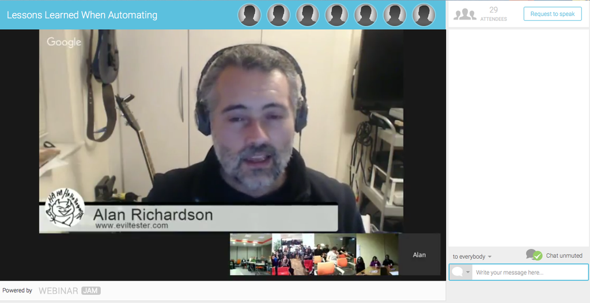

# Lessons Learned When Automating

Tabara de Testare Webinar

Alan Richardson

@EvilTester

alan@compendiumdev.co.uk

EvilTester.com

SeleniumSimplified.com

JavaForTesters.com

CompendiumDev.co.uk

WebDriver Edition

---

# Live

- Did not have time to answer all the webdriver questions in the webinar.

---

# WebDriver

- Locator strategy tips?
- Problems encountered?
- Implicit &amp; Explicit Waits?
- How to structure project?
- Frameworks?
- Disadvantages?

---

# Location Strategy Tips?

- Aim for an ID, then CSS, then Xpath
- Optimised hierarchy starting at an ID with chained findElement calls
- Build less for speed of execution and more accuracy across multiple pages
- More arguments about managing in the code or external 'map' files

---

# Common WebDriver Problems

- Synchronisation
    - Add more than you think
    - Sync prior to action
    - SlowLoadableComponent
    - 'ware remote
- Abstraction Layers
    - Refactoring
- Bug workarounds
    - JavaScriptExecutor
    - Inject cookies from HTTP calls
    - Monkey patching Ruby

---

# Implicit &amp; Explicit Waits

- Never Implicit Waits
- And if Explicit waits still result in timeout?
    - Missing Synchronisation
    - Environment Speed Variability
    - Remote Grid?
    - May have to increase timeout on 'big state' actions

---

# How to structure project?

- Maven Structure
- \\test
    - The @Test code
- \\src
    - The abstractions
- Packages
    - Refactor as we go

---

# Frameworks or additional tools?

- No, I avoid frameworks as much as I can
- WebDriver doesn't seem hard enough
- Model application domain as abstraction layers
- Closest to framework – Cucumber, Junit
    - Cucumber – DSL
    - Junit – test runner
    - Both delegate/use domain abstractions

---

# Disadvantages of WebDriver?

- Not fully supported by browser vendors yet
    - Safari/Apple
    - Microsoft (Edge isn't complete yet)
- Compared to what?
    - Do browser vendors support any other tool?
    - Google (Chrome), Mozilla (Firefox)
