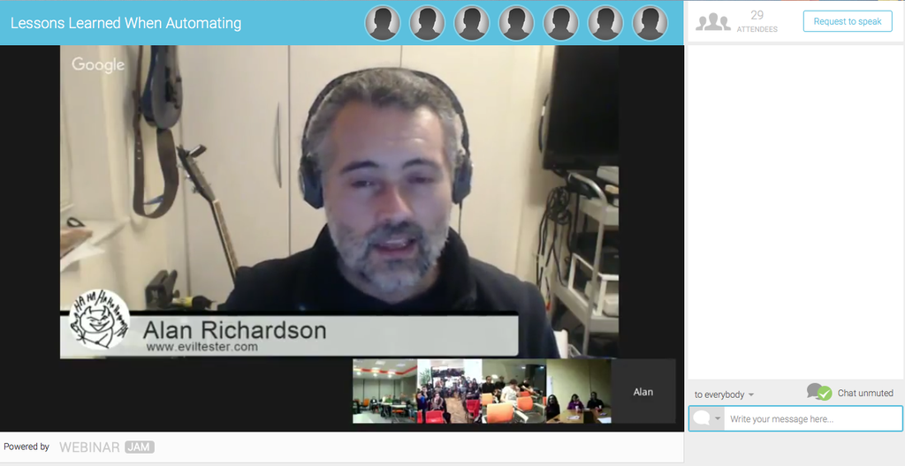
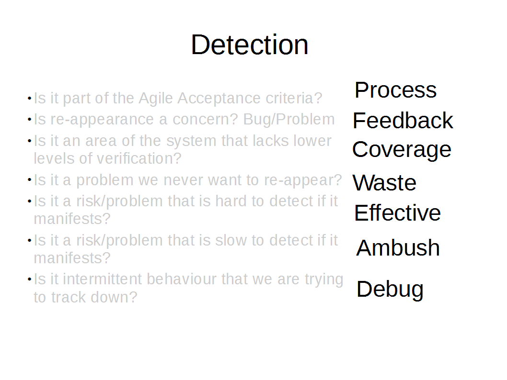
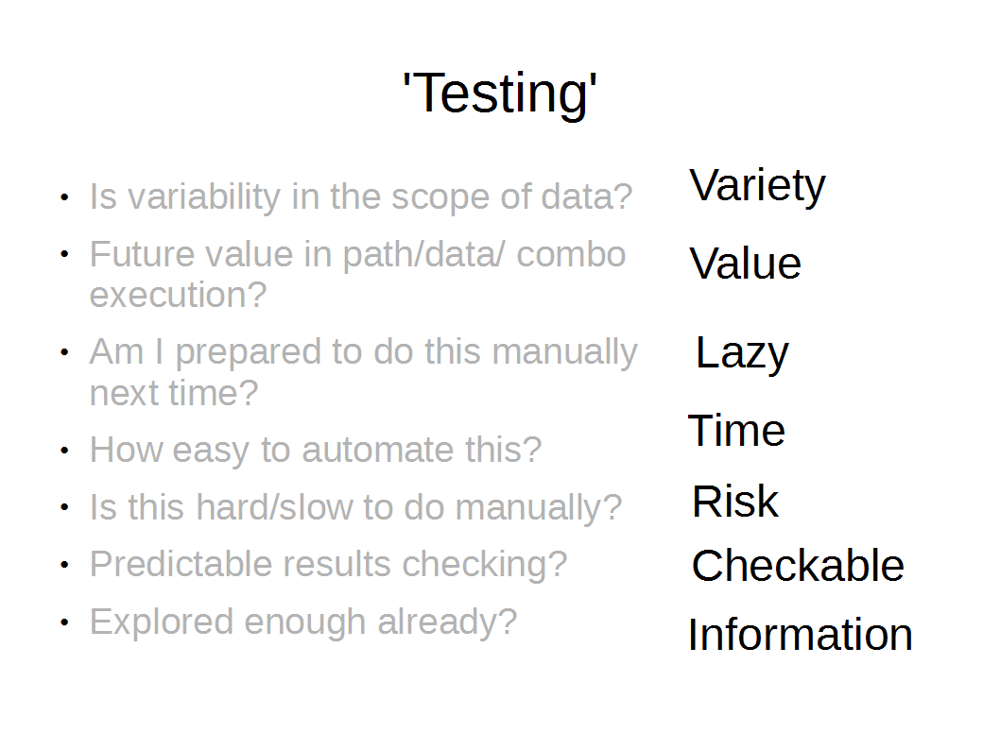
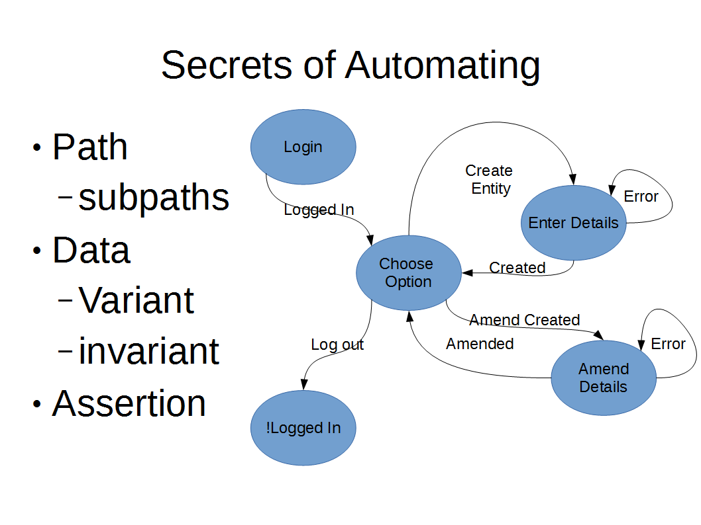

# Lessons Learned When Automating

Tabara de Testare Webinar

Alan Richardson

@EvilTester

alan@compendiumdev.co.uk

EvilTester.com

SeleniumSimplified.com

JavaForTesters.com

CompendiumDev.co.uk

---

# Lessons Learned When Automating

Tabara de Testare Webinar

Alan Richardson

@EvilTester

alan@compendiumdev.co.uk

EvilTester.com

SeleniumSimplified.com

JavaForTesters.com

CompendiumDev.co.uk

---

# Blurb

I've been asked some very challenging questions about lessons learned, and how decisions are made during the process of automating and performing technical testing. In this webinar I'm going to answer them based on my experience. We'll discus how we know 'what to automate' which means we have to split our analysis into 'detection' and 'testing'. We'll cover lessons learned from solving problems, and making mistakes, and steps we can take during the problem solving process e.g for intermittent failures, and possible tool bugs. We'll discuss abstraction levels and the different levels of the technology stack to automate: how to do it, and how we make the decisions. We'll discuss coding primarily the differences, and the overlap, between the needs for coding for testing and coding for production deployment. We'll also cover some WebDriver specific answers to some of these questions. I'm also going to describe books and techniques that have helped me over the years when trying to deal with these questions on production projects. Also we'll take additional and follow up questions.

---

# Automating

- Words &amp; Definitions
- What to automate?
- Problems encountered automating?
- Levels to automate at?
- Improve testability for automating?

---

# Words &amp; Definitions

- 'test' 'automate' used loosely?
- Can you automate testing?
- What words to use?

---

# What to Automate?

- How to decide if we should automate something ?
    - Any Heuristics?

---

# 'Detection' or 'Testing'

- Detect for 'known' problems when they occur
- Test for unknowns and improve process

---

# Detection

- Is it part of the Agile Acceptance criteria?
- Is re-appearance a concern? Bug/Problem
- Is it an area of the system that lacks lower levels of verification?
- Is it a problem we never want to re-appear?
- Is it a risk/problem that is hard to detect if it manifests?
- Is it a risk/problem that is slow to detect if it manifests?
- Is it intermittent behaviour that we are trying to track down?

---

# Detection

| Question | Label |
| --- | --- |
| Is it part of the Agile Acceptance criteria? | Process |
| Is re-appearance a concern? Bug/Problem | Feedback |
| Is it an area of the system that lacks lower levels of verification? | Coverage |
| Is it a problem we never want to re-appear? | Waste |
| Is it a risk/problem that is hard to detect if it manifests? | Effective |
| Is it a risk/problem that is slow to detect if it manifests? | Ambush |
| Is it intermittent behaviour that we are trying to track down? | Debug |

---

# 'Testing'

- Is variability in the scope of data?
- Future value in path/data/ combo execution?
- Am I prepared to do this manually next time?
- How easy to automate this?
- Is this hard/slow to do manually?
- Predictable results checking?
- Explored enough already?

---

# 'Testing'

| Question | Label |
| --- | --- |
| Is variability in the scope of data? | Variety |
| Future value in path/data/ combo execution? | Value |
| Am I prepared to do this manually next time? | Lazy |
| How easy to automate this? | Time |
| Is this hard/slow to do manually? | Risk |
| Predictable results checking? | Checkable |
| Explored enough already? | Information |

---

# Secrets of Automating

- Path
    - subpaths
- Data
    - Variant
    - invariant
- Assertion

| From | Action or result | To |
| --- | --- | --- |
| Login | Logged In | Choose Option |
| Choose Option | Create Entity | Enter Details |
| Enter Details | Error | Enter Details |
| Enter Details | Created | Choose Option |
| Choose Option | Amend Created | Amend Details |
| Amend Details | Error | Amend Details |
| Amend Details | Amended | Choose Option |
| Choose Option | Log out | !Logged In |

---

# Problems Encountered Automating

- What problems encountered writing automated tests?
- How to resolve?
- Problems change over time

---

# Problems Encountered At Start

- Lack of tool familiarity
- Tool Immaturity
- Choice of tools, risk of commitment
- Hard to know what are your problems and what are tool problems
- No Abstractions

---

# Problem Diagnostic

- Isolate issue with a small @Test
- Make issue repeatable
- Debug mode
- Step slowly
    - If no problem then synchronisation problem
- View tool source code
- Different version combinations (down, up)
- Identify workarounds

---

# Problems Encountered Now

- Decide on level of abstraction
- Decide on tech stack level to target
- Decide on tooling to use
- Unit test or not Unit test my code
- Synchronisation issues
- Ease of System Automating
- Mobile &amp; New platforms

---

# Levels to automate at

- How do you decide which level to automate at?
- Would you combine levels?
- Do you use abstractions?
    - Page Objects? Data Models? Other Models?

---

# How do you decide which level to automate at? GUI? API? Unit? etc.

- What is your model of the system?
- Where do you trust/value feedback from?
- Where can you automate fast to add value quickly?
- What are you prepared to maintain?
- What environments do/will you have?

---

# Would you combine levels?

- e.g. using GUI to create account, editing info and then verifying from the DB if data was stored properly?

---

# Would you combine levels?

- Yes
- Path Segment (subpath) preconditions
    - Create at a level that you trust
- Automate at the level of the risk you want to detect
- Assert at multiple levels based on the conditions you want to check
    - Created – check in DB
    - Reported Created – check in API/HTML
    - Rendered Created Message – check on GUI

---

# Would you combine levels?

- Yes
- Helps build abstraction layers that are clean
- Avoids frameworks
- Builds libraries
- Can re-use in different ways

---

# Do you use abstractions?

- Page Objects?
    - Yes, an abstraction of the physical GUI
    - Not just Pages: Components, Navigation
- Data Models?
    - Yes, abstraction of persistence, messaging and logical
    - Random data generation
    - 'Default' data
- Other Models?
    - Yes, path and system models
    - Layered execution models
        - API, GUI as API, Files &amp; Persistence

---

# Improve testability for automating

- Advice to improve testability?
- Tools?
    - Re-use abstraction layers (different level of systems modelled – API, DB, GUI, etc.)
    - execute via @Test
    - Simple batch scripts
- Use abstractions for exploratory testing
- Executability
    - Tool hooks – GUI ids, APIs, no https, etc.

---

# Coding

- How is coding different for testers than for programmers?
    - Any different coding Skills?
    - Language usage?

---

# Differences

- Subset of the language
- Junit rather than container
- Coding for efficiency
- YAGNI vs IDKWTAGN
- Multiple Usages vs Controlled Access
- Paths and Libraries vs Applications
- Frameworks vs Libraries
- Coding for Change vs Requirements (Requisite Variety)

---

# Similarities

- Advanced Books
- Static Analysis Tools
- Unit Testing
- TDD
- Naming and Coding Conventions
- Test Execution Runners
- Libraries
- Debugging

---

# Skills

- Same skills required
- Levels of Experiences different
- Developers better be the best at coding
- Project can afford for Testers to be less experienced coders, supported by developers

---

# Estimation

- “How much time is needed to automate an application?”
- How do you estimate when you are just starting to automate?

---

# Estimation

- I tend to avoid these questions, unless they are part of a sprint planning for estimating the automating of specific acceptance criteria
- But if I have to...

---

# Estimation

- Same way estimate any development project
- Split into chunks
- Make unknowns, risks and assumptions clear
- Gain experience with tools to identify capabilities
- Experiments to improve estimates and derisk
- Depends on skills and experience
- Depends on levels of change
- What % dedicated to automating vs testing?
- Easier on 'Agile' stories

---

# Tools

- Is there another option (except Selenium WebDriver) which you would recommend for UI automation?

---

# Tools

- No
- http://seleniumsimplified.com/2016/01/can-i-use-selenium-webdriver-to-automate-a-windows-desktop-application/
- Different technologies require different tools

---

# WebDriver

- Locator strategy tips?
- Problems encountered?
- Implicit &amp; Explicit Waits?
- How to structure project?
- Frameworks?
- Disadvantages?

---

# Location Strategy Tips?

- Aim for an ID
- Optimised hierarchy starting at an ID
- Build less for speed of execution and more accuracy across multiple pages
- More arguments about managing in the code

---

# Common WebDriver Problems

- Synchronisation
    - Add more than you think
    - Sync prior to action
    - SlowLoadableComponent
    - 'ware remote
- Abstraction Layers
    - Refactoring
- Bug workarounds
    - JavaScriptExecutor
    - Inject cookies from HTTP calls
    - Monkey patching Ruby

---

# Implicit &amp; Explicit Waits

- Never Implicit Waits
- And if Explicit waits still result in timeout?
    - Missing Synchronisation
    - Environment Speed Variability
    - Remote Grid?
    - May have to increase timeout on 'big state' actions

---

# How to structure project?

- Maven Structure
- \\test
    - The @Test code
- \\src
    - The abstractions
- Packages
    - Refactor as we go

---

# Frameworks or additional tools?

- No, I avoid frameworks as much as I can
- WebDriver doesn't seem hard enough
- Model application domain as abstraction layers
- Closest to framework – Cucumber, Junit
    - Cucumber – DSL
    - Junit – test runner
    - Both delegate/use domain abstractions

---

# Disadvantages of WebDriver?

- Not fully supported by browser vendors yet
    - Safari/Apple
    - Microsoft (Edge isn't complete yet)
- Compared to what?
    - Do browser vendors support any other tool?
    - Google (Chrome), Mozilla (Firefox)

---

# Career

- “How do you arrive/What was the journey from a technical side to having conference talks and training people?”

---

# Career

- Do you feel strongly enough to be the change?
- Are you prepared to do the work?

---

# Techniques

---

# Techniques that have helped

- Decision making
- Redefinition
- Books

---

# Decision Making

- Responsibility
- How do I know if I'm making the right decision?
- What if I make the wrong decision?

---

# Use words to help you

- Avoid ambiguity
- Own your definitions

---

# Books

- 'Clean Code'
    - References: Dijkstra, Hoare
    - Reference Peers: Myers, Yourdon, de marco, Jackson
- Others
    - 'Growing Object-Oriented Software','Working with legacy code', 'Implementation Patterns', 'Domain Driven Design','refactoring'
- Systems
    - Cybernetics, Herbert Simon, Stafford Beer, Deming, John Diebold

---

# Future of Testing

- “How do you see the future of testing?”

---

# Future of Testing

- Testing will, and always has…
    - been, contextual
    - been about feedback
    - involved coding and technical levels
    - Involved exploration
    - been implemented badly in some environments

---

# Future of Testing

- Testing will,
    - Require more technical knowledge
    - Require more testing knowledge
    - Be recognised as more skill == better testing
    - Be implemented badly in some environments

---

# Future of Testing

A more important question is

- “What are you doing, to improve your testing?”
