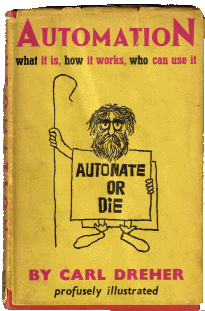
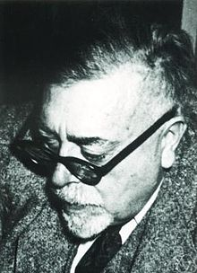
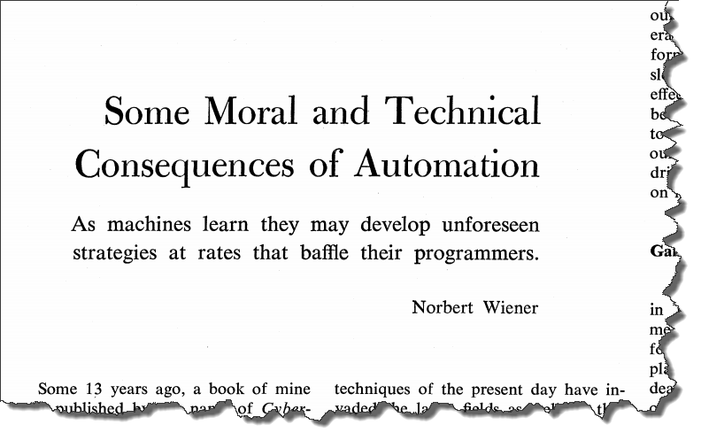
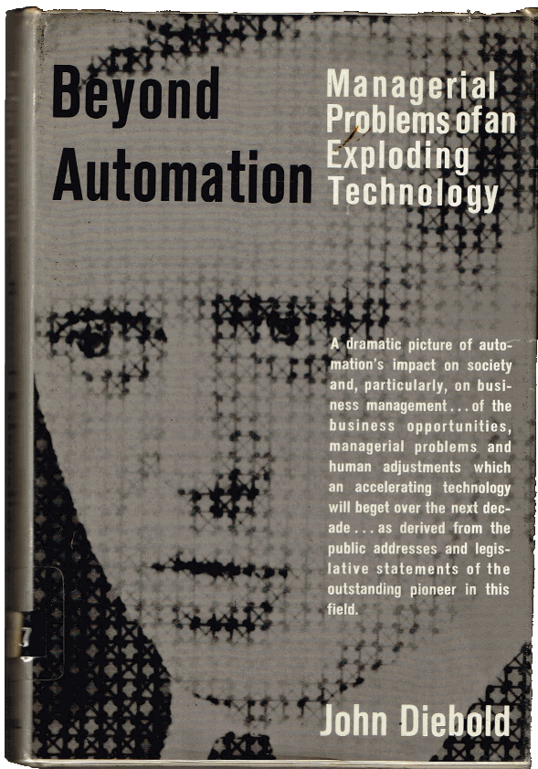
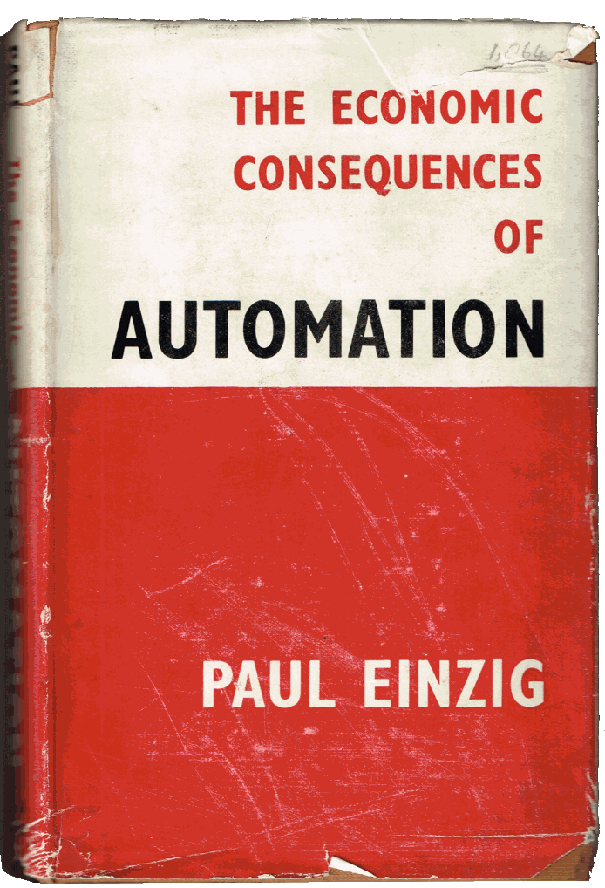
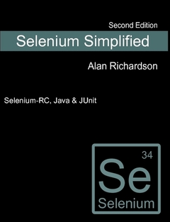

<!-- footer: @eviltester -->

<!-- Slide 1 -->

# Practical Test Automation Lessons Learned

Test Automation Day 2015

Alan Richardson

[CompendiumDev.co.uk](http://compendiumdev.co.uk)

[@eviltester](https://twitter.com/eviltester)

---

<!-- Slide 2 -->

# Expect controversy when we automate in software testing. Automation has long been controversial.

---

<!-- Slide 3 -->

# A Little History...

---

<!-- Slide 4 -->

# 1957

---

<!-- Slide 5 -->

# “What we need is more automation.”

Ford Motor company VP,

Delmar S. Harder,

Coined “automation” in 1948

1948

---

<!-- Slide 6 -->

# Automation is not a ‘thing’

---

<!-- Slide 7 -->

# Automation is a ‘process’ (automatization)

---

<!-- Slide 8 -->

# 1952

---

<!-- Slide 9 -->

# Automatization was hard to spell

"...the author found automatization both awkward and - from the standpoint of his weak spelling - hazardous ... it was the ease of spelling that finally overcame the author's reticence to coin a new word"

John Diebold,

“Automation”, 1952

---

<!-- Slide 10 -->

# The word “Automation” is...

Norbert Wiener

“hideous”

Sir Anthony Eden

“barbarous”

---

<!-- Slide 11 -->

# “Science”, May 6th, 1960

---

<!-- Slide 12 -->

# “Science”, May 6th, 1960

'automatization', 'automata', 'strategy', 'machine', 'automatic', 'automated', 'programming'

---

<!-- Slide 13 -->

# Watch your language

---

<!-- Slide 14 -->

# “Testers don’t need to learn to program to create automation”

Leads To

Controversy. Argument. Conflict.

---

<!-- Slide 15 -->

# “Testers don’t need to learn to program, to program automata”

Leads To

You do need to learn to program to program

---

<!-- Slide 16 -->

# “Testers don’t need to learn to program, to define test data” (etc.)

Leads To

A clear strategy for automating against

---

<!-- Slide 17 -->

# Automating requires a change to your test process. Describe your process with the correct words.

---

<!-- Slide 18 -->

# When we tagged ‘automation’ on

- No time to automate
- Less ‘testing’ done
- No Maintenance of automata
- ‘automation’ justified by ROI
- ‘automation’ didn’t fit the metrics and tools

---

<!-- Slide 19 -->

# Natural to tag it on when...

- Requirements (xref to)
- Test Cases (lead to)
- Test Scripts (automated by)
- Automation

---

<!-- Slide 20 -->

# “Automate all the test scripts”

> “But we don’t have any test scripts”

---

<!-- Slide 21 -->

# 1964

---

<!-- Slide 22 -->

# "...automation makes it possible to do many things that could not be done without it..."

John Diebold, Beyond Automation, 1964, pg 191

---

<!-- Slide 23 -->

# How to start automating?

---

<!-- Slide 24 -->

# Start by figuring out ‘Why?’, then ‘Doing’ and ‘Learning’

---

<!-- Slide 25 -->

# 1956

---

<!-- Slide 26 -->

# How to start automating?

A structured approach for vendor procurement?

---

<!-- Slide 27 -->

# How not to start automating?

A structured approach for vendor procurement

---

<!-- Slide 28 -->

# How not to start automating?

- Identify a set of tools
- Create objective feature assessment lists
- Add weightings to each objective
- Create RFx for tool vendors
- Await RFx Replies
- Review replies
- Choose Tool
- Evaluate and figure out how to use the tool

---

<!-- Slide 29 -->

# “Many managements genuinely seem to be looking at this subject as if they were walking around the edge of an ice cold swimming pool...”

John Diebold, Beyond Automation, 1964, pg 66

---

<!-- Slide 30 -->

# “...They realize that sooner or later they are going to have to jump in, but they try to postpone the leap with as much rationalization and fact-gathering as possible”

John Diebold, Beyond Automation, 1964, pg 66

---

<!-- Slide 31 -->

# Evaluate everything for a long time and end up with nothing

---

<!-- Slide 32 -->

# ~~Evaluate everything for a long time and end up with nothing~~

---

<!-- Slide 33 -->

# How to start automating

- Why?
    - Because?
        - How?
            - Experiment

---

<!-- Slide 34 -->

# Avoid the Danger of Ratholes. Understand your objectives

---

<!-- Slide 35 -->

# As a:

- Tester:
    - identify the areas to improve
- Manager:
    - prioritise and approve,
    - have a vision,
    - check in frequently
- Automator:
    - build small, solve fast, try multiple approaches

---

<!-- Slide 36 -->

# My First Automation...

---

<!-- Slide 37 -->

# Ignore the Tools & Demos

- SSADM Test Tool
- Generic Test Case Management Tool
- Test Case Xrefer
- Metrics Collator
- Test Data Generator * 2
- Keyword driven terminal emu automator
- Demos to ‘sell’ automation to clients

---

<!-- Slide 38 -->

# My First Automation was tools and frameworks

---

<!-- Slide 39 -->

# ~~My First Automation was tools and frameworks~~

---

<!-- Slide 40 -->

# My first ‘good’ automation

Automate the generation of ‘Scripts’ from ‘Paths’ to support interactive testing

---

<!-- Slide 41 -->

# Do start by solving problems

---

<!-- Slide 42 -->

# Don’t start by building tools or frameworks

---

<!-- Slide 43 -->

# Refactor to Flexible Abstraction Layers

---

<!-- Slide 44 -->

# Automate the easy stuff first

- start small
- the better you get, the easier things become, so start simple
- 80/20 : automate the 20%, gain 80% value

---

<!-- Slide 45 -->

# Do start with proof of concepts

---

<!-- Slide 46 -->

# Can we automate this system?

- can you execute some basic paths?
- check results where?
- individual control mechanisms?
- synchronisation methods?

---

<!-- Slide 47 -->

# Automate that which can be automated. Prioritize by value and ease.

---

<!-- Slide 48 -->

# How do you manage that which you do not know how to do?

---

<!-- Slide 49 -->

# The Philosophy of Insanity

1860

1947

---

<!-- Slide 50 -->

# “He must, as in the past, be so complete a master of the technical aspects of his profession that his subordinates will recognise his mastery, and be prepared to learn from him.”

The Art of Leadership,

Captain S.W. Roskill,

1964, pg 30

---

<!-- Slide 51 -->

# “The capability of a superintendent is eminently conspicuous in the selection of his attendants…”

The Philosophy of Insanity, 1860

---

<!-- Slide 52 -->

# Lessons learned in recruitment

- Phone screen
    - cv, experience & philosophy
    - portfolio
- Face to face
    - pairing
    - review, fix, create, speculate

Technical Knowledge Required

---

<!-- Slide 53 -->

# “Automation has turned out to be a much more complex and difficult problem than was originally thought.”

John Diebold, Beyond Automation, 1964, pg 51

---

<!-- Slide 54 -->

# Lessons Learned: Do Stuff

- Automation is not a thing, it is a process
- Watch your language
- Solve problems quickly and maximize value
- Build abstractions, not tools and frameworks
- Experiment small and fast
- Hire well, based on a portfolio and demo

---

<!-- Slide 55 -->

# Alan Richardson

Blogs and Websites

- [CompendiumDev.co.uk](http://compendiumdev.co.uk)
- [SeleniumSimplified.com](http://SeleniumSimplified.com)
- [EvilTester.com](http://eviltester.com)
- [JavaForTesters.com](http://javafortesters.com/)
- [Twitter: @eviltester](https://twitter.com/eviltester)

Online Training

- Technical Web Testing 101
- Selenium 2 WebDriver API
Books

Selenium Simplified

Java For Testers

[leanpub.com/javaForTesters](https://leanpub.com/javaForTesters)

Alan Richardson

[uk.linkedin.com/in/eviltester](http://uk.linkedin.com/in/eviltester)

[http://compendiumdev.co.uk/contact](http://compendiumdev.co.uk/contact)
