## Test Automation Day 2015 Keynote 'Script' 

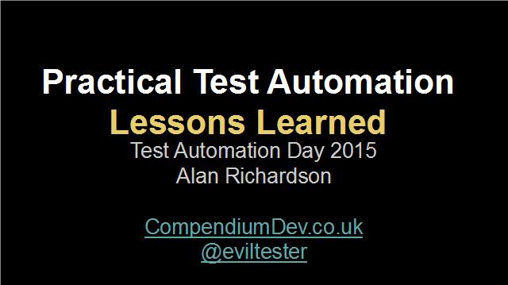

Hi, My name is Alan Richardson, and I'm an independent consultant. I help people start automating or improve their existing approach to automating. And help with their agile, and technical exploratory testing.

I've worked as a test consultant in consultancy companies, as a test manager and as a tester and automator. So I've tried to approach this 'lessons learned' presentation from the point of view of all those aspects.

And first. 

### Expect Controversy

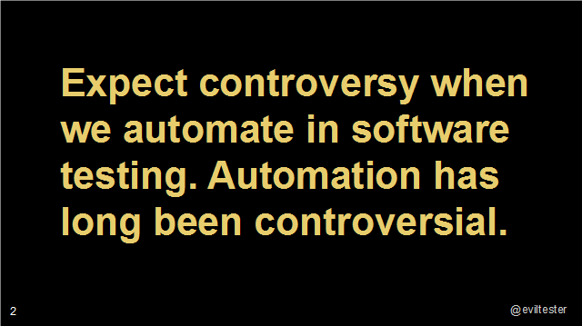\

Automation is controversial. It is now, if you search the internet for blogs or articles on automation you'll see controversy about 'should testers be able to code', what abstraction layers to use, what languages are best, what tools to use. etc. etc.

And the point for you, about all the controversy is. You can learn from it - if the arguments have some practical value for you. But you have to take responsibility for your own environment and the way you automate own test processes.

I think some people 'halt' when faced with controversy. Particularly if you're in management and being asked to make decisions about something you don't understand. But you can't halt. Management have to find ways forward, and create results, despite controversy. Because controversy has always surrounded automation.And we'll cover the history of that.

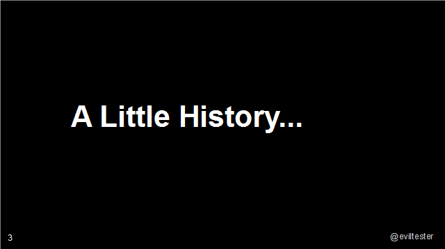

### 1957

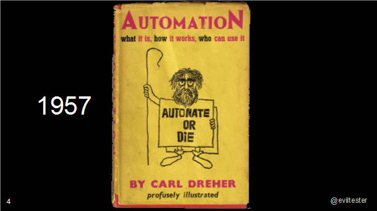

In 1957, Gollancz published a book by Carl Dreher. It was part of their "Gollancz  Primers for Our Times" series, which started with "How to lie with statistics"

"How to lie with statistics" was an incredibly successful book. It is still in print.

"Automation" - not so successful. I think it hit a 2nd edition in 1958, but other than that ...

People, it seems, would rather learn to lie with statistics and metrics and numbers, than to learn effective automation.

Now since this is an automation conference I'm sure that isn't true here. But it is worth being conscious of this in the real world. That people are often more interested in the numbers and the metrics, than they are in the benefits and the improvement of processes. "Automation" can be a hard sell - and so lessons are that we don't sell it, we do it.

### 1948 "Automation" and Delmar Harder @ Ford

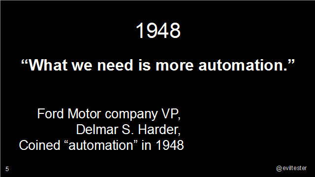

In 1948, Delmar S. Harder is reputed to have visited the Ford production lines, seen that they weren't producing product as fast as he wanted, and said "What we need is more automation."

Unfortunately...

Automation is not a 'thing'

Automation is not a 'thing'. 

You can put things in boxes, you can count things, you can sell 'things'. 

Automation is not a 'thing'. It is a vague word that acts as both a noun and a verb and if we use it carelessly no-one knows what we are talking about, but they think we do.

Perhaps people didn't buy "Automation" by Dreher, because everyone already knows what it is.

### Automation is not a 'thing'. 

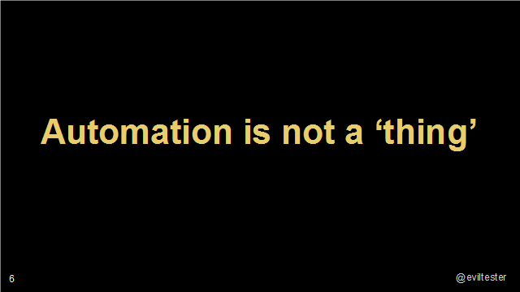\

Automation, if it is anything, is a 'verb'. Automation is the 'process' of automatization.

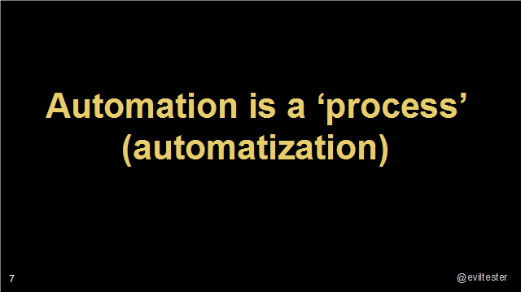\

### 1952 Automation by Diebold

\

In 1952, John Diebold wrote a very famous book, which did sell, called "Automation".

And it is this book which is credited with popularising the word "Automation"

### Automatization was hard to spell

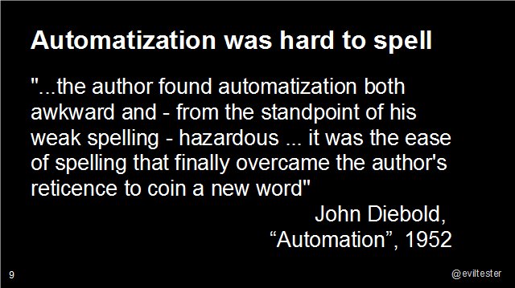\

Because "Automatization was hard to spell".

In 1952, people had not automated the process of spell checking. When you typed in the olden days you had to spell correctly.

So rather than learning to spell. John Diebold popularised an easier to spell variant, which was less exact in meaning than the word it replaced.

"Automatization" describes a process of making something more reflexive or more automated.

Automation seems to mean, the process, and the product, and anything else we want to argue about. 

### The word "Automation" is ...

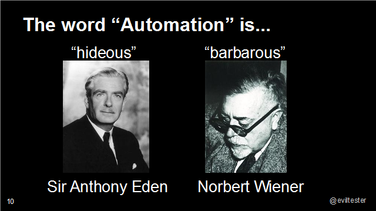\

According to Carl Dreher's "Automation"

Sir Anthony Eden called the word "hideous".

Norbert Wiener "a father of cybernetics", described the word as "barbarous". And unfortunately most descriptions of Wiener that you find on the internet call him the "father of automation" or an "advocate for automation".

I can't find another source to corroborate this.

But I did find a paper written by Norbert Wiener where he uses the word Automation.

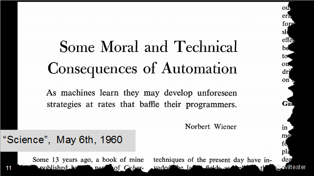\

Some Moral and Technical Consequences of Automation

In the paper "Some Moral and Technical Consequences of Automation" in "Science" 1960, Norbert Wiener does use the word "Automation".

But only in the title.

Elsewhere in the paper Wiener uses the words "automatization", "automata", "automatic", etc.

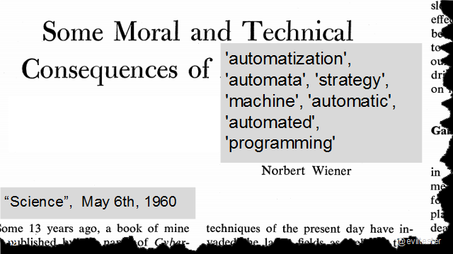\

I presume that Wiener used it in the title as a marketing ploy (or the editor added it, as a marketing ploy). 

But Wiener wanted clarity in his communication. And so tried to use more exact words to explain his meaning. This helped him think more clearly about the strategies and concepts he was trying to explore.

### Watch your language

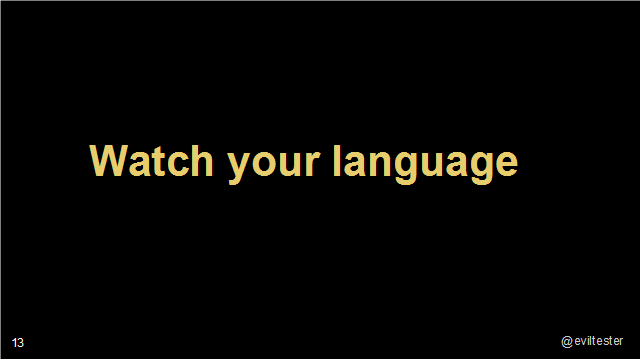\

One thing I have attempted to do over the years is be as exact as possible when I talk about testing.

I don't use phrases like "Black Box Testing" or "White Box Testing". I try to explain "performance testing" or "stress testing" in terms of what I want the activity to achieve.

Similarly with "Automation"

I think it helps avoid controversy and encourages ownership and responsibility.

###"Tester's don't need to learn to program to create automation"

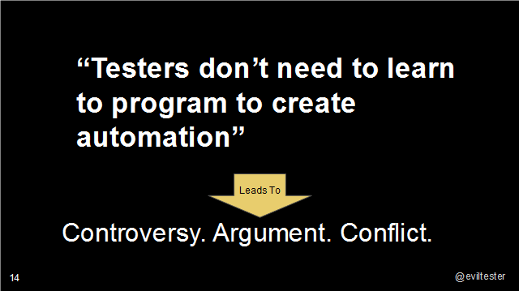\

One thing the software industry seems to argue about at the moment are statements like:

"Tester's don't need to learn to program to create automation"

Because it is vague, it uses the word "automation" in a vague way.

If, instead we said:

### "Testers don't need to learn to program, to program automata"

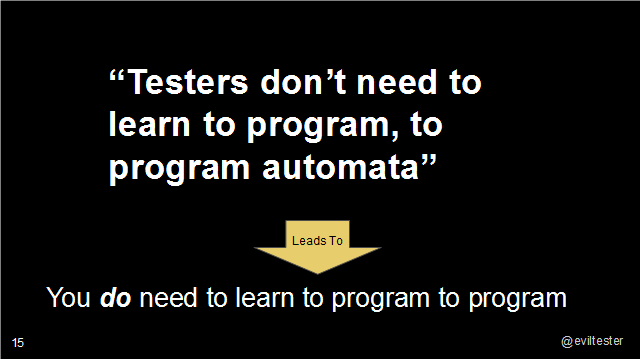\

(Automata being something that automatically follows a program.)

Then clearly that statement is false. We do need to learn to program if we want to do that.

But if we said:

"Testers don't need to learn to program to define test data" (or identify test execution paths, etc.)

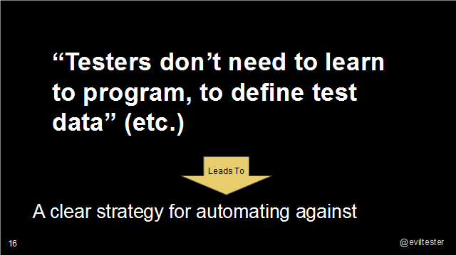\

Then clearly that statement is true. And not only does it avoid controversy, it is a step towards making your strategy for automating clearer and a more integrated part of your test process.

### Automating Requires a change to your test process

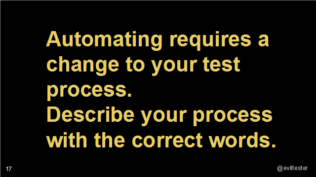\

Automating Requires a change to your test process. 

Automation is a verb, a process. You can't add a new process into an old one without the old one changing.

Describe, and think, through your process with the correct words and you can avoid controversy, and make the necessary adjustments in your process to make the change successful.

### I remember when we tagged "automation" on

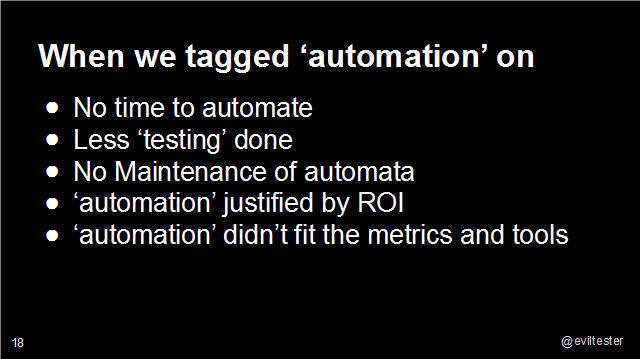\

In my early days, we tagged 'automation' on to our existing process.

We found that we didn't have time to automate. And less testing was done when we did make time. Because it wasn't part of our process the automata (automation code) wasn't maintained so didn't work reliably. So people questions the cost and the managers had to justify the ROI on automation. And it didn't fit into the existing metrics and tools so had an overhead of creating "meaningful" statistics for the automation fit into the existing metrics and tools.

It was a mess. Because it was tagged on. We didn't incorporate automating into our test process, we added 'automation' into the mix.

Unfortunately people still do this today, even with Agile development, with many of the same results.

### Natural to tag it on when...

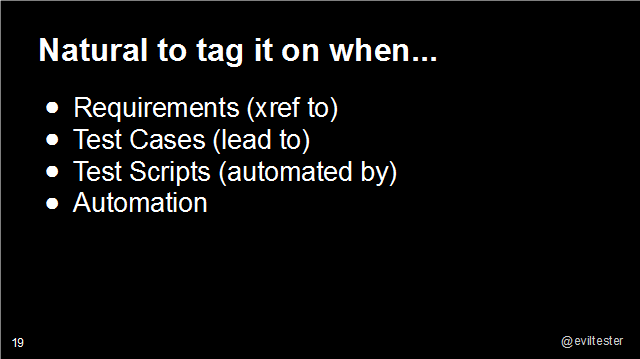\

Unfortunately "Automated Script" seems like a natural thing to do when your test process has "Requirements" which cross reference to "Test Cases" which we execute by "Test Scripts". So we then introduce "automation" with "Automated Scripts".

Which leads to 1-1 poorly coded scripts, which often copy pasted, no understanding of what they try to do, and no re-use of code.

### Automate all the test scripts

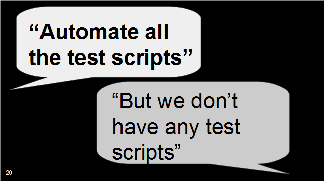\

But now we live in a world where some people don't have "test scripts".

I haven't written a 'test script' in years.

So I don't create "Automated Scripts" - most people don't. But we still have this language hangover. 

Which I am trying to train myself out of.

And which can also prevent people thinking through all the possibilities that are available when you try to automate parts of your process.

### Beyond Automation

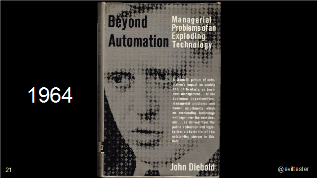\

In 1964, John Diebold wrote "Beyond Automation" a series of "lessons learned" and lectures he had given in the years since his "Automation" book, aimed primarily at managers.

He makes the point that "...automation makes it possible to do many things that could not be done without it..."

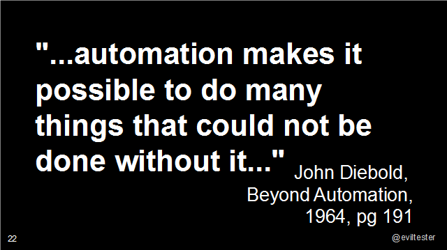\

A point that can be obscured if we think in terms of "Automated Scripts" instead of "automating" parts of our process, and changing our process to allow parts of it to be automated.

### How to start automating?

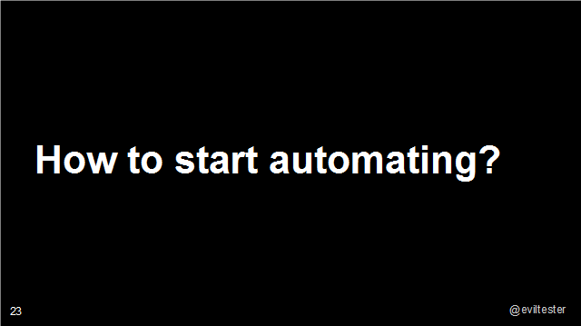\

So how do you start?

I recommend that you start by 'doing' and from this 'learn'. But do something, after you have figured out 'why?' you want to automate a process.

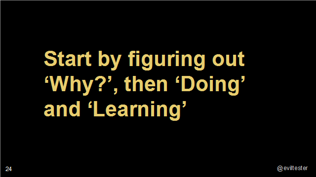\

### 1956 Economics of Automation

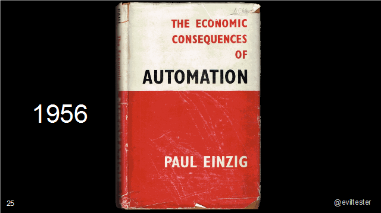\

This is not the typical approach.

The typical approach is to deal with "automation", which drags you into the money and ROI maze, and the 'big change project' approach typified by committees and "structured approaches to vendor procurement"

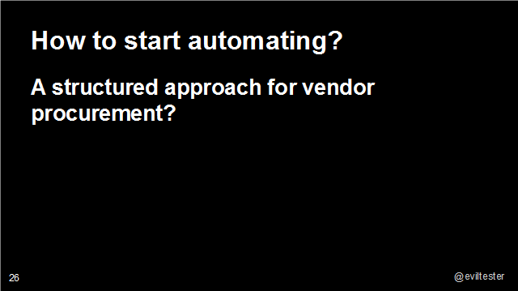\

Unfortunately, early in my career I've been involved in the massive black rat hole of time consuming meetings surrounding these processes.

This is absolutely 'not', how to start.

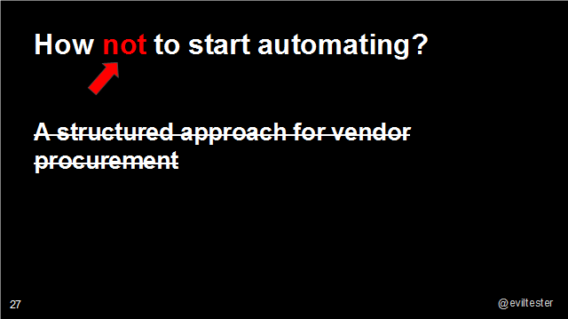\

Don't, create a big list of candidate tools and vendors, when you don't know what tools are suitable and you don't know what you want to do. 

You don't know what benefits you want to achieve or what you need to achieve them so you create feature lists drawn from vendor documents.

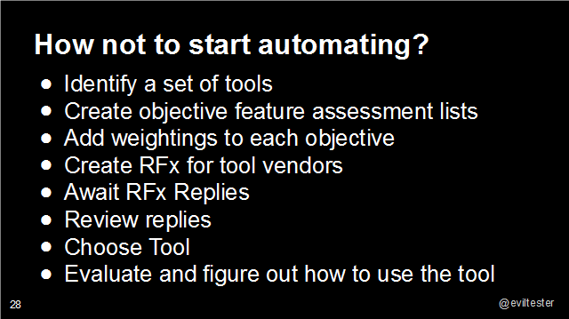\

You try to pretend that you know how important they are to you so you create weightings for them all - this makes it objective.

Then wait for the responses, where vendors are completely honest and every tool can do everything on the list.

Then you calculate the weightings and choose what shelfware you want to buy.

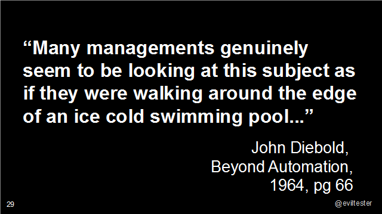\

I've been involved in these processes. Don't do this.

Diebold describes this in "Beyond Automation" as managers "walking around the edge of an ice cold swimming pool..." 

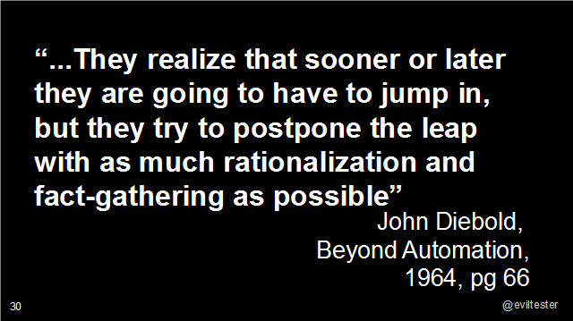\

They know that "sooner or later they are going to have to jump in, but the postpone the leap" as long as possible.

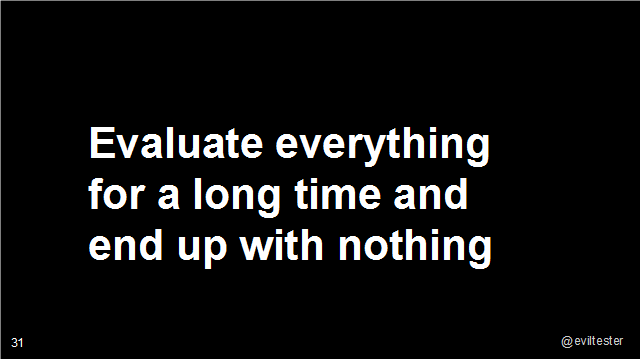\

They put up a barrier of rationalisation and fact-gathering, which also helps to avoid responsibility and blame.

It is so easy to evaluate everything for a long time and still end up with nothing.

Don't repeat this mistake.

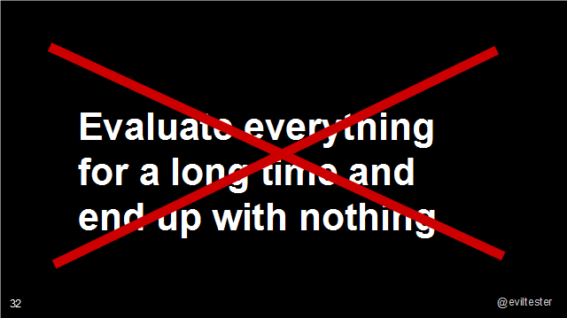\

### Start with why

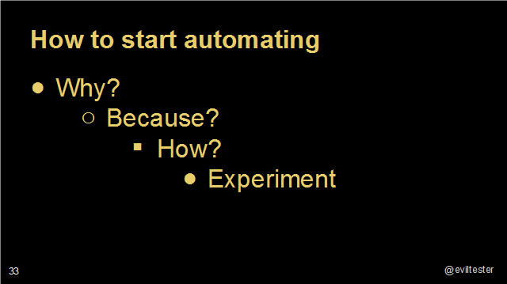\

Start with 'why?'

"We need more automation" because we want to create more products faster in the production and compete with our competitors.

Now, with an objective, you can work out how, and experiment with it.

With objectives you can avoid getting sucked into rat holes of ongoing 'automation' without any goals being met. Because management left everything in the hands of automators instead of taking the hard task of making a decision about something outside their comfort zone.

### Avoid Rat Holes

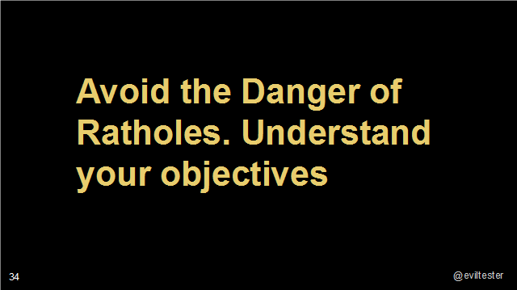\

I receive emails from people saying "I've just started learning Java and WebDriver and I want to create a framework that will make it easy for anyone to get started. What should I do?"

This person doesn't have objectives - otherwise they wouldn't be creating a framework for 'anyone' they would be solving problems in their domain.

This person may not even have tried to use the tools, they've looked at it, found it hard, and stopped learning.

And where is their management in this? Management have let them go off into a rat hole of automation and technical development with no value and time-scales.

I don't use frameworks when I use WebDriver, the tool isn't hard. I create domain models that help me solve problems for the current application and environment.

### This involves everyone

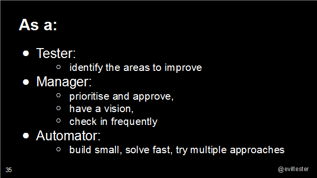\

And this involves everyone.

People on the ground who know what the problems are.

Managers would can prioritize the objectives based on the benefits they want to achieve, and can manage based on the results of the experiments.

And the people who will build the solutions. And who are encouraged to build small focussed solutions, rather than tools and frameworks.

### My First Automation was tools and frameworks

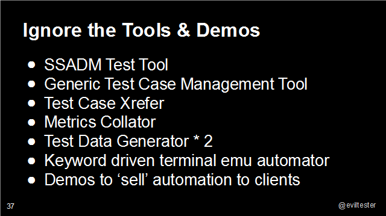\

In the olden days I build lots of tools during my work in consultancies or on projects - we didn't really set objectives for what we wanted so we built what might sell, or was interesting to work on.

Rat holes of tools and frameworks.

Don't do this.

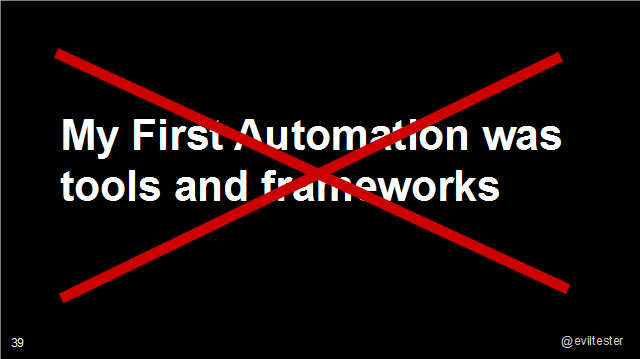\

### My first 'good' automation

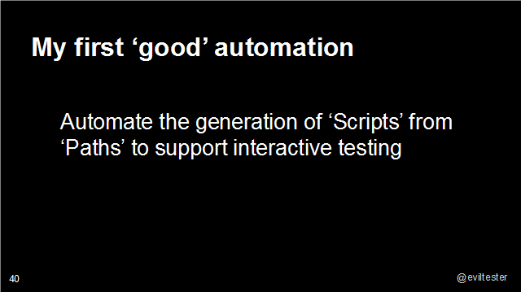\

The first 'good' automation I think I was involved in, was me solving a problem by automating part of my process.

I was working in an environment which did "requirements -> test cases -> test scripts" in a big name test management tool. But we spent so much time responding to change an updating in the tool that we didn't really have time to 'test'.

I needed to stay close to the team and keep up to date with the changes. But I couldn't do that if I was continually updating the scripts. So I automated those.

I didn't automate the execution. I automated the creation of the scripts.

See I learned that 'scripts' were actually instantiated paths through a system. And I could model the system as a graph. 

I built a program to generate the scripts from the paths.

I no longer had to keep the scripts up to date, just the graph model.

I solved a problem when I automated part of my process.

Don't start by building tools or frameworks.

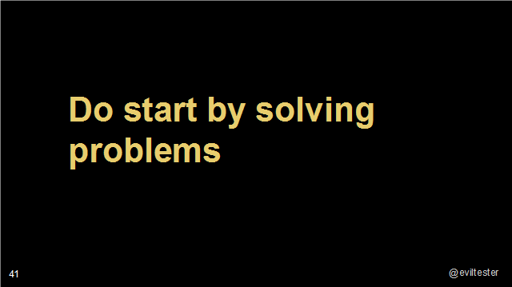\

### Refactor to Flexible Abstraction Layers

\

I build abstraction layers, rather than frameworks.

Libraries that effectively organise the code,

Code that models our domain, and our application. Not something generic. Something specific for our needs.

And a mark of success with that is flexibility.

I want to see the program code we use to automate the application, also support our exploratory testing. To help me knock up some code to investigate a risk or a condition. 

I don't want to be forced to use a framework like cucumber to create adhoc tests. I want our cucumber abstracted code to use our flexible abstractions.

I don't want to have to use reflection to bypass constraints coded into the libraries we've built. If we learn other lessons from cybernetics like requisite variety - the ability to respond effectively to a variety of use-cases and inputs then we automate with flexibility.

But we refactor to this. We build something that solves a problem. Then refactor to make it generic and re-usable.

### Automate the easy stuff first

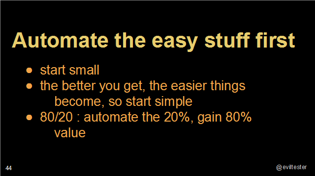\

When you first start doing anything, it is hard at first.

So we start small. We achieve some success. We learn.

Then, the next thing doesn't seem so hard.

And if we concentrate on the easy things that make a big difference we can take advantage of the Pareto principle and aim for 80% value from 20% effort. And if each thing we target is a problem that we are 'solving' 80% of, then we never have to explain a return on investment. We are improving our process.

### Start with a proof of concept

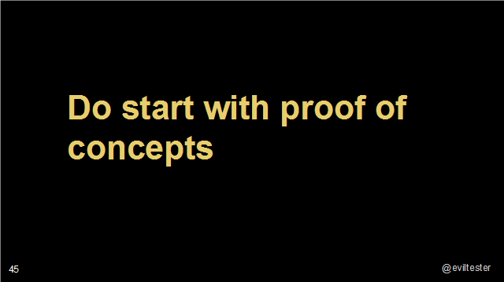\

Instead of evaluating tools in a structured fashion. Start with a proof of concept.

So I execute some basic paths, just to check I can exercise the app.

I make sure I can check results at all the levels I need to, pulling info off the GUI or out of the database.

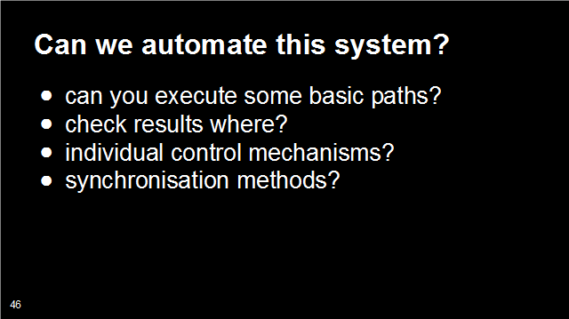\

I look through the system to try and make sure we can control as much of the app as possible. We tend to use the same buttons or lists etc. throughout the app so when we know how to control it once, we pretty much know how to control it in all parts of the app, but we want to identify the parts we can't control.

And most importantly I make sure I can synchronise on the app state. I don't use wait for 5 seconds. I make sure I wait for the form to load and be ready to use. Synchronise on state, not on time. This is one of the main areas of error and intermittent execution that I see on site.

A proof of concept doesn't always lead to abstraction layers but it should lead to a massive de-risking of the tool selection, and should help identify skills needed and possibly architecture in the system that needs to change to support automating it.

### Prioritise

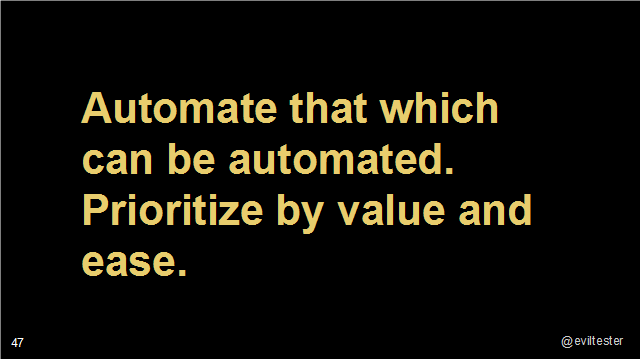\

Start simple and automate what is within your capabilities. And prioritise the effort in terms of value.

Don't try and tackle the hardest things first, when you know least.

### How do you manage?

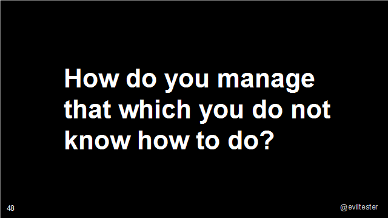\

And how do you manage something which you do not know how to do?

Madness?

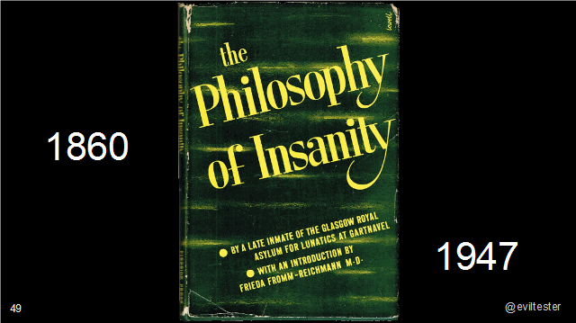\

I pretty much threw this in for a laugh, but I love this book. Since it was originally published in 1860, you can find it on the internet archive.

So you can. As S.W. Roskill, describes it, be a "master of the technical aspects" - and I recommend that you do try and learn some hands on experience with automation so you know how hard it can be. But Roskill is talking about leadership, not management. There is a difference.

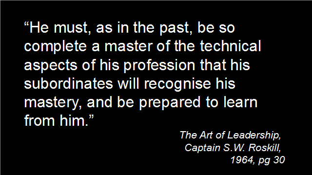\

The manager, has to be able to hire and identify leaders that can be hands on. That has to be your skill.

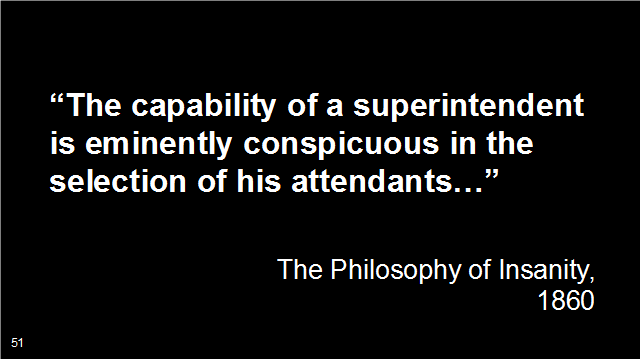\

### Lessons learned in recruitment

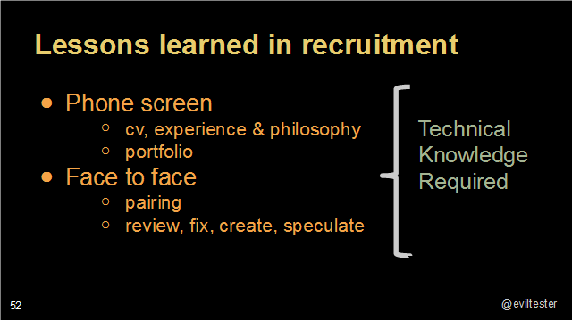\

And the problem is that the first hire is so important. Because they will help you hire everyone else. And when you hire for technical skills you have to see those technical skills in operation.

I always phone screen. Because I want to discuss what they learned from their experience and what their philosophy to automating they have developed.

If they have a portfolio of work e.g. on github or on a blog then that is important.

Most important is pairing with them in an interview. I want to see where on the experience continuum they fit.

* Can they review the automated program code and comment on it effectively.
* Can they fix errors in the code?
* Can they create code from scratch?
* Can they speculate and design an approach from scratch, given an application?

But it takes technical knowledge to evaluate this effectively.

### Automation is hard

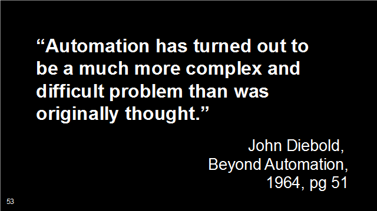\

Automation is hard. And we make it hard on ourselves by attempting to automate the new and shiny, and we create technology that we make hard to automate like mobile. This is an ongoing hard problem that requires technical skill and knowledge.

Automation is hard to manage. Manager's have to make decisions about topics that they know little.

It is too easy to 'not manage'. And push the responsibility on to the automators, or only hire testers with programming skills 'just in case' because you don't know what you will automate or what problems you will solve.

### Lessons Learned. Do Stuff

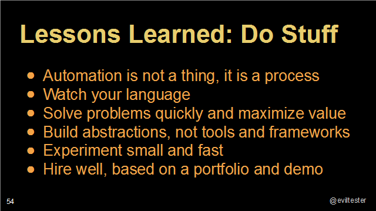\

But if we start small and solve problems, making sure that we treat automating as part of our process and not as a tag on. Making sure that we communicate what and why we automate, rather than obfuscate with 'automation'.

It is possible to add value quickly, if you have the right people involved, and if you take the time to learn.

And if, when faced with an ice cold swimming pool, instead of putting off the inevitable, and dive in, then you might learn that you need to switch on the heating first next time.

