# Unused Slides for Test Automation Day 2015

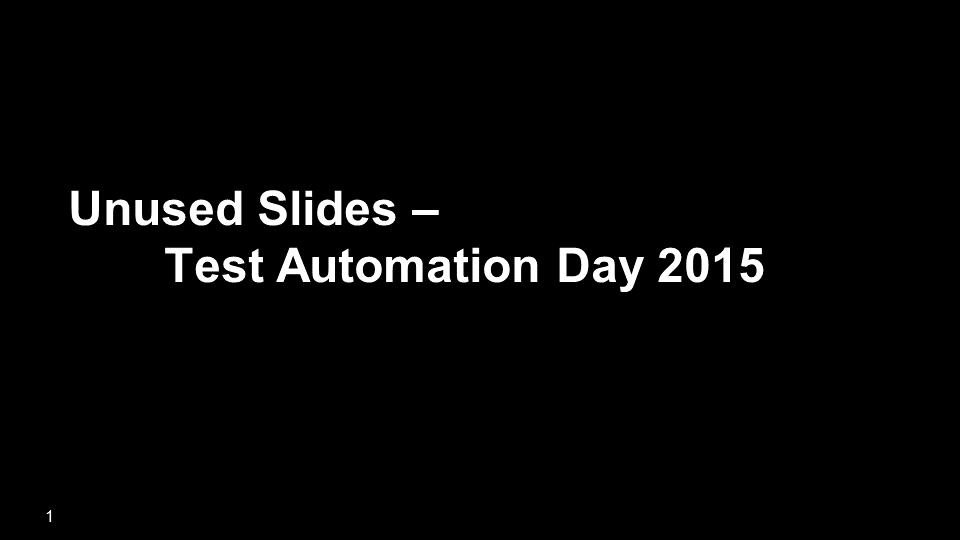\

## Historical Notes

### People have argued for a long time

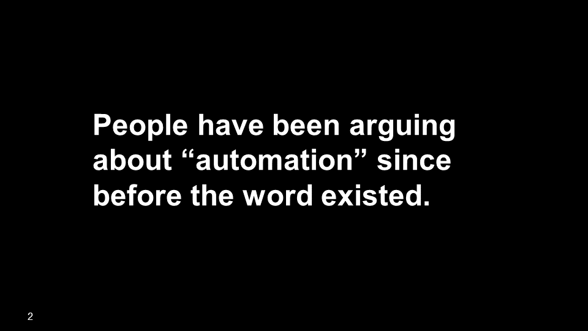\

"People have been arguing about “automation” since before the word existed."

I think I do cover this in the presentation, that people have been afraid of the concept of automating manual labour for a long time. Generally out of fear. People feared progress because they couldn't see how they could adapt to respond to change effectively.

This is why I think the cybernetic concept of Requisite Variety is so important. 

Adaptation to change is vital for survival. If we are aware of the concept of "Requisite Variety" then we know that we have to have multiple ways to respond to inputs into our system. The more we learn, the more we understand why we do things, the more we understand alternative ways to perform actions, the more we understand about how the system fits together, the more skills we develop in ourselves.

The more we can handle change.

This is one reason why Miyamoto Musashi's "The book of five rings" is such an inspirational book. It essentially covers 'how to build your own requisite variety' and explains how he tested his requisite variety by challenging and duelling against swordsmen of different styles across Japan, so that he could test his skill against multiple styles and would have to respond effectively or he would die.

Still a great book today and if you haven't read it, I thoroughly recommend Miyamoto Musashi's "The Book of Five Rings".

### Automatic Must Be Good

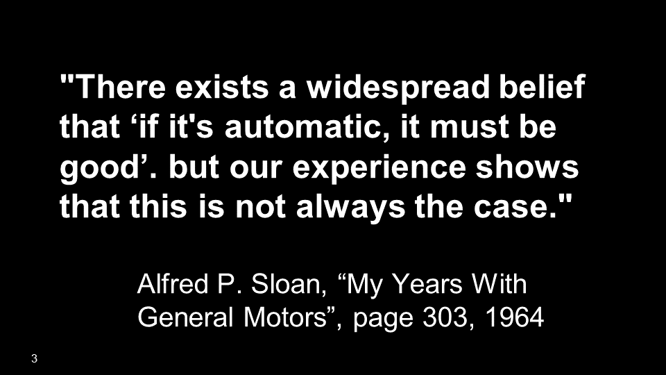\

"There exists a widespread belief that ‘if it's automatic, it must be good’. but our experience shows that this is not always the case."

* Alfred P. Sloan, “My Years With General Motors”, page 303, 1964

Alfred Sloan's book "My Years With General Motors" is often quoted as a classic management book. But I just pillaged this quote from it to try and counter the view that "Automating is always good".

Having a single response to improvement. Whether it be 'automating' or 'manual' or 'better skills' or whatever your single approach is, doesn't guarantee success. We have to be aware that we are working within a system and we need to take actions that fit into that system.

Automating is hard, so make sure that when you do it you have good enough staff and your strategy and goals for the automation are justifiable and doable.

## Case Studies in early automation

### Early Automation

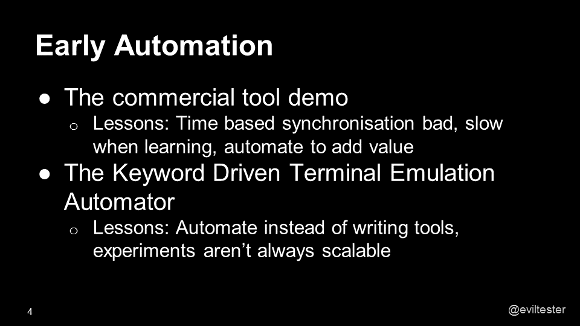\

I didn't go into detail on some of my early experiences of automating in the talk because it seemed like it would take too much time and I could summarise in a few sentences.

I remember my first automation was a 'demo'. Because the consultancy I worked for was trying to 'sell' in automating as a strategy to a client, and we had to create a demo of WinRunner automatically executing paths through the client application.

I had never automated anything before, but I could program, the tool was supposed to be easy to use and test automation is pretty simple right.

We identified a basic set of paths through the application and we were going to have a demo that just looped around those paths.

Man this was hard.

I did get it working but it was skin of the teeth stuff, I was still tinkering with the code on the morning of the demo and when we set it off, I was sitting at the back of the room ready to run forward and switch the demo off if we encountered any intermittency in the execution.

Because I hadn't learned to synchronise on an application sensitive basis and was using time based synchronisation (i.e. wait 3 seconds, then click on the button).

Fortunately it all worked smoothly. But I learned early on that programming skills weren't going to save me. I needed to learn how to build code that would synchronise on the application effectively.

I also learned how to hack out random data so that I could repeat the same path through the application without resetting the environment.

The second thing I had to do was a keyword automation exercise. Why keywords? Because that was the simplest high level parser to create. Keyword based automation wasn't a thing then, and it was just the normal way of writing a high level interpreter so that testers didn't need to learn how to code.

In this case we were pulling the text out of an MS Word document and feeding data through an API into a green screen terminal emulator.

Again - synchronisation was a nightmare because the API was designed to receive information rather than make it easy to pass back. And I learned that high level abstractions have to be designed at multiple layers and in conjunction with the usage scenarios they are designed for. Creating a list of commands for re-use, isn't necessarily the best way to create an abstraction layer.

But both were fun exercises for me the junior consultant, even if they didn't add much value to the project. So I also learned early that when I moved in to management, I had to make sure that we didn't do stuff just cause we thought it would work, or was interesting to do, it had to add value, and as a manager it was my job to keep checking that the work we were doing added value.

### How do you know what to automate?

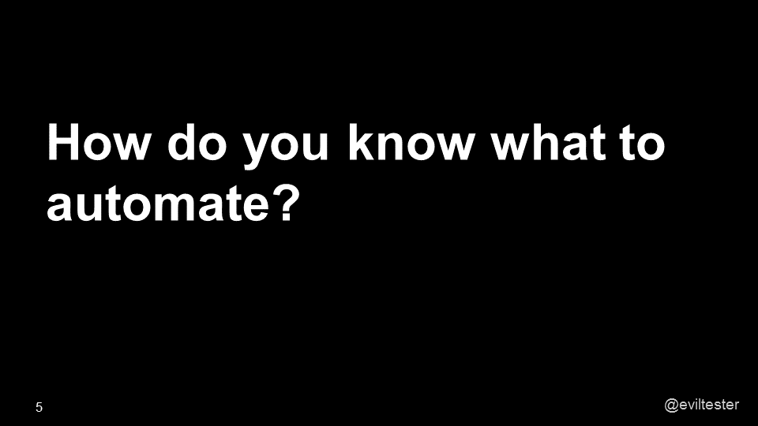\

If you are automating strategically then it should be obvious what you need to automate, because you are working to a bigger picture.

But it is also possible to automate tactically, and when you do, making choices about what to automate can be hard.

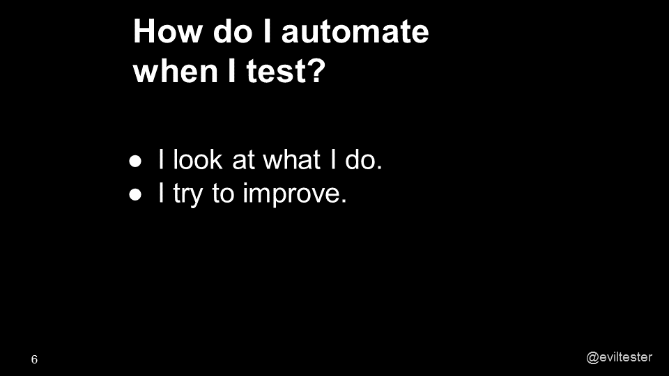\

So when I work tactically, I make sure I understand what I do, and look for simple things that I can improve.

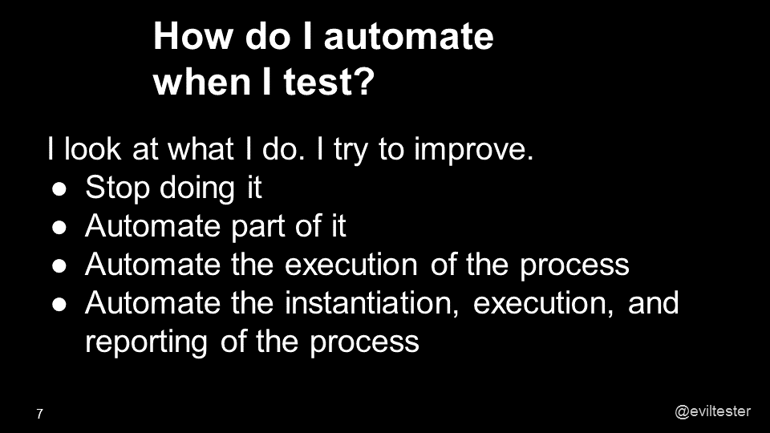\

This doesn't always lead to automating because sometimes I'm better off just stopping an activity. If I'm writing something, and no-one is reading it, and I gain no value from writing it, then I'm better off stopping entirely.

There is no point in automating away an activity that adds no value.

Sometimes I'll automate away part of the task. So I might have a page that lists a bunch of URLs, and I click on those instead of typing each URL every time I need to switch test environments. I might find a tool that generates strings of data so I don't have to keep typing them in.

I might automate the execution of a process, e.g. a macro in a text editor. I have to load the file and put the cursor in the right place, then I'll execute a macro to do a specific activity. But I haven't made the time to automate the full process.

And sometimes I'll automate the full process, so I click a button and an entire activity takes place. This is generally harder and more time consuming, but I can also build up to it by gradually increasing the amount of responsibility I delegate to the automated process.

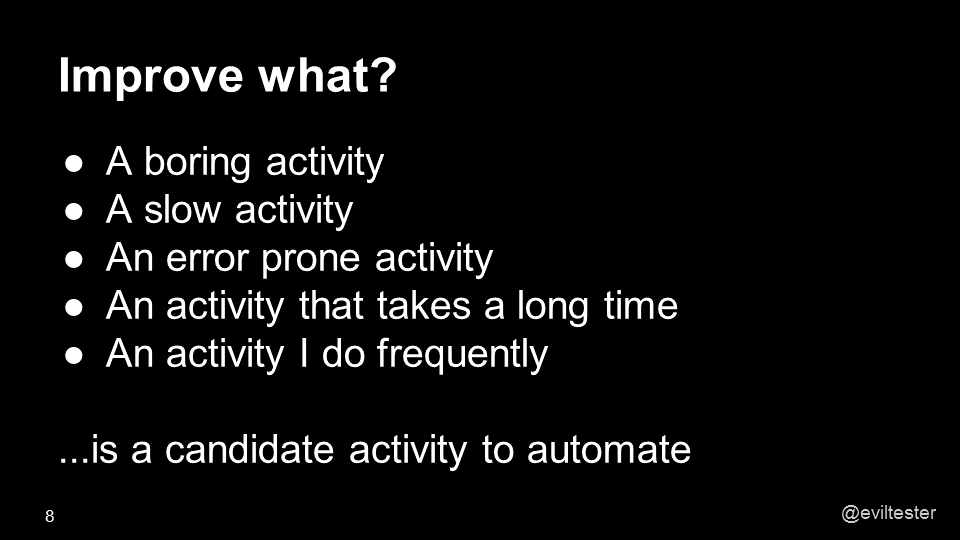\

So then the question is. Improve what?

Since it is hard to write code that requires cognition, I start simple and go for tasks that require no thought, and one which the cost benefit associated with spending time automating it outweighs the time doing it, or the risk associated with doing it manually is worth offsetting through an automated process.

So stuff that is boring or slow for me to do, or something where I make lots of typos or errors, etc. etc.

### My first proper automation

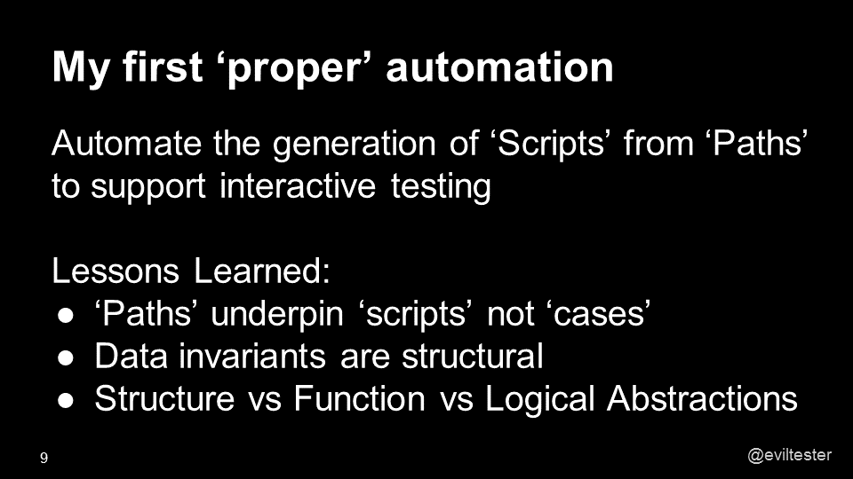\

I did cover this a little in the talk.

My first 'proper' automation I created was in an environment that had a lot of overhead on a manual process.

We used a test case management tool. And we had to cross reference cases to requirements and write scripts for each case and steps repeated across scripts etc. etc. 

And the maintenance was horrible.

I needed to change the script steps all the time, because of the style of documentation we used.

Instead I wrote a tool where I could create a graph model of the application. Identify paths through that model and then automatically generate the steps required.

A few years later I turned this into a commercial product that flopped and taught me a lot about business in general. [Ha Ha]

But I leaned heavily on Beizer's Software Testing Techniques book here. And it helped me change my model of what this documentation was.

The test scripts weren't really important. And neither were the test cases.

What was important was the building of a model that I could use during testing. And this can just as easily be a mental model rather than a formal graph model. But if you want to feed your model into an automated process you have to formalise it.

And essentially, all the scripts are simply instantiated paths through a system. So the paths are important.

And when you look at paths in a system. Some of the data is invariant. It never changes. In order to follow a certain path in a system you have to use a specific data value. e.g. You can only enter the zip code if the country is the US

At that point you identify data invariants based on a structural model. The data exists in a variant form in a domain model, but a structural model can cause data to be invariant.

I also learned that if the data isn't invariant then it doesn't affect hte path, then I it is really an equivalence class. Regardless of your boundary value analysis on a field etc. If it doesn't impact the path, then it is in an equivalence class.

And I started to see different types of overlapping models in what I was doing - structural models, functional models that were higher level abstractions that didn't explain (how), and logical abstractions.

So this completely changed how I approach automating and testing in general and set me off down a path of understanding Systems, systems thinking, cybernetics, set theory etc.

If you haven't read Beizer's Software Testing Techniques, then I thoroughly recommend it.

### Case Studies

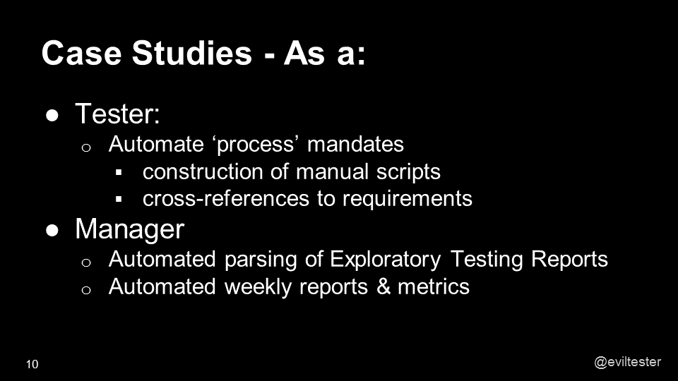\

Just so that we don't get the idea that Automating requires us to execute paths through the system under test and check results to report pass/fail conditions.

A lot of my automating is around the process.

So I prefer to use tools which have APIs and support my tinkering around the edges.

And here are some examples.

I often automate away process mandates. The 'daily report' mandates or all the cross referencing in tools.

And it isn't so much the cross referencing that I want to do away with. I can see the reasons for cross referencing planned work back to justification sources like requirements in some environments. But very often the tools that we use to do it are so inefficient and codify the model so badly that it adds a huge maintenance effort.

And that's often what I automate a away, by creating and maintaining a more effective model of the cross references, I can then have an intermediate level automation take my model and update the 'test tool' that we are using.

And when I was in management I added automation into the process.

So on one site, I was trying to improve the note taking around the exploratory testing so that we had evidence of the testing performed and to increase the ability of the testers to plan their work and report on their work.

And to do that I had to make sure that the tool use didn't introduce objections to that, and barriers to it, and didn't provide excuses for an inefficient process i.e. I'm trying to take notes, but it takes so long to add them to each of the bureaucratic tools.

So we were using Jira. And Jira has an API.

We were working off stories, so all our test evidence would be assigned to stories for reporting.

When we test, it is useful to keep a longer running report of our work, rather than organise it into stories. And certainly for review purposes it is easier to review the test work when it isn't split across 10 different stories.

So I created a parser that would scan exploratory test reports and so long as they had macros in place it would split the report up and create defects, and add notes to the appropriate stories etc. to avoid some of the manual reporting work.

Again this was just a modelling problem where the model we needed for our testing, didn't match the reporting model, so I built an automated bridge to span those models.

And so many times I've built automated scripts and tools to collate those incredibly valuable weekly reports that are sent outside the main software development process into the management Shangri-la.

## Staffing and Doing

### If you don't know...

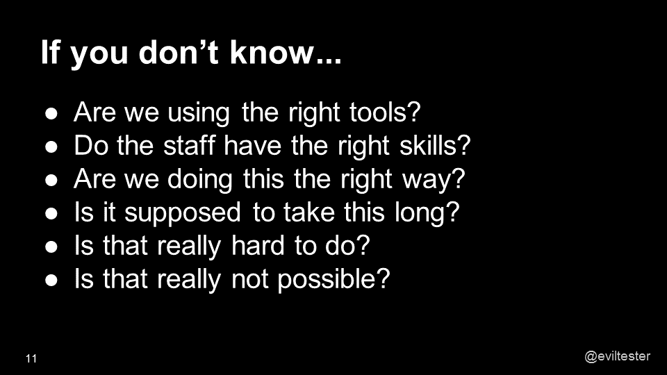\

I have the advantage that I've worked as a developer and I've been involved in testing for a long time.

I would argue that this advantage is a result of my continually expanding my 'Requisite Variety' and working hard to improve my testing, management and development skills.

And this advantage means that I can be involved very heavily in the process of automating the testing work.

So I can answer and evaluate these questions:

* Are we using the right tools?
* Do the staff have the right skills?
* Are we doing this the right way?
* Is it supposed to take this long?
* IS that really hard to do?
* Is that really not possible?

But you might not be able to address those questions directly. So you rely on your staff, and sometimes people get so caught up in a problem that they really don't know how to extricate themselves from it.

So sometimes people tell you that something is impossible, because they haven't managed to do it, and haven't managed to find someone on the internet show them how to do it.

At that point, yes, it is currently impossible for your team to do. But it doesn't mean that is is universally impossible. But it may be hard to find out.

So a general guidance has to be to have an experimental mind set.

Try things out in small chunks to mitigate risk and explore functionality.

Approach problems in multiple ways using multiple tools to help identify which approach works best.

Bring in experts who already know how to solve the problems and then you have a baseline for what is possible and how short it can take when you have the experience.

Automate through a GUI, through an API, treating the GUI as an API, direct into the database. Multiple injection and manipulation points.

This helps build experience quickly and gives you the ability to swap approaches quickly.

But fundamentally, if you don't know how to answer these questions, find someone who does, or help your team learn how to answer these questions.

### I don't recommend recruiting like this

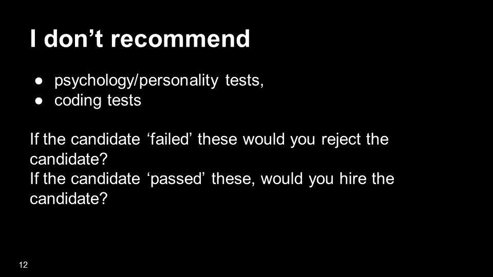\

When I recruit people I use a lot of hands on pairing and discussions. I don't like tests where the person works on their own because you don't see how they work, you don't get a feel for how they ask for help, they might misunderstand something and go off on a long tangent.

Personally, I also don't like it when organisations ask me to do a lot of work up front without demonstrating to me that they are a group of people that I would want to work with.

Imagine spending 4 hours doing a coding test and then turning up for an interview and discovering in 10 minutes that you don't want to work in this environment.

What a waste.

And generally speaking, the best staff aren't going to do this, they just won't respond to your recruitment process.

So I try to code with people, have them maintain or create code within our existing code repository.

However, if you feel that, if someone aced your coding test that you would immediately give them a job then great, that test is giving you the information that you need.

If you're using that test as a buffer then you're going to put people off and it means that your filtering process isn't good enough.

And as for personality and psychology tests like Belbin or Myers Briggs, or the psychometric tests like verbal reasoning etc.

I don't go anywhere near them. They seem like buffers. Again, unless you use them to accept someone unconditionally, don't do it.

You don't want any barriers to getting the best staff you can.

And you do want to learn how people can work. So make 'working with them' part of the interview process.

## Automation Hints and Tips

### Data Randomisation

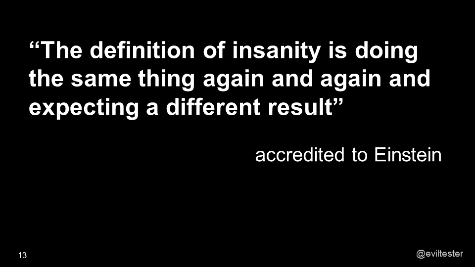\

“The definition of insanity is doing the same thing again and again and expecting a different result” accredited to Einstein

I took this out because it is a platitude, and I couldn't find a verified source of Einstein saying it.

But the reason I was going to add it, was to introduce the topic of data randomisation.

We lose so many of the benefits of automating and repeated execution over the same path if we restrict the variation that we apply to that path.

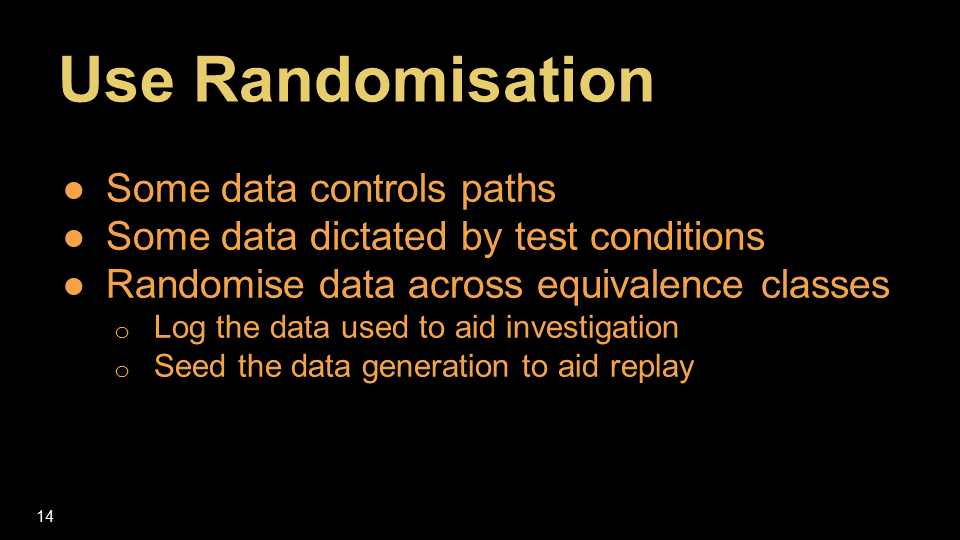\

I already mentioned that automated execution of a system under test can be modelled as a structural graph, and that when you do you see variant and invariant data. Also the equivalence classes of the data become more obvious.

As a result of this model, I tend to use a lot of randomisation across equivalence classes.

Since I believe that it is important for people to have requisite variety and handle the inputs that are thrown at us.

I also expect the systems to handle requisite variety.

Now data variety is just a scope problem. It can be hard to track, it can be hard to create lots of data. That is, when we don't use tools to help us, when we don't automate it.

But when we do automate execution, I see no reason for not using random sampling of data from the equivalence classes during the execution. At least then, each automated traversal of the same path, has some 'value add' in the form of expanding the data scope used during the execution, and helping us check that our model of variant and invariant data matches the system implementation.

We do need to make sure that we log the data we use, so that if something goes wrong we can investigate.

And we might want to add the ability to 'seed' the random data generation routines when we restart an execution to replay the path with the same data.

### Abstractions

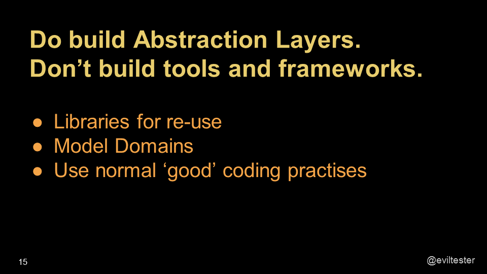\

So as a couple of hints and tips.

A lot of people write frameworks and tools.

I've done that too. I've already mentioned some of the tools I've built.

The danger is that we focus on the tools, or the frameworks as an end in and of themselves, rather than a way of helping us achieve our goals.

And they can become a time sink, where we find it really interesting to work on them, and it can really improve our programming skills and great for our future career.

But it might not add a lot of value to our work.

So I tend to focus on libraries rather than frameworks and tools.

I really like to have abstraction layers that map on to domains, so if you haven't read Domain Driven Design then I recommend that as a good starting point.

And also, make sure the test code embodies good coding practises that lead to maintainable code.

I find myself working with teams and individuals on code to automate systems under test, and very often the first thing we do is start splitting the code apart to make it simpler. To avoid code re-use. And to create classes that have a single responsibility as much as possible.

Often, those simple steps mean that we remove issues in the code base and improve the automated execution.

### Multiple Usage Approaches

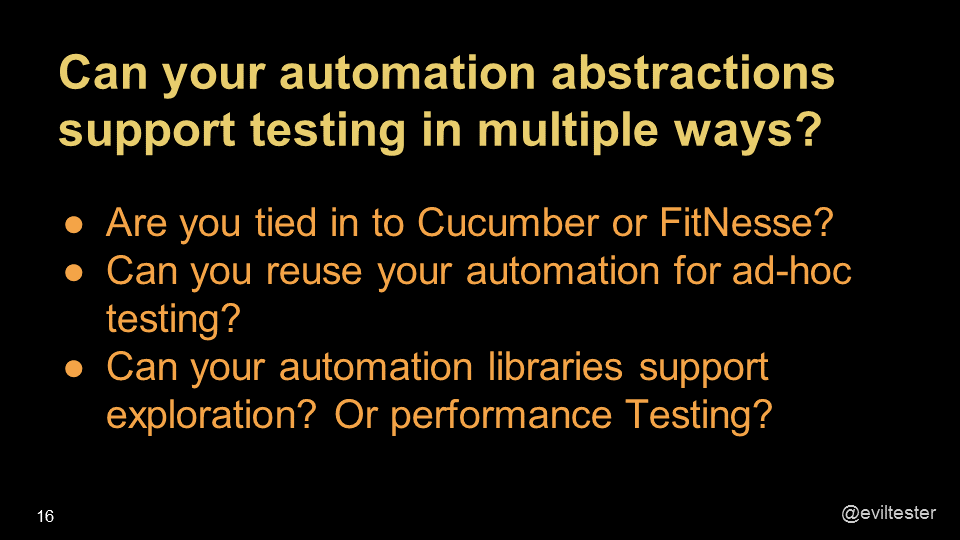\

Again, I mention Requisite Variety.

Does your automated code exhibit requisite variety.

When you create abstraction layers, can you re-use them?

Could you write code to cover paths in your system under test in Cucumber and FitNesse and JBehave, or are you tied into a specific tool. If you're tied into a specific tool that drives your execution then chances are you haven't created abstraction layers at the right levels.

I like to be able to use automated execution tactically, to investigate defects or as part of my exploratory testing. I should be able to re-use the abstraction layers we have and write JUnit tests, even if we also use Cucumber JVM for the bulk of our automated driving.

The more use cases that our abstraction layers can support, the more I believe that we have built automation code that can grow with us, rather than slow us down in the future.

So I try to use the abstraction layers in multiple ways, that will also increase the value you get from it, and cause you to write code that will last.

