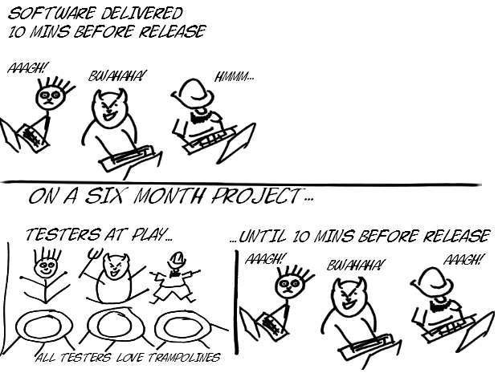
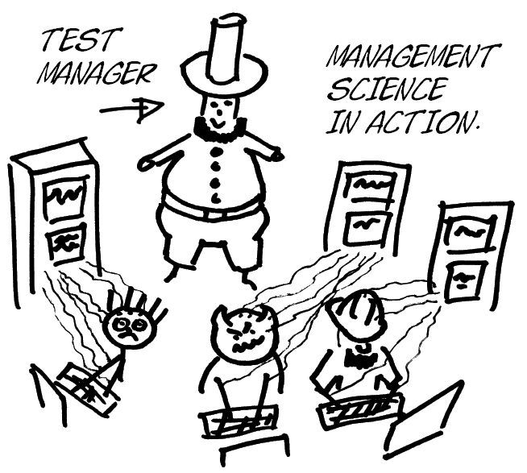
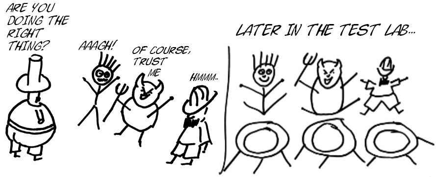

<!-- Slide 1 -->

# Exploratory Testing Techniques

Test Management Summit 2010

Alan Richardson

www.eviltester.com [Source link](http://www.eviltester.com/)

www.compendiumdev.co.uk [Source link](http://www.compendiumdev.co.uk/)

---

<!-- Slide 2 -->

# My previous work environments

- In the olden days, were heavily structured
- I 'bypassed' processes in order to explore
- Early parts of projects were 'structured test design' to pad time until app was delivered
- I backfilled 'structure' after exploring

---

<!-- Slide 3 -->

# My current work environment

- Almost exclusively exploratory testing (with some automation)
- Online applications
- 'Agile' projects
- Testers recruited for automation and exploratory expertise
- Manager – hands on (probably too much)

---

<!-- Slide 4 -->

# What do we mean by Exploratory Testing?

---

<!-- Slide 5 -->

# What do we mean by Exploratory Testing?

- “Test design and test execution at the same time” James Bach
- “Exploratory software testing is a style of software testing that emphasizes the personal freedom and responsibility of the individual tester to continually optimize the value of her work by treating test-related learning, test design, test execution, and test result interpretation as mutually supportive activities that run in parallel throughout the project.”
    - Workshop on Heuristic and Exploratory Techniques via Cem Kaner

---

<!-- Slide 6 -->

# What techniques do exploratory testers use?

---

<!-- Slide 7 -->

# What techniques do exploratory testers use?

- Techniques? For Adhoc testing?
- Risk – project, technical
- Hacking
- Heuristic Models
- Standard Test Design Techniques
- Thinking. Reflection. Feedback. Observation. Experimentation. Prediction.
- Cheating
- Luck (Prestidigitators would say “Utilisation”)

Anything we can get our hands on that works.

---

<!-- Slide 8 -->

# What tools do exploratory testers use?

---

<!-- Slide 9 -->

# What tools do exploratory testers use?

- Tools? For Adhoc Testing?
- 'standard' test tools very often get in the way
    - lightweight alternatives
- Automation tools
- System Management tools
- Hacking tools
- Lots and lots of Firefox plugins

Anything that augments our testing ability.

---

<!-- Slide 10 -->

# What are the Characteristics &amp; Attitude Exhibited by exploratory testing and Testers

- Short planning sessions
- More writing during and after than before
- Questioning
- “What Next?” learning
- Innovation
- Tester's High Skill
- Less Waste
- Observation

- Curiosity
- Rebellion
- Questioning
- Reflective
- Innovative
- Continuous Improvement
- Always Learning

---

<!-- Slide 11 -->

# When is it appropriate to use exploratory techniques?

---

<!-- Slide 12 -->

# When is it appropriate to use exploratory techniques?

- When is it not appropriate?
- Why would anyone not do this?

---

<!-- Slide 13 -->

# How do we provide feedback on the value of exploratory testing to stakeholders?

---

<!-- Slide 14 -->

# How do we provide feedback on the value of exploratory testing to stakeholders?

- We don't have to, they don't care.
- However they want so long as it doesn't get in the way.
- Tell them what we've done. What we have still to do, and what we have found.

---

<!-- Slide 15 -->

# How can test managers track the exploratory testing being done?

---

<!-- Slide 16 -->

# How can test managers track the exploratory testing being done?

- Psychic powers, after all, exploratory testers don't write anything down.
- Charters and Debriefs
- Stories and Testing Tasks
- Reports from the testers

More honesty in exploratory testing reports and tracking, than in 'structured' testing coverage metrics.

---

<!-- Slide 17 -->

# How can Test Managers remain sure that their testers are doing the 'right' testing?

---

<!-- Slide 18 -->

# How can Test Managers remain sure that their testers are doing the 'right' testing?

- Were you ever sure?
- Trust
- Open communication
- Work with them
- Train them
- Assume they are and watch for deviation

---

<!-- Slide 19 -->

# What do managers need to know to effectively mentor their testers in exploratory testing?

---

<!-- Slide 20 -->

# What do managers need to know to effectively mentor their testers in exploratory testing?

- Pah, I've been doing adhoc testing for 40 years, there is nothing new here, let them read Hetzel
- I don't need to know anything. I know how to ask open ended coaching questions.
- You better know how to test, in the environment your testers work in.
- You better know the technologies being built on.
- You better know the fundamentals really well.
- You had better do exploratory testing and have made mistakes and learned the lessons.

---

<!-- Slide 21 -->

# How do you recruit good exploratory testers?

---

<!-- Slide 22 -->

# How do you recruit good exploratory testers?

- You mean people put this on their CV?
- You can't recruit them, you have to grow your own.
- Good Job spec. Thorough CV Review. Phone Interview.
- Most important – the F2F audition.
- Listen for questions. Ask them to think aloud. Check how they stay up to date. Ask what they are improving about their process now.

---

<!-- Slide 23 -->

# What are the secrets to exploratory testing that will make the biggest difference to your implementation?

“Hmm...

I could tell you, but then I'd have to kill you”

---

<!-- Slide 24 -->

# What are the secrets to exploratory testing that will make the biggest difference to your implementation?

- Secret #1 Work hard at getting better
- Nuances
    - Notetaking
    - Modelling
    - Observation
    - Testing Fundamentals
    - Technology Knowledge
    - Reflection

---

<!-- Slide 25 -->

# What steps do you take to improve the quality of the exploratory testing done by your team?

“I love testing so much I never stop. I even test on the toilet.

Take this toilet paper for instance...”

---

<!-- Slide 26 -->

# What steps do you take to improve the quality of the exploratory testing done by your team?

- Start with yourself first
- What does good exploratory testing look like?
- Read the books.
    - Lessons Learned. Testing Computer Software. How to break...
- Search the web
- Do it. Reflect. Compare to what others report.
- Training
- Do it some more

Don't expect to ever be finished improving.

---

<!-- Slide 27 -->

# Alan Richardson

alan@compendiumdev.co.uk [Source link](mailto:alan@compendiumdev.co.uk)

www.eviltester.com [Source link](http://www.eviltester.com/)

www.compendiumdev.co.uk [Source link](http://www.compendiumdev.co.uk/)

