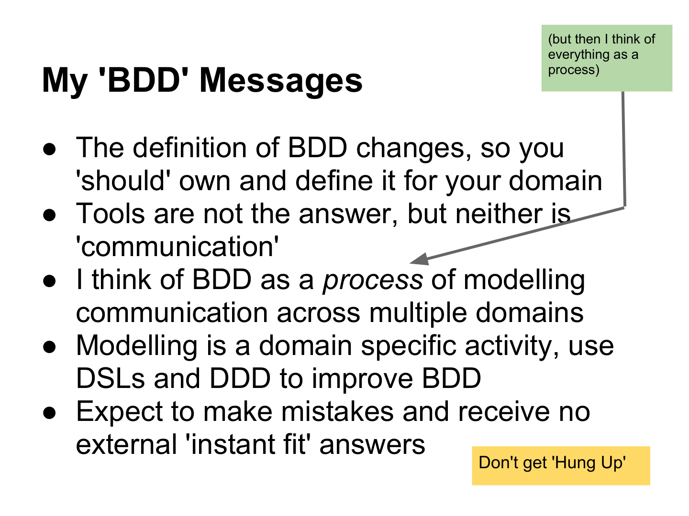
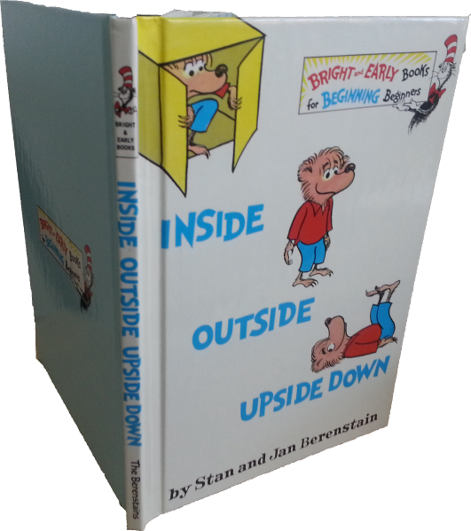
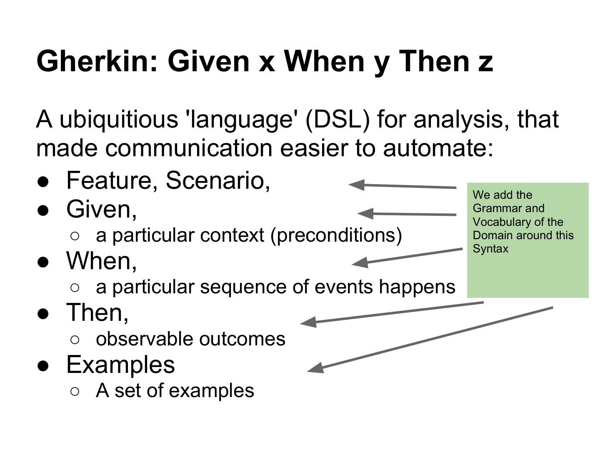

<!-- Slide 1 -->

# Lessons Learned With BDD

Thinking and Automating with Domain Specific Languages

Alan Richardson

@eviltester

www.compendiumdev.co.uk

www.eviltester.com

www.seleniumsimplified.com

alan@compendiumdev.co.uk

[Source link: @eviltester](https://twitter.com/eviltester)

---

<!-- Slide 2 -->

# Scope

- Part 1 - BDD
    - BDD Opinionated Overview
    - Lessons Learned
    - Exercises for BDD with no tools
- Part 2 - BDD &amp; Tools
    - Cucumber overview
    - FitNesse overview
    - Custom DSL Overview
- Part 3 -
    - Q&amp;A + Summaries

Warning: pretty much everything in here can be argued with. BDD emphasises communication. So feel free to disagree.

---

<!-- Slide 3 -->

# Introduction

---

<!-- Slide 4 -->

# The Brief

Lessons Learned with BDD - Thinking and Automating with Domain Specific Languages

Starting with the the tools for BDD and Acceptance Testing has become increasingly simple. To learn tools like Cucumber and FitNesse to create tests you can now read books and articles and watch countless videos to help. But using the tools is only part of the battle.

Over years of working with Agile teams, and using various tools to help Business Analysts collaborate with Development staff, writing high level tests in a human readable language, I've learned that most people do not realise that they are writing a Domain Specific Language.

Each of the tools provides a different mechanism for modeling the domain and writing the language. But fundamentally we are creating a language unique to our domain. And if we do not recognise this, or harness this, then we make our life harder.

So in this session I want to look at some of the BDD and Acceptance Testing tool mechanisms e.g. tables or Gherkin, with the additional modeling perspective of a high level language that models the domain.

Business Analysts are trained in modeling domains. Testers are trained in identifying ambiguity. Developer are trained in refactoring to domain objects. These skills exist in the development team, we just have to harness them.

In this session we will explore what this means, and how it changes our approach to writing BDD. This session does not require access to a computer. Tools will be demonstrated. But tests will be written on paper and discussed by the group to explore how to use BDD tools and and languages to more effectively model the domain.

---

<!-- Slide 5 -->

# Alan Richardson

- Has used BDD, ATDD, DDD using tools such as FitNesse, Cucumber, Domain Specific Languages
- Domains - finance, gambling, pharmaceuticals, media
- Has done it well, and badly
- Still gets confused by other people so makes up his own models

---

<!-- Slide 6 -->

# My 'BDD' Messages



- The definition of BDD changes, so you 'should' own and define it for your domain
- Tools are not the answer, but neither is 'communication'
- I think of BDD as a process of modelling communication across multiple domains
- Modelling is a domain specific activity, use DSLs and DDD to improve BDD
- Expect to make mistakes and receive no external 'instant fit' answers

(but then I think of everything as a process)

Don't get 'Hung Up'

---

<!-- Slide 7 -->

# BDD Opinionated Overview

---

<!-- Slide 8 -->

# BDD relates to communication

... but I think it is the worst communicated 'thing' in Software Development at the moment

BDD, ATDD, Specification By Example, BD Design, ... Development, 'Real Options', "for Communication (not development)", Deliberate Discovery, Feature Injection

---

<!-- Slide 9 -->

# Plenty of platitudes for what it is not

- "it isn't about testing",
- "it isn't the tool",
- "it isn't just for the development team"
- "if must involve the business"
- "it isn't about the 'how'"
- BDD isn't ATDD
- "it isn't about the automation"
- "It isn't just for the business"

And most of these are probably true, but don't necessarily help you understand what to do.

---

<!-- Slide 10 -->

# There are universal platitudes of "isness"

- It is about communication
- It is for bridging the gaps
- It brings the business and development closer together

Again these are true, but don't help, you do it.

---

<!-- Slide 11 -->

# 'Problems' with understanding BDD

---

<!-- Slide 12 -->

# The Definition 'Problem' with understanding 'BDD'

- 'Definition' has changed over the years
    - ..D used to be for Development
        - because of TDD gaps and flow
        - ATDD not using abstraction layers
    - now is more like Design, but is still development

---

<!-- Slide 13 -->

# The Tool 'Problem' with understanding 'BDD'

- Same tools used for BDD, ATDD, Spec By Example
    - so what is the differentiator?
- BDD is not the tool, but the tool changes the way you do BDD
- Tools enforce a syntax which BDD does not require
    - Gherkin e.g. Given, When, Then
    - Tables

---

<!-- Slide 14 -->

# The Example 'Problem' with understanding 'BDD'

- Where are all the 'good' examples?

---

<!-- Slide 15 -->

# But we don't get hung up on any 'problems', we focus on building a shared understanding in our Domain

---

<!-- Slide 16 -->

# Building a Shared Understanding

---

<!-- Slide 17 -->

# Domain Specific Language

A shared understanding requires a shared language, which we agree over time.

The language 'should' become ubiquitous: in verbal discussion, in written communication, in the code, in the tests.

---

<!-- Slide 18 -->

# Language

- Grammar
- Syntax
- Vocabulary

A simple model:

- Vocabulary and Syntax allow automation
- Grammar unites these with domain rules

---

<!-- Slide 19 -->

# BDD, ATDD, etc. Nuances over time

- BDD, ATDD, Specification by Example etc. - different ways of looking at the same process:
    - Moving from desire to reality
    - Maintaining as many options as possible
    - Allowing us to commit late
    - Allow us to experiment
    - Building a Shared Understanding
    - Checking we are adding value
    - Checking we are building it right
    - Each 'name' attempts to expose an additional nuance
- Not the same things at all

---

<!-- Slide 20 -->

# Not the same things at all but BDD is winning, because...

- When people talk about 'this' they now say BDD more than any other term
- BDD has changed its definition to stay on top
- Modelling is hard, so it is easy to point at other peoples BDD and say 'this is wrong', then explain the principles again rather than offer a 'right' answer

---

<!-- Slide 21 -->

# Principles of this 'BDD' thing

- Communication
- Ubiquitous Language
- 'should' - does it? should it? how? when?
- Declarative vs Procedural
- Concise examples illustrate, explain &amp; explore
- Use explanatory text
- Model multiple levels
- Living spec - review for durability
- Review for waste

---

<!-- Slide 22 -->

# Nuances of BDD



---

<!-- Slide 23 -->

# Some possible lenses or views if I have to use the existing terms

- DDD (inside out)
    - are we using the right language? Are we working at the right level in the domain?
- BDD (outside in)
    - what behaviour should this thing exhibit, how do I know?
- ATDD (what else?)
    - what else should it do? how would it handle X? how did we get it wrong?
- Specification by Example (examples?)
    - Do we have enough examples? Too many? The right examples? Will this make sense later? Adds Context
- Real Options (commitment)
    - are we open to options? should we commit now?

---

<!-- Slide 24 -->

# Gherkin: Given x When y Then z



A ubiquitious 'language' (DSL) for analysis, that made communication easier to automate:

- Feature, Scenario,
- Given,
    - a particular context (preconditions)
- When,
    - a particular sequence of events happens
- Then,
    - observable outcomes
- Examples
    - A set of examples

We add the Grammar and Vocabulary of the Domain around this Syntax

---

<!-- Slide 25 -->

# Opinionated Summary

- I don't care what you call it.
- I don't really care how you do it.
- But if I'm involved, and I see waste or inefficiency, then I use all the lenses to look at how you model the domain in a DSL and make suggestions accordingly
- Many times I see people using one lense above others, and rarely using, or recognising their use of, a Domain Specific Language

---

<!-- Slide 26 -->

# Lessons Learned

---

<!-- Slide 27 -->

# Lessons Learned

- Don't be tool driven
- 'Agree' your domain language
- Change your language
- Building a DSL is hard
- Refine your existing models

---

<!-- Slide 28 -->

# Don't be tool driven

- When you start, expect to be tool driven
- Fitnesse
    - Script tables
    - Essentially keyword driven automation
    - Because the testers can't code
    - Reuse of 'chunks' of FitNesse pages
    - Refactoring nightmare
- Eventually used for
    - Database setup and comparison
    - A GUI for the data
    - But Spreadsheets would have been better (have you ever tried to edit FitNesse tables?)

---

<!-- Slide 29 -->

# Why not be tool driven?

- You're not fixing your communication problem, you're adding a distraction
- New tools won't save you
- Tool introduces a new layer of abstraction which may not help communication
- Tool can slow down communication
- Tool might impact your options
    - may not make change easy
    - may not make options easy

---

<!-- Slide 30 -->

# Do 'agree' your Domain language

- We just wrote down what the BAs said
    - including all the inconsistencies
- Different nouns to mean the same entity
- Different verbs to mean the same process (sometimes a verb, sometimes a verb phrase)

---

<!-- Slide 31 -->

# Expect your domain language to change

- Because you will discover and learn more as you try to express and model the domain
- The Domain is not restricted to the business
    - e.g. as soon as you commit to building a web app, the language of the web becomes part of your domain
- Do refactor your language
    - if later you decide that 'visitor' is better than 'a user who is not logged in' then change it - everywhere

---

<!-- Slide 32 -->

# Building a DSL is hard

- Many people find modelling a DSL hard
    - I didn't realise this until we had people try to do it
- I think because:
    - people are not used to analysing language
    - people are not used to building new languages
    - people don't want to share/own the language
    - people don't feel confident with the written word
    - they are overloaded 'this' is new, the tool is new, communication is new
    - Gherkin == BDD

---

<!-- Slide 33 -->

# Refine your existing models

- We kept adding more stuff
- Refine your models to remain relevant and revealing
    - move acceptance criteria into functional tests as you generalise and expand the scenarios
        - e.g. after committing to a web app move the web acceptance criteria from BDD into functional tests and make the BDD more general again
    - join scenarios and given when thens into a more generic statement - cover detail in lower level tests
- Try to keep the BDD small by reworking new parts of the domain into the existing model

---

<!-- Slide 34 -->

# How to make DSL construction easier?

- You can limit the DSL modelling options to the Vocabulary and the Grammar if you use Gherkin

---

<!-- Slide 35 -->

# Exercise: Spot and critique the DSL

---

<!-- Slide 36 -->

# What is the DSL here?

Given a registered user

When the customer logs in

Then the account holder can view their personal details

Critique?

---

<!-- Slide 37 -->

# Exercise: How might it read?

5 mins, make it better

- Given a registered user
- When the customer logs in
- Then the account holder can view their personal details

---

<!-- Slide 38 -->

# Debrief - what did you come up with?

5 mins

---

<!-- Slide 39 -->

# How might it read?

- Are the following:
    - Right or wrong?
    - Good or Bad?
    - Better or worse?
    - Does it provide 'real options'
    - Supported by examples?

---

<!-- Slide 40 -->

# How might it read?

- A logged in user can view their account details

Critique?

---

<!-- Slide 41 -->

# How might it read?

- A logged in user can view their account details
    - the language encapsulates the context and event
    - this may be harder to automated

---

<!-- Slide 42 -->

# How might it read?

- Given a logged in user,
- when they view their details,
- then they can view their details

Critique?

---

<!-- Slide 43 -->

# How might it read?

- Given a logged in user,
- when they view their details,
- then they can view their details
    - context encapsulates details so event written at a different level,
    - Gherkin forces a redundant 'then'
        - does it have to be redundant?

---

<!-- Slide 44 -->

# How might it read?

- Given a logged in user, when the user views their details, then the user can see account details are correct

Critique?

---

<!-- Slide 45 -->

# How might it read?

- Given a logged in user, when the user views their details, then the user can see account details are correct
    - provides more of a 'why'
    - reveals lack of options
        - there exist other ways that a user could check the correctness of their account details

---

<!-- Slide 46 -->

# Right, Wrong?

- Context and Domain specific
- Domain has to include:
    - Business Domain
    - Technical
    - Also automation domain - how much of what we said could be automated?

---

<!-- Slide 47 -->

# Is login an appropriate example?

- Is login obvious enough that this is a poor example?
- Do we need communication around login?

---

<!-- Slide 48 -->

# Exercise: Don't let tools limit your DSL expressive power

---

<!-- Slide 49 -->

# BDD does not require a tool

Do some BDD on the Tracks application.

GTD - we think it is going to come back in style.

Pretend we are going to create a new version of the Tracks app and use BDD to help us.

---

<!-- Slide 50 -->

# Product Owner (me) Demo of App

Demo of Tracks:

\- default admin user created during setup

\- login, logout

\- create &amp; delete user

\- amend details, only I can amend admin email

\- create a next action on review pages: home, project edit, tickler, starred

\- projects are always personal

\- CRUD actions on next action, project, context

---

<!-- Slide 51 -->

# Exercise: Pick a few of the areas and 'BDD' them

- Whatever format you want
- I will answer questions as the SME
- Small groups
- Debrief in 20 mins

---

<!-- Slide 52 -->

# Examples: How incorporating a tool into the process changes the options around the DSL for the domain

---

<!-- Slide 53 -->

# Tools: Cucumber JVM

---

<!-- Slide 54 -->

# Demo Scope

- cucumber-jvm added easily with maven
- feature files as resources
- run feature files from ide
- step definitions in class
- regex in annotation to find steps
    - supports params
- JUnit runner for CI and report creation
- IDE support for syntax, quick fix and code completion
- Gherkin - loose syntax checking
- "Scenario Outline" for examples

---

<!-- Slide 55 -->

# Lesson Learned: Cucumber-JVM is not BDD

- Cucumber-JVM is an implementation of Cucumber tool
- Gherkin is a DSL
- Cucumber allows us to map Gherkin text file statements to code so we can 'execute' a Gherkin document
- Cucumber means we don't have to write a parser or lexer or the reporting tools
- If we don't pull out the elements of the tool then we can't consider options and alternatives to help us do BDD

---

<!-- Slide 56 -->

# Lesson Learned: Don't add all your code into step definitions

- Tempting to add all 'test' implementation code into step definitions
- But you aren't modelling the 'domain' if you do that, you are using a tool
- Build abstraction layers. Model the domains
- Creates more options for your implementation approach
- Supports re-use of automation code across multiple test layers
- Because "BDD is not about testing"

---

<!-- Slide 57 -->

# Use Multiple Abstraction Layers

- Domain
- Physical Implementation World
    - Page Objects, Page Components, Sites, etc.
- Workflows
- Feature Files
    - Step Definitions
- BDD

These help increase flexibility for changing, restrict commitment to fewer layers

---

<!-- Slide 58 -->

# Lesson Learned: Multiple Automation Levels

- Functional Testing in conjunction with BDD helps create multiple abstraction layers
    - refactoring
    - DRY
- Choices about what to model at what level
    - e.g. don't have to do everything in 'BDD' tool
- In this demo I had existing functional tests which flushed out the page objects prior to the Scenario implementation

---

<!-- Slide 59 -->

# Lesson Learned: Refactor your automation code

- Too easy to add new code in, or copy paste bits between steps
- Refactor, Refactor, Refactor
- Write clean code

---

<!-- Slide 60 -->

# About Cucumber-JVM

- Java Implementation of Cucumber
- Available via maven so easy to add to project
- Annotate Java code with @Given etc. allows sharing steps between scenarios
- IDEs (IntelliJ 12) are cucumber aware so:
    - can run feature files directly and create steps Alt+Enter
    - code completion and syntax highlighting
- JUnit runner for CI
- Uses lots of reflection to work

---

<!-- Slide 61 -->

# Minimal Gherkin Feature File

```gherkin
Feature:
Scenario:
* a statement to check
```

Supports non standard modelling

e.g. non Given, When, Then modelling

---

<!-- Slide 62 -->

# Typical Gherkin Feature File

```gherkin
Feature: short description of feature

  Background: general info
                       about the feature

  Scenario: a scenario description
    Given: a given condition
    When: a particular event happens
    Then: we can observe that this happened
```

---

<!-- Slide 63 -->

# Lesson Learned: Use the tool features

- Don't avoid tool features because you want the ability to move between tools
    - e.g. cucumber @Before, @After, @tagging, etc.
- Using the tool ineffectively can force you to move away from the tool
- You can move between tools using abstraction layers

---

<!-- Slide 64 -->

# Tools: FitNesse

---

<!-- Slide 65 -->

# A DSL based on Tables

- Cucumber provides a Gherkin parser
- FitNesse provides a Table parser
- table name
    - a scenario
- columns
    - map on to examples
- setter Columns - add data in to fixture
- getter Columns? - pull data out of fixture
    - if no 'expected' value then these can be used for execution documentation

---

<!-- Slide 66 -->

# Demo

- BDD table for login
- Code to implement fixture
    - reuses our page objects etc.

---

<!-- Slide 67 -->

# Pros &amp; Cons Compared with Cucumber-JVM

- Cons
    - Technically more painful to setup
    - May deter collaboration if users can edit on server without pairing with dev or test
- Pros
    - Very rich documentation ability
        - but no-one ever seems to use this
    - Wiki based for collaboration with users
    - Easy to test out new examples from a server deploy
    - FitNesse seems to be receiving more love and attention again so keep an eye on it

---

<!-- Slide 68 -->

# Tools: Custom DSL

---

<!-- Slide 69 -->

# Demo Scope

- Test Code
- Refactored into Domain and supporting objects
- Readable Tests
    - how could it be more readable?
- Abstraction layers

---

<!-- Slide 70 -->

# Exercise: How could it be more readable?

---

<!-- Slide 71 -->

# When you write your own

- Easiest to create abstraction layers that 'look' and 'act' like a DSL
- Readable code
- Supports refactoring, code completion
- Take this as far as you need to.
    - Can be as complicate or as simple as you like

---

<!-- Slide 72 -->

# Is it BDD?

- General Question &amp; Discussion

---

<!-- Slide 73 -->

# Is it BDD when...

- Testers can write tests using the DSL
- Business can express intent using the DSL
- Moving from business intent to test can be done collaboratively

---

<!-- Slide 74 -->

# Lessons Learned: Constant Reviews

- Constantly need to review the DSL code
- Patterns and understanding constantly evolve so need to keep on top and communicate across the team
- Review to help enforce 'good' programming practices

---

<!-- Slide 75 -->

# Lessons Learned: 'Good' Programming Practices Required

- Refactor
- Test
- DRY
- Single Responsibility
- Patterns
- Use the language well
- Leverage libraries where you can

---

<!-- Slide 76 -->

# Lessons Learned: Domain Objects

- Use DDD lessons and embody Domain objects in your code
- Limit the extent of the objects to avoid overlapping domains

---

<!-- Slide 77 -->

# Final Phase

---

<!-- Slide 78 -->

# Q &amp; A

---

<!-- Slide 79 -->

# Summary

- Don't get hung up on doing it 'right'
- You make BDD what it is, if its not working for you, change it and fix it
- Use all the nuances: DDD, ATDD, Example, Options, TDD to BDD
- BDD is not the tools, but the chosen tools change your Domain and your BDD style
- Own your DSL

---

<!-- Slide 80 -->

# Self Study Recommendations

---

<!-- Slide 81 -->

# Recommended Web Reading

- http://dannorth.net/introducing-bdd/
- http://en.wikipedia.org/wiki/Behavior\_Driven\_Development
- http://www.slideshare.net/lunivore/behavior-driven-development-11754474
- http://www.infoq.com/articles/virtual-panel-tdd-bdd
- http://www.infoq.com/articles/real-options-enhance-agility
- http://www.infoq.com/articles/feature-injection-success
- http://specificationbyexample.com/resources.html
- http://lizkeogh.com/behaviour-driven-development/

[Source link: http://en.wikipedia.org/wiki/Behavior\_Driven\_Development](http://en.wikipedia.org/wiki/Behavior_Driven_Development)

---

<!-- Slide 82 -->

# Recommended Books

- Domain Driven Design
    - by Eric Evans
- Growing Object Oriented Software
    - by Steve Freeman and Nat Pryce
- Specification by Example
    - by Gojko Adzic
- The Cucumber Book
    - by Matt Wynne and Aslak Hellesoy
- ATDD by Example
    - by Marcus Gartner

---

<!-- Slide 83 -->

# Gherkin

- https://github.com/cucumber/cucumber/wiki/Gherkin
- http://docs.behat.org/guides/1.gherkin.html

---

<!-- Slide 84 -->

# Cucumber-JVM

- https://github.com/cucumber/cucumber-jvm
- http://c0deattack.wordpress.com/category/programming/cucumber/
- http://aslakhellesoy.com/

---

<!-- Slide 85 -->

# FitNesse

- http://fitnesse.org/
- http://gojko.net/fitnesse/
- http://en.wikipedia.org/wiki/FitNesse
- http://ketiljensen.wordpress.com/2009/12/13/bdd-with-scenario-tables-in-fitnesse-slim/

---

<!-- Slide 86 -->

# Recommended Listening

- DDD interview with Dan North and Liz Keogh
    - http://domaindrivendesign.org/library/north\_keogh\_gitlevich\_2007

[Source link: http://domaindrivendesign.org/library/north\_keogh\_gitlevich\_2007](http://domaindrivendesign.org/library/north_keogh_gitlevich_2007)

---

<!-- Slide 87 -->

# Unused Slides

---

<!-- Slide 88 -->

# Some possible Levels to view the communication process at

- Desire
- Contextualised
- Examples
- Explored
    - what did we miss? how did we get it wrong? is it enough?
- Implementation (s)

Other people use different levels. So do I.
