<!-- footer: © Compendium Developments, 2014, CompendiumDev.co.uk -->

<!-- Slide 1 -->

# Hands On WebDriver: The Talky Bits Half Day Training

Alan Richardson

@eviltester

<http://www.compendiumdev.co.uk/contact>

www.SeleniumSimplified.com

www.EvilTester.com

www.CompendiumDev.co.uk

www.JavaForTesters.com

[Source link: www.SeleniumSimplified.com](http://www.seleniumsimplified.com/)

[Source link: www.EvilTester.com](http://www.eviltester.com/)

[Source link: www.JavaForTesters.com](http://www.JavaForTesters.com/)

---

<!-- Slide 2 -->

# Alan Richardson - Blogs, Books, and Courses

Blogs and Websites

- CompendiumDev.co.uk
- SeleniumSimplified.com
- EvilTester.com
- JavaForTesters.com
- Twitter: @eviltester

Online Training Courses

- Technical Web Testing 101
- Intro to Selenium
- Selenium 2 WebDriver API

Videos

youtube.com/user/EviltesterVideos

Books

Selenium Simplified

Java For Testers

leanpub.com/javaForTesters

Alan Richardson

uk.linkedin.com/in/eviltester

Independent Test Consultant &amp; Custom Training

Contact Alan

<http://compendiumdev.co.uk/contact>


[Source link: CompendiumDev.co.uk](http://www.compendiumdev.co.uk/)

[Source link: SeleniumSimplified.com](http://www.seleniumsimplified.com/)

[Source link: EvilTester.com](http://www.eviltester.com/)

[Source link: JavaForTesters.com](http://JavaForTesters.com/)

[Source link: @eviltester](https://twitter.com/eviltester)

[Source link: youtube.com/user/EviltesterVideos](http://www.youtube.com/user/EviltesterVideos)

[Source link: leanpub.com/javaForTesters](http://leanpub.com/javaForTesters)

[Source link: uk.linkedin.com/in/eviltester](http://uk.linkedin.com/in/eviltester)

---

<!-- Slide 3 -->

# Introduction &amp; Overview

---

<!-- Slide 4 -->

# Ancient History

- Selenium 1.0
    - Javascript through a proxy
    - Flat API “selenium.”
    - Server based
- WebDriver
    - Object Oriented API, Interface which each driver implements
    - Driver calls browser directly
    - Has a server component Remote WebDriver

---

<!-- Slide 5 -->

# Installation

- Java SDK
- Maven
- IntelliJ IDE
- Firefox
- FirePath plugin

seleniumsimplified.com/get-started/

[Source link: seleniumsimplified.com/get-started/](http://seleniumsimplified.com/get-started/)

---

<!-- Slide 6 -->

# What is Maven?

- A build tool
- Standard Folder Structure
- Java project tasks simpler
    - mvn clean compile
    - mvn package
    - mvn test
- <http://maven.apache.org>

---

<!-- Slide 7 -->

# pom.xml

```xml
    <dependencies>
        <dependency>
            <groupId>org.hamcrest</groupId>
            <artifactId>hamcrest-all</artifactId>
            <version>1.3</version>
        </dependency>
        <dependency>
            <groupId>junit</groupId>
            <artifactId>junit</artifactId>
            <version>4.11</version>
        </dependency>
        <dependency>
            <groupId>org.seleniumhq.selenium</groupId>
            <artifactId>selenium-server</artifactId>
            <version>2.40.0</version>
        </dependency>
    </dependencies>
```

---

<!-- Slide 8 -->

# Java Language Levels

- Set in IntelliJ Project Settings
- And in the pom.xml

```xml
    <!-- I have added the build section to support importing into
     IntelliJ automatically without throwing errors about wrong Java
     Version. This basically says the source requires at least Java 1.7
     and use a compiler that outputs Java 1.7 -->
    <build>
        <plugins>
            <plugin>
                <groupId>org.apache.maven.plugins</groupId>
                <artifactId>maven-compiler-plugin</artifactId>
                <version>3.1</version>
                <configuration>
                    <source>1.7</source>
                    <target>1.7</target>
                    <encoding>UTF-8</encoding>
                </configuration>
            </plugin>
        </plugins>
    </build>
```

---

<!-- Slide 9 -->

# Benefits of Maven

- Standard directory structure
- Supported by Selenium and some of the drivers
- Easy to update and install
- Simple to add to Continuous Integration
    - “mvn test”

---

<!-- Slide 10 -->

# MyFirstTest.java

```java
package com.eviltester.webdriver;

import org.junit.Assert;
import org.junit.Test;
import org.openqa.selenium.WebDriver;
import org.openqa.selenium.firefox.FirefoxDriver;

public class MyFirstTest {

 @Test
 public void startWebDriver(){

   WebDriver driver = new FirefoxDriver();
   driver.navigate().to("http://seleniumsimplified.com");

   Assert.assertTrue("Expected Selenium Simplified",
                     driver.getTitle().
                            startsWith("Selenium Simplified"));

   driver.close();
   driver.quit();
 }
}
```

[Source link: <http://seleniumsimplified.com>](http://seleniumsimplified.com/)

---

<!-- Slide 11 -->

# Recommended Applications For Exercises Overview

- Beginner: Selenium Test Pages
    - <https://github.com/eviltester/seleniumTestPages>
    - <http://seleniumsimplified.com/testpages/>
- Intermediate:
    - <http://todomvc.com/>
- Advanced
    - <http://google-gruyere.appspot.com/>
    - <http://demo.redmine.org/>

---

<!-- Slide 12 -->

# Section: WebDriver is an API

---

<!-- Slide 13 -->

# API Overview

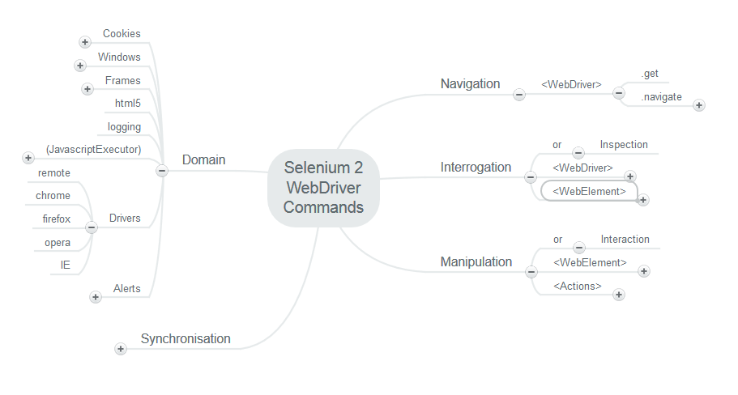

<http://www.mindmeister.com/280141421/selenium-2-webdriver-commands>

---

<!-- Slide 14 -->

# Basic Knowledge

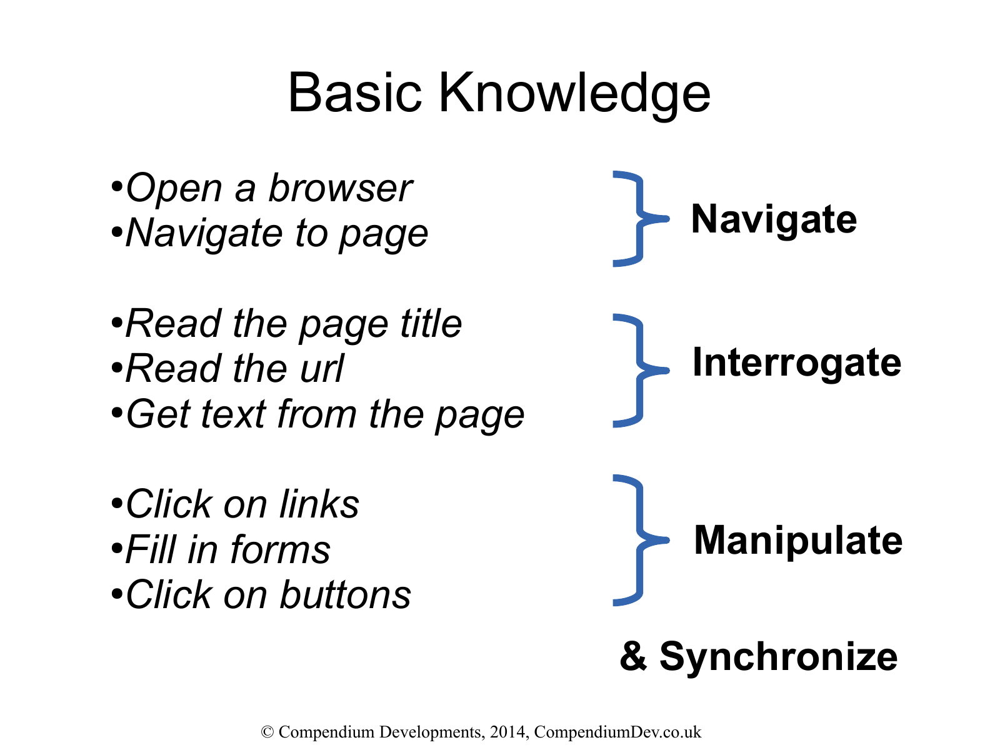

- Open a browser
- Navigate to page

- Read the page title
- Read the url
- Get text from the page

- Click on links
- Fill in forms
- Click on buttons

Navigate

Interrogate

Manipulate

&amp; Synchronize

---

<!-- Slide 15 -->

# WebDriver Basics

- WebDriver
    - Think of the driver as the browser
    - Interface with implementations – FirefoxDriver, ChromeDriver etc.
    - High Level commands
        - get, getTitle, getCurrentUrl, close, quit
    - Functional Groupings
        - Navigate, Manage
    - Locate
        - FindElement, FindElements

---

<!-- Slide 16 -->

# WebElement Basics

- The DOM elements
    - &lt;a&gt;, &lt;p&gt;, &lt;ul&gt;, etc.
- Found By.Id, By.Name, etc.
- Interrogate
    - .getAttribute, .getValue, isEnabled etc.
- Manipulate
    - SendKeys, click, etc.

---

<!-- Slide 17 -->

# JUnit Basics

- Test Execution Framework
- @Test
    - Annotate a method with @Test
- Can Run @Test methods from the IDE
- Use Assertions to check results
    - Assert.assertTrue(true);
    - Assert.assertEquals(1+1, 2);

---

<!-- Slide 18 -->

# WebDriver API Learning Tips

- Use Code Completion (ctrl+space)
- ctrl+Q for Documentation of Commands (ctrl+j on mac)
- ctrl+click to view the actual WebDriver code (cmd+click on mac)
- AutoScroll

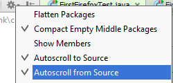

---

<!-- Slide 19 -->

# IntelliJ Navigation Shortcut Keys

- Find Symbol
    - Shift + Cntrl + Alt + N
- Find Class
    - Cntrl + N
- Find File
    - Shift + Cntrl + N
    - on mac use Cmd instead of Cntrl

---

<!-- Slide 20 -->

# Browser Tools Overview

- Firefox
    - Inspect
    - Inspect with Firebug
        - FirePath
- Chrome Inspect

---

<!-- Slide 21 -->

# Section: My First Test

---

<!-- Slide 22 -->

# Demo

- <http://seleniumsimplified.com/testpages/basic_web_page.html>
    - Get Page, Check Title, Find para1, Check Text
- How to run a test Class
- How to run a test method
- How to set a breakpoint
- How to debug a test Method
- How to use evaluate

---

<!-- Slide 23 -->

# MyFirstExtendedTest.java

```java
@Test
public void getBasicPageAndCheckDetails(){

  WebDriver driver = new FirefoxDriver();

  driver.get(
    "http://seleniumsimplified.com/testpages/basic_web_page.html"
        );

  Assert.assertTrue("Expected Different Title",
                    driver.getTitle().
                            equals("Basic Web Page Title"));

  WebElement para1 = driver.findElement(By.id("para1"));
  Assert.assertTrue(
                "A paragraph of text".equals(para1.getText()));

  driver.close();
  driver.quit();
}
```

---

<!-- Slide 24 -->

# Used WebDriver API Summary

- WebDriver driver = new FirefoxDriver();
    - Create a new instance of a driver and browser
- driver.get(aURL);
    - Open a web page in the browser
- findElement, By.id, By.name
    - WebElement element = driver.findElement(By.id(“anid));
    - Find a WebElement using id or name attribute,
    - findElement can be chained

- driver.getTitle()
    - Get the title of the current page
- driver.close(), driver.quit()
    - Close the current browser window,
    - quit the browser and driver

- Junit Used
    - @Test
    - Assert.assertTrue
    - Assert.assertEquals

---

<!-- Slide 25 -->

# IntelliJ &amp; JUnit

---

<!-- Slide 26 -->

# Java &amp; Maven Summary

- Packages organise the Java classes
- Java Classes Start with Uppercase letters
- Methods start with lowercase letters
- Add tests in the src/test/java folder hierarchy
- Add Test into the class name to automatically run from maven as a test
- Import classes from other packages to use them
- Code completion helps, be careful what you import

---

<!-- Slide 27 -->

# Basics

- Use code completion as much as possible
- Learn short cut keys
- Remove any code syntax errors as fast as possible because they interfere with code completion

---

<!-- Slide 28 -->

# IntelliJ Evaluate Expression

- In Debug mode use Evaluate to experiment with code constructs in situ.
    - e.g. when writing xpath findElements code
- Can sometimes recompile and hot swap the code into the running debug session.

---

<!-- Slide 29 -->

# JUnit @Before, @After

- @BeforeClass,
    - Run once before any @Test in the class is run
    - static
- @AfterClass
    - Run once after all @Test in the class have run
    - static
- @Before,
    - Run before each @Test
- @After
    - Run after each @Test

---

<!-- Slide 30 -->

# Hamcrest Summary

- Create readable assertions
- assertThat( actual, is(expected value));
    - Check that an actual value is as expected
- Look at the code to see what methods are available:
    - is, not, greaterThan, lessThan, endsWith, startsWith, containsString, etc.
- Read the docs
- <http://code.google.com/p/hamcrest/wiki/Tutorial#A_tour_of_common_matchers>

---

<!-- Slide 31 -->

# Navigation &amp; Interrogation

---

<!-- Slide 32 -->

# WebDriver

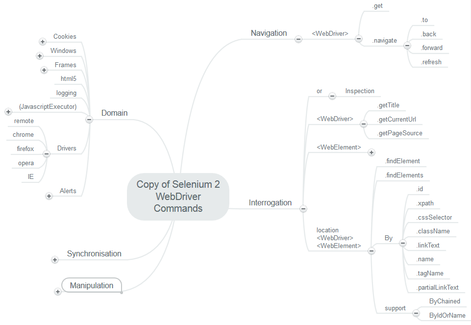

---

<!-- Slide 33 -->

# Navigation Annotated

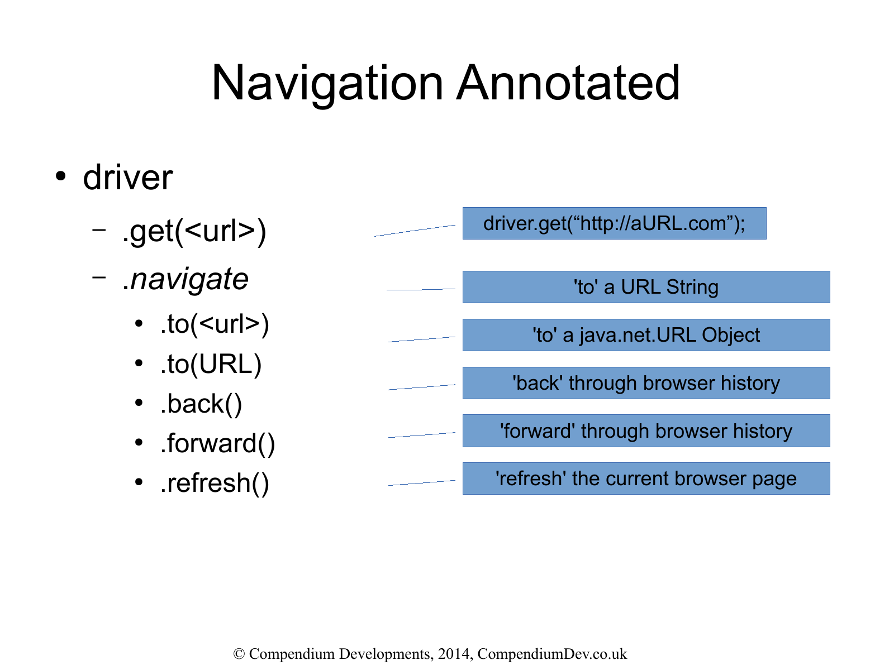

- driver
    - .get(&lt;url&gt;)
    - .navigate
        - .to(&lt;url&gt;)
        - .to(URL)
        - .back()
        - .forward()
        - .refresh()

driver.get(“http://aURL.com”);

'to' a URL String

'to' a java.net.URL Object

'back' through browser history

'forward' through browser history

'refresh' the current browser page

---

<!-- Slide 34 -->

# Driver level Interrogation Methods

- driver
    - .getTitle()

- .getCurrentUrl()

- .getPageSource()

All return String.

Pretty obvious what each method does.

Be wary of using getPageSource it may not return what you expect.

---

<!-- Slide 35 -->

# Be Careful with getPageSource

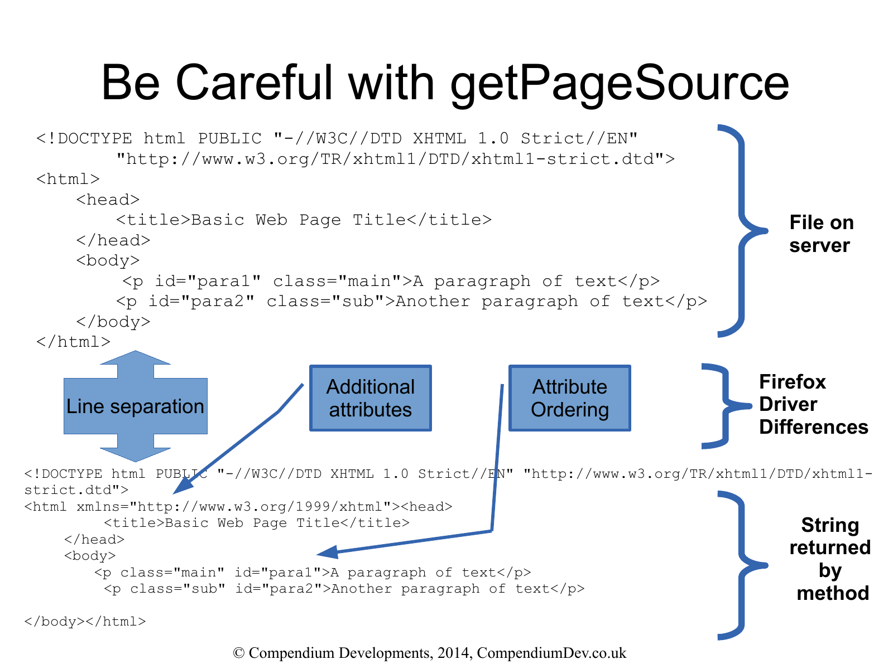

```html
<!DOCTYPE html PUBLIC "-//W3C//DTD XHTML 1.0 Strict//EN"
        "http://www.w3.org/TR/xhtml1/DTD/xhtml1-strict.dtd">
<html>
    <head>
        <title>Basic Web Page Title</title>
    </head>
    <body>
        <p id="para1" class="main">A paragraph of text</p>
        <p id="para2" class="sub">Another paragraph of text</p>
    </body>
</html>
```

```html
<!DOCTYPE html PUBLIC "-//W3C//DTD XHTML 1.0 Strict//EN" "http://www.w3.org/TR/xhtml1/DTD/xhtml1-strict.dtd">
<html xmlns="http://www.w3.org/1999/xhtml"><head>
        <title>Basic Web Page Title</title>
    </head>
    <body>
        <p class="main" id="para1">A paragraph of text</p>
        <p class="sub" id="para2">Another paragraph of text</p>

</body></html>
```

File on

server

String

returned

by

method

Line separation

Firefox

Driver

Differences

Additional

attributes

Attribute

Ordering

---

<!-- Slide 36 -->

# Driver .findElement(By)

- By.id
- By.xpath
- By.cssSelector
- By.className
- By.linkText
- By.name
- By.tagName
- By.partialLinkText

We find an element By using a locator strategy.

e.g. by using the id, by evaluating an xpath expression, by executing a css selector, etc.

```java
driver.findElement(By.id("para1"))
```

---

<!-- Slide 37 -->

# .findElements

- .findElement only returns 1 WebElement
- When a By can return more elements then .findElement returns the first in the list
- .findElements does not throw an exception if it can't match anything, it returns an empty list

- .findElements returns the full list of matching WebElements
    - e.g. driver.findElements(By.className(“normal”));

---

<!-- Slide 38 -->

# Chaining .findElement (s)

findElement(By.id(“.”)).findElement(By.name(“.”))

e.g.

```java
WebElement element = driver.findElement(By.id("div1")).
                            findElement(By.name("pName3")).
                            findElement(By.tagName("a"));
```

- Can use any By locator strategy

- Cannot Chain .findElements() as it returns a List of Web Elements

List&lt;WebElement&gt;

---

<!-- Slide 39 -->

# Chaining with ByChained

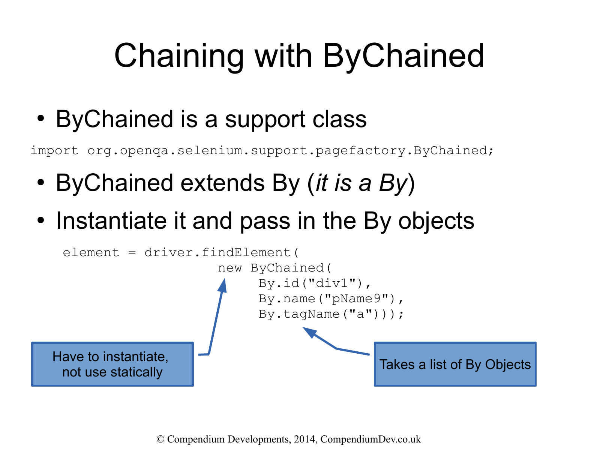

- ByChained is a support class

import org.openqa.selenium.support.pagefactory.ByChained;

- ByChained extends By (it is a By)
- Instantiate it and pass in the By objects

element = driver.findElement( new ByChained( By.id("div1"), By.name("pName9"), By.tagName("a")));

Takes a list of By Objects

Have to instantiate, not use statically

---

<!-- Slide 40 -->

# Other By Support Classes

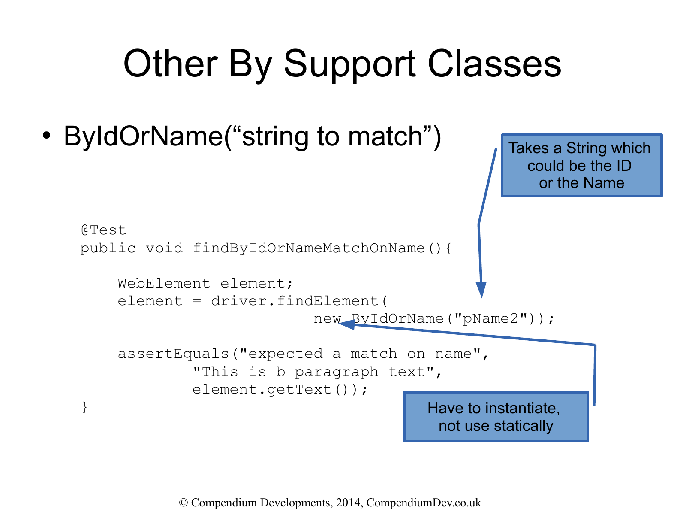

- ByIdOrName(“string to match”)

```java
    @Test
    public void findByIdOrNameMatchOnName(){

        WebElement element;
        element = driver.findElement(
                             new ByIdOrName("pName2"));

        assertEquals("expected a match on name",
                "This is b paragraph text",
                element.getText());
    }
```

Takes a String which

could be the ID

or the Name

Have to instantiate, not use statically

---

<!-- Slide 41 -->

# Basic WebElement API Summary

- WebElement, findElement,
    - WebElement element = driver.findElement(By.id(“anid));
    - Find a WebElement using id or name attribute,
    - findElement can be chained
- By.id, By.name
    - Locators to 'find' the elements

- element.sendKeys(“type this”);
    - Send keys to a web element to type something
- element.click()
- element.getText
    - Click on a web element
    - Get the text of the current element

---

<!-- Slide 42 -->

# WebElement

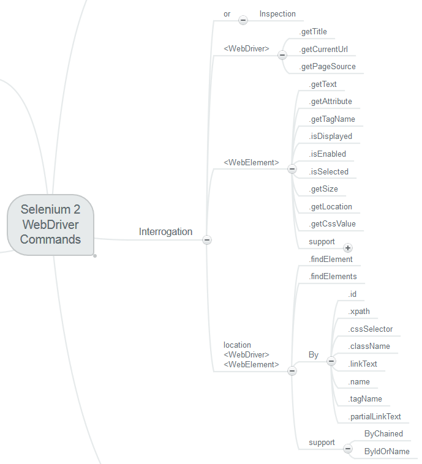

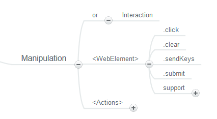

---

<!-- Slide 43 -->

# Dom Element Interrogation Approach

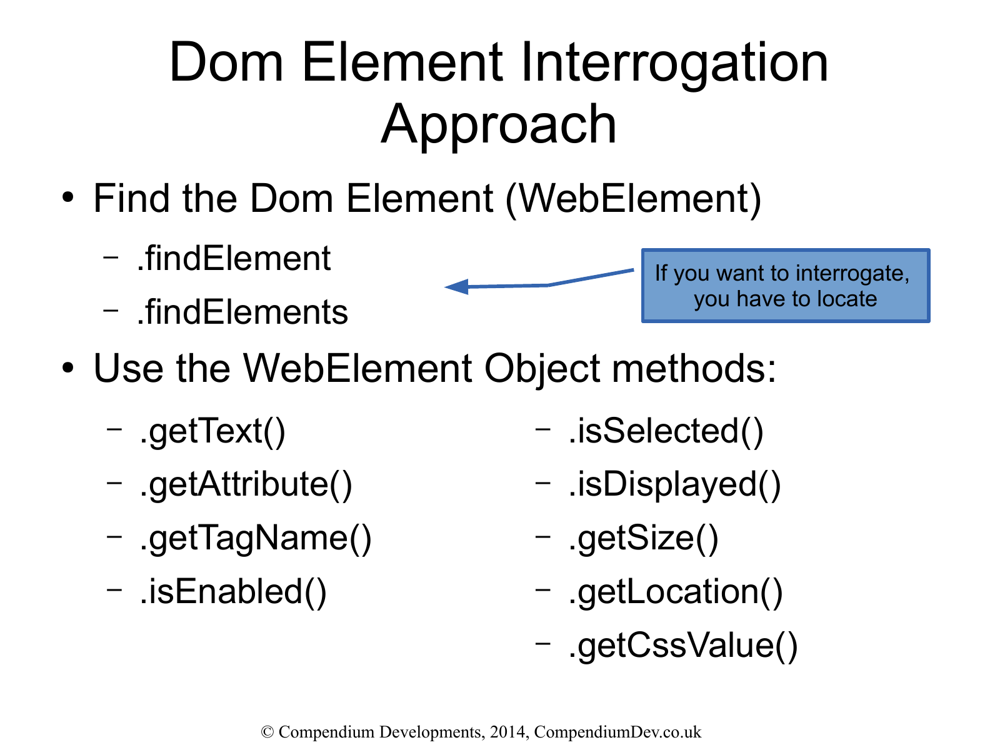

- Find the Dom Element (WebElement)
    - .findElement
    - .findElements
- Use the WebElement Object methods:

- .getText()
- .getAttribute()
- .getTagName()
- .isEnabled()

- .isSelected()
- .isDisplayed()
- .getSize()
- .getLocation()
- .getCssValue()

If you want to interrogate,

you have to locate

---

<!-- Slide 44 -->

# Does Navigation Require Synchronisation?

- Navigation blocks until the HTML of the page is loaded
- This does not mean the page is ready
    - for manipulation or
    - full interrogation
- Sometimes synchronisation is required on navigation

---

<!-- Slide 45 -->

# What about clicking?

- Normally we navigate by clicking:
    - on links
    - on buttons
    - by submitting forms
- This is navigation as a side-effect
    - It requires synchronisation
    - We will cover this later in Manipulation

---

<!-- Slide 46 -->

# Manipulation

---

<!-- Slide 47 -->

# WebElement Manipulation

- .click()
- .clear()
    - Clear a field
- .sendKeys(String) actually (CharSequence)
    - Sends the appropriate events to a WebElement keyup, keydown, etc.
    - Helper Keys class (org.openqa.selenium.Keys)
- .submit()
    - Submit a form

---

<!-- Slide 48 -->

# Synchronisation

---

<!-- Slide 49 -->

# Discussion

- Why wait?
- What conditions might you have waited for? e.g. visible... what else?
- Why wait for title instead of assert?
- Can we make the code cleaner?

---

<!-- Slide 50 -->

# Waiting Approaches

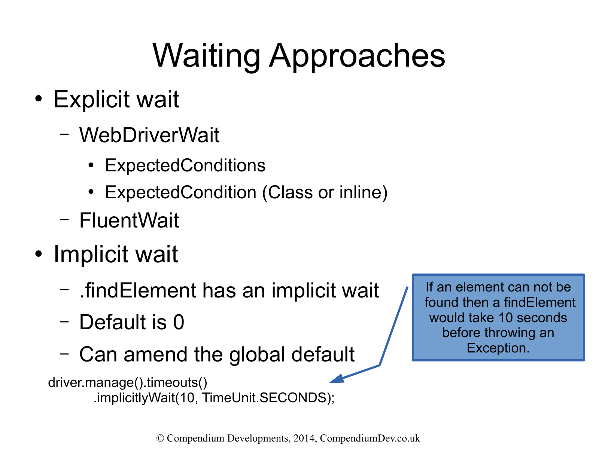

- Explicit wait
    - WebDriverWait
        - ExpectedConditions
        - ExpectedCondition (Class or inline)
    - FluentWait
- Implicit wait
    - .findElement has an implicit wait
    - Default is 0
    - Can amend the global default

```java
driver.manage().timeouts()
            .implicitlyWait(10, TimeUnit.SECONDS);
```

If an element can not be

found then a findElement

would take 10 seconds

before throwing an

Exception.

---

<!-- Slide 51 -->

# Implicit or Explicit?

- Implicit can make initial tests faster to write
    - you don't worry about synchronisation when writing tests
- It can be harder to add synchronisation later
    - You have to identify a source of intermittency
- If you start with implicit then you can expose synchronisation problems by gradually reducing the implicit wait time
- Can make tests increasingly slower
- Implicit can make test failures slower to report

---

<!-- Slide 52 -->

# Basic Synchronisation with ExpectedConditions

- Wait for the page to be in the correct state before working with it
    - Why? ElementNotFound exception
    - More robust across browsers
- WebDriverWait
    - A wait class which handles element not found exceptions
- ExpectedConditions
    - A class of static helper methods
    - e.g. new WebDriverWait(driver,10).until( ExpectedConditions.somecondition( By.id("user\_login")));

---

<!-- Slide 53 -->

# WebDriverWait Example

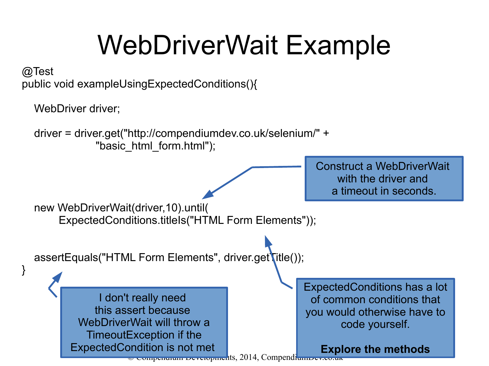

```java
@Test
public void exampleUsingExpectedConditions(){

    WebDriver driver;

    driver = driver.get("http://compendiumdev.co.uk/selenium/" +
                        "basic_html_form.html");


    new WebDriverWait(driver,10).until(
            ExpectedConditions.titleIs("HTML Form Elements"));


    assertEquals("HTML Form Elements", driver.getTitle());
}
```

I don't really need

this assert because

WebDriverWait will throw a

TimeoutException if the

ExpectedCondition is not met

Construct a WebDriverWait

with the driver and

a timeout in seconds.

ExpectedConditions has a lot

of common conditions that

you would otherwise have to

code yourself.

Explore the methods

---

<!-- Slide 54 -->

# Synchronisation API Summary

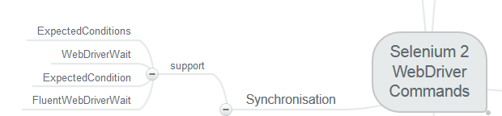

- new WebDriverWait(driver, seconds)
    - Create a wait class
- .until
    - Wait until a specific condition happens
    - until can return an element
- ExpectedConditions
    - A class of static helper wait methods for common scenarios


e.g.

- .titleIs(expectedValue)
    - True when title of page is expectedValue
- visibilityOfElementLocated
    - Returns an element when element located is visible

---

<!-- Slide 55 -->

# Section: Custom Expected Condition

---

<!-- Slide 56 -->

# Custom ExpectedCondition

```java
new WebDriverWait(driver,10).until(
        contextItemCountChanges(currentActionsForContext, "in tutorial"));
);
```

- Why?
    - ExpectedConditions doesn't have what you need
    - You want to make your tests read well for your usage scenario
    - You want to pass additional values to the apply method
- ... create a Custom ExpectedCondition

---

<!-- Slide 57 -->

# Custom ExpectedCondition Example

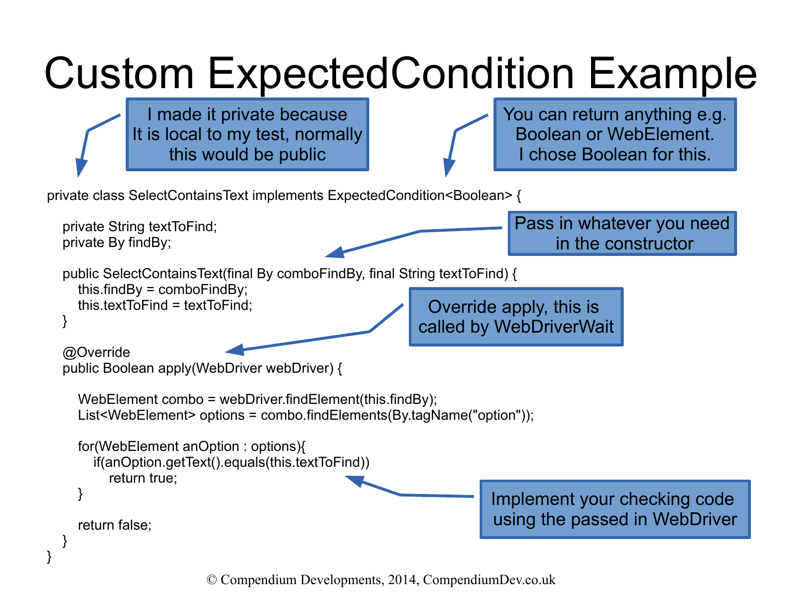

```java
    private class SelectContainsText implements ExpectedCondition<Boolean> {

        private String textToFind;
        private By findBy;

        public SelectContainsText(final By comboFindBy, final String textToFind) {
            this.findBy = comboFindBy;
            this.textToFind = textToFind;
        }

        @Override
        public Boolean apply(WebDriver webDriver) {

            WebElement combo = webDriver.findElement(this.findBy);
            List<WebElement> options = combo.findElements(By.tagName("option"));

            for(WebElement anOption : options){
                if(anOption.getText().equals(this.textToFind))
                    return true;
            }

            return false;
        }
    }
```

I made it private because

It is local to my test, normally

this would be public

You can return anything e.g.

Boolean or WebElement.

I chose Boolean for this.

Pass in whatever you need

in the constructor

Override apply, this is

called by WebDriverWait

Implement your checking code

using the passed in WebDriver

---

<!-- Slide 58 -->

# Adhoc Waits Created Inline Example

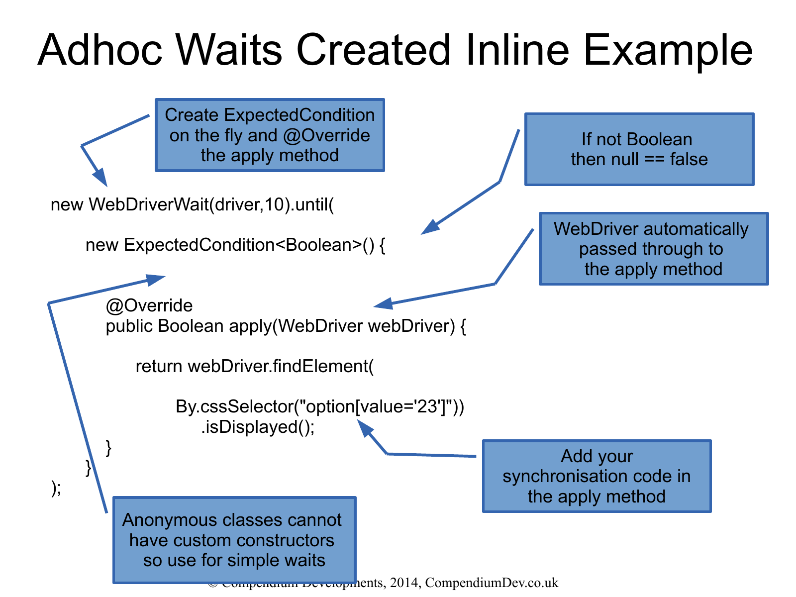

```java
new WebDriverWait(driver,10).until(
       new ExpectedCondition<Boolean>() {
           @Override
           public Boolean apply(WebDriver webDriver) {
                 return webDriver.findElement(
                         By.cssSelector("option[value='23']"))
                              .isDisplayed();
           }
       }
);
```

Create ExpectedCondition on the fly and @Override the apply method

WebDriver automatically passed through to the apply method

Add your

synchronisation code in the apply method

If not Boolean then null == false

Anonymous classes cannot have custom constructors so use for simple waits

---

<!-- Slide 59 -->

# Wrap Adhoc Wait in a method

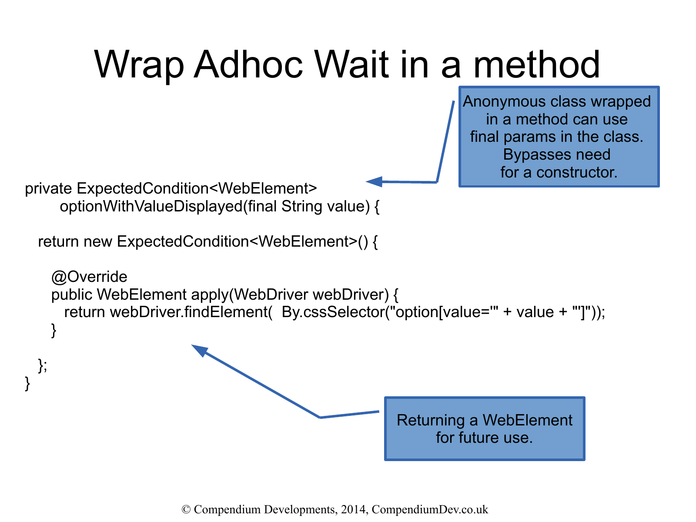

```java
private ExpectedCondition<WebElement>
        optionWithValueDisplayed(final String value) {

   return new ExpectedCondition<WebElement>() {

      @Override
      public WebElement apply(WebDriver webDriver) {
         return webDriver.findElement(  By.cssSelector("option[value='" + value + "']"));
      }

   };
}
```

Anonymous class wrapped

in a method can use

final params in the class.

Bypasses need

for a constructor.

Returning a WebElement

for future use.

---

<!-- Slide 60 -->

# Abstraction

---

<!-- Slide 61 -->

# Abstraction Layers

- Abstraction Layers are
    - not a framework
    - contextual for an application, or an application framework
    - Essential for:
        - Maintenance
        - Speed of writing tests
        - Ease of understanding tests

---

<!-- Slide 62 -->

# Abstraction Layers Categorised

1. Data

- Generic Data Abstractions e.g. email, postcode

2. Physical

- Physical layout of your application e.g. pages, components
- Navigation across pages

3. Domain

- Your application Entities domain e.g. user, account

4. Logical

- User actions, workflows

---

<!-- Slide 63 -->

# Hints

- Create the test you want to see
    - Write the test as if the abstraction layers already existed
    - So you can:
        - See if it is readable, at the right level etc.
        - Use code completion to create classes (IntelliJ: Alt+Enter)

---

<!-- Slide 64 -->

# Page Objects?

- An abstraction around pages
    - Or page components
- Remove driver.xxxx from tests
- Model the physical domain
- Numerous ways of doing this
    - Page Factory
    - Extends LoadableComponent or SlowLoadableComponent
    - Basic objects
- Modelling Decisions Required

---

<!-- Slide 65 -->

# Example Test Using Page Object

```java
@Test
public void basicHtmlPageTest(){

    WebDriver driver = new FirefoxDriver();
    BasicHtmlPage page =
                                new BasicHtmlPage(driver);

    page.get();

    assertEquals(page.getParagraphOne(),
                        "A paragraph of text");
    assertEquals(page.getParagraphTwo(),
                        "Another paragraph of text");
}
```

---

<!-- Slide 66 -->

# Example Page Object

```java
public class BasicHtmlPage {
    private final WebDriver driver;
    private String paragraphTwo;

    public BasicHtmlPage(WebDriver driver) {
        this.driver = driver;
    }

    public void get() {
        driver.get(
"http://seleniumsimplified.com/testpages/basic_web_page.html");
    }

    public String getParagraphOne() {
        return driver.findElement(By.id("para1")).getText();
    }

    public String getParagraphTwo() {
        return driver.findElement(By.id("para2")).getText();
    }
}
```

---

<!-- Slide 67 -->

# Refactor to Page Object Heuristics

- Convert local abstractions to Page Abstractions
- Replace comments with abstractions
- Make Decisions about the model based on the test readability and method reuse
- Build only what you need as you need it

---

<!-- Slide 68 -->

# Page Object Heuristics

- Construct the page object with a WebDriver
- Limit the methods to physical actions
- Expose Constants as public static final
- Don't navigate to the page in the constructor, either use a navigation object or a get() method

---

<!-- Slide 69 -->

# Reference Section

---

<!-- Slide 70 -->

# Basic Practice Pages

- <http://SeleniumSimplified.com/testpages/>
    - alert.html
    - basic\_ajax.html
    - basic\_web\_page.html
    - basic\_html\_form.html
    - ajaxselect.php
- Source available at https://github.com/eviltester/seleniumTestPages

- calculate.php
- find\_by\_playground.php
- refresh.php
- search.php

---

<!-- Slide 71 -->

# Advanced Practice Pages

- compendiumdev.co.uk/selenium/Showcase/Showcase.html
- Source available at https://github.com/eviltester/simpleGWTShowCaseClone

---

<!-- Slide 72 -->

# Learn More Java

- Java For Testers by Alan Richardson
- Effective Java by Joshua Bloch
- Implementation Patterns by Kent Beck
- Growing Object-Oriented Software, Guided by Tests by Steve Freeman and Nat Pryce

---

<!-- Slide 73 -->

# Live pages to challenge yourself

gwt.google.com/samples/Showcase/Showcase.html

- Try the above it offers many challenges

www.primefaces.org/showcase/ui/home.jsf

- Practice on some simple apps:
    - <http://todomvc.com/>
    - <http://google-gruyere.appspot.com/>
    - <http://www.redmine.org/>
    - <http://getontracks.org/>

[Source link: www.primefaces.org/showcase/ui/home.jsf](http://www.primefaces.org/showcase/ui/home.jsf)

---

<!-- Slide 74 -->

# WebDriver Summary Sheet

| WebElement |
| --- |
| .getText() |
| .getAttribute(“name”) |
| .getTagName() |
| .isEnabled() |
| .isSelected() |
| .isDisplayed() |
| .getSize() |
| .getLocation() |
| .getCssValue() |

| Finding elements |
| --- |
| WebDriver |
| WebElement =<br>.findElement(BY) |
| List&lt;WebElement&gt; =<br>.findElements(BY) |
| By |
| .id(“an\_id”) |
| .xpath(“xpath”) |
| .cssSelector(“css”) |
| .className(“class”) |
| .linkText(“text”) |
| .name(“name” |
| .tagName(“a\_tag”) |
| .partialLinkText(“t”); |
| Support |
| ByChaining(By, By) |
| ByIdOrName(“idName”) |

Inspect

Navigate

| WebDriver |
| --- |
| .get(“URL”) |
| .navigate |
| .to(Url) |
| .to(“URL”) |
| .back() |
| .forward() |
| .refresh() |

| WebDriver |
| --- |
| .getTitle() |
| .getCurrentUrl() |
| .getPageSource() |

| WebDriver Interact |
| --- |
| = new &lt;driverClass&gt;() |
| .close() |
| .quit() |

Interact

| WebElement |
| --- |
| .click() |
| .submit() |
| .clear() |
| .sendKeys(String) |
| .sendKeys(Keys.x) |

| support.ui.Select |
| --- |
| .&lt;methods&gt;() |

| SwitchTo. |
| --- |
| .alert() |
| .getText() |
| .accept() |
| .dismiss() |
| .sendKeys(String) |
| .frame(...) |

| ExpectedConditions |
| --- |
| .titleIs(String) |
| … a lot of helper methods |

| WebDriverWait |
| --- |
| (driver, timeout in Seconds)<br>.until(ExpectedCondition) |

| Cookies |
| --- |
| WebDriver |
| .manage() |
| .deleteAllCookies() |
| .addCookie(Cookie) |
| .deleteCookie(Cookie) |
| .deleteCookieNamed(String) |

Synchronise

| Cookies |
| --- |
| WebDriver |
| .manage() |
| .getCookieNamed(String) |
| .getCookies() |

| Actions |
| --- |
| .keyUp() etc. |
| .perform() |

| (JavascriptExecutor) |
| --- |
| .executeScript |

---

<!-- Slide 75 -->

# Selectors

| CSS Selectors |
| --- |
| \* - any |
| #id |
| .class |
| tag |
| [attribute] |
| [attribute="value"] |
| tag[attribute="value"] |
| tag[attr1='val1'][attr2='val2'] |
| tag[att1='val1'], orThisTag |
| = (' or ") |
| \*="anywhere in value" |
| ^="start of value" |
| $="end of value" |
| ~="spaceSeperatedValue" |
| Paths |
| A &gt; B (child) |
| A B (any descendant) |
| A + B (A's B sibling) |
| tag:first-child |

| XPATH Selectors |
| --- |
| // - match anywhere |
| / - match from root |
| //\* - any element |
| //tag |
| //\*[@attribute] |
| //\*[@attribute="value"] |
| //tag[@attribute="value"] |
| //tag1/tag2 (child) |
| //tag1//tag2 (any descendant) |
| //tag1/../.. (.. to go up) |
| //\*[.='element textl] |
| [@at1="a" and @at2="b"] |
| and, or, =, !=, &lt;, &gt;, &gt;=, &lt;- |
| Functions |
| contains(@a,"alu") |
| starts-with(@a,"v") |
| ends-with(@a,"e") |
| Indexing |
| //tag[1] |

XPath References

- <http://www.w3schools.com/xpath/>
- <http://www.simple-talk.com/dotnet/.net-framework/xpath,-css,-dom-and-selenium-the-rosetta-stone/>

CSS References

- <http://reference.sitepoint.com/css/selectorref>
- http://net.tutsplus.com/tutorials/html-css-techniques/ the-30-css-selectors-you-must-memorize/
- <http://www.quirksmode.org/css/contents.html>
- <http://www.w3schools.com/cssref/css_selectors.asp>

[Source link: <http://net.tutsplus.com/tutorials/html-css-techniques/>](http://net.tutsplus.com/tutorials/html-css-techniques/the-30-css-selectors-you-must-memorize/)

---

<!-- Slide 76 -->

# Alan Richardson - Blogs, Books, and Courses

Blogs and Websites

- CompendiumDev.co.uk
- SeleniumSimplified.com
- EvilTester.com
- JavaForTesters.com
- Twitter: @eviltester

Online Training Courses

- Technical Web Testing 101
- Intro to Selenium
- Selenium 2 WebDriver API

Videos

youtube.com/user/EviltesterVideos

Books

Selenium Simplified

Java For Testers

leanpub.com/javaForTesters

Alan Richardson

uk.linkedin.com/in/eviltester

Independent Test Consultant &amp; Custom Training

Contact Alan

<http://compendiumdev.co.uk/contact>


[Source link: CompendiumDev.co.uk](http://www.compendiumdev.co.uk/)

[Source link: SeleniumSimplified.com](http://www.seleniumsimplified.com/)

[Source link: EvilTester.com](http://www.eviltester.com/)

[Source link: JavaForTesters.com](http://JavaForTesters.com/)

[Source link: @eviltester](https://twitter.com/eviltester)

[Source link: youtube.com/user/EviltesterVideos](http://www.youtube.com/user/EviltesterVideos)

[Source link: leanpub.com/javaForTesters](http://leanpub.com/javaForTesters)

[Source link: uk.linkedin.com/in/eviltester](http://uk.linkedin.com/in/eviltester)
