<!-- footer: Alan Richardson -->

<!-- Slide 1 -->

# Test Management Summit

April 2015

“Test Automation for Managers”

Alan Richardson

www.compendiumdev.co.uk

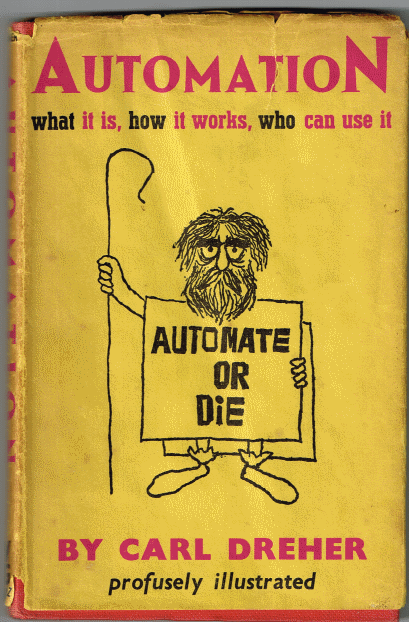

---

<!-- Slide 2 -->

# Basic Agenda

- Logistics intro (75 minute session)
- I talk for 15 minutes
    - but you can interrupt and start a discussion immediately
- We all discuss for 60 minutes
    - I have material if we need it to start discussions
    - We will be flexible and adjust direction based on what you want to discuss.

---

<!-- Slide 3 -->

# Demographics

- Managers, Consultants, Doers
- Technical? Not Technical?
- Automating?

---

<!-- Slide 4 -->

# What do you want out of this session?

---

<!-- Slide 5 -->

# Today we will discuss Automation

---

<!-- Slide 6 -->

# What is Automation?

- Use of tools?
- Programming?
- No manual intervention?

---

<!-- Slide 7 -->

# How does automation work?

- Does it work?
- Magic?
- How do you know it works?

---

<!-- Slide 8 -->

# Who can use automation?

- Can you program?
- Can you push a button?
- We automate the automation!

---

<!-- Slide 9 -->

# What is automation for?

- Build a better CV and get a better job?
- Reduce headcount?
- Save money?
- Allow focus elsewhere?

---

<!-- Slide 10 -->

# On the question of “Do you need to be technical, to manage automation?”

---

<!-- Slide 11 -->

# Keeping Management Knowledge Current

“New technology is exposing management to ideas that were not dealt with in the textbooks and the classroom of ten or fifteen years ago… The executive who does not keep his ideas modern by constant, aggressive learning from every available source will increasingly often be called on to make decision on problems he cannot grasp…”

Automation, by Carl Dreher, 1957, pg 15

---

<!-- Slide 12 -->

# Technical Mastery and Leadership

“He must, as in the past, be so complete a master of the technical aspects of his profession that his subordinates will recognise his master, and be prepared to learn from him. This postulates the need to keep abreast of the changes and advances which lie within his own special field through the period of his service during which he is concerned with such matters.”

The Art of Leadership, Captain S.W. Roskill, 1964, pg 30

---

<!-- Slide 13 -->

# There is a difference between management and leadership.

---

<!-- Slide 14 -->

# How can manager’s help?

- Experience
- Coaching
- Questioning
- Removing obstacles
- Learning
- Defining Needs & Constraints
- Recruitment

---

<!-- Slide 15 -->

# How can managers hinder?

- Mandates & Edicts
- Metrics
- Meetings
- Process
- Lack of Understanding

---

<!-- Slide 16 -->

# Initial Discussion points?

- Managing without technical skills?
- Managing with technical skills?
- How do you know automation is working?
- How to recruit?
- How do you start automating?
- Questions?
- Risks?
- Issues?

---

<!-- Slide 17 -->

# Mindmaps of discussion points

… if needed to trigger discussion

---

<!-- Slide 18 -->

# Reserve Mind Map: What Is Test Automation?

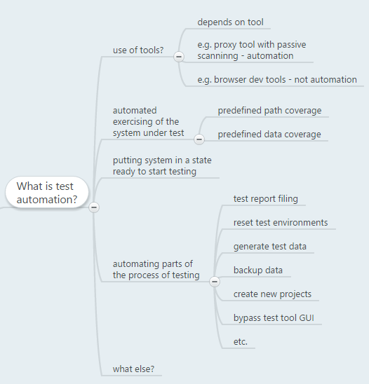

---

<!-- Slide 19 -->

# Reserve Mind Map: Do You Need to Be Technical?

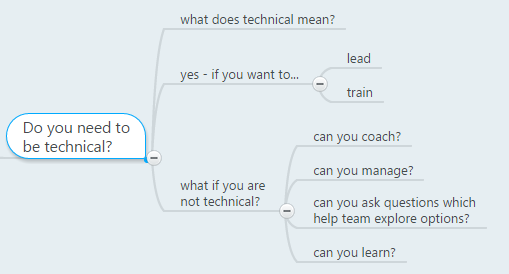

---

<!-- Slide 20 -->

# Reserve Mind Map: How Do You Manage Test Automation?

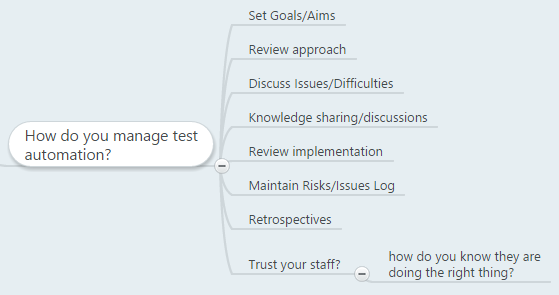

---

<!-- Slide 21 -->

# Reserve Mind Map: How Can Managers Help?

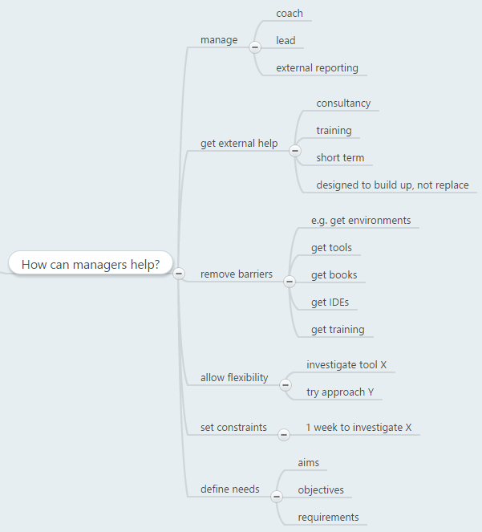

---

<!-- Slide 22 -->

# Reserve Mind Map: How Can Managers Hinder?

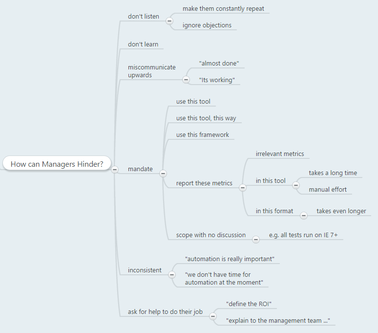

---

<!-- Slide 23 -->

# Reserve Mind Map: What Do Automation Staff Require from Management?

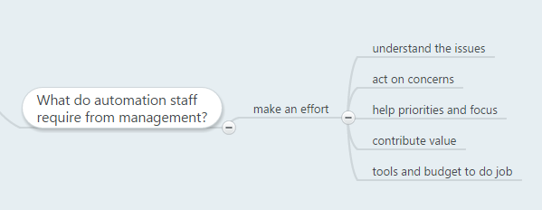

---

<!-- Slide 24 -->

# Reserve Mind Map: How Do You Know Your Automation Is Working?

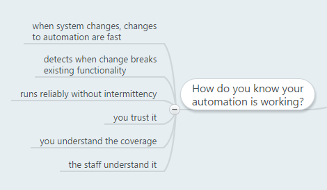

---

<!-- Slide 25 -->

# Reserve Mind Map: Experiences of What Can Go Right

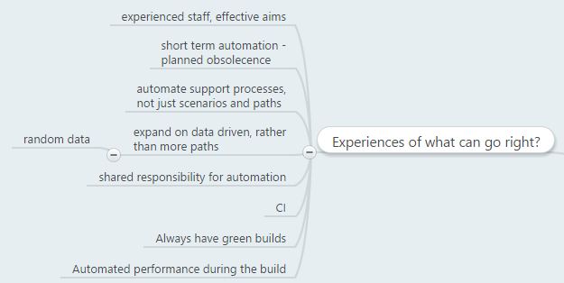

---

<!-- Slide 26 -->

# Reserve Mind Map: Recruitment

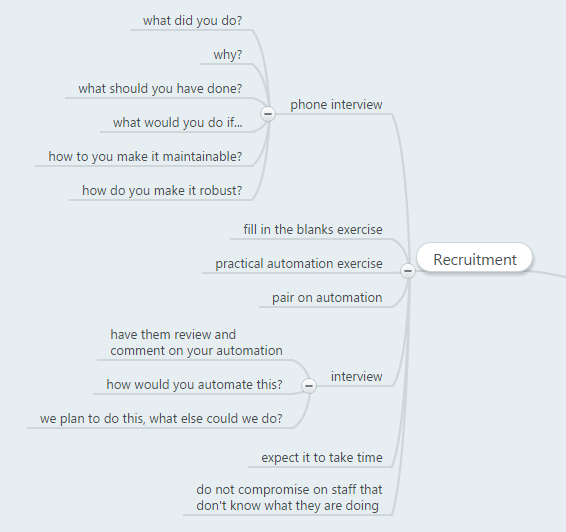

---

<!-- Slide 27 -->

# Further Discussion Prompts

- What Tools?
- Future Challenges?
- Current Issues, Questions, Risks?
- Experiences of what can go wrong?
- Experiences of what can go right?

---

<!-- Slide 28 -->

# Controversies

- Should automation be a programmer responsibility?
- All testers should learn to code?
- You can’t automate testing, only checking

---

<!-- Slide 29 -->

# Alan Richardson

Alan Richardson

[uk.linkedin.com/in/eviltester](http://uk.linkedin.com/in/eviltester)

Independent Test Consultant based in the UK. He offers training and consultancy in Selenium WebDriver, Exploratory and Technical web testing.

Contact Alan for training and

[consultancy tailored to your needs: http://compendiumdev.co.uk/contact](http://compendiumdev.co.uk/contact)

Blogs and Websites

- [CompendiumDev.co.uk](http://compendiumdev.co.uk)
- [SeleniumSimplified.com](http://SeleniumSimplified.com)
- [EvilTester.com](http://eviltester.com)
- [JavaForTesters.com](http://javafortesters.com/)
- [Twitter: @eviltester](https://twitter.com/eviltester)

Online Training Courses

- Selenium 2 WebDriver with Java
- Technical Web Testing 101
Videos

[youtube.com/user/EviltesterVideos](http://youtube.com/user/EviltesterVideos)

Books

Selenium Simplified

Java For Testers

[leanpub.com/javaForTesters](https://leanpub.com/javaForTesters)

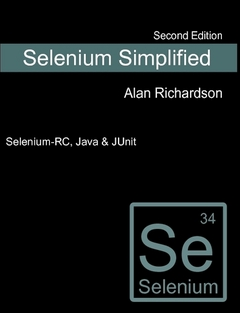

