<!-- Slide 1 -->

# The Evil Tester's Guide to Evil

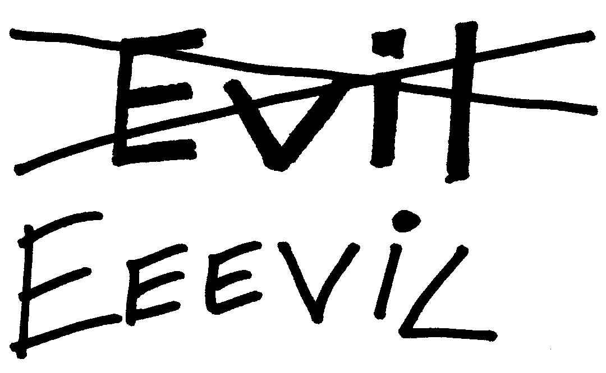

---

<!-- Slide 2 -->

# Beliefs and Attitude

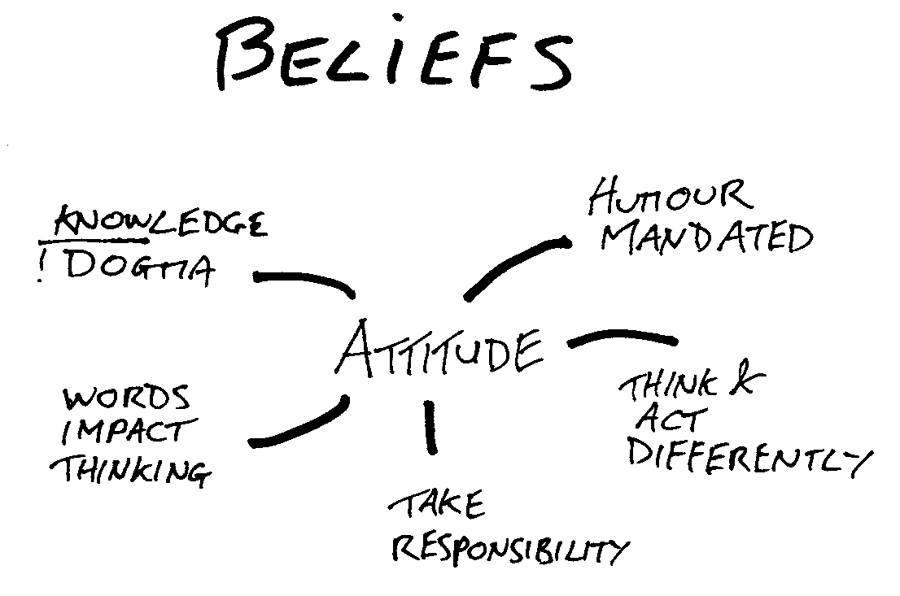

---

<!-- Slide 3 -->

# Who am I?

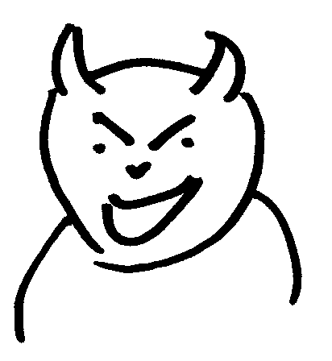

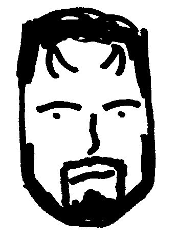

eviltester.com

@eviltester

---

<!-- Slide 4 -->

# "I've studied evil in all its forms"

...I've read a lot of comics

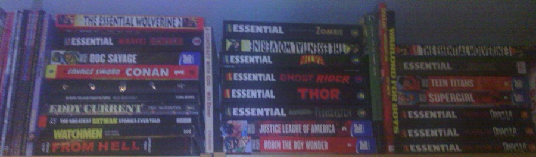

---

<!-- Slide 5 -->

# "I've learned the essence of evil"

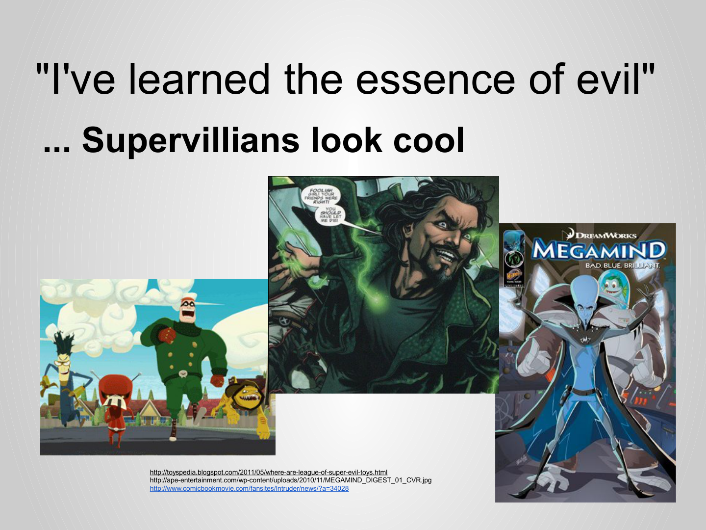

... Supervillians look cool

<http://toyspedia.blogspot.com/2011/05/where-are-league-of-super-evil-toys.html> <http://ape-entertainment.com/wp-content/uploads/2010/11/MEGAMIND_DIGEST_01_CVR.jpg>

<http://www.comicbookmovie.com/fansites/Intruder/news/?a=34028>

---

<!-- Slide 6 -->

# When I were little...

... I learned about the left hand path.

KnowLedge vs Dogma

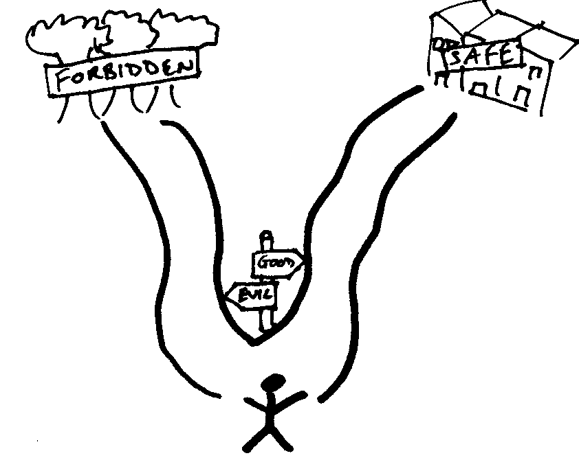

---

<!-- Slide 7 -->

# When I were a baby tester...

... testing was a necessary evil.

embrace said evil.

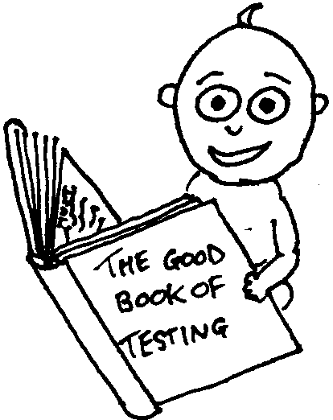

---

<!-- Slide 8 -->

# Psycholinguistics of GOOD and EVIL

...Good? Evil?

Are you a good little tester?

Choose your words carefully.

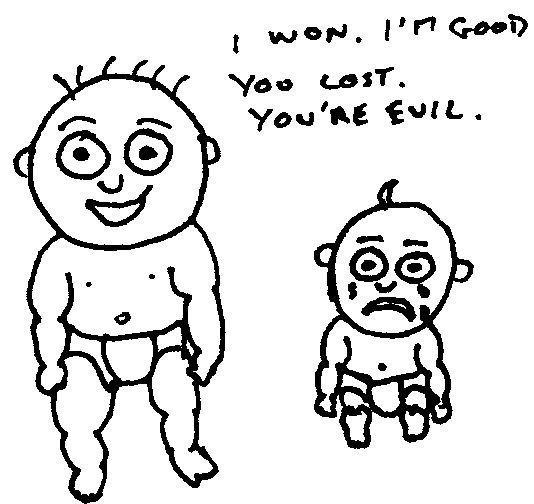

---

<!-- Slide 9 -->

# “With Great Power comes Great Responsibility”, Stan Lee

But Evil knows no limits...

...we impose our own limits when we take responsibility.

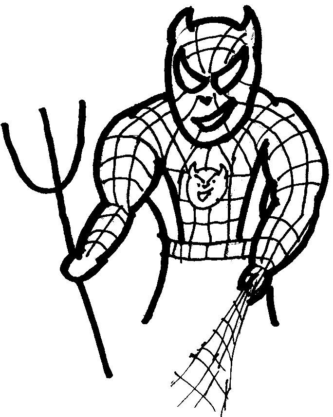

---

<!-- Slide 10 -->

# Some PRECEPTS of Eeevil

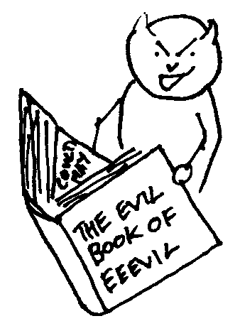

---

<!-- Slide 11 -->

# No-one is born evil

... it takes hard work

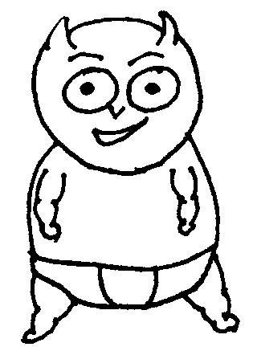

---

<!-- Slide 12 -->

# Seriously Ridiculous

...do you take it seriously enough to mock it?

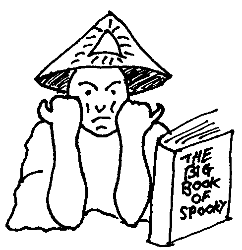

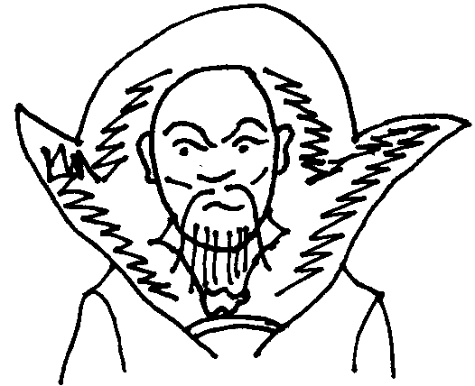

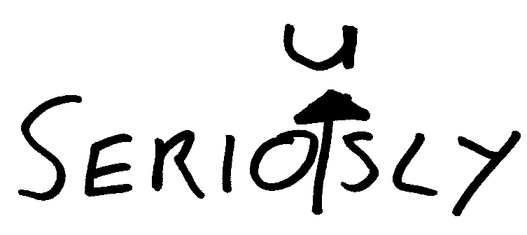

---

<!-- Slide 13 -->

# Beliefs are made to be broken

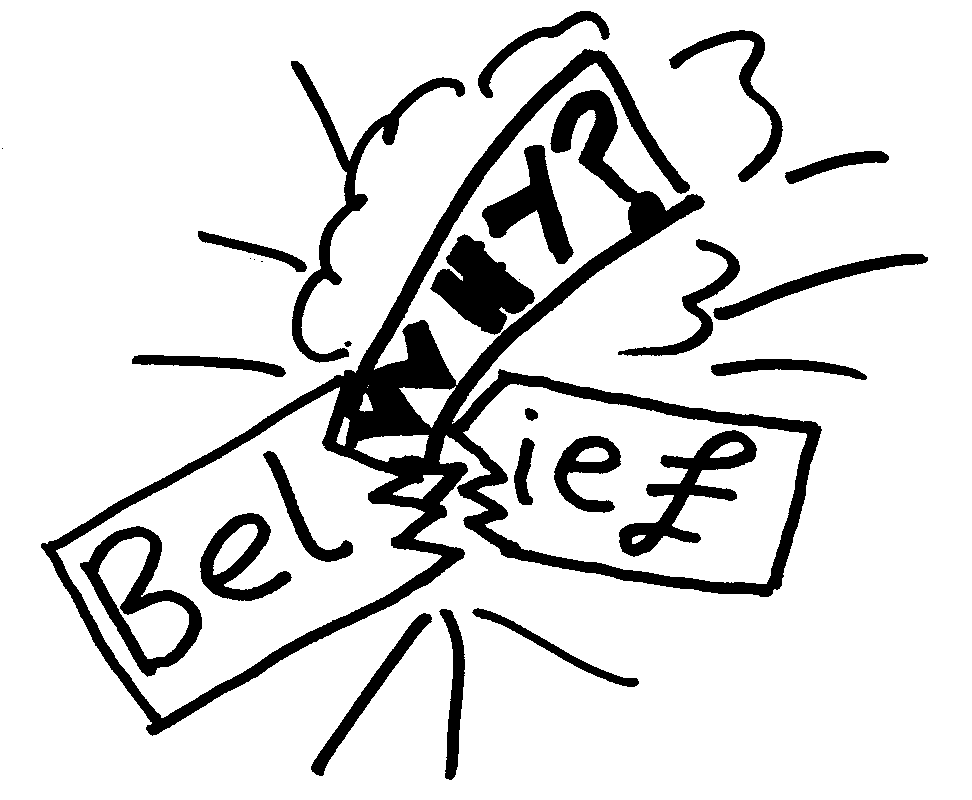

---

<!-- Slide 14 -->

# Evil is seductive

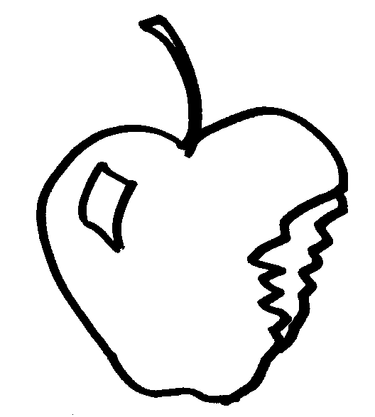

---

<!-- Slide 15 -->

# Simple as...

Sin

---

<!-- Slide 16 -->

# Now, Now, Now

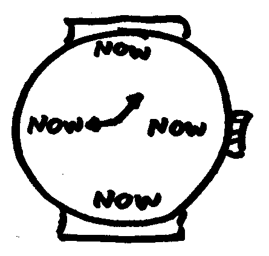

---

<!-- Slide 17 -->

# Nothing is true, Everything is permitted

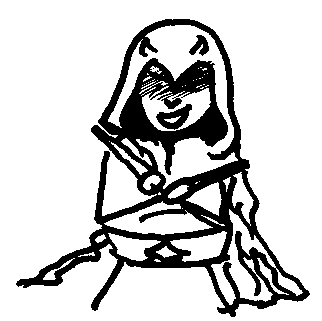

---

<!-- Slide 18 -->

# One road to heaven, a thousand roads to hell

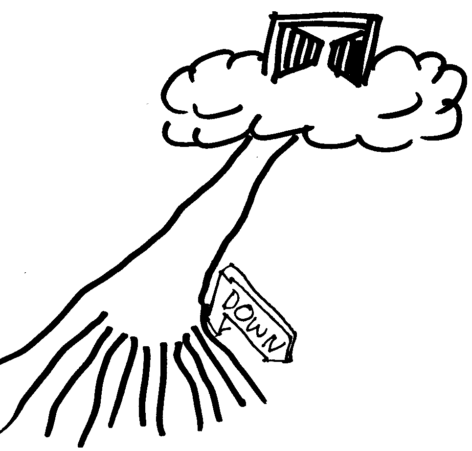

---

<!-- Slide 19 -->

# Evil is wrong

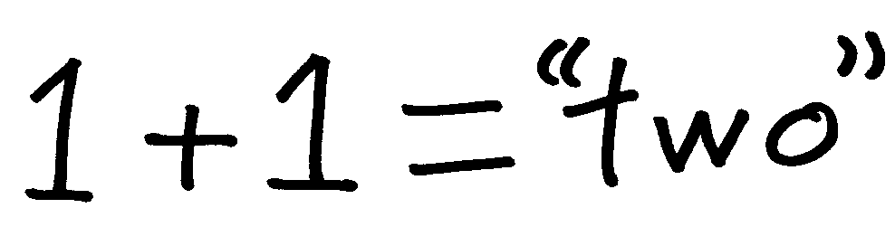

---

<!-- Slide 20 -->

# What did you expect? The door wasn't locked!

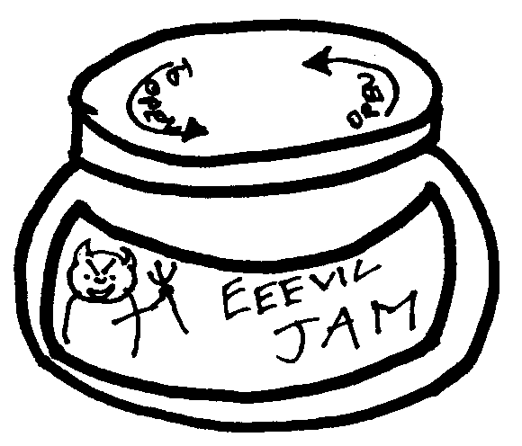

---

<!-- Slide 21 -->

# When they look to you for certainty, foster doubt.

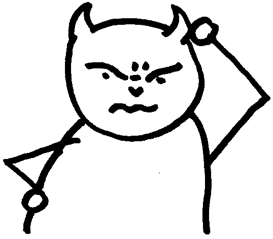

---

<!-- Slide 22 -->

# A Bad Attitude

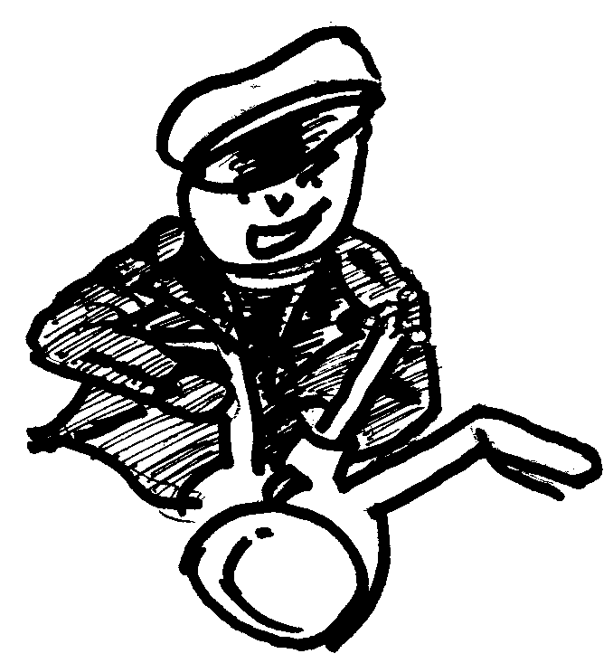

---

<!-- Slide 23 -->

# Eeevil, a means to an end

...an end of ?

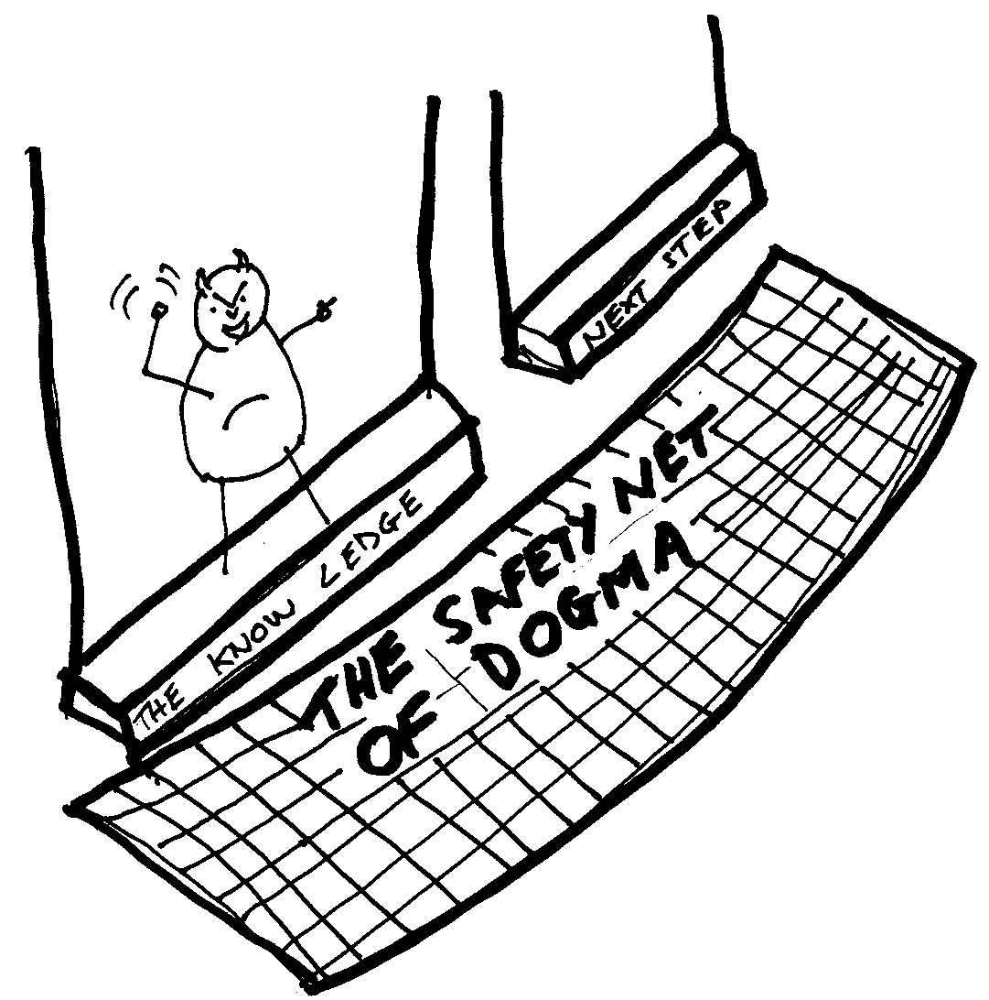
