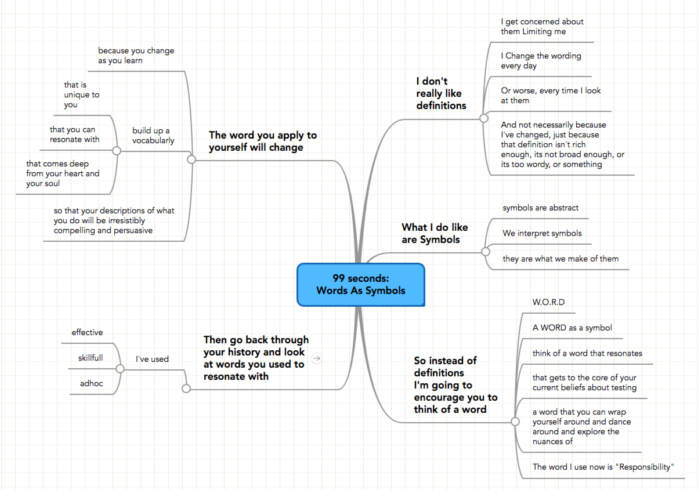

# Words as Symbols

Outline for the prepared alternative to the TestBash 2.0 99-second talk. This alternative was not delivered at the conference. Converted from the original FreeMind map, preserving its wording and hierarchy. This is an outline, not a transcript.

## Original Map Title

Test Bash 99 seconds

## Outline

- I don't really like definitions
    - I get concerned about them Limiting me
    - I Change the wording every day
    - Or worse, every time I look at them
    - And not necessarily because I've changed, just because that definition isn't rich enough, its not broad enough, or its too wordy, or something
- The word you apply to yourself will change
    - because you change as you learn
    - build up a vocabularly
        - that is unique to you
        - that you can resonate with
        - that comes deep from your heart and your soul
    - so that your descriptions of what you do will be irresistibly compelling and persuasive
- What I do like are Symbols
    - symbols are abstract
    - We interpret symbols
    - they are what we make of them
- Then go back through your history and look at words you used to resonate with
    - I've used
        - effective
        - skillfull
        - adhoc
- So instead of definitions I'm going to encourage you to think of a word
    - W.O.R.D
    - A WORD as a symbol
    - think of a word that resonates
    - that gets to the core of your current beliefs about testing
    - a word that you can wrap yourself around and dance around and explore the nuances of
    - The word I use now is "Responsibility"

## Original Mind Map

