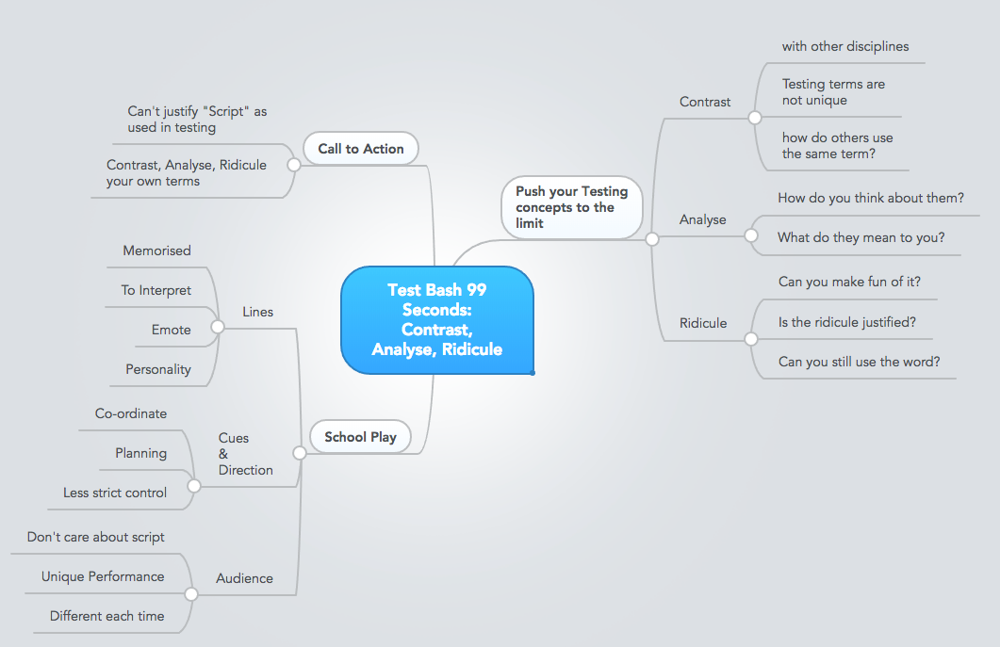

# Contrast, Analyse, Ridicule

Outline for the talk delivered at TestBash 2.0, Brighton, 22 March 2013. Converted from the original FreeMind map, preserving its wording and hierarchy. This is an outline, not a transcript.

## Original Map Title

Test Bash 99 Seconds: Contrast, Analyse, Ridicule

## Outline

- Push your Testing concepts to the limit
    - Contrast
        - with other disciplines
        - Testing terms are not unique
        - how do others use the same term?
    - Analyse
        - How do you think about them?
        - What do they mean to you?
    - Ridicule
        - Can you make fun of it?
        - Is the ridicule justified?
        - Can you still use the word?
- Call to Action
    - Can't justify "Script" as used in testing
    - Contrast, Analyse, Ridicule your own terms
- School Play
    - Lines
        - Memorised
        - To Interpret
        - Emote
        - Personality
    - Cues &amp; Direction
        - Co-ordinate
        - Planning
        - Less strict control
    - Audience
        - Don't care about script
        - Unique Performance
        - Different each time

## Original Mind Map

