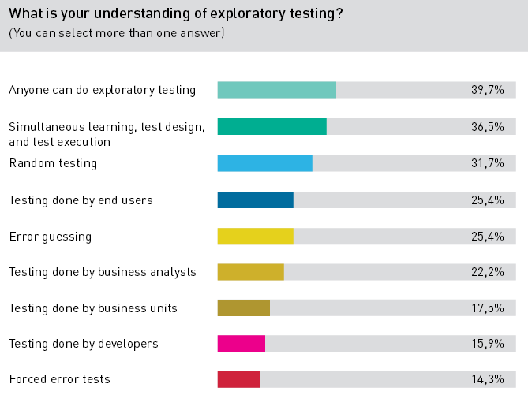
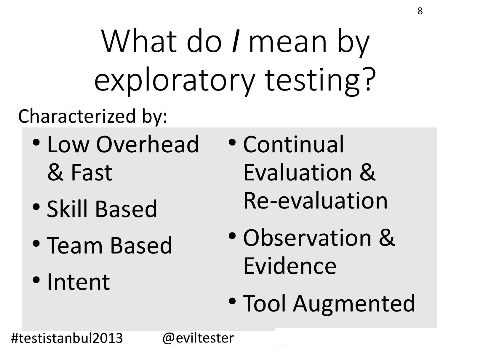
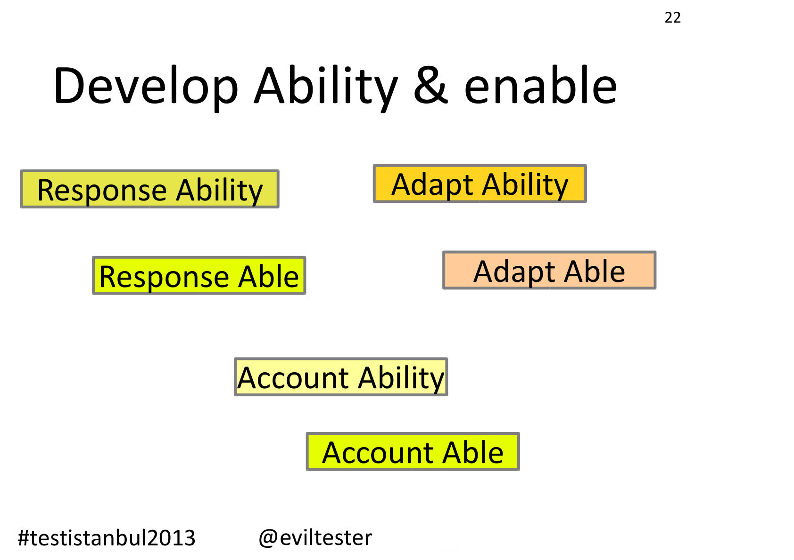

<!-- Slide 1 -->

# Experiences with Exploratory Testing

Alan Richardson

@eviltester

www.eviltester.com

www.compendiumdev.co.uk

www.seleniumsimplified.com

---

<!-- Slide 2 -->

# Future of Testing: New Techniques and Methodologies

- Exploratory Testing is not new,
    - but people still don't do it.
- The future will be the same, as now,
    - unless we take responsibility for it.
- Learn from experience,
    - base experiments on observation.

#testistanbul2013 @eviltester [Source link](https://twitter.com/search?q=#testistanbul2013&src=hash) [Source link](https://twitter.com/eviltester)

---

<!-- Slide 3 -->

# Some things I've learned by doing and teaching Exploratory Testing

- Adopt a personal approach
- Exploration &amp; experiment is natural
- Environment can kill exploratory testing
- Evidence based documentation
- Use Automation in your exploration

#testistanbul2013 @eviltester [Source link](https://twitter.com/search?q=#testistanbul2013&src=hash) [Source link](https://twitter.com/eviltester)

---

<!-- Slide 4 -->

# What does "Exploratory Testing" mean?

"An Interactive Process of Simultaneous learning, test design, and test execution"

James Bach

<http://www.satisfice.com/glossary.shtml>

#testistanbul2013 @eviltester [Source link](https://twitter.com/search?q=#testistanbul2013&src=hash) [Source link](https://twitter.com/eviltester)

---

<!-- Slide 5 -->

# The story of Chinese Zen

"If you master the source, but not the teachings, whenever you open your mouth you will speak at random; if you master the teachings but not the source, you will be like a one-eyed dragon." The story of Chinese Zen, by Nan Huai-Chin

#testistanbul2013 @eviltester [Source link](https://twitter.com/search?q=#testistanbul2013&src=hash) [Source link](https://twitter.com/eviltester)

---

<!-- Slide 6 -->

# Understanding of exploratory testing

#testistanbul2013 @eviltester [Source link](https://twitter.com/search?q=#testistanbul2013&src=hash) [Source link](https://twitter.com/eviltester)

<http://www.testistanbul.org/TurkeySoftwareQualityReport_2013_2014.pdf>

---

<!-- Slide 7 -->

# Adopt a personal approach to Testing

Take responsibility for your test approach:

- What does it mean to me?
- How do I do it?
- Why did I start?
- Why do I do it?

#testistanbul2013 @eviltester [Source link](https://twitter.com/search?q=#testistanbul2013&src=hash) [Source link](https://twitter.com/eviltester)

---

<!-- Slide 8 -->

# What do I mean by exploratory testing?

- Continual Evaluation &amp; Re-evaluation
- Observation &amp; Evidence
- Tool Augmented

- Low Overhead &amp; Fast
- Skill Based
- Team Based
- Intent

Characterized by:

#testistanbul2013 @eviltester [Source link](https://twitter.com/search?q=#testistanbul2013&src=hash) [Source link](https://twitter.com/eviltester)

---

<!-- Slide 9 -->

# Low Overhead &amp; Fast

- Fast paced environments, becoming norm
- Success based on outcome, not compliance
- Maximize the time spend "doing"

Techniques:

- Think through risks and target those. System risks, business risks.
- Chunk testing into 'charters' and 'sessions'. Log the testing against those. Raise defects.

#testistanbul2013 @eviltester [Source link](https://twitter.com/search?q=#testistanbul2013&src=hash) [Source link](https://twitter.com/eviltester)

---

<!-- Slide 10 -->

# Skill Based

Rather than just relying on 'Techniques'...

- Assume the tester knows the techniques and applies them on an adhoc skill based basis
- Train people where risks and bugs exist and how to look for them
- Train people to be adaptable
- Trust people, give them responsibility

#testistanbul2013 @eviltester [Source link](https://twitter.com/search?q=#testistanbul2013&src=hash) [Source link](https://twitter.com/eviltester)

---

<!-- Slide 11 -->

# Team Based

- Use the whole team to review everyone else's work
- Write logs that others can read
- Review coverage of others testing and suggest new scope
- Pair to come up with new ideas
- Debrief rather than report
- The Manager tests as well

#testistanbul2013 @eviltester [Source link](https://twitter.com/search?q=#testistanbul2013&src=hash) [Source link](https://twitter.com/eviltester)

---

<!-- Slide 12 -->

# Continual Evaluation &amp; Re-evaluation

- Start with minimal scope
- Test to learn what you need to test
- Write down what you know and don't know
- Continually revisit your approach and testing scope
- Revisit your use of tools
- Question your effectiveness
- Model the system and the process

---

<!-- Slide 13 -->

# Intent

- Know what you are testing for.
- Decide on what to test next.
    - What risk are you concerned about?
    - What requirement are you investigating?
    - What data are you covering?
- Don't do it because you planned to.
    - Do it because it is important now.

#testistanbul2013 @eviltester [Source link](https://twitter.com/search?q=#testistanbul2013&src=hash) [Source link](https://twitter.com/eviltester)

---

<!-- Slide 14 -->

# Observation &amp; Evidence

- Focus / Defocus
    - Go Meta
    - Go Deeper
    - Peripheral Observation
    - Relate to existing evidence
- Produce Evidence
    - screenshots, system logs,
    - recordings, manual logs

#testistanbul2013 @eviltester [Source link](https://twitter.com/search?q=#testistanbul2013&src=hash) [Source link](https://twitter.com/eviltester)

---

<!-- Slide 15 -->

# Tool Augmented

- Tools augment our testing to help us test better
- Tools should never drive or dictate our process
- Exploratory Testing has heavy use of tools for: Observation, Data Creation, Logging, State Manipulation

#testistanbul2013 @eviltester [Source link](https://twitter.com/search?q=#testistanbul2013&src=hash) [Source link](https://twitter.com/eviltester)

---

<!-- Slide 16 -->

# My Exploratory Process

- Modelling
- Observing
- Reflective
- Intentional
- Manipulative

#testistanbul2013 @eviltester [Source link](https://twitter.com/search?q=#testistanbul2013&src=hash) [Source link](https://twitter.com/eviltester)

---

<!-- Slide 17 -->

# Why should you do exploratory testing?

- Because you liked the definition?
- Because you liked the characteristics?
- Because you want to test more effectively?

Personal Approach

I don't know why you should do it. I only know why I do it, and why I started doing it.

#testistanbul2013 @eviltester [Source link](https://twitter.com/search?q=#testistanbul2013&src=hash) [Source link](https://twitter.com/eviltester)

---

<!-- Slide 18 -->

# Why did I start doing exploratory testing?

"There is a risk that the test team will waste a lot of time and money by creating scripts that are wrong and will never be run"

- Frustration Mainly
- Heavily Scripted environment which wasn't working well

#testistanbul2013 @eviltester [Source link](https://twitter.com/search?q=#testistanbul2013&src=hash) [Source link](https://twitter.com/eviltester)

---

<!-- Slide 19 -->

# In order to be effective we had to Subvert the process

| Step # | Description | Expected Result |
| --- | --- | --- |
| 1 | I've only added this because the tool made me | I'll test the conditions in the case and write down my observations |

#testistanbul2013 @eviltester [Source link](https://twitter.com/search?q=#testistanbul2013&src=hash) [Source link](https://twitter.com/eviltester)

---

<!-- Slide 20 -->

# Why do I keep doing Exploratory Testing?

Because:

- It works
- I get better at it, the more I do it
- I can train people to do it
- It adapts to different environments, and processes

#testistanbul2013 @eviltester [Source link](https://twitter.com/search?q=#testistanbul2013&src=hash) [Source link](https://twitter.com/eviltester)

---

<!-- Slide 21 -->

# Take Responsibility to succeed

- Stop Following
- Do and Learn
- Change What you do

#testistanbul2013 @eviltester [Source link](https://twitter.com/search?q=#testistanbul2013&src=hash) [Source link](https://twitter.com/eviltester)

---

<!-- Slide 22 -->

# Develop Ability &amp; enable

Response Ability

Response Able

Adapt Able

Adapt Ability

Account Ability

Account Able

#testistanbul2013 @eviltester [Source link](https://twitter.com/search?q=#testistanbul2013&src=hash) [Source link](https://twitter.com/eviltester)

---

<!-- Slide 23 -->

# What stops Exploratory Testing?

- Environment
- Personal Fear
- Existing Learning

#testistanbul2013 @eviltester [Source link](https://twitter.com/search?q=#testistanbul2013&src=hash) [Source link](https://twitter.com/eviltester)

---

<!-- Slide 24 -->

# Automation &amp; Exploratory Testing

- Tool Augmented
- Exploratory Automated Testing
    - Models &amp; Checks
- Automation can lead to Exploration

#testistanbul2013 @eviltester [Source link](https://twitter.com/search?q=#testistanbul2013&src=hash) [Source link](https://twitter.com/eviltester)

---

<!-- Slide 25 -->

# An example: Random Coverage of Defined Scope

- New Registration Process
    - Manual Testing kept finding problems,
    - Every app change introduced new errors
- Randomize Coverage of a Model
    - Model registration as a process of equivalent steps
        - Fill Name, Fill Password, Fill PostCode etc.
    - Model data as a set of templates to randomly fill
        - {a-z,A-Z, }\*3-25, {a-z,A-Z,0-9,!"£$%^&amp;\*()}\*6-18
    - Leave to run, Automated Checks flag issues
- When run is clean, perform exploratory testing

---

<!-- Slide 26 -->

# When Automation Leads to exploration

- Sometimes you want to get somewhere known fast,
    - so that you can explore unknowns
- Automate the 'getting to'
    - Randomise to maximise chance that this shows a problem
- When there, engage brain and test

#testistanbul2013 @eviltester [Source link](https://twitter.com/search?q=#testistanbul2013&src=hash) [Source link](https://twitter.com/eviltester)

---

<!-- Slide 27 -->

# Explore and Experiment with your Testing

- The Future of Testing requires us to Unlearn.
- Change our existing beliefs based on evidence.
- Make it easy to experiment with new approaches.
- Evaluate Qualitatively as well as Quantitatively.
- Take responsibility, own your test approach.

#testistanbul2013 @eviltester [Source link](https://twitter.com/search?q=#testistanbul2013&src=hash) [Source link](https://twitter.com/eviltester)

---

<!-- Slide 28 -->

# About Alan Richardson and resources

Blogs and Web Sites

- SeleniumSimplified.com [Source link](http://www.seleniumsimplified.com/)
- EvilTester.com [Source link](http://www.eviltester.com/)
- Testing Papers and Tools
    - CompendiumDev.co.uk [Source link](http://www.compendiumdev.co.uk/)

Online Training Courses

- Technical Web Testing 101
- Intro to Selenium
- Selenium 2 WebDriver API

Videos

youtube.com/user/EviltesterVideos [Source link](http://www.youtube.com/user/EviltesterVideos)

Books

Selenium Simplified

Alan Richardson is an Independent Test Consultant based in the UK. He offers training and consultancy in Selenium WebDriver, exploratory and technical web testing.

- uk.linkedin.com/in/eviltester [Source link](http://uk.linkedin.com/in/eviltester)

Contact Alan for training and consultancy tailored to your needs: alan@compendiumdev.co.uk [Source link](mailto:alan@compendiumdev.co.uk?Subject=WebDriver%20Training)

@eviltester [Source link](https://twitter.com/eviltester)
