<!-- Slide 1 -->

# My Quest for Silver Bullets

TestNet May 2013

Alan Richardson

@eviltester

www.eviltester.com

www.seleniumsimplified.com

www.compendiumdev.co.uk

---

<!-- Slide 2 -->

# Silver Bullets are Good

There is nothing intrinsically evil in a Silver Bullet...

...except the fact that is a bullet...

...and that bullets can kill...

But, "Silver Bullet" as an ideal == good

@EvilTester

---

<!-- Slide 3 -->

# Silver kills bacteria

Silver teething rings are good

Silver spoons are good

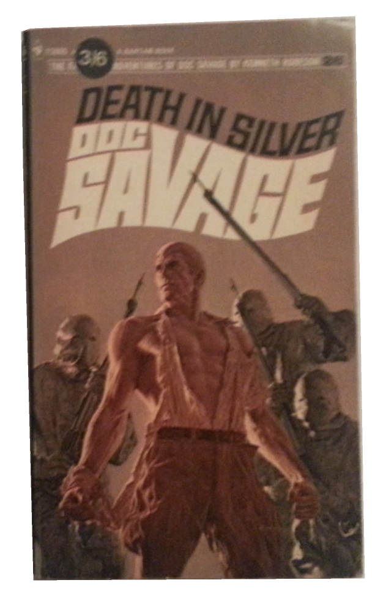

@EvilTester

---

<!-- Slide 4 -->

# The Lone Ranger used Silver Bullets

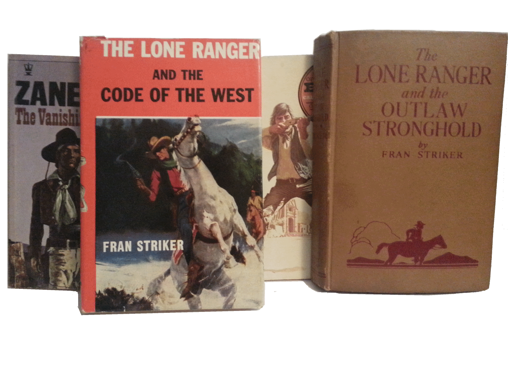

... ignore the fact that the lone ranger is a fictional character

@EvilTester

---

<!-- Slide 5 -->

# Only good guys use Silver Bullets

We all think we are the good guy

Ours will be the 'right' Silver Bullet

Often when we know the least.

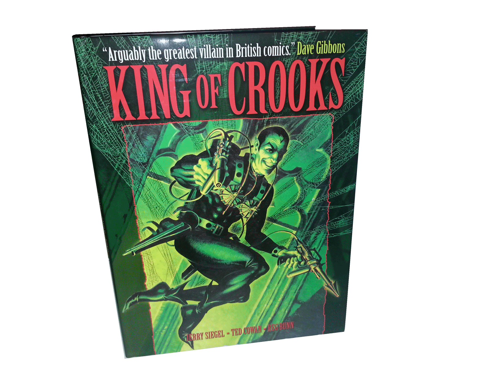

@EvilTester

---

<!-- Slide 6 -->

# You Can Only Hurt Werewolves With a Silver Bullet

...ignore the fact that werewolves don't exist

@EvilTester

---

<!-- Slide 7 -->

# Reification &amp; Nominalisation

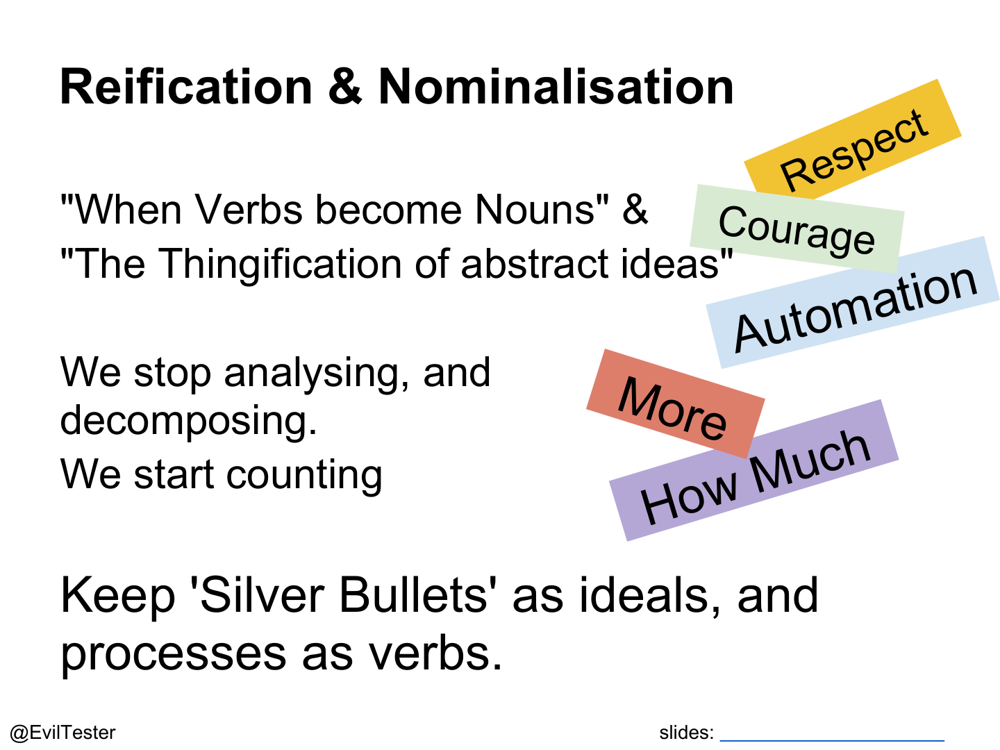

Automation

How Much

Respect

Courage

More

Keep 'Silver Bullets' as ideals, and processes as verbs.

@EvilTester

"When Verbs become Nouns" &amp;

"The Thingification of abstract ideas"

We stop analysing, and decomposing.

We start counting

---

<!-- Slide 8 -->

# I started my career building silver bullets

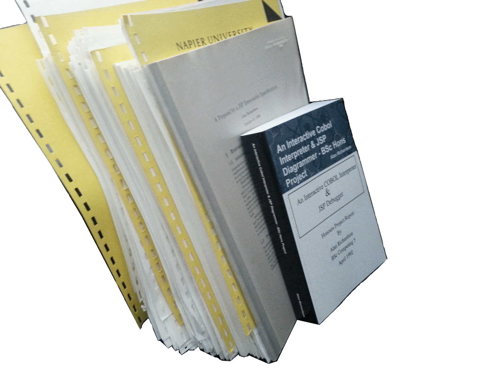

@EvilTester

---

<!-- Slide 9 -->

# Lesson Learned: Never build a generic "Silver Bullet" tool for others to use

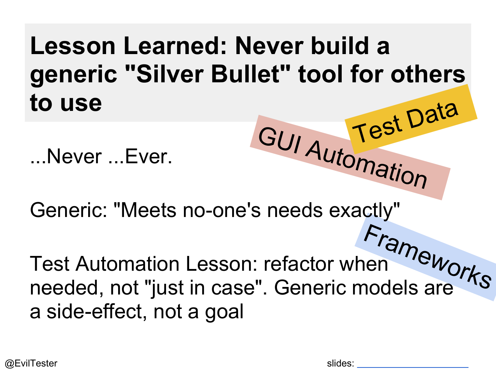

Frameworks

...Never ...Ever.

Generic: "Meets no-one's needs exactly"

Test Automation Lesson: refactor when needed, not "just in case". Generic models are a side-effect, not a goal

@EvilTester

GUI Automation

Test Data

---

<!-- Slide 10 -->

# You can learn a lot by making Silver Bullets

Model at the problem domain.

Abstract for the current context.

- DSL, Frameworks, Logging, Screenshots, Keywords

Need, not want.

@EvilTester

---

<!-- Slide 11 -->

# Sometimes the bad guy, thinks he's the good guy

... he knows best

... his Silver Bullet will save the world

@EvilTester

---

<!-- Slide 12 -->

# Other Peoples' Silver Bullets are like a black hole

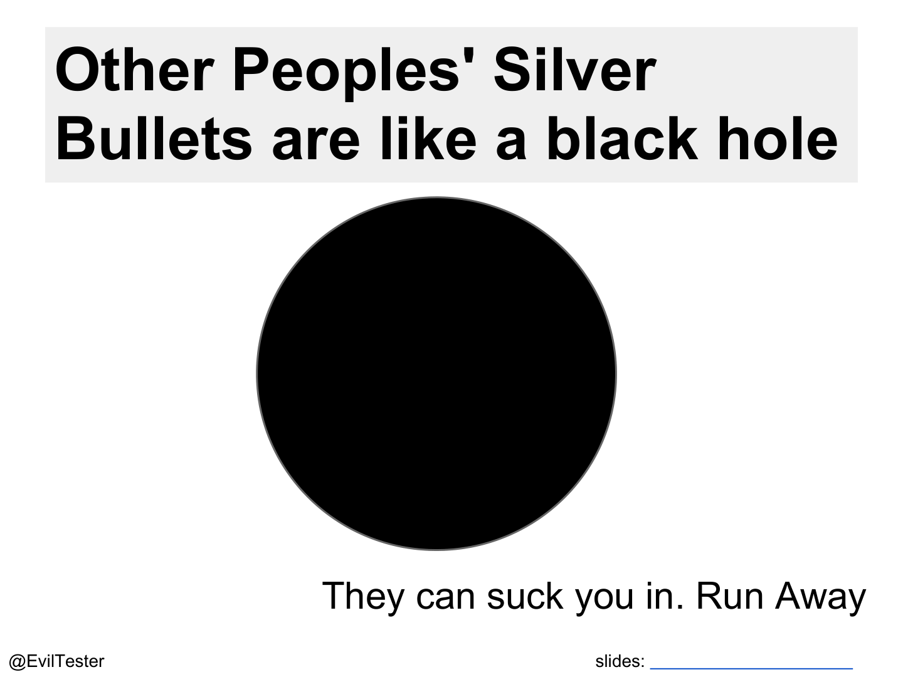

They can suck you in. Run Away

@EvilTester

---

<!-- Slide 13 -->

# Other People's Silver Bullets can hurt

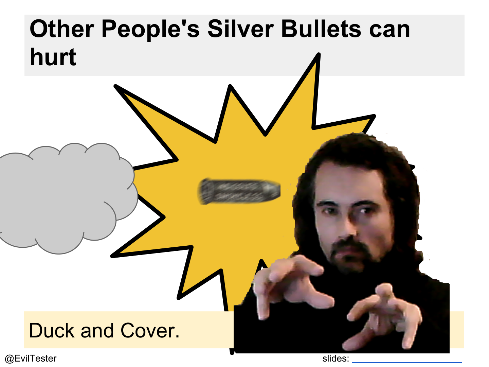

Duck and Cover.

@EvilTester

---

<!-- Slide 14 -->

# Lesson Learned: NEVER let tools limit your testing.

Never, EVER.

@EvilTester

---

<!-- Slide 15 -->

# Bypass Silver Bullet Constraints

- The tool is not the process
- The tool uses a database, use the database
- Don't like the GUI? Build your own and automate theirs
- Use their API, only buy it, if it has one

Augment other tools and use them in combination.

---

<!-- Slide 16 -->

# The lone Ranger uses Silver Bullets as a last resort

Use What you have first.

Assume you can use it differently.

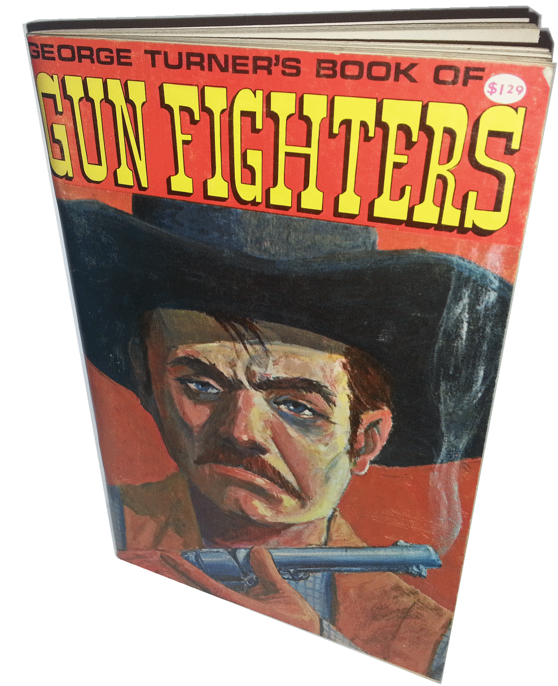

@EvilTester

---

<!-- Slide 17 -->

# The lone Ranger's gun only holds 6 Silver Bullets

Sears, Roebuck and Co. Catalogue #110 Fall 1900

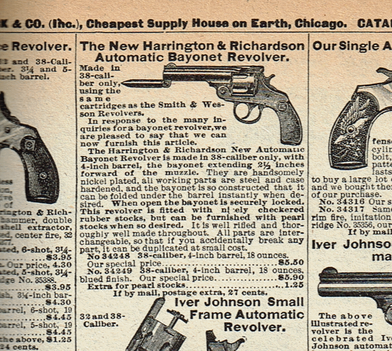

@EvilTester

Don't Build An Armoury

Keep tools simple

With simple aims:

- Model, Observe, Reflect, Inspect, Manipulate

---

<!-- Slide 18 -->

# The lone Ranger uses Silver Bullets as a last resort

... Change your definition of a tool

... Use tools to Augment your testing

... Don't list "Who" and "What", list "Why" and How"

@EvilTester

---

<!-- Slide 19 -->

# The Lone Ranger didn't make his own Silver Bullets... Tonto Did

Learn to fend for yourself.

@EvilTester

---

<!-- Slide 20 -->

# The Lone Ranger's Silver Bullets remind him of the value of a human life.

Sears, Roebuck and Co. Catalogue #110 Fall 1900

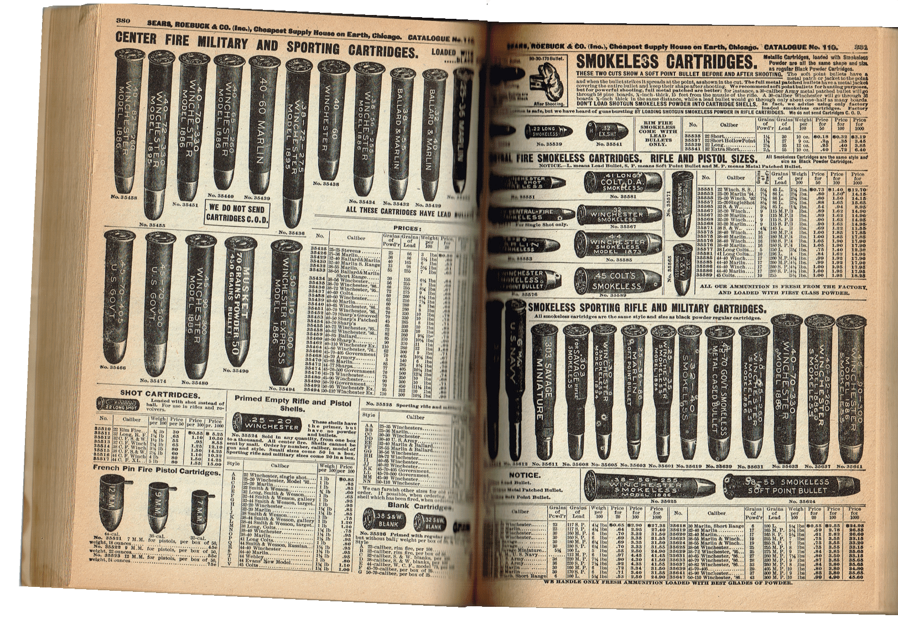

@EvilTester

---

<!-- Slide 21 -->

# The most dangerous part of a quest is when you believe you have finished.

Are you sure you want to sit at the Seige Perilous?

@EvilTester

DC Comics, Little Shop of Horrors, Movie Adaptation Special, 1986

---

<!-- Slide 22 -->

# "By This Axe I Rule"

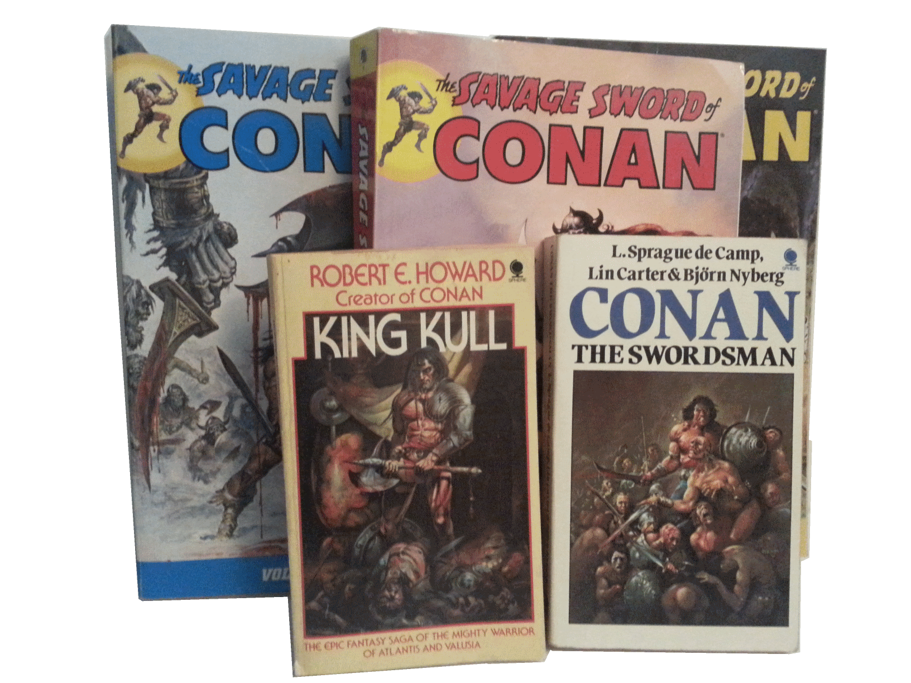

@EvilTester

---

<!-- Slide 23 -->

# "By This Axe I Rule", Robert E. Howard

"By this axe I rule! This is my sceptre! I have struggled and sweated to be the puppet king you wished me to be - to king it your way. Now I use mine own way! If you will not fight, you shall obey! Laws that are just shall stand; laws that have outlived their times I shall shatter as I shattered that one! I am King!"

@EvilTester

---

<!-- Slide 24 -->

# "By This Axe I Rule", Robert E. Howard Annotated for Software Testing by Alan Richardson

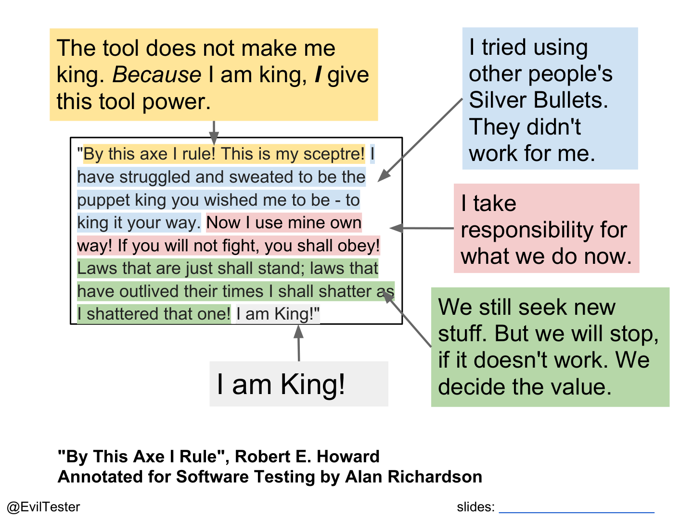

"By this axe I rule! This is my sceptre! I have struggled and sweated to be the puppet king you wished me to be - to king it your way. Now I use mine own way! If you will not fight, you shall obey! Laws that are just shall stand; laws that have outlived their times I shall shatter as I shattered that one! I am King!"

The tool does not make me king. Because I am king, I give this tool power.

I tried using other people's Silver Bullets. They didn't work for me.

I take responsibility for what we do now.

We still seek new stuff. But we will stop, if it doesn't work. We decide the value.

I am King!

@EvilTester

---

<!-- Slide 25 -->

# Keep looking for new ways. Keep questing and looking for improvements. But never allow yourself to think that you have found THE one.

@EvilTester

---

<!-- Slide 26 -->

# Alan Richardson - Blogs, Books, and Courses

Alan Richardson is an Independent Test

Consultant based in the UK. He offers training

and consultancy in Selenium WebDriver,

exploratory and technical web testing.

- uk.linkedin.com/in/eviltester

[Source link: uk.linkedin.com/in/eviltester](http://uk.linkedin.com/in/eviltester)

Contact Alan for training and

consultancy tailored to your needs:alan@compendiumdev.co.uk

[Source link: alan@compendiumdev.co.uk](mailto:alan@compendiumdev.co.uk)

Blogs and Websites

- SeleniumSimplified.com
- EvilTester.com
- Testing Papers and Tools
    - CompendiumDev.co.uk

Twitter: @eviltester

[Source link: SeleniumSimplified.com](http://SeleniumSimplified.com)

[Source link: EvilTester.com](http://eviltester.com)

[Source link: CompendiumDev.co.uk](http://compendiumdev.co.uk)

[Source link: @eviltester](https://twitter.com/eviltester)

Online Training Courses

- Technical Web Testing 101
- Intro to Selenium
- Selenium 2 WebDriver API

Videos

youtube.com/user/EviltesterVideos

Books

Selenium Simplified

[Source link: youtube.com/user/EviltesterVideos](http://youtube.com/user/EviltesterVideos)

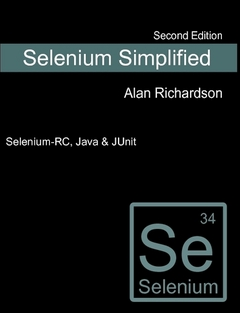

---

<!-- Slide 27 -->

# Summary Lessons Learned

- Never build a generic 'Silver Bullet' tool, ever
- Never let tools limit your testing
- Never build 'on top' of another tool
- Augment other tools, and use them in combination, use their APIs if possible
- Use what you have first, assume you can use it differently
- Stamp out ignorance, challenge people to learn
- Model at the problem domain, not a generic domain
- Generic models are a side-effect, not a goal

@EvilTester
