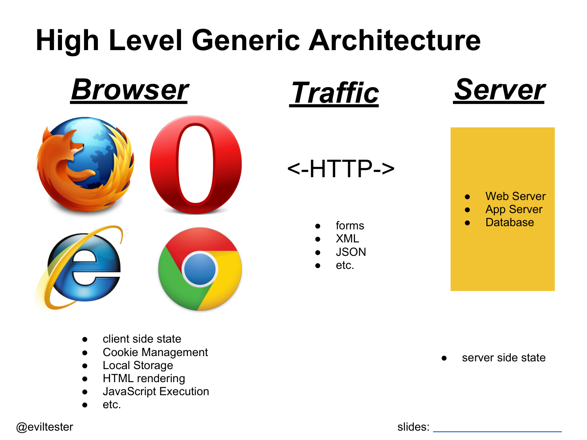
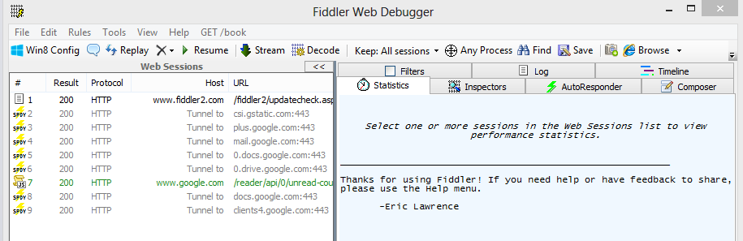
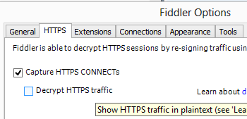

<!-- Slide 1 -->

# The Evil Tester's Guide to HTTP Proxies

A Tutorial for TestNet May 2013

Alan Richardson

@eviltester

www.eviltester.com

www.compendiumdev.co.uk

www.seleniumsimplified.com

@eviltester

---

<!-- Slide 2 -->

# Logistics

- 09:30
- xx:xx half hour break
- 13:00

Only 3 hours!

1st Hour: Theory &amp; Modern Browsers

- 20 mins Intro, basic theory
- 5 Mins 'Modern Browsers
- 5 Mins Demo
- 15 minutes browser exercise
- 15 minutes debrief

2nd Hour: BurpSuite

- 10 mins Introduction to proxies
- 20 mins BurpSuite overview
- 15 minutes BurpSuite Exercise
- 15 minutes BurpSuite debrief and questions

3rd Hour: Fiddler &amp; End Notes

- 15 mins fiddler overview
- 15 minute Exercise
- 15 minute debrief and questions
- 10 minute end notes
- 5 minutes Q&amp;A

@eviltester

---

<!-- Slide 3 -->

# Blurb: Evil Tester guide - HTTP proxies

I test a lot of web applications. I use proxy servers to interrogate

and manipulate web traffic. So in this tutorial I want to introduce

you to the basics of proxy servers, using BurpSuite and Fiddler.

We will cover and go beyond the obvious interrogation and manipulation

traffic and also look at how to use autoresponders, custom rules and

traffic generators. The different capabilities of the tools and how to

use them in combination.

And as a bonus we will look at the new features in modern browsers

that help you achieve some of the proxy benefits out of the box, for

those moments when you have to test unarmed.

As well as the tools I want to cover the thought processes and models

that help you get the best from the tools because "Form can follow

features" and "Terrain can inform technique".

@eviltester

---

<!-- Slide 4 -->

# Technical Web Testing: A Model

@eviltester

---

<!-- Slide 5 -->

# The MORIM Loop

- Model
- Observe
- Reflect
- Interrogate
- Manipulate

@eviltester

---

<!-- Slide 6 -->

# The MORIM Loop - Model

- Model
    - Build a layered model of the application functionality, flows, technology usage, etc.
- Observe
- Reflect
- Interrogate
- Manipulate

@eviltester

---

<!-- Slide 7 -->

# The MORIM Loop - Observe

- Model
- Observe
    - At every layer, what can you see?
    - Can you increase the depth of observation.
    - Do you understand what you see?
    - What else could you observe?
- Reflect
- Interrogate
- Manipulate

@eviltester

---

<!-- Slide 8 -->

# The MORIM Loop - Reflect

- Model
- Observe
- Reflect
    - Expand the model,
    - Intent - for deliberate action
    - Analyse the observations
    - What does that imply?
    - How? Risks? What else? When?
- Interrogate
- Manipulate

@eviltester

---

<!-- Slide 9 -->

# The MORIM Loop - Interrogate

- Model
- Observe
- Reflect
- Interrogate
    - Deep dive into observed data
    - Breakpoint
    - Correlate data changes with state
    - etc.
- Manipulate

@eviltester

---

<!-- Slide 10 -->

# The MORIM Loop - Manipulate

- Model
- Observe
- Reflect
- Interrogate
- Manipulate
    - Edit the data
    - Change the state
    - Edit the communication
    - Change the environment context e.g. speed, memory, etc.

@eviltester

---

<!-- Slide 11 -->

# The MORIM Loop - Utilisation

- Repeat
- Transpose - do the events in any order
- Learn
- Deliberately decide what to try next
- Do it - take advantage of what happens

@eviltester

---

<!-- Slide 12 -->

# During all the exercises; Consider:

Observation

- What are you observing. What are you not observing. What do you want to observe? Why?

Interrogation

- What do you want to see in more detail? How can you do that? Why?

Manipulation

- What do you want to amend? How could you? Why?

@eviltester

---

<!-- Slide 13 -->

# Our Basic Web Technology Knowledge

@eviltester

---

<!-- Slide 14 -->

# High Level Generic Architecture

&lt;-HTTP-&gt;

- Web Server
- App Server
- Database

- server side state

- client side state
- Cookie Management
- Local Storage
- HTML rendering
- JavaScript Execution
- etc.

- forms
- XML
- JSON
- etc.

Browser

Server

Traffic

@eviltester

---

<!-- Slide 15 -->

# Introduction to Modern Browsers

@eviltester

---

<!-- Slide 16 -->

# Modern Browsers

- Dev Tools
- Observe Network Traffic
- Interrogate &amp; Manipulate
    - DOM
    - Data - cookies, local storage
- Differing capabilities between browsers

"Don't get hung up on 'I need to test on BrowserX' - use them all, even while you focus on BrowserX"

@eviltester

---

<!-- Slide 17 -->

# Quick Demo of Modern Browser

- Interrogate Dom?
- Manipulate Dom?
- Observe Cookies?
- Interrogate Cookies?
- Manipulate Cookies?
- Observe Network Traffic?
- Interrogate Traffic?
- Manipulate Traffic?

@eviltester

---

<!-- Slide 18 -->

# Augment Browsers

- Out of the box experience continually improves
- Use browser plugins to increase the functionality of the browser even further

@eviltester

---

<!-- Slide 19 -->

# Gruyere - Cloud app to test against

A Google App Engine hosted application to learn security testing for common vulnerabilities.

Read the Instructions

- http://google-gruyere.appspot.com/

Create a new instance

- http://google-gruyere.appspot.com/start

@eviltester

---

<!-- Slide 20 -->

# For local App Testing

- WebGoat
    - http://code.google.com/p/webgoat/

Or anything from BitNami

bitnami.org

---

<!-- Slide 21 -->

# Modern Browser Exercise

1. Decide on a browser: IE, Firefox, Opera, Chrome
2. Find the Dev Tools in the browser
3. Visit http://google-gruyere.appspot.com/start
4. Explore and investigate the Browser capabilities using this app
5. Debrief in 15 mins
- What "Observe, Interrogate, Manipulate" capabilities did the browser have?
- What did you want them to have?
- Other thoughts?

@eviltester

---

<!-- Slide 22 -->

# For full control, Use a Proxy...

@eviltester

---

<!-- Slide 23 -->

# Introduction to Proxies

@eviltester

---

<!-- Slide 24 -->

# What is an HTTP Proxy?

- Sits between browser and server
- route all requests through the proxy

Browser -&gt; Request -&gt; Proxy -&gt; Server

Browser &lt;- Proxy &lt;- Response &lt;- Server

Https handled by 'man in the middle' certificate use.

@eviltester

---

<!-- Slide 25 -->

# Why should a tester care?

- Learn
    - HTTP
    - JSON
    - App Architecture
- Observe &amp; Manipulate Traffic
- Simulate Network Speeds
- Simulate different browsers
- Test new css and js without a release to main site
- Test extreme '4xx', '5xx' conditions

@eviltester

---

<!-- Slide 26 -->

# When should you use it?

- Almost all the time

@eviltester

---

<!-- Slide 27 -->

# When should you not use it?

- confirm a defect happens without the proxy
- streaming?
- long polling?

A proxy is invasive, and can impact your results. So you need to double check your results without the proxy.

But the value trumps the risk.

@eviltester

---

<!-- Slide 28 -->

# How?

Quick Demo

@eviltester

---

<!-- Slide 29 -->

# Proxies and their capabilities

@eviltester

---

<!-- Slide 30 -->

# Proxies we will cover today

- BurpSuite
- Fiddler
- Capabilites
- Demos
- Exercises

@eviltester

---

<!-- Slide 31 -->

# Generic Testing Requirements

Traffic {Request, Response} CRUD

- Create - Generate new requests
- Read - Observe Traffic
    - Requests
    - Responses
- Update -
    - Manipulate Requests &amp; Responses
        - Manually
        - Automatically
    - Replay Requests
- Delete - block requests or responses

@eviltester

---

<!-- Slide 32 -->

# Configure Browser to use a Proxy

---

<!-- Slide 33 -->

# Configure Browser to use a Proxy

- Chrome, IE all use the System Internet Settings
- Firefox and Opera can maintain proxy settings independently of system settings

---

<!-- Slide 34 -->

# Configure Chrome to use a Proxy

- Chrome\\Settings search for proxy
- Use the normal system proxy settings
- Chrome Incognito and normal mode share proxy settings

---

<!-- Slide 35 -->

# Configure Firefox to use a Proxy

- Firefox\\Options
    - Advanced\\Network
        - Connection \[Settings...\]
        - Manual proxy configuration:
        - use value listed in Proxy\\Options Listeners
        - ignore the "No Proxy For"
- If you already configured IE or Chrome then you could use System Proxy Settings

---

<!-- Slide 36 -->

# Configure Opera to use a Proxy

- Settings\\Preferences
    - Advanced\\Network
    - \[Proxy Servers...\]
    - use config from Proxy\\Options
- F12 can quickly toggle proxy on off once configured

---

<!-- Slide 37 -->

# Configure IE to use a Proxy

- Config \\ options
    - Connections
        - Lan settings
            - Use Proxy Server
                - use details from Proxy\\Options

---

<!-- Slide 38 -->

# You may be asked about proxy certificate (BurpSuite portswigger)

- Adhoc - Add it as an exception
- To remove exception
    - Firefox
        - Options\\Advanced\\Encryption
        - view certificates
            - servers (PortSwigger)
    - Chrome
        - Settings \\ search for manage certificates
    - Opera
        - Preferences
            - Advanced\\Security
            - Manage Certificates...
    - IE
        - Config \\ Internet Options \\ Content \[Certificates\]

---

<!-- Slide 39 -->

# BurpSuite

@eviltester

---

<!-- Slide 40 -->

# What is BurpSuite?

- Java based Proxy
- Professional and Free License
    - Pro designed for security professionals
    - Free version usually good enough for testing
- Book: "The Web Application Hacker's Handbook"
- http://portswigger.net/burp/download.html

@eviltester

---

<!-- Slide 41 -->

# Basic Features For Testing

- Proxy
- Spider
- Repeater
- Sequencer
- Decoder
- Comparer

@eviltester

---

<!-- Slide 42 -->

# How to Install &amp; Run

- Download the .jar file
    - http://portswigger.net/burp/download.html
- Double click or "java -jar burpsuite\_free\_vx.x.jar"
    - where x.x is the version you downloaded

@eviltester

---

<!-- Slide 43 -->

# BurpSuite Basics

- Tabbed GUI
- Proxy\\Options
- Configure Browser
- Intercept
- Obeserve with History Tab
- Repeater to replay and manipulate
- Site Map
- Spider
- Decoder
- Intruder - variety of params

@eviltester

---

<!-- Slide 44 -->

# Exercise - explore tool and proxy capabilities

- 20 mins explore, 10 mins debrief
- Use BurpSuite on guyere
    - Setup the proxy
    - Config browser to point to browser
    - Choose a site and browse
    - View the Traffic
    - View sitemap
        - visit pages you haven't been that sitemap found
    - Repeat requests
    - Tamper Traffic
    - do any of the pages lend themselves to sequencing?

@eviltester

---

<!-- Slide 45 -->

# Debrief

- Comments, Questions?

@eviltester

---

<!-- Slide 46 -->

# Fiddler

@eviltester

---

<!-- Slide 47 -->

# What is Fiddler?

- .net based (v2 &amp; v4)
- http://www.fiddler2.com/
- now owned by Teleric

@eviltester

---

<!-- Slide 48 -->

# Obvious Differences

- Automatically hooks into Windows System Proxy
    - IE &amp; Chrome use by default without configuration
    - This makes it good for beginners
- HTTPS decryption off by default
    - Tools \\ Fiddler Options
        - HTTPS tab
            - Decrypt HTTPS traffic

@eviltester

---

<!-- Slide 49 -->

# Fiddler Extensions

- www.fiddler2.com/fiddler2/extensions.asp
    - Formatters
    - Windows 8 "Metro"
    - Android &amp; iOS Certificate maker
    - Request Differ
    - SAZ Clipboard Util
    - Geo spoofing
    - Rules Editor
    - Privacy Scanner
    - Performance Tester Helper
    - Stress Testing
    - Security Testing - Watcher &amp; Ammonite &amp; X5s
    - Fuzzing - intruder21
    - etc.

@eviltester

---

<!-- Slide 50 -->

# Fiddler Basics

- Firefox Hook "Tools \\ Monitor with Fiddler"
- WebSessions Pane - History
- Statistics Tab
- Inspectors Tab
- AutoResponder Tab
- Composer Tab
- Filters Tab
- Timeline Tab
- Config Options
- Decode with TextWizard
- Replay
- Export Sessions

---

<!-- Slide 51 -->

# Exercise - explore proxy functionality and compare with BurpSuite

- Any new functionality I didn't mention?
- Which is easier?
- Any missing functionality?
- Can you chain proxies?

@eviltester

---

<!-- Slide 52 -->

# Psychology of Proxying

@eviltester

---

<!-- Slide 53 -->

# Isn't this just Security Testing?

Yes, No?

Opinions?

@eviltester

---

<!-- Slide 54 -->

# Observation &amp; Manipulation

Comments on what you observed?

- What didn't you observe?
- What did you want to observe?
- What could you not observe?

Comments on Manipulation?

- What did you manipulate?
- What did you want to manipulate?
- What could you not manipulate?

@eviltester

---

<!-- Slide 55 -->

# What makes a difference?

You can manipulate a whole bunch of things, why would you want to manipulate the:

- Header?
- Body?
- Request URI?
- Params?
- Payload?

@eviltester

---

<!-- Slide 56 -->

# Inspiration from Form

What can this tool do? == New test ideas!

e.g.

- what does the autoresponder feature let me do?
- What could I use the save as HAR file for?
- etc.

@eviltester

---

<!-- Slide 57 -->

# Recommended For Self Study

@eviltester

---

<!-- Slide 58 -->

# Videos &amp; Courses

- Evil Tester Videos on Burp on Youtube
    - www.youtube.com/watch?v=ft5MSmf42Kw
    - www.youtube.com/watch?v=JmAk1OVwp-4
- ZAP
    - www.youtube.com/watch?v=QG2RCZHMEkM
    - www.youtube.com/user/psiinon?feature=watch
- Technical Web Testing 101
    - www.udemy.com/technical-web-testing-101
    - Free Udemy Course

[Source link: www.youtube.com/watch?v=ft5MSmf42Kw](http://www.youtube.com/watch?v=ft5MSmf42Kw)

[Source link: www.youtube.com/watch?v=JmAk1OVwp-4](http://www.youtube.com/watch?v=JmAk1OVwp-4)

[Source link: www.youtube.com/watch?v=QG2RCZHMEkM](http://www.youtube.com/watch?v=QG2RCZHMEkM)

[Source link: www.youtube.com/user/psiinon?feature=watch](http://www.youtube.com/user/psiinon?feature=watch)

@eviltester

---

<!-- Slide 59 -->

# Books

- The Web Application Hacker's Handbook
    - www.amazon.com/exec/obidos/ASIN/1118026470
    - www.amazon.co.uk/exec/obidos/ASIN/1118026470
- Debugging with Fiddler by Eric Lawrence
    - www.amazon.com/exec/obidos/ASIN/1475024487
    - www.amazon.co.uk/exec/obidos/ASIN/1475024487

[Source link: www.amazon.com/exec/obidos/ASIN/1118026470](http://www.amazon.com/exec/obidos/ASIN/1118026470/compendiumdev-20)

[Source link: www.amazon.co.uk/exec/obidos/ASIN/1118026470](http://www.amazon.co.uk/exec/obidos/ASIN/1118026470/compendiumdev-21)

[Source link: www.amazon.com/exec/obidos/ASIN/1475024487](http://www.amazon.com/exec/obidos/ASIN/1475024487/compendiumdev-20)

[Source link: www.amazon.co.uk/exec/obidos/ASIN/1475024487](http://www.amazon.co.uk/exec/obidos/ASIN/1475024487/compendiumdev-21)

@eviltester

---

<!-- Slide 60 -->

# Proxies

- BurpSuite
    - http://www.portswigger.net/burp/
- Fiddler
    - http://www.fiddler2.com/fiddler2/
- zaproxy (Zed Attack Proxy)
    - http://code.google.com/p/zaproxy/
- https://twitter.com/zaproxy

@eviltester

---

<!-- Slide 61 -->

# Apps to test against

- http://google-gruyere.appspot.com/part1
    - http://google-gruyere.appspot.com/start
- https://hack.me/
- http://demo.testfire.net/
- WebGoat
    - http://code.google.com/p/webgoat/
- Lists of Apps to Test Against
    - http://blog.taddong.com/2011/10/hacking-vulnerable-web-applications.html

@eviltester

---

<!-- Slide 62 -->

# Q &amp; A

@eviltester

---

<!-- Slide 63 -->

# Alan Richardson - Blogs, Books, and Courses

Alan Richardson is an Independent Test

Consultant based in the UK. He offers training

and consultancy in Selenium WebDriver,

exploratory and technical web testing.

- uk.linkedin.com/in/eviltester

[Source link: uk.linkedin.com/in/eviltester](http://uk.linkedin.com/in/eviltester)

Contact Alan for training and

consultancy tailored to your needs:alan@compendiumdev.co.uk

[Source link: alan@compendiumdev.co.uk](mailto:alan@compendiumdev.co.uk)

Blogs and Websites

- SeleniumSimplified.com
- EvilTester.com
- Testing Papers and Tools
    - CompendiumDev.co.uk

Twitter: @eviltester

[Source link: SeleniumSimplified.com](http://SeleniumSimplified.com)

[Source link: EvilTester.com](http://eviltester.com)

[Source link: CompendiumDev.co.uk](http://compendiumdev.co.uk)

[Source link: @eviltester](https://twitter.com/eviltester)

Online Training Courses

- Technical Web Testing 101
- Intro to Selenium
- Selenium 2 WebDriver API

Videos

youtube.com/user/EviltesterVideos

Books

Selenium Simplified

[Source link: youtube.com/user/EviltesterVideos](http://youtube.com/user/EviltesterVideos)

