<!-- footer: @EvilTester -->

<!-- Slide 1 -->

# Automate or Die!

Alan Richardson

EvilTester.com

SeleniumSimplified.com

JavaForTesters.com

@EvilTester

“Real World Automation Survival”

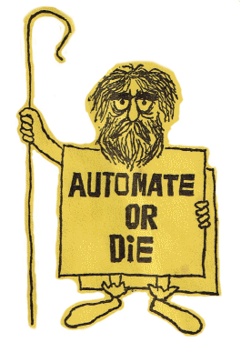

---

<!-- Slide 2 -->

# Can you survive?

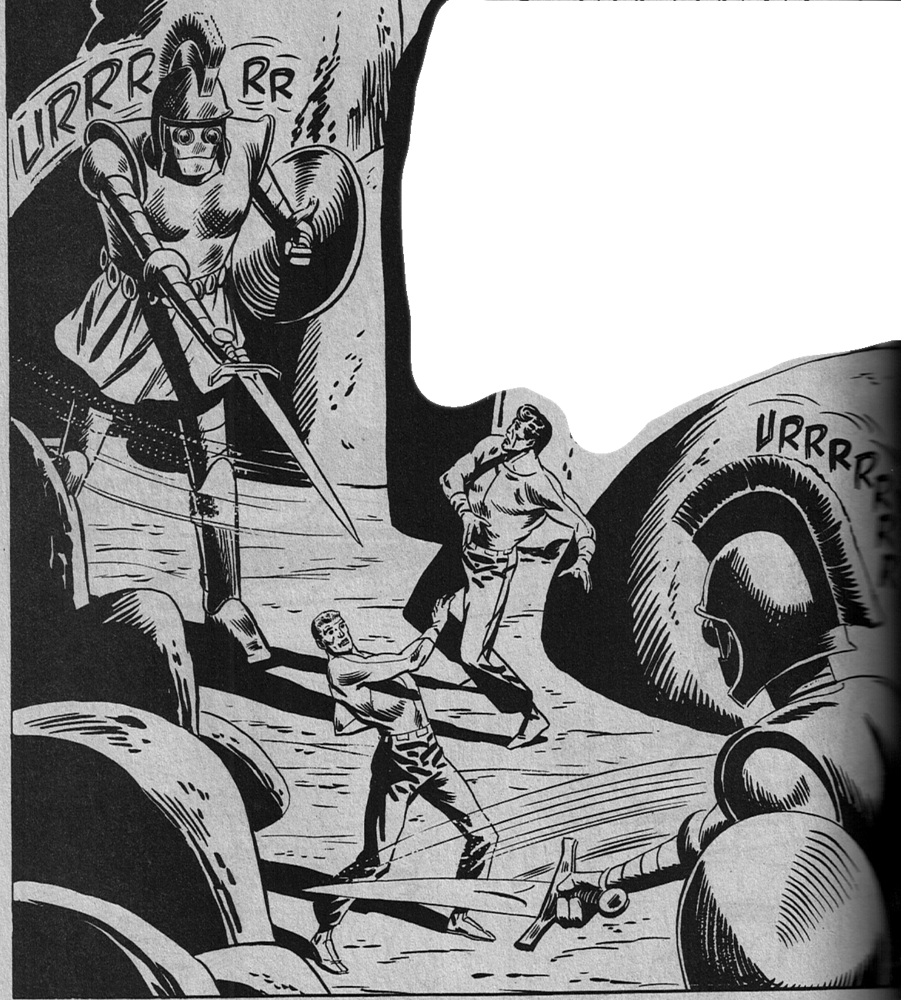

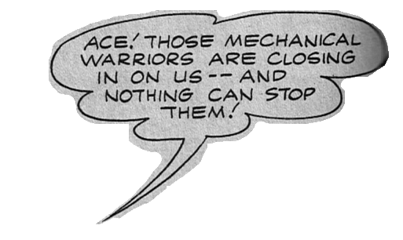

Challengers of the Unknown, DC Comics, #23, 1961

---

<!-- Slide 3 -->

# Automate or Slave!

“Let us remember that the automatic machine ... is the precise economic equivalent of slave labor. Any labor which competes with slave labor must accept the economic conditions of slave labor. It is perfectly clear that this will produce an unemployment situation”

Norbert Weiner

The Human Use of Human Beings,

1950, pg 162

---

<!-- Slide 4 -->

# Don't compete with slave labour

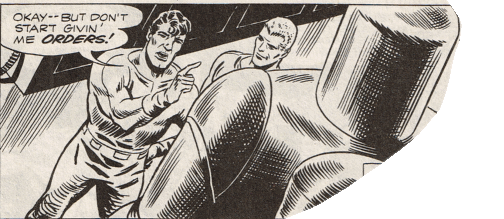

Challengers of the Unknown, DC Comics, #33, 1963

---

<!-- Slide 5 -->

# "...automation makes it possible to do many things that could not be done without it..."

John Diebold,

Beyond Automation,

1964, pg 191

---

<!-- Slide 6 -->

# Automating isn't easy

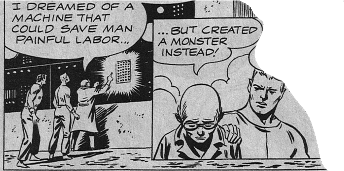

Challengers of the Unknown, DC Comics, #28, 1962

---

<!-- Slide 7 -->

# Automating has always been a challenge

---

<!-- Slide 8 -->

# Challengers of the Unknown - Issue 18

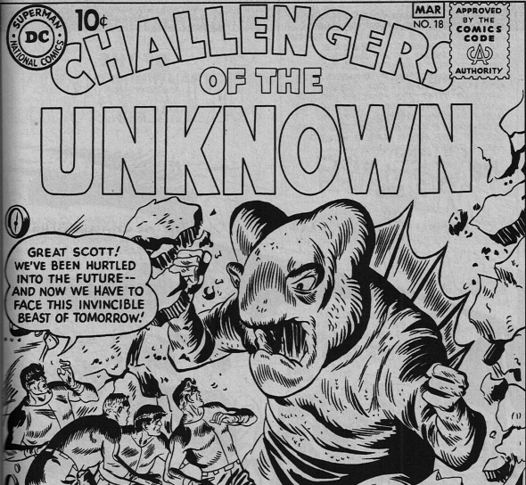

Challengers of the Unknown, DC Comics, #18, 1961

---

<!-- Slide 9 -->

# Automation Is a Complex and Difficult Problem

“Automation has turned out to be a much more complex and difficult problem than was originally thought.”

John Diebold,

Beyond Automation, 1964, pg 51

---

<!-- Slide 10 -->

# “What we need is more automation.”

1948

Ford Motor company VP,

Delmar S. Harder,

Coined “automation” in 1948

---

<!-- Slide 11 -->

# John Diebold - Automation, 1952

John Diebold,

“Automation”, 1952

"...the author found automatization both awkward and - from the standpoint of his weak spelling - hazardous ... it was the ease of spelling that finally overcame the author's reticence to coin a new word"

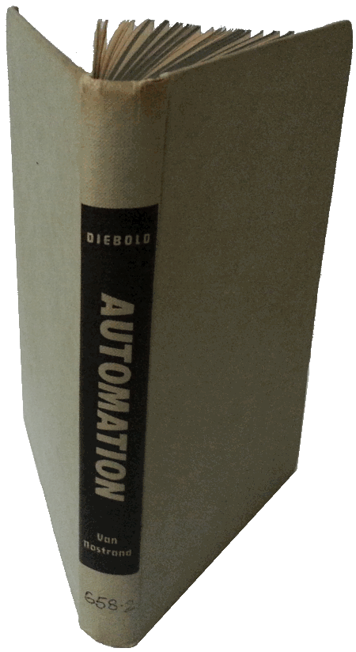

---

<!-- Slide 12 -->

# 1957

1957

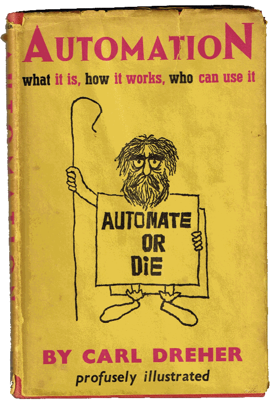

---

<!-- Slide 13 -->

# The word “Automation” is...

“barbarous”

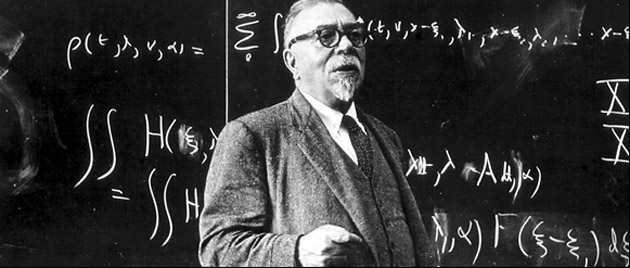

http://www.norbertwiener.umd.edu/NW/NWphotos.html

Norbert Wiener

---

<!-- Slide 14 -->

# Science - May 6th, 1960

“Science”, May 6th, 1960

http://bit.ly/1iwga1m

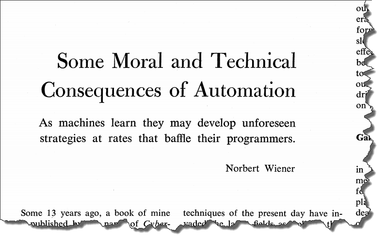

---

<!-- Slide 15 -->

# Science - May 6th, 1960

“Science”, May 6th, 1960


'automatization', 'automata', 'strategy',

'machine', 'automatic', 'automated', 'programming'

http://bit.ly/1iwga1m

---

<!-- Slide 16 -->

# Watch your language

---

<!-- Slide 17 -->

# Automation is not a 'thing'

---

<!-- Slide 18 -->

# 'Automation' is Arguable

'Automation' is vague enough that we can argue about it

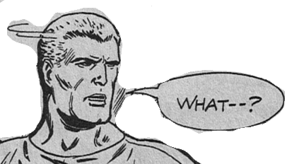


Testers need to program to do automation


Testers can do automation without needing to program

---

<!-- Slide 19 -->

# Abstractions

“... what we see, hear, feel, speak about or infer, is never it, but only our human abstraction about 'it'.”

The Role of Language in the Perceptual Process

Alfred Korzybski

1951

http://bit.ly/1G06gL0

---

<!-- Slide 20 -->

# Control your specific language


Testers need to program to write code that will automate this scenario


Testers can identify the paths through the system that we will automate without needing to program

---

<!-- Slide 21 -->

# Solutions not tools

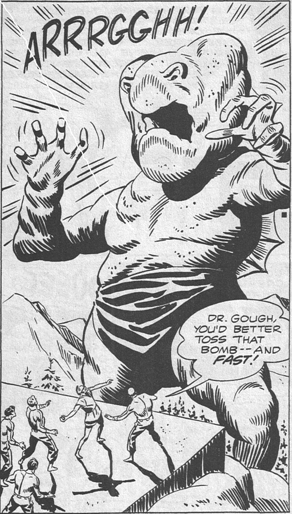

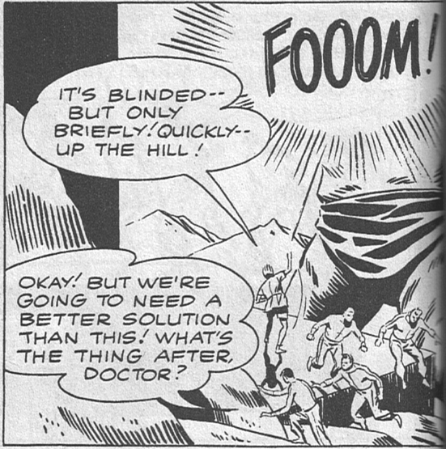

Challengers of the Unknown, DC Comics, #18, 1961

---

<!-- Slide 22 -->

# For 'tools' to be solutions, you have to know what problem they solve

---

<!-- Slide 23 -->

# Challengers of the Unknown - Issue 18


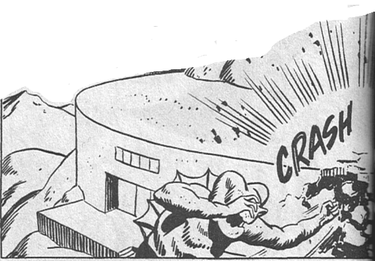

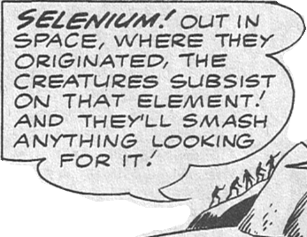

Challengers of the Unknown, DC Comics, #18, 1961

---

<!-- Slide 24 -->

# Automating Applications isn't easy

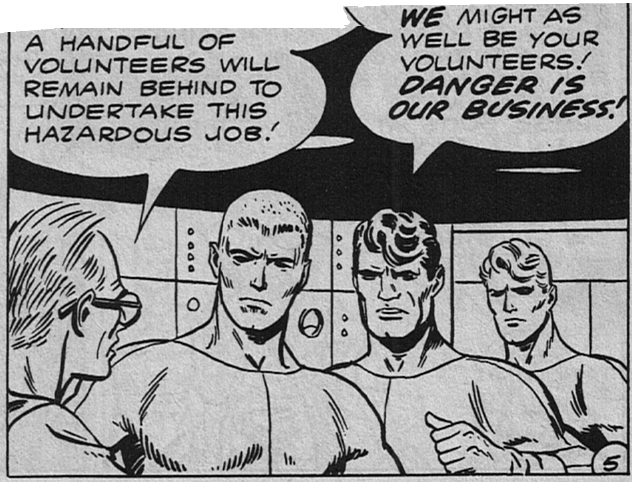

Challengers of the Unknown, DC Comics, #18, 1961

---

<!-- Slide 25 -->

# Automating is often a hunt for workarounds


Challengers of the Unknown, DC Comics, #27, 1962

---

<!-- Slide 26 -->

# How technical do testers need to become?

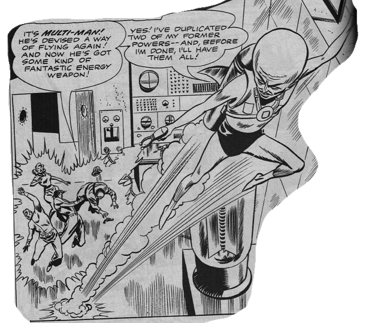

Challengers of the Unknown, DC Comics, #20, 1961

---

<!-- Slide 27 -->

# How can we observe and manipulate the system at deeper levels?

---

<!-- Slide 28 -->

# Team skills are important

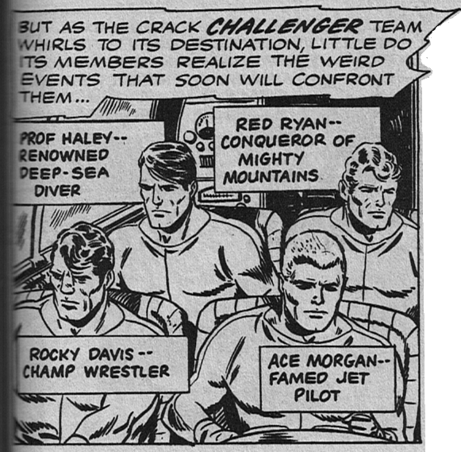

Challengers of the Unknown, DC Comics, #27, 1962

---

<!-- Slide 29 -->

# BDD

- BDD is not about testing
- BDD is not about tools
- BDD Tools are not testing tools

---

<!-- Slide 30 -->

# “Whatever you might say something "is", it is not.”

Alfred Korzybsi,

Science and Sanity, 1958, page 409

---

<!-- Slide 31 -->

# BDD

- ~~BDD is not about testing~~
- ~~BDD is not about tools~~
- ~~BDD Tools are not testing tools~~

“If BDD tools aren't test tools why do we use them as part of our test approach?”

---

<!-- Slide 32 -->

# I use Cucumber...

- … as a tool for creating Domain Specific Languages
- … to easily document and implement data driven scenarios

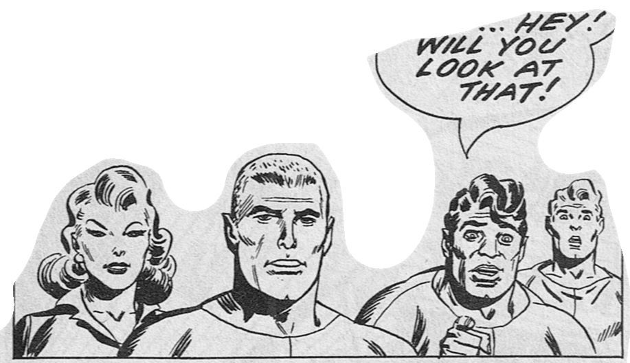

---

<!-- Slide 33 -->

# A 'Test' tool is any tool you use when testing

---

<!-- Slide 34 -->

# The solution to problems when automating is rarely more automating

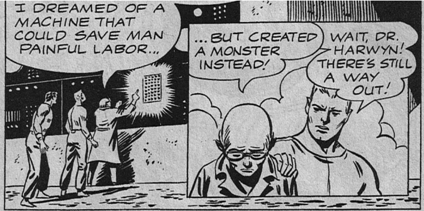

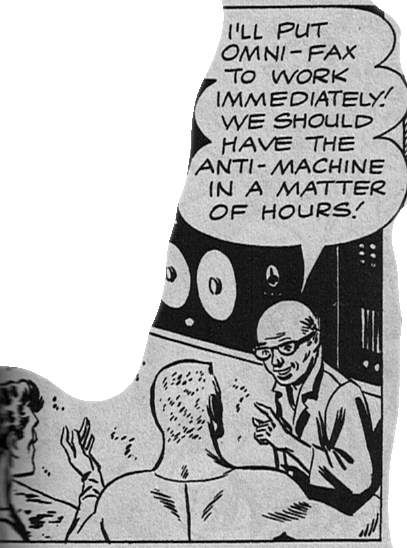

Challengers of the Unknown, DC Comics, #28, 1962

---

<!-- Slide 35 -->

# Abstraction Layers

“We all know that the only mental tool by means of which a very finite piece of reasoning can cover a myriad cases is called “abstraction””

The Humble Programmer

Edsger W. Dijkstra

ACM Turing Lecture 1972

http://bit.ly/1MVghiP

---

<!-- Slide 36 -->

# Code: Creating a Todo Without Abstraction

```java
@Test
public void canCreateAToDoWithNoAbstraction(){
    driver.get(
        "http://todomvc.com/architecture-examples/backbone/");

    int originalNumberOfTodos = driver.findElements(
        By.cssSelector(
        "ul#todo-list li"
        )).size();

    WebElement createTodo = driver.findElement(
        By.id("new-todo"));
    createTodo.click();
    createTodo.sendKeys("new task");
    createTodo.sendKeys(Keys.ENTER);

    assertThat(driver.findElement(
        By.id("filters")).isDisplayed(), is(true));

    int newToDos = driver.findElements(
        By.cssSelector(
        "ul#todo-list li")).size();

    assertThat(newToDos,
        greaterThan(originalNumberOfTodos));
}
```

---

<!-- Slide 37 -->

# Abstraction Layers

“... the purpose of abstracting is not to be vague, but to create a new semantic level in which one can be absolutely precise.”

The Humble Programmer

Edsger W. Dijkstra

ACM Turing Lecture 1972

http://bit.ly/1MVghiP

---

<!-- Slide 38 -->

# Code: Creating a Todo With Abstraction

```java
@Test
public void canCreateAToDoWithAbstraction(){
    TodoMVCUser user =
        new TodoMVCUser(driver,
        new TodoMVCSite());

    user.opensApplication().and().
        createNewToDo("new task");

    ApplicationPageFunctional page =
    new ApplicationPageFunctional(driver,
        new TodoMVCSite());
    assertThat(
        page.getCountOfTodoDoItems(), is(1));
    assertThat(
        Page.isFooterVisible(), is(true));
}
```

---

<!-- Slide 39 -->

# Refactor to Abstraction Layers

- Physical
- Logical
- Domain
- Data
- Event
- Actor

---

<!-- Slide 40 -->

# And how do you find time to test when you are automating so much?

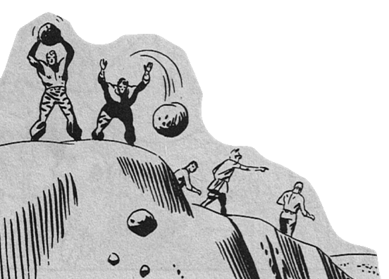

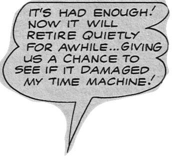

Challengers of the Unknown, DC Comics, #18, 1961

---

<!-- Slide 41 -->

# Survival is a way of thinking...

“Automation requires us to view the production processes as an integrated system... Automation is a way of thinking, a way of 'looking at...' as much as it is a way of doing... It is an attitude... rather than a particular technology”

John Diebold,

Applied Automation. A Practical Approach,

p. 3 1955

---

<!-- Slide 42 -->

# Survival is a way of thinking...

“Automation requires us to view the production processes as an integrated system... Automation is a way of thinking, a way of 'looking at...' as much as it is a way of doing... It is an attitude... rather than a particular technology”

John Diebold,

Applied Automation. A Practical Approach,

p. 3 1955

Systems

Abstraction

Requisite Variety

---

<!-- Slide 43 -->

# Survive

“Automation requires us to view the production processes as an integrated system... Automation is a way of thinking, a way of 'looking at...' as much as it is a way of doing... It is an attitude... rather than a particular technology”

John Diebold,

Applied Automation. A Practical Approach,

p. 3 1955

Requisite Variety

Systems

Abstractions


