# Slide 1: Intro

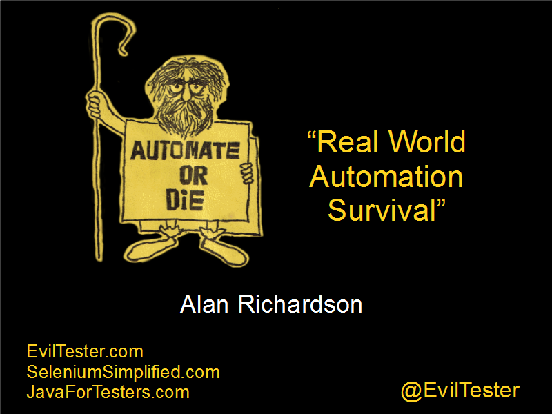\

Hi, my name is Alan Richardson, I test stuff, and work with people to help them test better. I have some web sites. And you can find me on twitter as @EvilTester.

Automate or Die! 

This seems to be a real problem for some people.

Although this particular phrase was from the 1950s because Automation concerns are not new. We experience modern instantiations of classes of issues. But there is no reference in this presentation after 1972. The problems, and the high level solutions I want to describe, are not really new.

People have been having problems with Automation since the word was coined.

And on social media I see a bunch of modern instantiated concerns around automation.

* Should testers code
* Should testers not code
* There is no such thing as test automation
* No need for testing because we're automating

Because people feel pressure to automate, or they'll die! or they won't have a job, or their role is changing, or Whatever they imagine is happening.

So I thought I should tackle it first.

# Slide 2 - Can you Survive?

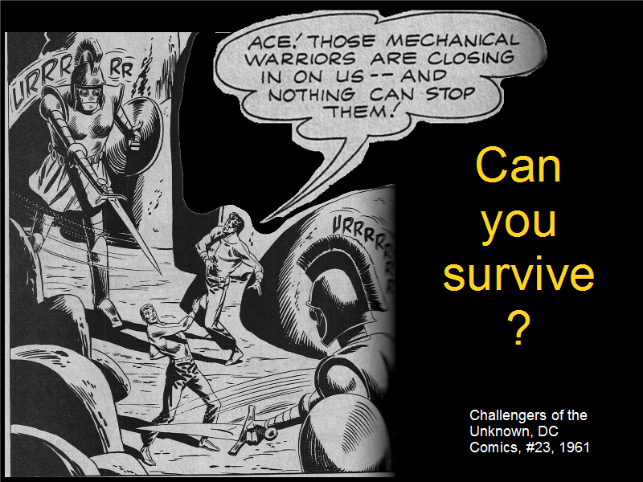\

So this is what I imagine happening. People imagine they are in canyons, flanked by giant robots in fear of their lives. "Giant robot, don't kill me, I don't want to automate. I'm a human. I have valuable skills. Aaargh."

But the System of Developments that we use are changing. We are trying to develop faster, and avoid long periods of checking what we've done, so we can release to market faster.

We still need to test. 

So what I see happening is people seeing the world changing, and them not believing that their skills will fit into that world. 

Survival requires you to have the requisite variety to adapt to the new circumstances. Having multiple responses to the situations and inputs that we receive. And one way to increase our variety is to learn more, increase our skill sets, and update our models of how we perceive and interact with the world.

# Slide 3: Automate or Slave!

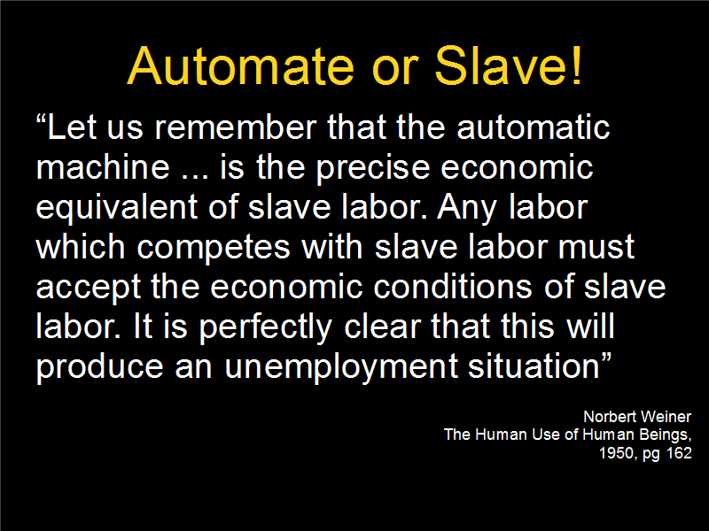\

In 1950, Norbert Wiener wrote a book called "The Human Use of Human Beings" and is often viewed as the father of automation, even though he would not have thought that.

In his book, he starts looking at the consequences of Cybernetics which he helped create in the 40s, spinning off from Operations Research.

And he wrote "Let us remember that the automatic machine... is the precise economic equivalent of slave labor. Any labor which competes with slave labor must accept the economic conditions of slave labor. It is perfectly clear that this will produce an unemployment situation"

And in this quote he's basically saying that automatic machines are essentially slave labour, they do what they are told, we tell them what to do, we can make them do what we want regardless of what they want, they are not allowed to think and vary beyond the confines that we dictate to them. 

And if we compete with that. If what we do, meets that description, then we are essentially slave labour and can be directly swapped for an automaton doing the same work.

So if people think they can not survive then they must be viewing what they do as equivalent to something an automaton can do.

Hopefully that isn't true. Certainly when working with software that should not be true.

# Slide 4: Don't compete with slave labour

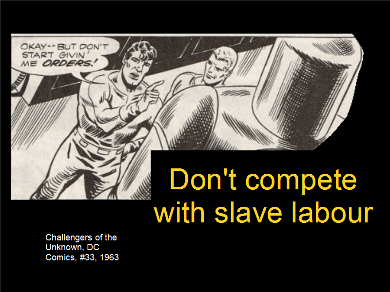\

And one way to survive is to not compete. We don't do the same things as slave labour.

If the work that people do can automated to the same standard and quality and scope and cost (or cheaper) then frankly I would rather see those people be made unemployed so they can go do something that is richer in variety and will engage them more.

Skilled people do not compete with automated slave labour. We may need to expand our skills because some of the processes that we have previously classed as skills might have tooling or automata associated with them, but there will continue to be variety that those tools cannot handle, and a skilled crafter will have the skills to use the tools better.

We do things differently. Humans can handle more variety than automata.

# Slide 5: Automation makes it possible to do many things that could not be done without it

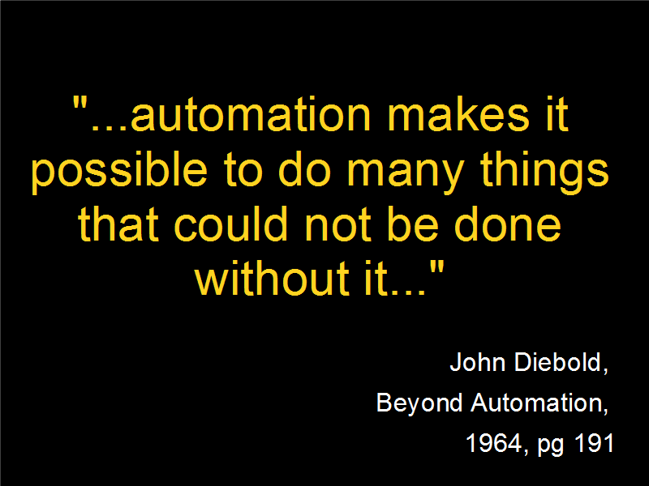\

In John Diebold's 1964 book "Beyond Automation" he says that "automation makes it possible to do many things that could not be done without it."

The reason we automate is to do things we couldn't do without it.

And those people with more skills will see ways of automating that those without the skills can not.

When we automate processes we can have an automated tool or program execute exhaustive combinations, where humans would run a much smaller subset.

We were testing an application that responsively dealt with devices based on the headers they sent from the browsers.

To test that manually we used a small subset, and tried to review the rules against various lists on websites.

But we also automated it.

A single scenario, with exhaustive data.

We used a program to automatically hit URLs with headers taken from public lists from every mobile phone or tablet in existence to make sure that our routing rules are correct and we identify the device correctly or adequately. Which identifies issues that our subset reviewing had let slip through.

Wed did something by automating that we could not do without it. And when the automated process was running, we humans could explore something of greater variety, and review the output of the tool for more variety than we had coded the software to observe.

We only really have a problem with a greater emphasis on automating if you lack the models of the system that allow you to see the opportunities that opens, or if your model of what you perceive the automated processes doing matches your mental model of what you do. 

# Slide 6: Automating isn't easy

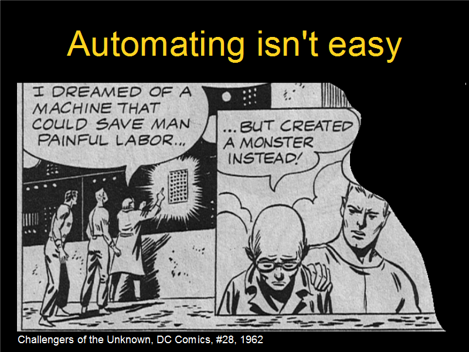\

And remember that automating isn't easy.

This is good for us. Automating requires a high skill set.

We dream of machines that can save man painful labour. We try to create automated scenarios that will cut down on our regression testing efforts.

But we create monsters instead. We find ourselves continually maintaining them, or reworking them, or fixing environments, something breaks but we didn't code it effectively for feedback reporting so we spend time trying to work out what happens. We build a time blob monster that soaks up all our project time.

A lot of people rebel against automation because what they thought they were going to get from the automated solutions was different from what they actually got.

What they thought they were going to get was "We write this once, and we run it a million times". Look at the return on investment for that 1,000,000 times.

But what they got was "We knock this up once, we run it a couple of times, then we fix it, and we continue to fix it, and change it when the system under test changes."

Automating isn't easy. We have to learn how to do it better. And we'll cover some ways of doing that later.

# Slide 7: Automation has always been a challenge

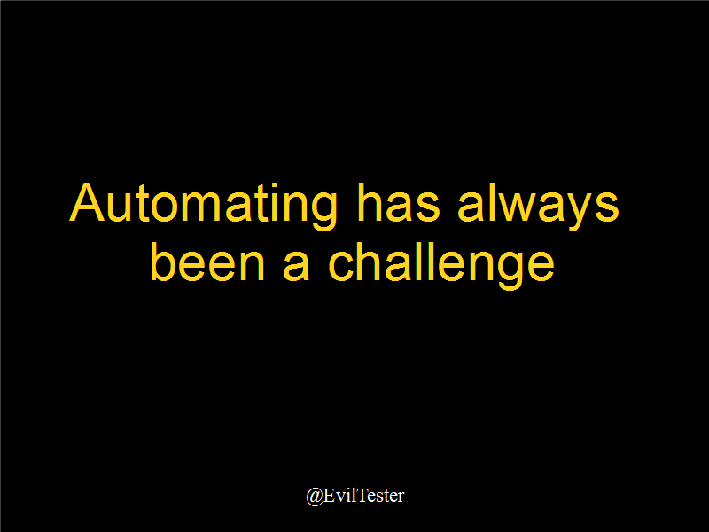\

And this isn't new.

Sure it seems new. We see new techniques like "page objects" or "keyword driven" or "self healing object maps" or whatever other phrase we have for abstraction now. And there are new frameworks on top of existing libraries and new vendors and new tool instantiations all the time.

But automating has always been a challenge.

# Slide 8: Challengers of the Unknown

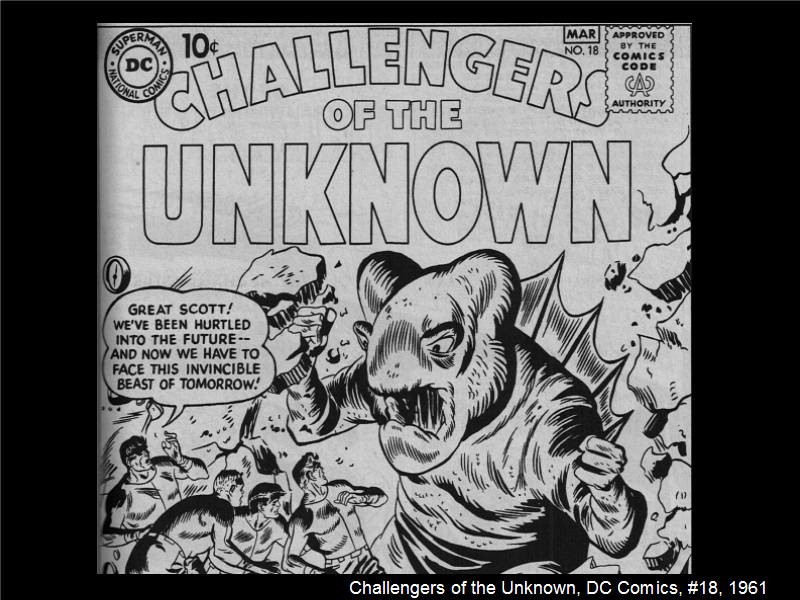\

For each new system that we have to test tomorrow.

We are put in the position of taking general concepts of how to automate, knowing what tools and libraries basically work against the technology, and they trying to apply them to this new beast.

Which might use different JavaScript libraries or different CSS animation techniques and our old approaches for synchronising the application don't work.

We have to face the unknown challenges that the systems will throw our way.

We need the skills to face it. We need the requisite variety to handle the challenges we'll find. And we need the ability to model the system in new ways to identify the new unknown risks that we haven't tackled before.

We become Challengers of the Unknown.

# Slide 9: Automaton is more complex than we thought

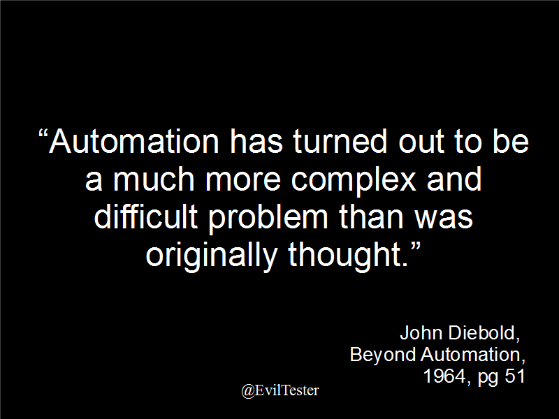\

“Automation has turned out to be a much more complex and difficult problem than was originally thought." So wrote John Diebold in 1964.

You'll see references to John Diebold throughout this. I don't think people read Diebold much any more, but he was massive in the 50s exploring automation in factories and the workplace and the impact that computers would have on people's daily lives, because they feared for their jobs and their skills becoming irrelevant, and the more computers we get the fewer people we'll have.

They were worried that all those desks filled with people typing copies of reports and letters would go away and they'd be replaced by a single computer and we wouldn't need people any more, because computers and software don't need people. 

That's been our experience.

So in the 50's it was look at the possibilities. And in '64 it was 'gosh this is harder than we thought".

So we've learned from that, and we now make everything easier to automate. All the systems we build have hooks to support our automating. Mobile phones and tablets have easy to use tools to let us automate and control them. Every browser has support for standard automating protocols.

Oh, so we didn't learn from that. It is still a complex and difficult problem. And we continue to build systems that make it a more complex and difficult problem.

Automation has always been a complicated problem.

# Slide 10: 1948 Delmar S. Harder

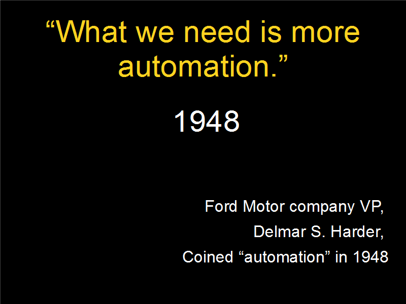\

"Automation" is a fairly new word. The word didn't really exist until the 50s.

Supposedly in 1948, Delmar S. Harder was walking around his Ford production plant thing "Harder, Harder, Harder, We need to work harder" and what he said was "What we need is more automation".

The processes were too slow, they were not consistent in their quality between releases, perhaps if they automated the production process they could release more often and not inject problems during production between each release.

"What we need is more automation." To allow his company to compete and survive in the world of car manufacturing they needed to "Automate or Die" as a company.

# Slide 11: 1952 John Diebold

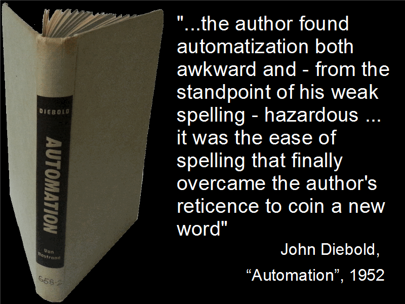\

Prior to the 50s, people used words like automatization to describe the process of making something more automated, and they used words like automata to describe things that moved automatically, and words like machine to describe products that used stored strategies to automate the construction of other things.

In 1952 John Diebold found 'automatization' too hard to spell, when he was writing his book. So he called it automation - just like Delmar S. Harder. And the word 'Automation' made its way into the public consciousness, because although few people today may have read this book, it was a bestseller in its day.

And because we hadn't invented spell checkers, and had not automated the process of checking the spelling of the written word. We now have the word "Automation" and we use it as a verb, and a noun, so we don't really know what it means.

# Slide 12: 1957 Automation

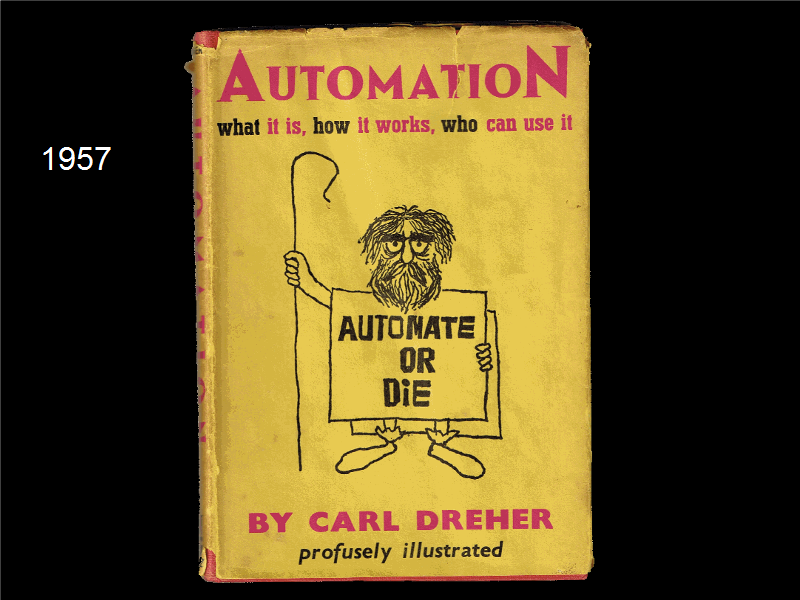\

And there were lots of books around this time looking at the impact of this general concept trying to tap into the popular Zeitgeist.

And with such a high level abstraction people started to wonder, what does this mean to me, how will this work, what are the economic consequence of automation, and to fear automation as a concept because it will put people out of business. Even though we have always automated things. Automation became a concept to fear, and a marketing concept that could mean almost anything.

But throughout all of this was the optimism that there would still be a need for skilled craftsmen, although the way that they worked, might change.

# Slide 13: The word "Automation" is Barbarous

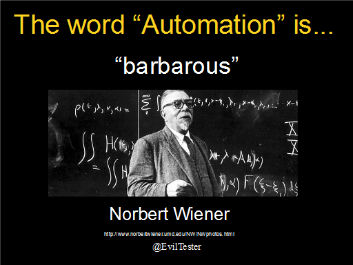\

Norbert Wiener, often called the father of automation, which I'm sure would not have please him, was quoted in Carl Dreher's book as thinking the word "Automation" barbarous.

He did not like the word "Automation".

He had a lot to say on the impact of increased automatization because of his work on cybernetics. But I think he disliked the word specifically because it was such a high level abstraction and didn't really mean anything.

And I could only find one use of the word in his work that I scanned.

# Slide 14: Some moral and Technical consequences of automation

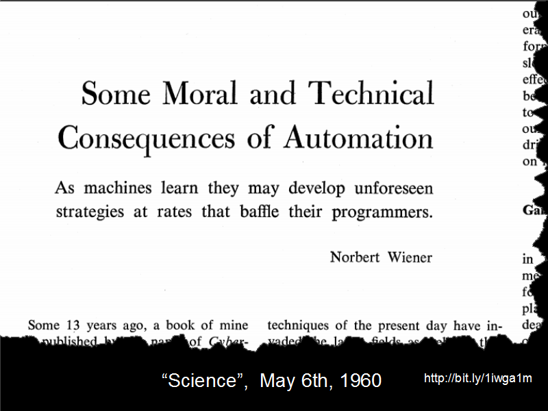\

In 1960, Wiener wrote a paper for "Science" Journal entitled "Some moral and Technical consequences of automation".

He describes some of the consequences of systems that display strategies that baffle their programmers. 

Does that happen today? Surely we've learned enough by now that ...

So you can see that Wiener uses the word "Automation" in the title.

But it was only in the title. Not in the body of the paper.

Maybe he did this for marketing, or the editor the journal made him use the word, or he he was trying to claim back the word so that he could demonstrate that it was a high level abstraction that encompassed a multitude of concepts.

# Slide 15: Some moral and Technical consequences of 'automatization'

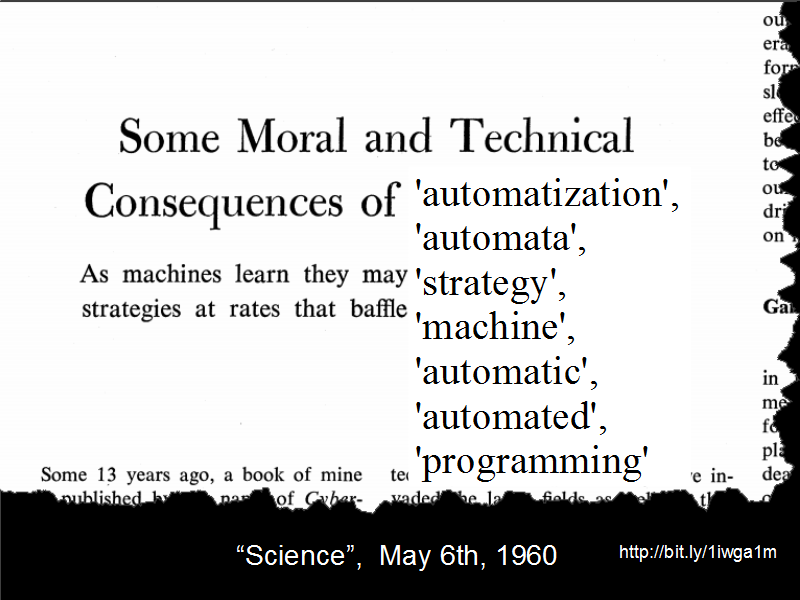\

In the body of the paper he describes the concepts in more detail. Automatization - the process of making something more automated. Automata - a machine that follows a set of coded instructions. Strategy - the coded way of doing something. etc. etc. 

All more specific words, so that he can talk about the process, or the output, or the way we build it.

# Slide 16: Watch your language

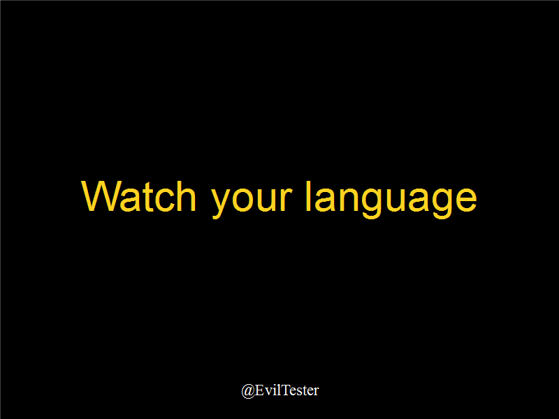\

So one simple lesson, I've taken from this and I want to try to instil in you. Is to "watch your language" when you talk about automating.

If you use the word automation then no-one really knows what you're talking about.

They might think that you are talking about writing a program that automates a specific task. They might think that you are talking about automating all the activities and processes associated with a particular role. Who knows what their thinking.

Be clear as possible with your language. This is a general concept. I'm still trying to do that. I work hard in doing that.

# Slide 17: Automation is not a 'thing'

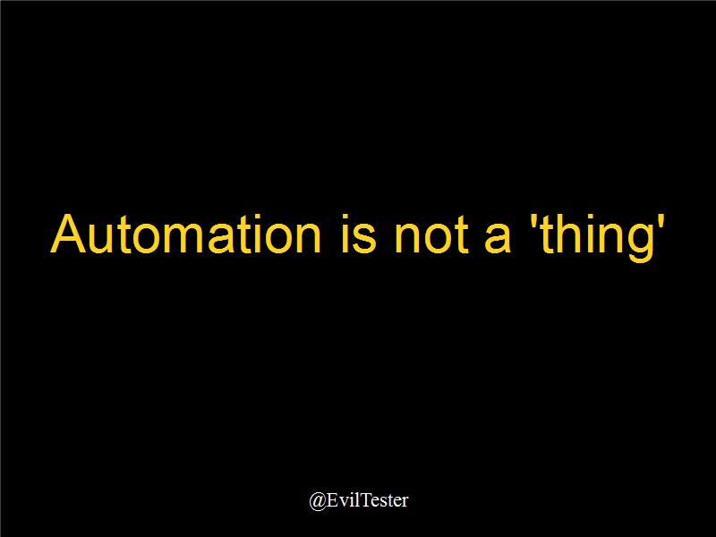\

People say they 'need more automation' that's a thing. Its no wonder people are asked for return on investment justifications for 'automation'. I'd ask for that too because it demonstrates a lack of clarity of thought and an open ended concept that could become a money pit.

Automation is not a thing. We automate the execution of scenarios over a subset of data, we might automate the generation of the data, we might automate the deployment of the system to an environment.

# Slide 18: Automation is Arguable

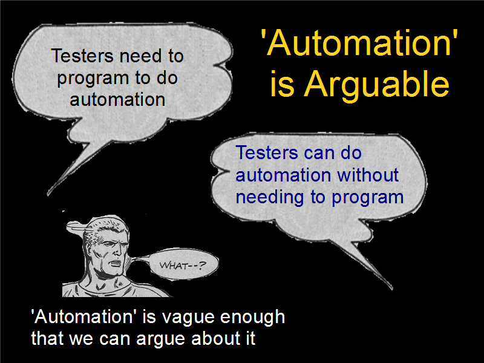\

People argue at this level of abstraction all the time.

"Testers need to program to be involved in automation."

"Testers can be involved in automation without needing to program."

People are arguing about something that doesn't even exist. There arguing about 'automation' an abstraction, a model, in their head, and is different in the other persons head.

# Slide 19: Abstractions

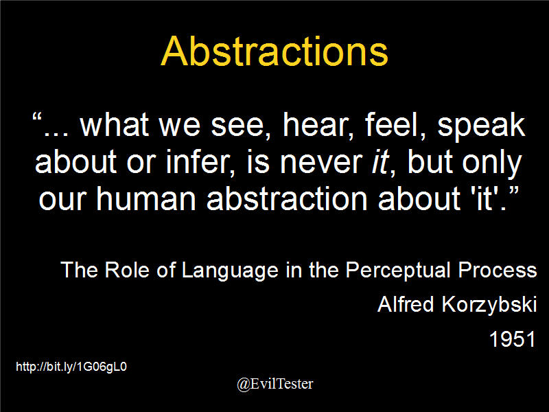\

This is Alfred Korzybski in 1951.

"What we see, hear, feel, speak about or infer, is never it, but only our human abstraction about 'it'"

We engage with the world in terms of our models about the world, and communicate in terms of our models.

And 'automation' is too vague a model to argue about.

Norbert Wiener found the word barbarous.

# Slide 20: Control your specific language

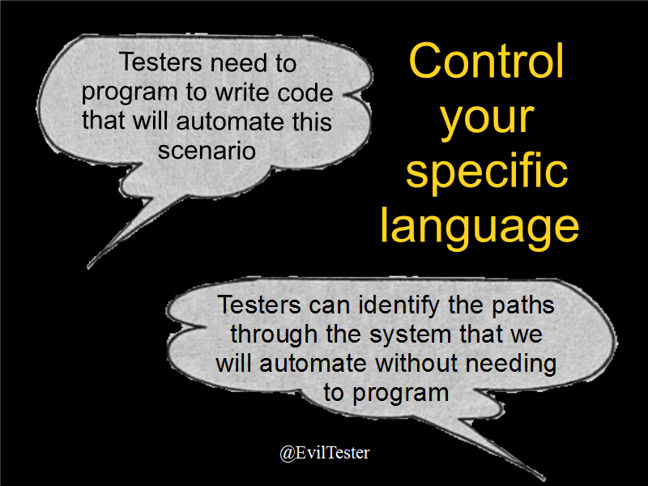\

"Automatization" is an abstraction, but is more detailed, and describes a process.

And we can control our language to increase its specificity.

"Testers need to program to write code that will automate this scenario"

"Testers can identify the paths through the system that we will automate without needing to program"

It is much harder to argue with these statements, or take offence at them since they don't really disturb your model of the world.

These are the skills we use to make automated approaches effective and efficient. So if we need these skills to automate, we can use these skills to communicate how we automate.

Sometimes one of the few things we can control on projects is the language we use to describe what we do. We may not decide what tools we use, or how much time we get, or what order we do things. 

But we can control how we describe things. You have control over the words you use, and what you think those words mean.

I never let anyone call me, or my team "QA" that is an abstraction that goes far beyond the boundaries of what we do. So I always use the word 'test' and I correct people so they hear the word 'test', because I 'test' I don't "QA". I control the language that describes what I do and how I do it.

These words are abstractions and we can control them.

And we need to communicate clearly because we are using automation as a solution.

# Slide 21: Solutions not tools

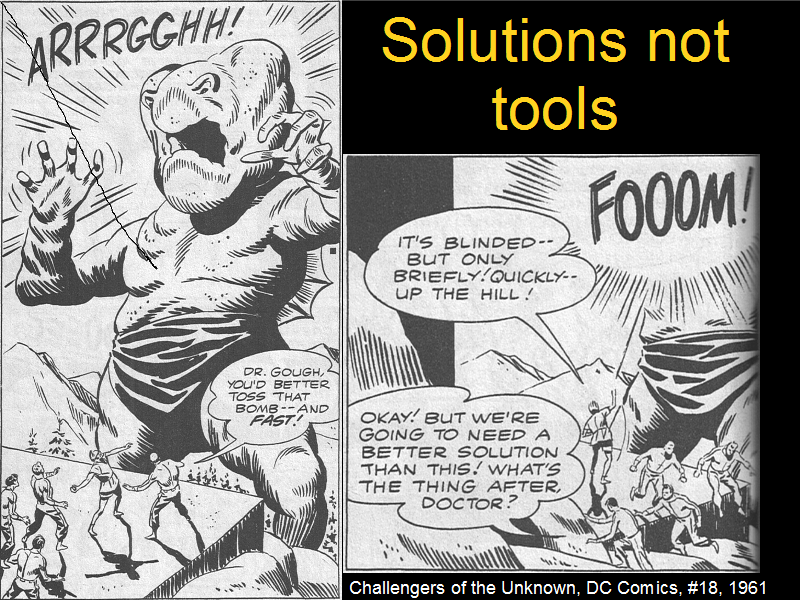\

By automating we can do things we were not able to do before.

We can solve problems in different ways, or alternative ways if our previous solution wasn't complete enough.

We have had 'test' solutions to a System of Development that wanted to go fast - we use exploratory testing. Which we might model as a sampling based approach for faster testing.

When we automated we can change our solution. We can do more things.

And that's what we have to keep in mind.

# Slide 22: For tools to be solutions we have to know the problem.

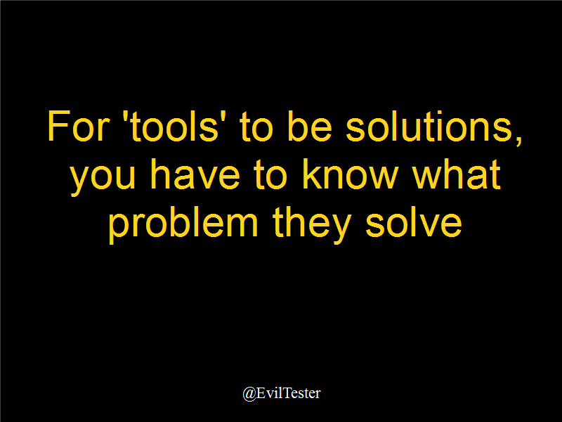\

We are not just bringing in tools. We are not just bringing in Cucumber, or bringing in WebDriver.

We are solving problems. And the tools offer us solutions.

Very often people get hung up on Return on investment. We're not doing return on investment. We're solving problems that we need to solve if we are to proceed and make a return on the investment in this project.

We're trying to solve the problem of making sure that the system still functions even after we've made changes.

We're trying to solve the problem of we can't view the http traffic between the application and the server so we don't know if the messages are really correct or have introduced risk.

# Slide 23: Selenium

\

In the Challengers of the Unknown, their solution to being attacked by the giant monster you saw earlier, was Selenium. These are not new things!

That wasn't always their solution, they had a multitude of approaches. But in this specific instance, Selenium offered them the best solution to their problem.

The problem that Selenium solves is browser automation. How can we automated the different browsers that we need to automate. How can we use whatever programming language we want to automate the browsers and not be sucked into a vendor specific language?

People think of Selenium WebDriver as a 'web automation tool'.

WebDriver provides an abstraction around browser manipulation and interrogation.

Selenium also provides a grid which solves the problem of having multiple browsers installed on a single machine and executing multiple scenarios at the same time, and specifying exactly which machine you need to execute your scenarios on. The grid solves that for you.

And then people have built cloud grids which solves the problem of you maintaining your own grid and installing lots of browsers and maintaining that environment.

Selenium solves problems. And if the problems that Selenium solves are the same problems you face. Then it might be a good fit for you.

When we know what problems we have, we can find tools that offer solutions to them.

Again its a mindset thing, we're trying to find out what problems we have to locate tools and libraries that offers a solution because then we have choices and a variety of responses we could have.

And if we're really paranoid, and aren't sure that this tools is going to work long term, we might build an abstraction layer at the problem domain which delegates to one tool, but if we want to replace the tool we can do, and build a new abstraction layer which has an interface that matches our problem domain.

# Slide 24: Automating Applications isn't easy

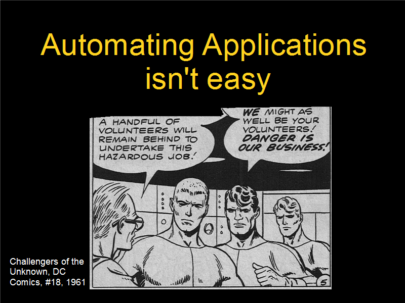\

And this is one of the reasons why automating applications isn't easy.

Its very easy to automate applications very simply.

We have capture playback tools which can run through an application scenario. But might fail when they replay it back because they haven't synchronised on the correct events, or they encounter a longer response time than was captured in the recording.

When we automate, we have to think about what we are doing in depth. We have to think about the synchronisation points that we need, and make sure we synchronise effectively to make the future execution as trouble free as possible.

We have to think about ways of locating controls such that they are robust in the face of future changes.

We have to think about ways of making the application easier to automate.

Automating applications is not an easy thing to do.

But we can learn and develop skills to get better at it.

# Slide 25: Automation is a hunt for workarounds

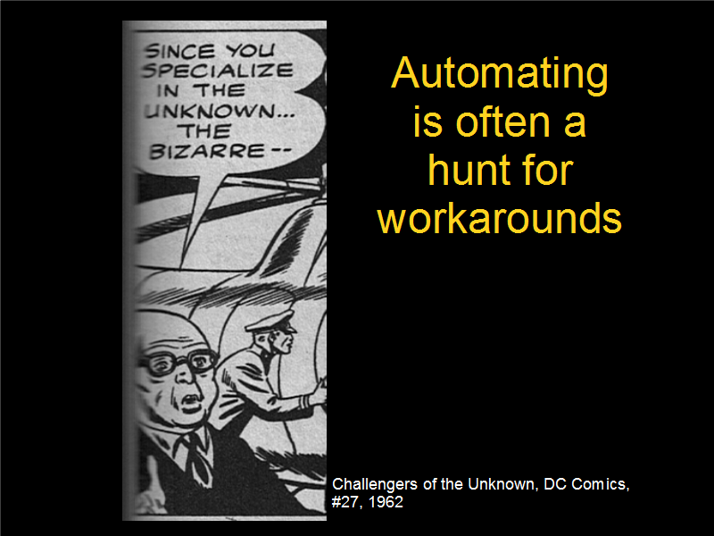\

Very often I find that automation is a hunt for workarounds.

As we gain experience with automation we have a more varied set of of responses to the problems we face.

We don't just down tools when the tool doesn't quite do what we want, or dump the tool and buy a new one because there is bug in this one.

We learn how to create workarounds.

You learn how to bypass the system.

You learn that some parts of the application aren't worth spending a lot of time trying to automate if they don't work with your tool out of the box.

Some parts of your application are external libraries that you don't want to test.

Some parts of your application aren't even part of your application. They are supplied by the browser that you are using. The HTML5 date or file or email fields. The browser offers validation and input approaches that you probably shouldn't try and automate because you want to go cross browser.

But people try to automate the file dialog. "How do I automate the file dialog in WebDriver" and you don't. The workaround is knowing what we are trying to test. If you want to test the server side processing of a file upload then you don't need to use the browser to do that. You just send the message direct to the server with the payload. That introduces the risk that the browser might do something to the file during upload, but you have a workaround and one that targets the actual part of the system you are trying to test.

Sometimes tools have bugs. Or the browsers have bugs.

WebDriver has the ability to execute arbitrary JavaScript and that's a great starting point for workarounds - particularly browser bugs or enhanced synchronisation.

A lessons I've taken is that I want myself to exhibit requisite variety to survive, but I need my tools to have requisite variety and allow me flexibility in how I use it. So I prefer tools which have a scripting ability, than those that don't - even if I don't necessarily use it immediately.

I use freemind and freeplane as my desktop mind map tools because they support simple scripting. There are other mind map tools, but they don't support scripting.

I look for tools that have an API, so that I can augment them if I have to.

I look for tools with an open file format so I can generate or process the files.

I don't want my tool introducing restrictions, I want them to contribute to my requisite variety, because I know I'm likely to need to use workarounds in the future.

# Slide 26: How technical do testers need to become?

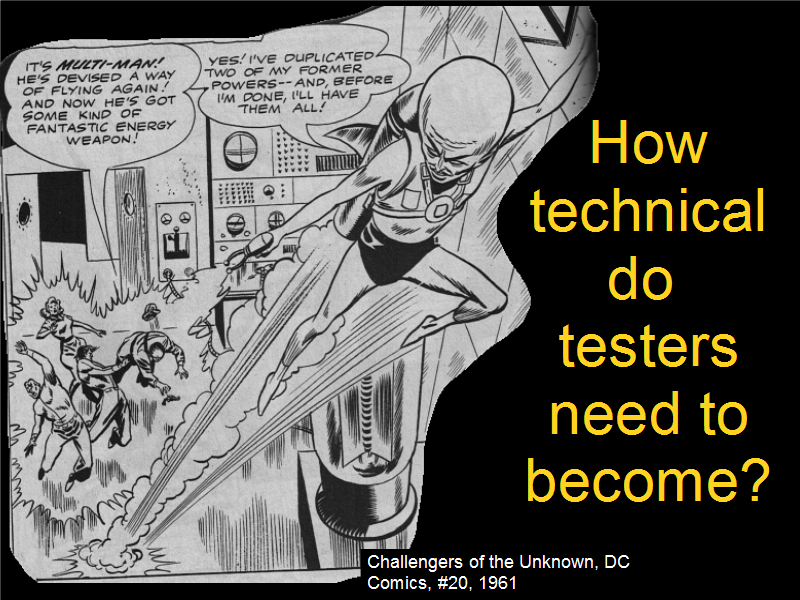\

I've already learned all the techniques for testing, that's technical, how much more do I need to learn! Aaargh.

How technical do testers need to become?

Do we need to become like the evil super villain multi-man and create new inventions and programs and tools to have more powers when testing?

How technical do testers need to become?

Testers need to become as technical as the problems they are trying to solve. And to observe and manipulate the system as deeply as they can.

If we want to expand the variety of responses that we have when testing then becoming more technical increases the variety of responses that we have access to. 

Personally I will become as technical as I can afford the time to investigate and practise. I will put no limit on it, because I'm interested in the technology. I know that the more I learn the more options I have and my options and test approaches increase.

# Slide 27: How can we observe and manipulate...?

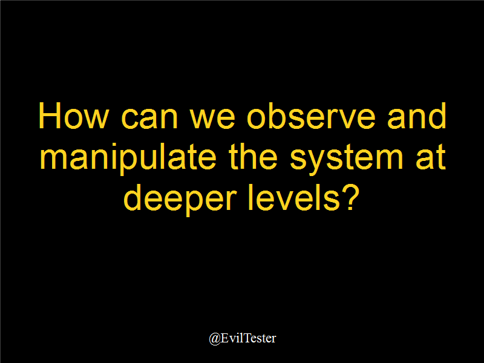\

I like to understand the technology so I know what I'm not observing, and then I can find tools which help me observe and manipulate the system at more technical levels - to amend the messages, view the database, see whatever I can see.

Automation is such a large abstraction that, for me the word also includes using tools to observe and manipulate the application. Tools to decompile the application if we don't have access to the source so I can understand it.

There are parts of the system that I cannot see manually. If I'm testing a web site then my GUI is the browser. Without using the dev tools, I can't observe the messages being sent back to the system. I can't observe the javascript that's been loaded. I can't observe if the local caching has worked and we only make one request for a file rather than several. I need to augment my ability to observe this through tooling. I need tools to see the DOM. To see what CSS has been applied.

So we use the dev tools to help us. Or we use proxy servers to observe and manipulate and replay the messages so we can bypass the GUI and test the server directly.

So even when I'm manually interacting with an application, without trying to 'automate' a scenario. I need to be technical enough to identify what I'm not observing and what levels I'm not testing. And solve that problem by introducing a tool to help me.

So I think testers need to become much much more technical to observe and manipulate the system at lower levels of abstraction. Seeing what the GUI is doing. Avoiding the GUI validation. Avoiding the GUI. Checking results in the database because the GUI might be lying to me when it renders those results. etc.

In reality though. In order to survive. Testers just need to be as technical as the team needs them to be.

Survival is an environmental concept. So to survive you need just enough to handle the variety in your environment. That might not be enough to let you survive in other environments. You might be technical enough for your current job, but you might be stuck in it a while if your technical skills don't let you survive in environments you would rather move to.

# Slide 28: Team skills are important

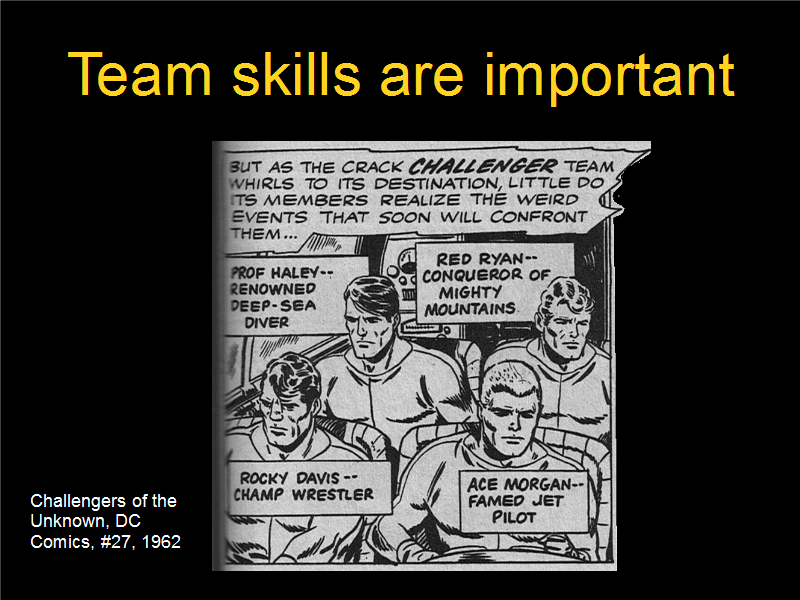\

We are always working with system. The system of development - the approach we use to build software is a system. That is a system that we can model, understand and look for risks. In the same way we do for the system under development, the system under test - the thing we are building. 

And the system of people building the product. The team. How it hangs together. What the relationships are. What the skill sets are and how they support each other.
We need the requisite variety of skills and approaches to respond effectively with what's going on in the team, to survive in the team.

If there is only one person on the team with testing skills then the team may not have the requisite variety to survive if that person is ill, or in meetings all the time, or writing code to automate scenarios because no one else is testing.

As soon as we extend our understanding from the tester, to the team, the question of 'how technical do testers need to become?' changes.

That's one reason why a general recommendation is for everyone in the team to be involved in automating the required scenario and condition coverage. And to pair more to increase the knowledge and skillsets of everyone on the team.

So analyse your team makeup. Look at the processes your team are engaged in. Look for gaps. Assess the risk of those gaps. And you might find that you need to extend your skill sets to fill those gaps.

Or recruit more people. And make sure that if you bring people in, that they can share their knowledge across the whole team.

# Slide 29: BDD

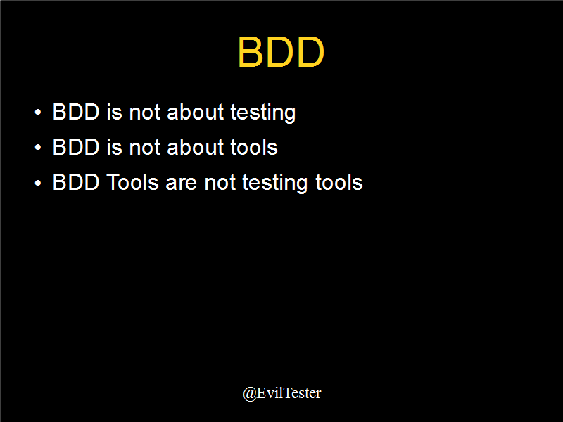\

One of the concepts that tries to bring the whole team together to work on automating the checking of the execution scenarios, that has broken through into the mainstream from the "Automate or Die" environments is the concept of BDD.

Behaviour Driven Development.

Or Specification by Example.

Or Acceptance Test Driven Development.

Or any other set of high level abstractions to describe the concept. But I think BDD is probably how the majority of people I meet, describe it.

And since this is a high level abstraction, people don't understand it the same way. So we then hear things like:

"BDD is not about testing", "BDD is not about tools", "BDD Tools are not testing tools" etc. etc.

"BDD is about communication" "BDD is about working together" etc. etc. 

Since its an abstraction, we already know the dangers. We get hung up on our model and understanding of the abstraction rather than communicating at a more specific level.

Silde 30: Whatever you say a thing is, it is not

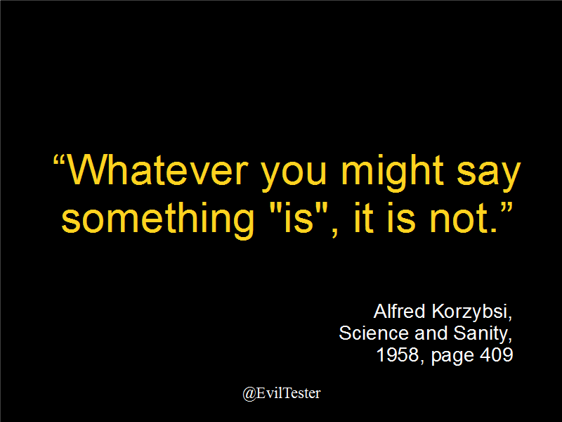\

Alfred Korzybski in Science and Sanity in 1958 said "Whatever you might say something 'is', it is not."

Its a word, its a phrase, its a model, its an abstraction. 

BDD is not the process, BDD is the name of the process, the process that people actually do is the process and it may not match the idealised abstraction so fix that, don't enforce or argue about the name.

We can't get hung up on the words. We have to deal with the results of instantiating that abstraction at runtime, in the physical world.

# Slide 31: BDD tools aren't test tools

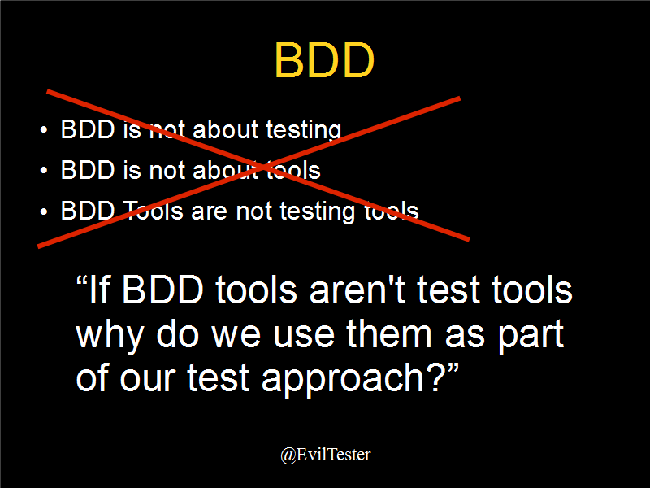\

So if BDD tools aren't test tools, why do we use them as part of our test approach?

Because BDD tools aren't just BDD tools.

BDD is a communication process that sometimes uses GHERKIN.

GHERKIN is the Given, When, Then syntax that we've all grown to love and implement.

Cucumber is a tool that makes it easier to write code that can 'do things' that are specified in Gherkin when its written in a special format in a text file.

# Slide 32: I use Cucumber...

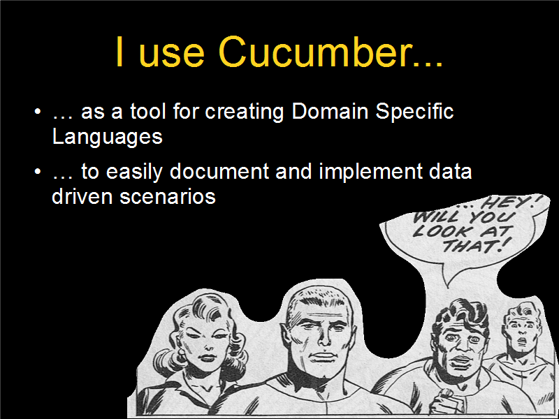\

One of the most popular BDD tools is Cucumber.

For some people Cucumber, Gherkin and BDD are the same thing.

The don't split the concepts apart and its just one big BDD abstraction.

Now it is possible to split the abstraction apart. And it is possible to use Cucumber as a 'tool' in and of itself without merging it into BDD. And if you do, you get a different abstraction and model for Cucumber. And your approach for automating might change.

It is possible to use tools to solve problems that other people don't perceive them as solving.

For me, Cucumber is an easy way of creating Domain Specific Languages that exist in text files. I don't have to write parser or create syntax checks. All I do is annotate some code that does stuff and Cucumber maps my code to the Gherkin file and runs the code in the correct order to make this human readable DSL executable.

On a technical level, that's what Cucumber does. It helps you quickly implement DSLs within a set a rules. And it does it very well.

Its a tool that helps you implement Domain Specific Languages. Is one way to view it.

I can also view it as a tool for helping me write data driven scenarios more easily. Rather than create all the automation that supports my testing using an XUnit framework like JUnit, I can have the scenarios that cover sets of data implemented in Cucumber, because its easier to work with than the JUnit parametrisation features.

We automate, to do things, that are hard to do otherwise. Its fairly easy to create automated code that will execute a single path through the system: login, amend a user, delete a user.

Complexity in testing comes from the range of data that we want to use in that scenario. So we talk about data driven testing.

Cucumber is great for that because I can create a simple table in a text file.

I can also use the same abstraction layers that I've built for my XUnit code. This also helps me make sure that my abstraction layers exhibit the requisite variety such that we can use them in different ways: for XUnit code, for Cucumber scenarios, perhaps for performance testing, for adhoc exploratory test support.

One issue I see teams face. Is that they have one approach - it might be a Cucumber BDD approach. So all their code for automating is built to be used by Cucumber, so if you want to do any automation at all, you have to drive it through Cucumber. So Cucumber becomes a victim of its own success and then teams are lambasted because they're doing BDD wrong and you shouldn't use Cucumber for that.

The underlying problem is not a misuse of BDD. Its that they didn't create abstractions that support them effectively.

# Slide 33: A test tool is any tool...

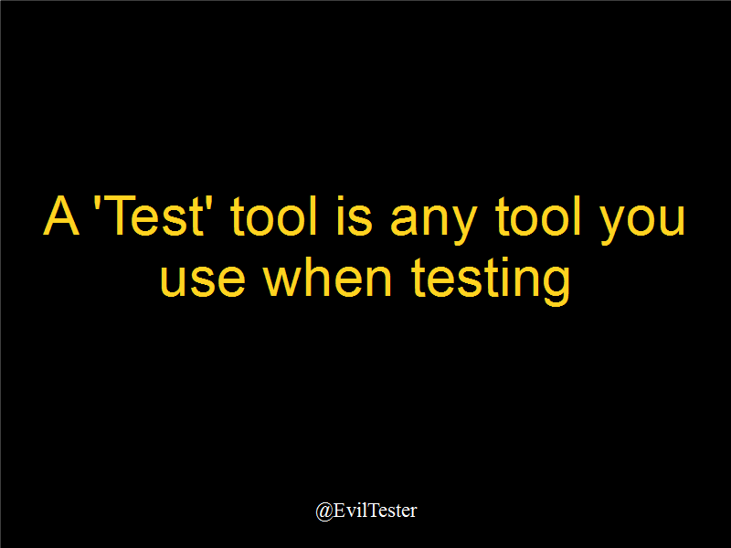\

It doesn't matter if these tools are test tools or not.

I use text editors to keep my notes as I test. That's my test tool for note taking.

I use debug http proxies as test tools to help me observe and manipulate HTTP traffic.

These are not test tools. But I use them to support my testing. That makes them test tools.

This forces you to build models of your approach to automating and testing that cover different angles and you don't have a functional fixedness bias. 

JUnit is used for Unit testing. Cucumber is used for BDD. BurpSuite is used for Hacking.

These tools and libraries help us solve problems. And solving problems is our business.

# Slide 34: The solution to automating problems is rarely more automating

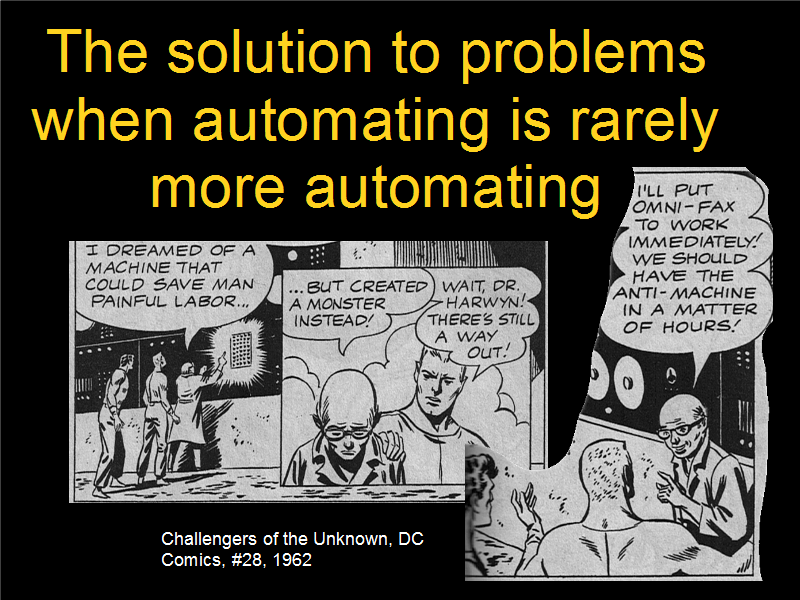\

Back to the Challengers of the Unknown. And our mad scientist has created a machine to automate and solve their problems. But something has gone wrong.

They need to figure a way out.

So what the scientist does is he puts the machine to work to find a solution.

The automation doesn't work, we need more automation to fix it.

This is rarely the fix.

I see this when people write me emails and tell me that WebDriver is too hard to use, so they are going to build a framework to make it easy for everyone to use.

Or people can't figure out how to use a tool, so they stick a framework that someone else has built on top.

There may not be anything wrong with the framework, but the problem is that they didn't learn how the tool works. They didn't learn how to expand their requisite variety to solve the problem. And they may just have limited their requisite variety further.

They don't understand how the tool works, so they can't drop down a level of abstraction when they need to create workarounds. They don't know how the framework works so they've limited their ability to respond.

This is one way that people end up having to throw automation work away. Because when things go wrong later on, they can't fix it themselves.

The other thing people do is replace the tool. "We can't do X", blame the tool. New tool. Later. "We cant' do X". 

If we focus on requisite variety then we will look for other alternatives, workarounds, and one workaround is learning how to use the tool more effectively because it might be us. Learning how to look online at the release notes and see if there is a new version of the tool, or the forums and see if anyone else has the problem. But changing tool is a very costly business and I try to avoid it unless I'm sure.

I tend not to use frameworks. I focus on abstraction layers.

# Slide 35: Abstraction Layers

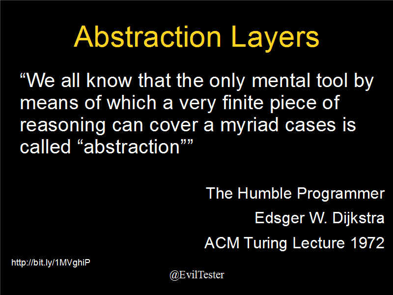\

I've mentioned abstractions a lot. Because I think that abstractions and learning how to model are incredibly important skills that lead to automated code that works, is maintainable and robust.

And its not new.

1972, Dijkstra in his Humble Programmer paper says "The only mental tool by means of which a very finite piece of reasoning can cover a myriad cases is called 'abstraction'". If we want to simplify our understanding of something we model it in an abstraction that makes it easier to understand and work with. To deal with something complex, we generalise, into an abstraction, and have other abstractions to help us understand the differences that make a difference (where the complexity comes in).

The 'difference that makes a difference' is a phrase from Gregory Bateson's work.

# Slide 36: Code without abstraction

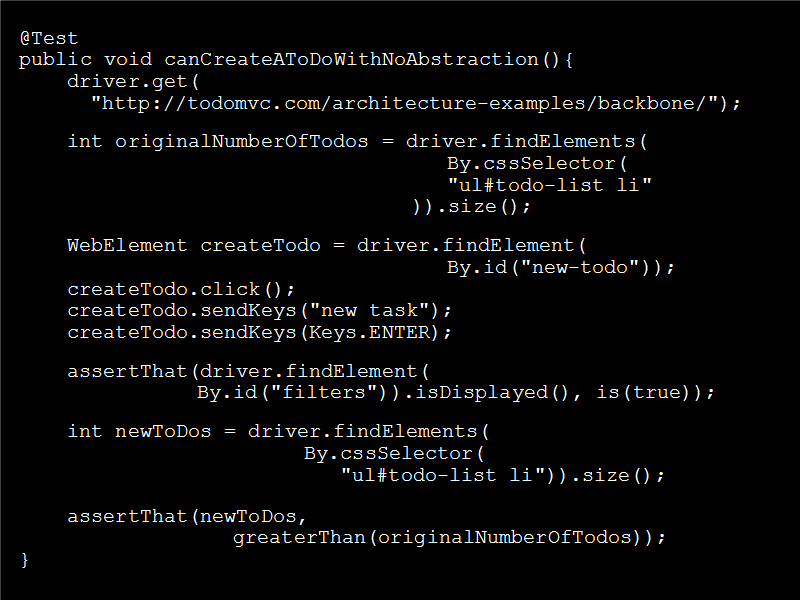\

So here is some code. Its Java code.

And this code has no abstraction. But you can probably read it and make some sense of it.

It uses WebDriver. It opens a URL for a todo app. If finds some elements. Counts them. Clicks on a few things. Types some stuff.  Then checks that the size has increased.

So that's readable, it isn't particularly maintainable because we have string literal locators in there which we would repeat across multiple tests without abstraction and we'll probably have a lot of repeated code to create new todo's later on. So we could tidy that up a bit.

But even though I've said that there is no abstraction here. There is abstraction here.

WebDriver offers an abstraction for browser manipulation and Dom interrogation. This code would work if the driver was Firefox or Chrome or possibly IE. The actual browser has been abstracted away.

The names of variables is a form of abstraction to help make the code understandable with the createTodo WebElement

There is always abstraction. Because that is how we work with the world. But we can add additional layers of abstraction to suit our purposes better.

To make the code more maintainable such that when the page changes and I need to update the location strategies I don't do that in the @Test code, I do that in an abstraction layer and I do that once.

We layer abstractions on top of each other, and beside each other.

# Slide 37: The Purpose of Abstractions

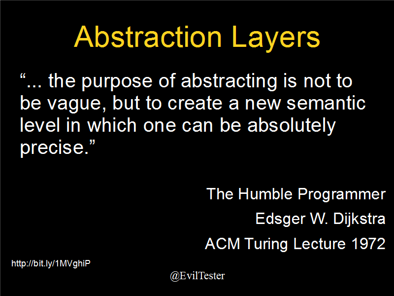\

Because, as Dijkstra wrote: "the purpose of abstracting is not to be vague, but to create a new semantic level in which one can be absolutely precise."

This is what we do when we write Gherkin to feed into Cucumber or as part of a BDD process. We write in an abstraction that creates a new semantic level in which can be absolutely precise. And not precise in general, because a lot of people use Gherkin and Cucumber for re-use. But to be precise in context for this Gherkin scenario or this @Test method. And we will gain re-use, the next time we work at that semantic level or that abstraction level.

And people worry about the precision because what is precise in one context, in one test, might not be precise in another so they can't use it, so they worry about writing too much code. And that stops them writing abstractions which are precise. And stops them achieving some of the benefits that the precision can gain them. And that's fine. That's there choice. If they recognise it as a choice, but sometimes they don't.

And people worry that this isn't precise. This hides information. They don't know how the application was opened. They don't know how a todo was created. It wasn't precise enough. And they worry because they view precision as a single level of abstraction at the level you saw before with the clicks. And don't see precision in context. And they haven't realised that the previous code hides information, because when we tell WebDriver to click, do we know if it sent a javascript click event? Or if it triggered an operating system mouse click event? Or it ran the code in the onclick event? We don't. The abstraction layer in the previous test hides information that we think we understand. And that in itself introduces risk if we don't recognise it.

# Slide 38: A Test With Abstraction

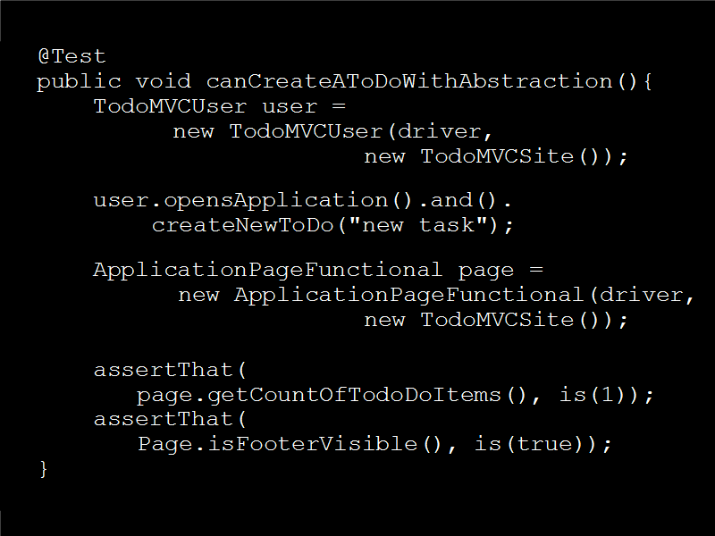\

So here is the test with abstraction.

I think this is a lot more readable. 

You can see I have some concepts. I have a user concept. And the user can do stuff like open the application and create a new to do.

There is a page concept and I can count the number of to dos and check the footer is visible.

This test actually does a little more than the previous one because it was easier for me to see (at this semantic level) that I should also check the footer visibility and that was obscured at the other semantic level.

And I could make this clearer. I could abstract the page object creation into a method on the user for examinesPage or looksAtPAge. I could move the user creation into an @Before method, that's another form of abstraction.

The point is to make the code work for us. And we don't always need tools like Cucumber or approaches like BDD, to make our code use an abstraction layer that is readable to humans.

# Slide 39: Refactor to Abstraction Layers

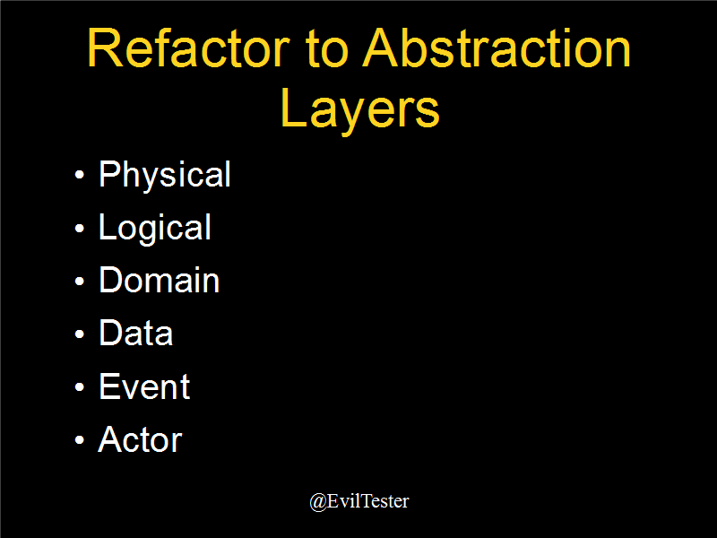\

Creating a 'new semantic layer' suggests that we can create as many layers as we need.

These are some that I use. And some are like onion layers on top of each other. Some are like views at a sibling level on the same model.

Physical layers which map on directly the page, or the database, or the file system. WebDriver is essentially a physical abstraction layer for a browser.

Logical layers that might let us view the physical layer in different ways.

Domain layers that represent concepts and constraints in the domain e.g. Users, but might not be present in the physical layer.

etc. etc.

Computer Science is full of modelling approaches and abstraction approaches that we can draw upon.

But the easiest way to build these up, is to write code, like the first example you saw earlier, and then refactor it into abstraction layers. 

Use simple principles like DRY (don't repeat yourself), and single responsibility. And then you can wrap the objects you create with these approaches with semantic layers that help you reason about the problem you are trying to solve or communicate.

# Slide 40: How to find time when you are automating so much:

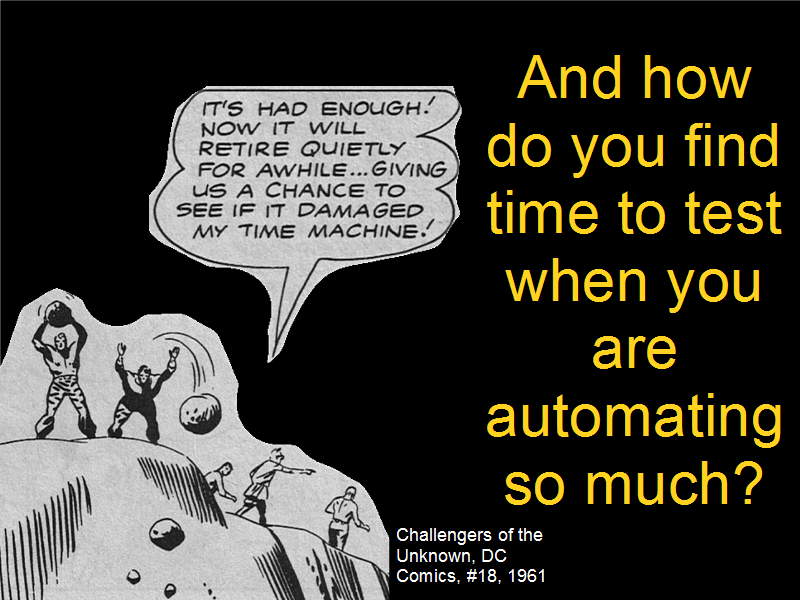\

And if you're doing so much automating, how do you find time to actually test?

People are often so focussed on automating that they don't test. And that's really related to a flaw in the System of development. The way we develop software as a team.

Well, we have a team. We work in a system which includes more than one person. And the goals of the team hopefully also include checking what they are doing over the long term.

Some people are interacting manually, and throwing rocks. And other people are checking the results of the automated processes and fixing them if they need to, or expanding them. And the whole team are involved in this to switch roles and avoid reliance on single people.

Its not a hard answer. Survival isn't just on an individual basis. It is on a team basis. The System of Development also has to be fit for purpose and survive. As does the System under development.

And do the automating in stages, so build simple tests. Refactor them to build abstraction layers. Create abstraction layers at the semantic level that you are working to help you cover that level effectively.

We should also be able to use the semantic layers to support our testing. I should be able to interactively test the REST API with HTTP messages and analyse them in a proxy, but I should also be able to use the HTTP REST abstractions we've built to interact with the system. So we can use the results of automating as part of our testing.

Since I'm testing lots of variations, I may not have time to interact with each variation and trigger them manually, and I might be able to use the automated libraries that we have to help me, even if I throw that automated code away, even if it doesn't become part of our CI coverage.

But fundamentally, and its a platitude, we do this as a team to find the time.

# Slide 41: Survival is a way of thinking...

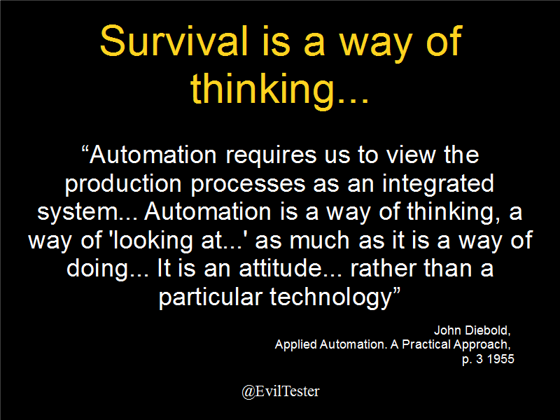\

So to jump back in time again. And look at the work of John Diebold.

Diebold describes automating as a different view of the world, a Systems view of the world. "view the production process as an integrated system"

Diebold calls it "a way of thinking, a way of 'looking at..." as much as it is a way of doing". Thinking and modelling with abstractions so we can 'look at' the system at different semantic levels.

Diebold calls it an attitude, a way of building up the appropriate variety of responses and requisite variety to survive "rather than a particular technology".

# Slide 42: How to survive

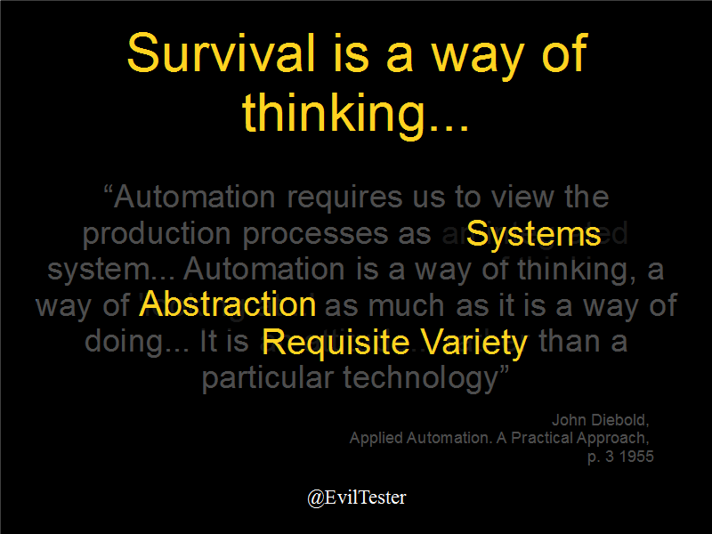\

And those are the concepts that will help you.

Requisite variety to have multiple ways to respond to situations, different demands, different learning needs, increasing your skill sets to help you do that, working as a team to make sure survival isn't just the individual.

Understanding the systems. Systems under development. The System OF development. So that the tools you bring in help you solve problems for or with the system. And recognising the interconnectedness of things to find intervention and observation points. 

And abstraction to help you work at the right semantic levels to create maintainable, readable, robust and effective automated processes that you can communicate the value of to other people.

# Slide 43: Survive

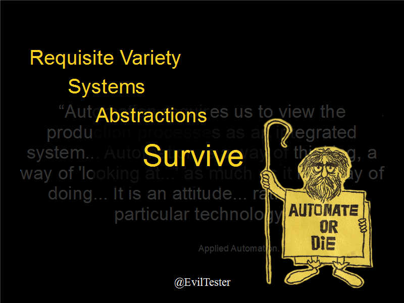\

Requisite Variety, Systems and Abstractions are what will allow you to survive in a world that tells you to automate or die.

