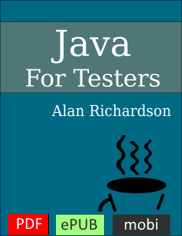
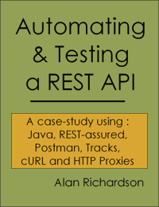

# Conversation Track on Automation and People

## What does technical enough mean?

27-28 February 2017 — LONDON

Alan Richardson

Compendium Developments

EvilTester.com

---

# “Automation and people”

Are we technical enough? Are the problems that people report with tool adoption a problem of testers not being technical enough or of tools not being easy to use? Are we over emphasising the technical and ignoring the personal?

---

# “Automation and people”

- What levels of technical skills, knowledge and ability are required for systems development, and specifically for testing activities?
- What do we mean by “Technical”? – just Technical (IT) or also Technical (Domain)?
- What types of technical knowledge support our testing (for example technical architecture, hardware as well as software, code, etc).

---

# “Automation and people”

- How do we keep up to date with the technology we test? If not, why not?
- If the ‘technical people’ on the team don’t understand the system, how do we identify technical risks?
- As the toolset we use matures, can we rely on it to support people better, or are the people driven by the technology they use?
- How do we improve the Tester's Experience of automating and working with more technical systems.

---

# Alan Richardson

| Alan Richardson | Java For Testers | Automating & Testing a REST API |
| --- | --- | --- |
|  |  |  |

- Linkedin - https://uk.linkedin.com/in/eviltester
- Twitter - https://twitter.com/eviltester
- Instagram - https://www.instagram.com/eviltester
- Facebook - https://facebook.com/eviltester/
- Youtube - https://www.youtube.com/user/EviltesterVideos
- Pinterest - https://uk.pinterest.com/eviltester/
- Github - https://github.com/eviltester/
- Slideshare - www.slideshare.net/eviltester

Alan Richardson

www.eviltester.com

www.seleniumsimplified.com

www.javafortesters.com

www.compendiumdev.co.uk
