<!-- Slide 1 -->

# Testing with Neuro Linguistic Programming (NLP)

Alan Richardson

For UKTest September 2005

www.bjss.co.uk

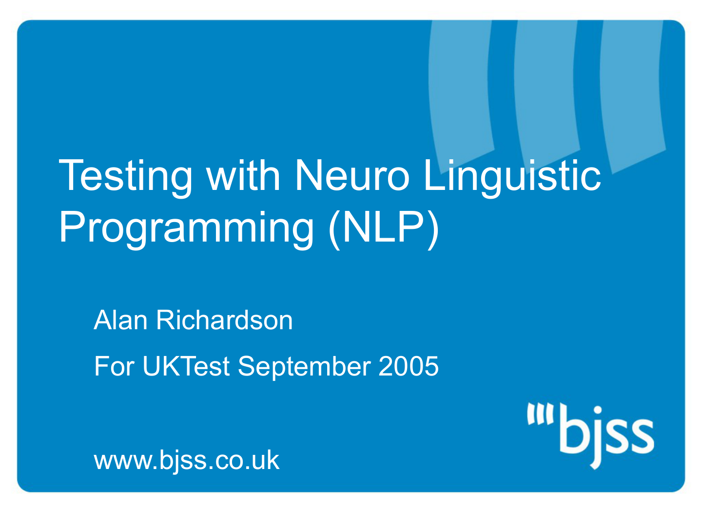

---

<!-- Slide 2 -->

# I was a teenage methodology monster!

\*Gasp in amazement\*

As you see him know exactly what do do, before he is even on site.

\*You will Be shocked\*

As the rework mounts to truly heroic proportions

\*Can you bear to see\*

Him justify his actions by quoting text book after text book and expert after expert.

Coming soon to a project near you…

Methodology

He can do

no wrong.

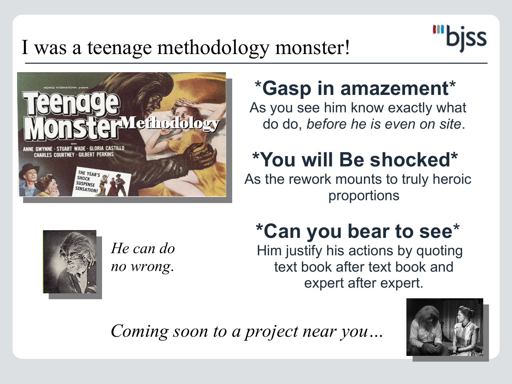

---

<!-- Slide 3 -->

# Context Driven Testing

## Embedded Diagram Text

Principles:

- Product is a solution
- Constant judgment &amp; Skill
- Projects often not predictable
- Value depends on context
- People most Important
- No Best Practices
- Testing (vb) = intellectual process

What about X?

Unit Testing, Regression Testing, End to End, Automation, Tools, etc.

Good in context

www.context-driven-testing.com

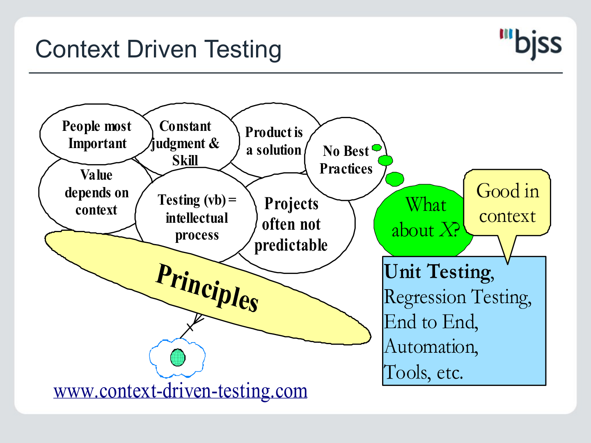

---

<!-- Slide 4 -->

# Neuro Linguistic Programming

Linguistic

Language and nonverbal communication systems through which neural representations are coded, ordered, and given meaning.

Programming

The ability to organize our communication and neurological systems to achieve specific desired goals and results.

Neuro

Nervous system through which experience is received and processed through the five senses.

<http://www.purenlp.com/nlpis1.htm>

“…the study of the structure of subjective experience.”

www.richardbandler.tv

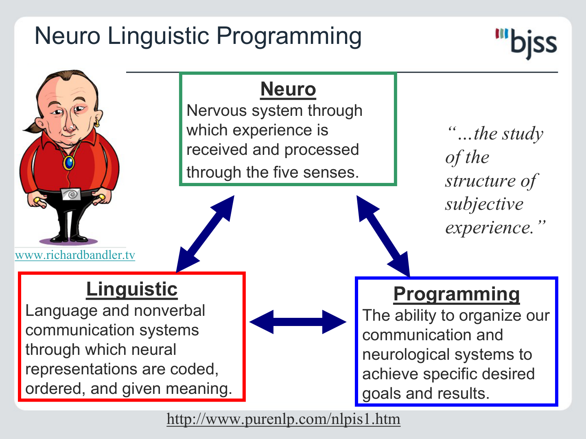

---

<!-- Slide 5 -->

# NLP is…

ATTITUDE

…sense of curiosity and adventure … desire to learn the skills to be able to find out what kinds of communication influences somebody and the kinds of things worth knowing ... to look at life as a rare and unprecedented opportunity to learn

METHODOLOGY … all behavior has a structure . . . and that structure can be modeled, learned, taught, and changed (re-Programmed). The way to know what will be useful and effective are the perceptual skills

TECHNOLOGY

enabling the practitioner to organize information and perceptions in ways that allow them to achieve results that were once inconceivable

<http://www.purenlp.com/nlpis2.htm>

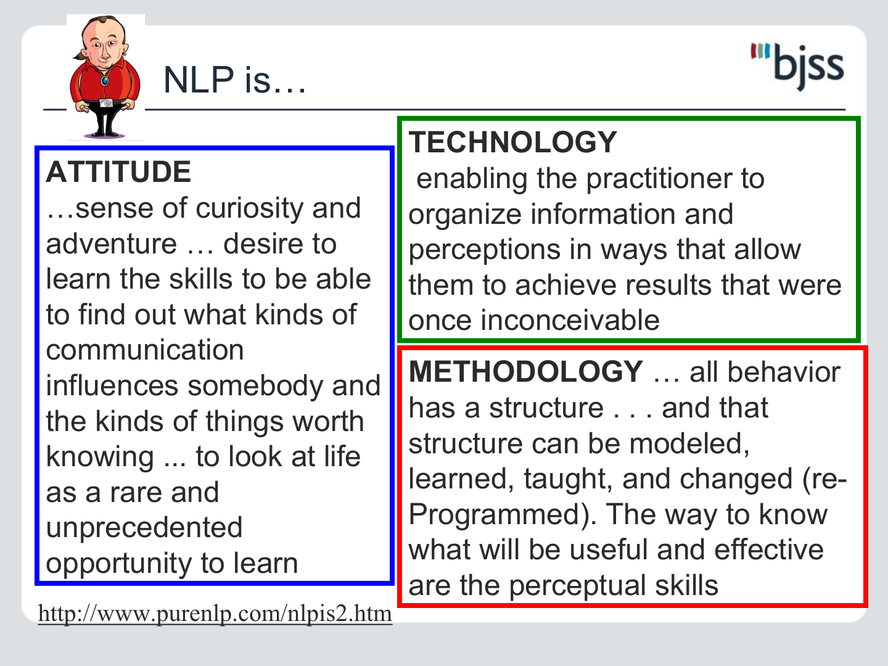

---

<!-- Slide 6 -->

# Roots of NLP

\[NLP is a Synthesis\]

## Embedded Diagram Text

| Person or area | Labels in the original diagram |
| --- | --- |
| Fritz Perls | Gestalt Therapy; Context |
| Virginia Satir | Family Therapy; Congruence; Groups; Change |
| Transformational Grammar | Deep structure; Surface Structure; Deletion; Distortion; Generalization |
| Milton Erickson | Hypnosis; Ambiguity; Conversational Change |
| Frank Farrelly | Provocative Therapy; Attitude; Humour; Challenge; Explore limits; Honesty |
| Others | George Miller; Gregory Bateson; Alfred Korzybski; Edward Sapir; Mathematical Logic |

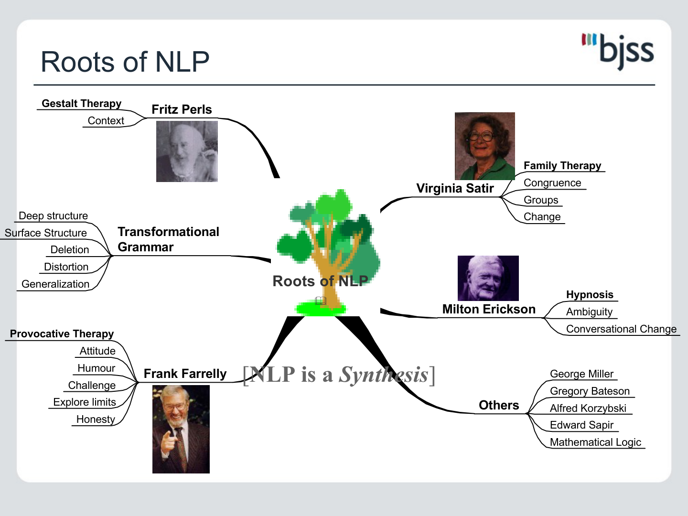

---

<!-- Slide 7 -->

# Deep Surface

- Meta-Model based on transformational grammar model
- Words affect experience

Deep Structure

Surface Structure

Primary Experience

Sensory &amp; Emotional

Secondary Experience

Linguistic Derivation

Transformation

Surface Structure

Surface Structure

Surface Structure

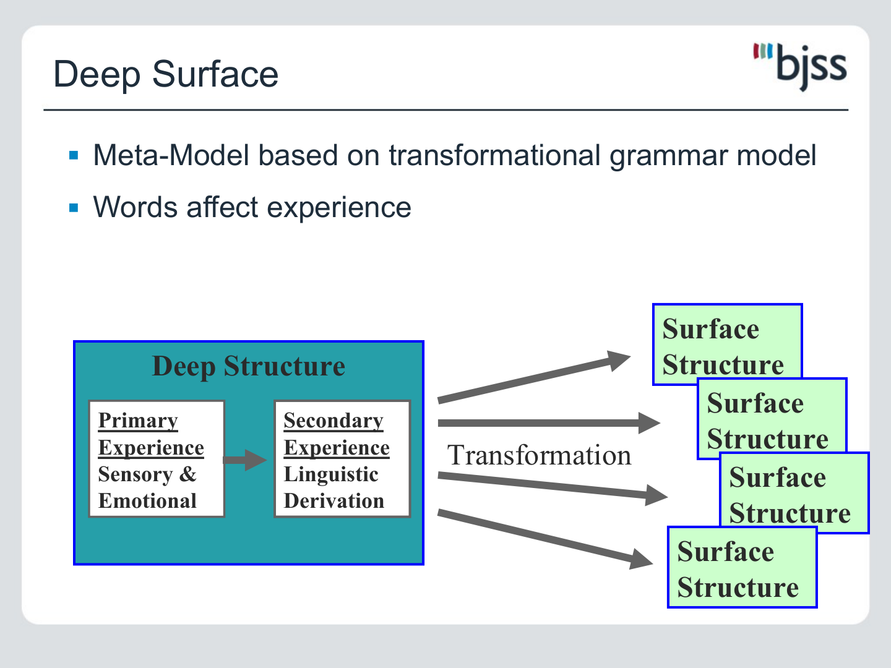

---

<!-- Slide 8 -->

# What can you expect from context-driven testers?

- “It depends...” on the context, but generally (I suspect they will)...
    - Ask a lot of questions of you and of themselves to explore the context and avoid assumptions
    - Change their minds, Re-plan
    - Be able to justify what they are doing, in terms of the context as they perceive it, not in calls to authority
    - Know their techniques and practices – assumptions, presuppositions, pros &amp; cons

I Ceased my evil ways, over time, kind of…

---

<!-- Slide 9 -->

# NLP and Testing are related

- Questioning
- Modelling
- Communication
- Effectiveness
- Attitude
- Synthesis Knowledge Systems

- Literalism
- Identify Ambiguity
- Honesty

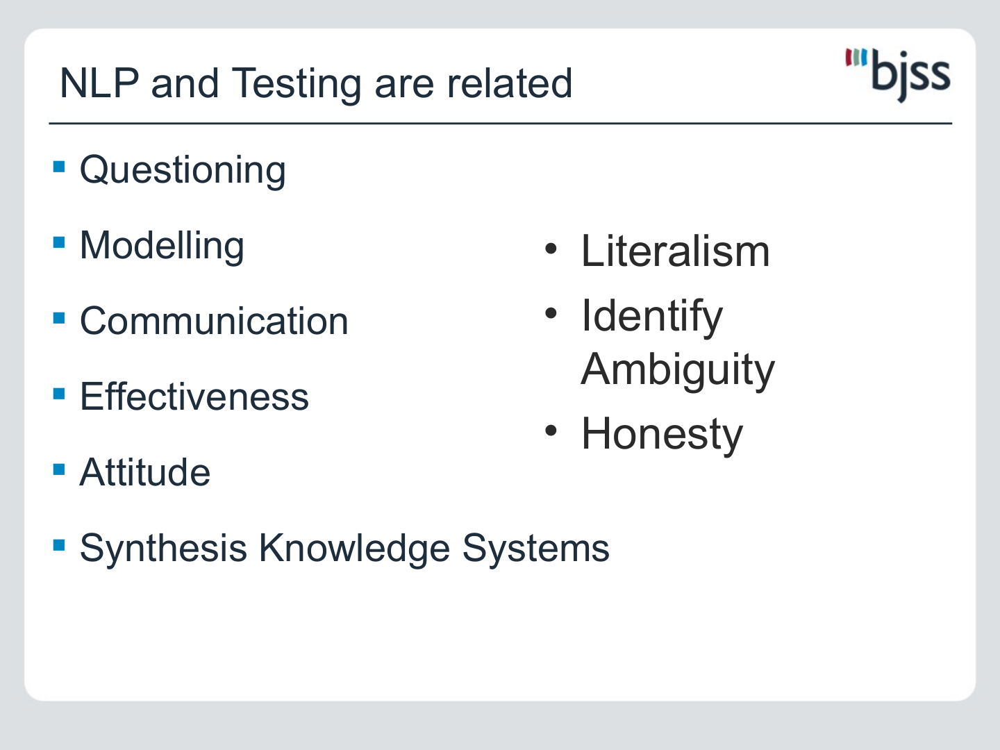

---

<!-- Slide 10 -->

# 3 NLP Techniques

- Modelling
- States
- Meta-Model

That can help you change your testing process.

---

<!-- Slide 11 -->

# Modelling

“The NLP modeling process involves finding out about how the brain (“Neuro”) is operating by analyzing language patterns (“Linguistic”) and non-verbal communication. The results of this analysis are then put into step-by-step strategies or programs (“Programming”) that may be used to transfer the skill to other people and areas of application.”

Modeling with NLP,

Robert Dilts

Meta Publishing, 1998

Most techniques and tools of NLP have been derived through Modelling

---

<!-- Slide 12 -->

# Attributes vs States

Attributes

- Person ‘has’
- Context?
- “IS” of identity

Make a difference to your testing by identifying the most effective states for you. And generate them.

States

- Person ‘feels’
- Context ↔ State
- “Behaviour

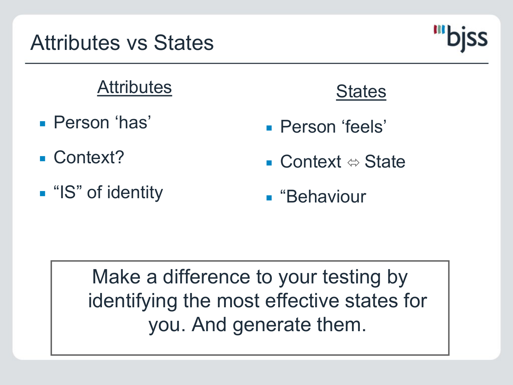

---

<!-- Slide 13 -->

# Meta-Model

- Transformations (Distortion, Deletion, Generalization) can create ambiguity
- Identify Ambiguity (in the system, in the docs, in the communication) and target it with questions (Tests, Challenges)

## Embedded Diagram Text

- Meta Model
    - Deletion
        - Simple Deletion
        - Comparative Deletion
        - Lack of Referential Index
        - Unspecified Verb
    - Distortion
        - Nominalization
        - Cause and Effect
        - Mind Reading
        - Complex Equivalence
        - Lost Performative
    - Generalization
        - Universal Quantifier
        - Modal Operators
        - Presuppositions

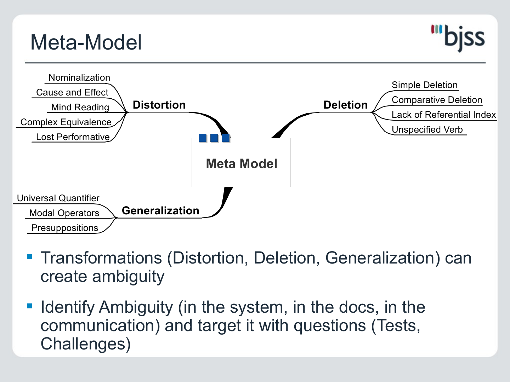

---

<!-- Slide 14 -->

# Example Meta-Model Application

- Processed by what? How?
- Daily trade file – contains what? From where?
- 5 seconds – based on what?
- Starts up? How, When, How often?

## Embedded Example Text

"The daily trade file must be processed in under 5 seconds when the system starts up"

Annotation labels in the source diagram: LP, SD (1), MO, UV (1), SD (3), SD (4), UV (2), SD (2), Effect, Cause, CE.

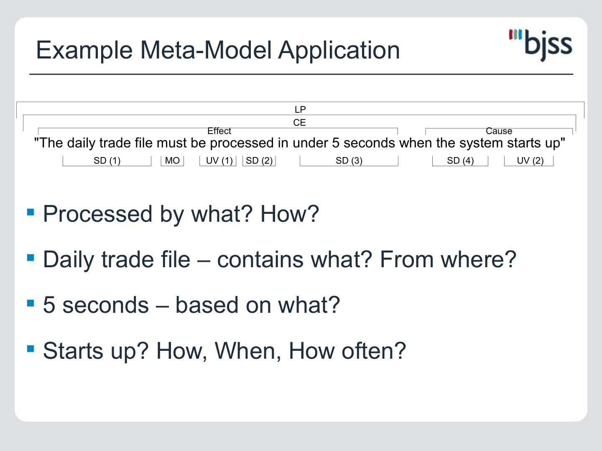

---

<!-- Slide 15 -->

# Learning NLP

- Read the early books
    - Structure of magic vols 1 &amp; 2
        - (Bandler and Grinder)
- Read These Authors:
    - Richard Bandler
    - Robert Dilts

- www.purenlp.com
- www.richardbandler.tv
- www.paulmckenna.com
- www.saladltd.co.uk
- www.nlp.biz/NLP

Visit www.compendiumdev.co.uk/nlp

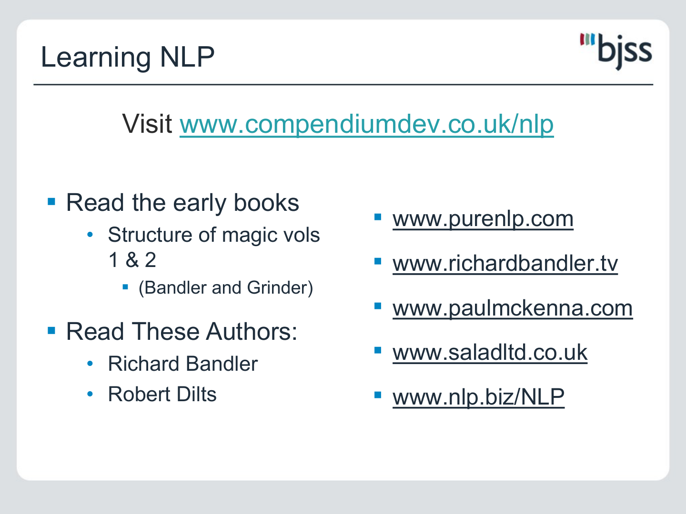
