# Prepared Keynote Script

Original Word preparation document, including the abstract, slide images, delivery cues and draft wording. This is a prepared script, not a recording transcript.

title:

Testing with Neuro Linguistic Programming (NLP)

Brief:

How quickly can you learn to change, for the better, how you approach software testing?

Neuro-Linguistic Programming™ (NLP™) provides a diverse set of techniques and models drawn from a wide range of disciplines; including mathematics, linguistics, psychotherapy, systems theory, cybernetics and general semantics. Techniques that have been used to identify, change, and allow people flexibility in their behaviour to achieve desired goals effectively and quickly.

The same NLP techniques can be used during software testing to rapidly increase testing effectiveness. In this session I'll introduce how NLP can help and leave you with some simple, and easy to apply NLP techniques that make a difference.

## Beginning

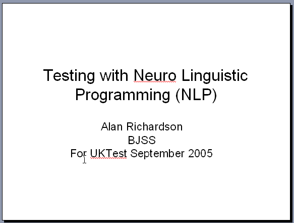

Hi, well, thank you for allowing me to be here now and talking with you about two subjects that I take a lot of interest in NLP and Testing.

Short Definition – Change – generic flexible – enriching a model

I’d like to be able to give you a short pithy description of testing, but I’ve never been able to settle on one definition that I can live with for very long. I keep changing the definitions because I keep having to do something different. So what I carry around in my head when I think of testing is flexible enough to allow me to change and adapt regularly. Testing for me is, I think, primarily a mechanism for enriching a model of a particular system so I can question that model and use that model to communicate, in more detail, the elements that people are interested in.

Testing is relevant feedback

See for me, one thing that testing is, is a feedback mechanism. And if we are going to feedback information then I think it should be the information that is most relevant for those people at that time to help them change and improve whatever it is that they are working on now.

NLP has models of flexibility

And that description of testing is, for me, general enough that I can adapt to the situations that I find myself in.And I think it is also one of the reasons that I bring NLP in to testing. Because NLP is full of models of flexibility, using the information that other people give us, so that we can help them have fewer limits.and more choices.

NLP – changed thinking, approach, communication

By studying NLP, I have changed the way that I think about software testing, the way that I approach and do software testing, and the way that I communicate software testing. And I believe that I have changed all of those things for the better. And I’m going to cover some of the parts of NLP that I use to make those changes. Specifically 3 topics – modelling (building a model to help me understand, explore, replicate and move on from), States (the states that we generate in ourselves and how that affects our subjective experience, when is it appropriate for me to be curious? And how will I know when I’m curious?), Meta Model (a model for questioning).

## Introduction

&lt;still using same slide &gt;

My name is Alan Richardson and my job is as a Software Testing Consultant. And I’ve been doing this for a long time now, and I’ve actually been doing NLP for longer than I’ve been software testing so sometimes I forget what I’ve learned from Software Testing, what I’ve learned from NLP, and what I’ve learned from the subjects that I’ve studied that underpin both of those – so systems thinking, problem solving, set theory, formal methods etc. whatever. It all just gets merged into a big model conglomeration as I try to learn as much as I can.

I guess that because you are at a software testing conference, I’m assuming that you all know what Software Testing is. One aproach to Software Testing is as the art of challenging software, for the express purpose of watching the developers and project managers weep tears of bitter regret into their cupped hands. Sometimes that is an approach I use, I think testers need more attitude.

Because I find it a shame that when we do Software testing we give software such a hard time, because it is people who build it, the people that have thought in certain ways that allowed ambiguous, or erronious, thinking or miscommunications to manifest as software code. And it can be the role of the tester to identify the results of those processes, and play them back so that they can be changed.

Software development is a process of communication and that is one of the reasons why I find such a good cross over with NLP. And NLP by the way, to quickly give some sort of definition for it. NLP is an area of study of human behaviour and communication.

Apply NLP to communications: transient, persistent, internal

And I find that I apply NLP to the transient communications that we have on a project; the conversations between people. The persistent communications; the documents, the design models and the actual software itself. And the internal communications that people have with themselves; so as managers we can help address relationship problems, we can help people develop flexibility about their approach to working, and I think approach their testing more effectively.

Sensory/Project Acuity. NLP awareness of actual rather than think rather than should

When NLP is taught as a methodology for working with people one of the items that is stressed is sensory accuity, noticing what is going on with the person because the person that you are working with gives you all the clues you need to ask the next question or for the direction to pursue. I like to think that NLP has increased my project acuity. So I think NLP has allowed me to become more aware of what is actually going on on a project as opposed to what I think is going on on a project as opposed to what I think should be going on on a project. So I respond to the development procesesses are actually being used rather than the ones that are documented in their ‘software development methodology manual’ volumes 1 thru 6.

But I’ve changed, I was not always like that...

## Teenage Methodology Monster

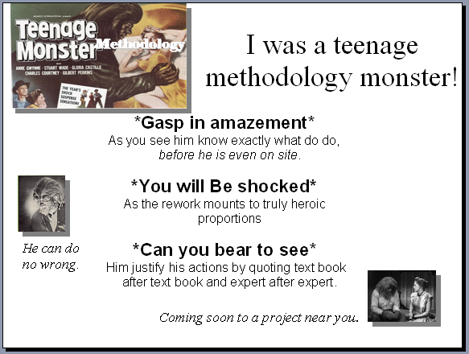

There was a time when I knew exactly how to do testing.

I could walk on to a site, and instantly know what was needed to do the testing. Because I knew what the right things to do were.

In fact I knew what was needed, before even coming on site. I was that good.

And because I was that good, I made sure that what I knew had to be done, was done, even if it cost a lot of overtime and rework. I was doing the right thing, because I was using best practices.

Because I had a model in my head of how testing should be, or must be done. I was using modal operators of absolute necessity to describe testing.

I had a whole set of distorted, generalised and idealised models for software development.

Nominalization

I didn’t think in terms of processes, I thought in terms of ‘things’. I knew that we needed to have reviews, rather than thinking in terms of getting people involved in a process of review and refinement. And it is a subtle difference but it was a difference that made a difference to my flexibility and to my ability in terms of thinking about software development as a process of interlinked processes.

I mean I could have a whole list of shoulds/and musts that neeeded to be done. Must have cases before scripts. Must have scripts before execution. All these beliefs in my model built a whole set of work and rework and we could have done it all differently and still been effective, maybe even more effective.

Universal Quantifier

There were a whole set of things that we Always had to do Every time we did testing. We always had to build conditions, and cross reference them all.

Lost Performative

I justified what I was doing and saying in terms of books and experts but I couldn’t ever pin down exactly which book or expert I had got the information from.

Complex Equivalence

I had a whole set of complex and equivalent relationships which I read a lot into. For example I knew that the test team weren’t respected because the requirements were late. I knew testing was undervalued because the designs weren’t complete and signed off. I couldn’t believe the number of experienced people on projects that didn’t know how to develop software, they had no processes and they didn’t document anything.

Phew, it was exhausting.

I look back and I see that I used to wield the ‘V-model’ like a crucifix. I guess I didn’t do software process improvement I did software process exorcisms.

And it is not that any of this stuff is bad, it is just that I thought it was ALL best. And I didn’t use it particularly appropriately.

Surprisingly, I took quite a lot of beatings before it sunk in that there might be other ways of doing what we do in testing.

And I started applying the NLP stuff I was learning to analyse the language that I was using to describe testing and development. So I would look at the, what are called the modal operators of possibility (or inflexibility) – the must’s, should’s and started thinking them through. “Requirements must be signed off before test conditions are written.” – well fine, but they weren’t, so I could fight and battle, or I could figure out what to do instead, so I asked myself questions like “What if they didn’t have to be?”, I followed through my chains of reasoning and built a model of how I was thinking about software development. I explored my model of software development with the NLP meta model. And then I tore it down and built a new one for myself.

I built a lot of different models of software testing to get a better understanding of what was actually going on and what could go on.

And I started to develop the strength of character to say No, we don’t have to do all those things, they aren’t helping us. Deal with reality instead.

## Context Driven Testing

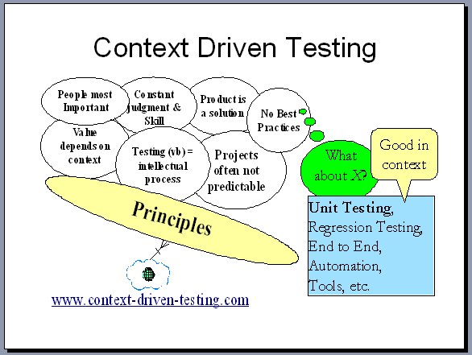

There is now a strand of testing where “experts” are now saying that testing can be contextual, and it can be flexible.

And the cool thing is that if you haven’t seen NLP in action before and you find a methodology monster, someone who isn’t contextual, who isn’t taking responsibility for the views that they themselves are spouting, and you explain who Cem Kaner is, or who James Bach is, or any of the other contextual testing proponents, build them up as experts by pointing out what books they have written, and then phrase the need for flexibility in terms of ‘they are experts and they say it depends on the context’. Then if you pay attention you can see them processing that information and you can see beliefs being changed. Because the experts are no longer mandating, they are talking about flexibility and the need for change.

And if you do this then make sure that when the belief is changing that you make sure that you can help that person recognise that they have the resources that they need in order to go forward more flexibly, because we don’t want to just knock down beliefs and leave a void, where they then throw themselves in the path of the next silver bullet that comes along to put themselves out of their misery.

So we then have to help them be able to model a particular context and then determine which of the many skills and techniques they already have that might be appropriate. And one thing that can help is an attitude of experimentation, and just trying things to see if they work, being able to recognise the feedback that you are given when you do or say something.

## NLP Is..

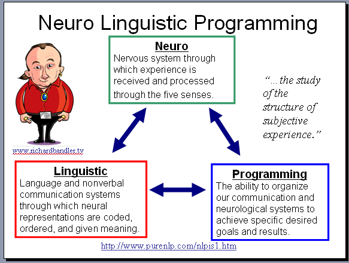

For me NLP is about how the brain works, and about how we learn to use our brains more effectively, and about how we communicate and interact with the world.

Over the years that NLP has been taught and developed the definition has always been pretty vague. So we could look at what each of the words mean to get an idea of the areas it covers.

I think the phrase “study of the structure of subjective experience” is actually a pretty good summary of what we do when we use NLP. Because what we are interested in is the structure of what people do, the how and the what, and always with the understanding that we are dealing with their subjective experience, being what they think their experience is, what their model of the world is, and what they do, makes sense within that, so in therapy terms we can either help someone do something different within their model, or enrich their model so that doing something else is a natural thing for them to do.

I sometimes have difficulty explaining exactly what NLP is because it is just made up – a whole bunch of people learned ways of doing things that other people were doing to get results and codified that knowledge so it could be taught. So the next slide works better for me as being closer to how I view NLP.

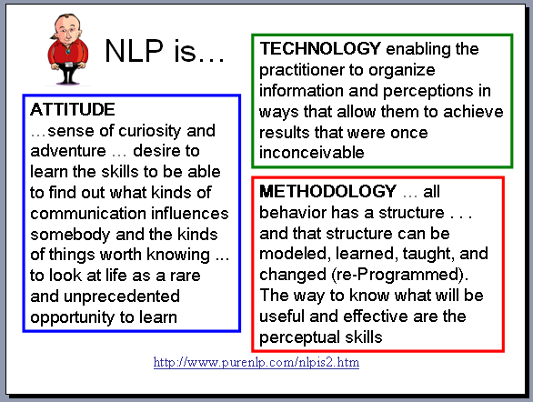

Given the previous ‘structure of subjective experience’ definition, it probably makes more sense to look at NLP in terms of what and how. And that is what this information is.

And this is where I see some real parallels with software testing.

I think the best testers have attitude. They are curious, they learn, they’re tenacious, they find the humour in adversity, they fall over and get back up, they try new things, they keep asking questions, they keep going. And it is the same set of attitudes that I have encountered in the people whom I respect in NLP.

They do what it takes and they learn everything they can to have the tools they need to be flexibile in doing that.

I think that context driven testing embodies the methodology above. We figure out what people are doing. What they are trying to achieve. What it might take to get that outcome. What that outcome leads on to. And after a process of questioning we may already have changed things, or we will have the information to try things to change. We take the statements that people give us and examine them at the surface level, literally, so that we can do things like play them back as extremese so that we can get at what they really want.

One thing that happened to me on a project was that the test team were told “You must do end to end performance and load testing as that is a testing best practice” so we fed back “So you are going to give us hundreds of thousands of pounds to licensing the software and to hire a specialist at a thousand pounds a day to do this.” And then when they went ‘gulp!’ we said “what is it that you really want to know?” and then we explored that, then set up a much more reasonable 30 minute stopwatch exercise to achieve a deeper level of comfort.

## Roots of NLP

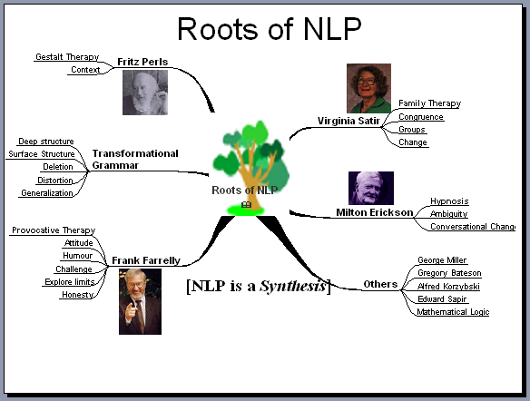

Basically in the 70’s 2 guys, Richard Bandler and John Grinder set out to identify what made some therapists more effective than others.

And they modelled those people, asking them questions. What do you do? How do you know how to do that? They studied the therapists, built models of them. Tried to use the models to do what the therapists were doing to see if they could achieve the same results, then improved and simplified the models. So what eventually resulted were distilled teachable models of how therapists that achieved results achieved results.

And for me software testing is a synthesis. So if all a tester has read are testing books they are not going to be as flexibile or effective as a tester that has also studied some logic, or some set theory, or formal methods and has some notation that they can use.

Frank Farrelly was cool by the way. I think testers should read Frank Farrelly’s book. A lot of testers read Virginia Satir’s books because of Jerry Weinberg’s work. But I think Farrelly’s work has an attitude that testers can adopt. You can imagine what it is like from the name ‘provocative therapy’ and if testers aren’t producing results that are provocative then they probably aren’t testing the system to the depth that the user deserves. But within Farrelly’s work there is also doing it with humour and integrity and working with the client which, from some of the stories about developer/tester working relationships, is something that just isn’t covered in the testing literature, but I think it is covered in this literature from NLP and the roots of NLP.

In provocative therapy the client is provoked by the therapist, using exaggeration, irony, self-deprecation, Daliesque absurdities, etc. to:

- Affirm his self-worth, both verbally and behaviorally.

- Assert himself appropriately both in task performances and relationships.

- Defend himself realistically.

- Engage in psycho-social reality testing and learn the necessary discriminations to respond adaptively. Global perceptions lead to global, stereotyped responses; differentiated perceptions lead to adaptive responses.

- Engage in risk-taking behaviors in personal relationships, especially communicating affection and vulnerability to significant others with immediacy as they are authentically experienced by the client. The most difficult words in relationships are often "I want you, I miss you, I care about you" -- to commit oneself to others

Side with the negative aspects, encourage continuation of the negative processes. Through the affectionate banter between close friends.

\[from <http://www.provocativetherapy.com/whatis.html> \]

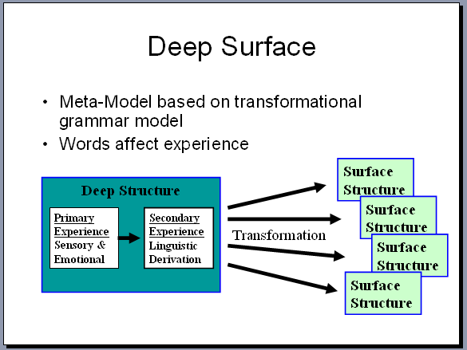

Transformational Grammar was a very popular model that looked at the mappings between different levels of experience and communication to explain how language structures are generated across all languages. NLP used that as a model and applied it to the communication used in therapy to try and identify how language could be used to change behaviours. What questions could cause changes to happen and what were those questions asked in response to.

The words that we use can affect our experience.

I have a simple exercise that I use when I’m testing to help me identify different aspects of the software under test and it is just a naming exercise. So I think “I’m testing …” and I insert:

\[Name of Software\]

doesn’t mean much but gets you thinking in terms of the adverts, the feature set, what needs to be tested generically

\[Name of Software\] v1.1

extensionalised – changes in this version, what needs to be tested specifically

A System

an integration of parts, interfaces, data syntax, system theory

Software

a thing which runs on an operating system, interfaces with hardware (disk), data semantics

A solution

for whom? What problem?

So each of those words is a surface structure, that leads to an enrichment of an underlying deep structure.

And the communications that we receive in the software process are surface structure communications. Because someone is trying their best (presumably) to give us an understanding of their deep structures, their models of what the system is and should do.

## Expectations of Context Driven Testers

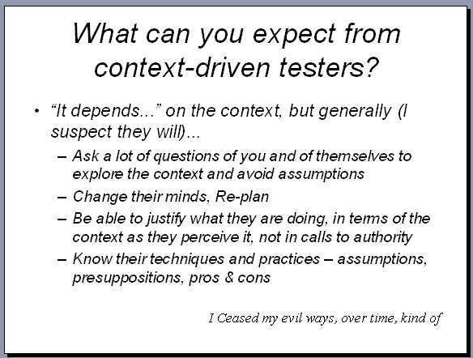

I put this slide together to describe context driven testers to development managers, so that they wouldn’t be too unsettled when they encountered them. But I think it describes NLP practitioners as well.

I think that context driven testers go below the surface. They don’t just settle for methodology manuals and what someone says they want. They work out what is going on and what people really want.

Asking questions (and listening and acting on the answers) makes it more difficult to just sell something (“I'm going to use the V-Model so I'll sell that in”). It means that you are consulting towards a solution rather than pushing a practice.In Advanced Selling Strategies, Brian Tracy, writes about top salesmen approaching selling as consultancy and meeting the client's/buyer's needs. Less effective sales people, sell.

I still have to catch myself because projects don’t always run smoothly. And if things get bad on a project my fall back position is “how can I learn more from this?”. And I start exploring my model of the project using NLP techniques because the project is what it is, and the ‘bad’ stuff is in my interpretation of my model of what is, so I should always be able to change my model and my interpretation of that model.

## NLP &amp; Testing

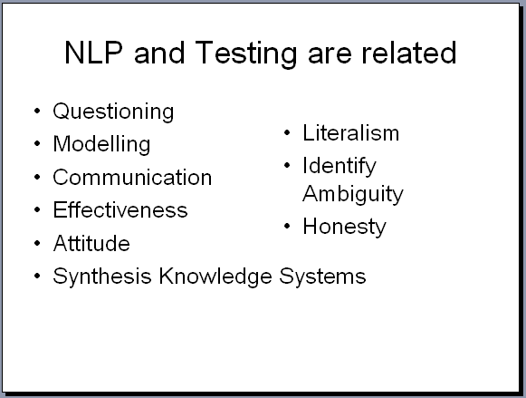

Yeah, this is a summary of some of the mappings from testing to NLP.

One of the things I learned from NLP was to take things literally, take the crazy statements that people make, take them literally, follow them through to some outrageous conclusion and then play that back. You know “this is the consequence of your model”.

I spend a lot of time targetting ambiguity and I get told a lot that I’m pedantic and that it really doesn’t matter that we use some words rather than others. So it doesn’t matter that we use the words “prove that there are no defects” instead of “demonstrate that the system can allow the user to do the following…” because they’re the same.

But I want people to understand that if they mean something when they say something, that the thing they say should mean what they mean. And not mean something else or be capable of being interpreted as something else. That’s pretty simple right?

My understanding of ambiguity in transformational grammar is that an ambiguous statement is where a single surface structure can have multiple deep structure mappings. So multiple people can interpret it in different ways. And that can cause problems or ‘unreasonable expectations’ on the part of the users about the software. Which we can better avoid.

Honesty in NLP has congruence, we are working with a model, and we know it, the map is not the territory, the model is not an absolute, but it is usable and we will explore it and ask questions. That is what we do. And in testing I am as honest as I can be because I know I’m working with models and sometimes it might seem to people that I am couching my language in a whole series of caveats when what they want to know is “is the software working” but it is generally more complicated than that. So if they want a generalisation at that level, then I generally say “No” and they they go “what? What do you mean No? Not at all?” which is great because that is a wonderful meta model question for a universal quantifier, and they may not have studied the meta model, but I have so I can get them asking those questions. And then I can tell them the information so they understand my model of the ‘validity’ of the software and I can begin to understand what they need to know. Because often people don’t want to know ‘does the system work!’, they want to know ‘what are the risks of releasing this software’ which is a different question and a different model.

## NLP Techniques

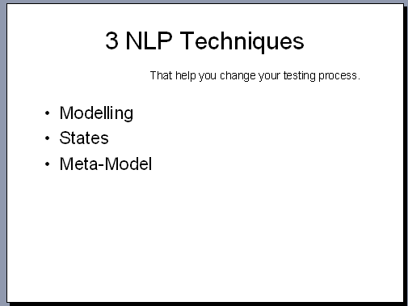

OK, so now we move on to a few of the techniques from NLP that I apply in testing. And I’ll quickly go over how I use them so that you can experiment with them yourself.

### Modelling

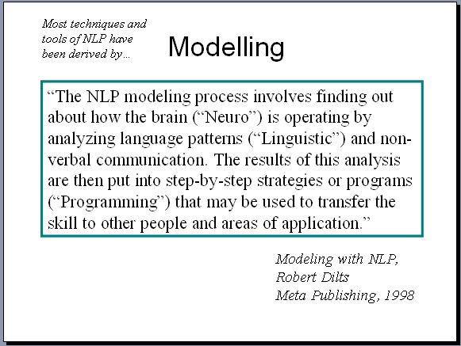

Modelling is something that software devlopment knows all about.

We model in software development for a whole set of reasons. To experiment with something before we build it, to try different options, to document something so that we can see it in a more holistic way, to communicate things to someone else so that they can do something, and even to 100% automate something so that we can generate code from it. Oooh… always tempting, and that is what got me into this software testing lark in the first place.

---an aside

I’ve being doing testing for a long time now but I got there via an IFD route. General Semantics has a notion of an ‘IFD Disease’ where people move from idealism to frustration to demoralization and I almost fell prey to this because in an academic environment, having learned “all there was to know about” software engineering. And I figured out how to solve the Software Crisis – that was what we were taught about in the 80’s – the software crisis – is that still taught? Software industry is still pretty bad, I don’t know what happened to the crisis, did we just get used to it?

I thought that to solve the software crisis I needed to stop people building software and have them build models instead. I initially started doing development work and building case tools. Back in the days when CASE was the thang. That was the solution, that would ‘save the world’. When we would build models and voila – good software would be generated. And I worked on JSP and build a cobol interpreter to animate diagrams etc. But when it came right down to it, programmers like coding and it will take a serious amount of work to change that.

For me now, models have to be useful, not 100%. But if I’m going to turn my models into code then they are probably going to be pretty complicated models and I’ll probably just end up with a modelling crisis instead. So I don’t have my models try to tackle everything.

So I decided that a better way to ‘save the world’. I was still a little idealistic. A better way was to help people improve, and people improve through feedback and it seemed as though software testing was the place where feedback happened so I started doing that. And I immediately started building test tools. I don’t know where that comes from but as soon as I start doing something I start thinking, what makes this work? How am I doing this? If I had to have someone else do this what steps would I have them take? How can I automate this? Maybe I can build a tool to do this!

And I’m trying to figure out the structure, I’m trying to model it, to find the organising principles behind a group of behaviours.

---

Summary of Modelling in NLP:

What was ‘that’?

What is ‘This’?

What are the differences? – between what I my model and what I’m trying to model

What ‘has’ to be there. – what are the elements that are making the difference

What else ‘could’ be there? – would it enrich the model? What would it allow me to do? Would it make it more effective?

When I model, I’m not going for something that is 100%, I may not even go for something that is 50%. I’m going for something that is usable, and will let me get my job done.

This has changed they way that I document my testing, now. A lot of people build script models of testing. Where we write 100 scripts to test the system. But for me, each one of those scripts is a path through a model at a higher level of abstraction. Sometimes two or more scripts will use the same path through the model, but hopefully the scripts have some differences – in terms of data, so that, for me, is a combination of two models. A data model at a higher level of abstration and a path model at a higher level of abstraction.

So I like to model my testing at that level, and then I interpret those models as required to do testing. I find it to be faster, to be more maintainable, I can be more flexible in that I can ask questions of my models that I couldn’t ask of a set of scripts.

I build a set of maps rather than a set of routes.

And I use this modelling process on my test proceses, on the development processes that are in use, pretty much everything. And I also use things I have learned from cybernetics, general semantics and sytems thinking. But for me that is kind of NLP since, NLP took a lot of stuff from those areas too.

### States

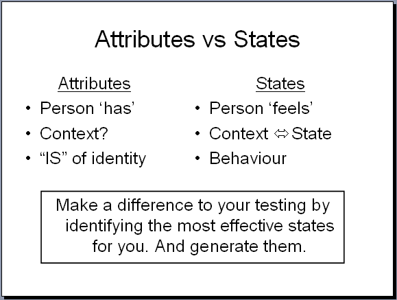

Now this is pretty simple but at the same time, underused. I’ve seen a lot of articles and been at talks where the questions have been – how would you describe a good tester? what are the attributes of a good tester? And those are fine questions, and it is good to know the answer, but what does it mean if we say that an attribute of a good tester is tenacity?

When is it appropriate to evidence tenacity? What does it feel like to have tenacity? How will I know when I don’t have it? What will I do differently as a result of not having tenacity. What is the process of being tenacious? What is a tenacious state? What does it feel like?

That is what states are all about. And for NLP states are key. When we change peoples’ behaviour we expect to change their state, if someone is demotivated, or not motivated to do something, chances are if they were more excited about doing it then would probably be more likely to do it, does that make them more motivated? Or does that mean it is more likely for them to do it? See the first one is all about words and attributes, and the second is all about states and behaviour.

And I like to figure out what the states I use when testing are. So I can be interested in how I do things and I can be curious and ask questions and when I get in that state I can do parts of my testing activities differently than when I’m just following a routine. I like to be kind of curious when I am working out what tests I could be doing – whether that is before time, or during, or now, I don’t mind but if testing is questioning then curiosity might help me out.

If I’m reporting on my testing to other people, I might be a little less curious, I might be curious enough to be able to work out what they need to know, but I’m going to be in a different state than when I’m actually testing.

And so recently I’ve been observing myself when I do tasks well, to identify what states I’m in. And what states I could be in, and merge states together. And when I’m not doing something well, when I’m plodding through it or going back over material – I stop and figure out what state I’m in and do something to change it. I figure that states are learned responses so I’m learning how to have states which are better responses.

So I don’t know what the most effective state you could be in for your testing. I don’t know what kind of states that you are in when you test at the moment. But if the one that you are normally in is different from the one that would be more effective, then I suggest that learning a little bit more about state control would be a good thing. And the process of modelling that I outlined earlier is a way of building up states to get them to where we want to be, and then it is a matter of getting them back.

And one of the keys to modelling is effective questioning.

### Meta Model

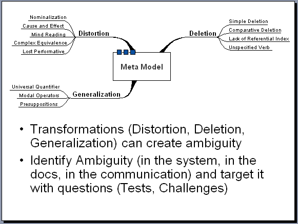

Cool, this is the BIG technique. The technical, complicated one. The one that I think people in software development are actually pretty good at. And when they learn it and learn to consciously apply it, it can really make a difference to the development process.

The meta model is a questioning model. Based on the information we receive, we analyse it in terms of some ambiguity generating patterns or transformations, and ask questions targetted at that.

How do you identify ambiguity? Well sometimes it is going to jump out at you, sometimes it is obvious, other times from experience we spot something.

That description isn’t good enough to have someone else do it, and really I would like all the testers in my team to be able to identify ambiguity. Preferrably everyone in the project to be able to identify ambiguity.

By learning the meta model we have a targetted way of examining communication. By looking at the communication and identifying ambiguity generating transformations, then that is a method that can be taught.

I used to use the What, Where, Why, How When Who model but those are questions that can pretty much be asked of any statement at any time and the meta model allows me to target my questions.

So for example, the meta model identifies 3 large categories of transformation, distortion, generalisation and deletion. Then within these there are specific instances, or special cases, which were identified as common patterns in therapy communications. And I’ve put examples of these all the way through my talk so that when I cover them now you have some ready example to think of so that you don’t have to go off and think of a lot of them yourself and tie this in to your own experience because they are already there.

Distortion

UQ – All, Every, Just, Only, None, Nobody, Never, Always

MO – Possibility – Can’t, won’t,

\- Necessity – must, should, shouldn’t, ought, mustn’t

Presuppositions : A in p(B), A in p(~B) – explore the parts of the model where the client has no choice

Cause effect: Makes me, can’t help but

Comp Equiv: Means that

Nominalization: - process to an event (verb to a noun), reverse and then tackle deletions. essentials of a process, discipline of software testing, effectiveness -ness

Referential index: intensional, list built from rules. Extensional, enumerated list. Extensionalise the list by defining the rules then from this subset idnetify the extensional referential index that is the deletion.

The meta model is something that we can use to identify ambiguity early, apply it to the communication we give to others, apply to the system when it communicates to us, apply to the models that are put forward to represent the system, and apply to our beliefs and values about testing.

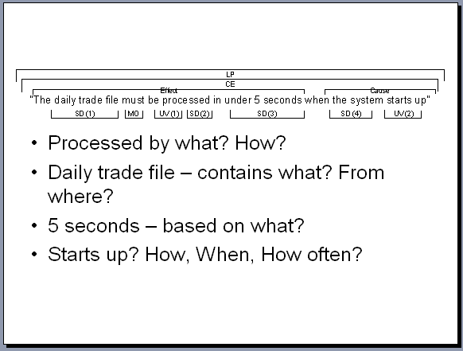

An understanding of the meta model can make us more aware of the ambiguity that we use in our own communication, and then we can decide if we want to keep our communication ambiguous or not. Because it is not that ambiguity is bad, but sometimes it isn’t appropriate to go to a meeting, say something and have 6 different people leave with 6 interpretations of what was said. Or maybe more interpretations, maybe someone gets confused and has multiple interpretations and doesn’t know what is going on.

And we are dealing with communication when we do software development so we can apply the meta model to everything.

I used it to go through what I used to think about the development process to help me build some flexibility and avoid catching the IFD disease.

## Learning NLP &amp; Endings

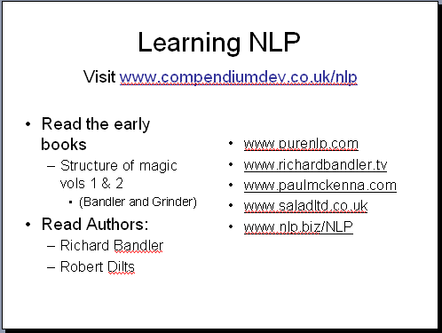

Well, I’m still learning.

NLP, Testing and the topics that both of those are built on. I’m still learning more about all this.

And I’ve had fun doing that and I think I’ve continually been changing what I do, and I fully believe I’m going to keep learning and enjoying it.

I’ve only covered a tiny set of techniques from NLP, and if you choose to start experimenting with them, I think you’ll begin to change your experiences of software testing. If you haven’t modelled what you do or been paying attention to the states that you use when you are testing then start paying attention to them. Become aware what you’re feeling and experiment with different states. Learn how they change you.

Now, I hope you’ll look at the meta-model in more detail and start identifying the elements in people’s speech and their written documentation. Always listen out for generalisations and never let them go by without testing and challenging them, see if they can stay generalised, and what happens when they don’t.

Follow up the links in this talk, or read some NLP books, or whatever you do, do something different and learn what it changes.

And enjoy yourself when you do it too.
