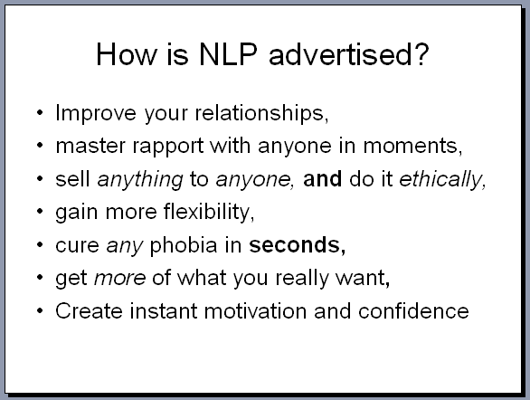

# Unused Preparation Snippets

Original material explicitly labelled “unusedSnippets” in the source archive. These unused drafts are separate from the keynote script; their inclusion does not imply they were delivered.

Introduction

My Name is Alan Richardson and I’m a Software Testing Consultant at a London based consultancy called BJSS – a fantastic set of initials, when I say them over the phone to people with my accent and they play back to me what they have heard I get back GAFF, CAFF, EAFS, etc. I’ve never yet heard back the initials. And the only reason I mention it is that either my mobile phone is garbage and has a voice filter on it that I’m not aware of, or my accent is stronger than I think it is, or, and I think that this is what it is, that it is just a wonderfully ambiguous set of phonetics.

And both Software Testing and Neuro Linguistic Programming deal a lot with ambiguity, and they both have set of techniques for dealing with it. So I try to pull as many techniques from each area and apply it to the other area.

Formal methods reduce ambiguity at the cost of incomprehensibility.

Because we have things that we learn as techniques which are actually heuristics. “Boundary Value Analysis” is a technique which is a heuristic.

Typically people try to be more agile than that, but get pulled back onto a compromise path. And sometimes I try and tempt them off that path. “it’s easier over here…”

And if no-one is interested in the information that we are going to feedback then don’t test.

“By all that is holy and by the power of the V-model, I cast out your heathen defect generating development process”.

The cool thing about that is that if you ever encounter a methodology monster who justifies what they are doing by referring to books and experts ‘because so and so says this, it must be true and it must be done’. That view can change now, because we can point those people at a whole set of experts that are telling them to think for themselves.

NLP orignally developed from a study of therapists and the communication that effective therapists used. And this was documented in the Meta-model in The structure of magic.

And since, for me, Software Development is a process of communication. And within that process, the tester very often takes on the role of therapist. NLP continues to be something that I find very useful.

The reason that NLP is sometimes hard to define is that it is a synthesis of a whole bunch of stuff and it changes over time.

Identifying with “I am a structured tester” can lead to beliefs such as: therefore I need you to sign off the requirements, stabilise the documents, not change anything, deliver by this date. And may involve adopting an adversarial position.

Removing the identification with form and instead focusing on required actions can lead to a more partnership style of relationship: I will test, I will provide feedback, I will raise risks, I will add value to the process, etc.

I'm not sure I even like to identify myself as a tester, even though I do more testing at work than anything else.

'Testing' created a rod for their own back by creating 'independent' test teams and 'independent' testing when 'independent testing' was the buzzword best practice of the week. I have found my work to be more effective when I retain independence of thought, but work as a member of the development team.

I learned to ask more, and different questions. So that I could understand more about the context, and act according to my understanding and not according to my pre-existing thoughts about testing regardless of the context.

“All defects must be cross referenced back to a test script” – so if I find a defect and I don’t have a test then I have to write the test that I didn’t use to find the defect to document the defect even though the defect description itself has enough information in it to allow me to recreate the defect and determine if the defect has been fixed.” – eh, -a little bit of doubt – yes – fall back to the old position-. “So I have to write a script to check the spelling of a word in the title?”

And it wasn’t just therapists, it was anything that was effective. There are elements of Polya’s problem solving techniques in NLP, there are mappings from logic and set theory on to how people generalise about items.

So NLP is a model of a whole bunch of other stuff, which also means that there are elements from those other areas, that add subtleties, which are not in NLP and by studying those areas we can increase our flexibility.

Virginia Satir, Fritz Perls, Milton Erickson, Moshe Feldenkrais, and a whole bunch of others.

It is use of the model that causes change. So we take parts of the model that we see, and follow them up where we need to.

Methodology Monster Slide:

I had a whole set of distorted, generalised and idealised models for software development. I knew that we needed reviews, strategy, approach, plan, conditions, scripts, software testing, sign-offs. I had a big bucket of things and nomilised processes that I could scatter around the project to improve it. “Here, have a review” “oh thank you very much, that’s much better”.

But I wasn’t thinking in terms of the processes and how they interact, and the time they take and the infrastructure that has to be put in place and the training that is required, or wether those proceses were even appropriate. Do the inputs to those processes exist? What would we be trying to achieve by doing that? What else could we do isntead of that?

I could walk on to a site, and instantly know what was needed to do the testing. Because I knew what the right things to do were. I knew what they weren't doing, and I could plug those gaps. I knew what must be done. I knew that we must have requirements before we can write test conditions. I knew that we, the testers must be involved early in the process because then there would be fewer bugs and the software would cost less.

The fact that we would then have a big team early in the process trying to justify its existence by producing documentation rather than software was lost on me because that was the right thing to do. All the books told me that and I didn’t need to think about it.

I was looking at all the little things that were so important that they had to be done rather than what the overall goals were and how the software testing process could be used to help achieve those goals and how the skills that the testers had could be applied effectively.

In fact I knew what was needed, before even coming on site. I was that good.

And because I was that good, I made sure that what I knew had to be done, was done, even if it cost a lot of overtime and rework. I was doing the right thing, because I was using best practices.

And if we had problems in the project because the test team weren’t getting the respect that they deserved, and I knew we weren’t respected because the requirements were late. I knew testing was undervalued because the designs weren’t complete and signed off. I couldn’t believe the number of experienced people on projects that didn’t know how to develop software, they had no processes and they didn’t document anything.

Phew, it was exhausting.

I look back and I see that I used to wield the ‘V-model’ like a crucifix. I guess I didn’t do software process improvement I did software process exorcisms.

And it is not that any of this stuff is bad, it is just that I thought it was ALL best. And I didn’t use it particularly appropriately. My excuse is that those were darker times, we were trying to solve a crisis, the software crisis, they were harder times so we did what it took.

I took quite a lot of beatings before it sunk in that there might be other ways of doing what we do in testing.

And I started applying the NLP stuff I was learning to analyse the language that I was using to describe testing and development. So I would look at the, what are called the modal operators of possibility (or inflexibility) – the must’s, should’s and started thinking them through. “Requirements must be signed off before test conditions are written.” – well fine, but they weren’t, so I could fight and battle, or I could figure out what to do instead, so I asked myself questions like “What if they didn’t have to be?”, I followed through my chains of reasoning and built a model of how I was thinking about software development. I explored my model of software development with the NLP meta model. And then I tore it down and build a new one for myself.

And I started to develop the strength of character to say No, we don’t have to do all those things, they aren’t helping us. Deal with reality instead.

## Modern NLP

NLP was originally firmly in the ‘serious’ psychotherapy realm. Supposedly when Bandler was trying to get “The Structure of magic” published, Virginia Satir took it to her publisher and said “you have to publish this” and the publisher went “shouldn’t I read it first” and Virginia said “you wouldn’t understand it!”. It was serious therapy stuff.

Virginia Satir is now fairly well known in Software testing now, I think, because of the work of Jerry Weinberg. And certainly her models of change have been presented in relation to software development.

But now if you read a modern NLP book, chances are you are going to find the above stuff from the slide. All the popularisation aspects of it, all the surface patterns of NLP, a few techniques and some wibble theory. But none of the information that is really going to get you down into the deep depths of NLP, which are contained in the early books.

I mean all of that stuff is cool, you know it is great to be able to help people make the changes they want to make in their life, but I’m more curious than just, you know, “here’s a technique, go forth and use it.”, I want to understand what makes the technique work, where it came from, how they got the idea to build that technique, where it works, where it doesn’t so that I can go ahead and build up my own techniques and know where to apply them.

Because that is what I do in testing and when I’m putting together a test process that is what I try to do.

NLP is about doing what takes to get the job done. And one difference between brief therapy or solution oriented therapy and traditional ‘talking cure’ therapies, is the amount of time spent building the model.

In traditional therapies, a lot of time is spent building the model. A patient spends years in therapy while they root back through all the problems, understand the reasons, map them on to the theories of the particular ‘talking cure’. Years to build a model, in the hope that building the model will allow change to happen. And it doesn’t.
